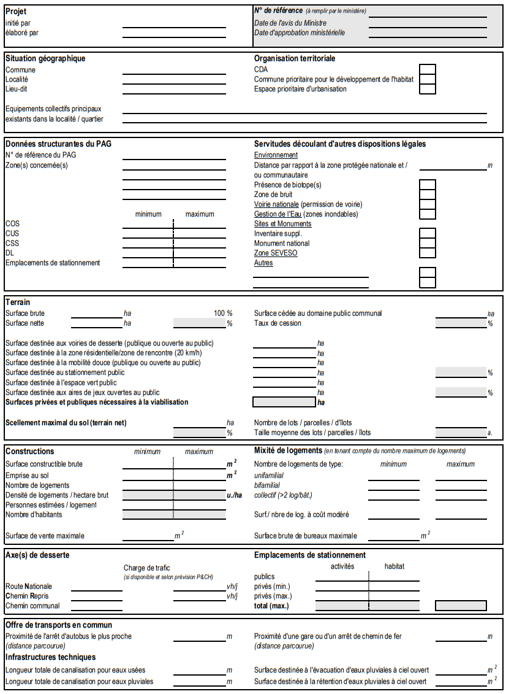

# Règlement grand-ducal du 8 mars 2017 concernant le contenu du rapport justificatif et du plan directeur du plan d’aménagement particulier « nouveau quartier ».

## Chapitre 1er — Le rapport justificatif

### Art. 1er — Objet

Le rapport justificatif expose de quelle manière et dans quelle mesure le plan d’aménagement particulier « nouveau quartier » précise et exécute le plan d’aménagement général.

### Art. 2 — Contenu

Le rapport justificatif, qui accompagne les projets d’aménagement particulier « nouveau quartier », comporte :

1\. un extrait du plan d’aménagement général en vigueur, y compris la partie écrite de la ou des zones concernées, et le schéma directeur élaboré au niveau de l’étude préparatoire ;

2\. un tableau récapitulatif en format papier et en format « XLS »[^1] qui reprend pour chaque lot ou parcelle les valeurs maximas et, le cas échéant, les valeurs minimas relatives à la surface construite brute, l’emprise au sol, la surface pouvant être scellée et le nombre de logements y admis. Ce tableau est complété, pour chaque ensemble de fonds couverts par un même degré d’utilisation du sol tel que fixé dans le plan d’aménagement général, les coefficients relatifs au degré d’utilisation du sol résultant des valeurs précitées. Le tableau récapitulatif précité qui figure à l’annexe I fait partie intégrante du présent règlement ;

3\. un descriptif du concept urbanistique ;

4\. un descriptif du concept urbanistique ;

a) l’implantation des constructions représentant le volume maximal admissible ;

b) l’aménagement des espaces publics ;

c) l’aménagement des espaces verts privés, le cas échéant, et.

d) le contexte environnant.

L’illustration du projet prévue à l’alinéa 1er est complétée par une représentation axonométrique tout en y intégrant les constructions avoisinantes.

Le rapport justificatif comprend également une fiche de synthèse, conformément à l’annexe II reprenant les données structurantes relatives au plan d’aménagement particulier.

La fiche de synthèse prévue à l’alinéa 3 doit être mise à jour lors de toute modification du projet pendant la procédure d’adoption du projet d’aménagement particulier « nouveau quartier ».

## Chapitre 2 — Le plan directeur

### Art. 3 — Définition

Le plan directeur met en valeur de façon schématique la zone urbanisée ou destinée à être urbanisée qu’il recouvre en arrêtant les orientations fondamentales de l’aménagement des fonds concernés ou de la restructuration du tissu urbain existant.

Le plan directeur se compose d’une partie graphique et d’une partie écrite.

### Art. 4 — Contenu

Le plan directeur reprend au moins les éléments suivants :

1\. les limites des fonds soumis à un plan directeur selon le plan d’aménagement général ou les limites définies en fonction des fonds à considérer afin de garantir un développement urbain cohérent ;

2\. la programmation urbaine des nouveaux quartiers ainsi que les affectations différenciées par îlots ;

3\. les interfaces avec le milieu environnant ;

4\. la géométrie urbaine précisée au niveau du quartier ;

5\. les prescriptions dimensionnelles sommaires ;

6\. un concept de circulation avec un concept de stationnement ;

7\. le gabarit et le statut des voies collectrices et de desserte.

Le plan directeur peut, en cas de besoin, être complété par les éléments suivants :

1\. la densité différenciée par îlots ;

2\. un bilan sommaire des surfaces dédiées au domaine public et au domaine privé;

3\. les caractéristiques et la configuration du réseau, des infrastructures et des équipements de transports en commun ;

4\. les caractéristiques, la configuration et le statut des voies principales et secondaires ;

5\. un concept de transport en commun ;

6\. les caractéristiques et la configuration des espaces publics ;

7\. les caractéristiques et la configuration des espaces verts dans le quartier.

### Art. 5 — Disposition abrogatoire

Le [règlement grand-ducal du 28 juillet 2011](https://legilux.public.lu/eli/etat/leg/rgd/2011/07/28/n6/jo) concernant le contenu du rapport justificatif et du plan directeur du plan d’aménagement particulier « nouveau quartier » est abrogé.

Ses dispositions continuent cependant à s’appliquer aux plans directeurs contenus dans les rapports justificatifs des plans d’aménagement particulier « nouveau quartier » exécutant un plan d’aménagement général dont la refonte complète a été entamée par la saisine de la commission d’aménagement avant le 1er août 2011.

Toutefois, jusqu’au 8 août 2018, l’initiateur d’un projet d’aménagement particulier « quartier existant » ou d’un projet d’aménagement particulier « nouveau quartier » peut entamer la procédure d’adoption d’un projet d’aménagement particulier basé sur un rapport justificatif élaboré conformément aux dispositions du [règlement grand-ducal du 28 juillet 2011](https://legilux.public.lu/eli/etat/leg/rgd/2011/07/28/n6/jo) précité.

### Art. 6 — Entrée en vigueur

Le présent règlement grand-ducal entre en vigueur le premier jour du mois qui suit sa publication au Journal officiel du Grand-Duché de Luxembourg.

### Art. 7 — Exécution

Notre Ministre de l’Intérieur est chargé de l’exécution du présent règlement qui sera publié au Journal officiel du Grand-Duché de Luxembourg.

[^2]

\**Annexe II : Données structurantes relatives au plan d’aménagement particulier "nouveau quartier"**

---

[^1]: [Règlement grand-ducal du 24 novembre 2021 portant modification : 1° du règlement grand-ducal du 8 mars 2017 concernant le contenu du plan d’aménagement général d’une commune ; 2° du règlement grand-ducal du 8 mars 2017 concernant le contenu du rapport justificatif et du plan directeur du plan d’aménagement particulier « nouveau quartier ».](https://legilux.public.lu/eli/etat/leg/rgd/2021/11/24/a832/jo)
[^2]: [Règlement grand-ducal du 24 novembre 2021 portant modification : 1° du règlement grand-ducal du 8 mars 2017 concernant le contenu du plan d’aménagement général d’une commune ; 2° du règlement grand-ducal du 8 mars 2017 concernant le contenu du rapport justificatif et du plan directeur du plan d’aménagement particulier « nouveau quartier ».](https://legilux.public.lu/eli/etat/leg/rgd/2021/11/24/a832/jo)
