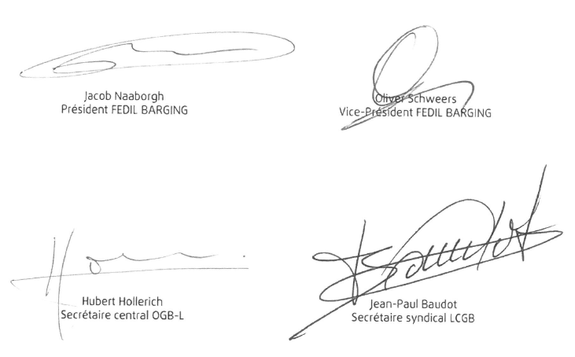

# Règlement grand-ducal du 31 mai 2017 portant déclaration d’obligation générale de l’accord interprofessionnel du 22 mars 2017 relatif à l’aménagement du temps de travail dans le secteur de la navigation intérieure conclu entre FEDIL BARGING, d’une part et les syndicats OGB-L et LCGB, d’autre part.

Nous Henri, Grand-Duc de Luxembourg, Duc de Nassau,

Vu l’article L.164-8 du [Code du Travail](https://legilux.public.lu/eli/etat/leg/loi/2006/07/31/n2/jo);

Sur proposition concordante des assesseurs de l’Office national de conciliation et sur avis des chambres professionnelles compétentes;

Vu l'article 2(1) de la [loi du 12 juillet 1996](https://legilux.public.lu/eli/etat/leg/loi/1996/07/12/n3/jo) portant réforme du Conseil d’Etat et considérant qu’il y a urgence;

Sur le rapport de Notre ministre du Travail, de l'Emploi et de l’Economie sociale et solidaire et après délibération du Gouvernement en conseil;

Arrêtons :

## Art. 1er.

L’accord interprofessionnel du 22 mars 2017 relatif à l’aménagement du temps de travail dans le secteur de la navigation intérieure, conclu entre FEDIL BARGING, d’une part et les syndicats OGB-L et LCGB, d’autre part, est déclaré d’obligation générale pour tout le champ d’application défini à la Clause 1 de l’accord.

## Art. 2.

Conformément au paragraphe (5) de l’article L.164-8 du [Code du travail](https://legilux.public.lu/eli/etat/leg/loi/2006/07/31/n2/jo), la déclaration d’obligation générale prend effet à partir de la date d’entrée en vigueur de l’accord interprofessionnel du 22 mars 2017 relatif à l’aménagement du temps de travail dans le secteur de la navigation intérieure.

## Art. 3.

Notre ministre du Travail, de l'Emploi et de l’Economie sociale et solidaire est chargé de l'exécution du présent règlement qui sera publié au Journal Officiel du Grand-Duché de Luxembourg avec l’accord interprofessionnel du 22 mars 2017 relatif à l’aménagement du temps de travail dans le secteur de la navigation intérieure.

Le Ministre du Travail, de l'Emploi  et de l'Economie sociale et solidaire,   Nicolas Schmit

Cabasson, le 31 mai 2017.   Henri

ACCORD INTERPROFESSIONNEL

conclu entre

| **L'association FEDIL BARGING** |
|---|

d'une part et

| **LCGB - OGB-L** |
|---|

d'autre part

Considérant d'abord la [directive 2014/112/UE](https://legilux.public.lu/eli/dir_ue/2014/112/jo) du Conseil du 19 décembre 2014 portant application de l'accord européen concernant certains aspects de l'aménagement du temps de travail dans le secteur de la navigation intérieure, conclu par l'Union européenne de la navigation fluviale (UENF), l'Organisation européenne des bateliers (OEB) et la Fédération européenne des travailleurs des transports (ETF) (la « Directive »);

considérant ensuite ce qui suit:

1\. La [directive 2003/88/CE](https://legilux.public.lu/eli/dir_ue/2003/88/jo) concernant certains aspects de l'aménagement du temps de travail présente des normes générales minimales qui, à l'exception des domaines énumérés à l'article 20, paragraphe 1 (repos journalier, temps de pause, repos hebdomadaire, durée de travail de nuit), s'appliquent aussi à l'aménagement du temps de travail dans le secteur de la navigation intérieure. Les dispositions de ladite directive ne tenant pas suffisamment compte des conditions particulières de travail et de vie dans le secteur de la navigation intérieure, des prescriptions plus spécifiques sont nécessaires, conformément à l'article 14 de la [directive 2003/88/CE](https://legilux.public.lu/eli/dir_ue/2003/88/jo).

2\. Ces prescriptions plus spécifiques doivent garantir un niveau élevé de protection de la sécurité et de la santé des travailleurs dans la navigation intérieure.

3\. La navigation intérieure est un mode de transport à dimension internationale, qui se caractérise principalement par des activités transfrontalières sur le réseau européen des voies navigables. C'est pourquoi il faut encourager l'élaboration de conditions similaires sur le marché du travail du secteur de la navigation intérieure européenne, et empêcher la concurrence déloyale fondée sur les différences que présentent les législations en matière d'aménagement du temps de travail.

4\. L'Union européenne, considérant l'importance du secteur des transports pour la compétitivité économique, s'est donnée pour objectif de donner plus de poids aux modes de transport à moindre intensité énergétique, plus propres et plus sûrs. La navigation intérieure en tant que mode de transport respectueux de l'environnement, disposant encore de capacités non exploitées, peut contribuer de façon durable à la décongestion des transports européens par voie routière et ferroviaire.

5\. L'organisation du travail est variable à l'intérieur du secteur. Le nombre de travailleurs et le temps de travail à bord varient en fonction de l'organisation du travail, de l'entreprise, de la zone d'exploitation, de la longueur du trajet et de la taille du bâtiment. Certains bateaux naviguent en continu, c'est-à-dire 24 heures sur 24, en recourant au travail posté. Par contre, les entreprises de taille moyenne en particulier exploitent en règle générale leurs bateaux 14 heures par jour, cinq ou six jours par semaine. Le temps de travail des travailleurs à bord ne peut être assimilé au temps d'exploitation d'un bâtiment dans la navigation intérieure.

6\. La navigation intérieure a ceci de particulier que les travailleurs peuvent également loger ou habiter à bord des bâtiments sur lesquels ils travaillent. Il est donc courant qu'ils y passent également leurs périodes de repos. De nombreux travailleurs du secteur de la navigation intérieure, en particulier ceux qui sont éloignés de leur lieu de vie, travaillent plusieurs jours consécutifs à bord, afin de réduire le temps de trajet, et passent ensuite plusieurs jours chez eux ou en tout autre lieu de leur choix. Pour un rythme de travail fondé sur un ratio de 1, par exemple, le travailleur a le même nombre de jours de travail et de repos. C'est pourquoi le nombre de jours de travail consécutifs à bord et le nombre de jours de repos peuvent être comparativement plus importants que pour un travail à terre.

7\. Le temps de travail moyen dans le secteur de la navigation intérieure comprend en principe une part importante de temps de garde (notamment lié aux temps d'attente imprévisibles aux écluses ou lors du chargement et du déchargement du bâtiment), y compris en période nocturne. C'est pourquoi les plafonds relatifs au temps de travail quotidien et hebdomadaire peuvent être plus élevés que ceux figurant dans la [directive 2003/88/CE](https://legilux.public.lu/eli/dir_ue/2003/88/jo).

8\. Dans le même temps, il convient de reconnaître que la charge de travail dans le secteur de la navigation intérieure est influencée par plusieurs facteurs, parmi lesquels le bruit, les vibrations et l'aménagement du temps de travail. Sans préjudice des dispositions de la [directive 89/391/CEE](https://legilux.public.lu/eli/dir_ue/1989/391/jo) du Conseil du 12 juin 1989 concernant la mise en oeuvre de mesures visant à promouvoir l'amélioration de la sécurité et de la santé des travailleurs au travail, des visites médicales, réalisées dans le but de tenir compte des conditions de travail particulières du secteur de la navigation intérieure, sont prévues chaque année de manière à protéger les travailleurs.

9\. La prise en compte des contraintes supplémentaires liées au service de nuit à bord doit se faire par une limitation du maximum d'heures du travail de nuit et à travers l'organisation du travail.

10\. Le secteur de la navigation intérieure n'occupe pas seulement des travailleurs salariés, mais également des travailleurs indépendants. La détermination du statut des travailleurs indépendants se fait sur la base des législations nationales en vigueur.

11\. Les conditions de travail et de vie dans le transport de passagers se distinguent de celles prévalant dans les autres segments de la navigation intérieure et justifient par conséquent l'existence de dispositions particulières. Les différences observées au niveau de l'environnement social et des activités d'exploitation, ainsi que le caractère saisonnier de ce segment de la navigation intérieure européenne, se traduisent par une organisation du travail distincte.

considérant que les dispositions du Titre Premier, Livre II (articles L. 211-1. à L. 215.12.) du [Code du travail](https://legilux.public.lu/eli/etat/leg/loi/2006/07/31/n2/jo) relatives à la durée de travail ne sont pas applicables aux entreprises de transport fluvial; qu'actuellement, le secteur constitue donc une plage de non-droit au niveau de la réglementation de la durée de travail; qu'afin de combler ce vide juridique les partenaires sociaux ont été invités et se sont engagés à mettre en oeuvre la Directive conformément aux procédures et pratiques propres aux partenaires sociaux au niveau national;

que l'objet du présent accord interprofessionnel (« Accord ») est donc de transposer la Directive qui vise spécialement le secteur de la navigation intérieure et tient compte des spécificités et contraintes du secteur, ainsi que des différents modèles d'organisation du temps de travail pratiqués à bord; que l'intention des auteurs de l'Accord est d'adopter autant que posssible en l'état le texte de la Directive et de réaliser une transposition aussi littérale que possible en droit national, sans préjudice de renvois exprès aux dispositions de la législation nationale;

que les parties signataires ont conclu ce qui suit:

\**Clause 1**

\**Champ d'application**

1\. Le présent Accord s'applique aux travailleurs mobiles employés en tant que membres du personnel navigant (équipage) ou dans une autre fonction (personnel de bord) à bord d'un bâtiment exploité par une entreprise dont le siège social ou la succursale est établi sur le territoire du Grand-Duché de Luxembourg dans le secteur de la navigation intérieure commerciale.

2\. Au sens du présent Accord, les transporteurs par voie navigable ne sont pas considérés comme des travailleurs, même s'ils ont un statut de travailleur dans leur propre entreprise.

3\. Le présent Accord ne fait pas obstacle aux prescriptions nationales ou internationales relatives à la sécurité de la navigation applicables aux travailleurs mobiles et aux personnes visées au paragraphe 2.

4\. Si, pour les travailleurs mobiles, les dispositions du présent Accord et les prescriptions nationales ou internationales relatives à la sécurité de la navigation divergent en ce qui concerne les périodes de repos, les dispositions qui prévalent sont celles qui assurent aux travailleurs le niveau le plus élevé de protection de la santé et de la sécurité.

5\. Les travailleurs mobiles qui travaillent à bord d'un bâtiment exploité sur le territoire d'un État membre en dehors du secteur de la navigation intérieure commerciale, et dont les conditions de travail sont régies par des organisations patronales et salariales sous la forme de conventions collectives, peuvent être inclus dans le champ d'application du présent Accord, en concertation avec ces organisations et sous réserve qu'elles y consentent, dans la mesure où les dispositions du présent Accord sont plus favorables aux travailleurs.

\**Clause 2**

\**Définitions**

Aux fins du présent Accord, on entend par:

a) « batiment », un bateau ou un engin flottant;

b) « bateau à passagers », un bateau d'excursions journalières ou un bateau à cabines construit et aménagé pour le transport de plus de 12 passagers;

c) « temps de travail », le temps durant lequel le travailleur effectue, sur instruction de l'employeur ou de son représentant, un travail à bord du bâtiment, sur le bâtiment et pour le bâtiment, a reçu l'ordre de travailler ou doit se tenir prêt à travailler (temps de garde);

d) « période de repos », toute période qui n'est pas du temps de travail; elle comprend les périodes de repos pendant la navigation, sur le bâtiment à l'ancre et à terre. Elle n'inclut pas les pauses de courte durée (15 minutes au maximum);

e) « jour de repos », une période de repos ininterrompue de 24 heures, que le travailleur passe en un lieu librement choisi;

f) « transporteur par voie navigable », toute personne exploitant librement et à son propre compte, à des fins commerciales, des bateaux de navigation intérieure;

g) « tableau de service », le tableau comprenant l'aménagement des jours de travail et des jours de repos, communiqué à l'avance au travailleur par l'employeur;

h) « période nocturne », la période comprise entre 23 heures et 6 heures;

i) « travailleur de nuit »:

aa) d'une part, tout travailleur qui accomplit durant la période nocturne au moins 3 heures de son temps de travail journalier accomplies normalement;

bb) d'autre part, tout travailleur qui est susceptible d'accomplir, pendant la période nocturne, une certaine partie d'heures de son temps de travail annuel, définie, soit:

aaa) par la législation nationale, ou

bbb) par des conventions collectives ou des accords conclus entre partenaires sociaux;

j) « travailleur posté », tout travailleur dont l'horaire de travail s'inscrit dans le cadre du travail posté;

k) « personnel de bord », la définition établie à l'appendice II, article 1.01 (Définitions), point 103, de la [directive 2006/87/CE](https://legilux.public.lu/eli/dir_ue/2006/87/jo);

l) « travailleur mobile », tout travailleur faisant partie du personnel mobile qui est au service d'une entreprise effectuant des services de transport de passagers ou de marchandises par voie navigable; les références aux «travailleurs» dans le présent Accord sont à interpréter en conséquence;

m) « saison », une période n'excédant pas 9 mois consécutifs par période de 12 mois, au cours de laquelle l'exercice de certaines activités est lié à des facteurs extérieurs, tels que les conditions climatiques ou la demande touristique.

\**Clause 3**

\**Temps de travail et période de référence**

1\. Sans préjudice des dispositions de la clause 4, la détermination du temps de travail normal se fonde en principe sur une journée de 8 heures.

2\. Le temps de travail peut être prolongé conformément à la clause 4 tant que, sur une période de 12 mois (période de référence), une moyenne de 48 heures par semaine n'est pas dépassée.

3\. Le nombre maximal d'heures de travail pendant la période de référence après déduction des congés payés annuels et des jours fériés légaux s'élève à 2176 heures. Les périodes de congés payés annuels accordées et les périodes de congé de maladie ne sont pas prises en compte ou sont neutres pour le calcul de la moyenne. Les périodes de repos dues au titre de jours fériés légaux sont déjà déduites dans le cadre de la détermination du nombre maximal d'heures de travail mentionné ci-avant.

4\. Pour les relations de travail d'une durée inférieure à la période de référence, le temps de travail maximal est calculé pro rata temporis.

\**Clause 4**

\**Temps de travail journalier et hebdomadaire**

1\. Le nombre d'heures de travail ne doit pas dépasser:

a) 14 heures par période de 24 heures, et

b) 84 heures par période de 7 jours.

2\. Lorsque le tableau de service prévoit plus de jours de travail que de jours de repos, une moyenne de 72 heures de travail par semaine ne peut être dépassée sur une période de 4 mois.

\**Clause 5**

\**Jours de travail et de repos**

1\. Le nombre de jours de travail consécutifs s'élève au maximum à 31.

2\. Lorsque le tableau de service prévoit un nombre de jours de travail au maximum égal au nombre de jours de repos, un nombre de jours de repos consécutifs équivalent au nombre de jours de travail consécutifs doit être accordé immédiatement après. Il est possible d'accorder un nombre de jours de repos consécutifs différent du nombre prévu à condition:

a) que le nombre maximal de 31 jours de travail consécutifs ne soit pas dépassé,

b) que le nombre minimal de jours de repos consécutifs indiqués aux points 3a), 3b) ou 3c) soit accordé immédiatement après les jours de travail consécutifs correspondants,

c) et que le nombre de jours de travail prolongé ou échangé s'équilibre au cours de la période de référence.

3\. Lorsque le tableau de service prévoit plus de jours de travail que de jours de repos, le nombre minimal de jours de repos consécutifs suivant immédiatement les jours de travail consécutifs est fixé comme suit:

a) 1 à 10 jours de travail consécutifs: 0,2 jour de repos par jour de travail consécutif (par exemple, 10 jours de travail consécutifs = 2 jours de repos);

b) 11 à 20 jours de travail consécutifs: 0,3 jour de repos par jour de travail consécutif (par exemple, 20 jours de travail consécutifs = 5 jours de repos);

c) 21 à 31 jours de travail consécutifs: 0,4 jour de repos par jour de travail consécutif (par exemple, 31 jours de travail consécutifs = 9,4 jours de repos).

Les fractions de jours de repos sont ajoutées au nombre minimal de jours de repos consécutifs dans ce calcul, et ne peuvent être prises que sous la forme de journées complètes.

\**Clause 6**

\**Travail saisonnier dans le transport de passagers en navigation intérieure**

Par dérogation aux dispositions des clauses 4 et 5 du présent Accord, les dispositions suivantes peuvent être appliquées à tout travailleur occupant un emploi saisonnier à bord d'un bateau à passagers:

1\. Le nombre d'heures de travail ne doit pas dépasser:

a) 12 heures par période de 24 heures, et

b) 72 heures par période de 7 jours.

2\. Le travailleur bénéficie de 0,2 jours de repos par jour de travail. Deux jours de repos au moins doivent être effectivement accordés pour chaque période de 31 jours. Les jours de repos restant sont accordés selon l'accord des parties.

3\. Compte tenu du paragraphe précédent et de la clause 3, paragraphe 4 la compensation des jours de repos et le respect de la durée moyenne de travail hebdomadaire de 48 heures visée à la clause 3 doivent être assurés conformément à des conventions collectives ou accords entre partenaires sociaux ou, en l'absence de tels accords, à la législation nationale.

\**Clause 7**

\**Périodes de repos**

Les travailleurs doivent disposer de périodes de repos régulières, suffisamment longues et continues, dont la durée est indiquée en unités de temps, afin de garantir qu'ils ne constituent pas un danger pour eux-mêmes, leurs collègues ou d'autres personnes et ne nuisent pas à leur santé à court ou à long terme en raison d'un état de surmenage ou d'un rythme de travail irrégulier.

La durée des périodes de repos ne doit pas être inférieure à:

a) 10 heures par période de 24 heures, dont au moins 6 heures de repos ininterrompu, et

b) 84 heures par période de 7 jours.

\**Clause 8**

\**Temps de pause**

Tout travailleur bénéficie, au cas où le temps de travail journalier est supérieur à six heures, d'un temps de pause dont les modalités, et notamment la durée et les conditions d'octroi, sont fixées par des conventions collectives ou accords conclus entre partenaires sociaux ou, en l'absence de tels accords, par la législation nationale.

\**Clause 9**

\**Temps de travail maximal pendant la période nocturne**

Vu la période nocturne de 7 heures, le nombre maximal hebdomadaire d'heures de travail pendant la période nocturne (sur une période de 7 jours) s'élève à 42 heures.

\**Clause 10**

\**Congés annuels**

Tout travailleur a droit au nombre de jours de congé annuel payé tel que fixé par la législation en vigueur.

Dans l'aménagement des jours de travail et des jours de repos, tel que prévu par le tableau de service, sont comprises les périodes de congés payés annuels et les périodes de repos dues au titre de jours fériés légaux.

\**Clause 11**

\**Protection des mineurs**

Pour les travailleurs de moins de 18 ans, la législation relative à la protection des jeunes au travail s'applique.

\**Clause 12**

\**Contrôle**

1\. Afin de veiller au respect des dispositions des clauses 3, 4, 5, 6, 7, 9, 10, 11 et 13, le temps de travail et de repos journalier de chaque travailleur est consigné dans un registre.

2\. Le registre doit être conservé à bord au moins jusqu'à la fin de la période de référence.

3\. Les données consignées doivent être vérifiées et confirmées conjointement par l'employeur ou son représentant et le travailleur, à des intervalles appropriés (au plus tard à la fin du mois suivant).

4\. Les données consignées comportent au minimum les indications suivantes:

a) nom du bateau,

b) nom du travailleur,

c) nom du conducteur de bateau responsable,

d) date,

e) jour de travail ou de repos,

f) début et fin des périodes de travail ou de repos journalières.

5\. Le travailleur reçoit une copie des données confirmées le concernant, qu'il conserve pendant un an.

\**Clause 13**

\**Situations d'urgence**

1\. Le conducteur de bateau ou son représentant a le droit d'exiger d'un travailleur les heures de travail nécessaires à la sécurité immédiate du bâtiment, des personnes à bord ou de la cargaison, ou en vue de porter secours à d'autres bateaux ou personnes en détresse.

2\. Conformément aux dispositions du point 1, le conducteur de bateau ou son représentant pourra exiger qu'un travailleur accomplisse à tout moment les heures de travail nécessaires jusqu'au retour à une situation normale.

3\. Dès que cela est réalisable après le retour à une situation normale, le conducteur de bateau ou son représentant doit faire en sorte que tout travailleur ayant effectué un travail alors qu'il était en période de repos selon l'horaire normal bénéficie d'une période de repos adéquate.

\**Clause 14**

\**Visite médicale**

1\. Tous les travailleurs ont droit à une évaluation de santé gratuite tous les ans. Lors des évaluations médicales, il convient de prêter une attention particulière aux symptômes ou conditions qui pourraient être liés aux périodes de repos journalières minimales et/ou au nombre minimal de jours de repos accordés lors du travail à bord conformément aux clauses 5 et 6.

2\. Les travailleurs de nuit souffrant de problèmes de santé reconnus liés au fait qu'ils accomplissent un travail de nuit doivent être transférés, chaque fois que cela est possible, à un poste de travail de jour auquel ils sont aptes.

3\. L'évaluation médicale gratuite est soumise au secret médical.

4\. L'évaluation médicale gratuite peut avoir lieu dans le cadre des institutions de santé publique.

\**Clause 15**

\**Protection en matière de sécurité et de santé**

1\. En matière de sécurité et de santé, les travailleurs de nuit et les travailleurs postés doivent bénéficier d'un niveau de protection adapté à la nature de leur travail.

2\. Les services et moyens de protection et de prévention en matière de sécurité et de santé des travailleurs de nuit et des travailleurs postés doivent être équivalents à ceux applicables aux autres travailleurs et doivent être disponibles à tout moment.

\**Clause 16**

\**Rythme de travail**

L'employeur qui envisage d'organiser le travail selon un certain rythme doit tenir compte du principe général de l'adaptation du travail à l'homme, notamment en vue d'atténuer le travail monotone et le travail cadencé, en fonction du type d'activité et des exigences en matière de sécurité et de santé, en particulier en ce qui concerne les pauses pendant le temps de travail.

\**Clause 17**

\**Dispositions finales**

Le présent Accord ne porte pas atteinte au droit des partenaires sociaux de conclure au niveau approprié des conventions collectives ou des accords précisant le présent Accord et prenant en compte les besoins spécifiques des parties concernées.

\**Clause 18**

\**Durée**

Le présent Accord est conclu pour une durée initiale de 3 ans à partir de sa déclaration d'obligation générale.

Il peut être dénoncé, en tout ou en partie, avec un préavis de 3 mois avant la date d'échéance. S'il n'a pas été dénoncé dans les délais, il est reconduit à titre d'accord à durée indéterminée.

\**Clause 19**

\**Commission de suivi**

Dans le cadre de l'accord interprofessionnel, il a été institué une commission de suivi, se composant de part et d'autre d'au moins deux membres. Cette commission a pour mission:

1\. la surveillance de l'exécution de l'accord interprofessionnel;

2\. l'examen approfondi de tous les problèmes litigieux n'ayant pas trouvé de solution au niveau des délégations du personnel.

\**Clause 20**

\**Déclaration d'obligation générale**

Le présent Accord est déposé auprès de l'Inspection du Travail et des Mines. Un autre exemplaire est transmis à l'Office National de Conciliation aux fins d'une déclaration d'obligation générale.

Signé en 4 exemplaires à Luxembourg, le 22 mars 2017.

