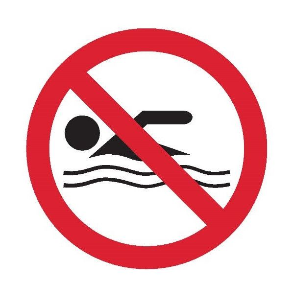
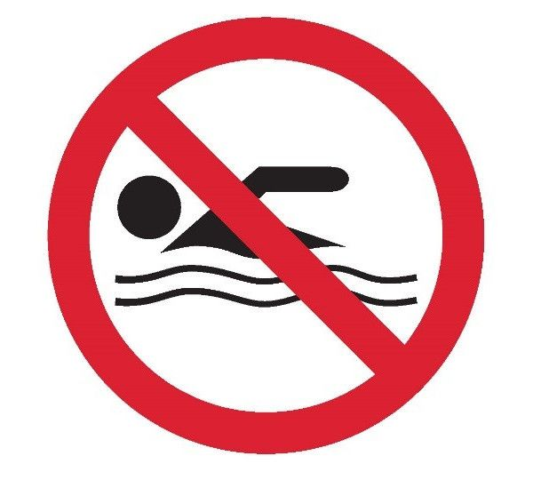
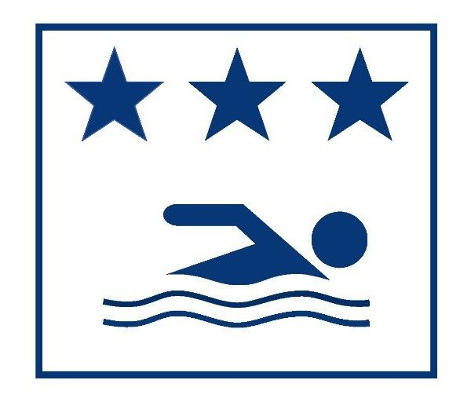
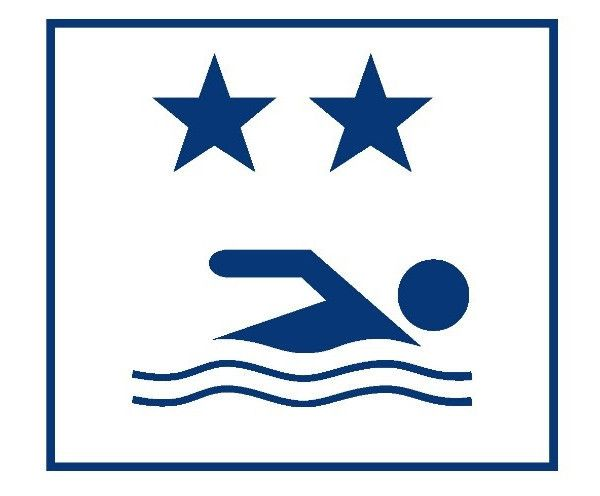
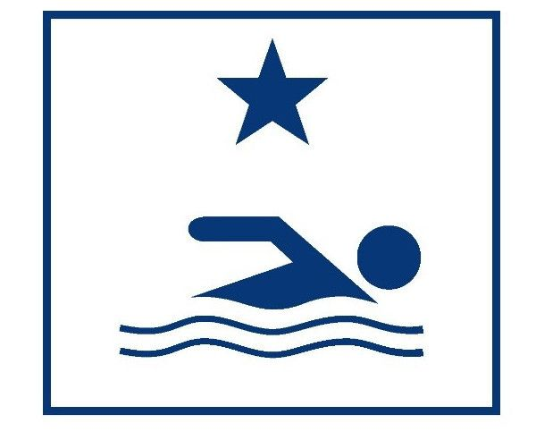
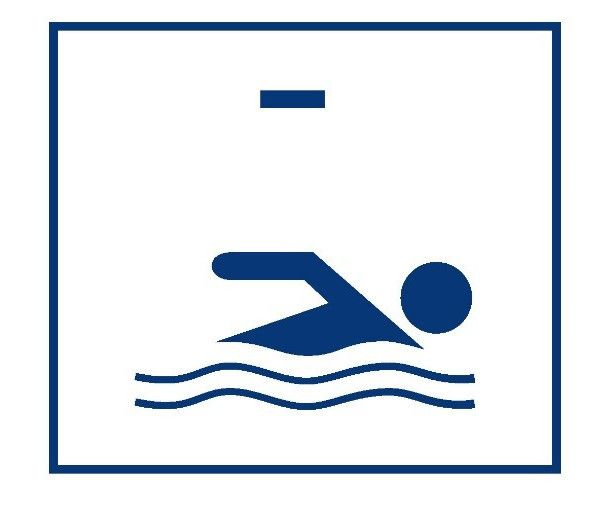

# Règlement grand-ducal du 8 juillet 2017 modifiant le règlement grand-ducal modifié du 19 mai 2009 déterminant les mesures de protection spéciale et les programmes de surveillance de l’état des eaux de baignade.

Nous, Henri, Grand-Duc de Luxembourg, Duc de Nassau,

Vu la [loi modifiée du 19 décembre 2008](https://legilux.public.lu/eli/etat/leg/loi/2008/12/19/n17/jo) relative à l’eau et notamment ses articles 20 et 21;

Vu la [directive 2006/7/CE](https://legilux.public.lu/eli/dir_ue/2006/7/jo) du Parlement européen et du Conseil du 15 février 2006 concernant la gestion de la qualité des eaux de baignade et abrogeant la [directive 76/160/CE](https://legilux.public.lu/eli/dir_ue/1976/160/jo);

Vu la fiche financière;

Vu les avis de la Chambre de commerce et de la Chambre des métiers;

L’avis de la Chambre d’agriculture ayant été demandé;

Notre Conseil d’Etat entendu;

Sur le rapport de Notre Ministre de Environnement et de Notre Ministre des Finances et après délibération du Gouvernement en conseil;

Arrêtons:

## Art. 1er.

A l’article 1er, alinéa 2 du [règlement grand-ducal modifié du 19 mai 2009](https://legilux.public.lu/eli/etat/leg/rgd/2009/05/19/n1/jo) déterminant les mesures de protection spéciale et les programmes de surveillance de l’état des eaux de baignade, dénommé ci-après « le règlement », les termes 31 août sont remplacés par les termes 30 septembre.

## Art. 2.

A L’article 7, alinéa 2, du même règlement, les termes et peut interdire la baignade. sont ajoutés après les termes 4e tirets.

## Art. 3.

L’article 10, 1er tiret, du même règlement est remplacé comme suit:

> aash le classement actuel de l’eau de baignade et, le cas échéant, le déconseil ou l’interdiction de baignade au moyen de la signalétique prévue à l’annexe IV;

## Art. 4.

A l’annexe I, le point 1, du même règlement est remplacé comme suit :

> 1\. Pour chaque eau de baignade, il est procédé à la diligence de l’Administration de la gestion de l’eau à six prélèvements effectués selon le calendrier suivant:
>
> Le premier échantillon est à prélever dans les deux semaines précédant le début de la saison balnéaire. Pendant la saison balnéaire, les échantillons sont à prélever au moins une fois par mois sans qu’une période de 30 jours ne soit dépassée entre deux échantillons consécutifs, y compris l’échantillon prélevé avant le début de la saison balnéaire.

## Art. 5.

Le même règlement est complété par une annexe IV prenant la teneur suivante:

> \**Annexe IV**
>
> Signalétique pour informer sur la qualité de l’eau de baignade et sur le fait que la baignade est déconseillée, voire interdite:
>
> |  | Il est déconseillé de se baigner Vom Baden wird abgeraten |
> |---|---|
> |  | Il est interdit de se baigner Baden verboten |
> |  | Eaux de baignade d’excellente qualité Ausgezeichnete Badegewässerqualität |
> |  | Eaux de baignade de bonne qualité Gute Badegewässerqualität |
> |  | Eaux de baignade de qualité suffisante Ausreichende Badegewässerqualität |
> |  | Eaux de baignade de qualité insuffisante Mangelhafte Badegewässerqualität |

## Art. 6.

Le présent règlement entre en vigueur le jour de sa publication au Journal officiel du Grand-Duché de Luxembourg.

## Art. 7.

Notre Ministre de l’Environnement et Notre Ministre des Finances sont chargés, chacun en ce qui le concerne, de l’exécution du présent règlement qui sera publié au Journal officiel du Grand-Duché de Luxembourg.

La Ministre de l’Environnement,   Carole Dieschbourg   Le Ministre des Finances,   Pierre Gramegna

Château de Berg, le 8 juillet 2017.   Henri
