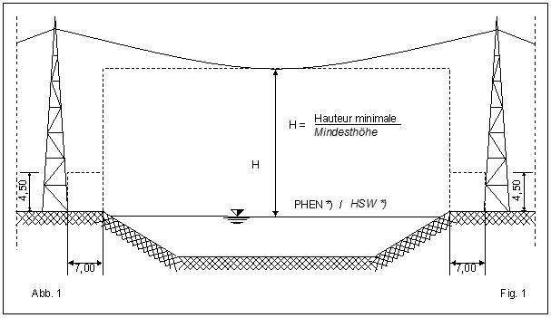
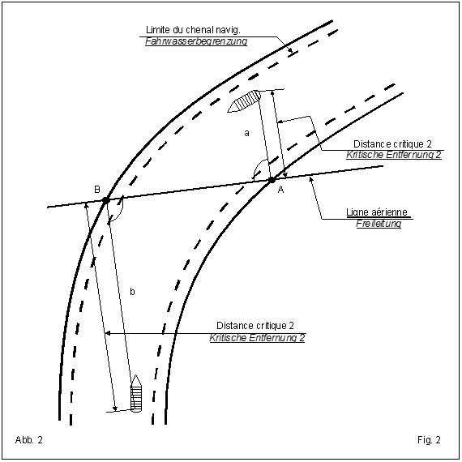
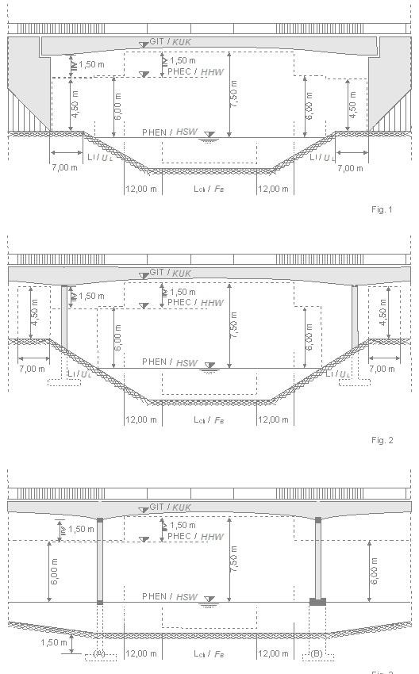

# Règlement grand-ducal du 9 octobre 2017 relatif à la procédure d'autorisation harmonisée en matière d'occupation et d'utilisation privative et privilégiée du domaine public fluvial et arrêtant des prescriptions types minimales.

Vu la [loi du 23 décembre 2016](https://legilux.public.lu/eli/etat/leg/loi/2016/12/23/n19/jo) concernant la gestion du domaine public fluvial ;

Vu la [loi modifiée du 24 janvier 1990](https://legilux.public.lu/eli/etat/leg/loi/1990/01/24/n3/jo) portant création et organisation d’un tribunal pour la navigation de la Moselle ;

Vu l’avis de la Chambre de Commerce ;

Notre Conseil d’État entendu ;

Sur le rapport de Notre Ministre du Développement durable et des Infrastructures ;

Arrêtons :

## Objectif

### Art. 1er.

Le présent règlement fixe les exigences minimales auxquelles doivent répondre les installations et ouvrages projetés de manière à assurer la continuité et la sécurité d’exploitation de la voie navigable et la sauvegarde du domaine public fluvial.

## Champ d'application

### Art. 2.

Le présent règlement s'applique à :

a) la mise en place d’installations et d’ouvrages ou à l’exécution de travaux sur le domaine public fluvial ;

b) toute occupation ou autre utilisation privative ou privilégiée d’éléments ou de parcelles déterminées du domaine public fluvial.

## Procédure d’autorisation

### OCCUPATIONS

#### Art. 3.

Sans préjudice d'autres autorisations éventuelles, tout ouvrage et installation à réaliser sur le domaine public fluvial ou l’exécution de travaux est soumis à autorisation du membre du Gouvernement ayant les transports dans ses attributions, appelé ci-après « le ministre ».

Cette autorisation déterminera les conditions d’implantation, d’aménagement et d'exploitation des ouvrages et installations.

La demande d’autorisation est adressée en trois exemplaires au Service de la navigation.

La demande d’autorisation doit indiquer :

a) les noms, prénoms, qualité et domicile du demandeur s’il s’agit d’une personne physique ou, si la demande émane d’une personne morale, la dénomination, l’objet et le siège social de la personne morale ainsi que les noms, prénoms, qualité ,domicile et pouvoirs du signataire de la demande et le cas échéant les coordonnées du ou des personnes habilitées à représenter la personne morale auprès de l’administration ;

b) la destination, les caractéristiques de l’installation ou de l’ouvrage et la description de la technique de construction ;

c) le lieu d’implantation souhaité et les conditions de propriété du terrain.

Elle doit être accompagnée :

a) d’un plan de situation à l’échelle 1/1000, 1/ 2000 ou 1/500 ;

b) des plans de construction de l’installation ou de l’ouvrage projeté à l’échelle adéquate comportant une vue horizontale et des coupes longitudinales et transversales ;

c) d'un extrait récent du plan cadastral ;

d) des notes de calcul techniques relatives à la résistance, la flottabilité et la stabilité de l’installation ;

e) des numéros des parcelles cadastrales concernées par la demande.

L’installation ne peut être mise en service qu’après une visite des lieux et la réception de l’installation ou de l’ouvrage par le Service de la navigation.

Toute demande d’autorisation fait l’objet d’un accusé de réception. Lorsque le dossier d’une demande d’autorisation n’est pas complet, l’autorité compétente invite, le requérant à compléter le dossier tout en lui notifiant le relevé de l’ensemble des pièces à fournir.

L’autorisation perd sa validité lorsqu'il aura été constaté que l'installation a été abandonnée ou que les droits concédés par la présente ne sont plus exercés.

Toute modification des données du dossier ayant servi à l’instruction de la demande et à l’octroi de l’autorisation doit être notifiée dans un délai de 15 jours au ministre qui décide s’il y a lieu à modification de l’autorisation.

### UTILISATIONS PRIVATIVES OU PRIVILEGIÉES

#### Art. 4.

Sans préjudice d'autres autorisations éventuelles, toute utilisation privative ou privilégiée d’éléments ou de parcelles déterminées du domaine public fluvial est soumise à autorisation du ministre.

Cette autorisation déterminera les conditions de sécurité et de police dans l’intérêt du bon ordre de la navigation et de la sauvegarde du domaine public fluvial.

La demande d’autorisation est adressée en trois exemplaires au Service de la navigation au plus tard 60 jours avant la date prévue de l’utilisation. Les demandes présentées en dehors des délais requis, incomplètes ou pour laquelle la preuve du paiement de la redevance ou taxe due n’a pas été fournie, peuvent être refusées.

La demande d’autorisation doit indiquer :

a) le nom, la profession, la raison sociale et l'adresse ou le siège du requérant ;

b) le lieu, la parcelle concernée, la surface de l'emprise ;

c) la période et durée d’utilisation ;

d) la description ou le déroulement des activités.

Elle doit être accompagnée d’un plan de situation à l’échelle 1/1000, 1/2000 ou 1/500 ;

Toute demande d’autorisation fait l’objet d’un accusé de réception. Lorsque le dossier d’une demande d’autorisation n’est pas complet, l’autorité compétente invite, le requérant à compléter le dossier tout en lui notifiant le relevé de l’ensemble des pièces à fournir.

Toute modification des données du dossier ayant servi à l’instruction de la demande et à l’octroi de l’autorisation doit être notifiée dans un délai de 2 jours au ministre qui décide s’il y a lieu à modification de l’autorisation.

## Prescriptions techniques minimales

### Art. 5.

Les exigences minimales à observer lors de la mise en place de certaines installations et ouvrages sont arrêtées dans les prescriptions type jointes en annexe du présent règlement grand-ducal.

## Autorité compétente

### Art. 6.

Le Service de la navigation est chargé de surveiller les autorisations d’occupations et d’utilisations privatives ou privilégiées et la conformité d’utilisation du domaine public fluvial.

Le Service de la navigation tient le répertoire des autorisations d'occupation concédées et le registre des visites de conformité effectuées.

Le Service de la navigation peut s’assurer à tout moment de la conformité de l'installation avec les conditions et obligations légales, réglementaires et administratives.

## Dispositions abrogatoires et transitoires

### Art. 7.

Le [règlement grand-ducal modifié du 6 avril 1990](https://legilux.public.lu/eli/etat/leg/rgd/1990/04/06/n1/jo) relatif aux débarcadères sur la Moselle qui ne sont pas soumis à l’approbation de la Commission de la Moselle est abrogé.

Les autorisations délivrées antérieurement à l’entrée en vigueur du présent règlement sur base du [règlement grand-ducal précité du 6 avril 1990](http://legilux.public.lu/eli/etat/leg/rgd/1990/04/06/n1/jo) restent valables jusqu’à la date fixée dans l’autorisation**.**

Les alinéas 3 et 6 de l’article 19 du [règlement grand-ducal modifié du 29 avril 2002](https://legilux.public.lu/eli/etat/leg/rgd/2002/04/29/n6/jo) portant réglementation de la police et de la sécurité sur les cours d’eau et plans d’eau sont abrogés.

Les autorisations délivrées antérieurement à l’entrée en vigueur du présent règlement sur base du [règlement grand-ducal précité du 29 avril 2002](http://legilux.public.lu/eli/etat/leg/rgd/2002/04/29/n6/jo) restent valables jusqu’à la date fixée dans l’autorisation.

### Art. 8.

Notre Ministre du Développement durable et des infrastructures est chargé de l’exécution du présent règlement qui sera publié au Journal officiel du Grand-Duché de Luxembourg.

Le Ministre du Développement durable  et des Infrastructures,   François Bausch

Palais de Luxembourg, le 9 octobre 2017.   Henri

\**ANNEXE**

\**Prescriptions minimales types**  auxquelles doivent répondre les installations, ouvrages et travaux soumis à autorisation au titre de la sécurité d’exploitation de la voie navigable et de la sauvegarde du domaine public fluvial

1\) **Postes d’accostage.**

\- Appendice A

\- Appendice B

2\) **Franchissement aériens - Lignes aériennes.**

\- Appendice C

\- Appendice D

\- Appendice E

3\) **Franchissements souterrains de conduites et de câbles (siphons).**

\- A) Pose de canalisation par fonçage

\- B) Pose de canalisation en tranchée à ciel ouvert

4\) **Ouvrages de déversement et de prise d’eau.**

\- Appendice F

5\) **Ponts et ouvrages similaires.**

\- Appendice G

| 1) POSTES D'ACCOSTAGE |
|---|

Les présentes prescriptions s’appliquent à la mise en place des installations destinées à l’accostage des bateaux.

\**A)** **Prescriptions générales :**

L’aménagement et l’exploitation des postes d’accostage sur la Moselle doivent répondre aux exigences suivantes :

1\. Les postes d’accostage doivent être construits selon les règles de l’art. Leur stabilité doit correspondre à l'usage auquel ils sont destinés.

2\. Les postes d’accostage doivent être conçus de façon à permettre l’accostage des bateaux en toute sécurité. Ils doivent notamment être équipés de moyens d’amarrage en nombre suffisant.

3\. Les structures en acier doivent être protégées contre la corrosion. Il est interdit d'utiliser des peintures nuisibles pour l’environnement.

4\. Les postes d’accostage doivent être exploités et entretenus par leurs propriétaires de manière à ce que la sécurité d'exploitation reste garantie et de sorte que les conditions d'exploitation de la voie navigable ne soient pas entravées.

5\. L’écartement minimum entre la face extérieure du poste d’accostage et la limite du chenal navigable doit être 15,00 m. Pour les postes d’accostage de petites dimensions on pourra autoriser exceptionnellement un écartement minimum de 12,00 m.

6\. Sauf autorisation spéciale du Ministre, les installations flottantes, y compris leurs accessoires mobiles, devront être sorties hors du cours d’eau et de la zone inondable au minimum pendant la période comprise entre le 1er novembre et le 31 mars (hiver et période de crues). Cette prescription est également applicable en cas de menace de crue en dehors de cette période ou sur mise en demeure de l’autorité compétente. L’autorité compétente nationale pourra exiger qu’une demande d’autorisation d’un poste d’accostage comporte l’indication d’un emplacement de dépôt pendant l’hiver.

7\. Ne sont autorisés à accoster aux postes d’accostage que les seuls bateaux pour lesquels l’installation est conçue.

8\. Les postes d’accostage doivent porter une inscription lisible à partir de la rive et de la voie navigable sur laquelle figure le numéro d’autorisation. Ce numéro doit avoir au moins 10 cm de hauteur et être apposée en couleur claire sur fond sombre ou en couleur sombre sur fond clair. En outre le numéro d’autorisation doit être répété en caractères indélébiles sur la passerelle et les éléments porteurs.

9\. Il y a lieu de prendre les mesures nécessaires pour interdire l’utilisation du poste d’accostage par des personnes non autorisées.

\**B) Prescriptions spécifiques pour les pontons d’accostage pour bateaux de navigation intérieure :**

Les pontons pour bateaux de navigation intérieure doivent d'une manière générale répondre aux exigences imposées par la norme EN 14504 relative aux embarcadères flottants pour bateaux de navigation intérieure.

\**C) Prescriptions spécifiques pour les postes d’accostage de petites dimensions :**

Par postes d’accostage de petites dimensions on entend des installations flottantes :

aash destinées à l’accostage et au stationnement de menues embarcations ;

bash destinées à l’embarquement et au débarquement de personnes ;

cash destinées à la mise à l’eau et hors de l’eau de petits bateaux de sport.

Les postes d’accostage de petites dimensions doivent répondre aux prescriptions suivantes :

1\. Les postes d’accostage ne peuvent être installés que sur les secteurs prévus à cet effet et indiqués en vert sur la carte jointe en tant qu’appendice A ;

2\. L’espacement des postes d’accostage entre eux devra être choisi de manière à ce que les embarcations qui les utilisent ne puissent constituer une gêne mutuelle ou une gêne pour la navigation ou pour la sécurité du trafic. À cet effet, il y a lieu de chercher à disposer les postes d’accostage par groupes.

\**C.1. Postes d’accostage flottants (pontons d’accostage)**

1\. Flotteurs :

a. Les flotteurs doivent être constitués d’éléments complètement fermés.

b. L’épaisseur des parois des flotteurs en métal doit être d’au moins 2 mm.

c. Les flotteurs cylindriques doivent avoir un diamètre minimum de 60 cm.

L’utilisation de fûts à essence ou à huile n’est pas autorisée.

d. Le remplissage en mousse expansée est fortement recommandé.

2\. Passerelles :

La passerelle doit être en mesure de suivre toutes les variations du plan d’eau.

À cet effet la passerelle doit comporter une fixation articulée aux deux extrémités.

Lorsque les flotteurs comportent un guidage vertical (p. ex. sur un duc d’Albe), la passerelle doit pouvoir coulisser soit sur la rive, soit sur la plateforme.

3\. Équipements :

a) Les pontons d’accostage doivent être équipés de systèmes d’ancrage appropriés, soit des petits bollards, soit des taquets ou des anneaux.

b) Le dispositif d’amarrage sur le ponton d’accostage doit être assez solide pour maintenir le bateau fermement amarré pendant le stationnement quels que soient les niveaux d’eau et les conditions de courant et de vent.

c) L’utilisation de pneus comme défenses mobiles des pontons d’accostage n’est pas autorisée.

4\. Ancrage :

a) Les pontons d’accostage doivent être solidement ancrés compte tenu de leurs charges et des sollicitations auxquelles ils sont soumis pour résister au batillage provoqué par la navigation de passage.

b) Lorsqu’on utilisera des câbles d’acier ou des chaînes, ceux-ci devront être fixés sur la berge, vers l’amont et l’aval, si possible sous un angle de 45°.

Le diamètre minimal du dispositif de fixation doit être de 10 mm. Une galvanisation est recommandée.

Les dispositifs de fixation vers l’amont et celui vers l’aval doivent être de dimensions égales.

c) Dans le dimensionnement des fondations d’ancrage on tiendra également compte d’une possible poussée d’Archimède agissant sur les massifs de fondation susceptibles d’être immergés.

La fondation et le dispositif de fixation vers l’amont et vers l’aval doivent être de même nature.

5\. Solicitations :

Pour le dimensionnement des pontons d’accostage et de leur fixation, il est recommandé de prendre en compte les sollicitations définies ci-après :

a) Charge verticale

Elle se compose :

aot de la charge constante (poids des éléments de construction et charges invariables) et

bot d’une surcharge de :

aash de 2,5 kN/m2 (250 kg/m2) de surface utile pour les pontons d’accostage utilisés au sein des associations et ports ;

bash de 1,5 kN/m2 (150 kg/m2) de surface utile pour les pontons d’accostage privés non destinés à un usage commercial ni à un usage au sein d’associations.

b) Force horizontale (Fh)

Elle se compose :

aot du choc de bateau (Ch) ;

bot 1/10ème du poids total du bateau le plus lourd utilisant le débarcadère comme charge unique à l’endroit le plus défavorable avec un minimum de 0,5 kN (50 kg) ;

cot de la force due au courant (C) : 3,5 kN/m2 (350 kg/m2) agissant sur les sections immergées du ponton et du plus grand bateau utilisant l’installation, la charge verticale n’étant pas prise en considération ;

dot de la force due au vent (V) : 0,5 kN/m2 (50 kg/m2) agissant sur les sections hors eau du débarcadère et du plus grand bateau, la charge verticale n’étant pas prise en considération.

Compte tenu d’un coefficient de sécurité de 1,5, la force horizontale, somme des trois forces définies ci-dessus, est exprimée par la formule suivante : Fh = 1,5 x (Ch + C + V)

c) Dispositions complémentaires :

En cas de charge maximale, il y a lieu de respecter un franc-bord d’au moins 30 cm.

Les flotteurs ne doivent s’enfoncer dans l’eau qu’à 2/3 de leur hauteur. La ligne de franc-bord doit être marquée sur les flotteurs.

Des exemples de pontons d’accostage se trouvent esquissés à l’appendice B

\**C.2. Postes d’accostage fixes**

Les prescriptions mentionnées sous les points 3, 4a, 4c, 5a et 5b du chapitre C.1. sont applicables par analogie aux postes d’accostage fixes.

\**Appendice A**

\**Carte de la Moselle avec sections de rive indiquées en vert où la construction de postes d’accostage de petites dimensions peut être autorisée**

*[image omitted (0.8 MB) — see the official version: https://legilux.public.lu/eli/etat/leg/rgd/2017/10/09/a951/jo]*

\**Appendice B**

\**Exemples de pontons d’accostage**

*[image omitted (1.1 MB) — see the official version: https://legilux.public.lu/eli/etat/leg/rgd/2017/10/09/a951/jo]*

| **2) Franchissement aériens - Lignes aériennes** |
|---|

Les présentes prescriptions s’appliquent aux franchissements aériens par des lignes aériennes et des téléphériques.

1\. Gabarit

a) Hauteurs minimales (figure 1 de l’appendice C).

| Câbles | Hauteurs minimales au-dessus des  PHEN *) |
|---|---|
| Câbles non conducteurs | 15,50 m |
| Câbles jusqu’à environ 110 kV | 17,00 m |
| Câbles au-dessus de 110 kV à environ 220 kV | 18,00 m |
| Câbles au-dessus de 220 kV à environ 380 kV | 19,00 m |

b) Gabarit entre la crête de la berge et le mât-support de la ligne.

Entre la crête de la berge et le mât-support de la ligne il y a lieu de laisser un espace libre minimum d’une largeur de 7,00 m et d’une hauteur de 4,50 m.

2\. Reproduction de lignes aériennes sur l’écran-radar.

aash Lors de l’établissement du projet d’un tracé de ligne aérienne, l’angle de franchissement devrait être choisi de telle sorte qu’une signalisation par réflecteurs-radar ne soit pas nécessaire.

bash En règle générale, ceci est le cas lorsque la distance critique est < 150 m (voir fig. 2 de l’appendice D).

cash Dans chaque cas particulier, les mesures à prendre devront être arrêtées par des experts ou par les services techniques des administrations concernées.

3\. Protection contre les chocs de bateaux.

Les ouvrages annexes aux lignes aériennes qui risquent d’être atteints par des bateaux devront être protégés contre les chocs.

4\. Téléphériques

Les téléphériques sont considérés comme des câbles non conducteurs. Leur hauteur minimale se rapporte à l’arête inférieure de la cabine.

Les recommandations qui précèdent leur sont intégralement applicables.

\*) Étant donné que le niveau de retenue à l’amont immédiat des barrages est variable en fonction du débit (Q), la hauteur libre sous les lignes aériennes se réfère aux niveaux hydrodynamiques de retenue représentés dans le croquis de l’appendice D, pour les débits suivants :

aash Q ≤ 200 m3/s,

bash Q = HBQ (débit maximum d’exploitation des centrales) et

cash Q = HSQ (débit maximum navigable, c.à.d. correspondant aux PHEN)

[Texte]

\**Appendice C**

\**Figure 1**

\**Hauteur minimale**

\*) Étant donné que le niveau de retenue à l’amont immédiat des barrages est variable en fonction du débit (Q), la hauteur libre sous les lignes aériennes se réfère aux niveaux hydrodynamiques de retenue représentés dans le croquis de l’appendice D, pour les débits suivants :

aash Q ≤ 200 m3/s,

bash Q = HBQ (débit maximum d’exploitation des centrales) et

cash Q = HSQ (débit maximum navigable, c.à.d. correspondant aux PHEN)

[Texte]

\**Appendice D**

\**Figure 2**

\**Distance critique**

\*) Étant donné que le niveau de retenue à l’amont immédiat des barrages est variable en fonction du débit (Q), la hauteur libre sous les lignes aériennes se réfère aux niveaux hydrodynamiques de retenue représentés dans le croquis de l’appendice D, pour les débits suivants :

aash Q ≤ 200 m3/s,

bash Q = HBQ (débit maximum d’exploitation des centrales) et

cash Q = HSQ (débit maximum navigable, c.à.d. correspondant aux PHEN)

[Texte]

\**Appendice E**

*[image omitted (1.0 MB) — see the official version: https://legilux.public.lu/eli/etat/leg/rgd/2017/10/09/a951/jo]*

\*) Étant donné que le niveau de retenue à l’amont immédiat des barrages est variable en fonction du débit (Q), la hauteur libre sous les lignes aériennes se réfère aux niveaux hydrodynamiques de retenue représentés dans le croquis de l’appendice D, pour les débits suivants :

aash Q ≤ 200 m3/s,

bash Q = HBQ (débit maximum d’exploitation des centrales) et

cash Q = HSQ (débit maximum navigable, c.à.d. correspondant aux PHEN)

[Texte]

| **3) F****ranchissements souterrains de conduites et de câbles (siphons)** |
|---|

\**A) Pose de canalisation par fonçage**

Les présentes prescriptions s’appliquent aux franchissements souterrains de conduites et de câbles par fonçage.

1\. Lors de la pose du siphon, l’impétrant doit respecter les règles reconnues de la technique et procéder avec le soin nécessaire en matière de constructions.

2\. L’impétrant est tenu d’informer les autorités compétentes, en temps utile, de toute modification qu’il entend apporter au siphon ou à son utilisation.

3\. Les travaux de mise en place du siphon ne peuvent commencer qu’après l’accord des autorités compétentes.

4\. En prévision d’une possible érosion, l’arête supérieure du siphon doit être enfouie sur toute la largeur de la rivière, y compris les berges, à au moins 2,50* / 2,00** m en dessous du plafond de la rivière.

5\. Lors de la pose du siphon, les relèvements suivants sont exigés :

aash immédiatement avant le sondage, un relèvement du plafond de la rivière, y compris des berges, dans l’axe longitudinal du siphon ;

bash après la pose du siphon, un relèvement du plafond de la rivière, y compris des berges, dans l’axe longitudinal du siphon.

Les relèvements doivent être exécutés en présence d’un représentant des autorités compétentes.

6\. L’épaisseur du recouvrement ou l’état du plafond à l’emplacement du siphon doivent être vérifiées au moins tous les 5 ans. Cette vérification doit avoir lieu plus souvent si des circonstances particulières l’exigent, par exemple la présence de glaces etc. La preuve de la vérification doit être fournie aux autorités compétentes. Dès que l’épaisseur du recouvrement ne sera plus que de 2,50* / 2,00** m ou inférieure, l’impétrant devra mettre en place et entretenir, en accord avec les autorités compétentes et conformément à l’article 7.03 du RPNM, un panneau d’interdiction d’ancrage sur chaque rive.

Lorsque l’épaisseur du recouvrement ne sera plus que de 1,00 m et qu’il ne sera plus possible de rétablir un recouvrement, le siphon devra être supprimé.

7\. Au cas où des affouillements ou des atterrissements se formeraient le long du tracé du siphon, et que la cause en serait imputable à la construction ou à l’existence de cette installation, l’impétrant serait tenu d’y remédier sans délai en accord avec les autorités compétentes.

8\. Les installations de signalisation, les points de repère (points hectométriques, points polygonaux) et les bornes frontalières qui ont été supprimées, endommagées ou ensevelies lors de l’exécution des travaux doivent être remises en état aux frais de l’impétrant.

L’impétrant doit informer les autorités compétentes avant l’exécution des travaux de remise en état.

9\. Pour les travaux en rivière, il y a lieu de se conformer aux prescriptions du Règlement de police pour la navigation de la Moselle (RPNM). En particulier, les bâtiments et engins flottants doivent porter de jour et de nuit la signalisation réglementaire.

10\. La mise en place de panneaux de signalisation, de bouées ou de vigies sur pontons ainsi que l’introduction d’un système d’avertisseurs, mesures qui sont éventuellement nécessaires pour garantir la sécurité de la navigation pendant les travaux, doit avoir lieu d’après les directives des autorités compétentes et aux frais de l’impétrant.

11\. Les travaux dans le chenal navigable ne peuvent être exécutés, en règle générale, que de jour par bonne visibilité ; de nuit et en période de mauvaise visibilité, les bâtiments et engins flottants doivent dégager le chenal navigable et stationner tout près de la rive. Des exceptions à cette règle doivent nécessairement être approuvées par les autorités compétentes.

12\. L'impétrant est tenu de veiller à ce qu'aucune substance susceptible de provoquer une pollution ou de faire naître une entrave ou un danger pour la navigation ou pour les usagers de la voie navigable puisse s'écouler dans la Moselle ou ses abords immédiats du fait de l’exploitation du siphon.

13\. Le tracé du siphon doit être marqué de manière exacte et à demeure par des piquets ou des bornes munis de plaques d’information suivant les instructions des autorités compétentes.

La situation du siphon doit être intégrée dans le réseau des points de repères géodésiques.

14\. Le siphon et ses installations doivent être mesurées sur le réseau des points de repère par un organisme qualifié (géomètre agréé**,** bureau d'études géomètre). Les résultats des levés doivent être communiqués aux autorités compétentes en vue de l’actualisation des cartes de la voie navigable et du réseau des points de repères géodésiques.

15\. Le siphon ne peut être mis en service qu’après réception par les autorités compétentes.

Celle-ci ne se substitue pas aux autres réceptions qui sont obligatoires en application des prescriptions administratives relatives à la sécurité.

\**B) Pose de canalisation en tranchée à ciel ouvert**

Les présentes prescriptions s’appliquent aux franchissements souterrains de conduites et de câbles en tranchée à ciel ouvert.

1\. Lors de la pose du siphon, l’impétrant doit respecter les règles reconnues de la technique et procéder avec le soin nécessaire en matière de constructions.

2\. L’impétrant est tenu d'informer les autorités compétentes, en temps utile, de toute modification qu'il entend apporter au siphon ou à son utilisation et de fournir des nouveaux documents se rapportant au projet.

3\. Les travaux de pose du siphon ne pourront commencer qu'après accord des autorités compétentes.

4\. En prévision d'une possible érosion, l'arête supérieure du siphon devra être enfouie sur toute la largeur de la rivière, y compris les berges, à au moins 2,50*/2,00** m en-dessous du plafond de la rivière.

5\. Lors de la pose du siphon, les relèvements suivants devront être exécutés :

a) immédiatement avant le dragage, un relèvement du plafond de la rivière, y compris des berges, dans l'axe longitudinal du siphon et, parallèlement à cet axe, un relèvement du profil à 10 m en amont et à 20 m en aval du tracé du siphon ;

b) après exécution de la tranchée, un relèvement de la cote du plafond de la tranchée ;

c) après la pose du siphon et avant remblaiement de la tranchée, un relèvement de la cote de l'arête supérieure du siphon ;

d) après remblaiement de la tranchée, un relèvement du plafond de la rivière, y compris des berges, dans l'axe longitudinal du siphon et, parallèlement à cet axe, un relèvement du profil à 10 m en amont et à 20 m en aval du tracé du siphon.

Les relèvements doivent être exécutés en présence d'un représentant de l'autorité compétente.

6\. Le remblaiement de la tranchée ne pourra avoir lieu qu'après les relèvements et l'accord de l'autorité compétente.

Toutes mesures devront être prises pour qu'après remblaiement de la tranchée de pose, le plafond de la rivière, y compris les berges, soit rétabli dans sa forme initiale et sans risque d'érosion.

7\. L'épaisseur du recouvrement ou l'état du plafond à l'emplacement du siphon devront être vérifiés au moins tous les 5 ans. Cette vérification devra avoir lieu plus souvent si des circonstances particulières l'exigeaient, par exemple la présence de glaces etc., vérification qui devra être prouvée auprès de l'autorité compétente. Dès que l'épaisseur du recouvrement ne sera plus que 2,00*/1,50** m ou inférieure à 2,00*/1,50** m, le (la) requérant(e) devra mettre en place et entretenir sur chaque rive, en accord avec l'autorité compétente, un panneau d'interdiction d'ancrage conforme aux dispositions de l'article 7.03 du Règlement de police pour la navigation de la Moselle (RPNM).

Lorsque l'épaisseur du recouvrement ne sera plus que de 1,00 m et qu'il ne sera plus possible de rétablir un recouvrement suffisant, le siphon devra être retiré de la voie navigable.

8\. Au cas où des affouillements ou des atterrissements se formeraient le long du tracé du siphon et que la cause en serait imputable à la construction ou à l'existence de cette installation, le (la) requérant(e) serait tenu(e) d'y remédier sans délai en accord avec l'administration compétente (dénomination exacte). L'autorité compétente se réserve le droit de mettre en place et d'entretenir, jusqu'au début et pour la durée de ces travaux, des panneaux d'interdiction d'ancrage conformes aux dispositions de l'article 7.03 du RPNM et, le cas échéant, tous autres signaux de la voie navigable aux frais du (de la) requérant(e).

9\. Des panneaux de 2,00 m x 1,50 m portant l'inscription

"Attention! Chantier de siphon au PK …"

devront être apposés sur les écluses de (noms respectifs des écluses amont et aval du bief concerné). En outre, un panneau de dimensions suffisantes portant l'inscription

"Attention! Chantier de siphon"

devra être mis en place à l'amont et à l'aval du chantier suivant les directives de l'autorité compétente (dénomination exacte).

Les panneaux devront être éclairés.

10\. Pour éviter autant que possible une gêne de la navigation lors des travaux de dragage ou de pose, un planning spécial sera établie à temps et par écrit en accord avec l'autorité compétente. Ce document indiquera également la date précise des travaux de pose en rivière en raison des brèves interruptions de la navigation qu'ils pourraient exiger et qui devraient faire l'objet, dix jours avant, d'un avis à la batellerie.

11\. Pour les travaux en rivière, il y aura lieu de se conformer aux prescriptions du RPNM. En particulier, les bâtiments et engins flottants devront porter de jour et de nuit la signalisation réglementaire.

12\. La mise en place de signaux de la voie d'eau navigable, de bouées et/ou de vigies sur ponton ainsi que l'introduction d'un système d'avertisseurs, mesures qui sont nécessaires pour garantir la sécurité de la navigation pendant les travaux, devront avoir lieu d'après les directives de l'autorité compétente et aux frais de l’impétrant.

13\. Les travaux dans le chenal navigable ne pourront être exécutés, en règle générale, que de jour et par bonne visibilité ; de nuit et en période de mauvaise visibilité, les bâtiments et engins flottants devront dégager le chenal navigable et stationner sur la rive. Des exceptions à cette règle devront nécessairement être approuvées par l'autorité compétente.

14\. Le procédé mis en œuvre pour la pose du siphon devra prévoir l'utilisation d'un engin ayant un rendement suffisant pour limiter au minimum la durée de gêne de la navigation.

15\. L’impétrant est tenu de respecter les charges et les conditions à ses propres frais.

16\. Le siphon ne pourra être mis en service qu'après réception par l'autorité compétente. Celle-ci ne se substitue pas aux autres réceptions prévues par les prescriptions relatives à la sécurité ou par des prescriptions administratives.

\* Siphon de la catégorie I = siphons pour: conduites de gaz, matières solides et liquides dangereuses, câbles de haute tension

\** Siphon de la catégorie II = siphons pour: conduites d'eau potable, conduites d'eaux usées, câbles de télécommunication, câbles de commande et de télécommande, câbles de basse tension

| **4) OUVRAGES DE DÉVERSEMENT ET DE PRISE D'EAU** |
|---|

Les présentes prescriptions s’appliquent à la construction d'ouvrages de déversement respectivement de prise d’eau sur la voie navigable.

1\. L’angle de déversement entre l’axe de la conduite de déversement / de prise d’eau et la direction d’écoulement de la rivière doit être situé entre 30° et 60°.

2\. La composante transversale admissible (VQ) de la vitesse de déversement dans la Moselle ne doit pas dépasser la valeur limite de 0,8 m/s c.à.d. que la vitesse de déversement autorisée dépend de l’angle.

VR = 0,8 m/s

sin α

Dans les avants ports des écluses ou à d’autres endroits critiques, la vitesse de déversement admissible est diminuée.

3\. La conduite de sortie respectivement l’ouvrage de déversement / de prise d’eau doit être adapté à la pente de la berge.

4\. La conduite de sortie respectivement l’ouvrage de déversement / de prise d’eau doit être protégé contre les remous et les affouillements par la mise en place d’un enrochement allant vers l’amont et l’aval à une distance de :

aash 1,50 m pour les conduites d’un diamètre de 500 mm ;

bash 3,00 m pour les conduites d’un diamètre de 1500 mm ;

cash 5,00 m pour les conduites d’un diamètre supérieur à 1500 mm.

Pour la partie de l’ouvrage située en dessous du niveau d’eau, il suffit de mettre en place un remblai de pierres (voir plan type joint à l’appendice F).

L’enrochement doit être exécuté avec des pierres appropriées en matière de constructions hydrauliques qui sont posées sur une couche de gravier 16/32 d’une épaisseur de 20 cm.

À proximité immédiate de la conduite et de l’ouvrage, l’enrochement doit être posé dans le béton.

5\. Les joints doivent être réalisés de manière à ce que l’affouillement de la couche de gravier est empêché. Les joints sont remplis avec de la terre arable et sont ensuite ensemencer.

6\. La crête de la conduite de sortie doit être située à une hauteur supérieure de 30 cm au niveau moyen des eaux (niveau d’eau moyen + 30 cm).

7\. La zone de passage de la conduite avec le chemin de service doit être dimensionnée pour le trafic lourd.

8\. Avant le commencement des travaux, les installations de signalisation et géodésiques du gestionnaire de la voie navigable (points hectométriques, points polygonaux) doivent être relevées et sécurisées dans le cadre d’une visite des lieux commune.

9\. Les installations de signalisation, les points de repère (points hectométriques, points polygonaux) et les bornes frontalières qui ont été supprimées, endommagées ou ensevelies lors de l’exécution des travaux doivent être remises en état aux frais de l’impétrant.

L’impétrant doit informer les autorités compétentes avant l’exécution des travaux de remise en état.

10\. Les conduites et/ou les ouvrages de déversement / de prise d’eau installés sur le domaine public fluvial doivent être calibrés sur le réseau des points de repère par un organisme qualifié (géomètre agréé**,** bureau d'études géomètre). Les résultats des levés doivent être communiqués aux autorités compétentes en vue de l’actualisation des cartes de la voie navigable et du réseau des points de repères géodésiques.

\**Appendice F**

\**Aménagement d’un ouvrage de déversement**

\**Plan type**

\**Exemple d'un ouvrage de déversement**

*[image omitted (2.2 MB) — see the official version: https://legilux.public.lu/eli/etat/leg/rgd/2017/10/09/a951/jo]*

| **5) PONTS ET OUVRAGES SIMILAIRES** |
|---|

1\. Règles générales pour les gabarits de navigation des ponts :

a) En ce qui concerne le gabarit qu’il convient d’assurer au droit des passes navigables des ponts, il faut tenir compte, en dehors des critères de rentabilité, des valeurs usuelles fixées pour les voies navigables en matière de navigation à passagers.

b) Outre les nécessités du trafic, il y a lieu de tenir compte également des conditions d’écoulement des eaux.

c) En raison de la diversité des conditions locales, il est impossible de fixer des valeurs uniformes en ce qui concerne les hauteurs de tirant d’air et les largeurs des passes. Les valeurs indiquées dans le présent texte (Fig. 1-3 de l’appendice G) sont des valeurs minimales qui doivent être respectées pour tout ouvrage nouveau.

d) Pour l’implantation du pont et le choix des largeurs de passes, on tiendra compte à la fois des exigences relatives à la sécurité du trafic et des exigences relatives aux incidences financières du projet.

e) On tiendra compte de la surlargeur du chenal navigable dans les courbes.

f) Dans les courbes, il faudra s’efforcer de réaliser des conditions optimales de visibilité.

2\. Classification des ponts suivant l’alignement des piles et de culées :

a) Ponts sans piles

Ces ponts enjambent le lit de la rivière sans piles sur toute sa largeur, y compris les chemins de service (fig. 1).

b) Ponts avec piles dans les talus de berges

Les piles sont souvent implantées dans les talus de berges afin de leur assurer un bon milieu statique (fig. 2).

c) Ponts avec piles en rivière

Lorsque la largeur de franchissement est importante, des piles en rivière peuvent être nécessaires (fig. 3).

3\. Explication des abréviations des figures 1,2 et 3

GIT = génératrice inférieure du tablier

PHEC = plus hautes eaux connues

PHEN = plus hautes eaux navigables

Lch = largeur du chenal navigable

Ll = ligne de laisse des eaux aux PHEN

(A) = piles sur dalle de fondation

(B) = piles sur fondation massive

4\. Gabarit au droit des ponts

a) Aspects relatifs au trafic et à l’exploitation :

aash Lors de la construction ou de la transformation de ponts, il y a lieu de prévoir les hauteurs libres suivantes au-dessus des plus hautes eaux navigables (PHEN) :

aquare au-dessus du chenal navigables et d’une distance de sécurité de 12,00 m de part et d’autre du chenal : 7.50 m.

bquare en dehors du chenal navigable et d’une distance de sécurité de 12 m de part et d’autre du chenal jusqu’à la ligne de laisse des eaux (Ll) : 6,00 m.

bash Pour les chemins de service les dimensions ci-dessous doivent être respectées :

aquare largeur libre = 7,00 m

bquare hauteur libre = 4,50 m

cash Pour les ponts avec piles en rivière, la passe navigable doit comporter entre le bord du chenal navigable et les piles ou autres constructions une distance de sécurité de 12,00 m.

b) Aspects de l’écoulement des hautes eaux :

Pour éviter toute gêne à l’écoulement des hautes eaux et pour assurer la protection des ponts dont la détérioration ou la destruction nuirait à la navigation, il convient de s’assurer que la distance entre la génératrice inférieure du tablier du pont (GIT) et les plus hautes eaux connues (PHEC) soit au moins 1,50 m.

5\. Implantation des piles en rivière.

Dans le cas de piles en rivière, les aspects suivants doivent être pris en considération :

a) Le tracé du lit de la rivière et des rives.

b) Le tracé du chenal navigable.

c) Les conditions concernant l’écoulement, les courants et les glaces.

d) Les conditions morphologiques.

e) La position des piles et leur disposition dans le lit de la rivière.

f) Les conditions de visibilité, en particulier de nuit ou par temps bouché.

6\. Profondeur des fondations de piles en rivière.

Les dalles ou autres dispositifs de fondation des piles devront être disposés de manière que l’espace se trouvant en-dessous de la largeur du chenal navigable, y compris la distance de sécurité, reste libre de toute construction sur une certaine profondeur.

La crête supérieure des dalles de fondation ou autres dispositifs de fondation devra être située à au moins 1,50 m en-dessous de la profondeur d’aménagement. Cette distance tient compte de l’éventualité d’un approfondissement du chenal ainsi que d’un affouillement au pied des piles (fig. 3).

7\. Protection des piles et autres constructions dans le lit de la rivière et sur les rives contre les chocs de bateaux *) et le glissement sur la rive.

Les piles et culées de ponts situées dans la rivière ou sur les rives et qui risquent d’être atteintes directement par les bâtiments ou par glissement de bâtiments sur la rive, doivent être protégées contre les chocs.

Le requérant doit présenter les justifications y relatives aux services techniques de l’administration concernée.

Pour déterminer les forces de chocs, il y a lieu de prendre en considération un convoi poussé dans sa composition la plus défavorable navigant à la vitesse maximale possible. Ce calcul devra tenir compte d’un approfondissement éventuel du chenal.

En raison du nombre de cas possibles, les forces ne peuvent pas toujours être déterminées de manière absolue.

Parmi les paramètres entrant dans les calculs on retiendra, entre autre :

aash la géométrie du lit de la rivière,

bash les courants longitudinaux et transversaux à la marche du bâtiment en fonction des diverses hauteurs d’eau,

cash la vitesse, les caractéristiques et le chargement des bâtiments,

dash la trajectoire incidente d’impact et la hauteur du point de choc,

eash les diagrammes d’absorption de l’énergie d’accostage (énergie déformante, frottement, déformation par écrasement)

fash le raidissement et l’inertie des éléments d’accouplement d’un convoi.

Lorsqu’il s’agit d’ouvrages légers, p.ex. de piles élancées ou de piles à colonnes, il y a lieu, également, de prendre en considération :

gash un facteur dynamique de charge

hash un calcul du dynamisme de l’ouvrage

8\. Signalisation des ouvertures de ponts.

Les passes navigables de ponts devront porter une signalisation conforme au règlement de police pour la navigation de la Moselle.

En outre :

a) les panneaux de signalisation des ponts devront être illuminés de nuit et par temps bouché,

b) les piles de ponts des passes principales devront être illuminées lorsque les piles sont implantées très près du chenal,

c) pour les ponts à large superstructure et dont les piles sont implantées très près du chenal, une illumination des murs de piles côté chenal est nécessaire,

d) les piles de ponts des passes principales devront être signalées par des réflecteurs-radar

(L’installation de réflecteurs-radar fixés sur les flèches suffisamment longues est préférable à des réflecteurs flottants).

9\. Représentation des ponts sur l’écran-radar.

a) Pour la construction de nouveaux ponts ou d’ouvrages similaires, il y a lieu de tenir compte des aspects suivants :

aash Sur les ponts en béton-armé ou en béton précontraint - indépendamment de leur forme - des perturbations par des échos-fantômes provoqués par des reflets multiples peuvent être exclues.

bash Pour les ponts métalliques à âme pleine, il y a lieu de prendre des mesures qui permettent d’éviter des perturbations par des échos-fantômes.

cash Les ponts métalliques à charpente en treillis induisent des échos-fantômes. Des dispositions particulières devront être prises à ce sujet.

b) Les ponts parallèles entre eux à une distance trop faible (de 200 à 300 m) et ayant un tablier sensiblement au même niveau, sont susceptibles de provoquer des échos-fantômes.

Pour y remédier, il y a lieu de prévoir p.ex. un décalage aussi grand que possible par rapport à la position parallèle (>5°) ou une inclinaison de >5° des faces latérales du tablier de chacun des deux ouvrages.

c) Dans chaque cas particulier, les mesures à prendre devront être arrêtées par des experts ou par les services techniques des administrations concernées.

\*) Au sens de la recommandation ci-dessus sont considérées comme bateaux les unités flottantes de toutes catégories.

\**) Étant donné que le niveau de retenue à l’amont immédiat des barrages est variable en fonction du débit (Q), la hauteur libre sous les ponts se réfère aux niveaux hydrodynamiques de retenue représentés dans le croquis de l’annexe 2, pour les débits suivants :

aash Q ≤ 200 m3/s,

bash Q = HBQ (débit maximum d’exploitation des centrales) et

cash Q = HSQ (débit maximum navigable, c.à.d. correspondant aux PHEN

\**Appendice G**

\**Gabarit des ponts**

\***Lichtraummasse der brücken***

\*) Au sens de la recommandation ci-dessus sont considérées comme bateaux les unités flottantes de toutes catégories.

\**) Étant donné que le niveau de retenue à l’amont immédiat des barrages est variable en fonction du débit (Q), la hauteur libre sous les ponts se réfère aux niveaux hydrodynamiques de retenue représentés dans le croquis de l’annexe 2, pour les débits suivants :

aash Q ≤ 200 m3/s,

bash Q = HBQ (débit maximum d’exploitation des centrales) et

cash Q = HSQ (débit maximum navigable, c.à.d. correspondant aux PHEN)
