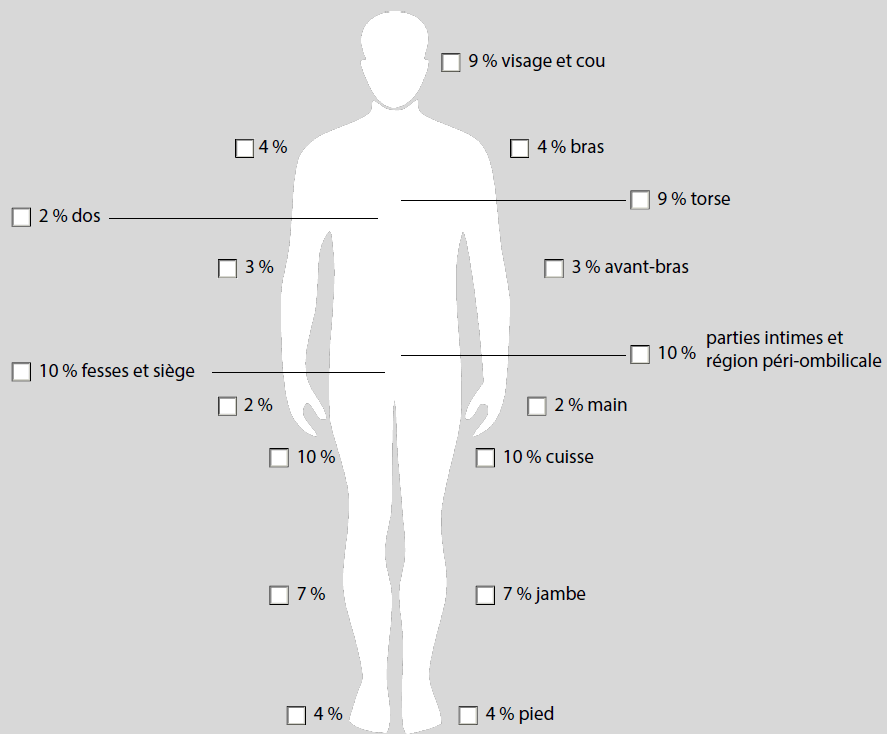

# Règlement grand-ducal du 13 décembre 2017 modifiant le règlement grand-ducal modifié du 18 décembre 1998 fixant les modalités de la détermination de la dépendance.

Nous Henri, Grand-Duc de Luxembourg, Duc de Nassau,

Vu l’article 350, paragraphe 9 du [Code de la sécurité sociale](https://legilux.public.lu/eli/etat/leg/loi/1925/12/17/n1/jo) ;

Vu l’avis de la Commission consultative prévue à l’article 387 du [Code de la sécurité sociale](https://legilux.public.lu/eli/etat/leg/loi/1925/12/17/n1/jo) ;

Vu les avis de la Chambre des salariés, de la Chambre des métiers et de la Chambre de commerce ;

Notre Conseil d’État entendu ;

Sur le rapport de Notre Ministre de la Sécurité sociale et après délibération du Gouvernement en conseil ;

Arrêtons :

## Art. 1er.

Au [règlement grand-ducal modifié du 18 décembre 1998](https://legilux.public.lu/eli/etat/leg/rgd/1998/12/18/n9/jo) fixant les modalités de la détermination de la dépendance, désigné ci-après par « le règlement », l’article 1er est modifié comme suit :

> **Art. 1er.**
>
> Les aides et soins que requiert la personne dépendante et leur fréquence hebdomadaire sont évalués à l’aide d’un outil d’évaluation et de détermination des prestations de l’assurance dépendance et sont déterminés suivant le relevé-type figurant en annexe I et le référentiel des aides et soins figurant en annexe II. Ils font l’objet d’une synthèse de prise en charge établie par l’Administration d’évaluation et de contrôle de l’assurance dépendance suivant le formulaire type en annexe III.
>
> L’outil d’évaluation et de détermination des prestations de l’assurance dépendance constitue un instrument informatique à disposition de l’Administration d’évaluation et de contrôle de l’assurance dépendance, comportant un ensemble de questions et de tests permettant d’évaluer l’état de dépendance d’une personne demandant des prestations de l’assurance dépendance suivant une structure en six parties, à savoir :
>
> 1° Les « données générales » recensent les données administratives relatives au demandeur d’assurance dépendance, à savoir les données personnelles relatives au demandeur, le motif de la demande, le contexte d’évaluation, la description du lieu de vie du demandeur, ainsi que la prise en charge et l’encadrement du demandeur au moment de l’évaluation.
>
> 2° L’« anamnèse » permet de décrire l’état de santé général du demandeur de prestations de l’assurance dépendance, ainsi que les causes de la dépendance. Cette évaluation générale est complétée par une évaluation des capacités cognitives, psychiques et physiques du demandeur sur base d’observations, de tests et de mises en situation.
>
> 3° La « partie médicale » est complétée par un médecin de l’Administration d’évaluation et de contrôle de l’assurance dépendance dans les hypothèses suivantes :
>
> a) le référent de l’Administration d’évaluation et de contrôle de l’assurance dépendance constate un besoin de clarification des causes médicales de la dépendance suite à l’analyse du rapport médical du médecin traitant joint à la demande de prestations de l’assurance dépendance. L’examen médical comporte un entretien individuel, un examen clinique et une conclusion sous forme de diagnostics médicaux confirmant un état de dépendance au sens de l’article 349 du [Code de la sécurité sociale](https://legilux.public.lu/eli/etat/leg/loi/1925/12/17/n1/jo) ;
>
> b) le médecin de l’Administration d’évaluation et de contrôle de l’assurance dépendance émet un avis relatif à l’imputabilité des prestations prévues à l’article 350 du [Code de la sécurité sociale](https://legilux.public.lu/eli/etat/leg/loi/1925/12/17/n1/jo) à un accident de travail ou une maladie professionnelle. Cet avis est rédigé soit à la demande de l’Association d’assurance accident, soit à l’initiative du médecin de l’autorité lui-même, s’il ressort de l’évaluation du demandeur de prestations de l’assurance dépendance que les prestations dont il a besoin sont imputables à un accident du travail ou une maladie professionnelle ;
>
> c) pour les personnes bénéficiant de prestations forfaitaires en vertu de dispositions particulières, le médecin de l’Administration d’évaluation et de contrôle de l’assurance dépendance demande les expertises qu’il juge nécessaires aux médecins spécialistes mandatés par l’autorité et détermine les prestations sur base de ces expertises.
>
> 4° La partie relative à l’« aidant » recense l’identité de l’aidant, renseigné sur la fiche de renseignements visée à l’article 350, paragraphe 7 du [Code de la sécurité sociale](https://legilux.public.lu/eli/etat/leg/loi/1925/12/17/n1/jo) ou identifié au moment de l’évaluation du demandeur. Les capacités de l’aidant à fournir les aides et soins requis sont évaluées en prenant des renseignements concernant son lieu de vie, son emploi du temps, ses occupations professionnelles, ses charges familiales, ses possibilités de répit et son état de santé général. À la suite de cette évaluation, le référent de l’Administration d’évaluation et de contrôle de l’assurance dépendance détermine, le cas échéant, un aidant au sens de l’article 350, paragraphe 7 du [Code de la sécurité sociale](https://legilux.public.lu/eli/etat/leg/loi/1925/12/17/n1/jo) dans la synthèse de prise en charge.
>
> 5° Sur base des données recueillies dans les parties « données générales », « anamnèse » et, le cas échéant « partie médicale », le référent de l’Administration d’évaluation et de contrôle de l’assurance dépendance détermine dans la partie « domaines de prestations » les besoins du demandeur dans les domaines des actes essentiels de la vie et dans le domaine des activités d’appui à l’indépendance, ainsi que les besoins en activités d’accompagnement en établissement d’aides et de soins, en activités de gardes individuelles et en groupe, les besoins de formations pour l’aidant et pour les aides techniques, et les besoins en activités d’assistance à l’entretien du ménage. La détermination de ces besoins se base sur le relevé-type et le référentiel des aides et soins.
>
> Les besoins en matériel d’incontinence, en aides techniques et en adaptations du logement, incluant une analyse du contexte architectural, sont évalués dans la partie consacrée aux « domaines de prestations ».
>
> 6° La partie « synthèse et répartition » reprend la liste des prestations retenues par l’Administration d’évaluation et de contrôle de l’assurance dépendance, les éléments de description des aides déterminées, la répartition des aides requises entre l’aidant et le prestataire, le volume total déterminé en minutes par semaine, la liste d’aides techniques à accorder et la liste des adaptations du logement à accorder le cas échéant.
>
> L’outil d’évaluation et de détermination des prestations de l’assurance dépendance prend en compte les spécificités d’une réévaluation des besoins de la personne dépendante.
>
> L’outil d’évaluation et de détermination des prestations de l’assurance dépendance permet au référent de l’Administration d’évaluation et de contrôle de l’assurance dépendance de procéder à une évaluation préliminaire. S’il ressort de cette analyse préliminaire que l’état de santé du demandeur de prestations de l’assurance dépendance ne justifie pas l’aide d’une tierce personne pour les actes essentiels de la vie, l’Administration d’évaluation et de contrôle de l’assurance dépendance peut saisir directement l’organisme gestionnaire d’un avis sans recourir à l’intégralité des éléments constitutifs de l’outil d’évaluation et de détermination des prestations de l’assurance dépendance.

## Art. 2.

L’article 2 du règlement prend la teneur suivante :

> **Art. 2.**
>
> Toute personne dont la capacité auditive de la meilleure oreille avec correction par appareillage permanent et/ou implant cochléaire - à moins que cette correction ne puisse être réalisée - est réduite de plus ou égale à 75dB en audiométrie tonale, ou qui présente un seuil d'intelligibilité égal ou supérieur à 70 dB en audiométrie vocale en champ libre, a droit à une prise en charge forfaitaire de 361 minutes par semaine.
>
> La réduction auditive à l'audiogramme tonal est à établir en prenant la moyenne arithmétique de la perte auditive au seuil des quatre fréquences conversationnelles 500, 1000, 2000 et 4000 Hz. Si la perte auditive n'est pas mesurable pour une de ces quatre fréquences, il est admis que le seuil se situe à 120 dB. L’audiométrie vocale est réalisée en champ libre avec appareillage ou implant cochléaire.

## Art. 3.

L’article 3 du règlement prend la teneur suivante :

> **Art. 3.**
>
> Toute personne atteinte de cécité complète ou dont l'acuité visuelle du meilleur œil avec correction par appareillage permanent, à moins que celle-ci ne puisse être réalisée, est inférieure à 1/20ième ou dont le champ visuel est inférieur à 10°, quelle que soit l'acuité visuelle, a droit à une prise en charge forfaitaire de 361 minutes par semaine.

## Art. 4.

L’article 4 du règlement prend la teneur suivante :

> **Art. 4.**
>
> Toute personne atteinte d’une forme symptomatique de Spina Bifida a droit à une prise en charge forfaitaire de 361 minutes par semaine.

## Art. 5.

L’article 5 du règlement prend la teneur suivante :

> **Art. 5.**
>
> Toute personne atteinte d’une aphasie entravant une communication verbale normale ou d’une dysarthrie entravant une communication verbale normale a droit à une prise en charge forfaitaire de 361 minutes par semaine.

## Art. 6.

L’article 6 du règlement prend la teneur suivante :

> **Art. 6.**
>
> Toute personne présentant une laryngectomie a droit à une prise en charge forfaitaire de 361 minutes par semaine.

## Art. 7.

L’article 7 du règlement prend la teneur suivante :

> **Art. 7.**
>
> Les prestations forfaitaires allouées en vertu des articles 2 à 6 ne sont pas cumulables entre elles.
>
> La détermination du droit aux prestations en application des articles 2 à 6 ne préjudicie pas une détermination suivant les dispositions de l’article 1er, auquel cas les prestations déterminées suivant cet article se substituent aux prestations forfaitaires prévues aux articles 2 à 6.

## Art. 8.

Les annexes I à V du [règlement grand-ducal modifié du 18 décembre 1998](https://legilux.public.lu/eli/etat/leg/rgd/1998/12/18/n9/jo) fixant les modalités de la détermination de la dépendance sont remplacées par les annexes I à III suivantes :

> \**Annexe I : Relevé-type des aides et soins requis.**
>
> \**Annexe II : Référentiel des aides et soins de l’assurance dépendance.**
>
> \**Annexe III : Formulaire-type pour la synthèse de prise en charge.**

## Art. 9.

Le présent règlement grand-ducal entre en vigueur le 1er janvier 2018.

## Art. 10.

Notre Ministre de la Sécurité sociale est chargé de l’exécution du présent règlement qui sera publié au Journal officiel du Grand-Duché de Luxembourg.

Le Ministre de la Sécurité sociale,   Romain Schneider

Palais de Luxembourg, le 13 décembre 2017.   Henri

<table>
<tr>
<td></td>
<td colspan="5"><b><i>Annexe I - RELEVÉ-TYPE</i> DES AIDES ET SOINS REQUIS</b></td>
</tr>
<tr>
<td></td>
<td><b>ACTES ESSENTIELS DE LA VIE (AEV)</b></td>
<td><b>Lieu</b></td>
<td><b>Fréquence de référence/jour</b></td>
<td><b>Forfait hebdomadaire (minutes)</b></td>
<td><b>Forfait hebdomadaire (heures)</b></td>
</tr>
<tr>
<td></td>
<td colspan="5"><b>HYGIÈNE</b></td>
</tr>
<tr>
<td>AEVH01</td>
<td>hygiène corporelle aide minimale</td>
<td>D, CSS, ESI, ESC</td>
<td>1</td>
<td>30</td>
<td></td>
</tr>
<tr>
<td>AEVH02</td>
<td>hygiène corporelle aide partielle</td>
<td>D, CSS, ESI, ESC</td>
<td>1</td>
<td>70,0</td>
<td></td>
</tr>
<tr>
<td>AEVH03</td>
<td>hygiène corporelle aide complète</td>
<td>D, CSS, ESI, ESC</td>
<td>1</td>
<td>117,5</td>
<td></td>
</tr>
<tr>
<td>AEVH04</td>
<td>hygiène buccale</td>
<td>D, CSS, ESI, ESC</td>
<td>2</td>
<td>35</td>
<td></td>
</tr>
<tr>
<td>AEVH05</td>
<td>rasage visage</td>
<td>D, CSS, ESI, ESC</td>
<td>1</td>
<td>35</td>
<td></td>
</tr>
<tr>
<td>AEVH06</td>
<td>épilation visage</td>
<td>D, CSS, ESI, ESC</td>
<td>1</td>
<td>5</td>
<td></td>
</tr>
<tr>
<td>AEVH07</td>
<td>hygiène menstruelle</td>
<td>D, CSS, ESI, ESC</td>
<td></td>
<td>8</td>
<td></td>
</tr>
<tr>
<td></td>
<td colspan="5"><b>ÉLIMINATION</b></td>
</tr>
<tr>
<td rowspan="2">AEVE01</td>
<td rowspan="2">élimination aide minimale</td>
<td rowspan="2">D, CSS, ESI, ESC</td>
<td>5</td>
<td>87,5</td>
<td></td>
</tr>
<tr>
<td>2</td>
<td>35</td>
<td></td>
</tr>
<tr>
<td rowspan="2">AEVE02</td>
<td rowspan="2">élimination aide partielle</td>
<td rowspan="2">D, CSS, ESI, ESC</td>
<td>5</td>
<td>175</td>
<td></td>
</tr>
<tr>
<td>2</td>
<td>70</td>
<td></td>
</tr>
<tr>
<td rowspan="2">AEVE03</td>
<td rowspan="2">élimination aide complète</td>
<td rowspan="2">D, CSS, ESI, ESC</td>
<td>5</td>
<td>262,5</td>
<td></td>
</tr>
<tr>
<td>2</td>
<td>105</td>
<td></td>
</tr>
<tr>
<td>AEVE04</td>
<td>changement sac de stomie/vidange sac urinaire</td>
<td>D, CSS, ESI, ESC</td>
<td>3</td>
<td>52,5</td>
<td></td>
</tr>
<tr>
<td></td>
<td colspan="5"><b>NUTRITION</b></td>
</tr>
<tr>
<td>AEVN01</td>
<td>nutrition aide minimale</td>
<td>D, CSS, ESI, ESC</td>
<td>3</td>
<td>105</td>
<td></td>
</tr>
<tr>
<td>AEVN02</td>
<td>nutrition aide partielle</td>
<td>D, CSS, ESI, ESC</td>
<td>3</td>
<td>210</td>
<td></td>
</tr>
<tr>
<td>AEVN03</td>
<td>nutrition aide complète</td>
<td>D, CSS, ESI, ESC</td>
<td>3</td>
<td>420</td>
<td></td>
</tr>
<tr>
<td rowspan="2">AEVN04</td>
<td rowspan="2">nutrition entérale</td>
<td rowspan="2">D, CSS, ESI, ESC</td>
<td>6</td>
<td>210</td>
<td></td>
</tr>
<tr>
<td>3</td>
<td>105</td>
<td></td>
</tr>
<tr>
<td></td>
<td colspan="5"><b>HABILLEMENT</b></td>
</tr>
<tr>
<td>AEVHB01</td>
<td>habillage-déshabillage aide minimale</td>
<td>D, CSS, ESI, ESC</td>
<td>2</td>
<td>70</td>
<td></td>
</tr>
<tr>
<td>AEVHB02</td>
<td>habillage-déshabillage aide partielle</td>
<td>D, CSS, ESI, ESC</td>
<td>2</td>
<td>105</td>
<td></td>
</tr>
<tr>
<td>AEVHB03</td>
<td>habillage-déshabillage aide complète</td>
<td>D, CSS, ESI, ESC</td>
<td>2</td>
<td>210</td>
<td></td>
</tr>
<tr>
<td>AEVHB04</td>
<td>installation de matériel de correction et de compensation</td>
<td>D, CSS, ESI, ESC</td>
<td>1</td>
<td>17,5</td>
<td></td>
</tr>
<tr>
<td></td>
<td colspan="5"><b>MOBILITÉ</b></td>
</tr>
<tr>
<td>AEVM11</td>
<td>transferts forfait simple</td>
<td>D, CSS, ESI, ESC</td>
<td>1</td>
<td>52,5</td>
<td></td>
</tr>
<tr>
<td>AEVM12</td>
<td>transferts forfait majoré</td>
<td>D, CSS, ESI, ESC</td>
<td>1</td>
<td>105</td>
<td></td>
</tr>
<tr>
<td>AEVM13</td>
<td>déplacements forfait simple</td>
<td>D, CSS, ESI, ESC</td>
<td>1</td>
<td>52,5</td>
<td></td>
</tr>
<tr>
<td>AEVM14</td>
<td>déplacements forfait majoré</td>
<td>D, CSS, ESI, ESC</td>
<td>1</td>
<td>105</td>
<td></td>
</tr>
<tr>
<td>AEVM15</td>
<td>accès et sortie du logement</td>
<td>D, CSS, ESI, ESC</td>
<td>1</td>
<td>35</td>
<td></td>
</tr>
<tr>
<td>AEVM16</td>
<td>changements de niveau</td>
<td>D, CSS, ESI, ESC</td>
<td>1</td>
<td>35</td>
<td></td>
</tr>
<tr>
<td></td>
<td colspan="5"><b>COMPLÉMENT POUR DÉPENDANCE À GRAVITÉ EXCEPTIONNELLE</b></td>
</tr>
<tr>
<td>AEVH-C</td>
<td>complément hygiène corporelle</td>
<td>D, CSS, ESI, ESC</td>
<td>1</td>
<td>105</td>
<td></td>
</tr>
<tr>
<td>AEVE-C</td>
<td>complément élimination</td>
<td>D, CSS, ESI, ESC</td>
<td>1</td>
<td>105</td>
<td></td>
</tr>
<tr>
<td>AEVHB-C</td>
<td>complément habillage-déshabillage</td>
<td>D, CSS, ESI, ESC</td>
<td>1</td>
<td>105</td>
<td></td>
</tr>
<tr>
<td>AEVN-C</td>
<td>complément nutrition</td>
<td>D, CSS, ESI, ESC</td>
<td>1</td>
<td>105</td>
<td></td>
</tr>
<tr>
<td>AEVN-C-HY</td>
<td>complément hydratation</td>
<td>D, CSS, ESI, ESC</td>
<td>1</td>
<td>52,5</td>
<td></td>
</tr>
<tr>
<td>AEVM-C</td>
<td>complément transferts</td>
<td>D, CSS, ESI, ESC</td>
<td>1</td>
<td>105</td>
<td></td>
</tr>
<tr>
<td rowspan="3">AEVM-C-ES</td>
<td rowspan="3">complément pour risques d'escarres</td>
<td rowspan="3">D, CSS, ESI, ESC</td>
<td>3</td>
<td>73,5</td>
<td></td>
</tr>
<tr>
<td>6</td>
<td>147</td>
<td></td>
</tr>
<tr>
<td>9</td>
<td>220,5</td>
<td></td>
</tr>
<tr>
<td></td>
<td colspan="5"><b>ACTIVITÉS D'APPUI À L'INDÉPENDANCE</b></td>
</tr>
<tr>
<td rowspan="2">AAI</td>
<td rowspan="2">activités d'appui à l'indépendance</td>
<td rowspan="2">D, CSS, ESI, ESC</td>
<td>0</td>
<td rowspan="2">300 (individuel) ou 1200 (groupe)</td>
<td rowspan="2">5 (individuel) ou 20 (groupe)</td>
</tr>
<tr>
<td>0</td>
</tr>
<tr>
<td></td>
<td colspan="5"><b>ACTIVITÉS D’ACCOMPAGNEMENT EN ÉTABLISSEMENT</b></td>
</tr>
<tr>
<td>AAE</td>
<td>activités d’accompagnement en établissement</td>
<td>ESI, ESC</td>
<td></td>
<td>240</td>
<td>4</td>
</tr>
<tr>
<td></td>
<td colspan="5"><b>ACTIVITÉS DE MAINTIEN À DOMICILE</b></td>
</tr>
<tr>
<td rowspan="2">AMD-GI</td>
<td rowspan="2">garde individuelle</td>
<td rowspan="2">D</td>
<td></td>
<td>420</td>
<td>7</td>
</tr>
<tr>
<td></td>
<td>840</td>
<td>14</td>
</tr>
<tr>
<td>AMD-GDN</td>
<td>garde de nuit</td>
<td>D</td>
<td></td>
<td>-</td>
<td>10 nuits (annuel)</td>
</tr>
<tr>
<td>AMD-GG</td>
<td>garde en groupe</td>
<td>CSS</td>
<td></td>
<td>2400</td>
<td>40</td>
</tr>
<tr>
<td>AMD-FA</td>
<td>formation à l’aidant</td>
<td>D, CSS</td>
<td></td>
<td>360 (annuel)</td>
<td>6 (annuel)</td>
</tr>
<tr>
<td>AMD-FAT</td>
<td>formation liée aux aides techniques</td>
<td>D</td>
<td></td>
<td>120 (annuel)</td>
<td>2 (annuel)</td>
</tr>
<tr>
<td>AMD-M</td>
<td>activités d'assistance à l'entretien du ménage</td>
<td>D</td>
<td></td>
<td>180</td>
<td>3</td>
</tr>
<tr>
<td></td>
<td colspan="5"><b>MATÉRIEL D'INCONTINENCE</b></td>
</tr>
<tr>
<td>FMI</td>
<td>forfait pour matériel d'incontinence</td>
<td>D</td>
<td></td>
<td>14,32 €</td>
<td></td>
</tr>
</table>

| **Annexe II - Le référentiel des aides et soins de l’assurance dépendance** |
|---|

| **Généralités** |
|---|

\**Les fiches descriptives**

Les fiches descriptives des aides et soins dans le domaine des actes essentiels de la vie, des activités d’appui à l’indépendance, des activités d’accompagnement en établissement, des activités de maintien à domicile et du matériel d’incontinence comprennent :

aash l’intitulé de l’acte ou de l’activité et son abréviation. Pour les actes essentiels de la vie l’abréviation se fait en « AEV » complété par la première lettre du domaine d’intervention ; ainsi par exemple le sigle « AEVE » correspondra à l’acte de l’élimination. Les actes relatifs au complément pour dépendance à gravité exceptionnelle sont dotés de la lettre C ( « AEVE-C » ) . Les chiffres « 01-02-03 » sont réservés aux actes comprenant une gradation en aide minimale, partielle et complète. Les autres actes sont numérotés en continu ;

bash la définition, qui détermine les caractéristiques de l’acte ou de l’activité ;

cash les conditions d’octroi, qui spécifient les conditions pour l’allocation de l'acte ou de l'activité ;

dash les règles de cumul, qui précisent si l’acte ou l’activité peuvent être combinés avec d’autres actes ou activités du même domaine d’intervention ;

eash les références de l’acte ou de l’activité. Cette partie de la fiche descriptive regroupe sous forme de tableau : l’abréviation de l’acte ou de l’activité, son intitulé, la/les fréquence(s) journalière(s) pour la réalisation de l’acte, ainsi que le forfait hebdomadaire en minutes ou en heures correspondant.

\**I. Les aides et soins dans les domaines des actes essentiels de la vie**

\**Les domaines d’intervention**

Les aides et soins dans le domaine des actes essentiels de la vie sont structurés suivant cinq domaines d’intervention, à savoir l’hygiène, l’élimination, la nutrition, l’habillement et la mobilité. Les 5 domaines comprennent d’une part les soins de base, qui sont :

1\) dans le domaine de l’hygiène : l’hygiène corporelle, l’hygiène buccale, le rasage du visage, l’épilation du visage et l’hygiène menstruelle ;

2\) dans le domaine de l’élimination : l’élimination et le changement du sac de stomie / la vidange du sac urinaire ;

3\) dans le domaine de la nutrition : la nutrition et la nutrition entérale ;

4\) dans le domaine de l’habillement : l’habillage - le déshabillage et l’installation de matériel de correction et de compensation ;

5\) dans le domaine de la mobilité : les transferts, les déplacements, l’accès et la sortie du logement ainsi que les changements de niveau.

Des actes complémentaires peuvent être attribués en cas d’une gravité exceptionnelle de la situation de dépendance. Ces actes sont regroupés dans le relevé-type dans une catégorie spécifique nommée « complément pour dépendance à gravité exceptionnelle » et correspondant aux actes suivants :

1\) dans le domaine de l’hygiène : le complément hygiène corporelle ;

2\) dans le domaine de l’élimination : le complément élimination ;

3\) dans le domaine de la nutrition : le complément nutrition et le complément hydratation ;

4\) dans le domaine de l’habillement : le complément habillage-déshabillage ;

5\) dans le domaine de la mobilité : le complément transferts et le complément pour risque d’escarres.

\**Les formes d’aide**

Les aides et soins dans le domaine des actes essentiels de la vie peuvent être fournis sous différentes formes :

aash effectuer à la place de la personne tout ou partie des actes essentiels de la vie : forme d'aide qui consiste en une intervention physique effective dans la réalisation de l'acte et qui s'adresse aux personnes physiquement ou psychiquement incapables de poser l'acte ;

bash surveiller ou soutenir la personne en vue de permettre l’exécution des actes essentiels de la vie : forme d'aide qui consiste en une intervention verbale ou en une présence lors de la réalisation de l'acte et qui s'adresse aux personnes incapables de réaliser l'acte pour des raisons liées à un déficit psychique ou mental. Cette forme d'aide englobe toutes les formes d'intervention, à savoir la motivation, le soutien, l'instruction, la surveillance.

Les formes d’aides requises sont précisées au niveau des conditions d’octroi de chaque acte.

\**Précisions sur les prestations**

Chaque acte essentiel de la vie, les activités d’appui à l’indépendance, les activités d’accompagnement en établissement et les activités de maintien à domicile tiennent compte de la préparation et de terminaison qui en fait partie intégrante :

Support direct :

aash prendre contact avec le bénéficiaire/identifier la personne ;

bash si nécessité, expliquer l’intervention / donner à la personne les informations générales ;

relatives aux aides et soins ;

aash la préparation ou la mise à disposition des aides techniques ;

bash donner les conseils d’usage ;

cash prendre congé du bénéficiaire.

Support indirect :

aash consulter la synthèse de prise en charge ;

bash se laver les mains ;

cash préparer, désinfecter et ranger le matériel de soins ;

dash préparer les AAI, AAE ou les AMD.

Communication au sujet du bénéficiaire :

aash mettre à jour la documentation ;

bash assister aux réunions d’équipe ;

cash faire les transmissions écrites et orales.

\**La détermination des aides et soins**

La détermination des besoins en aides et soins est multidimensionnelle. Elle tient compte en parallèle et en même temps de plusieurs variables qui sont inhérentes à la personne évaluée (variables de conditions physique et psychique) , à son entourage humain, aux conditions du bâti occupé par la personne, aux aides techniques que la personne a à sa disposition.

Ces variables sont prises en compte pour déterminer si une aide ou un soin est requis.

Les prestations sous II, III, IV et V, à l’exception de la formation liée aux aides techniques, peuvent uniquement être allouées si la personne requiert des aides et soins dans les domaines des actes essentiels de la vie pour une durée d’au moins trois heures et demie par semaine, et si suivant toute probabilité, l’état de dépendance de la personne dépasse six mois ou est irréversible.

\**II. Les aides et soins dans le domaine des activités d'appui à l'indépendance (AAI)**

Les activités d’appui à l’indépendance ont pour objet l’apprentissage ou l’entretien des capacités motrices, cognitives ou psychiques requises en vue de réaliser les actes essentiels de la vie ou de limiter l’aggravation de la dépendance pour ces mêmes actes.

Les activités d’appui à l’indépendance complètent les prestations d’aides et de soins pour les actes essentiels de la vie, elles ne peuvent pas en être dissociées. Il doit donc y avoir un lien direct entre les activités d’appui à l’indépendance et les actes essentiels de la vie. Ce lien direct est à concevoir comme une intervention qui naît de l’intensité du risque de dégradation des fonctions physiques ou psychiques indispensables pour l’exécution des actes essentiels de la vie ou au maintien de ces fonctions.

Ces activités ne sont généralement pas de nature à réduire substantiellement la dépendance pour les actes essentiels de la vie chez la personne et elles n’ont pas d’objectif rééducatif. Elles sont destinées à éviter que l’état de dépendance pour les actes essentiels de la vie ne s’aggrave ou ne devienne d’avantage chronique.

Les activités d’appui à l’indépendance peuvent être prestées en individuel ou en groupe en fonction des besoins de la personne et indépendamment du lieu de vie. Les conditions d’octroi des activités d’appui à l’indépendance n’imposent pas le détail du domaine d’intervention visé par la prestation pour permettre une flexibilité nécessaire répondant à des objectifs et besoins variables au cours du temps dans les différents actes essentiels de la vie.

\**III. Les activités d’accompagnement en établissement (AAE)**

Les activités d’accompagnement en établissement d’aides et de soins sont destinées aux personnes prises en charge en milieu à séjour continu et en milieu à séjour intermittent et consistent en un encadrement durant la journée d’une personne. Elles ont pour objectif de garantir la sécurité de la personne dépendante ne pouvant pas rester seule de façon prolongée ou visent à éviter un isolement social nuisible, d’aider à structurer le déroulement de la journée de la personne dépendante, de contribuer aux contacts sociaux de la personne.

\**IV. Les activités de maintien à domicile (AMD)**

Les activités de maintien à domicile (AMD) sont directement en relation avec un des quatre principes directeurs de l’assurance dépendance, à savoir la priorité au maintien à domicile. Il y a différents types d’activités de maintien à domicile visant différents aspects mais tous poursuivent ce même objectif.

Ainsi, les gardes individuelles et en groupe ont entre autre pour objectif d’assurer la sécurité de la personne dépendante, d’éviter un isolement social nuisible et d’assurer le répit de l’aidant.

Les activités de formation à l’aidant visent à conseiller et à rendre compétent l’aidant pour l’exécution des aides et soins à fournir à la personne dans les actes essentiels de la vie.

La formation liée aux aides techniques est prévue pour la transmission des techniques à la personne ou à l’aidant, du savoir nécessaire pour l’utilisation de ces mêmes aides techniques.

Les activités d’assistance à l’entretien du ménage visent à maintenir la salubrité des lieux de vie habituels de la personne dépendante et à veiller à son approvisionnement de base.

\**V. Forfait pour matériel d’incontinence (FMI)**

Le forfait pour matériel d’incontinence est prévu pour aider la personne dépendante prise en charge à domicile à acquérir le matériel d’incontinence.

| **I. Les aides et soins dans les domaines des actes essentiels de la vie** |
|---|

| **HYGIÈNE CORPORELLE** | **AEVH01/AEVH02/AEVH03** |
|---|---|

| **Définition :** |
|---|

Aider la personne à maintenir la propreté de son corps, de ses cheveux et de ses ongles, indépendamment de l’endroit où l’acte est réalisé (lavabo, douche, bain, lit) et à effectuer le cas échéant les transferts en lien avec l’hygiène corporelle.

| **Conditions d’octroi :** |
|---|

L’acte **«** hygiène corporelle aide minimale » (AEVH01) est attribué si au moins une des aides suivantes est nécessaire :

asc aider la personne à réaliser les transferts en lien avec l’hygiène corporelle ;

bsc aider la personne à laver et à sécher entre 1 % et 17 % de la surface corporelle ;

csc aider la personne à laver et à sécher les cheveux ;

dsc aider la personne à nettoyer et à raccourcir les ongles des mains et des pieds ;

esc rappeler à la personne de se laver et contrôler à la fin si l’acte a été réalisé ;

fsc rappeler à la personne de se laver et de se sécher les cheveux et contrôler à la fin si l’acte a été réalisé ;

gsc rappeler à la personne de nettoyer et de raccourcir les ongles des mains et des pieds et contrôler à la fin si l’acte a été réalisé.

L’acte « hygiène corporelle aide partielle » (AEVH02) est attribué si au moins une des aides suivantes est nécessaire :

asc aider la personne à laver et à sécher entre 18 % et 55 % de la surface corporelle ;

bsc guider de façon répétée la personne afin qu’elle réalise l’acte.

L’acte « hygiène corporelle aide complète » (AEVH03) est attribué si au moins une des aides suivantes est nécessaire :

asc aider la personne à laver et à sécher entre 56 % et 100 % de la surface corporelle ;

bsc rester présent de façon constante pour soutenir la personne afin qu’elle réalise l’acte.

Les aides suivantes sont comprises dans les actes de l’hygiène corporelle AEVH01, AEVH02 et AEVH03 mais ne justifient pas l’attribution de l’acte : coiffure (coupe, brushing, mise en pli, teinture) , épilation du corps, manucure ou pédicure, pédicure médicale.

Le calcul du pourcentage de la surface corporelle à laver s’effectue en utilisant le schéma ci-dessous.

Les actions suivantes sont comprises dans les trois actes de l’hygiène corporelle, mais ne sont pas prises en comptes dans la détermination de ces actes :

asc le réglage de la température de l’eau ;

bsc la préparation des produits d’hygiène, y compris leur dosage ;

csc l’application d’une lotion hydratante ;

| **Règles de cumul :** |
|---|

Les actes « hygiène corporelle aide minimale » (AEVH01) , « hygiène corporelle aide partielle » (AEVH02) et « hygiène corporelle aide complète » (AEVH03) ne sont pas cumulables.

| **Références :** |
|---|

<table>
<tr>
<td rowspan="2">AEVH01</td>
<td rowspan="2">Hygiène corporelle aide minimale</td>
<td>Fréquence journalière</td>
<td>1</td>
</tr>
<tr>
<td>Forfait hebdomadaire</td>
<td>30 min</td>
</tr>
<tr>
<td rowspan="2">AEVH02</td>
<td rowspan="2">Hygiène corporelle aide partielle</td>
<td>Fréquence journalière</td>
<td>1</td>
</tr>
<tr>
<td>Forfait hebdomadaire</td>
<td>70 min</td>
</tr>
<tr>
<td rowspan="2">AEVH03</td>
<td rowspan="2">Hygiène corporelle aide complète</td>
<td>Fréquence journalière</td>
<td>1</td>
</tr>
<tr>
<td>Forfait hebdomadaire</td>
<td>117,5 min</td>
</tr>
</table>

| **COMPLÉMENT HYGIÈNE CORPORELLE** | **AEVH-C** |
|---|---|

| **Définition :** |
|---|

Aider la personne, qui présente des facteurs aggravant la dépendance, à maintenir la propreté de son corps, de ses cheveux et de ses ongles, indépendamment de l’endroit où l’acte hygiène corporelle aide complète (AEVH03) est réalisé (lavabo, douche, bain, lit) et à effectuer le cas échéant les transferts en lien avec l’hygiène corporelle.

| **Conditions d’octroi :** |
|---|

L’acte « complément hygiène corporelle » (AEVH-C) est attribué si les deux conditions suivantes sont remplies :

asc un investissement supplémentaire au niveau de l’exécution de l’acte « hygiène corporelle aide complète » (AEVH03) est nécessaire ;

et

bsc un investissement supplémentaire est justifié par une ou plusieurs des indications médicales suivantes :

asc indice de masse corporelle supérieur à 40 kg/m2 (obésité morbide) ;

bsc pathologie neuropsychiatrique ou handicap mental avec troubles du comportement grave non gérable malgré un traitement médical spécifique bien conduit ;

csc pathologie neurologique avec spasticité sévère irréductible et déclenchée lors de manipulation malgré un traitement médical spécifique bien conduit ;

dsc pathologie neurologique ou de l’appareil locomoteur ne permettant pas au patient de garder la position assise malgré un support adapté ;

esc syndrome algique important malgré un traitement médical par antalgiques de pallier III de l’Organisation Mondiale de la Santé (OMS) bien conduit ;

fsc coma vigile ;

gsc toute autre indication médicale dûment motivée.

| **Règles de cumul :** |
|---|

L’acte AEVH-C peut uniquement être déterminé si l’acte « hygiène corporelle aide complète » (AEVH03) a été attribué.

| **Références :** |
|---|

<table>
<tr>
<td rowspan="2">AEVH-C</td>
<td rowspan="2">Complément hygiène corporelle</td>
<td>Fréquence journalière</td>
<td>1 min</td>
</tr>
<tr>
<td>Forfait hebdomadaire</td>
<td>105 min</td>
</tr>
</table>

| **HYGIÈNE BUCCALE** | **AEVH04** |
|---|---|

| **Définition :** |
|---|

Aider la personne à prendre soin de son hygiène buccale, indépendamment du matériel utilisé.

| **Conditions d’octroi :** |
|---|

L’acte « hygiène buccale » (AEVH04) est attribué si au moins une des aides suivantes est nécessaire :

asc aider la personne à se brosser les dents ou à nettoyer les prothèses dentaires ;

bsc aider la personne édentée à rincer la bouche ;

csc rappeler à la personne de se brosser les dents ou de nettoyer les prothèses dentaires et contrôler à la fin si l’acte a été réalisé ;

dsc guider de façon répétée ou constante la personne afin qu’elle réalise l’acte.

Les aides suivantes sont comprises dans l’acte de l’hygiène buccale mais ne justifient pas l’attribution de l’acte :

asc le réglage de la température de l’eau ;

bsc la préparation des produits d’hygiène buccale, y compris leur dosage ;

csc le lavage des mains ;

dsc l’installation des prothèses dentaires.

| **Règles de cumul :** |
|---|

L’acte AEVH04 est cumulable avec les autres actes du domaine de l’hygiène.

| **Références :** |
|---|

<table>
<tr>
<td rowspan="2">AEVH04</td>
<td rowspan="2">Hygiène buccale</td>
<td>Fréquence journalière</td>
<td>2</td>
</tr>
<tr>
<td>Forfait hebdomadaire</td>
<td>35 min</td>
</tr>
</table>

| **RASAGE VISAGE** | **AEVH05** |
|---|---|

| **Définition :** |
|---|

Aider la personne à se raser le visage, indépendamment du matériel utilisé.

| **Conditions d’octroi :** |
|---|

L’acte « rasage visage » (AEVH05) est attribué si au moins une des aides suivantes est nécessaire :

asc aider la personne à raser tout ou partie du visage ;

bsc aider la personne à laver ou à tailler la barbe/moustache ;

csc rappeler à la personne de se raser et contrôler à la fin si l’acte a été réalisé ;

dsc guider de façon répétée ou constante la personne afin qu’elle réalise l’acte.

Les aides suivantes sont comprises dans l’acte rasage visage mais ne justifient pas l’attribution de l’acte :

asc le réglage de la température de l’eau ;

bsc la préparation des produits de rasage, y compris leur dosage ;

csc le rinçage du visage ;

dsc le lavage des mains ;

esc l’application d’une lotion hydratante.

| **Règles de cumul :** |
|---|

L’acte AEVH05 est cumulable avec les autres actes du domaine de l’hygiène, à l’exception de l’acte épilation visage (AEVH06) .

| **Références :** |
|---|

<table>
<tr>
<td rowspan="2">AEVH05</td>
<td rowspan="2">Rasage visage</td>
<td>Fréquence journalière</td>
<td>1</td>
</tr>
<tr>
<td>Forfait hebdomadaire</td>
<td>35 min</td>
</tr>
</table>

| **ÉPILATION VISAGE** | **AEVH06** |
|---|---|

| **Définition :** |
|---|

Aider la personne à épiler le visage, indépendamment du matériel utilisé.

| **Conditions d’octroi :** |
|---|

L’acte « épilation visage » (AEVH06) est attribué si au moins une des aides suivantes est nécessaire :

asc aider la personne à épiler le visage ;

bsc rappeler à la personne à épiler le visage et contrôler à la fin si l’acte a été réalisé ;

csc guider de façon répétée ou constante la personne afin qu’elle réalise l’acte.

Les aides suivantes sont comprises dans l’acte épilation visage mais ne justifient pas l’attribution de l’acte :

asc le réglage de la température de l’eau ;

bsc la préparation des produits d’épilation ;

csc le rinçage du visage ;

dsc le lavage des mains ;

esc l’application d’une lotion hydratante.

| **Règles de cumul :** |
|---|

L’acte AEVH06 est cumulable avec les autres actes du domaine de l’hygiène, à l’exception de l’acte rasage visage (AEVH05) .

| **Références :** |
|---|

| AEVH06 | Épilation | Forfait hebdomadaire | 5 min |
|---|---|---|---|

| **HYGIÈNE MENSTRUELLE** | **AEVH07** |
|---|---|

| **Définition :** |
|---|

Aider la personne à gérer les soins lors du cycle menstruel, indépendamment du matériel utilisé et indépendamment de l’endroit où l’acte est réalisé.

| **Conditions d’octroi :** |
|---|

L’acte « hygiène menstruelle » (AEVH07) est attribué si au moins une des aides suivantes est nécessaire :

asc aider la personne à changer les protections hygiéniques lors du cycle menstruel ;

bsc aider la personne à procéder à une toilette génitale lors du cycle menstruel ;

csc rappeler à la personne de changer les protections hygiéniques lors du cycle menstruel ou de procéder à une toilette génitale lors du cycle menstruel et contrôler à la fin si l’acte a été réalisé ;

dsc guider de façon répétée ou constante la personne afin qu’elle réalise l’acte.

Les aides suivantes sont comprises dans l’acte de l’hygiène menstruelle mais ne justifient pas l’attribution de l’acte :

asc la manipulation des diverses fermetures des vêtements du bas ;

bsc la mise à disposition des protections hygiéniques ;

csc le lavage des mains ;

dsc le changement des vêtements souillés.

Les personnes ayant une aménorrhée primaire ou secondaire ne peuvent pas bénéficier de cet acte.

| **Règles de cumul :** |
|---|

Le cumul est possible avec l’ensemble des actes du domaine de l’hygiène.

| **Références :** |
|---|

| AEVH07 | Hygiène menstruelle | Forfait hebdomadaire | 8 min |
|---|---|---|---|

| **ÉLIMINATION** | **AEVE01/AEVE02/AEVE03** |
|---|---|

| **Définition :** |
|---|

Aider la personne, éliminant par voie naturelle, à faire ses besoins et à garantir sa propreté, indépendamment du lieu d’aisance ou de l’aide technique utilisés (chaise-percée, urinal ou bassin de lit) et à effectuer le cas échéant les transferts en lien avec l’élimination.

| **Conditions d’octroi :** |
|---|

L’acte « élimination aide minimale » (AEVE01) est attribué si au moins une des aides suivantes est nécessaire :

asc aider la personne à réaliser les transferts en lien avec l’élimination ;

bsc aider la personne à descendre et à remonter les vêtements du bas ;

csc installer l’urinal ou installer la personne sur le bassin de lit ;

dsc rappeler à la personne d’aller en temps utile aux toilettes et contrôler si la personne a fait ses besoins ;

esc rappeler à la personne de s’essuyer les parties intimes et contrôler si cela a été réalisé ;

fsc rappeler à la personne présentant une incontinence quotidienne de changer le matériel d’incontinence et contrôler si cela a été réalisé.

L’acte « élimination aide partielle » (AEVE02) est attribué si au moins une des aides suivantes est nécessaire :

asc aider la personne à essuyer les parties intimes ;

bsc aider la personne présentant une incontinence quotidienne et qui fait une partie de ses besoins dans les couches, à mettre ou à enlever le matériel d’incontinence ;

csc guider de façon répétée la personne afin qu’elle réalise l’acte.

L’acte « élimination aide complète » (AEVE03) est attribué si au moins une des aides suivantes est nécessaire :

asc aider une personne présentant une incontinence quotidienne, qui fait l’ensemble de ses besoins dans les couches, à laver et à sécher les parties intimes et à mettre ou à enlever le matériel d’incontinence ;

bsc rester présent de façon constante pour soutenir la personne afin qu’elle réalise l’acte.

Les aides suivantes sont comprises dans les actes de l’élimination mais ne justifient pas l’attribution de l’acte :

asc la manipulation des diverses fermetures des vêtements du bas ;

bsc la mise à disposition du papier hygiénique ;

csc le lavage des mains ;

dsc le changement des vêtements souillés.

Le besoin d'aide lors d'une vidange rectale manuelle ou le besoin d’aide lors d’un sondage vésical ne justifient pas l'attribution de l'acte.

| **Règles de cumul :** |
|---|

Les actes « élimination aide minimale » (AEVE01) , « élimination aide partielle » (AEVE02) et « élimination aide complète » (AEVE03) ne sont pas cumulables.

Les actes AEVE01, AEVE02 et AEVE03 peuvent être cumulés avec l‘acte « changement sac de stomie/vidange sac urinaire » (AEVE04) si la personne élimine en partie par voie naturelle. La fréquence attribuable est alors de deux fois par jour.

Pour les personnes qui effectuent un sondage vésical ou une vidange rectale manuelle et qui présentent un besoin d’aide pour la partie de l’élimination réalisée par voie naturelle, la fréquence d’attribution de l’acte est de deux fois par jour.

| **Références :** |
|---|

<table>
<tr>
<td rowspan="2">AEVE01</td>
<td rowspan="2">Élimination aide minimale</td>
<td>Fréquence journalière</td>
<td>5</td>
</tr>
<tr>
<td>Forfait hebdomadaire</td>
<td>87,5 min</td>
</tr>
<tr>
<td rowspan="2">AEVE02</td>
<td rowspan="2">Élimination aide partielle</td>
<td>Fréquence journalière</td>
<td>5</td>
</tr>
<tr>
<td>Forfait hebdomadaire</td>
<td>175 min</td>
</tr>
<tr>
<td rowspan="2">AEVE03</td>
<td rowspan="2">Élimination aide complète</td>
<td>Fréquence journalière</td>
<td>5</td>
</tr>
<tr>
<td>Forfait hebdomadaire</td>
<td>262,5 min</td>
</tr>
<tr>
<td rowspan="2">AEVE01 + AEVE04</td>
<td rowspan="2">Élimination aide minimale</td>
<td>Fréquence journalière (en cumul avec AEVE04)</td>
<td>2</td>
</tr>
<tr>
<td>Forfait hebdomadaire</td>
<td>35 min</td>
</tr>
<tr>
<td rowspan="2">AEVE02 + AEVE04</td>
<td rowspan="2">Élimination aide partielle</td>
<td>Fréquence journalière (en cumul avec AEVE04)</td>
<td>2</td>
</tr>
<tr>
<td>Forfait hebdomadaire</td>
<td>70 min</td>
</tr>
<tr>
<td rowspan="2">AEVE03 + AEVE04</td>
<td rowspan="2">Élimination aide complète</td>
<td>Fréquence journalière (en cumul avec AEVE04)</td>
<td>2</td>
</tr>
<tr>
<td>Forfait hebdomadaire</td>
<td>105 min</td>
</tr>
</table>

| **COMPLÉMENT ÉLIMINATION** | **AEVE-C** |
|---|---|

| **Définition :** |
|---|

Aider la personne éliminant par voie naturelle, qui présente des facteurs aggravant la dépendance, à faire ses besoins et à garantir sa propreté, indépendamment du lieu d’aisance ou du matériel utilisé (toilettes, chaise-percée, urinal ou bassin de lit) et à effectuer le cas échéant les transferts en lien avec l’élimination.

| **Conditions d’octroi :** |
|---|

L’acte « complément élimination » (AEVE-C) est attribué si les deux conditions suivantes sont remplies :

asc un investissement supplémentaire au niveau de l’exécution de l’acte « élimination aide complète » (AEVE03) est nécessaire ;

et

bsc un investissement supplémentaire est justifié par une ou plusieurs des indications médicales suivantes :

asc indice de masse corporelle supérieur à 40 kg/m2 (obésité morbide) ;

bsc pathologie neuropsychiatrique ou handicap mental avec troubles du comportement grave non gérable malgré un traitement médical spécifique bien conduit ;

csc pathologie neurologique avec spasticité sévère irréductible et déclenchée lors de manipulation malgré un traitement médical spécifique bien conduit ;

dsc pathologie neurologique ou de l’appareil locomoteur ne permettant pas au patient de garder la position assise malgré un support adapté ;

esc syndrome algique important malgré un traitement médical par antalgiques de pallier III de l’Organisation Mondiale de la Santé (OMS) bien conduit ;

fsc coma vigile ;

gsc toute autre indication médicale dûment motivée.

| **Règles de cumul :** |
|---|

L’acte AEVE-C peut uniquement être déterminé si l’acte « élimination aide complète » (AEVE03) a été attribué.

| **Références :** |
|---|

<table>
<tr>
<td rowspan="2">AEVE-C</td>
<td rowspan="2">Complément élimination</td>
<td>Fréquence journalière</td>
<td>1</td>
</tr>
<tr>
<td>Forfait hebdomadaire</td>
<td>105 min</td>
</tr>
</table>

| **CHANGEMENT SAC DE STOMIE/VIDANGE SAC URINAIRE** | **AEVE04** |
|---|---|

| **Définition :** |
|---|

Aider la personne ayant une sonde urinaire ou un sac de stomie (colostomie/iléostomie) à éliminer les urines ou les selles.

| **Conditions d’octroi :** |
|---|

L’acte « changement sac de stomie/vidange sac urinaire » (AEVE04) est attribué si une des aides suivantes est nécessaire :

asc vider le sac urinaire ;

bsc changer le sac de stomie.

Les aides suivantes sont comprises dans l’acte « changement sac de stomie/vidange sac urinaire » mais ne justifient pas l’attribution de l’acte :

asc la mise à disposition du matériel nécessaire ;

bsc le lavage des mains ;

csc le changement des vêtements souillés.

| **Règles de cumul :** |
|---|

Le cumul est possible avec les actes « élimination aide minimale » (AEVE01) , « élimination aide partielle » (AEVE02) ou « élimination aide complète » (AEVE03) , si la personne élimine en partie par voie naturelle.

| **Références :** |
|---|

<table>
<tr>
<td rowspan="2">AEVE04</td>
<td rowspan="2">Changement sac de stomie/vidange sac urinaire</td>
<td>Fréquence journalière</td>
<td>3</td>
</tr>
<tr>
<td>Forfait hebdomadaire</td>
<td>52,5 min</td>
</tr>
</table>

| **NUTRITION** | **AEVN01/AEVN02/AEVN03** |
|---|---|

| **Définition :** |
|---|

Aider la personne à manger et à s’hydrater.

| **Conditions d’octroi :** |
|---|

L’acte « nutrition aide minimale » (AEVN01) est attribué si au moins une des aides suivantes est nécessaire :

asc préparer la nourriture dans l’assiette en vue de son absorption ;

bsc aider ponctuellement la personne à amener la nourriture à la bouche ;

csc aider la personne de façon répétée ou constante à amener les boissons à la bouche ;

dsc rappeler à la personne de manger et contrôler si la personne a mangé ;

esc rappeler à la personne présentant des troubles neuropsychiatriques ou un handicap mental de s’hydrater et contrôler si elle a bu une quantité adaptée ;

fsc guider de façon répétée ou constante la personne présentant des troubles neuropsychiatriques ou un handicap mental afin qu’elle s’hydrate en quantité adaptée.

L’acte « nutrition aide partielle » (AEVN02) est attribué si au moins une des aides suivantes est nécessaire :

asc aider la personne de façon répétée à amener la nourriture à la bouche ;

bsc guider de façon répétée la personne afin qu’elle mange.

L’acte « nutrition aide complète » (AEVN03) est attribué si au moins une des aides suivantes est nécessaire :

asc aider la personne de façon constante à amener la nourriture à la bouche ;

bsc rester présent de façon constante pour soutenir la personne afin qu’elle mange.

Les aides suivantes sont comprises dans les actes de la nutrition mais ne justifient pas l’attribution de l’acte :

asc la préparation et le rangement de la table ;

bsc la préparation des aliments et plats ;

csc l’installation d’un bavoir/d’une serviette ;

dsc le lavage des mains ;

esc la distribution et le service d’aliments ;

fsc la distribution et le service de boissons de façon générale, mais également pour faciliter l’absorption de médicaments.

| **Règles de cumul :** |
|---|

Les actes « nutrition aide minimale » (AEVN01) , « nutrition aide partielle » (AEVN02) et « nutrition aide complète » (AEVN03) ne sont pas cumulables.

Les actes AEVN01, AEVN02 et AEVN03 peuvent être cumulés avec l‘acte « nutrition entérale » (AEVN04) .

| **Références :** |
|---|

<table>
<tr>
<td rowspan="2">AEVN01</td>
<td rowspan="2">Nutrition aide minimale</td>
<td>Fréquence journalière</td>
<td>3</td>
</tr>
<tr>
<td>Forfait hebdomadaire</td>
<td>105 min</td>
</tr>
<tr>
<td rowspan="2">AEVN02</td>
<td rowspan="2">Nutrition aide partielle</td>
<td>Fréquence journalière</td>
<td>3</td>
</tr>
<tr>
<td>Forfait hebdomadaire</td>
<td>210 min</td>
</tr>
<tr>
<td rowspan="2">AEVN03</td>
<td rowspan="2">Nutrition aide complète</td>
<td>Fréquence journalière</td>
<td>3</td>
</tr>
<tr>
<td>Forfait hebdomadaire</td>
<td>420 min</td>
</tr>
</table>

| **COMPLÉMENT NUTRITION** | **AEVN-C** |
|---|---|

| **Définition :** |
|---|

Aider la personne, qui présente des facteurs aggravant la dépendance, à manger en supplément des apports garantis par les actes AEVN02 ou AEVN03 afin qu’elle garde un équilibre nutritionnel.

| **Conditions d’octroi :** |
|---|

L’acte « complément nutrition » (AEVN-C) est attribué si les deux conditions suivantes sont remplies :

asc une alimentation supplémentaire, non-couverte par les apports garantis par les actes AEVN01, AEVN02 ou AEVN03 ou par une nutrition entérale, est nécessaire ;

et

bsc l’apport nutritionnel supplémentaire est justifié par une ou plusieurs des indications médicales suivantes :

asc indice de masse corporelle inférieure à 18,5 kilos/m2 (cachexie due à une pathologie physique ou psychique) ;

bsc diabète insulino-dépendant déséquilibré (avec une HbA1C > 8,5 %) ou antécédents d’hospitalisation pour hypoglycémie ;

csc alimentation fractionnée suite à une gastrectomie ;

dsc toute autre indication médicale dûment motivée.

| **Règles de cumul :** |
|---|

L’acte AEVN-C peut uniquement être déterminé si l’acte « nutrition aide partielle » (AEVN02) ou l’acte « nutrition aide complète » (AEVN03) a été attribué.

| **Références :** |
|---|

<table>
<tr>
<td rowspan="2">AEVN-C</td>
<td rowspan="2">Complément nutrition</td>
<td>Fréquence journalière</td>
<td>1</td>
</tr>
<tr>
<td>Forfait hebdomadaire</td>
<td>105 min</td>
</tr>
</table>

| **COMPLÉMENT HYDRATATION** | **AEVN-C-HY** |
|---|---|

| **Définition :** |
|---|

Aider la personne, qui présente des facteurs aggravant la dépendance, à s’hydrater en supplément des apports garantis par les actes AEVN02 ou AEVN03 afin qu’elle garde un équilibre hydrique.

| **Conditions d’octroi :** |
|---|

L’acte « complément hydratation » (AEVN-C-HY) est attribué si les deux conditions suivantes sont remplies :

asc une hydratation supplémentaire, non-couverte par les actes AEVN02 ou AEVN03 ou par une nutrition entérale est nécessaire ;

et

bsc l’apport hydrique supplémentaire est justifié par une ou plusieurs des indications médicales suivantes :

asc pathologie neuropsychiatrique ou handicap mental avec antécédent d’hospitalisation pour déshydratation ;

bsc pathologie neuropsychiatrique ou handicap mental chez une personne qui, sans stimulation, boit moins de 1,5 litre par jour et qui est sous médication antidiurétique ;

csc pathologie physique rendant impossible d'amener un verre à la bouche et de boire sans aide ;

dsc toute autre indication médicale dûment motivée.

| **Règles de cumul :** |
|---|

L’acte AEVN-C-HY peut uniquement être déterminé si l’acte « nutrition aide partielle » (AEVN02) ou l’acte « nutrition aide complète » (AEVN03) a été attribué.

| **Références :** |
|---|

<table>
<tr>
<td rowspan="2">AEVN-C-HY</td>
<td rowspan="2">Complément hydratation</td>
<td>Fréquence journalière</td>
<td>1</td>
</tr>
<tr>
<td>Forfait hebdomadaire</td>
<td>52,5 min</td>
</tr>
</table>

| **NUTRITION ENTÉRALE** | **AEVN04** |
|---|---|

| **Définition :** |
|---|

Aider la personne, nourrie exclusivement ou partiellement par le biais d'une sonde nasogastrique ou par le biais d'une gastrostomie, dans la gestion de cette nutrition entérale.

| **Conditions d’octroi :** |
|---|

L’acte « nutrition entérale » (AEVN04) est attribué si au moins une des aides suivantes est nécessaire :

asc mesurer le résidu gastrique ;

bsc installer le gavage ;

csc vérifier le débit ;

dsc irriguer la sonde gastrique ;

esc fermer et fixer la sonde gastrique.

Les aides suivantes sont comprises dans les actes de la nutrition entérale mais ne justifient pas l’attribution de l’acte :

asc la préparation de la solution de gavage ;

bsc la préparation de la bouteille, du sac ou de la seringue de gavage ;

csc l’entretien de l’équipement ;

dsc l’hydratation de la muqueuse buccale.

| **Règles de cumul :** |
|---|

Le cumul est possible avec les actes « nutrition aide minimale » (AEVN01) , « nutrition aide partielle » (AEVN02) et « nutrition aide complète » (AEVN03) si la personne s’alimente en partie par voie orale et présente un besoin d’aide pour la partie de l’alimentation réalisée par voie entérale. La fréquence attribuable est alors de trois fois par jour.

| **Références :** |
|---|

<table>
<tr>
<td rowspan="2">AEVN04</td>
<td rowspan="2">Nutrition entérale</td>
<td>Fréquence journalière</td>
<td>6</td>
</tr>
<tr>
<td>Forfait hebdomadaire</td>
<td>210 min</td>
</tr>
<tr>
<td rowspan="2">AEVN04 +  AEVN01/AEVN02/AEVN03</td>
<td rowspan="2">Nutrition entérale  (en combinaison avec AEVN01/AEVN02/AEVN03)</td>
<td>Fréquence journalière</td>
<td>3</td>
</tr>
<tr>
<td>Forfait hebdomadaire</td>
<td>105 min</td>
</tr>
</table>

| **HABILLAGE – DÉSHABILLAGE** | **AEVHB01/AEVHB02/AEVHB03** |
|---|---|

| **Définition :** |
|---|

Aider la personne à mettre ou à enlever ses vêtements.

| **Conditions d’octroi :** |
|---|

L’acte « habillage-déshabillage aide minimale » (AEVHB01) est attribué si au moins une des aides suivantes est nécessaire :

asc aider la personne à manipuler les diverses fermetures des vêtements ;

bsc aider la personne à mettre/enlever les chaussures ou les chaussettes/bas/collants ;

csc guider la personne pour choisir des habits propres ou adaptés en fonction de la température ;

dsc rappeler à la personne de s’habiller ou de se déshabiller et contrôler à la fin si l’acte a été réalisé.

L’acte « habillage-déshabillage aide partielle » (AEVHB02) est attribué si au moins une des aides suivantes est nécessaire :

asc aider la personne à mettre ou à enlever une partie des vêtements (du haut ou du bas) ;

bsc guider de façon répétée la personne afin qu’elle réalise l’acte.

L’acte « habillage-déshabillage aide complète » (AEVHB03) est attribué si au moins une des aides suivantes est nécessaire :

asc aider la personne à mettre ou à enlever tous les vêtements (du haut et du bas) ;

bsc rester présent de façon constante pour soutenir la personne afin qu’elle réalise l’acte.

Les aides suivantes sont comprises dans les actes d’habillage-déshabillage mais ne justifient pas l’attribution de l’acte :

asc la sortie et le rangement des vêtements ;

bsc l’ajustement des vêtements ;

csc l’aide pour mettre ou enlever les vêtements professionnels sur le lieu de travail.

| **Règles de cumul :** |
|---|

Les actes « habillage-déshabillage aide minimale » (AEVHB01) , « habillage-déshabillage aide partielle » (AEVHB02) et « habillage-déshabillage aide complète » (AEVHB03) , ne sont pas cumulables.

| **Références :** |
|---|

<table>
<tr>
<td rowspan="2">AEVHB01</td>
<td rowspan="2">Habillage-déshabillage aide minimale</td>
<td>Fréquence journalière</td>
<td>2</td>
</tr>
<tr>
<td>Forfait hebdomadaire</td>
<td>70 min</td>
</tr>
<tr>
<td rowspan="2">AEVHB02</td>
<td rowspan="2">Habillage-déshabillage aide partielle</td>
<td>Fréquence journalière</td>
<td>2</td>
</tr>
<tr>
<td>Forfait hebdomadaire</td>
<td>105 min</td>
</tr>
<tr>
<td rowspan="2">AEVHB03</td>
<td rowspan="2">Habillage-déshabillage aide complète</td>
<td>Fréquence journalière</td>
<td>2</td>
</tr>
<tr>
<td>Forfait hebdomadaire</td>
<td>210 min</td>
</tr>
</table>

| **COMPLÉMENT HABILLAGE-DÉSHABILLAGE** | **AEVHB-C** |
|---|---|

| **Définition :** |
|---|

Aider la personne, qui présente des facteurs aggravant la dépendance, à mettre et à enlever ses vêtements.

| **Conditions d’octroi :** |
|---|

L’acte « complément habillage-déshabillage » (AEVHB-C) est attribué si les deux conditions suivantes sont remplies :

asc un investissement supplémentaire au niveau de l’exécution de l’acte « habillage-déshabillage aide complète » (AEVHB03) est nécessaire ;

et

bsc un investissement supplémentaire est justifié par une ou plusieurs des indications médicales suivantes :

asc indice de masse corporelle supérieure à 40kg/m2 (obésité morbide) ;

bsc pathologie neuropsychiatrique ou handicap mental avec troubles du comportement grave non gérable malgré un traitement médical spécifique bien conduit ;

csc pathologie neurologique avec spasticité sévère irréductible et déclenchée lors de manipulation malgré un traitement médical spécifique bien conduit ;

dsc pathologie neurologique ou de l’appareil locomoteur ne permettant pas au patient de garder la position assise malgré un support adapté ;

esc syndrome algique important malgré un traitement médical par antalgiques de pallier III de l’Organisation Mondiale de la Santé (OMS) bien conduit ;

fsc coma vigile ;

gsc toute autre indication médicale dûment motivée.

| **Règles de cumul :** |
|---|

L’acte AEVHB-C peut uniquement être déterminé si l’acte « habillage-déshabillage aide complète » (AEVHB03) a été attribué.

| **Références :** |
|---|

<table>
<tr>
<td rowspan="2">AEVHB-C</td>
<td rowspan="2">Complément habillage-déshabillage</td>
<td>Fréquence journalière</td>
<td>1</td>
</tr>
<tr>
<td>Forfait hebdomadaire</td>
<td>105 min</td>
</tr>
</table>

| **INSTALLATION DE MATÉRIEL DE CORRECTION ET DE COMPENSATION** | **AEVHB04** |
|---|---|

| **Définition :** |
|---|

Aider la personne à installer ou à enlever le matériel de correction et de compensation. Il s’agit d’appareils de support portés sur le corps et servant à protéger les muscles affaiblis, à corriger les difformités anatomiques, à corriger certaines dysfonctions sensorielles ou à protéger certaines parties du corps :

asc une paire de bas de contention ;

bsc une paire de lentilles de contact ou une paire de lunettes ;

csc un ou une paire d’appareil(s) auditif(s) ;

dsc un casque protecteur ;

esc un harnais ;

fsc une prothèse d’un membre ou d’une part de membre ;

gsc une prothèse oculaire ;

hsc une prothèse mammaire ;

isc une orthèse ou un corset orthopédique ;

jsc une ceinture pour hernie ;

ksc un vêtement compressif.

| **Conditions d’octroi :** |
|---|

L’acte « installation de matériel de correction et de compensation » (AEVHB04) est attribué si au moins une des aides suivantes est nécessaire :

asc aider la personne à mettre ou à enlever le matériel de correction et de compensation ;

bsc rappeler à la personne de mettre ou d’enlever le matériel de correction et de compensation et contrôler à la fin si l’acte a été réalisé.

Les aides suivantes sont comprises dans l’acte « installation de matériel de correction et de compensation » mais ne justifient pas l’attribution de l’acte :

asc la mise à disposition du matériel nécessaire ;

bsc l’ajustement régulier du matériel ;

csc le nettoyage ou l’entretien du matériel.

| **Règles de cumul :** |
|---|

Le cumul est possible avec l’ensemble des actes du domaine de l’habillement.

| **Références :** |
|---|

<table>
<tr>
<td rowspan="2">AEVHB04</td>
<td rowspan="2">Installation de matériel de correction et compensation</td>
<td>Fréquence journalière</td>
<td>1</td>
</tr>
<tr>
<td>Forfait hebdomadaire</td>
<td>17,5 min</td>
</tr>
</table>

| **TRANSFERTS** | **AEVM11/AEVM12** |
|---|---|

| **Définition :** |
|---|

Aider la personne à passer d’une position à une autre. Les transferts regroupent les changements de positions suivants :

asc se lever ou se coucher ;

bsc s’asseoir ou se mettre debout ;

csc passer d’un support à un autre.

Ces transferts sont en lien avec les supports suivants : lit ; mobilier d’assise ; fauteuil roulant. L’aide pour les transferts en lien avec l’hygiène corporelle, l’élimination ou les changements de niveau est comprise dans les actes respectifs.

| **Conditions d’octroi :** |
|---|

L’acte « transferts forfait simple » (AEVM11) est attribué si au moins une des aides suivantes est nécessaire :

asc aider ponctuellement la personne à se transférer ;

bsc rappeler à la personne de s’installer de façon appropriée sur le support et contrôler à la fin si l’acte a été réalisé.

L’acte « transferts forfait majoré » (AEVM12) est attribué si au moins une des aides suivantes est nécessaire :

asc aider la personne à réaliser tous les transferts ;

bsc rester présent de façon constante auprès d’une personne présentant un risque de chute majeur durant tous les transferts ;

csc rester présent de façon constante pour soutenir la personne présentant des troubles neuropsychiatriques ou un handicap mental durant tous les transferts.

L’aide suivante est comprise dans les actes de transferts mais ne justifie pas l’attribution de l’acte :

asc la mise à disposition du support nécessaire pour réaliser les transferts.

| **Règles de cumul :** |
|---|

Les actes « transferts forfait simple » (AEVM11) et l’acte « transferts forfait majoré » (AEVM12) ne sont pas cumulables.

| **Références :** |
|---|

<table>
<tr>
<td rowspan="2">AEVM11</td>
<td rowspan="2">Transferts forfait simple</td>
<td>Fréquence journalière</td>
<td>1</td>
</tr>
<tr>
<td>Forfait hebdomadaire</td>
<td>52,5 min</td>
</tr>
<tr>
<td rowspan="2">AEVM12</td>
<td rowspan="2">Transferts forfait majoré</td>
<td>Fréquence journalière</td>
<td>1</td>
</tr>
<tr>
<td>Forfait hebdomadaire</td>
<td>105 min</td>
</tr>
</table>

| **COMPLÉMENT TRANSFERTS** | **AEVM-C** |
|---|---|

| **Définition :** |
|---|

Aider la personne, qui présente des facteurs aggravant la dépendance, à passer d’une position à une autre, indépendamment du moyen requis (aide humaine supplémentaire ou utilisation d’un levier hydraulique) . Les transferts regroupent les changements de positions suivants :

asc se lever ou se coucher ;

bsc s’asseoir ou se mettre debout ;

csc passer d’un support à un autre.

| **Conditions d’octroi :** |
|---|

L’acte « complément transferts » (AEVM-C) est attribué si une des deux conditions suivantes est remplie :

asc un lève-personne est nécessaire pour réaliser les transferts ;

ou

bsc un investissement supplémentaire au niveau de l’exécution de l’acte « transferts forfait majoré » (AEVM12) est nécessaire et cet investissement supplémentaire est justifié par une ou plusieurs des indications médicales suivantes :

asc indice de masse corporelle supérieure à 40kg/m2 (obésité morbide) ;

bsc pathologie neuropsychiatrique ou handicap mental avec troubles du comportement grave non gérable malgré un traitement médical spécifique bien conduit ;

csc pathologie neurologique avec spasticité sévère irréductible et déclenchée lors de manipulation malgré un traitement médical spécifique bien conduit ;

dsc pathologie neurologique ou de l’appareil locomoteur ne permettant pas au patient de garder la position assise malgré un support adapté ;

esc syndrome algique important malgré un traitement médical par antalgiques de pallier III de l’Organisation Mondiale de la Santé (OMS) bien conduit ;

fsc coma vigile ;

gsc toute autre indication médicale dûment motivée.

| **Règles de cumul :** |
|---|

L’attribution de l’acte AEVM-C peut uniquement être déterminé si l’acte « transferts forfait majoré » (AEVM12) a été attribué.

| **Références :** |
|---|

<table>
<tr>
<td rowspan="2">AEVM-C</td>
<td rowspan="2">Complément transferts</td>
<td>Fréquence journalière</td>
<td>1</td>
</tr>
<tr>
<td>Forfait hebdomadaire</td>
<td>105 min</td>
</tr>
</table>

| **COMPLÉMENT POUR RISQUE D’ESCARRES** | **AEVM-C-ES** |
|---|---|

| **Définition :** |
|---|

Aider la personne, qui présente un risque d’escarres, à maintenir l’intégrité de la peau.

| **Conditions d’octroi :** |
|---|

L’acte « complément pour risque d’escarres » (AEVM-C-ES) est attribué si les deux conditions suivantes sont remplies :

asc des changements de positions supplémentaires à l’acte « transferts forfait majoré » (AEVM12) sont nécessaires ;

bsc les changements de positions supplémentaires sont justifiés par un risque d’escarres. L’évaluation du risque d’escarres se fait à l’aide de l’échelle de Norton qui porte sur les cinq items suivants :

asc état clinique général et santé physique ;

bsc niveau de conscience et orientation ;

csc degré de capacité à se déplacer ;

dsc degré de contrôle et de mobilisation des membres ;

esc degré de capacité à contrôler le sphincter anal et la vessie.

Chaque item est coté de 4 (normal) à 1 (risque important) . Les scores obtenus sont en lien avec les fréquences journalières attribuées à l’acte AEVM-C-ES (score 20 : fréquence 0xjour ; score 15-19 : fréquence 3xjour ; score 10-14 : fréquence 6xjour ; score 5-9 : fréquence 9xjour) .

Les aides suivantes sont comprises dans l’acte AEVM-C-ES mais ne justifient pas l’attribution de l’acte :

asc la mise à disposition des aides techniques nécessaires pour éviter les escarres ;

bsc la surveillance des points de pression.

| **Règles de cumul :** |
|---|

L’acte AEVM-C-ES peut uniquement être déterminé si l’acte « transferts forfait majoré » (AEVM12) a été attribué.

| **Références :** |
|---|

<table>
<tr>
<td rowspan="2">AEVM-C-ES</td>
<td rowspan="2">Complément pour  risque d’escarres</td>
<td>Fréquence journalière</td>
<td>3</td>
</tr>
<tr>
<td>Forfait hebdomadaire</td>
<td>73,5 min</td>
</tr>
<tr>
<td rowspan="2">AEVM-C-ES</td>
<td rowspan="2">Complément pour  risque d’escarres</td>
<td>Fréquence journalière</td>
<td>6</td>
</tr>
<tr>
<td>Forfait hebdomadaire</td>
<td>147 min</td>
</tr>
<tr>
<td rowspan="2">AEVM-C-ES</td>
<td rowspan="2">Complément pour  risque d’escarres</td>
<td>Fréquence journalière</td>
<td>9</td>
</tr>
<tr>
<td>Forfait hebdomadaire</td>
<td>220,5 min</td>
</tr>
</table>

| **DÉPLACEMENTS** | **AEVM13/AEVM14** |
|---|---|

| **Définition :** |
|---|

Aider la personne à effectuer tout trajet à l’intérieur de son habitation et en lien avec les lieux de vie (salle de bains, toilettes, cuisine, chambre à coucher, salon, salle à manger, espaces communautaires en établissement) , indépendamment du moyen requis pour réaliser le déplacement.

| **Conditions d’octroi :** |
|---|

L’acte « déplacements forfait simple » (AEVM13) est attribué si au moins une des aides suivantes est nécessaire :

asc aider ponctuellement la personne à se déplacer ;

bsc orienter la personne dans l’espace afin qu’elle effectue les déplacements et contrôler à la fin si la personne est arrivée à destination ;

csc rappeler à la personne d’effectuer le trajet et contrôler à la fin si la personne est arrivée à destination.

L’acte « déplacements forfait majoré » (AEVM14) est attribué si au moins une des aides suivantes est nécessaire :

asc déplacer la personne à l’aide d’une aide technique ;

bsc rester présent de façon constante auprès de la personne présentant un risque de chute majeur tout au long des déplacements ;

csc rester présent de façon constante pour soutenir la personne présentant des troubles cognitifs ou psychiques tout au long des déplacements.

Les aides suivantes sont comprises dans les actes de déplacements mais ne justifient pas l’attribution de l’acte :

asc la mise à disposition de l'aide technique nécessaire pour le déplacement ;

bsc l’ouverture ou la fermeture des portes utilisées dans le cadre des déplacements.

| **Règles de cumul :** |
|---|

Les actes « déplacements forfait simple » (AEVM13) et « déplacements forfait majoré » (AEVM14) ne sont pas cumulables.

| **Références :** |
|---|

<table>
<tr>
<td rowspan="2">AEVM13</td>
<td rowspan="2">Déplacements forfait simple</td>
<td>Fréquence journalière</td>
<td>1</td>
</tr>
<tr>
<td>Forfait hebdomadaire</td>
<td>52,5 min</td>
</tr>
<tr>
<td rowspan="2">AEVM14</td>
<td rowspan="2">Déplacements forfait majoré</td>
<td>Fréquence journalière</td>
<td>1</td>
</tr>
<tr>
<td>Forfait hebdomadaire</td>
<td>105 min</td>
</tr>
</table>

| **ACCÈS ET SORTIE DU LOGEMENT** | **AEVM15** |
|---|---|

| **Définition :** |
|---|

Aider la personne de plus de huit ans à entrer dans son habitation ou l’aider à en sortir jusqu’à la voie publique, indépendamment du moyen requis.

L’acte « accès et sortie du logement » comprend le cas échéant le franchissement d’un escalier extérieur ou intérieur ou l’utilisation d’un ascenseur intérieur.

| **Conditions d’octroi :** |
|---|

L’acte « accès et sortie du logement » (AEVM15) est attribué si au moins une des aides suivantes est nécessaire :

asc aider la personne à entrer ou à sortir de son habitation, au moyen d’une aide technique ou non ;

bsc assurer une présence constante auprès de la personne présentant un risque de chute majeur lors de l’accès et de la sortie de son habitation ;

csc orienter la personne dans l’espace afin qu’elle puisse entrer ou sortir de son habitation.

Les aides suivantes sont comprises dans l’acte « accès et sortie du logement » mais ne justifient pas l’attribution de l’acte :

asc la mise à disposition des aides techniques nécessaires pour les déplacements à l’extérieur ;

bsc l’ouverture ou la fermeture des portes utilisées dans le cadre de l’accès et de la sortie de l’habitation ;

csc l’aide pour mettre ou enlever les habits d’extérieur ;

dsc le besoin de surveillance permanente d’une personne avec risque de fugue/absence de notion de danger.

| **Règles de cumul :** |
|---|

Le cumul est possible avec l’ensemble des actes du domaine de la mobilité

| **Références :** |
|---|

<table>
<tr>
<td rowspan="2">AEVM15</td>
<td rowspan="2">Accès et sortie du logement</td>
<td>Fréquence journalière</td>
<td>1</td>
</tr>
<tr>
<td>Forfait hebdomadaire</td>
<td>35 min</td>
</tr>
</table>

| **CHANGEMENTS DE NIVEAU** | **AEVM16** |
|---|---|

| **Définition :** |
|---|

Aider la personne à changer de niveau à l’intérieur de son habitation. Ce changement de niveau se fait indépendamment du nombre de marches et du moyen utilisé (escalier ou ascenseur), afin d’accéder aux lieux de vie (salle de bains, toilettes, cuisine, chambre à coucher, salon, salle à manger, espaces communautaires en établissement) .

L’aide pour les changements de niveau à l’intérieur de l’habitation servant uniquement à sortir de l’habitation pour atteindre la voie publique est comprise dans l’acte « accès et sortie du logement »

| **Conditions d’octroi :** |
|---|

L’acte « changements de niveau » (AEVM16) est attribué si au moins une des aides suivantes est nécessaire :

asc aider la personne à changer de niveau, au moyen d’une aide technique ou non ;

bsc aider la personne à réaliser les transferts sur l’aide technique facilitant le changement de niveau ;

csc assurer une présence constante auprès de la personne présentant un risque de chute majeur lors des changements de niveau ;

dsc orienter la personne dans l’espace afin qu’elle effectue les changements de niveau et contrôler à la fin si la personne est arrivée à destination.

Les aides suivantes sont comprises dans l’acte « changements de niveau » mais ne justifient pas l’attribution de l’acte :

asc la mise à disposition des aides techniques nécessaires pour les changements de niveau ;

bsc l’ouverture ou la fermeture des portes utilisées dans le cadre des changements de niveau.

| **Règles de cumul :** |
|---|

Le cumul est possible avec l’ensemble des actes du domaine de la mobilité.

| **Références :** |
|---|

<table>
<tr>
<td rowspan="2">AEVM16</td>
<td rowspan="2">Changements de niveau</td>
<td>Fréquence journalière</td>
<td>1</td>
</tr>
<tr>
<td>Forfait hebdomadaire</td>
<td>35 min</td>
</tr>
</table>

| **II.** | **Les activités d’appui à l’indépendance, les activités d’accompagnement en établissement et les activités de maintien à domicile** |
|---|---|

| **ACTIVITÉS D’APPUI À L’INDÉPENDANCE** | **AAI** |
|---|---|

| **Définition :** |
|---|

Les activités d’appui à l’indépendance consistent à apprendre à la personne dépendante à participer activement, à persévérer dans ou à mener à son terme la réalisation des actes essentiels de la vie, soit :

asc en prévenant une diminution des capacités motrices, cognitives, psychiques ;

bsc en entretenant les capacités motrices, cognitives, psychiques ;

csc en améliorant les capacités motrices, cognitives, psychiques.

Ces activités, prestées en individuel ou en groupe, sont planifiées et structurées et répondent à l’état et aux besoins spécifiques de la personne dépendante.

| **Conditions d’octroi :** |
|---|

Les « activités d’appui à l’indépendance » (AAI) sont attribuées si les deux conditions suivantes sont remplies :

asc la personne dépendante est capable de participer de façon active, mentalement ou physiquement, aux activités proposées ;

bsc la personne dépendante présente des capacités de compréhension et d’assimilation minimales nécessaires à l’apprentissage.

| **Règles de cumul :** |
|---|

Les activités d’appui à l’indépendance sont cumulables avec les activités de maintien à domicile (AMD) ou avec les activités d'accompagnement en établissement (AAE) .

| **Références :** |
|---|

| AAI | Activités d’appui à l’indépendance | Forfait hebdomadaire | 5h (300 minutes) en individuel ou 20h (1200 minutes) en groupe |
|---|---|---|---|

| **ACTIVITÉS D’ACCOMPAGNEMENT EN ÉTABLISSEMENT** | **AAE** |
|---|---|

| **Définition :** |
|---|

Les activités d'accompagnement en établissement d’aides et de soins consistent en un encadrement durant la journée d’une personne dépendante. Elles ont pour objectif de garantir la sécurité de la personne dépendante ne pouvant pas rester seule de façon prolongée ou visent à éviter un isolement social nuisible. Elles aident à structurer le déroulement de la journée de la personne dépendante et permettent une participation à des activités occupationnelles ou sociales. Elles sont prestées en collectivité.

| **Conditions d’octroi :** |
|---|

Les « activités d'accompagnement en établissement » (AAE) sont attribuées aux personnes dépendantes prises en charge en établissement d’aides et de soins.

| **Règles de cumul :** |
|---|

L’acte « activités d'accompagnement en établissement » est cumulable avec les activités d’appui à l’indépendance (AAI) .

| **Références :** |
|---|

| AAE | Activités d’accompagnement en établissement | Forfait hebdomadaire | 4h (240 minutes) |
|---|---|---|---|

| **ACTIVITÉS DE MAINTIEN À DOMICILE – GARDE INDIVIDUELLE** | **AMD-GI** |
|---|---|

| **Définition :** |
|---|

La garde individuelle vise à garantir l’intégrité physique et psychique d‘une personne dépendante présentant un besoin constant de surveillance et d’encadrement. En outre, elle vise le répit planifié de l’aidant.

Cette garde individuelle consiste en une surveillance et un encadrement à domicile pendant une courte période durant la journée d’une personne dépendante en l’absence de son aidant.

La garde individuelle comprend le cas échéant des activités occupationnelles lorsque l’état général de la personne le permet.

| **Conditions d’octroi :** |
|---|

L’acte « garde individuelle » (AMD-GI) est attribué si les deux conditions suivantes sont remplies :

asc l’intégrité physique ou psychique de la personne dépendante ne peut être garantie en l’absence de courte durée de son aidant à cause d’un ou plusieurs des facteurs suivants :

asc un état grabataire ;

bsc une auto-agressivité physique ;

csc une absence de notion du danger ;

dsc un risque de fugues ;

esc un risque élevé de chutes ;

fsc un risque de déclenchement d’angoisses ou d’un sentiment de panique si la personne dépendante se retrouve seule.

et

bsc il y a :

asc un risque de surmenage de l’aidant ;

ou

bsc un surmenage avéré de l’aidant.

Le forfait majoré de la garde individuelle ne peut être attribué que dans le cas d’un surmenage avéré de l’aidant.

| **Règles de cumul :** |
|---|

L’acte « garde individuelle » est cumulable avec les « activités d’appui à l’indépendance » (AAI) , les « activités d’assistance à l’entretien du ménage » (AMD-M) , la « formation à l’aidant » (AMD-FA) et la « formation liée aux aides techniques » (AMD-FAT) .

L’acte « garde individuelle » n’est pas cumulable avec la « garde en groupe » (AMD-GG) .

| **Références :** |
|---|

<table>
<tr>
<td rowspan="2">AMD-GI</td>
<td rowspan="2">Activités de maintien à domicile - garde individuelle</td>
<td>Forfait hebdomadaire simple</td>
<td>7h (420 minutes)</td>
</tr>
<tr>
<td>Forfait hebdomadaire majoré</td>
<td>14h (840 minutes)</td>
</tr>
</table>

| **ACTIVITÉS DE MAINTIEN À DOMICILE - GARDE DE NUIT** | **AMD-GDN** |
|---|---|

| **Définition :** |
|---|

La garde de nuit consiste en une surveillance durant la nuit d’une personne dépendante à son domicile et qui nécessite la présence d’une tierce personne vingt-quatre heures sur vingt-quatre. Cette garde permet un remplacement de l’aidant en cas d’absence momentanée, absence due à un besoin de répit, suite à son hospitalisation ou d’une indisponibilité définitive.

| **Conditions d’octroi :** |
|---|

L’acte « gardes de nuit » (AMD-GDN) est attribué si les deux conditions suivantes sont remplies :

asc la personne dépendante nécessite la présence d’une tierce personne vingt-quatre heures sur vingt-quatre ;

bsc la personne dépendante nécessite une garde individuelle (AMD - GI) ou une garde en groupe (AMD - GG) .

| **Règles de cumul :** |
|---|

L’acte « garde de nuit » est cumulable avec les « activités d’appui à l’indépendance » (AAI) et avec toutes les activités de maintien à domicile (AMD) .

Si des actes essentiels de la vie doivent être effectués pendant la garde de nuit, ceux-ci sont réalisés dans le cadre du forfait attribué aux actes essentiels de la vie.

| **Références :** |
|---|

| AMD-GDN | Activités de maintien à domicile - garde de nuit | Forfait annuel | 10 nuits |
|---|---|---|---|

| **ACTIVITÉS DE MAINTIEN À DOMICILE - GARDE EN GROUPE** | **AMD-GG** |
|---|---|

| **Définition :** |
|---|

La garde en groupe vise à garantir l’intégrité physique et psychique d‘une personne dépendante présentant un besoin d’encadrement prolongé. En outre, elle peut viser le répit planifié de l’aidant.

Cette garde consiste en un encadrement en-dehors du lieu de vie, durant la journée d’une personne dépendante et ne pouvant rester seule de façon prolongée.

La garde en groupe comprend le cas échéant des activités occupationnelles lorsque l’état général de la personne le permet.

| **Conditions d’octroi :** |
|---|

L’acte « garde en groupe » (AMD-GG) est attribué si au moins une des deux conditions suivantes est remplie :

asc l’intégrité physique et psychique de la personne dépendante ne peut être garantie à cause d’un ou plusieurs des facteurs suivants :

asc une incapacité à structurer le déroulement de la journée ;

bsc un isolement social nuisible ;

csc une auto-agressivité physique ;

dsc une absence de notion du danger ;

esc un risque de fugues ;

fsc un risque élevé de chutes ;

gsc un risque de déclenchement d’angoisses ou d’un sentiment de panique si la personne dépendante se retrouve seule.

ou

bsc il y a :

asc un risque de surmenage de l’aidant ;

ou

bsc un surmenage avéré de l’aidant.

| **Règles de cumul :** |
|---|

L’acte « garde en groupe » est cumulable avec les activités d’appui à l’indépendance (AAI) , ainsi qu'avec les activités d’assistance à l’entretien du ménage (AMD-M) , la formation à l’aidant (AMD-FA) et la formation liée aux aides techniques (AMD-FAT) .

L’acte « garde en groupe » n’est pas cumulable avec la « garde individuelle » (AMD-GI) .

| **Références :** |
|---|

| AMD-GG | Activités de maintien à domicile - garde en groupe | Forfait hebdomadaire | 40h (2400 minutes) |
|---|---|---|---|

| **ACTIVITÉS DE MAINTIEN À DOMICILE - FORMATION À L’AIDANT** | **AMD-FA** |
|---|---|

| **Définition :** |
|---|

Conseiller et rendre compétent l’aidant pour l’exécution des aides à fournir à la personne dépendante dans les actes essentiels de la vie en lui transmettant les techniques et le savoir nécessaire.

La formation à l’aidant, prestée en individuel ou en groupe, est planifiée et structurée et répond aux besoins spécifiques de l’aidant.

| **Conditions d’octroi :** |
|---|

L’acte « formation à l’aidant » (AMD-FA) est attribué si les deux conditions suivantes sont remplies :

asc l’aidant rencontre des difficultés dans l’aide à fournir dans les actes essentiels de la vie ;

bsc l’aidant est en mesure de profiter des techniques et du savoir transmis.

| **Règles de cumul :** |
|---|

L’acte « formation à l’aidant » est cumulable avec les « activités d’appui à l’indépendance » (AAI) et avec toutes les formes d’activités de maintien à domicile (AMD) .

| **Références :** |
|---|

| AMD-FA | Activités de maintien à domicile - formation à l’aidant | Forfait annuel | 6h (360 minutes) |
|---|---|---|---|

| **ACTIVITÉS DE MAINTIEN À DOMICILE –** **FORMATION LIÉE AUX AIDES TECHNIQUES** | **AMD-FAT** |
|---|---|

| **Définition :** |
|---|

Conseiller et rendre compétent la personne ou son aidant pour l’utilisation des aides techniques mises à disposition par l’assurance dépendance à domicile, en leur transmettant les techniques et le savoir nécessaire.

La formation liée aux aides techniques est prestée en individuel ; elle ne peut pas être assimilée aux informations transmises lors de la livraison et l’installation d’une aide technique par un fournisseur.

| **Conditions d’octroi :** |
|---|

L’acte « formation liée aux aides techniques » (AMD-FAT) est attribué si les deux conditions suivantes sont remplies :

asc la personne ou son aidant rencontre des difficultés pour l’utilisation des aides techniques mises à disposition ;

bsc la personne ou son aidant est en mesure de profiter des techniques et du savoir transmis.

| **Règles de cumul :** |
|---|

L’acte « formation liée aux aides techniques » est cumulable avec les « activités d’appui à l’indépendance » (AAI) et avec toutes les formes d’activités de maintien à domicile (AMD) .

| **Références :** |
|---|

| AMD-FAT | Activités de maintien à domicile - formation liée aux aides techniques | Forfait annuel | 2h (120 minutes) |
|---|---|---|---|

| **ACTIVITÉS DE MAINTIEN À DOMICILE –** **ACTIVITÉS D’ASSISTANCE À L’ENTRETIEN DU MÉNAGE** | **AMD-M** |
|---|---|

| **Définition :** |
|---|

Aider à maintenir la salubrité des lieux de vie (salle de bains, toilettes, cuisine, chambre à coucher, salon, salle à manger) de la personne dépendante à domicile et à veiller à son approvisionnement de base, soit à :

asc nettoyer et à ranger les pièces de vie ;

bsc faire la vaisselle et à nettoyer l’équipement de la cuisine ;

csc s’assurer de la comestibilité des aliments ;

dsc acheter les denrées alimentaires et les produits de première nécessité pour la personne ;

esc changer la literie ;

fsc laver et à repasser le linge.

| **Conditions d’octroi :** |
|---|

L’acte « activités d’assistance à l’entretien du ménage » (AMD-M) est attribué à toutes les personnes dépendantes prises en charge à domicile.

| **Règles de cumul :** |
|---|

L’acte « activités d’assistance à l’entretien du ménage » est cumulable avec les « activités d’appui à l’indépendance » (AAI) et avec toutes les formes d’activités de maintien à domicile (AMD) .

| **Références :** |
|---|

| AMD-M | Activités d’assistance à l’entretien du ménage | Forfait hebdomadaire | 3h (180 minutes) |
|---|---|---|---|

| **FORFAIT POUR MATÉRIEL D’INCONTINENCE** | **FMI** |
|---|---|

| **Définition :** |
|---|

Le forfait pour matériel d’incontinence vise à participer aux frais liés à l’achat de matériel d’incontinence.

Par matériel d’incontinence on entend les couches nécessaires aux personnes présentant une incontinence quotidienne, urinaire ou fécale.

| **Conditions d’octroi :** |
|---|

Le « forfait pour matériel d’incontinence » (FMI) est attribué à toute personne dépendante prise en charge à domicile qui souffre d’incontinence quotidienne, urinaire ou fécale.

| **Règles de cumul :** |
|---|

Le « forfait pour matériel d’incontinence » n’est pas cumulable avec les prestations de même nature due au titre de l’assurance maladie.

| **Références :** |
|---|

| FMI | Forfait pour matériel d’incontinence | Forfait hebdomadaire : 14,32 € |
|---|---|---|

| **ANNEXE III – FORMULAIRE-TYPE POUR LA SYNTHÈSE DE PRISE EN CHARGE** |
|---|

Suite à l’évaluation

de (*nom du demandeur*),

réalisée en date du (*date*),

par (nom du référent),,

au moyen de l’outil d’évaluation et de détermination des prestations de l’assurance dépendance, du relevé-type et du référentiel des aides et soins annexés au [règlement grand-ducal modifié du 18 décembre 1998](https://legilux.public.lu/eli/etat/leg/rgd/1998/12/18/n9/jo) fixant les modalités de la détermination de la dépendance,

les prestations requises par l’Autorité d’évaluation et de contrôle de l’assurance dépendance, correspondant au niveau de prise en charge ………, sont les suivantes :

| **Libellé** | **Code** | **Fréquence** |
|---|---|---|
| **Actes essentiels de la vie :** |  |  |
| **hygiène** |  |  |
| . |  |  |
| . |  |  |
| **Élimination** |  |  |
| . |  |  |
| . |  |  |
| **Nutrition** |  |  |
| . |  |  |
| . |  |  |
| **Habillement** |  |  |
| . |  |  |
| . |  |  |
| **Mobilité** |  |  |
| . |  |  |
| . |  |  |
| . |  | **Heures** |
| **Activités d'appui à l'indépendance** | **AAI** |  |
| **Activités d’accompagnement en établissement** | **AAE** |  |
| **Activités de maintien à domicile :** |  |  |
| . |  |  |
| . |  |  |
| . |  |  |
| . |  |  |
| . |  | **Forfait en €** |
| **forfait pour matériel d'incontinence** | **FMI** | 14,32 |

| **Les prestations se composent des contenus suivants :** |
|---|

Actes essentiels de la vie :

(Libellé de l’acte) :

aot (Description du contenu)

(Libellé de l’acte) :

aot (Description du contenu)

Activités d'appui à l'indépendance :

aot (Description du contenu)

Activités d’accompagnement en établissement :

aot (Description du contenu)

Activités de maintien à domicile :

(Libellé de l’acte) :

aot (Description du contenu)

(Libellé de l’acte) :

aot (Description du contenu)

Forfait pour matériel d'incontinence :

aot (Description du contenu)

| **Répartition dans l’exécution des prestations entre l’aidant et le prestataire professionnel** |
|---|

Après évaluation du (date de l’évaluation de l’aidant) , l’Autorité d’évaluation et de contrôle de l’assurance dépendance constate que

Madame/Monsieur (*nom et prénom de l’aidant)* *,*

avec le matricule n° ,

présente les capacités et disponibilités indispensables pour fournir les prestations suivantes, selon une semaine-type de prise en charge. Les prestations qui ne sont pas fournies par l’aidant sont dispensées par le réseau d’aides et de soins selon le tableau suivant :

| **Libellé** | **Aidant** | **Réseau** |
|---|---|---|
| . | **Fréquence** | **Fréquence** |
| **Actes essentiels de la vie :** |  |  |
| **Hygiène** |  |  |
| . |  |  |
| . |  |  |
| **Élimination** |  |  |
| . |  |  |
| . |  |  |
| **Nutrition** |  |  |
| . |  |  |
| . |  |  |
| **Habillement** |  |  |
| . |  |  |
| . |  |  |
| **Mobilité** |  |  |
| . |  |  |
| . |  |  |
| . | **Heures** | **Heures** |
| **Activité d’assistance à l’entretien du ménage** |  |  |

| **Les Aides techniques :** |
|---|

Suite à l’évaluation

de (*nom du demandeur*),

réalisée en date du (*date*),

par (nom du référent),,

au moyen de l’outil d’évaluation et de détermination des prestations de l’assurance dépendance annexé au [règlement grand-ducal modifié du 18 décembre 1998](https://legilux.public.lu/eli/etat/leg/rgd/1998/12/18/n9/jo) fixant les modalités de la détermination de la dépendance, et du [règlement grand-ducal modifié du 22 décembre 2006](https://legilux.public.lu/eli/etat/leg/rgd/2006/12/22/n9/jo) déterminant 1. les modalités et les limites de la prise en charge des aides techniques par l’assurance dépendance ; 2. les modalités et les limites de la prise en charge des adaptations du logement par l’assurance dépendance ; 3. les produits nécessaires aux aides et soins,

les aides techniques requises sont les suivantes :

| **L’adaptation du logement :** |
|---|

Suite à l’évaluation

de (*nom du demandeur*),

réalisée en date du (*date*),

par (nom du référent),,

au moyen de l’outil d’évaluation et de détermination des prestations de l’assurance dépendance annexé au [règlement grand-ducal modifié du 18 décembre 1998](https://legilux.public.lu/eli/etat/leg/rgd/1998/12/18/n9/jo) fixant les modalités de la détermination de la dépendance, et du [règlement grand-ducal modifié du 22 décembre 2006](https://legilux.public.lu/eli/etat/leg/rgd/2006/12/22/n9/jo) déterminant 1. les modalités et les limites de la prise en charge des aides techniques par l’assurance dépendance ; 2. les modalités et les limites de la prise en charge des adaptations du logement par l’assurance dépendance ; 3. les produits nécessaires aux aides et soins,

les adaptations de votre logement requises sont les suivantes :

| **Prise en charge forfaitaire suivant dispositions particulières :** |
|---|

Suite à l’évaluation

de (*nom du demandeur*),,

réalisée en date du (*date*),

par (nom du référent),,

au moyen de l’outil d’évaluation et de détermination des prestations de l’assurance dépendance annexé au [règlement grand-ducal modifié du 18 décembre 1998](https://legilux.public.lu/eli/etat/leg/rgd/1998/12/18/n9/jo) fixant les modalités de la détermination de la dépendance, et des articles 2 à 7 dudit règlement grand-ducal,

une prise en charge forfaitaire est possible compte tenu des symptomatologies suivantes :

aquare surdité / capacité auditive réduite (article 2)

bquare cécité / acuité visuelle réduite (article 3)

cquare Spina Bifida symptomatique (article 4)

dquare dysarthrie grave / aphasie grave (article 5)

equare laryngectomie (article 6)

| **Seuil pas atteint :** |
|---|

Suite à l’évaluation

de (*nom du demandeur*),

réalisée en date du (*date*),

par (nom du référent),,

au moyen de l’outil d’évaluation et de détermination des prestations de l’assurance dépendance annexé au [règlement grand-ducal modifié du 18 décembre 1998](https://legilux.public.lu/eli/etat/leg/rgd/1998/12/18/n9/jo) fixant les modalités de la détermination de la dépendance,

l’Autorité d’évaluation et de contrôle de l’assurance dépendance, constate que le seuil défini à l’article 349 du [Code de la sécurité sociale](https://legilux.public.lu/eli/etat/leg/loi/1925/12/17/n1/jo) et correspondant à trois heures et demie par semaine de besoins en aides et soins dans les domaines des actes essentiels de la vie n’est pas atteint.
