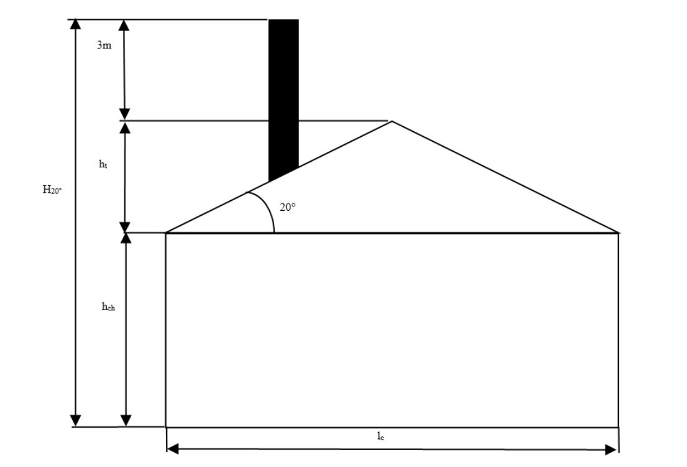
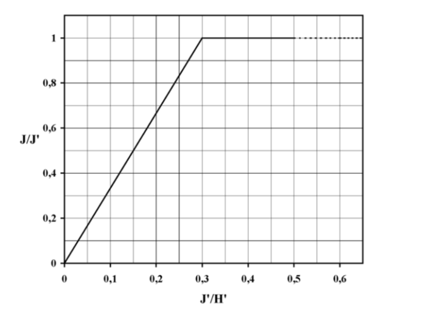
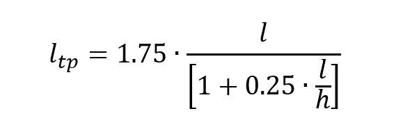
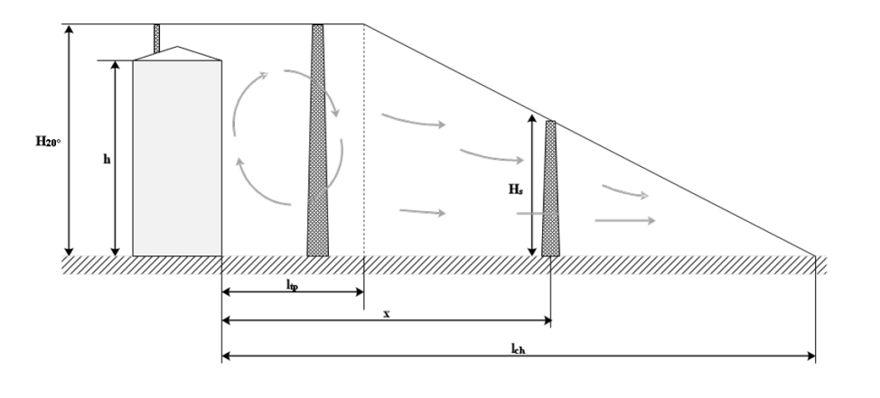
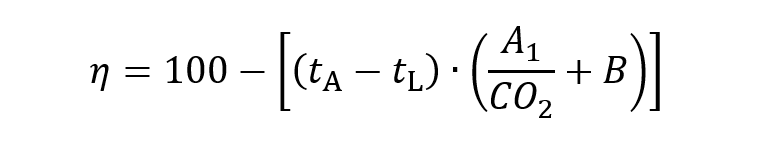
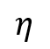
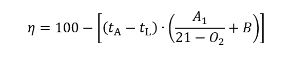
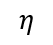
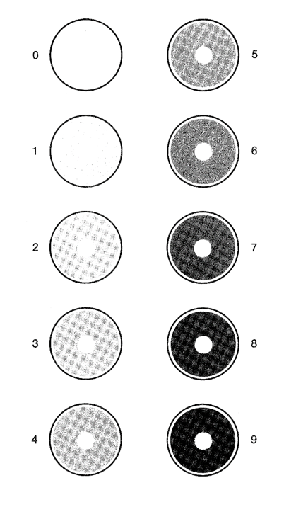

# Règlement grand-ducal du 24 avril 2018 relatif à la limitation des émissions de certains polluants dans l'atmosphère en provenance des installations de combustion moyennes et modifiant\n1. le règlement grand-ducal modifié du 27 février 2010 concernant les installations à gaz\n2. le règlement grand-ducal modifié du 7 octobre 2014 relatif a) aux installations de combustion alimentées en combustible solide ou liquide d’une puissance nominale utile supérieure à 7 kW et inférieure à 20 MW b) aux installations de combustion alimentées en combustible gazeux d’une puissance nominale utile supérieure à 3 MW et inférieure à 20 MW.

## Art. 1er — Objet

Le présent règlement établit des règles visant à limiter et à surveiller les émissions atmosphériques de polluants en provenance des installations de combustion moyennes et, partant, à réduire les émissions atmosphériques et les risques que celles-ci sont susceptibles de présenter pour la santé humaine et l’environnement.[^2]

## Art. 2 — Champ d’application

(1) Le présent règlement s’applique :

1\. aux installations de combustion d'une puissance thermique nominale égale ou supérieure à 1 MW et inférieure à 50 MW, ci-après dénommées « installations de combustion moyennes », quel que soit le type de combustible qu'elles utilisent ;

2\. à un ensemble formé par des installations de combustion moyennes en vertu de l'article 4, y compris un ensemble dont la puissance thermique nominale totale est supérieure ou égale à 50 MW, à moins que cet ensemble ne constitue une installation de combustion relevant du chapitre III de la [loi modifiée du 9 mai 2014](https://legilux.public.lu/eli/etat/leg/loi/2014/05/09/n1/jo) relative aux émissions industrielles ;

quelle que soit l’affectation des bâtiments où sont comprises ces installations.[^3]

(2) Le présent règlement ne s’applique pas :

1° aux installations de combustion qui relèvent du chapitre III ou du chapitre IV de la [loi modifiée du 9 mai 2014](https://legilux.public.lu/eli/etat/leg/loi/2014/05/09/n1/jo) relative aux émissions industrielles ;

2° aux installations de combustion qui relèvent du [règlement (UE) 2016/1628](https://legilux.public.lu/eli/reg_ue/2016/1628/jo) du Parlement européen et du Conseil du 14 septembre 2016 relatif aux exigences concernant les limites d’émission pour les gaz polluants et les particules polluantes et la réception par type pour les moteurs à combustion interne destinés aux engins mobiles non routiers, modifiant les [règlements (UE) n° 1024/2012](https://legilux.public.lu/eli/reg_ue/2012/1024/jo) et [(UE) n° 167/2013](https://legilux.public.lu/eli/reg_ue/2013/167/jo) et modifiant et abrogeant la [directive 97/68/CE](https://legilux.public.lu/eli/dir_ue/1997/68/jo)  ;[^36]

3° aux installations de combustion situées dans une exploitation agricole dont la puissance thermique nominale totale est inférieure ou égale à 5 MW, et qui utilisent exclusivement comme combustible du lisier non transformé de volaille, visé à l'article 9, point a), du [règlement (CE) no 1069/2009](https://legilux.public.lu/eli/reg_ue/2009/1069/jo) du Parlement européen et du Conseil ;

4° aux installations de combustion dont les produits gazeux de la combustion sont utilisés pour le réchauffement direct, le séchage ou tout autre traitement d'objets ou de matières ;

5° aux installations de combustion dont les produits gazeux de la combustion sont utilisés pour le chauffage direct au gaz des espaces intérieurs aux fins de l'amélioration des conditions de travail ;

6° aux installations de postcombustion qui ont pour objet l'épuration par combustion des gaz résiduaires de procédés industriels et qui ne sont pas exploitées en tant qu'installations de combustion autonomes ;

7° à tout dispositif technique employé pour la propulsion d'un véhicule, navire ou aéronef ;

8° aux turbines à gaz et aux moteurs à gaz ou moteurs diesel, en cas d'utilisation sur les plates-formes offshore ;

9° aux dispositifs de régénération des catalyseurs de craquage catalytique ;

10° aux dispositifs de conversion de l'hydrogène sulfuré en soufre ;

11° aux réacteurs utilisés dans l'industrie chimique ;

12° aux fours à coke ;

13° aux cowpers des hauts fourneaux ;

14° aux crematoriums ;

15° aux installations de combustion utilisant des combustibles de raffinerie seuls ou avec d'autres combustibles pour la production d'énergie au sein de raffineries de pétrole et de gaz ;

16° aux chaudières de récupération au sein d'installations de production de pâte à papier.

(3) Le présent règlement ne s'applique pas aux activités de recherche, aux activités de développement ou aux activités d'expérimentation ayant trait aux installations de combustion moyennes.

## Art. 3 — Définitions

Aux fins du présent règlement, on entend par :

1° « *bâtiment* » : une construction dotée d'un toit et de murs, dans laquelle l'énergie est utilisée pour réguler le climat intérieur ;

2° « *bioliquide* » : les combustibles liquides au sens du point 2 de l’article 1er du [règlement grand-ducal du 27 février 2011](https://legilux.public.lu/eli/etat/leg/rgd/2011/02/27/n1/jo) fixant les critères de durabilité pour les biocarburants et bioliquides et respectant les critères de durabilité y prévus ;

3° « *biomasse* » :

a) les produits composés d'une matière végétale agricole ou forestière susceptible d'être employée comme combustible en vue d'utiliser son contenu énergétique ;

b) les déchets ci-après :

i) déchets végétaux agricoles et forestiers ;

ii) déchets végétaux provenant du secteur industriel de la transformation alimentaire, si la chaleur produite est valorisée ;

iii) déchets végétaux fibreux issus de la production de pâte vierge et de la production de papier à partir de pâte, s'ils sont coïncinérés sur le lieu de production et si la chaleur produite est valorisée ;

iv) déchets de liège ;

v) déchets de bois, à l'exception des déchets de bois qui sont susceptibles de contenir des composés organiques halogénés ou des métaux lourds à la suite d'un traitement avec des conservateurs du bois ou du placement d'un revêtement, y compris notamment les déchets de bois de ce type provenant de déchets de construction ou de démolition ;

4° « *combustible* » : toute matière combustible solide, liquide ou gazeuse ;

5° « *combustible de raffinerie* » : tout combustible solide, liquide ou gazeux résultant des phases de distillation et de conversion du raffinage du pétrole brut, y compris le gaz de raffinerie, le gaz de synthèse, les huiles de raffinerie et le coke de pétrole ;

6° « *déchets* » : tout déchet au sens de l’article 4, point (1) de la [loi modifiée du 21 mars 2012](https://legilux.public.lu/eli/etat/leg/loi/2012/03/21/n1/jo) relative aux déchets ;

7° « *émission* » : le rejet dans l'atmosphère de substances provenant d'une installation de combustion ;

8° « *exploitant* » : toute personne physique ou morale qui exploite ou contrôle l'installation de combustion ou toute personne qui s'est vu déléguer un pouvoir économique déterminant à l'égard du fonctionnement technique de l'installation ;

9° « *fioul lourd* » :

a) tout combustible liquide dérivé du pétrole classé sous les codes NC 2710 19 51 à 2710 19 67, 2710 20 32, ou 2710 20 38 ; ou[^5]

b) tout combustible liquide dérivé du pétrole, autre que le gasoil défini au point 10°[^6], appartenant, du fait de ses limites de distillation, à la catégorie des fiouls lourds destinés à être utilisés comme combustibles et dont moins de 65 pour cent en volume (pertes comprises) distillent à 250 °C selon la méthode ASTM D86. Si la distillation ne peut pas être déterminée selon la méthode ASTM D86, le produit pétrolier est également classé dans la catégorie des fiouls lourds ;

10° « *gasoil* » :

a) tout combustible liquide dérivé du pétrole classé sous les codes NC 2710 19 25, 2710 19 29, 2710 19 47, 2710 19 48, 2710 20 16 ou 2710 20 19 ; ou[^7]

b) tout combustible liquide dérivé du pétrole dont moins de 65 pour cent en volume (pertes comprises) distillent à 250 °C et dont au moins 85 pour cent en volume (pertes comprises) distillent à 350 °C selon la méthode ASTM D86 ;

dont la teneur en soufre n'excède pas la valeur limite fixée par la réglementation en vigueur et qui n’a pas servi auparavant à d’autres fins.

11° « *gaz naturel* » : méthane de formation naturelle ayant une teneur maximale de 20 pour cent (en volume) en inertes et autres éléments ;

12° « *heures d’exploitation* » : période de temps, exprimée en heures, au cours de laquelle une installation de combustion est en exploitation et rejette des émissions dans l'air, à l'exception des phases de démarrage et d'arrêt ;

13° « *inspection* » :

a) le contrôle de l’installation de combustion et des paramètres prescrits qui intervient après la mise en service d’une nouvelle installation de combustion ou après une transformation importante d’une installation de combustion ;

b) le mesurage périodique des paramètres prescrits pour une installation de combustion ;[^8]

14° « *inspection positive* » : la conformité des valeurs mesurées lors de l'inspection avec les paramètres prescrits ;

15° « *inspection négative* » : la non-conformité des valeurs mesurées lors de l'inspection avec les paramètres prescrits ;

16° « *installation de combustion* » : tout dispositif technique dans lequel des produits combustibles sont oxydés en vue d’utiliser la chaleur ainsi produite ;

17° « *installation de combustion existante* » : une installation de combustion qui est mise en service au plus tard le 20 décembre 2018 ;[^9]

18° « *microréseau isolé* » : tout réseau qui a eu une consommation inférieure à 500 GWh en 1996, et qui n’est pas connecté à d’autres réseaux ;

19° « *moteur* » : un moteur à gaz, un moteur diesel ou un moteur à double combustible ;

20° « *moteur à gaz* » : un moteur à combustion interne fonctionnant selon le cycle Otto et utilisant l'allumage par étincelle pour brûler le combustible ;

21° « *moteur diesel* » : un moteur à combustion interne fonctionnant selon le cycle diesel et utilisant l'allumage par compression pour brûler le combustible ;

22° « *moteur à double combustible* » : un moteur à combustion interne utilisant l'allumage par compression et fonctionnant selon le cycle diesel pour brûler des combustibles liquides et selon le cycle Otto pour brûler des combustibles gazeux ;

23° « *nouvelle installation de combustion* » :

a) toute installation de combustion qui est mise en service après le 20 décembre 2018 ;

b) toute installation de combustion existante qui a fait l’objet d’une transformation importante après le 20 décembre 2018 ;

c) toute installation de combustion existante qui a été mise en service ou qui a fait l’objet d’une transformation importante au plus tard le 20 décembre 2018 et qui n’a pas fait l’objet d’une inspection positive avant cette date ;[^10]

24° « *organisme agréé* » : l’organisme ou la personne titulaire d’un agrément dans le cadre de la [loi du 21 avril 1993](https://legilux.public.lu/eli/etat/leg/loi/1993/04/21/n3/jo) relative à l'agrément de personnes physiques ou morales privées ou publiques, autres que l'État, pour l'accomplissement de tâches techniques d'études et de vérification dans le domaine de l'environnement ;

25° « *oxydes d'azote (NOx)* » : le monoxyde et le dioxyde d'azote, exprimés en dioxyde d'azote (NO2) ;

26° « *petit réseau isolé* » : tout réseau qui a une consommation inférieure à 3 000 GWh en 1996, et qui peut être interconnecté avec d’autres réseaux pour une quantité inférieure à 5 pour cent de sa consommation annuelle ;

27° « *poussières* » : les particules de forme, de structure ou de masse volumique quelconque dispersées dans la phase gazeuse dans les conditions au point de prélèvement, qui sont susceptibles d'être recueillies par filtration dans les conditions spécifiées après échantillonnage représentatif du gaz à analyser, et qui demeurent en amont du filtre et sur le filtre après séchage dans les conditions spécifiées ;

28° « *puissance thermique nominale* » : la puissance calorifique maximale, exprimée en MW, fixée et garantie par le constructeur comme pouvant être fournie en marche continue tout en respectant les rendements utiles annoncés par le constructeur, désignée ci-après « puissance » ;

29° « *taux d'humidité résiduelle* » : La masse d'eau contenue dans le combustible par rapport à la masse du combustible sec ;

30° « *transformation importante* » : le remplacement total ou la transformation d’une unité de combustion par le remplacement de la chaudière ou du brûleur ou l’extension ou le déplacement d’une installation de combustion ;[^11]

31° « *turbine à gaz* » : tout appareil rotatif qui convertit de l'énergie thermique en travail mécanique et consiste principalement en un compresseur, un dispositif thermique permettant d'oxyder le combustible de manière à chauffer le fluide de travail et une turbine ; sont comprises dans cette définition les turbines à gaz à circuit ouvert et les turbines à gaz à cycle combiné, ainsi que les turbines à gaz en mode de cogénération, équipées ou non d'un brûleur supplémentaire dans chaque cas ;

32° « *valeur limite d’émissions* » : la quantité admissible d'une substance contenue dans les gaz résiduaires d'une installation de combustion pouvant être rejetée dans l'atmosphère pendant une période donnée.

33° « *efficacité énergétique* » : le rapport entre les résultats, le service, la marchandise ou l’énergie que l’on obtient et l’énergie consacrée à cet effet ;

34° « *amélioration de l’efficacité énergétique* » : un accroissement de l’efficacité énergétique à la suite de modifications d’ordre technologique, comportemental ou économique ;

35° « *contrat de performance énergétique* » : un accord contractuel entre le bénéficiaire et le fournisseur d’une mesure visant à améliorer l’efficacité énergétique, vérifiée et surveillée pendant toute la durée du contrat, aux termes duquel les investissements (travaux, fournitures ou services) dans cette mesure sont rémunérés en fonction d’un niveau d’amélioration de l’efficacité énergétique qui est contractuellement défini ou d’un autre critère de performance énergétique convenu, tel que des économies financières ;

36° « *système technique de bâtiment* » : un équipement technique de chauffage des locaux, de refroidissement des locaux, de ventilation, de production d’eau chaude sanitaire, d’éclairage intégré, d’automatisation et de contrôle des bâtiments, de production d’électricité sur site d’un bâtiment ou d’une unité de bâtiment, ou combinant plusieurs de ces systèmes, y compris les systèmes utilisant une énergie produite à partir de sources renouvelables ;

37° « *système d’automatisation et de contrôle des bâtiments* » : un système comprenant tous les produits, logiciels et services d’ingénierie à même de soutenir le fonctionnement efficace sur le plan énergétique, économique et sûr des systèmes techniques de bâtiment au moyen de commandes automatiques et en facilitant la gestion manuelle de ces systèmes techniques de bâtiment.[^12]

## Art. 4 — Cumul

(1) L'ensemble formé par au moins deux nouvelles installations de combustion moyennes est considéré comme une seule installation de combustion moyenne aux fins du présent règlement, et leur puissance thermique nominale est additionnée aux fins du calcul de la puissance thermique nominale totale de l'installation si :

1\. les gaz résiduaires de ces installations de combustion moyennes sont rejetés par une cheminée commune, ou

2\. Compte tenu des facteurs techniques et économiques, les gaz résiduaires de ces installations de combustion moyennes pourraient, selon l’Administration de l’environnement, dénommée ci-après « administration », être rejetés par une cheminée commune.[^13]

(2) Dans le cas où l’ensemble formé remplit la condition du paragraphe 1er point 1, le mesurage des émissions au cours des inspections est effectué dans l’ensemble formé par ces installations.

Dans le cas où l’ensemble formé remplit la condition du paragraphe 1er point 2, le mesurage des émissions au cours des inspections est effectué dans chaque installation appartenant à l’ensemble visé par le paragraphe 1er.

(3) La puissance thermique nominale totale d’un ensemble d’installations visé par le paragraphe 1er est déterminante pour la périodicité des inspections visée par l’article 7.

## Art. 5 — Enregistrement d’une installation de combustion moyenne

(1) L’administration tient un registre public comportant des informations sur chaque installation de combustion moyenne, y compris les informations énumérées à l’annexe I et les informations obtenues en vertu de l’article 11.[^14] L’administration met les informations contenues dans le registre à la disposition du public, accessibles sur un site électronique installé à cet effet, conformément à la [loi du 25 novembre 2005](https://legilux.public.lu/eli/etat/leg/loi/2005/11/25/n4/jo) concernant l'accès du public à l'information en matière d'environnement.

(2) Aux fins du paragraphe 1er,

1\. l’exploitant d’une installation de combustion moyenne mise en service avant l’entrée en vigueur du présent règlement communique à l’administration, dans les douze mois qui suivent cette entrée en vigueur, les informations énumérées à l'annexe I.

2\. l’exploitant d’une installation de combustion moyenne mise en service après l’entrée en vigueur du présent règlement communique ces informations dans les six semaines qui suivent la date de mise en service.

Au-delà des délais fixés à l’alinéa 1er, l’installation de combustion moyenne ne peut pas être exploitée aussi longtemps qu’un enregistrement n’a pas été effectué.

La communication des informations se fait par le biais d’un formulaire mis à disposition par l’administration.

L’administration vérifie si les informations fournies sont exactes et complètes et dans l’affirmative informe l'exploitant de l’enregistrement. L’enregistrement est effectué dans un délai d’un mois à compter de la communication des informations.

(3) Pour les installations de combustion moyennes qui font partie d’une installation relevant du chapitre II de la [loi modifiée du 9 mai 2014](https://legilux.public.lu/eli/etat/leg/loi/2014/05/09/n1/jo) relative aux émissions industrielles, les exigences du présent article sont réputées remplies du fait du respect de [ladite loi](https://legilux.public.lu/eli/etat/leg/loi/2014/05/09/n1/jo).[^15]

(4) Tout enregistrement effectué en vertu d'autres dispositions législatives ou réglementaires peut être combiné avec l'enregistrement requis en vertu du paragraphe 1er pour former un enregistrement unique, pour autant que ledit enregistrement unique contienne les informations requises au titre du présent article.

## Art. 6 — Valeurs limites d’émission

(1) Sans préjudice du chapitre II de la [loi modifiée du 9 mai 2014](https://legilux.public.lu/eli/etat/leg/loi/2014/05/09/n1/jo) relative aux émissions industrielles, le cas échéant, les valeurs limites d’émission énoncées à l’annexe II s’appliquent aux installations de combustion moyennes.

(2) Les installations de combustion moyennes existantes sont exploitées de façon à ce que les valeurs limites d’émission de l’annexe II, partie 1, ne soient pas dépassées.

Cette disposition ne s’applique pas aux installations de combustion moyennes existantes qui ne sont pas exploitées plus de 100 heures d’exploitation par an, en moyenne mobile calculée sur une période de cinq ans.

Dans des cas d’urgence ou de circonstances exceptionnelles, la limite visée à l’alinéa 2 s’étend à 500 heures d’exploitation.

Dans tous les cas visés au présent paragraphe, une valeur limite d’émission de 200 milligrammes par normal mètre cube (mg/Nm3) pour les poussières s’applique aux installations de combustion moyennes existantes qui utilisent des combustibles solides.

(3) Les nouvelles installations de combustion moyennes sont exploitées de façon à ce que les valeurs limites d’émission de l’annexe II, partie 2, ne soient pas dépassées.

Cette disposition ne s’applique pas aux nouvelles installations de combustion moyennes qui ne sont pas exploitées plus de 100 heures d’exploitation par an, en moyenne mobile calculée sur une période de trois ans.

Dans des cas d’urgence ou de circonstances exceptionnelles, la limite visée à l’alinéa 2 s’étend à 500 heures d’exploitation.

Dans tous les cas visés au présent paragraphe, une valeur limite d’émission de 100 milligrammes par normal mètre cube (mg/Nm3) pour les poussières s’applique aux nouvelles installations de combustion moyennes qui utilisent des combustibles solides.

(4) Au plus tard le 1er janvier 2025, les installations de combustion moyennes existantes sont exploitées conformément au paragraphe 3.

(5) Dans les zones ou les parties de zones où les valeurs limites de qualité de l’air établies par le [règlement grand-ducal modifié du 29 avril 2011](https://legilux.public.lu/eli/etat/leg/rgd/2011/04/29/n2/jo) portant application de la [directive 2008/50/CE](https://legilux.public.lu/eli/dir_ue/2008/50/jo) du Parlement européen et du Conseil du 21 mai 2008 concernant la qualité de l’air ambiant et un air pur pour l’Europe ne sont pas respectées, le ministre ayant l’Environnement dans ses attributions, dénommé ci-après « ministre », fait évaluer par administration, dans le cadre de l’élaboration des plans relatifs à la qualité de l’air visés à l’article 24 du [règlement grand-ducal précité du 29 avril 2011](https://legilux.public.lu/eli/etat/leg/rgd/2011/04/29/n2/jo), en tenant compte des résultats de l’échange d’informations organisé par la Commission européenne, la nécessité d’appliquer, pour chaque installation de combustion moyenne dans ces zones ou parties de zones, des valeurs limites d’émission plus strictes que celles énoncées dans le présent règlement. Le ministre prend, sur base de cette évaluation, une décision afférente pour autant que l’application de telles valeurs limites d’émission contribue effectivement à une amélioration notable de la qualité de l’air.

(6) Le ministre peut accorder une dérogation dispensant de l’obligation de respecter les valeurs limites d’émission prévues aux paragraphes 2 et 3 dans le cas où une installation de combustion moyenne qui n’utilise que du combustible gazeux doit exceptionnellement avoir recours à d’autres combustibles en raison d’une interruption soudaine de l’approvisionnement en gaz et devrait, de ce fait, être équipée d’un dispositif antipollution secondaire. La période pour laquelle une telle dérogation est accordée ne dépasse pas dix jours, sauf si l’exploitant démontre qu’une période plus longue est justifiée.

(7) Lorsqu’une installation de combustion moyenne utilise simultanément deux combustibles ou davantage, la valeur limite d’émission de chaque polluant est calculée comme suit :

1° prendre la valeur limite d’émission relative à chaque combustible, telle qu’elle est énoncée à l’annexe II ;

2° déterminer la valeur limite d’émission pondérée par combustible ; cette valeur est obtenue en multipliant la valeur limite d’émission visée au point 1° par la puissance thermique fournie par chaque combustible, et en divisant le résultat de la multiplication par la somme des puissances thermiques fournies par tous les combustibles ;

3° additionner les valeurs limites d’émission pondérées par combustible.[^16]

## Art. 7 — Obligations de l’exploitant

(1) L’exploitant procède à la surveillance des émissions et du rendement conformément, au minimum, à l’annexe III, partie 1, et dans les périodicités prévues par le présent article.

Les frais de la surveillance des émissions et du rendement sont à charge de l’exploitant.

(2) Toute nouvelle installation de combustion moyenne et toute installation de combustion moyenne soumise à une transformation importante fait l’objet d’une première inspection par un organisme agréé conformément à l’article 8. Cette première inspection est effectuée, sur demande de l’exploitant, dans les quatre semaines qui suivent la mise en service de l’installation.

(3) À compter de la date de la première inspection positive, l’exploitant d’une installation de combustion moyenne fait procéder à des inspections subséquentes par un organisme agréé dans les fréquences suivantes :

a) pour les installations ayant une puissance thermique nominale supérieure ou égale à 1 MW et inférieure ou égale à 20 MW, tous les deux ans ;

b) pour les installations ayant une puissance thermique nominale supérieure ou égale à 1 MW et inférieure ou égale à 20 MW et qui ne sont pas exploitées plus de 100 heures d’exploitation par an, chaque fois que 200 heures d’exploitation se sont écoulées, sans que la fréquence puisse être inférieure à une fois tous les cinq ans ;

c) pour les installations ayant une puissance thermique nominale supérieure à 20 MW, annuellement ;

d) pour les installations ayant une puissance thermique nominale supérieure à 20 MW et qui ne sont pas exploitées plus de 100 heures d’exploitation par an, chaque fois que 100 heures d’exploitation se sont écoulées, sans que la fréquence puisse être inférieure à une fois tous les cinq ans.

L’exploitant d’une installation de combustion moyenne devant respecter les valeurs limites d’émission liées aux composés organiques totaux et aux fluor et composés inorganiques du fluor énoncées à l’annexe II fait procéder à des inspections annuelles par un organisme agréé à compter de la date de la première inspection positive.

(4) Les dates des inspections subséquentes d’une installation de combustion moyenne existante sont calculées par rapport à la dernière inspection telle que prévue, par le [règlement grand-ducal modifié du 7 octobre 2014](https://legilux.public.lu/eli/etat/leg/rgd/2014/10/07/n1/jo) relatif aux installations de combustion alimentées en combustible solide ou liquide d’une puissance nominale utile supérieure à 7 kW et inférieure à 1 MW respectivement par le [règlement grand-ducal modifié du 27 février 2010](https://legilux.public.lu/eli/etat/leg/rgd/2010/02/27/n2/jo) concernant les installations à gaz ou le cas échéant dans l’autorisation de l’installation concernée.

Si l’alinéa 1er ne trouve pas à s’appliquer, l’exploitant d’une installation de combustion moyenne existante fait procéder par un organisme agréé à une première inspection périodique au plus tard un an après l’entrée en vigueur du présent règlement.

(5) Dans le cas des installations de combustion moyennes qui utilisent plusieurs combustibles, la surveillance des émissions et du rendement est effectuée lors de la combustion du combustible ou du mélange de combustibles susceptible d’entraîner le plus haut niveau d’émissions et pendant une période représentative des conditions d’exploitation normales.

(6) L’exploitant conserve une trace de tous les résultats de la surveillance et en traite tous les résultats de manière à permettre la vérification du respect des valeurs limites d’émission et du rendement minimal conformément aux règles énoncées à l’annexe III, partie 2.

(7) Dans le cas des installations de combustion moyennes qui utilisent un dispositif antipollution secondaire et un dispositif de mesure en continu pour respecter les valeurs limites d’émission, l’exploitant conserve une trace du bon fonctionnement continu de ces dispositifs ou conserve des informations le prouvant.

(8) L’exploitant d’une installation de combustion moyenne conserve les éléments suivants :

1° l’autorisation ou la preuve de l’enregistrement délivrée par l’autorité compétente et, le cas échéant, sa version actualisée et les informations connexes ;

2° les résultats de la surveillance et les informations visées aux paragraphes 6 et 7 ;

3° le cas échéant, un relevé des heures d’exploitation visées à l’article 6, paragraphes 2 et 3 ;

4° un relevé du type et des quantités de combustible utilisé dans l’installation et de tout dysfonctionnement ou toute panne du dispositif antipollution secondaire ;

5° un relevé des cas de non-respect et des mesures prises, conformément au paragraphe 10 ;

6° le cas échéant, un relevé des valeurs moyennes horaires et journalières des mesures en continu dont il est question à l’annexe III.

Les données et informations visées aux points 2 à 6 sont conservées par l’exploitant pendant au moins six ans.

(9) Sur demande de l’administration, l’exploitant communique à cette dernière, sans retard injustifié, les données et les informations énumérées au paragraphe 8. L’administration peut formuler une telle demande afin de permettre le contrôle du respect des exigences du présent règlement. L’administration formule une telle demande si un citoyen sollicite l’accès aux données ou aux informations énumérées au paragraphe 8.

(10) En cas de non-respect des valeurs limites d’émission et du rendement minimal énoncés à l’annexe II, l’exploitant prend les mesures nécessaires pour assurer le rétablissement de la conformité dans les plus brefs délais, sans préjudice des mesures requises au titre des articles 8 et 10.

(11) L’exploitant fournit à l’administration toute l’assistance nécessaire pour lui permettre de mener les inspections et les visites des sites, de prélever des échantillons et de recueillir toute information nécessaire à l’accomplissement de ses tâches aux fins du présent règlement.

(12) L’exploitant fait en sorte que les phases de démarrage et d’arrêt de l’installation de combustion moyenne soient aussi courtes que possible. [^17]

## Art. 8 — Inspection d’une installation de combustion moyenne

(1) Au moins une semaine avant de procéder à une inspection, l’organisme agréé en informe l’administration.

(2) L’organisme agréé procède au contrôle des valeurs limites d’émission et du rendement minimal énoncés par l’annexe II conformément aux conditions de mesurage de l’annexe III.

(3) Lorsque l’inspection est positive, l’organisme agréé qui y a procédé transmet dans le délai d’un mois à l’exploitant et à l’administration un rapport d’inspection contenant toutes les informations requises par l’annexe V et indiquant la conformité de l’installation. La transmission se fait sur base d’un formulaire mis à disposition par l’administration.

Lorsque l’inspection est négative, l’exploitant de l’installation prend toute mesure nécessaire pour assurer le rétablissement de la conformité sans retard injustifié et est tenu d’établir à cet effet une prise de position détaillée relative aux conclusions et recommandations de l’organisme agréé. Cette prise de position doit également comprendre un échéancier précis dans lequel l’exploitant entend se conformer aux exigences du présent règlement, lequel ne peut pas dépasser douze mois. L’échéancier peut toutefois exceptionnellement dépasser le délai de douze mois si un tel dépassement est dûment justifié. Dans ce cas, l’exploitant ajoute une explication détaillée à la prise de position. La prise de position est transmise pour approbation dans la quinzaine par l’exploitant à l’administration. Après la réalisation des travaux de mise en conformité qui s’imposent suite à une inspection négative, l’exploitant est tenu de faire procéder à une deuxième inspection. En cas de non-respect du présent alinéa ou si cette deuxième inspection est également négative ou n’a pas été effectuée selon l’échéancier approuvé par l’administration, l’installation est réputée ne pas satisfaire aux dispositions du présent règlement et ne peut être maintenue en service.

Lorsque la non-conformité constatée lors d’une inspection négative entraîne une dégradation significative de la qualité de l’air au niveau local, l’exploitation de l’installation de combustion moyenne est suspendue jusqu’à ce que la conformité soit rétablie.

L’organisme agréé est tenu, lors de l’inspection, de signaler sans délai à l’administration tout défaut, toute nuisance ainsi que toute situation qui constitue ou est susceptible de constituer une atteinte à l’environnement.[^18]

(4) Les rapports d'inspection font l’objet d'un contrôle indépendant par l'administration. À cette fin, l'administration sélectionne de manière aléatoire au moins un pourcentage statistiquement significatif de tous les rapports d'inspection périodique établis au cours d'une année donnée et soumet ceux-ci à une vérification.

(5) L’administration veille à ce que les rapports d’inspection ainsi que des informations sur leur utilité et leurs objectifs soient transmis à l’exploitant.

(6) Pour les installations de combustion moyennes[^19] ayant une puissance thermique nominale égale ou supérieure à 1 MW et inférieure ou égale à 3 MW et tombant dans le champ d’application de l’article 8 du [règlement grand-ducal modifié du 27 février 2010](https://legilux.public.lu/eli/etat/leg/rgd/2010/02/27/n2/jo) concernant les installations à gaz à l’exception des installations visées par l’article 8, paragraphe 2, point 2 du même règlement, l’organisme agréé procède lors de l’inspection aux contrôles de la conformité des critères visés à l’article 9, paragraphe 5, points a), b) et c) et à l’article 11, paragraphe 7, points a), b) et c) du même règlement.

Pour ces installations, l’administration transmet, dès la réception de ces documents, au ministre ayant l’Énergie dans ses attributions les rapports d’inspection y relatifs.

(7) Pour les installations de combustion moyennes qui sont régies explicitement par un critère de performance énergétique convenu ou un accord contractuel fixant un niveau convenu d’amélioration de l’efficacité énergétique, tels que les contrats de performance énergétique définis à l’article 3, point 35°, ou qui sont gérées par un gestionnaire de services d’utilité publique ou un gestionnaire de réseau et sont par conséquent soumises à des mesures de suivi de la performance visant les systèmes, le rendement de combustion ne doit pas être contrôlé dans le cadre des inspections prévues au présent article à condition que l’incidence globale d’une telle approche soit équivalente à celle qui résulte d’une inspection complète avec contrôle du rendement de combustion.

Sont également exemptées de l’obligation de contrôle du rendement de combustion dans le cadre des inspections prévues au présent article, les installations de combustion moyennes installées dans des bâtiments qui sont équipés d’un système d’automatisation et de contrôle du bâtiment capable :

1° de suivre, d’enregistrer et d’analyser en continu la consommation énergétique et de permettre de l’ajuster en continu ;

2° de situer l’efficacité énergétique du bâtiment par rapport à des valeurs de référence, de détecter les pertes d’efficacité des systèmes techniques de bâtiment et d’informer la personne responsable des installations ou de la gérance technique du bâtiment des possibilités d’amélioration de l’efficacité énergétique ;

3° de permettre la communication avec les systèmes techniques de bâtiment connectés et d’autres appareils à l’intérieur du bâtiment, et d’être interopérables avec des systèmes techniques de bâtiment impliquant différents types de technologies brevetées, de dispositifs et de fabricants.[^20]

## Art. 9 — Performance énergétique d’une installation de combustion moyenne

(1) Le présent article s’applique uniquement aux installations de combustion moyennes qui sont destinées exclusivement au chauffage du bâtiment.

(2) Avant la mise en place d’une nouvelle installation de combustion moyenne et avant une transformation importante d’une installation de combustion moyenne, l’exploitant fait procéder à une évaluation du dimensionnement de l’installation par rapport aux exigences en matière de chauffage du bâtiment.[^21] L'évaluation du dimensionnement de l’installation ne doit pas être répétée dès lors qu'aucune transformation importante n'a été apportée entre-temps au système de chauffage ou en ce qui concerne les exigences en matière de chauffage du bâtiment.

L'exploitant conserve une trace de cette évaluation.

Une nouvelle installation de combustion moyenne doit être conçue de façon à ce que le système utilisé pour le chauffage de bâtiments, tels que le générateur de chaleur, le système de contrôle et la ou les pompes de circulation, correspond aux meilleures techniques disponibles en matière d’efficience énergétique.

(3) Pour les installations de combustion moyennes existantes l’évaluation de la performance énergétique telle que visée par le paragraphe 2 se fait au cours de la première inspection requise.

L’inspection comprend également le contrôle des systèmes utilisés pour le chauffage de bâtiments, tels que le générateur de chaleur, le système de contrôle et la ou les pompes de circulation.

L’exploitant fait établir par un expert qualifié un rapport sur l’évaluation de la performance énergétique. Cette évaluation comprend des recommandations pour l’amélioration rentable de la performance énergétique de l’installation. Il conserve une trace de cette évaluation.

(4) Les nouvelles installations de combustion moyennes sont exploitées de façon à ce que les rendements de combustion minimaux de l’annexe II, partie 2, soient respectés.

(5) Les installations de combustion moyennes existantes sont exploitées de façon à ce que les rendements de combustion minimaux de l’annexe II, partie 1, soient respectés.

Au plus tard le 1er janvier 2025, les installations de combustion moyennes existantes sont exploitées conformément au paragraphe 4.[^22]

## Art. 10 — Contrôles et calibrages des dispositifs de mesure en continu

(1) L’exploitant d’une installation de combustion moyenne équipée d’un dispositif de mesure en continu doit faire :

1\. contrôler annuellement le bon fonctionnement des dispositifs de mesure en continu ;

2\. contrôler le calibrage des appareils de mesure en continu :

a) une première fois avant leur mise en service

b) le cas échéant chaque fois qu'un nouveau calibrage s'avère nécessaire ; sinon, tous les trois ans.

Ce contrôle doit être effectué par un organisme agréé.

Un nouveau calibrage s'avère nécessaire chaque fois qu'une ou plusieurs des composantes du système de mesure est modifiée ou remplacée ou qu'une anomalie de fonctionnement est constatée.

(2) Lorsque le contrôle annuel du fonctionnement des dispositifs de mesure en continu est positif, l’organisme agréé qui y a procédé transmet dans le mois qui suit le contrôle à l'exploitant un rapport de contrôle contenant toutes les informations requises par l'annexe VI et indiquant le bon fonctionnement du dispositif de mesure en continu.

L’exploitant indique la date du contrôle dans le rapport annuel visé par l’article 12.

Lorsque le contrôle annuel du système de mesure en continu démontre des défauts, l’organisme agréé qui y a procédé indique les défauts dans le rapport de contrôle et informe dans la quinzaine l’exploitant et l'administration. L’information peut se faire sur base d'un formulaire électronique mis à disposition par l'administration.

(3) En cas de défauts du système de mesure en continu, l’exploitant prend toute mesure nécessaire pour assurer le rétablissement du bon fonctionnement sans retard injustifié.

## Art. 11 — Transformations importantes et autres modifications apportées aux installations de combustion moyennes

L’exploitant informe, sans retard injustifié, l’administration de toute modification ou transformation importante prévue de l’installation de combustion moyenne qui serait susceptible d’avoir une incidence sur les valeurs limites d’émission et le rendement minimal applicables.[^23]

L'administration actualise en conséquence l'enregistrement et en informe l’exploitant.

## Art. 12 — Rapport annuel

L'exploitant est tenu de transmettre à l'administration pour le 1er mars au plus tard un rapport annuel contenant toutes les informations requises par l'annexe VII et relatives à l'année écoulée. La transmission peut se faire sur base d'un formulaire mis à disposition par l'administration.

## Art. 13 — Exigences relatives aux cheminées des installations de combustion moyennes

(1) Les émissions des cheminées des installations de combustion moyennes sont évacuées de façon que la diffusion dans l'air, circulant librement, soit garantie. Des caches sur les cheminées ne sont pas admissibles.

(2) La hauteur minimale des hautes cheminées des installations visées au paragraphe 1er est déterminée soit par les méthodes décrites à l’annexe IV, soit par des méthodes qui fournissent des résultats d’une fiabilité équivalente.

(3) Le présent article ne s’applique pas aux cheminées existantes des installations visées au paragraphe 1er, à l’exception de celles faisant partie d’installations subissant une transformation importante.[^24]

## Art. 14 — Support électronique

La transmission des informations et la mise à disposition des documents prévus par le présent règlement peuvent se faire sous forme électronique.

## Art. 15 — Modification du règlement grand-ducal modifié du 7 octobre 2014 relatif a) aux installations de combustion alimentées en combustible solide ou liquide d’une puissance nominale utile supérieure à 7 kW et inférieure à 20 MW b) aux installations de combustion alimentées en combustible gazeux d’une puissance nominale utile supérieure à 3 MW et inférieure à 20 MW

Le [règlement grand-ducal modifié du 7 octobre 2014](https://legilux.public.lu/eli/etat/leg/rgd/2014/10/07/n1/jo) relatif a) aux installations de combustion alimentées en combustible solide ou liquide d’une puissance nominale utile supérieure à 7 kW et inférieure à 20 MW b) aux installations de combustion alimentées en combustible gazeux d’une puissance nominale utile supérieure à 3 MW et inférieure à 20 MW est modifié comme suit :

1° L’intitulé est modifié comme suit :

> Règlement grand-ducal modifié du 7 octobre 2014 relatif aux installations[^1] de combustion alimentées en combustible solide ou liquide d’une puissance nominale utile supérieure à 7 kW et inférieure à 1 MW

2° L’article 1er, paragraphe 1er est remplacé par le texte suivant :

> (1) Le présent règlement s’applique aux :
>
> 1° installations de combustion fixes alimentées en combustible solide à chargement manuel ou à chargement automatisé ayant une puissance nominale utile supérieure à 7 kW et inférieure à 1 MW ;
>
> 2° installations de combustion fixes alimentées en combustible liquide ayant une puissance nominale utile supérieure à 7 kW et inférieure à 1 MW ;
>
> quelle que soit l'affectation des locaux où sont comprises ces installations qui sont dénommées ci-après « installation(s) ».

3° L’article 2, point 5 est remplacé comme suit :

> 5\) « certificat de contrôleur pour chauffages » :
>
> l'habilitation conférée par le ministre ayant l*'*Environnement dans ses attributions, dénommé ci-après « ministre », à un candidat contrôleur pour les installations d'une puissance supérieure à 7 kW et inférieure à 1 MW visées par le règlement ;

4° L’article 4, point 9 est supprimé.

5° L’article 5, paragraphes 2 et 3 sont supprimés.

6° Les articles 9, 11, 12 et 14 sont supprimés.

7° L’intitulé du premier chapitre du titre III est remplacé comme suit :

> **Chapitre Ier Réception des installations ayant une puissance inférieure 1 MW**

8° L’intitulé de l’article 15 est remplacé comme suit :

> **Art.15 — Réception des installations à combustible solide ou liquide d’une puissance supérieure à 7 kW et inférieure à 1 MW**

9° L’article 15, paragraphe 1er est modifié comme suit :

> À l'exception des chauffages de locaux non raccordés au circuit de chauffage, les nouvelles installations à combustible solide ou liquide d’une puissance supérieure à 7 kW et inférieure 1 MW sont soumises, sur demande préalable d'une entreprise, à une réception.

10° L’article 17 est supprimé.

11° L’intitulé du premier chapitre du titre IV est remplacé comme suit :

> **Chapitre Ier Inspection périodique des installations ayant une puissance supérieure à 7 kW et inférieure 1 MW**

12° L’intitulé de l’article 18 est remplacé comme suit :

> Inspection périodique des installations à combustible solide ou liquide d’une puissance supérieure à 7 kW et inférieure 1 MW

13° L’article 18, paragraphe 1er, alinéa 1er est modifié comme suit :

> (1) À l'exception des chauffages de locaux non raccordés au circuit de chauffage, l'exploitant d'une installation alimentée en combustible solide ou liquide d’une puissance supérieure à 7 kW et inférieure 1 MW est tenu de faire procéder à une inspection périodique tous les deux ans.

14° Les articles 19 et 20 sont supprimés.

15° L’annexe VII est supprimée.

16° L’intitulé de l’annexe XI est remplacé comme suit :

> Rapport de réception et rapport d’inspection périodique d‘une installation à combustible solide ou liquide d’une puissance supérieure à 7 kW et inférieure 1 MW

17° L’annexe XI, alinéa 1er est remplacé comme suit :

> Le rapport de réception et le rapport d'inspection pour les installations à combustible solide ou liquide d’une puissance supérieure à 7 kW et inférieure 1 MW doivent contenir au minimum les données suivantes.

18° Les annexes XII, XIII, XIV et XV sont supprimées.

## Art. 16 — Modification du règlement grand-ducal modifié du 27 février 2010 concernant les installations à gaz

Le [règlement grand-ducal modifié du 27 février 2010](https://legilux.public.lu/eli/etat/leg/rgd/2010/02/27/n2/jo) concernant les installations à gaz est modifié comme suit :

1° L’article 7 est remplacé comme suit :

> **Art. 7 — Valeurs de combustion des installations gaz.**
>
> (1) Les installations à gaz destinées au chauffage des locaux et au chauffage de l’eau sanitaire d’une puissance inférieure à 1 MW doivent être mises en place et exploitées de façon à ce que le rendement de combustion et la qualité de combustion répondent aux exigences indiquées aux annexes 4 et 5.
>
> (2) Tous les appareils à gaz d’une puissance inférieure à 1 MW doivent être mis en place et exploités de façon à ce que la qualité de combustion réponde aux exigences indiquées à l’annexe 5.

2° L’article 8, paragraphe 2, alinéa 2 est remplacé comme suit :

> aux installations qui ont une puissance totale supérieure ou égale à 1 MW ;

3° À l’annexe 4, premier tableau, ligne 4, les termes 3000 kW sont remplacés par les termes 1000 kW.

## Art. 17 — Dispositions transitoires

(1) L’habilitation à la fonction de contrôleur pour les installations ayant une puissance supérieure à 7 kW et inférieure à 3 MW, obtenue avant l’entrée en vigueur du présent règlement, en vertu de l’article 18 du [règlement grand-ducal modifié du 7 octobre 2014](https://legilux.public.lu/eli/etat/leg/rgd/2014/10/07/n1/jo) relatif a) aux installations de combustion alimentées en combustible solide ou liquide d’une puissance nominale utile supérieure à 7 kW et inférieure à 20 MW b) aux installations de combustion alimentées en combustible gazeux d’une puissance nominale utile supérieure à 3 MW et inférieure à 20 MW respectivement en vertu de l’article 13 du [règlement grand-ducal modifié du 27 février 2010](https://legilux.public.lu/eli/etat/leg/rgd/2010/02/27/n2/jo) concernant les installations à gaz reste valable jusqu’à la date de son expiration.

(2) Pour les installations qui sont en service au moment de l´entrée en vigueur du présent règlement et pour lesquelles la demande de réception a été introduite avant cette entrée en vigueur, les dispositions suivantes s’appliquent :

1\. pour les installations fonctionnant à combustible solide et liquide, la réception se fait dans les conditions visées par le [règlement grand-ducal précité du 7 octobre 2014](https://legilux.public.lu/eli/etat/leg/rgd/2014/10/07/n1/jo) ;

2\. a) pour les installations fonctionnant à combustible gazeux d’une puissance supérieure ou égale à 1 MW et inférieure ou égale à 3 MW, la réception se fait dans les conditions visées par le [règlement grand-ducal modifié du 27 février 2010](https://legilux.public.lu/eli/etat/leg/rgd/2010/02/27/n2/jo) concernant les installations à gaz ;

b) pour les installations fonctionnant à combustible gazeux d’une puissance supérieure à 3 MW, la réception se fait dans les conditions visées par le [règlement grand-ducal précité du 7 octobre 2014](https://legilux.public.lu/eli/etat/leg/rgd/2014/10/07/n1/jo).

## Art. 18 — Intitulé de citation

La référence au présent règlement se fait sous la forme suivante : « *règlement grand-ducal du 24 avril 2018 relatif à la limitation des émissions en provenance des installations de combustion moyennes* ».

## Art. 19 — Formule exécutoire

Notre Ministre de l'Environnement et Notre Ministre de l’Économie sont chargés, chacun en ce qui le concerne, de l'exécution du présent règlement qui sera publié au Journal officiel du Grand-Duché de Luxembourg.

\**ANNEXE I**

\**INFORMATIONS À FOURNIR PAR L'EXPLOITANT DANS LE CADRE DE**

\**L'ENREGISTREMENT**

1\. La puissance thermique nominale en MW de l'installation de combustion moyenne.

2\. Le type d'installation de combustion moyenne (moteur diesel, turbine à gaz, moteur à double combustible, autre moteur ou autre installation de combustion moyenne).

3\. Le type et la proportion de combustibles utilisés.[^25]

4\. La date de début d'exploitation de l'installation de combustion moyenne ou, lorsque la date exacte de début d'exploitation est inconnue, la preuve que l'exploitation a débuté avant le 20 décembre 2018.

5\. Le secteur d'activité de l'installation de combustion moyenne ou le bâtiment dans lequel elle est exploitée (code NACE).

6\. Le nombre prévu d'heures d'exploitation annuelles de l'installation de combustion moyenne et la charge moyenne en service.

7\. En cas de recours aux possibilités d’exemption prévues à l’article 6, paragraphes 2 et 3, une déclaration signée de l’exploitant aux termes de laquelle l’installation de combustion moyenne ne sera pas exploitée au-delà du nombre d’heures d’exploitation visé audit paragraphe.[^26]

8\. Le nom et le siège social de l'exploitant et, dans le cas des installations de combustion moyennes fixes, l'adresse du lieu où l'installation est implantée.

9\. Le calcul détaillé de la hauteur des cheminées. Dans le cas où une méthode alternative à celles proposées dans l’annexe IV a été utilisée, une preuve de fiabilité équivalente au sens de l’article 13 est à rajouter.[^27]

\**ANNEXE II**

\**VALEURS LIMITES D’ÉMISSION VISÉES À L’ARTICLE 6 ET RENDEMENT MINIMAL VISÉ À L’ARTICLE 9**

Toutes les valeurs limites d’émission figurant dans la présente annexe sont définies pour une température de 273,15 K, une pression de 101,3 kPa et après correction en fonction de la teneur en vapeur d’eau des gaz résiduaires, et pour une teneur normalisée en O2 de 6 pour cent dans le cas des installations de combustion moyennes utilisant des combustibles solides, de 3 pour cent dans le cas des installations de combustion moyennes, autres que les moteurs et turbines à gaz, qui utilisent des combustibles liquides et gazeux et de 15 pour cent dans le cas des moteurs et des turbines à gaz.

Les substances considérées comme biomasse liquide et les bioliquides sont énoncés à l’annexe VIII.

Le rendement de combustion est exprimé et calculé par application de la méthode décrite à l’annexe IX.

L’indice de suie est exprimé et mesuré par application de la méthode décrite à l’annexe X.

PARTIE 1

\**Valeurs limites d’émission et rendement minimal pour les installations de combustion moyennes existantes**

\*Tableau 1*

Valeurs limites d’émission (en mg/Nm3) et rendement minimal pour les installations de combustion moyennes existantes dont la puissance thermique nominale est supérieure ou égale à 1 MW et inférieure ou égale à 5 MW, autres que les moteurs et les turbines à gaz

| Valeur limite | Biomasse solide | Autres combustibles solides | Gasoil | Combustibles liquides autres que le gasoil | Gaz naturel | Combustibles gazeux autres que le gaz naturel |
|---|---|---|---|---|---|---|
| Rendement(1) [pour cent] | 90 | 90 | 90 | 90 | 91 | 91 |
| SO2 | 200(2)(3) | 1100 | - | 350 | - | 200(4) |
| NOx | 375 | 375(5) | 200 | 250 | 150 | 150 |
| CO | 225(6) | 225 | 1350 | 1350 | 50 | 50 |
| Poussières | 30 | 30 | Indice de suie 1 | 30 | - | - |
| COT(7) | - | 10 | - | 10 | - | 10 |
| HF(8) | - | 2 | - | 2 | - | 2 |

(1) Les valeurs s’appliquent uniquement aux installations de combustion moyennes qui sont destinées exclusivement au chauffage du bâtiment.

(2) La valeur n’est pas applicable aux installations qui utilisent de la biomasse solide exclusivement ligneuse.

(3) 300 mg/Nm3 dans le cas des installations utilisant de la paille.

(4) 400 mg/Nm3 dans le cas des gaz à faible valeur calorifique provenant de fours à coke dans l’industrie du fer et de l’acier.

(5) 160 mg/Nm3 dans le cas d’installations à lit fluidisé alimentées avec charbon.

(6) 375 mg/Nm3 dans le cas des installations utilisant de la paille.

(7) Composés organiques totaux exprimés en carbone.

(8) Fluor et composés inorganiques du fluor exprimés en fluorure d’hydrogène (HF).

\*Tableau 2*

Valeurs limites d’émission (en mg/Nm3) et rendement minimal pour les installations de combustion moyennes existantes dont la puissance thermique nominale est supérieure à 5 MW, autres que les moteurs et les turbines à gaz

| Valeur limite | Biomasse solide | Autres combustibles solides | Gasoil | Combustibles liquides autres que le gasoil | Gaz naturel | Combustibles gazeux autres que le gaz naturel |
|---|---|---|---|---|---|---|
| Rendement(1) [pour cent] | 90 | 90 | 90 | 90 | 91 | 91 |
| SO2 | 200(2)(3) | 400(4) | - | 350 | - | 35(5)(6) |
| NOx | 375 | 375(7) | 200 | 250 | 150 | 150 |
| CO | 225(8) | 225 | 80 | 80 | 50 | 50 |
| Poussières | 30 | 30 | Indice de suie 1 | 30 | - | - |
| COT(9) | - | 20 | - | 20 | - | 20 |
| HF(10) | - | 2 | - | 2 | - | 2 |

(1) Les valeurs s’appliquent uniquement aux installations de combustion moyennes qui sont destinées exclusivement au chauffage du bâtiment.

(2) La valeur n’est pas applicable aux installations qui utilisent de la biomasse solide exclusivement ligneuse.

(3) 300 mg/Nm3 dans le cas des installations utilisant de la paille.

(4) 1100 mg/Nm3 dans le cas des installations dont la puissance thermique nominale est supérieure à 5 MW et inférieure ou égale à 20 MW.

(5) 400 mg/Nm3 dans le cas des gaz à faible valeur calorifique provenant de fours à coke et 200 mg/Nm3 dans le cas des gaz à faible valeur calorifique provenant des hauts fourneaux, dans l’industrie du fer et de l’acier.

(6) 170 mg/Nm3 dans le cas des biogaz.

(7) 160 mg/Nm3 dans le cas d’installations à lit fluidisé alimentées avec charbon.

(8) 375 mg/Nm3 dans le cas des installations utilisant de la paille.

(9) Composés organiques totaux exprimés en carbone.

(10) Fluor et composés inorganiques du fluor exprimés en fluorure d’hydrogène (HF).

\*Tableau 3*

Valeurs limites d’émission (en mg/Nm3) pour les moteurs et les turbines à gaz existants

<table>
<tr>
<td>Valeur limite</td>
<td>Type d’installation de combustion moyenne</td>
<td>Gasoil</td>
<td>Combustibles liquides autres que le gasoil</td>
<td>Gaz naturel</td>
<td>Combustibles gazeux autres que le gaz naturel</td>
</tr>
<tr>
<td>SO2</td>
<td>Moteurs et turbines à gaz</td>
<td>-</td>
<td>120</td>
<td>-</td>
<td>15(1)(2)</td>
</tr>
<tr>
<td rowspan="2">NOx</td>
<td>Moteurs</td>
<td>190(3)(4)</td>
<td>190(3)(5)</td>
<td>190(6)</td>
<td>190(6)</td>
</tr>
<tr>
<td>Turbines à gaz(7)</td>
<td>200</td>
<td>200</td>
<td>150</td>
<td>150</td>
</tr>
<tr>
<td>Poussières</td>
<td>Moteurs et turbines à gaz</td>
<td>-</td>
<td>10(8)</td>
<td>-</td>
<td>-</td>
</tr>
</table>

(1) 60 mg/Nm3 dans le cas des biogaz.

(2) 130 mg/Nm3 dans le cas des gaz à faible valeur calorifique provenant de fours à coke 65 mg/Nm3 dans le cas des gaz à faible valeur calorifique provenant de hauts fourneaux, dans l’industrie du fer et de l’acier.

(3) 1850 mg/Nm3 dans les cas suivants :

i) pour les moteurs diesel dont la construction a débuté avant le 18 mai 2006 ;

ii) pour les moteurs à double combustible en mode liquide.

(4) 250 mg/Nm3 dans le cas des moteurs dont la puissance thermique nominale est supérieure ou égale à 1 MW et inférieure ou égale à 5 MW.

(5) 250 mg/Nm3 dans le cas des moteurs dont la puissance thermique nominale est supérieure ou égale à 1 MW et inférieure ou égale à 5 MW ; 225 mg/Nm3 dans le cas des moteurs dont la puissance thermique nominale est supérieure à 5 MW et inférieure ou égale à 20 MW.

(6) 380 mg/Nm3 pour les moteurs à double combustible en mode gaz.

(7) Les valeurs limites d’émission ne sont applicables qu’au-delà d’une charge de 70 pour cent.

(8) 20 mg/Nm3 dans le cas des installations dont la puissance thermique nominale est supérieure ou égale à 1 MW et inférieure ou égale à 20 MW.

PARTIE 2

\**Valeurs limites d’émission et rendement minimal pour les nouvelles installations de combustion moyennes**

\*Tableau 1*

Valeurs limites d’émission (en mg/Nm3) et rendement minimal pour les nouvelles installations de combustion moyennes autres que les moteurs et les turbines à gaz

| Valeur limite | Biomasse solide | Autres combustibles solides | Gasoil | Combustibles liquides autres que le gasoil | Gaz naturel | Combustibles gazeux autres que le gaz naturel |
|---|---|---|---|---|---|---|
| Rendement(1) [pour cent] | 90 | 90 | 91 | 91 | 91 | 91 |
| SO2 | 200(2) | 400 | - | 350(3) | - | 35(4)(5) |
| NOx | 300(6) | 300 | 200 | 250(7)(8) | 100 | 200 |
| CO | 225 | 225 | 80 | 80 | 50 | 50 |
| Poussières | 20(9) | 20 | Indice de suie 1 | 20(10) | - | - |
| COT(11) | - | 3 | - | 3 | - | 3 |
| HF(12) | - | 1 | - | 1 | - | 1 |

(1) Les valeurs s’appliquent uniquement aux installations de combustion moyennes qui sont destinées exclusivement au chauffage du bâtiment.

(2) La valeur n’est pas applicable dans le cas des installations qui utilisent de la biomasse solide exclusivement ligneuse.

(3) Jusqu’au 1er janvier 2025, 1700 mg/Nm3 dans le cas des installations qui font partie de petits réseaux isolés ou de microréseaux isolés.

(4) 200 mg/Nm3 dans le cas des gaz à faible valeur calorifique provenant de hauts fourneaux, dans l’industrie du fer et de l’acier.

(5) 100 mg/Nm3 dans le cas des biogaz.

(6) 500 mg/Nm3 dans le cas des installations à biomasse solide dont la puissance thermique nominale totale est supérieure ou égale à 1 MW et inférieure ou égale à 5 MW.

(7) Jusqu’au 1er janvier 2025, 450 mg/Nm3 en cas d’utilisation de fiouls lourds contenant entre 0,2 et 0,3 pour cent de N et 360 mg/Nm3 en cas d’utilisation de fiouls lourds contenant moins de 0,2 pour cent de N dans le cas des installations qui font partie de petits réseaux isolés ou de microréseaux isolés.

(8) 300 mg/Nm3 pour les bioliquides.

(9) 30 mg/Nm3 dans le cas des installations à biomasse solide dont la puissance thermique nominale totale est supérieure ou égale à 1 MW et inférieure ou égale à 20 MW.

(10) 30 mg/Nm3 dans le cas des installations fonctionnant aux bioliquides dont la puissance thermique nominale totale est supérieure ou égale à 1 MW et inférieure ou égale à 5 MW.

(11) Composés organiques totaux exprimés en carbone.

(12) Fluor et composés inorganiques du fluor exprimés en fluorure d’hydrogène (HF).

\*Tableau 2*

Valeurs limites d’émission (en mg/Nm3) pour les nouveaux moteurs et les nouvelles turbines à gaz

<table>
<tr>
<td>Valeur limite</td>
<td>Type d’installation de combustion moyenne</td>
<td>Gasoil</td>
<td>Combustibles liquides autres que le gasoil</td>
<td>Gaz naturel</td>
<td>Combustibles gazeux autres que le gaz naturel</td>
</tr>
<tr>
<td>SO2</td>
<td>Moteurs et turbines à gaz</td>
<td>-</td>
<td>120(1)</td>
<td>-</td>
<td>15(2)</td>
</tr>
<tr>
<td rowspan="2">NOx</td>
<td>Moteurs(3)(4)</td>
<td>190(5)</td>
<td>190(5)(6)</td>
<td>95(7)</td>
<td>190</td>
</tr>
<tr>
<td>Turbines à gaz(8)</td>
<td>75</td>
<td>75(9)</td>
<td>50</td>
<td>75</td>
</tr>
<tr>
<td>Poussières</td>
<td>Moteurs et turbines à gaz</td>
<td>-</td>
<td>10(10)(11)</td>
<td>-</td>
<td>-</td>
</tr>
</table>

(1) Jusqu’au 1er janvier 2025, 590 mg/Nm3 pour les moteurs diesel qui font partie de petits réseaux isolés ou de microréseaux isolés.

(2) 40 mg/Nm3 dans le cas des biogaz.

(3) Les moteurs qui fonctionnent de 100 à 1 500 heures par an sont exemptés du respect de ces valeurs limites d’émission si des mesures primaires sont appliquées afin de réduire les émissions de NOx et de respecter les valeurs limites d’émission prévues dans la note 4.

(4) Jusqu’au 1er janvier 2025 dans les petits réseaux isolés et les microréseaux isolés, 1850 mg/Nm3 pour les moteurs à double combustible en mode liquide et 380 mg/Nm3 en mode gazeux ; 1300 mg/Nm3 pour les moteurs diesel dont le régime est inférieur ou égal à 1200 tr/min et dont la puissance thermique nominale totale est inférieure ou égale à 20 MW et 1850 mg/Nm3 pour les moteurs diesel dont la puissance thermique nominale totale est supérieure à 20 MW ; 750 mg/Nm3 pour les moteurs diesel dont le régime est supérieur à 1200 tr/min.

(5) 225 mg/Nm3 pour les moteurs à double combustible en mode liquide.

(6) 225 mg/Nm3 pour les moteurs diesel dont la puissance thermique nominale totale est inférieure ou égale à 20 MW et dont le régime est inférieur ou égal à 1200 tr/min.

(7) 190 mg/Nm3 pour les moteurs à double combustible en mode gaz.

(8) Ces valeurs limites d’émission ne sont applicables qu’au-delà d’une charge de 70 pour cent.

(9) Jusqu’au 1er janvier 2025, 550 mg/Nm3 pour les installations qui font partie de petits réseaux isolés ou de microréseaux isolés.

(10) Jusqu’au 1er janvier 2025, 75 mg/Nm3 pour les moteurs diesel qui font partie de petits réseaux isolés ou de microréseaux isolés.

(11) 20 mg/Nm3 dans le cas des installations dont la puissance thermique nominale totale est supérieure ou égale à 1 MW et inférieure ou égale à 5 MW alimentées en bioliquides.[^28]

\**ANNEXE III**

\**SURVEILLANCE DES ÉMISSIONS ET DU RENDEMENT ET ÉVALUATION DE LA CONFORMITÉ**

PARTIE 1

\**Surveillance des émissions et du rendement par l’exploitant**

1\. La surveillance et le mesurage des émissions de polluants et du rendement de combustion au cours des inspections se font dans les délais et périodicités prévus par l’article 7.

2\. Le mesurage des polluants est exigé uniquement pour :

a) les polluants pour lesquels une valeur limite d’émission est établie par l’annexe II pour l’installation concernée ;

b) le CO pour toutes les installations, nonobstant d’une valeur limite prévue par l’annexe II.

3\. Au lieu des mesures de SO2 visées aux points 1 et 2a, d’autres procédures vérifiées et approuvées par l’administration peuvent être utilisées pour déterminer les émissions de SO2.

4\. Le mesurage en continu est demandé si les seuils cités ci-dessous sont dépassés aux sources individuelles pendant au moins 10 pour cent du temps de fonctionnement de l’installation par année :

| **Polluants à mesurer** | **Seuil** |
|---|---|
| Poussières(1) | 1 kg/h |
| Poussières(2) | 3 kg/h |
| SO2 (3) | 30 kg/h |
| NOx (4) | 30 kg/h |
| CO | 5 kg/h |
| Composés organiques totaux | 2,5 kg/h |
| HF | 0,3 kg/h |

(1) Contrôle qualitatif.

(2) Contrôle quantitatif.

(3) Si le dioxyde de soufre est mesuré en continu, le trioxyde de soufre est à mesurer lors du calibrage et à considérer par calcul.

(4) Si la part de dioxyde d’azote est en dessous de 10 pour cent dans les émissions d’oxyde d’azote, le mesurage en continu du dioxyde d’azote n’est pas nécessaire. Son pourcentage est à considérer par calcul.

Les systèmes de mesure automatisés sont contrôlés au moyen de mesures en parallèle selon les méthodes de référence dans les délais prévus par l’article 10.

5\. L’échantillonnage et l’analyse des substances polluantes ainsi que les mesures des paramètres d’exploitation, et les autres méthodes éventuellement utilisées, visées aux points 3 et 4, sont basés sur des méthodes qui livrent des résultats fiables, représentatifs et comparables. Les méthodes conformes aux normes EN harmonisées sont présumées remplir cette condition. Pendant chaque mesure, l’installation est exploitée dans des conditions stables, avec une charge représentative et homogène. Dans ce cadre, les phases de démarrage et d’arrêt sont exclues.

\**PARTIE 2**

Évaluation de la conformité

1\. Au cours des inspections, les valeurs limites d’émission visées à l’article 6 sont considérées comme respectées si les résultats de chacune des séries de mesures ne dépassent pas les valeurs limites d’émission applicables.

Au cours des inspections, les rendements minimaux visés à l’article 9 sont considérés comme respectés si les résultats de chacune des séries de mesures atteignent au moins les rendements minimaux applicables.

2\. Modalités de mesurage :

a) Les valeurs calculées des rejets de polluants sont déterminées en moyennes semi horaires. Dans la mesure du possible, les mesures sont effectuées à charge minimale, moyenne et à pleine charge ;

b) Pour les mesures qui accompagnent le contrôle au cours des inspections, les valeurs limites d’émissions sont considérées comme respectées si aucune des moyennes déterminées au sens du point a) ne dépasse les valeurs limites respectives ;

c) Des dispositifs de prélèvement facilement accessibles doivent être prévus sur chaque unité d’évacuation à un endroit approprié permettant la prise d’échantillons selon les règles de l’art. L’accès vers ces points de contrôle doit être aisément accessible et permettre des interventions en toute sécurité ;

d) Dans la mesure du possible, les mesures pour le calcul du rendement de combustion sont effectuées à charge minimale, moyenne et à pleine charge ;

e) Pour les mesures qui accompagnent le contrôle au cours des inspections, les rendements requis sont considérés comme respectés si aucune des valeurs déterminées au sens du point d) n’est inférieure aux valeurs minimales respectives.

3\. Dans le cas de mesures en continu du SO2, NOx, CO ou des poussières, la conformité avec les valeurs limites d’émission visées à l’article 6 est évaluée conformément à l’annexe V, partie 4, point 1 de la [directive 2010/75/UE](https://legilux.public.lu/eli/dir_ue/2010/75/jo).

Les valeurs moyennes validées sont déterminées conformément à l’annexe V, partie 3, points 9 et 10, de la [directive 2010/75/UE](https://legilux.public.lu/eli/dir_ue/2010/75/jo).

Dans le cas de mesures en continu des composés organiques totaux ou du fluor et des composés inorganiques du fluor, les valeurs limites d’émission visées à l’article 6 sont respectées lorsque :

aash aucune des valeurs moyennes portant sur 24 heures d’exploitation normale ne dépasse les valeurs limites d’émissions ;

bash aucune des valeurs moyennes horaires n’est supérieure à 1,5 fois la valeur limite d’émission.

Les valeurs moyennes portant sur 24 heures sont déterminées à partir d’une moyenne arithmétique calculée sur base des valeurs moyennes horaires. Une valeur moyenne horaire est déterminée à partir des valeurs mesurées pendant ladite heure en excluant les valeurs se trouvant en dehors de l’intervalle de confiance à 95 %. Il n’est pas tenu compte de toute journée pendant laquelle plus de trois valeurs horaires moyennes ont dû être invalidées en raison de pannes ou d’opérations d’entretien du système de mesure en continu. Si plus de dix jours par an doivent être écartés pour des raisons de ce genre, l’exploitant doit prendre des mesures adéquates pour améliorer la fiabilité du système de mesure automatisé.

4\. Aux fins du calcul des valeurs moyennes d’émission, il n’est pas tenu compte des valeurs mesurées durant les périodes visées à l’article 6, paragraphe 7, ni de celles mesurées durant les phases de démarrage et d’arrêt.[^29]

\**ANNEXE IV**

\**DÉTERMINATION DE LA HAUTEUR DES HAUTES CHEMINÉES**

\**1. Généralités**

Les effluents gazeux sont à évacuer de telle façon que la diffusion dans l’air, circulant librement, soit garantie. Des couvertures sur les cheminées, empêchant cette diffusion, ne sont pas admissibles.

Si l’application de cette annexe entraîne des hauteurs de cheminée différentes, la hauteur la plus élevée est à retenir.

Sur demande motivée, le ministre peut accorder une autre hauteur de cheminée si cette dernière garantit la diffusion des effluents gazeux dans l’air circulant librement et si la hauteur de la cheminée déterminée conformément au présent règlement serait disproportionnée.

\**2. Schéma de décision pour le calcul de la hauteur des cheminées**

a) Les points 3, 5, 6 et 7 s’appliquent

i) aux installations de combustion moyennes ayant une puissance nominale totale supérieure ou égale à 1 MW et inférieure à 10 MW ;

ii) aux installations de combustion ayant une grandeur Q/S inférieure ou égale à 10.

b) À l’exception des installations visées au point 2a)i), les points 4 à 7 s’appliquent aux installations de combustion ayant une grandeur Q/S supérieure à la valeur de 10.

c) Si deux ou plusieurs installations forment un ensemble du fait de leur disposition sur le terrain, l’ensemble formé par ces installations est considéré comme une seule unité pour la détermination de la hauteur des cheminées.

Les paramètres Q et S sont définis de manière suivante :

| Q [kg/h] | débit massique du polluant atmosphérique ; |
|---|---|
| S | valeur selon le tableau « Valeurs S ». |

\**Tableau** : Valeurs S

| Polluant | S |
|---|---|
| Poussière en suspens | 0,08 |
| Monoxyde de carbone | 7,5 |
| Oxydes de soufre (dioxydes et trioxydes de soufre), exprimé en dioxyde de soufre | 0,14 |
| Oxydes d’azote, exprimés en dioxyde d’azote | 0,1 |
| Composés organiques totaux | 0,1 |
| HF | 0,0018 |

\**3. Méthode 1 pour la détermination de la hauteur des cheminées**

Les effluents gazeux des installations de combustion s’effectuent en général au-dessus des toits, par une cheminée ou un conduit d’évacuation ayant une hauteur minimale de 10 mètres au-dessus du sol, dépassant le faîtage d’au moins 3m. Pour une inclinaison de la toiture de moins de 20°, la hauteur du faîtage se détermine selon la règle de 20° (point 4.1).

\**4. Méthode 2 pour la détermination de la hauteur des cheminées**

\**4.1. La règle de 20°**

Les cheminées ont une hauteur minimale de 10 mètres au-dessus du sol et dépassent le faîtage d’au moins 3 m.

Pour une inclinaison de la toiture de moins de 20°, la hauteur du faîtage se détermine selon la règle de 20°.

Pour déterminer la hauteur du faîtage, la largeur du bâtiment (côté étroit) lc est à utiliser. Ainsi la hauteur de la cheminée H20° résulte de la somme de la hauteur du chéneau (hch), la hauteur du toit (ht) et le dépassement du faîtage de 3m :

H 20 °    =   h c h    +   ht   +   3 m

avec

ht   =   (lc)/(2)   ·   tan   20 °

| *H* 20° | Hauteur de la cheminée en prenant comme base une toiture inclinée à 20° |
|---|---|
| *hch* | Hauteur du chéneau |
| *ht* | Hauteur du faîtage moins la hauteur du chéneau |
| *lc* | Largeur du bâtiment (côté étroit) |

La hauteur de la cheminée ne peut cependant pas dépasser le double de la hauteur du bâtiment.

\**Figure 1 :** Application de la règle de 20°.

\**4.2. Détermination graphique de la hauteur des hautes cheminées**

Si plusieurs polluants atmosphériques sont émis, la hauteur de la cheminée se calculera sur la base de la substance pour laquelle la grandeur Q/S est la plus élevée.

Les valeurs t, R et Q à introduire dans le nomogramme sont celles résultant d’une exploitation normale de l’installation, mais dans les conditions les plus défavorables en matière de la lutte contre la pollution atmosphérique.

Pour les émissions de monoxyde d’azote un taux de conversion de 60 sur 100 par rapport au dioxyde d’azote est à prendre base, c.à.d. que le débit massique du monoxyde d’azote est à multiplier par un facteur 0.92 et que la valeur Q résultante est à introduire en tant que débit massique pour le dioxyde d’azote dans le nomogramme (Figure 2).

\**Détermination de H’**

Le paramètre H’ est déterminé au moyen de la figure 2.

*[image omitted (0.5 MB) — see the official version: https://legilux.public.lu/eli/etat/leg/rgd/2018/04/24/a331/consolide/20240608]*

\**Figure 2 :** Détermination de la hauteur de la cheminée

Avec

| H’ [m] | hauteur de la cheminée suivant la figure 2 ; |
|---|---|
| d [m] | diamètre intérieure de la cheminée ; |
| t [°C] | température des effluents gazeux à la sortie de la cheminée ; |
| R [m3/h] | débit volumétrique des effluents gazeux dans les conditions standard (0°C, 1013 mbar) et après déduction de l’humidité (état sec), sans conversion au taux d’oxygène de référence ; |
| Q [kg/h] | débit massique du polluant atmosphérique ; |
| S | paramètre selon le tableau « Valeurs S ». |

\**4.3. Considération des constructions et de la végétation**

Dans le cas d’une urbanisation close, existante ou admise par le plan d’aménagement ou d’une végétation close couvrant plus de 5 pour cent de la surface d’influence, un complément J est ajouté à la hauteur H’ déterminée par la méthode visée au point 4.2.

La surface d’influence est définie comme la surface se trouvant dans un rayon de 50 fois la hauteur de la cheminée H’ et où aux points d’immission la charge supplémentaire dépasse la valeur limite de longue durée de 3 pour cent. Pour les cheminées ayant une hauteur H’ de moins de 20 mètres, le rayon d’influence est d'1 km au moins.

La valeur J est exprimée en m et est déterminée à l’aide de la figure 3.

\**Figure 3 :** Détermination de la valeur J

Avec

| H [m] | hauteur de construction de la cheminée (H = H’ + J) ; |
|---|---|
| J’ [m] | hauteur moyenne au-dessus du sol des constructions closes et existantes ou admises suivant le plan d’aménagement ou de la végétation close. |

\**5. Considération de bâtiments hauts isolés**

Dans certains cas, des bâtiments hauts isolés peuvent empêcher que les effluents gazeux soient évacués dans l’air circulant librement. La hauteur de la cheminée est alors corrigée. Ceci vaut pour les bâtiments hauts situés dans l’axe des vents dominants par rapport à la cheminée. S’il n’y a pas de points d’immission pertinents à apprécier dans ces zones, une correction de la cheminée ne s’impose pas nécessairement.

La valeur ltp est calculée par la formule suivante :

Avec

| ltp | étendue horizontale de la zone de tourbillonnement proche ; |
|---|---|
| l | largeur du bâtiment haut perpendiculairement à la ligne centre du bâtiment – cheminée ; |
| h | hauteur du bâtiment haut. |

La hauteur de la cheminée dépend de la zone et est calculée d’après les formules suivantes :

aash La cheminée se trouve dans la zone ltp :

HS   =   H 20 ° 

bash La cheminée se trouve dans la zone ltp < x < lch :

HS   =   ( I c h    -   x   ·   H 20 °  )/( I c h    -   I t p  )

La hauteur de la cheminée H est celle dont la valeur entre Hs et HN est la plus haute.

\**Figure 4** : Détermination de la hauteur de la cheminée en considérant des bâtiments hauts isolés.

Avec

| H | hauteur de la cheminée ; |
|---|---|
| H20° | hauteur de la cheminée suivant la règle 20° ; |
| Hs | hauteur de la cheminée corrigée ; |
| HN | hauteur de la cheminée non corrigée ; |
| x | distance entre le bâtiment haut et la cheminée ; |
| ltp | étendue horizontale de la zone de tourbillonnement proche ; |
| lch | étendue horizontale de la zone de considération pour la correction de la hauteur de la cheminée (lch = 5*ltp) ; |
| l | largeur du bâtiment perpendiculairement à la ligne centre du bâtiment – cheminée ; |
| h | hauteur du bâtiment haut. |

\**6. Considération de la topographie du terrain**

La détermination de la hauteur de la cheminée requiert de prendre en considération les caractéristiques du terrain dans le cas où l’installation est située dans une vallée ou dans le cas où des élévations du terrain gênent la propagation des émissions.

\**7. Considération de plusieurs cheminées**

S’il en résulte plusieurs cheminées d’environ la même hauteur et émettant des effluents gazeux similaires, il est à vérifier dans quelle mesure ces émissions sont à regrouper pour la détermination de la hauteur de chaque cheminée.

Cette vérification est à effectuer notamment dans le cas où la distance horizontale entre les différentes cheminées est inférieure à 1,4 fois la hauteur de la cheminée et supérieure à 5 fois le diamètre de la cheminée. Dans ce cas, la hauteur de la cheminée est calculée en additionnant les différents débits massiques des différentes sources d’émission, et en conservant les autres paramètres.

Si la distance horizontale entre les différentes cheminées est inférieure à 5 fois le diamètre de la cheminée, la hauteur de la cheminée est calculée en additionnant les différents débits massiques et les différents débits volumétriques des différentes sources d’émission et en supposant un diamètre fictif équivalent.

Selon le cas, une évaluation spécifique est réalisée, s’il ne peut pas être exclu que les fumées des différentes sources pourraient se superposer.[^30]

\**ANNEXE V**

\**RAPPORT D'INSPECTION**

Le rapport d’inspection pour les installations de combustion moyennes doit contenir au minimum les données suivantes :

1\. Exploitant :

a) Nom et adresse complète de l’exploitant ;

b) Emplacement précis de l’installation ;

c) Numéro d’identification de l’installation attribué par l’administration.

2\. Rapport de mesurage :

a) Résultats des mesures d’émission des différents polluants et du rendement de l’installation ;

b) Hauteur et coordonnées géographiques (LUREF) des cheminées ;

c) État d’opération de l’installation pendant les mesures ;

d) Résultat global (conforme, non conforme).

3\. Organisme agréé

a) Nom, adresse complète de l’organisme ;

b) Nom, prénom de l’inspecteur responsable ;

c) Signature de l’inspecteur responsable ;

4\. Observations de l’inspecteur.[^31]

\**ANNEXE VI**

\**RAPPORT DE CONTRÔLE ET DE CALIBRAGE DES SYSTÈMES DE MESURE EN CONTINU[^32]**

Le rapport de contrôle et de calibrage des systèmes de mesure en continu doit contenir au minimum les informations suivantes :[^33]

1\. Exploitant :

a) Nom et adresse complète de l'exploitant ;

2\. Dispositifs de mesure en continu

a) Polluant(s) mesuré(s) ;

b) Année de construction ;

c) Date de mise en service ;

d) Date du dernier calibrage.

3\. Gaz de calibration

a) Gaz de calibration ;

b) Fabricant ;

c) Concentration ;

d) Date de production ;

e) Date de validité.

4\. Résultats de mesure

a) Résultat global (conforme, non-conforme).

5\. Personne agréée

a) Nom, adresse et code de la personne agréée ;

b) Nom, prénom et code de l'agent ;

c) Signature de l'agent.

\**ANNEXE VII**

\**RAPPORT ANNUEL**

Le rapport annuel tel que prévu par l’article 12 doit contenir au minimum les informations suivantes :

1\. Exploitant :

Nom et adresse complète de l’exploitant

2\. Paramètres de fonctionnement de l’installation

a) Heures d’exploitation de l’installation par an (h/a) ;

b) En cas de recours aux possibilités d’exemption prévues à l’article 6, paragraphe 2, alinéa 3 et paragraphe 3, alinéa 3, une preuve détaillant les raisons pour lesquelles les installations de combustion moyennes ont été exploitées au-delà de 100 heures d’exploitation ;

c) Consommation de combustible pour l’année écoulée (en m3/a, l/a, t/a) ;

d) Estimation de consommation pour l’année à venir ;

e) Évaluation des émissions annuelles de tous les polluants (y compris le CO2) sur base de la production de l’année écoulée et sur base des mesures réalisées (t/a) ;

f) Mesures envisagées à réduire les émissions des polluants ;

g) Toutes perturbations de fonctionnement de l’installation ayant un effet négatif sur les émissions des polluants ;

h) Date du contrôle et du calibrage du dispositif de mesurage en continu ;

i) Pour les polluants mesurés en continu :

aash le nombre des moyennes journalières dépassant la valeur limite ;

bash le nombre des moyennes horaires dépassant 1,5 fois la valeur limite.[^34]

\**ANNEXE VIII**

\**BIOMASSE SOLIDE ET BIOLIQUIDES**

Dans les installations de combustion moyenne, la biomasse solide et les bioliquides suivants peuvent être utilisés comme combustible, sous réserve que le constructeur les a déclarés compatibles pour l'installation concernée :

1\. La biomasse solide dont question à l’article 3, point 3a) est la suivante :

a) bois en morceau non traité et avec ou sans écorce sous forme de bûches de bois, plaquettes, brindilles, copeaux et copeaux de laminage ;

b) bois non traité sous forme de sciures de bois, poussières ou écorce ;

c) comprimés de bois non traité sous forme de briquettes ou sous forme de pellets qui ont été fabriqués exclusivement à l'aide d'un adhésif naturel ;

d) pailles ou autres substances végétales et, le cas échéant, des comprimés à base de pailles ou d'autres substances végétales.

Le taux d'humidité résiduelle des combustibles visés doit être inférieur à 25 pour cent.

Par dérogation, sont exclues de cette limite les installations à chargement automatique qui sont conçues par le constructeur pour un taux d'humidité supérieur à 25 pour cent.

2\. Sous bioliquides le présent règlement entend les combustibles suivants :

a) Biométhanol ;

b) Éthanol ;

c) Huiles végétales en état naturel et les méthylester d’huiles végétaux ;

d) Huiles végétales usagées et les méthylester d’huiles végétales.

Seuls les bioliquides pour lesquels il est certifié, au sens du [règlement grand-ducal du 27 février 2011](https://legilux.public.lu/eli/etat/leg/rgd/2011/02/27/n1/jo) fixant les critères de durabilité pour les biocarburants et les bioliquides qu'ils respectent les critères de durabilité y prévus, peuvent être utilisés comme combustible.

\**ANNEXE IX**

\**RENDEMENT DE COMBUSTION**

1\. La formule pour le calcul du rendement de combustion d’après la méthode du mesurage CO2 est la suivante :

avec

|  | le rendement, |
|---|---|
| *t* A | la température des gaz de combustion en °C, |
| *t* L | la température de l’air de combustion en °C mesurée au niveau de l’entrée d’aération du brûleur, |
| *CO* 2 | le dioxyde de carbone en % volume mesuré. |

|  | Gasoil, bioliquides | Gaz naturel, biogaz | Gaz de pétrole liquéfié |
|---|---|---|---|
| *A* 1 | 0.50 | 0.37 | 0.42 |
| *B* | 0.007 | 0.009 | 0.008 |

2\. La formule pour le calcul de rendement de combustion d’après la méthode de mesurage O2 est la suivante :

avec

|  | le rendement, |
|---|---|
| *t* A | la température des gaz de combustion en °C, |
| *t* L | la température de l’air de combustion en °C mesurée au niveau de l’entrée d’aération du brûleur, |
| *O* 2 | l’oxygène en % volume mesuré, |

<table>
<tr>
<td colspan="7">Biomasse solide</td>
</tr>
<tr>
<td>Taux d’humidité</td>
<td>0 %</td>
<td>10 %</td>
<td>20 %</td>
<td>30 %</td>
<td>40 %</td>
<td>50 %</td>
</tr>
<tr>
<td><i>A</i> 1</td>
<td>0.6572</td>
<td>0.6682</td>
<td>0.6824</td>
<td>0.7017</td>
<td>0.7290</td>
<td>0.7709</td>
</tr>
<tr>
<td><i>B</i></td>
<td>0.0083</td>
<td>0.0107</td>
<td>0.0125</td>
<td>0.0149</td>
<td>0.0183</td>
<td>0.0235</td>
</tr>
</table>

|  | Gasoil, bioliquides | Gaz naturel, biogaz | Gaz de pétrole liquéfié |
|---|---|---|---|
| *A* 1 | 0.68 | 0.66 | 0.63 |
| *B* | 0.007 | 0.009 | 0.008 |

\**ANNEXE X**

\**INDICE DE SUIE**

L’indice de suie est déterminé d’après la méthode suivante :

Une minute après l’allumage du brûleur, une quantité bien définie (1) de gaz de combustion est prise pendant un temps déterminé (2) dans le noyau de flux de ce dernier et aspirée (3) au travers d’une sonde placée face au flux (4) elle-même reliée à un appareil d’aspiration muni d’un papier filtre (5). Le papier filtre exposé (6) est examiné qualitativement en vue de déceler la présence éventuelle de particules huileuses (7) et le noircissement du filtre est comparé (8) à une échelle de comparaison des gris du type Bacharach (9).

Signification de :

(1) « quantité bien définie »

5.75 + 0.25 Nl (litre normal) par cm2 de surface efficace de papier filtre.

(2) « pendant un temps déterminé »

Durée de chaque prélèvement : maximum 5 minutes.

(3) « aspirée »

Le dispositif de prélèvement doit être conçu de telle manière que

aash la température, à l’avant et au niveau du filtre, ne soit pas inférieure au point de condensation ;

bash seuls des dépôts négligeables de substances solides apparaissent en avant du filtre.

(4) « au travers d’une sonde placée face au flux »

Les points suivants doivent être observés lors des mesures de fumée :

a) sur le parcours, où s’effectue la mesure, le flux doit être régulier ;

b) sur le parcours, l’état du flux ne doit pas être modifié par la prise d’échantillons ;

c) aash il faut utiliser comme sonde de prélèvement, un tuyau de métal courbe à l’angle droit aux parois minces (épaisseur inférieure à 1 mm) avec une embouchure aux parois amincies comme une lame ;

bash pendant le prélèvement, la vitesse d’aspiration (au niveau de l’embouchure de la sonde) doit toujours être 2 à 3 fois supérieure à la vitesse moyenne du gaz de combustion, exprimé perpendiculairement au plan de mesure. Celle-ci peut être calculée à partir de la capacité de chauffage de l’installation, l’excédent d’air, la pression et la température du gaz de combustion ainsi que la surface du plan de mesure (générale 1 à 3 m/s).

(5) « papier filtre »

Filtre blanc de cellulose avec une capacité de réflexion de 85 – 0.25 %.

(6) « papier filtre exposé »

Pour que le papier filtre exposé puisse être utilisé dans de bonnes conditions pour la détermination de la qualité de suie, les points suivants sont nécessaires :

aash il ne doit pas avoir été humecté par la condensation ou altéré dans sa couleur par l’échauffement ;

bash il devra être noirci régulièrement sur toute la surface.

(7) « examiné qualitativement en vue de déceler la présence éventuelle de particules huileuses »

Outre la suie, on ne doit déceler ou sentir sur le papier-filtre exposé ni huile, ni particules incomplètement brûlées.

(8) « comparé »

Soit par comparaison visuelle directe du papier filtre avec l’échelle des gris, soit avec un photomètre étalonné au moyen de l’échelle des gris.

(9) « échelle de comparaison des gris »

[^35]

---

[^2]: [Règlement grand-ducal du 29 mai 2024 modifiant le règlement grand-ducal modifié du 24 avril 2018 relatif à la limitation des émissions en provenance des installations de combustion moyennes.](https://legilux.public.lu/eli/etat/leg/rgd/2024/05/29/a222/jo)
[^3]: [Règlement grand-ducal du 29 mai 2024 modifiant le règlement grand-ducal modifié du 24 avril 2018 relatif à la limitation des émissions en provenance des installations de combustion moyennes.](https://legilux.public.lu/eli/etat/leg/rgd/2024/05/29/a222/jo)
[^36]: [Règlement grand-ducal du 29 mai 2024 modifiant le règlement grand-ducal modifié du 24 avril 2018 relatif à la limitation des émissions en provenance des installations de combustion moyennes.](https://legilux.public.lu/eli/etat/leg/rgd/2024/05/29/a222/jo)
[^5]: [Règlement grand-ducal du 29 mai 2024 modifiant le règlement grand-ducal modifié du 24 avril 2018 relatif à la limitation des émissions en provenance des installations de combustion moyennes.](https://legilux.public.lu/eli/etat/leg/rgd/2024/05/29/a222/jo)
[^6]: [Règlement grand-ducal du 29 mai 2024 modifiant le règlement grand-ducal modifié du 24 avril 2018 relatif à la limitation des émissions en provenance des installations de combustion moyennes.](https://legilux.public.lu/eli/etat/leg/rgd/2024/05/29/a222/jo)
[^7]: [Règlement grand-ducal du 29 mai 2024 modifiant le règlement grand-ducal modifié du 24 avril 2018 relatif à la limitation des émissions en provenance des installations de combustion moyennes.](https://legilux.public.lu/eli/etat/leg/rgd/2024/05/29/a222/jo)
[^8]: [Règlement grand-ducal du 29 mai 2024 modifiant le règlement grand-ducal modifié du 24 avril 2018 relatif à la limitation des émissions en provenance des installations de combustion moyennes.](https://legilux.public.lu/eli/etat/leg/rgd/2024/05/29/a222/jo)
[^9]: [Règlement grand-ducal du 29 mai 2024 modifiant le règlement grand-ducal modifié du 24 avril 2018 relatif à la limitation des émissions en provenance des installations de combustion moyennes.](https://legilux.public.lu/eli/etat/leg/rgd/2024/05/29/a222/jo)
[^10]: [Règlement grand-ducal du 29 mai 2024 modifiant le règlement grand-ducal modifié du 24 avril 2018 relatif à la limitation des émissions en provenance des installations de combustion moyennes.](https://legilux.public.lu/eli/etat/leg/rgd/2024/05/29/a222/jo)
[^11]: [Règlement grand-ducal du 29 mai 2024 modifiant le règlement grand-ducal modifié du 24 avril 2018 relatif à la limitation des émissions en provenance des installations de combustion moyennes.](https://legilux.public.lu/eli/etat/leg/rgd/2024/05/29/a222/jo)
[^12]: [Règlement grand-ducal du 29 mai 2024 modifiant le règlement grand-ducal modifié du 24 avril 2018 relatif à la limitation des émissions en provenance des installations de combustion moyennes.](https://legilux.public.lu/eli/etat/leg/rgd/2024/05/29/a222/jo)
[^13]: [Règlement grand-ducal du 29 mai 2024 modifiant le règlement grand-ducal modifié du 24 avril 2018 relatif à la limitation des émissions en provenance des installations de combustion moyennes.](https://legilux.public.lu/eli/etat/leg/rgd/2024/05/29/a222/jo)
[^14]: [Règlement grand-ducal du 29 mai 2024 modifiant le règlement grand-ducal modifié du 24 avril 2018 relatif à la limitation des émissions en provenance des installations de combustion moyennes.](https://legilux.public.lu/eli/etat/leg/rgd/2024/05/29/a222/jo)
[^15]: [Règlement grand-ducal du 29 mai 2024 modifiant le règlement grand-ducal modifié du 24 avril 2018 relatif à la limitation des émissions en provenance des installations de combustion moyennes.](https://legilux.public.lu/eli/etat/leg/rgd/2024/05/29/a222/jo)
[^16]: [Règlement grand-ducal du 29 mai 2024 modifiant le règlement grand-ducal modifié du 24 avril 2018 relatif à la limitation des émissions en provenance des installations de combustion moyennes.](https://legilux.public.lu/eli/etat/leg/rgd/2024/05/29/a222/jo)
[^17]: [Règlement grand-ducal du 29 mai 2024 modifiant le règlement grand-ducal modifié du 24 avril 2018 relatif à la limitation des émissions en provenance des installations de combustion moyennes.](https://legilux.public.lu/eli/etat/leg/rgd/2024/05/29/a222/jo)
[^18]: [Règlement grand-ducal du 29 mai 2024 modifiant le règlement grand-ducal modifié du 24 avril 2018 relatif à la limitation des émissions en provenance des installations de combustion moyennes.](https://legilux.public.lu/eli/etat/leg/rgd/2024/05/29/a222/jo)
[^19]: [Règlement grand-ducal du 29 mai 2024 modifiant le règlement grand-ducal modifié du 24 avril 2018 relatif à la limitation des émissions en provenance des installations de combustion moyennes.](https://legilux.public.lu/eli/etat/leg/rgd/2024/05/29/a222/jo)
[^20]: [Règlement grand-ducal du 29 mai 2024 modifiant le règlement grand-ducal modifié du 24 avril 2018 relatif à la limitation des émissions en provenance des installations de combustion moyennes.](https://legilux.public.lu/eli/etat/leg/rgd/2024/05/29/a222/jo)
[^21]: [Règlement grand-ducal du 29 mai 2024 modifiant le règlement grand-ducal modifié du 24 avril 2018 relatif à la limitation des émissions en provenance des installations de combustion moyennes.](https://legilux.public.lu/eli/etat/leg/rgd/2024/05/29/a222/jo)
[^22]: [Règlement grand-ducal du 29 mai 2024 modifiant le règlement grand-ducal modifié du 24 avril 2018 relatif à la limitation des émissions en provenance des installations de combustion moyennes.](https://legilux.public.lu/eli/etat/leg/rgd/2024/05/29/a222/jo)
[^23]: [Règlement grand-ducal du 29 mai 2024 modifiant le règlement grand-ducal modifié du 24 avril 2018 relatif à la limitation des émissions en provenance des installations de combustion moyennes.](https://legilux.public.lu/eli/etat/leg/rgd/2024/05/29/a222/jo)
[^24]: [Règlement grand-ducal du 29 mai 2024 modifiant le règlement grand-ducal modifié du 24 avril 2018 relatif à la limitation des émissions en provenance des installations de combustion moyennes.](https://legilux.public.lu/eli/etat/leg/rgd/2024/05/29/a222/jo)
[^1]: [Règlement grand-ducal du 24 avril 2018 relatif à la limitation des émissions de certains polluants dans l'atmosphère en provenance des installations de combustion moyennes et modifiant 1. le règlement grand-ducal modifié du 27 février 2010 concernant les installations à gaz 2. le règlement grand-ducal modifié du 7 octobre 2014 relatif a) aux installations de combustion alimentées en combustible solide ou liquide d’une puissance nominale utile supérieure à 7 kW et inférieure à 20 MW b) aux installations de combustion alimentées en combustible gazeux d’une puissance nominale utile supérieure à 3 MW et inférieure à 20 MW - RECTIFICATIF.](https://legilux.public.lu/eli/etat/leg/rect/2018/04/24/a209/jo)
[^25]: [Règlement grand-ducal du 29 mai 2024 modifiant le règlement grand-ducal modifié du 24 avril 2018 relatif à la limitation des émissions en provenance des installations de combustion moyennes.](https://legilux.public.lu/eli/etat/leg/rgd/2024/05/29/a222/jo)
[^26]: [Règlement grand-ducal du 29 mai 2024 modifiant le règlement grand-ducal modifié du 24 avril 2018 relatif à la limitation des émissions en provenance des installations de combustion moyennes.](https://legilux.public.lu/eli/etat/leg/rgd/2024/05/29/a222/jo)
[^27]: [Règlement grand-ducal du 29 mai 2024 modifiant le règlement grand-ducal modifié du 24 avril 2018 relatif à la limitation des émissions en provenance des installations de combustion moyennes.](https://legilux.public.lu/eli/etat/leg/rgd/2024/05/29/a222/jo)
[^28]: [Règlement grand-ducal du 29 mai 2024 modifiant le règlement grand-ducal modifié du 24 avril 2018 relatif à la limitation des émissions en provenance des installations de combustion moyennes.](https://legilux.public.lu/eli/etat/leg/rgd/2024/05/29/a222/jo)
[^29]: [Règlement grand-ducal du 29 mai 2024 modifiant le règlement grand-ducal modifié du 24 avril 2018 relatif à la limitation des émissions en provenance des installations de combustion moyennes.](https://legilux.public.lu/eli/etat/leg/rgd/2024/05/29/a222/jo)
[^30]: [Règlement grand-ducal du 29 mai 2024 modifiant le règlement grand-ducal modifié du 24 avril 2018 relatif à la limitation des émissions en provenance des installations de combustion moyennes.](https://legilux.public.lu/eli/etat/leg/rgd/2024/05/29/a222/jo)
[^31]: [Règlement grand-ducal du 29 mai 2024 modifiant le règlement grand-ducal modifié du 24 avril 2018 relatif à la limitation des émissions en provenance des installations de combustion moyennes.](https://legilux.public.lu/eli/etat/leg/rgd/2024/05/29/a222/jo)
[^32]: [Règlement grand-ducal du 29 mai 2024 modifiant le règlement grand-ducal modifié du 24 avril 2018 relatif à la limitation des émissions en provenance des installations de combustion moyennes.](https://legilux.public.lu/eli/etat/leg/rgd/2024/05/29/a222/jo)
[^33]: [Règlement grand-ducal du 29 mai 2024 modifiant le règlement grand-ducal modifié du 24 avril 2018 relatif à la limitation des émissions en provenance des installations de combustion moyennes.](https://legilux.public.lu/eli/etat/leg/rgd/2024/05/29/a222/jo)
[^34]: [Règlement grand-ducal du 29 mai 2024 modifiant le règlement grand-ducal modifié du 24 avril 2018 relatif à la limitation des émissions en provenance des installations de combustion moyennes.](https://legilux.public.lu/eli/etat/leg/rgd/2024/05/29/a222/jo)
[^35]: [Règlement grand-ducal du 29 mai 2024 modifiant le règlement grand-ducal modifié du 24 avril 2018 relatif à la limitation des émissions en provenance des installations de combustion moyennes.](https://legilux.public.lu/eli/etat/leg/rgd/2024/05/29/a222/jo)
