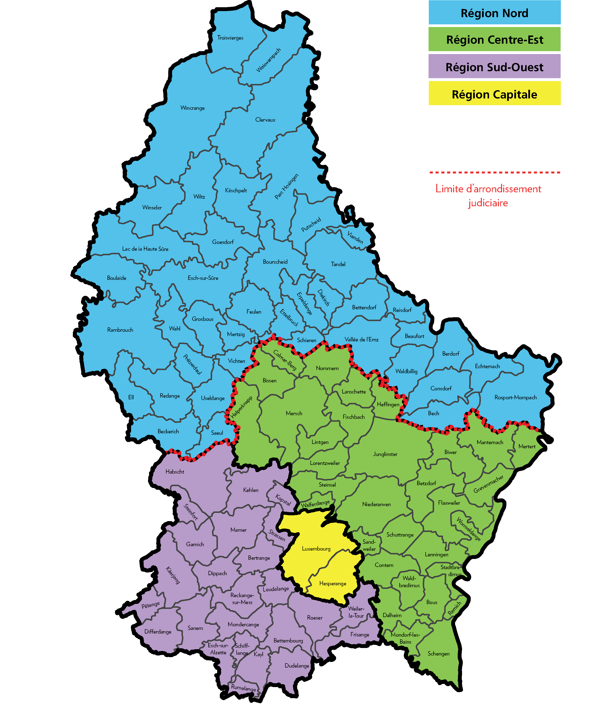

# Règlement grand-ducal du 25 juillet 2018 portant délimitation des régions de Police.

Nous Henri, Grand-Duc de Luxembourg, Duc de Nassau,

Vu l’article 47 de la [loi du 18 juillet 2018](https://legilux.public.lu/eli/etat/leg/loi/2018/07/18/a621/jo) sur la Police grand-ducale ;

Notre Conseil d’État entendu ;

Sur le rapport de Notre Ministre de la Sécurité intérieure et de Notre Ministre de l’Intérieur et après délibération du Gouvernement en conseil ;

Arrêtons :

## Art. 1er.

Les quatre régions de Police, Capitale, Nord, Sud-Ouest et Centre-Est, telles que définies à l’article 47, alinéa 1er, point 3 de la [loi du 18 juillet 2018](https://legilux.public.lu/eli/etat/leg/loi/2018/07/18/a621/jo) sur la Police grand-ducale sont délimitées conformément à la carte en annexe.

## Art. 2.

Notre Ministre de la Sécurité intérieure et Notre Ministre de l’Intérieur sont chargés, chacun en ce qui le concerne, de l’exécution du présent règlement qui sera publié au Journal officiel du Grand-Duché de Luxembourg.

Le Ministre de la Sécurité intérieure,   Étienne Schneider   Le Ministre de l’Intérieur,   Dan Kersch

Cabasson, le 25 juillet 2018.   Henri

\**ANNEXE**

