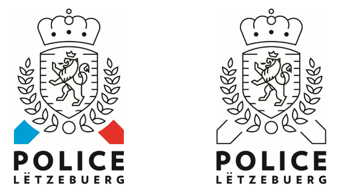

# Règlement grand-ducal du 17 août 2018 portant\n1° détermination de l’emblème, de l’uniforme et de la carte de service de la Police ;\n2° modification du règlement grand-ducal du 15 février 1982 concernant les drapeaux et emblèmes militaires.

Nous Henri, Grand-Duc de Luxembourg, Duc de Nassau,

Vu l’article 52 de la [loi du 18 juillet 2018](https://legilux.public.lu/eli/etat/leg/loi/2018/07/18/a621/jo) sur la Police grand-ducale ;

Vu l’avis de la Chambre des fonctionnaires et employés publics ;

Notre Conseil d’État entendu ;

Sur le rapport de Notre Ministre de la Sécurité intérieure et après délibération du Gouvernement en conseil ;

Arrêtons :

## Chapitre 1er — L’emblème

### Art. 1er.

L’emblème de la Police grand-ducale est défini comme suit :

Lion avec une couronne à trois pointes, rugissant, debout sur ses deux pattes arrière et avec la queue double liée, regardant vers la gauche.

Le lion en noir et blanc se trouve sur un écusson. Des lignes horizontales de longueurs différentes, au nombre de neufs de chaque côté, partant des deux côtés latéraux du bord du bouclier sont interrompues à quelques millimètres de la structure du lion.

Le bouclier est entouré d’une couronne de laurier stylisée, en noir et blanc ouverte vers le haut et assemblée par un anneau à la pointe basse de l’écusson.

Une couronne en noir et blanc, à quatre arcs, ornée d’un globe stylisé sur la partie supérieure surplombe l’écusson. La couronne est décorée de trois pierres précieuses fortement stylisées en forme de simples points.

Deux bouts de flèches pointues d’un côté sont visibles sous la couronne de laurier et pointent vers le bas.

L’emblème existe en couleur bleu et rouge, en noir et blanc, en version monochrome et en version brodée.

L’apposition de l’emblème sur les vêtements et accessoires de l’uniforme est fixée à l’annexe I.

## Chapitre 2 — L’uniforme

### Art. 2.

L’uniforme de la Police grand-ducale est une tenue déterminée, destinée à identifier et à faire reconnaître son porteur en tant que membre du cadre policier. Les vêtements et accessoires de l’uniforme de la Police grand-ducale sont déterminés à l’annexe II.

### Art. 3.

Le détail, la composition et le port des vêtements et accessoires de l’uniforme sont déterminés par le directeur général de la Police grand-ducale.

## Chapitre 3 — La carte de service

### Art. 4.

Tout membre de la Police grand-ducale détient et porte une carte de service permettant de l’identifier comme membre de la Police grand-ducale.

Cette carte comporte l’emblème, les nom et prénom, une photo de son titulaire, ainsi que la mention « Officier de police judiciaire », « Agent de police judiciaire », « Officier de police administrative », « Agent de police administrative » ou « Cadre civil ».

## Chapitre 4 — Dispositions modificatives et abrogatoires

### Art. 5.

L’article 2 du [règlement grand-ducal du 15 février 1982](https://legilux.public.lu/eli/etat/leg/rgd/1982/02/15/n1/jo) concernant les drapeaux et emblèmes militaires est abrogé.

### Art. 6.

Sont abrogés :

1° le [règlement grand-ducal modifié du 30 octobre 1968](https://legilux.public.lu/eli/etat/leg/rgd/1968/10/30/n3/jo) fixant les titres des grades, les insignes et uniformes que porteront les officiers et sous-officiers de l'armée détachés à la gendarmerie et à la police ;

2° le [règlement grand-ducal du 18 mai 1984](https://legilux.public.lu/eli/etat/leg/rgd/1984/05/18/n9/jo) concernant l’écusson, l’emblème et le drapeau de la Police ;

3° le [règlement grand-ducal du 10 avril 1991](https://legilux.public.lu/eli/etat/leg/rgd/1991/04/10/n2/jo) concernant l’uniforme du corps de la Police ;

4° le [règlement grand-ducal du 10 avril 1991](https://legilux.public.lu/eli/etat/leg/rgd/1991/04/10/n1/jo) concernant l’uniforme du corps de la Gendarmerie.

## Chapitre 5 — Disposition finale

### Art. 7.

Notre ministre de la Sécurité intérieure est chargé de l'exécution du présent règlement qui sera publié au Journal officiel du Grand-Duché de Luxembourg.

Le Ministre de la Sécurité intérieure,   Étienne Schneider

Cabasson, le 17 août 2018.   Henri

\**Annexe I - Modèle de l’emblème de la Police grand-ducale**

\**Annexe II - Descriptif des vêtements et accessoires de l’uniforme des membres du cadre policier de la Police grand-ducale**

I. Les vêtements de l’uniforme

1\. Tunique

La tunique est de couleur bleu noir qui est une veste droite, cintrée, se fermant par 5 boutons argentés avec emblème. Quatre poches à patte avec boutonnière sont fermées par des boutons argentés avec emblème. L’encolure de la veste est formée par deux revers et le col. Celui-ci est coupé en pointe sur les extrémités qui sont garnies d’un écusson coupé en losange et portent le monogramme S.A.R. le Grand-Duc.

2\. Épaulettes

Les épaulettes portent les insignes de grade et un bouton argenté avec emblème et garnies d’une bise en drap bleu. Cette bise est en fil argenté pour le Directeur général et le Directeur général adjoint.

3\. Pantalon ou jupe

Le pantalon ou la jupe sont de couleur bleu noir. Les coutures de côté sont munies d’un passepoil en drap bleu. Le pantalon et la jupe pour les membres du niveau des commissaires divisionnaires et pour les commissaires tels que définis à l’article 54 de la [loi du 18 juillet 2018](https://legilux.public.lu/eli/etat/leg/loi/2018/07/18/a621/jo) sur la Police grand-ducale sont dotés de 2 galons noirs de chaque côté du passepoil.

4\. Écusson avec emblème de la Police grand-ducale

L’écusson est rond, d’un diamètre de 5 cm, et est en métal blanc. Il porte l’emblème de la Police avec le lettrage en majuscules « ZESUMME FIR IECH » au-dessus de l’emblème et le lettrage en majuscules « POLICE LËTZEBUERG » en dessous de l’emblème. Il est fixé sur support en cuir noir pour être porté sur la poche de poitrine droite de la tunique.

5\. Ceinturon de cérémonie

Le ceinturon de cérémonie est en soie bleu clair. La fermeture est en métal argenté et porte l’emblème de la Police.

6\. Chemise manches longues ou courtes

La chemise est de couleur bleue avec pattes d’épaule et deux poches de poitrine portant l’inscription « POLICE » en lettres capitales sur la patte de poche de poitrine droite.

7\. Polo manches longues ou courtes

Le polo de couleur bleu noir porte une sérigraphie de couleur blanche « POLICE » sur la poitrine droite et sur le dos. Une sérigraphie de couleur blanche « POLICE » est apposée verticalement sur les deux bras. Une bande incorporée de couleur bleu clair ceinture le milieu du corps du polo.

8\. Pullover à col en V ou à col rond

Le pullover est de couleur bleu noir et les épaules sont garnies de pattes. Une bande incorporée de couleur bleu clair ceinture le milieu du corps du pullover ainsi que les manches. Cette bande porte l’inscription « POLICE » en lettres bleu marine à hauteur de la poitrine gauche.

9\. Parka

La parka est de couleur bleu noir et comporte deux poches de poitrine et deux poches basses sur le devant. La patte de poche de poitrine droite porte l’inscription « POLICE » en lettres capitales blanches. Sur cette même poche de poitrine est apposé l’emblème brodé de la Police. Le mot « POLICE » figure en lettres capitales blanches sur le dos. Une bande en matière réfléchissante parcourt toute la largeur du dos. Sur chaque épaule est fixée une patte en tissu de fond permettant le port des passants-coulants avec les insignes de grade.

10\. Blouson

Le blouson est de couleur bleu noir et comporte deux poches de poitrine insérées, fermant par glissière et rabat ainsi que deux poches basses plaquées, fermant par glissière et rabat. Au-dessus de la poche de poitrine droite se trouve l’inscription « POLICE » en lettres capitales blanches. Sur cette même poche de poitrine est apposée l’emblème brodé de la Police. Sur le dos se trouve l’inscription « POLICE » en lettres capitales blanches. Une bande en matière réfléchissante parcourt toute la largeur du dos. Sur chaque épaule est fixée une patte en tissu de fond permettant le port des passants-coulants avec les insignes de grade.

11\. Les passants-coulants sont de couleur bleu ou de couleur orange (pour la veste de la tenue moto) et portent les insignes de grade.

12\. Imperméable

L’imperméable est de couleur bleu noir. Deux emblèmes en métal blanc de la Police sont montés sur les pointes en losange du col. Des pattes d’épaule permettent le port de passants-coulants avec insignes de grade.

13\. Veste « Maintien de l’ordre »

La veste est de couleur bleu foncé. Le logo réfléchissant « POLICE » est fixé sur le devant et sur le dos de la veste.

La combinaison d’intervention de l’Unité Spéciale est un overall de couleur gris-beige. Les coudes et les genoux sont renforcés. L’inscription « POLICE » se trouve sur la poitrine gauche et sur le dos. L’emblème de la Police se trouve sur le devant sous l’inscription POLICE.

14\. Coupe-vent cycliste

Le coupe-vent cycliste est de couleur bleu noir et orange fluo avec l’inscription « POLICE » en gris-argentée réfléchissant sur le dos et sur la poitrine côté droit. L’emblème brodé noir et blanc de la Police est apposé en dessous.

15\. Veste moto

Elle est de couleur bleu noir et orange fluo. Sur la poitrine droite, au-dessus de l’emblème brodé noir et blanc de la Police, et sur le dos se trouve l’inscription « POLICE » en lettres capitales réfléchissantes gris-argenté. Elle est munie de pattes sur chaque épaule permettant le port des passants coulants avec les insignes de grades.

16\. T-shirt de circulation

Il est à manches courtes, de couleur bleu noir et muni d’une bande orange fluo sur les épaules. Un bande réfléchissante gris-argenté fait le tour de la poitrine. Sur le dos et l’avant droite se trouve une inscription réfléchissante gris-argenté « POLICE ».

17\. Képi

Le képi pour le personnel masculin est en tissu de fond bleu noir avec une visière en vinyle noir et bordé d’un jonc en métal de couleur argenté. En fonction des grades, le calot est bordé d’une soutache argentée et muni d’un nœud hongrois. Il comprend une jugulaire double cordon argent attachée de chaque côté par un bouton avec emblème et un bandeau d’élite argent. L’emblème de la Police est brodé en fil argenté sur la partie de devant et un bandeau de velours noir va autour du képi à partir du bandeau d’élite jusqu’à la base.

Le képi du Directeur général se caractérise par un triple nœud hongrois, quatre soutaches argent qui tournent et trois qui montent et de deux bandeaux superposés « feuilles de chêne », brodé main au fil cannetille argent.

Le képi du Directeur général adjoint se caractérise par un triple nœud hongrois, trois soutaches argent qui tournent et trois qui montent et de deux bandeaux superposés « feuilles de chêne », brodé main au fil cannetille argent.

Le képi des membres du niveau « commissaires divisionnaires » se caractérise par un bandeau « feuilles de chêne », brodé main au fil cannetille argent.

Le képi des brigadiers se caractérise par une soutache argent avec un filet bleu qui tourne et une qui monte.

18\. Chapeau

Le chapeau, pour le personnel féminin, est en feutre de poil bleu noir, avec une calotte en forme de cône avec un bord relevé à l’arrière. Sur un bandeau de velours noir se trouvent les marques distinctives du rang. En fonction des grades, le chapeau est brodé d’une soutache argentée. L’emblème de la Police est brodé en fil argenté sur la partie de devant et un bandeau d’élite argent va autour du chapeau.

Le chapeau du Directeur général se caractérise par quatre soutaches argent qui tournent et deux bandeaux superposés « feuilles de chêne », brodé main au fil cannetille argent.

Le chapeau du Directeur général adjoint se caractérise par trois soutaches argent qui tournent et deux bandeaux superposés « feuilles de chêne », brodé main au fil cannetille argent.

Le chapeau des membres du niveau « commissaires divisionnaires » se caractérise par un bandeau « feuilles de chêne », brodé main au fil cannetille argent.

Le chapeau pour les brigadiers se caractérise par une soutache argent avec un filet bleu qui tourne.

19\. Képi blanc de circulation

Il répond aux caractéristiques du képi à part la couleur. L’emblème est en métal blanc.

20\. Chapeau blanc de circulation

Il répond aux caractéristiques du chapeau à part la couleur. L’emblème est en métal blanc.

21\. Casquette d’intervention

Elle est de couleur bleu noir et porte une broderie « POLICE » en caractères blancs sur le devant et sur le derrière.

22\. Bonnet d’hiver

Le bonnet d’hiver est de couleur bleu noir et porte l’emblème de la Police sur le devant.

II. Les accessoires aux effets d’uniforme

1\. Chasuble

Le chasuble est un gilet de couleur orange fluo et porte l’inscription « POLICE » en lettres majuscules sur le dos.

2\. Brassard

Le brassard est de couleur orange fluo et porte l’emblème ainsi que l’inscription « POLICE » en lettres majuscules.

3\. Plaquette de service

La plaquette de service est ronde, d’un diamètre de 5 cm et porte l’emblème de la Police avec le lettrage en majuscules « ZESUMME FIR IECH » au-dessus de l’emblème et le lettrage en majuscules « POLICE LËTZEBUERG » en dessous de l’emblème.

4\. Ceinturon pour pantalon

Ce ceinturon est en cuir de couleur noire avec boucle en métal avec l’emblème de la Police.

5\. Épingle cravate

Elle a la forme d’une barrette rectangulaire portant l’emblème de la Police.
