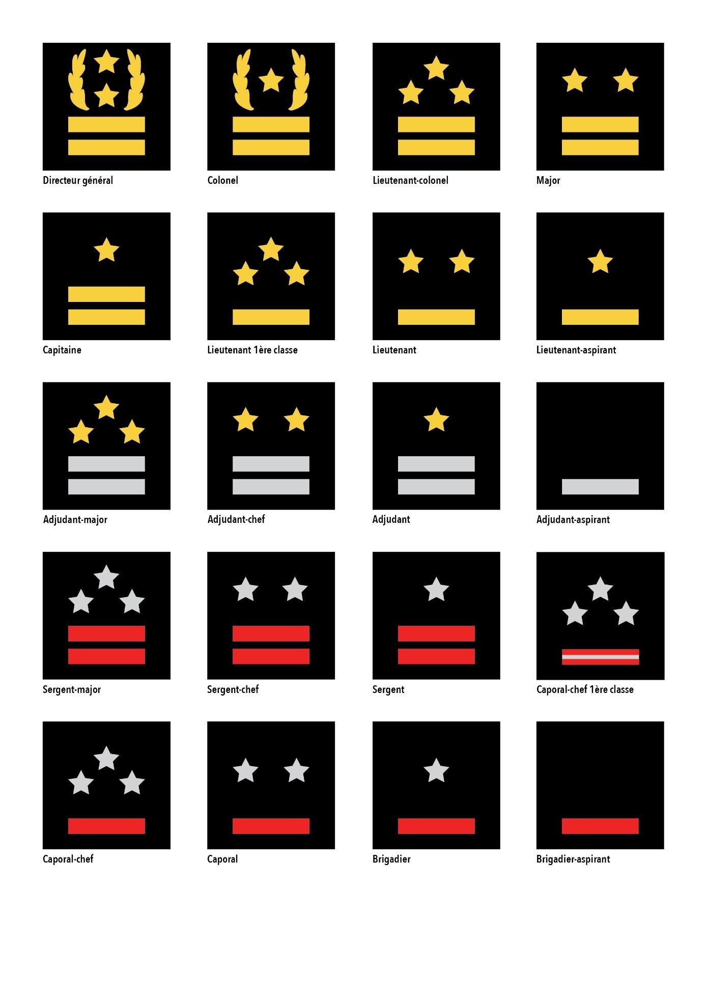
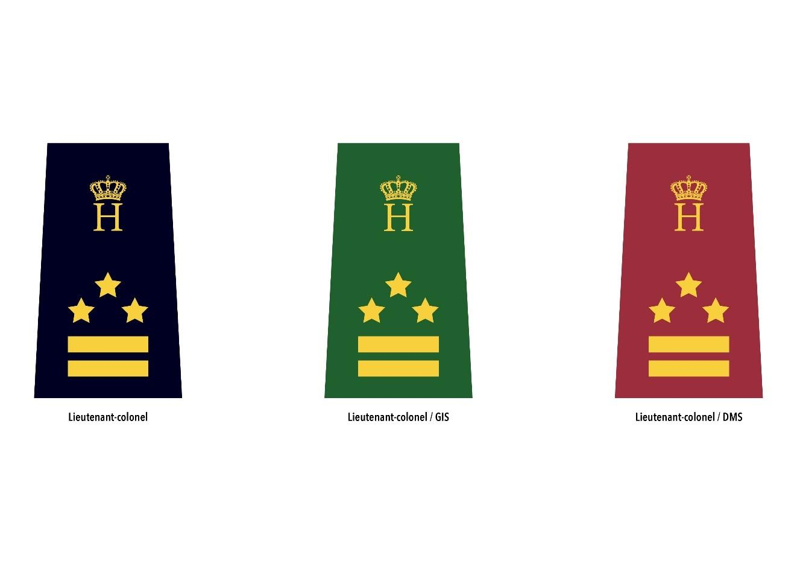
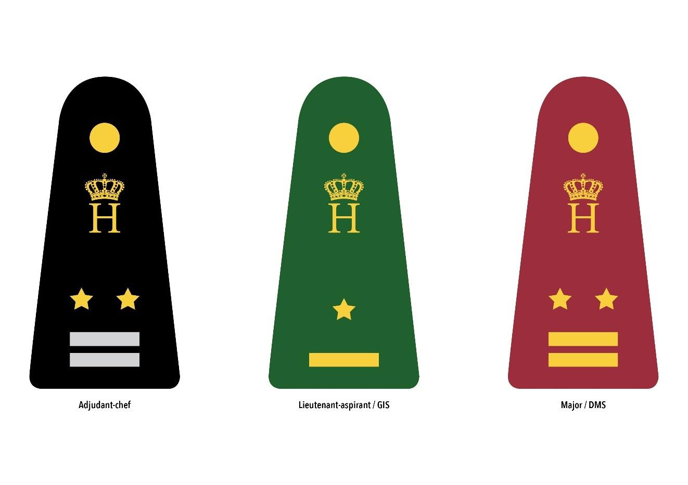
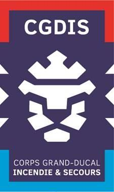
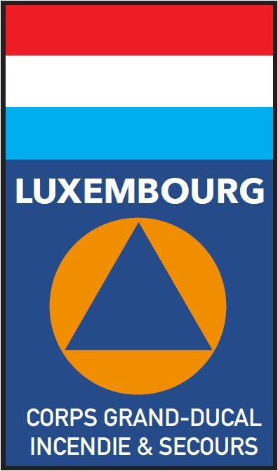

# Règlement grand-ducal du 18 septembre 2018 déterminant les grades fonctionnels, les tenues, insignes et attributs des personnels du Corps grand-ducal d'incendie et de secours.

Nous Henri, Grand-Duc de Luxembourg, Duc de Nassau,

Vu la [loi du 27 mars 2018](https://legilux.public.lu/eli/etat/leg/loi/2018/03/27/a221/jo) portant organisation de la sécurité civile, et notamment ses articles 31, 36 et 50 ;

Les avis de la Chambre des fonctionnaires et employés publics, de la Chambre d’agriculture, de la Chambre de commerce, de la Chambre des métiers et de la Chambre des salariés ayant été demandés ;

Vu l’article 1er, paragraphe 1er, de la [loi du 16 juin 2017](https://legilux.public.lu/eli/etat/leg/loi/2017/06/16/a592/jo) sur l’organisation du Conseil d’État et considérant qu’il y a urgence ;

Sur le rapport de Notre Ministre de l’Intérieur, et après délibération du Gouvernement en conseil ;

Arrêtons :

## Chapitre 1er — Généralités

### Art. **1er** .

Pendant la durée du service et dans le cadre de l’exercice de leur mission, les agents du Corps grand-ducal d’incendie et de secours, ci-après dénommé « CGDIS », portent les tenues, telles que définies à l’article 16, insignes et attributs définis au présent règlement et dans les conditions prévues au règlement intérieur du CGDIS.

### Art. 2.

Sauf dérogation du directeur général, le port d’une des tenues définies à l’article 16 par les agents du CGDIS est strictement prohibé en dehors de l’exercice des missions de sécurité civile et des manifestations officielles auxquelles participe le CGDIS.

Les vétérans, ainsi que les anciens pompiers volontaires et professionnels auxquels un titre honorifique a été décerné par le conseil d’administration du CGDIS, sont autorisés à porter la tenue de sortie, telle que définie à l’article 16, lors de représentations, cérémonies ou défilés conformément aux dispositions du règlement intérieur du CGDIS.

### Art. 3.

Le port des tenues du CGDIS à l’étranger est autorisé dans le cadre :

1° d’activités opérationnelles transfrontalières et conformément aux conventions en vigueur ;

2° de missions de sécurité civile et humanitaires ;

3° de certaines activités de formation, de coopération ou de représentation mandatées ou autorisées par le directeur général du CGDIS.

## Chapitre 2 — Grades fonctionnels

### Art. 4.

Le cadre de base des pompiers volontaires et professionnels comprend les grades fonctionnels suivants :

1° Brigadier-aspirant ;

2° Brigadier ;

3° Caporal ;

4° Caporal-chef ;

5° Caporal-chef 1ère classe ;

6° Sergent ;

7° Sergent-chef ;

8° Sergent-major.

### Art. 5.

Le cadre moyen des pompiers volontaires et professionnels comprend les grades fonctionnels suivants :

1° Adjudant-aspirant ;

2° Adjudant ;

3° Adjudant-chef ;

4° Adjudant-major.

### Art. 6.

Le cadre supérieur des pompiers volontaires et professionnels comprend les grades fonctionnels suivants :

1° Lieutenant-aspirant ;

2° Lieutenant ;

3° Lieutenant 1ère classe ;

4° Capitaine ;

5° Major ;

6° Lieutenant-colonel ;

7° Colonel.

### Art. 7.

Le directeur général, chef de corps du CGDIS, porte le grade fonctionnel de « Directeur général ».

Le directeur de la coordination opérationnelle, le directeur de la stratégie opérationnelle, le directeur médical et de la santé, le directeur des moyens logistiques et le directeur de l’Institut national de formation des secours portent le grade fonctionnel de « Colonel ».

### Art. 8.

Le conseil d’administration du CGDIS attribue un grade fonctionnel aux médecins, aux pharmaciens, aux psychologues, aux vétérinaires et aux professionnels de santé œuvrant au sein du CGDIS, qu’ils soient professionnels, volontaires ou contractuels. Les conditions d’attribution sont définies au règlement intérieur du CGDIS.

## Chapitre 3 — Identification de grades fonctionnels, insignes et attributs

### Art. 9.

Les identifications des grades fonctionnels portés par les agents du CGDIS sont établies comme suit :

| **Grade fonctionnel** | **Identification sur l'uniforme** | **Identification sur le képi** |
|---|---|---|
| Brigadier-aspirant | un galon rouge | non applicable |
| Brigadier | un galon rouge et une étoile argent | non applicable |
| Caporal | un galon rouge et deux étoiles argent | non applicable |
| Caporal-chef | un galon rouge et trois étoiles argent | non applicable |
| Caporal-chef 1ère classe | un galon rouge avec soie argent et trois étoiles argent | non applicable |
| Sergent | deux galons rouge et une étoile argent | non applicable |
| Sergent-chef | deux galons rouge et deux étoiles argent | non applicable |
| Sergent-major | deux galons rouge et trois étoiles argent | non applicable |
| Adjudant-aspirant | un galon argent | soutaches argent : une contournante, une montante |
| Adjudant | deux galons argent et une étoile or | soutaches argent : une contournante, une montante |
| Adjudant-chef | deux galons argent et deux étoiles or | soutaches argent : une contournante, une montante |
| Adjudant-major | deux galons argent et trois étoiles or | soutaches argent : une contournante, une montante |
| Lieutenant-aspirant | un galon or et une étoile or | soutaches or : une contournante, une montante |
| Lieutenant | un galon or et deux étoiles or | soutaches or : une contournante, une montante |
| Lieutenant 1ère classe | un galon or et trois étoiles or | soutaches or : deux contournantes, deux montantes |
| Capitaine | deux galons or et une étoile or | soutaches or : trois contournantes, deux montantes |
| Major | deux galons or et deux étoiles or | soutaches or : quatre contournantes, deux montantes |
| Lieutenant-colonel | deux galons or et trois étoiles or | soutaches or : cinq contournantes, deux montantes |
| Colonel | deux galons or et une étoile or entouré de deux feuilles de chêne or | soutaches or : cinq contournantes, trois montantes un contour discontinu de feuilles de chêne |
| Directeur général | deux galons or et deux étoiles or entourés de deux feuilles de chêne or | soutaches or : cinq contournantes, trois montantes deux contours discontinus de feuilles de chêne |

### Art. 10.

Les caractéristiques des identifications des grades fonctionnels sont déterminées à l’annexe I du présent règlement.

### Art. 11.

Les supports des grades fonctionnels se distinguent par les couleurs suivantes :

1° amarante pour les personnels visés à l’article 8 ;

2° vert foncé pour les pompiers volontaires et professionnels des groupes d’intervention spécialisés ;

3° noir pour l’ensemble des agents ne faisant pas partie des deux catégories précédentes.

### Art. 12.

Les agents faisant partie de plusieurs unités du CGDIS portent, sur la tenue de travail ou de service l’identification du grade fonctionnel en relation avec l’emploi qu’ils occupent au sein de leur unité pour laquelle ils sont en mission. Sur la tenue de sortie, les agents sont autorisés à porter l’identification du grade fonctionnel le plus élevé.

### Art. 13.

Les agents du CGDIS sont identifiés sur leurs tenues de travail ou de service par l’écusson officiel du CGDIS sur la manche gauche, tel que défini à l’annexe II du présent règlement. Lors des missions à l’étranger exclusivement, l’écusson officiel du CGDIS est remplacé par un écusson « Luxembourg » tel que défini à la même annexe II.

### Art. 14.

Le règlement intérieur du CGDIS peut définir des insignes et attributs spécifiques pour les fonctions suivantes :

1° directeur général ;

2° directeur fonctionnel ;

3° chef de zone et chef de zone adjoint ;

4° chef de centre et chef de groupe d’intervention spécialisé ;

5° personnels visés à l’article 8 ;

6° membres du comité exécutif de la Fédération nationale des pompiers ;

7° moniteurs et animateurs de jeunes pompiers.

Le règlement intérieur peut définir des écussons particuliers pour les différentes unités du CGDIS.

### Art. 15.

Seul le port des identifications des grades fonctionnels, insignes, décorations et attributs prévus au présent règlement ou au règlement intérieur du CGDIS est autorisé.

## Chapitre 4 — Tenues

### Art. 16.

Les tenues des agents du CGDIS comportent une tenue de travail portée pour la réalisation des opérations de secours, une tenue de service portée en dehors d’une fonction opérationnelle, une tenue de sortie portée lors de représentations, cérémonies et défilés ainsi qu’une tenue pour les activités physiques et sportives ou autres activités liées aux missions du CGDIS.

Après l’analyse des besoins et des risques, les agents sont dotés des différentes tenues nécessaires à l’exercice de leurs missions conformément au règlement intérieur et au règlement opérationnel du CGDIS.

### Art. 17.

La composition, les conditions de port ainsi que les spécifications des différentes tenues selon la nature des missions sont définies dans le règlement intérieur du CGDIS. Des variantes peuvent être intégrées en fonction de la nature de l’intervention ou des conditions climatiques, tout en respectant l’uniformité des tenues.

### Art. 18.

Lors des interventions et exercices, les emplois opérationnels de commandement sont identifiés par des chasubles définies au règlement intérieur du CGDIS, conformément au règlement opérationnel. Le commandant des opérations de secours est identifié par un chasuble portant l’inscription « COS ».

## Chapitre 5 — Dispositions transitoires et finales

### Art. 19.

Tout porteur d’un grade des services de secours au moment de l’entrée en vigueur du présent règlement est autorisé à porter ce grade jusqu’à l’obtention du nouveau grade fonctionnel en vertu de la [loi du 27 mars 2018](https://legilux.public.lu/eli/etat/leg/loi/2018/03/27/a221/jo) portant organisation de la sécurité civile.

### Art. 20.

Les gradés honoraires des services de secours au moment de l’entrée en vigueur du présent règlement conservent le droit de porter leur grade sur leur tenue de sortie portée lors de représentations, cérémonies et défilés.

### Art. 21.

Il est attribué aux membres du bureau exécutif de la Fédération nationale des pompiers en fonction au moment de l’entrée en vigueur du présent règlement, le grade fonctionnel équivalent à celui porté avant l’entrée en vigueur du présent règlement, conformément à l’article 120 de la [loi du 27 mars 2018](https://legilux.public.lu/eli/etat/leg/loi/2018/03/27/a221/jo) portant organisation de la sécurité civile.

### Art. 22.

Le présent règlement entre en vigueur le jour de sa publication au Journal officiel du Grand-Duché de Luxembourg.

### Art. 23.

Notre Ministre de l’Intérieur est chargé de l’exécution du présent règlement qui sera publié au Journal officiel.

Le Ministre de l'Intérieur,   Dan Kersch

Palais de Luxembourg, le 18 septembre 2018.   Henri

\**Annexe I**

\**1. Caractéristiques des identifications des grades fonctionnels**

\**a) Pour le cadre de base**

Les galons sont de couleur rouge et les étoiles à cinq branches sont argentées.

Les galons ont une largeur de 30 millimètres et une hauteur de 6 millimètres. Ils sont espacés entre eux de 3 millimètres. Les étoiles à cinq branches ont un diamètre de 10 millimètres.

Les identifications de grade fonctionnel sont portées :

aash sur un support en ruban auto-agrippant noir, amarante ou vert foncé, partie « crochets », les insignes de grades cousus sur le ruban ;

bash sur des fourreaux d’épaules en drap noir, amarante ou vert foncé, épousant la forme des pattes d’épaules ou du vêtement sur lequel il s’adapte.

Sur les fourreaux d’épaules et les pattes d’épaules, l’insigne de grade est surmonté par le monogramme doré du chef de l’État.

\**b) Pour le cadre moyen**

Les galons sont argentés et les étoiles à cinq branches sont dorées.

Les galons ont une largeur de 30 millimètres et une hauteur de 6 millimètres. Ils sont espacés entre eux de 3 millimètres. Les étoiles à cinq branches ont un diamètre de 10 millimètres.

Les identifications de grade fonctionnel sont portées :

aash sur un support en ruban auto-agrippant noir, amarante ou vert foncé, partie « crochets », les insignes de grades cousus sur le ruban ;

bash sur des fourreaux d’épaules en drap noir, amarante ou vert foncé, épousant la forme des pattes d’épaules ou du vêtement sur lequel il s’adapte ;

cash sur des pattes d’épaules en velours noir, amarante ou vert foncé, doublées, assemblées en fourreau sur une armature rigide.

Sur les fourreaux d’épaules et les pattes d’épaules, l’insigne de grade est surmonté par le monogramme doré du chef de l’État.

\**c)** **Pour le cadre supérieur**

Les feuilles de chêne, les galons et les étoiles à cinq branches sont dorés.

Les galons ont une largeur de 30 millimètres et une hauteur de 6 millimètres. Ils sont espacés entre eux de 3 millimètres. Les étoiles à cinq branches ont un diamètre de 10 millimètres.

Les identifications de grade fonctionnel sont portées :

aash sur un support en ruban auto-agrippant noir, amarante ou vert foncé, partie « crochets », les insignes de grades cousus sur le ruban ;

bash sur des fourreaux d’épaules en drap noir, amarante ou vert foncé, épousant la forme des pattes d’épaules ou du vêtement sur lequel il s’adapte ;

cash des pattes d’épaules en velours noir, amarante ou vert foncé, doublées, assemblées en fourreau sur une armature rigide.

Sur les fourreaux d’épaules et les pattes d’épaules, l’insigne de grade est surmonté par le monogramme doré du chef de l’État.

\**2. Caractéristiques des marques distinctives des grades fonctionnels sur les képis**

\**a) Du cadre moyen**

Le képi dispose d’un écusson argenté représentant la miniature du logo officiel du CGDIS, représentant le lion de face, entourée d’une fausse jugulaire argentée, retenue par deux petits boutons en métal argenté ainsi que d’un nœud hongrois encerclé.

Les soutaches argentées ont une largeur de deux millimètres.

\**b) Du cadre supérieur**

Le képi dispose d’un écusson doré représentant la miniature du logo officiel du CGDIS, représentant le lion de face, entourée d’une fausse jugulaire en or, retenue par deux petits boutons en métal doré ainsi que d’un nœud hongrois encerclé.

Pour le képi du Directeur général et des Colonels, l’écusson doré est par ailleurs entouré de branches de chêne. Les contours discontinus de feuille de chêne sont brodés en fil d‘or à hauteur de l’écusson. Le nœud hongrois est remplacé par un double nœud hongrois encerclé.

Les soutaches en or ont une largeur de deux millimètres. Entre la troisième et la quatrième soutache contournante, l’espace est doublé.

\**3.** **Schémas**

\**a)** **Identification des grades fonctionnels sur ruban auto-grippant – récapitulatif**

\**b) Identification des grades fonctionnels sur fourreaux d’épaules – exemples**

\**c)** **Identification des grades fonctionnels sur pattes d’épaules – exemples**

\**Annexe II**

\**1. Écusson officiel du CGDIS**

\**a)** **Description**

L’écusson rectangle représentant de face le lion couronné grand-ducal avec trois entailles triangulaires sur chaque côté de l’écusson. L’écusson est délimité sur ses parties supérieures et inférieures de crochets dans les couleurs nationales. L’écusson porte dans sa partie supérieure l’inscription « CGDIS » et dans sa partie inférieure sur deux lignes l’inscription « Corps grand-ducal » et « Incendie & Secours »

\**b)** **Illustration**

\**2.** **Écusson « Luxembourg » porté à l’étranger**

\**a)** **Description**

L’écusson comprend le drapeau national luxembourgeois dans sa partie supérieure, suivi de l’inscription « Luxembourg ». L’écusson comprend en outre le signe distinctif international de la protection civile, représenté par un triangle équilatéral bleu sur fond orange, conformément à l’article 66 du Protocole additionnel aux Conventions de Genève du 12 août 1949 relatif à la protection des victimes des conflits armés internationaux (Protocole I). En dessous du signe est placé l’inscription sur deux lignes « Corps grand-ducal » et « Incendie & Secours » en lettres majuscules.

\**b)** **Illustration**

