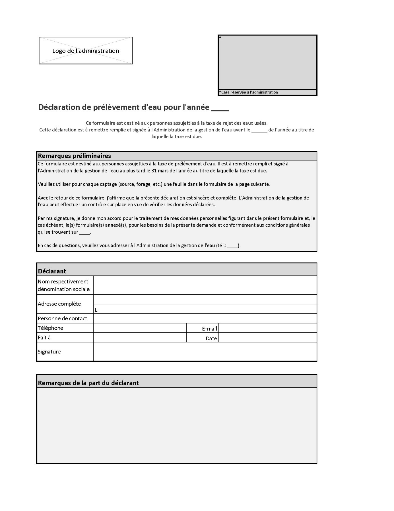
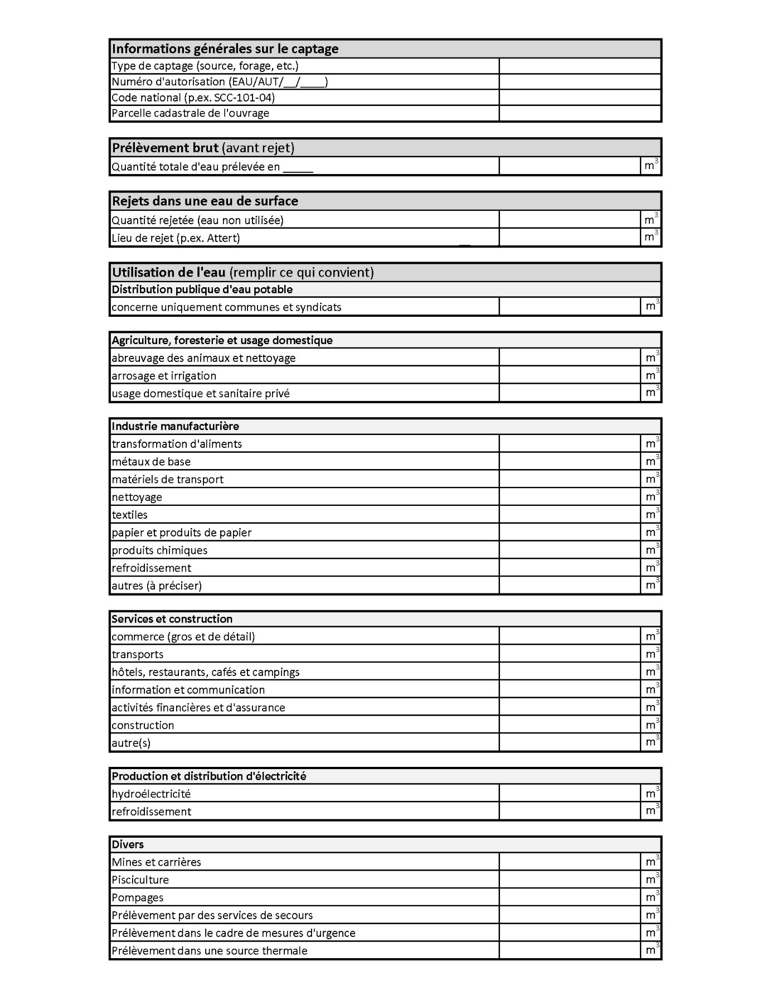
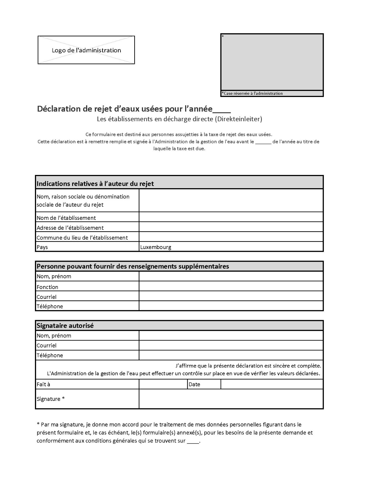
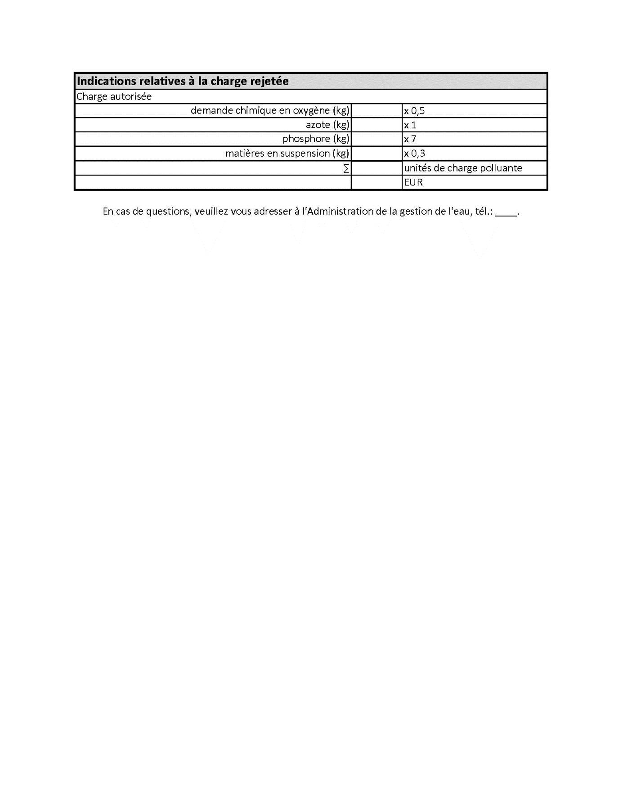
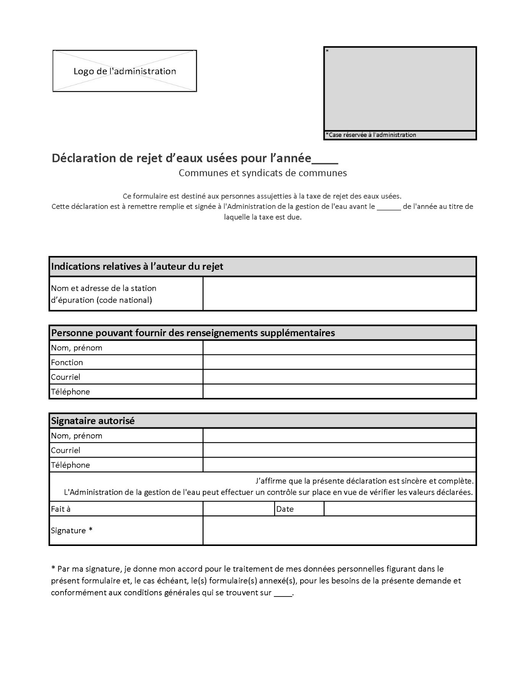
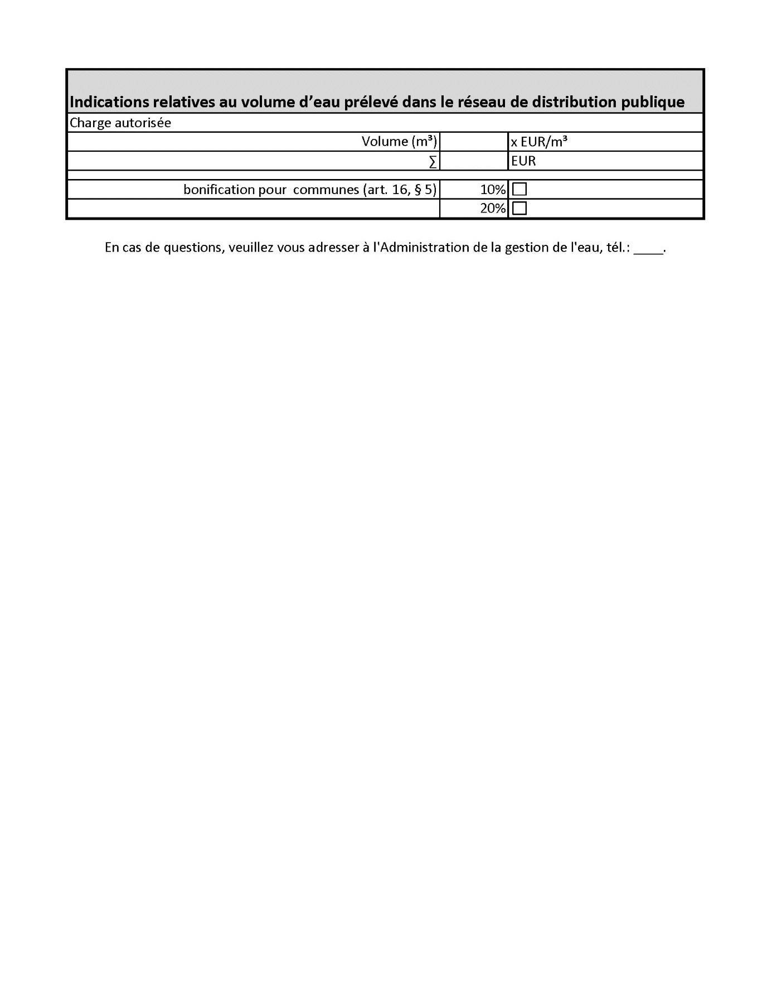

# Règlement grand-ducal du 18 juin 2020 portant sur la déclaration des éléments nécessaires au calcul des taxes de prélèvement et de rejet.

Nous Henri, Grand-Duc de Luxembourg, Duc de Nassau,

Vu la [loi modifiée du 19 décembre 2008](https://legilux.public.lu/eli/etat/leg/loi/2008/12/19/n17/jo) relative à l’eau, et notamment son article 17 ;

Vu l’avis de la Chambre de commerce ;

Les avis de la Chambre d’agriculture, de la Chambre des métiers, de la Chambre des salariés et de la Chambre des fonctionnaires et employés publics ayant été demandés ;

Notre Conseil d’État entendu ;

Sur le rapport de Notre Ministre de l’Environnement, du Climat et du Développement durable et après délibération du Gouvernement en conseil ;

Arrêtons :

## Art. 1er.

Les personnes physiques ou morales, de droit privé ou public, susceptibles d’être assujetties à la taxe de prélèvement d’eau ou à la taxe de rejet des eaux usées sont tenues d’utiliser pour leur déclaration les formulaires annexés au présent règlement.

Les formulaires dûment remplis sont à envoyer à l’Administration de la gestion de l’eau en charge de la vérification des déclarations.

## Art. 2.

Les annexes suivantes contiennent les formulaires à utiliser par les déclarants :

1° Annexe I : Déclaration permettant le calcul de la taxe de prélèvement d’eau ;

2° Annexe II : Déclaration permettant le calcul de la taxe de rejet des eaux usées à destination des établissements en décharge directe (modèle A) ;

3° Annexe III : Déclaration permettant le calcul de la taxe de rejet des eaux usées à destination des communes et syndicats de communes (modèle B).

## Art. 3.

Le [règlement grand-ducal du 12 mars 2011](https://legilux.public.lu/eli/etat/leg/rgd/2011/03/12/n1/jo) portant sur la déclaration des éléments nécessaires au calcul des taxes de prélèvement et de rejet est abrogé.

## Art. 4.

Le présent règlement grand-ducal entre en vigueur au 1er janvier 2021.

## Art. 5.

Notre ministre ayant la gestion de l’eau dans ses attributions est chargé de l’exécution du présent règlement qui sera publié au Journal officiel du Grand-Duché de Luxembourg.

La Ministre de l’Environnement, du Climat et du Développement durable,   Carole Dieschbourg

Palais de Luxembourg, le 18 juin 2020.   Henri

\**Annexe I : Déclaration permettant le calcul de la taxe de prélèvement d’eau**

\**Annexe II : Déclaration permettant le calcul de la taxe de rejet des eaux usées à destination des établissements en décharge directe (modèle A)**

\**Annexe III : Déclaration permettant le calcul de la taxe de rejet des eaux usées à destination des communes et syndicats de communes (modèle B).**

