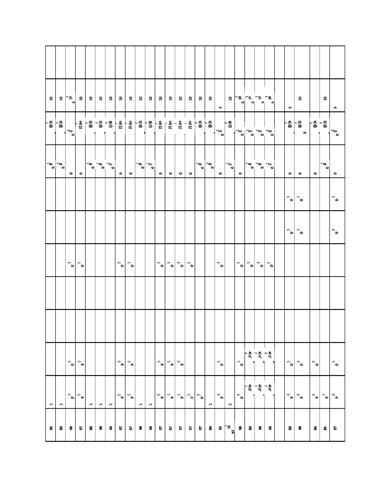
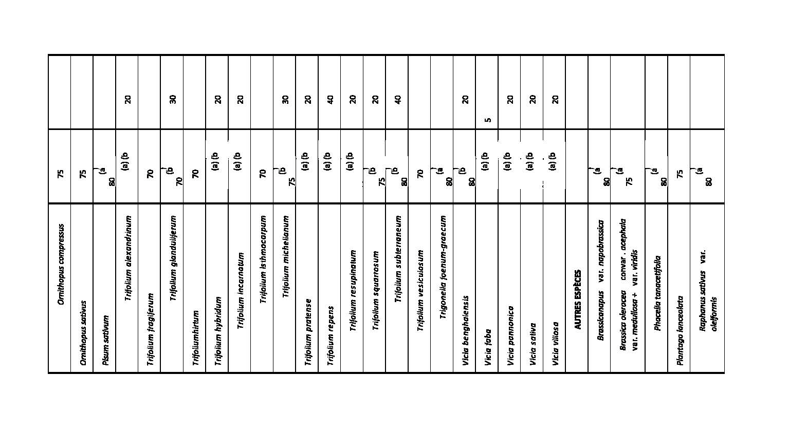

# Règlement grand-ducal du 22 janvier 2021 fixant les conditions de commercialisation, de production et de certification des semences de plantes fourragères.

## Chapitre 1er — Commercialisation des semences de plantes fourragères

### Art. 1er.

Le présent règlement concerne la production en vue de la commercialisation ainsi que la commercialisation à l’intérieur de l’Union européenne de semences de plantes fourragères.

Il ne s’applique pas aux semences de plantes fourragères dont il est prouvé qu’elles sont destinées à l’exportation vers des pays tiers.

### Art. 2.

(1) Au sens du présent règlement, on entend par « commercialisation » la vente, la détention en vue de la vente, l’offre de vente et toute cession, toute fourniture ou tout transfert, en vue d’une exploitation commerciale de semences à des tiers, que ce soit contre rémunération ou non.

(2) Ne relèvent pas de la commercialisation les échanges de semences qui ne visent pas une exploitation commerciale de la variété, tels que les opérations suivantes :

1° la fourniture de semences à des organismes officiels d’expérimentation et d’inspection ;

2° la fourniture de semences à des prestataires de services, en vue de la transformation ou du conditionnement, pour autant que le prestataire de service n’acquière pas un titre sur la semence ainsi fournie.

(3) La fourniture de semences, sous certaines conditions, à des prestataires de services, en vue de la production de certaines matières premières agricoles, destinées à un usage industriel, ou de la propagation de semences à cet effet, ne relève pas de la commercialisation, pour autant que le prestataire de services n’acquière un titre ni sur la semence ainsi fournie ni sur le produit de la récolte. Le fournisseur de semences fournira à l’autorité de certification une copie des parties correspondantes du contrat conclu avec le prestataire de services et ce contrat devra comporter les normes et conditions actuellement remplies par la semence fournie.

### Art. 3.

Au sens du présent règlement, on entend par :

1° « Plantes fourragères » : les plantes des genres et espèces énumérées à l’annexe I.

2° « Semences de base » :

a) Semences de variétés sélectionnées : les semences,

i) qui ont été produites sous la responsabilité de l’obtenteur selon les règles de sélection conservatrice en ce qui concerne la variété ;

ii) qui sont prévues pour la production de semences de la catégorie « semences certifiées » ;

iii) qui répondent, sous réserve des dispositions de l’article 11, aux conditions prévues aux annexes III et IV pour les semences de base et

iv) pour lesquelles il a été constaté, lors d’un examen officiel ou, dans le cas des conditions figurant à l’annexe IV, soit lors d’un examen officiel, soit lors d’un examen effectué sous contrôle officiel, que les conditions énoncées aux lettres a), b) et c) ont été respectées.

b) Semences de variétés de pays ou locales : les semences,

i) qui ont été produites sous contrôle officiel, à partir de matériels officiellement admis en tant que variétés de pays ou locales dans une ou plusieurs exploitations situées dans une région d’origine nettement délimitée ;

ii) qui sont prévues pour la production de semences de la catégorie « semences certifiées » ;

iii) qui répondent, sous réserve des dispositions de l’article 11, aux conditions prévues aux annexes III et IV pour les semences de base et

iv) pour lesquelles il a été constaté, lors d’un examen officiel ou, dans le cas des conditions figurant à l’annexe IV, soit lors d’un examen officiel, soit lors d’un examen effectué sous contrôle officiel, que les conditions énoncées aux lettres a), b) et c) ont été respectées ;

3° « Semences certifiées » : les semences de toutes les semences énumérées à l’annexe I autres que *Lupinus* spp., *Pisum sativum*, *Vicia* spp., ainsi que *Medicago sativa* :

a) qui proviennent directement de semences de base ou, à la demande de l’obtenteur, de semences d’une génération antérieure aux semences de base qui ont répondu, lors d’un examen officiel, aux conditions prévues aux annexes III et IV pour les semences de base ;

b) qui sont destinées à des fins autres que la production de semences ;

c) qui répondent, sous réserve des dispositions de l’article 11, aux conditions prévues aux annexes III et IV pour les semences certifiées et

d) pour lesquelles il a été constaté, lors d’un examen officiel ou lors d’un examen effectué sous contrôle officiel, que les conditions énoncées aux lettres a), b) et c) ont été respectées ;

4° « Semences certifiées de la première génération », les semences de *Lupinus* spp., de *Pisum sativum,* de *Vicia* spp. ainsi que de *Medicago sativa* :

a) qui proviennent directement de semences de base ou, à la demande de l’obtenteur, de semences d’une génération antérieure aux semences de base qui sont susceptibles de répondre et ont répondu, lors d’un examen officiel, aux conditions fixées aux annexes III et IV pour les semences de base ;

b) qui sont destinées à la production de semences de la catégorie « semences certifiées », seconde génération ou à des fins autres que la production de semences de plantes fourragères ;

c) qui répondent, sous réserve de l’article 11, aux conditions fixées aux annexes III et IV pour les semences certifiées ;

d) pour lesquelles il a été constaté, lors d’un examen officiel ou lors d’un examen effectué sous contrôle officiel, que les conditions énoncées aux lettres a), b) et c) ont été respectées ;

5° « Semences certifiées de la seconde génération », les semences de *Lupinus* spp., de *Pisum sativum,* de *Vicia* spp. ainsi que de *Medicago sativa* :

a) qui proviennent directement de semences de base, de semences certifiées de première génération ou, à la demande de l’obtenteur, de semences d’une génération antérieure aux semences de base qui sont susceptibles de répondre et ont répondu, lors d’un examen officiel, aux conditions fixées aux annexes III et IV pour les semences de base ;

b) qui sont destinées à d’autres fins que la production de semences de plantes fourragères ;

c) qui répondent, sous réserve de l’article 11, aux conditions fixées aux annexes III et IV pour les semences certifiées ;

d) pour lesquelles il a été constaté, lors d’un examen officiel ou lors d’un examen effectué sous contrôle officiel, que les conditions énoncées aux lettres a), b) et c) ont été respectées ;

6° « Semences commerciales », les semences :

a) qui possèdent l’identité de l’espèce ;

b) qui répondent, sous réserve des dispositions de l’article 11, aux conditions prévues à l’annexe IV pour les semences commerciales et

c) pour lesquelles il a été constaté, lors d’un examen officiel, ou lors d’un examen effectué sous contrôle officiel, que les conditions énoncées aux lettres a), b) et c) ont été respectées ;

7° « Petits emballages CE A » : les emballages contenant un mélange de semences qui ne sont pas destinées à être utilisées en tant que plantes fourragères, à concurrence d’un poids net de 2 kilogrammes à l’exclusion, le cas échéant, des pesticides granulés, des substances d’enrobage ou d’autres additifs solides ;

8° « Petits emballages CE B » : les emballages contenant des semences de base, des semences certifiées, des semences commerciales ou – pour autant qu’il ne s’agit pas de petits emballages CE A – un mélange de semences, à concurrence d’un poids net de 10 kilogrammes à l’exclusion, le cas échéant, des pesticides granulés, des substances d’enrobage ou d’autres additifs solides ;

9° « Contrôle officiel » : l’inspection des cultures sur pied et l’examen des semences après la récolte, effectués par un des organismes officiels de contrôle visés à l’article 5, paragraphe 1er de la [loi du 18 mars 2008](https://legilux.public.lu/eli/etat/leg/loi/2008/03/18/n1/jo) sur la commercialisation des semences et plants ainsi que sur la coexistence des cultures génétiquement modifiées, conventionnelles et biologiques.

### Art. 4.

Lorsque l’examen sous contrôle officiel visé à l’article 3, paragraphe 1er, point 2°, numéro 1, lettre d), au paragraphe 1er, point 2°, numéro 2, lettre d), au paragraphe 1er, point 5°, lettre d), et au paragraphe 1er, numéro 6°, lettre d), est effectué, les conditions suivantes sont respectées :

1° Inspection sur pied

a) Les inspecteurs :

1\. possèdent les qualifications techniques nécessaires ;

2\. ne tirent aucun profit personnel de la pratique des inspections ;

3\. sont officiellement agréés par l’autorité de contrôle de la certification des semences, cet agrément comportant la signature d’un engagement écrit de se conformer aux règles régissant les examens officiels ;

4\. effectuent les inspections sous contrôle officiel conformément aux règles applicables aux inspections officielles.

b) La culture de semences à inspecter est réalisée à partir de semences qui ont subi un contrôle officiel à posteriori, dont les résultats ont été satisfaisants.

c) Une proportion des cultures de semences fait l’objet d’une inspection par des inspecteurs officiels. Cette proportion est de 5 pour cent au moins.

d) Une partie des échantillons des lots de semences récoltés à partir des cultures de semences est prélevée pour contrôle officiel à posteriori et, le cas échéant, pour contrôle officiel en laboratoire de l’identité et de la pureté variétales.

e) Lorsque des inspecteurs officiellement agréés transgressent, délibérément ou par négligence, les règles régissant les examens officiels, l’agrément visé à la lettre a), numéro 3, est retiré. Dans ce cas, toute certification des semences examinées est annulée, à moins qu’il puisse être démontré que les semences répondent quand même à l’ensemble des conditions requises.

2° Essais de semences

a) Les essais des semences sont effectués par les laboratoires d’essai de semences qui ont été agréés à cet effet par l’autorité de contrôle de la certification des semences, dans les conditions prévues aux lettres b) à d).

b) Le laboratoire chargé des essais de semences doit disposer d’un analyste de semences en chef assumant la responsabilité directe des opérations techniques du laboratoire et possédant les qualifications requises pour la gestion technique d’un laboratoire d’essai de semences. Les analystes de semences du laboratoire doivent avoir la qualification technique nécessaire, obtenue dans le cadre de cours de formation organisés dans les conditions applicables aux analystes officiels de semences et sanctionnée par des examens officiels. Le laboratoire doit être installé dans des locaux et doté d’un équipement officiellement considéré par l’autorité de contrôle de la certification des semences comme satisfaisant aux fins de l’essai des semences, dans le champ d’application de l’autorisation. Il procède aux essais des semences conformément aux méthodes internationales en vigueur.

c) Le laboratoire chargé des essais de semences est :

1\. un laboratoire indépendant, ou

2\. un laboratoire appartenant à une entreprise semencière. Dans le cas visé au point 2), le laboratoire ne peut effectuer des essais de semences que sur des lots de semences produits au nom de l’entreprise semencière à laquelle il appartient, sauf dispositions contraires convenues entre l’entreprise semencière à laquelle il appartient, le demandeur de la certification et l’autorité responsable de la certification des semences.

d) Les activités d’essai des semences du laboratoire sont soumises au contrôle de l’autorité de contrôle de la certification des semences.

e) Aux fins du contrôle visé à la lettre d), une proportion déterminée des lots de semences présentés en vue de la certification officielle fait l’objet d’un essai de contrôle sous forme d’un essai officiel des semences. Cette proportion est, par principe, répartie aussi régulièrement que possible entre les personnes physiques et morales qui présentent des semences à la certification, et entre les espèces présentées, mais peut aussi viser à éliminer certains doutes. Cette proportion est de 5 pour cent au moins.

f) Lorsque des laboratoires d’essais de semences officiellement agréés transgressent, délibérément ou par négligence, les règles régissant les examens officiels, l’agrément visé à la lettre a) est retiré. Dans ce cas toute certification des semences examinées est annulée, à moins qu’il puisse être démontré que les semences répondent quand même à l’ensemble des conditions requises.

### Art. 5.

(1) Les semences énumérées à l’annexe II ne peuvent être commercialisées que si elles ont été officiellement certifiées « semences de base » ou « semences certifiées ».

(2) Les semences de genres et espèces de plantes fourragères autres que celles énumérées à l’annexe II ne peuvent être commercialisées que s’il s’agit soit de semences qui ont été officiellement certifiées « semences de base » ou « semences certifiées », soit de « semences commerciales ».

(3) Les examens officiels sont effectués selon les méthodes internationales en usage, dans la mesure où de telles méthodes existent.

### Art. 6.

Sans préjudice des dispositions de l’article 5, paragraphe 1er, peuvent être commercialisées :

1° les semences de sélection de générations antérieures aux semences de base et

2° les semences brutes, commercialisées pour la transformation, sous réserve que leur identité soit garantie.

### Art. 7.

Ne peuvent être commercialisées que les semences de variétés inscrites soit à la liste nationale des variétés, mentionnée à l’article 10 de la [loi du 18 mars 2008](https://legilux.public.lu/eli/etat/leg/loi/2008/03/18/n1/jo) sur la commercialisation des semences et plants ainsi que sur la coexistence des cultures génétiquement modifiées, conventionnelles et biologiques, soit au catalogue commun des variétés des espèces agricoles.

### Art. 8.

(1) Par dérogation aux exigences en matière de certification prévues à l’article 5, les semences d’une variété de conservation, telle que définie par le [règlement grand-ducal modifié du 5 juillet 2004](https://legilux.public.lu/eli/etat/leg/rgd/2004/07/05/n1/jo) concernant le catalogue des variétés des espèces de plantes agricoles et de légumes, peuvent être mises sur le marché si elles satisfont aux dispositions des paragraphes 2 et 3.

(2) Les semences sont issues de semences produites selon des règles de sélection conservatrice bien définies par le producteur pour la variété en question.

(3) a) Les semences satisfont aux exigences relatives à la certification des semences certifiées, à l’exclusion de celles afférentes à la pureté variétale et à l’examen officiel ou sous contrôle officiel.

b) Les semences doivent présenter une pureté variétale suffisante.

(4) Les semences d’une variété de conservation sont uniquement produites dans la région d’origine. Si les conditions afférentes à la certification fixées au paragraphe 3 ne peuvent pas être remplies dans cette région en raison d’un problème environnemental spécifique, la production de semences est autorisée dans des régions supplémentaires, en tenant compte des informations provenant des autorités responsables pour les ressources phytogénétiques ou d’organisations reconnues à cette fin par les États membres. Toutefois, les semences produites dans ces régions supplémentaires ne peuvent être utilisées que dans les régions d’origine. Les régions supplémentaires dans lesquelles sont produites les semences de variétés de conservation sont communiquées à la Commission européenne et aux autres États membres pour accord.

(5) Des analyses sont réalisées pour vérifier que les semences de variétés de conservation satisfont aux exigences relatives à la certification fixées au paragraphe 3. Ces analyses sont réalisées conformément aux méthodes internationales actuellement établies ou, si de telles méthodes n’existent pas, conformément à toute méthode appropriée.

(6) Aux fins des analyses visées au paragraphe 5, les échantillons sont prélevés sur des lots homogènes. Les règles relatives au poids des lots et au poids des échantillons, telles que prévues à l’article 14, paragraphe 2, s’appliquent.

### Art. 9.

Les semences d’une variété de conservation sont uniquement commercialisées aux conditions suivantes :

1° Les semences ont été produites uniquement dans la région d’origine de la variété en question ou d’une région visée à l’article 8, paragraphe 4.

2° La commercialisation est limitée à la région d’origine de la variété.

3° Pour chaque variété de conservation, la quantité de semences commercialisée n’excède pas la quantité nécessaire pour ensemencer 100 hectares. Cependant, pour une espèce de plantes fourragères donnée, la quantité totale de semences de variétés de conservation commercialisée n’excède pas 10 pour cent de la quantité de semences utilisée annuellement sur le territoire national. Si ce pourcentage correspond à une quantité inférieure à celle nécessaire pour ensemencer 100 hectares, la quantité maximale de semences d’une variété de conservation utilisée annuellement sur le territoire national pour une espèce de plantes fourragères donnée, peut être accrue de manière à équivaloir la quantité nécessaire pour ensemencer 100 hectares. À cette fin, les producteurs doivent indiquer à l’organisme de contrôle visé à l’article 3, point 9°, avant le début de chaque saison de production, la superficie et la localisation des parcelles destinées à la production de semences de variétés de conservation. Si sur base de ces informations, les quantités maximales fixées précédemment risquent d’être dépassées, un quota, qui peut être commercialisé durant la saison de production en question, est attribué à chaque producteur.

### Art. 10.

(1) L’organisme de contrôle visé à l’article 3, point 9°, vérifie par des contrôles officiels que les cultures de semences d’une variété de conservation satisfont aux dispositions du présent règlement en accordant une attention particulière aux lieux de production et aux quantités des semences de variétés de conservation.

(2) Les semences de variétés de conservation sont soumises à un contrôle officiel effectué à posteriori par sondage en ce qui concerne leur identité et leur pureté variétales.

(3) Les fournisseurs de semences de variétés de conservation, opérant sur le territoire national, indiquent pour chaque saison de production, la quantité de semences de chaque variété de conservation mise sur le marché.

### Art. 11.

En dérogation aux dispositions de l’article 5, dans l’intérêt d’un approvisionnement rapide en semences, l’organisme officiel de contrôle peut autoriser la certification officielle ou l’admission officielle et la commercialisation jusqu’au premier destinataire commercial des semences des catégories « semences de base », « semences certifiées » ou « semences commerciales », pour lesquelles ne serait pas terminé l’examen officiel destiné à contrôler le respect des conditions énoncées à l’annexe IV en ce qui concerne la faculté germinative.

La certification ou l’admission n’est accordée que sur présentation d’un rapport d’analyse provisoire des semences et à condition que soient indiqués le nom et l’adresse du premier destinataire. Toutes dispositions utiles sont prises pour que le fournisseur garantisse la faculté germinative constatée lors de l’analyse provisoire.

L’indication de cette faculté germinative doit figurer, pour la commercialisation, sur une étiquette spéciale portant les nom et adresse du fournisseur et le numéro de référence du lot.

Ces dispositions ne s’appliquent pas aux semences importées des pays tiers, sauf les cas prévus à l’article 28.

### Art. 12.

La description éventuellement requise des composants généalogiques est, à la demande de l’obtenteur, tenue confidentielle.

### Art. 13.

Sans préjudice des dispositions de l’article 5, paragraphe 1er, les producteurs sont autorisés à commercialiser :

a) de petites quantités de semences, dans des buts scientifiques ou pour des travaux de sélection ;

b) des quantités appropriées de semences destinées à d’autres fins, d’essai ou d’expérimentation, dans la mesure où elles appartiennent à des variétés pour lesquelles une demande d’inscription au catalogue a été déposée.

Dans le cas du matériel génétiquement modifié, cette autorisation ne peut être accordée que si toutes les mesures appropriées ont été prises pour éviter les risques pour la santé humaine et l’environnement. L’évaluation des risques pour la santé humaine et l’environnement à laquelle il doit être procédé à cet égard, doit être effectuée selon les dispositions de la [loi modifiée du 13 janvier 1997](https://legilux.public.lu/eli/etat/leg/loi/1997/01/13/n1/jo) relative au contrôle de l’utilisation et de la dissémination des organismes génétiquement modifiés.

### Art. 14.

(1) Au cours de la procédure de contrôle des variétés et de l’examen des semences pour la certification, les échantillons sont prélevés officiellement ou sous contrôle officiel selon des méthodes appropriées. Toutefois, le prélèvement d’échantillons aux fins des contrôles au cours de la commercialisation, effectué au moins par sondage, en vue de vérifier le respect des conditions prévues par la présente directive est effectué officiellement.

(2) Au cours de l’examen des semences pour la certification, les échantillons sont prélevés sur des lots homogènes; le poids maximal d’un lot et le poids minimal d’un échantillon sont indiqués à l’annexe IV.

(3) Lorsque le prélèvement de semences sous contrôle officiel prévu au paragraphe 1er est effectué, les conditions suivantes sont respectées :

a) l’échantillonnage des semences est effectué par des échantillonneurs autorisés à cet effet par l’autorité de contrôle de la certification des semences dans les conditions prévues aux lettres b), c) et d) ;

b) les échantillonneurs doivent avoir la qualification technique nécessaire, obtenue dans le cadre de cours de formation organisés dans les conditions applicables aux échantillonneurs officiels de semences et sanctionnée par des examens officiels. Ils procèdent à l’échantillonnage des semences conformément aux méthodes internationales en vigueur ;

c) les échantillonneurs de semences sont :

1\) des personnes physiques indépendantes ;

2\) des personnes employées par des personnes physiques ou morales dont les activités n’impliquent pas la production de semences, la culture de semences, le traitement de semences ou la commercialisation de semences ; ou

3\) des personnes employées par des personnes physiques ou morales dont les activités impliquent la production de semences, la culture de semences, le traitement de semences, ou la commercialisation de semences. Dans le cas visé au point 3), un échantillonneur ne peut prélever des échantillons que sur des lots de semences produits au nom de son employeur, sauf dispositions contraires convenues entre son employeur, le demandeur d’une certification et l’autorité de certification des semences ;

d) le travail des échantillonneurs de semences est soumis au contrôle de l’autorité de contrôle responsable de la certification des semences. En cas d’échantillonnage automatique, il y a lieu d’appliquer les procédures appropriées, lesquelles font l’objet d’un contrôle officiel ;

e) aux fins du contrôle visé à la lettre d), une proportion des lots de semences présentés en vue de la certification officielle fait l’objet d’un essai de contrôle par des échantillonneurs de semences officiels. Cette proportion est, par principe, répartie aussi régulièrement que possible entre les personnes physiques et morales qui présentent des semences à la certification, et entre les espèces présentées, mais peut aussi viser à éliminer certains doutes. Cette proportion est de 5 pour cent au moins. Ces essais de contrôle ne s’appliquent pas à l’échantillonnage automatique. Les échantillons de semences prélevés officiellement sont comparés avec ceux du même lot de semences prélevé sous contrôle officiel ;

f) Lorsque des échantillonneurs de semences officiellement agréés transgressent, délibérément ou par négligence, les règles régissant les examens officiels, l’agrément visé à la lettre a) est retiré. Dans ce cas, toute certification des semences échantillonnées est annulée, à moins qu’il puisse être démontré que les semences répondent quand même à l’ensemble des conditions requises.

### Art. 15.

Les semences de base, les semences certifiées et les semences commerciales ne peuvent être commercialisées qu’en lots suffisamment homogènes et dans des emballages fermés, munis, conformément aux dispositions des articles 18, 19 ou 20, d’un système de fermeture et d’un marquage.

### Art. 16.

(1) Les semences des variétés de conservation sont commercialisées uniquement dans des emballages fermés et scellés.

(2) Les emballages de semences sont scellés par le fournisseur de telle manière qu’il soit impossible de les ouvrir sans endommager le système de fermeture ou sans laisser de traces d’altération sur l’étiquette du fournisseur ou l’emballage.

(3) Afin de garantir que les emballages sont scellés conformément au paragraphe 2, le système de fermeture comporte soit l’incorporation dans celui-ci de l’étiquette soit l’apposition d’un scellé.

### Art. 17.

Les emballages des semences de variétés de conservation doivent porter une étiquette du fournisseur ou une inscription imprimée ou un cachet comprenant au moins les inscriptions suivantes :

1° la mention « règles et normes CE » ;

2° le nom et l’adresse de la personne responsable de l’apposition des étiquettes ou sa marque d’identification ;

3° l’année de la fermeture, exprimée par la mention « fermé… » (année) ou l’année du dernier prélèvement d’échantillons aux fins de la dernière analyse de germination, exprimée par la mention « échantillonné… » (année) ;

4° l’espèce ;

5° la dénomination de la variété de conservation ;

6° la mention « variété de conservation » ;

7° la région d’origine ;

8° la région de production des semences, si la région de production des semences est différente de la région d’origine ;

9° le numéro de référence donné au lot par la personne responsable de l’apposition des étiquettes ;

10° le poids net ou brut déclaré ou le nombre de semences déclaré ;

11° en cas d’indication du poids et d’emploi de pesticides granulés, de substances d’enrobage ou d’autres additifs solides, la nature du traitement chimique ou de l’additif ainsi que le rapport approximatif entre le poids de glomérules ou de semences pures et le poids total.

### Art. 18.

(1) Les emballages de semences de base, de semences certifiées et de semences commerciales qui pour ces deux dernières catégories ne se présentent pas sous forme de petits emballages CE B, sont fermés officiellement ou sous contrôle officiel de façon à ne pouvoir être ouverts sans détérioration du système de fermeture et sans traces de manipulation de l’étiquette officielle prévue à l’article 19 ni de l’emballage.

Lorsque le système de fermeture est réutilisable, il doit être muni d’une étiquette officielle incorporée ou d’un scellé officiel.

(2) Sauf dans les cas de fractionnement en petits emballages CE B, les agents de l’Administration des services techniques de l’agriculture, visés à l’article 16 de la [loi du 18 mars 2008](https://legilux.public.lu/eli/etat/leg/loi/2008/03/18/n1/jo) sur la commercialisation des semences et plants ainsi que sur la coexistence des cultures génétiquement modifiées, conventionnelles et biologiques, sont seuls autorisés à procéder à l’ouverture et à une nouvelle fermeture des emballages. Dans ce cas, il est fait mention sur l’étiquette officielle de la dernière nouvelle fermeture, de sa date et du service qui l’a effectuée.

(3) Les petits emballages CE B de semences certifiées, de semences commerciales ou de mélanges de semences sont fermés par le fournisseur de façon qu’ils ne puissent être ouverts sans que le système de fermeture ne soit détérioré ou sans que le marquage ni l’emballage ne montrent des traces de manipulation ; il ne peut être procédé à une ou plusieurs nouvelles fermetures que sous contrôle officiel.

### Art. 19.

Les emballages de semences de base, de semences certifiées et de semences commerciales, dans la mesure où les semences de ces deux dernières catégories ne se présentent pas sous forme de petits emballages CE B :

1° sont pourvus, à l’extérieur, d’une étiquette officielle qui n’a pas encore été utilisée, qui est conforme aux conditions fixées à l’annexe VI, partie A, et dont les indications sont rédigées dans une des langues officielles de l’Union européenne. La couleur de l’étiquette est blanche pour les semences de base, bleue pour les semences certifiées de la première reproduction à partir de semences de base, rouge pour les semences certifiées des reproductions suivantes à partir des semences de base et brune pour les semences commerciales. Lorsque l’étiquette est pourvue d’un œillet, sa fixation est assurée dans tous les cas par un scellé officiel. L’emploi d’étiquettes officielles adhésives est autorisé.

2° contiennent, lorsque les indications ne sont pas apposées de manière indélébile sur l’emballage ou lorsque l’étiquette utilisée n’est pas adhésive ou d’un matériel indéchirable, une notice officielle de la couleur de l’étiquette et reproduisant au moins les indications prévues pour l’étiquette à l’annexe VI, partie A, 1°, numéros 3, 5 et 6 et, pour les semences commerciales, lettre b), numéros 2 et 4.

La notice est constituée de façon qu’elle ne puisse être confondue avec l’étiquette visée au point 1°.

### Art. 20.

(1) Les petits emballages CE B :

1° sont pourvus à l’extérieur, conformément à l’annexe VI, partie B, d’une étiquette du fournisseur, d’une inscription imprimée ou d’un cachet rédigé dans une des langues officielles de l’Union européenne. Pour les emballages transparents, cette étiquette peut être glissée à l’intérieur, à condition qu’elle soit lisible à travers l’emballage. En ce qui concerne la couleur de l’étiquette, l’article 19, point 1°, est applicable ;

2° sont pourvus d’un numéro d’ordre attribué officiellement et apposé soit à l’extérieur de l’emballage, soit sur l’étiquette du fournisseur prévue au point 1°. En cas d’utilisation d’une vignette adhésive officielle, l’article 19, point 1°, est applicable en ce qui concerne la couleur. Les modalités d’apposition dudit numéro d’ordre peuvent être fixées par un règlement de l’Union européenne.

Le fournisseur responsable de la fermeture de petits emballages CE B et de l’apposition des étiquettes de fournisseur prescrite sous 1° doit tenir une comptabilité se rapportant aux lots de semences fractionnées en petits emballages CE B, en rapport avec les numéros d’ordre officiels attribués. Lors du fractionnement un échantillon de chaque lot de semences sera prélevé officiellement.

Les opérations de fractionnement font l’objet d’une surveillance officielle effectuée par sondage. À cette fin, la comptabilité est tenue pendant trois ans à la disposition de l’organisme officiel de contrôle visé à l’article 5, paragraphe 1er, de la [loi du 18 mars 2008](https://legilux.public.lu/eli/etat/leg/loi/2008/03/18/n1/jo) sur la commercialisation des semences et plants ainsi que sur la coexistence des cultures génétiquement modifiées, conventionnelles et biologiques.

En cas de mise en petits emballages CE B à partir de semences en vrac le principe de la fermeture officielle est respecté ; l’identité du lot de semences sera garantie par un plombage officiel du récipient de semences jusqu’à la mise en emballage définitive.

Le marquage des petits emballages CE B prescrit sous les points 1° et 2° peut être remplacé par une vignette adhésive officielle à condition que les indications requises soient reprises sur la vignette ; dans ce cas, le marquage prévu sous 1° n’est pas requis.

L’apposition du numéro d’ordre officiel donne lieu au paiement d’une redevance pour le plombage et l’étiquetage s’élevant à 0,10 euros par emballage.

(2) Par dérogation aux articles 15, 18 et 19, la simplification des dispositions relatives au système de fermeture et au marquage des emballages en cas de commercialisation de semences de la catégorie « semences certifiées » en vrac au consommateur final, est autorisée.

### Art. 21.

En cas de demande, les petits emballages CE B de semences sont fermés et marqués officiellement ou sous contrôle officiel selon l’article 18, paragraphe 1er, et l’article 19.

### Art. 22.

Le contrôle de l’identité des semences est assuré dans le cas des petits emballages notamment lors du fractionnement des lots de semences.

### Art. 23.

Les dispositions des articles 15, 18 et 19, en ce qui concerne l’emballage, le système de fermeture et le marquage ne sont pas applicables à la commercialisation de semences de plantes fourragères en petites quantités au dernier utilisateur.

Dans un même établissement de vente, il ne peut se trouver en aucun moment plus d’un emballage ou récipient ouverts renfermant des semences de la même variété et catégorie. L’étiquette et le système de fermeture d’origine doivent être fixés visiblement sur l’emballage ou récipient ouverts.

### Art. 24.

Dans le cas de semences d’une variété qui a été génétiquement modifiée, toute étiquette apposée sur le lot de semences ou tout document, officiel ou non, qui l’accompagne, en vertu des dispositions du présent règlement, indique clairement que la variété a été génétiquement modifiée.

### Art. 25.

Tout traitement chimique des semences de base, des semences certifiées ou des semences commerciales est mentionné soit sur l’étiquette officielle, soit sur une étiquette du fournisseur ainsi que sur l’emballage ou à l’intérieur de celui-ci.

### Art. 26.

Les semences commercialisées, soit obligatoirement soit facultativement, conformément aux dispositions du présent règlement, ne sont soumises, en ce qui concerne leurs caractéristiques, les dispositions d’examen, le marquage et la fermeture, à aucune restriction de commercialisation autre que celles prévues par le présent règlement ou toute autre réglementation.

### Art. 27.

Les conditions selon lesquelles des semences de sélection de générations antérieures aux semences de base peuvent être commercialisées conformément à l’article 6, point 1°, sont les suivantes :

1° elles ont été contrôlées officiellement par les organismes de contrôle compétents pour la certification, conformément aux dispositions applicables à la certification des semences de base ;

2° elles sont emballées conformément au présent règlement et ;

3° les emballages portent une étiquette officielle donnant au moins les indications suivantes :

1\. service de certification et État membre, ou leur sigle distinctif,

2\. numéro de référence du lot,

3\. mois et année de fermeture

ou

mois et année du dernier prélèvement officiel d’échantillons en vue de la certification,

4\. espèce, indiquée au moins sous sa dénomination botanique, qui peut figurer sous forme abrégée et sans les noms des auteurs, en caractères latins,

5\. variété indiquée au moins en caractères latins,

6\. mention « semences prébase »,

7\. nombre de générations précédant les semences de la catégorie semences certifiées ou semences certifiées de la première génération.

L’étiquette est de couleur blanche, barrée en diagonale d’un trait violet.

### Art. 28.

(1) Les semences de plantes fourragères provenant directement de semences de base ou de semences certifiées officiellement certifiées dans un ou plusieurs États membres ou dans un pays tiers auquel l’équivalence a été accordée, conformément aux prescriptions communautaires, ou provenant directement du croisement de semences de base officiellement certifiées dans un État membre avec des semences de base officiellement certifiées dans un de ces pays tiers et récoltées dans un autre État membre doivent, sur demande être officiellement certifiées comme semences certifiées, si ces semences ont été soumises à une inspection sur pied satisfaisant aux conditions prévues à l’annexe III pour la catégorie concernée et s’il a été constaté, lors d’un examen officiel, que les conditions prévues à l’annexe IV pour la même catégorie ont été respectées.

Lorsque, dans ces cas, les semences ont été produites directement à partir de semences officiellement certifiées de reproductions antérieures aux semences de base, la certification officielle comme semences de base est également autorisée, si les conditions prévues pour cette catégorie ont été respectées.

(2) Les semences de plantes fourragères qui ont été récoltées dans l’Union européenne et destinées à être certifiées conformément aux dispositions du paragraphe 1er:

1° sont emballées et étiquetées à l’aide d’une étiquette officielle remplissant les conditions fixées à l’annexe VII, parties A et B, conformément aux dispositions prévues par l’article 18, paragraphe 1er et,

2° sont accompagnées d’un document officiel remplissant les conditions prévues à l’annexe VII, partie C.

(3) Les semences de plantes fourragères récoltées dans un pays tiers doivent, sur demande, être officiellement certifiées si

1° elles ont été produites directement à partir de :

a) semences de base ou de semences certifiées officiellement de la première multiplication soit dans un ou plusieurs États membres, soit dans un pays tiers auquel l’équivalence a été accordée conformément aux prescriptions communautaires ;

b) croisements de semences de base officiellement certifiées dans un État membre avec des semences de base officiellement certifiées dans un pays tiers visé à la lettre a) ;

2° elles ont été soumises à une inspection sur pied satisfaisant aux conditions prévues dans une décision d’équivalence prise conformément aux prescriptions communautaires pour la catégorie concernée ;

3° il a été constaté, lors d’un examen officiel, que les conditions fixées à l’annexe IV pour la même catégorie ont été respectées.

### Art. 29.

(1) Les semences de plantes fourragères sont officiellement contrôlées au cours de la commercialisation, au moins par sondage, afin de vérifier leur conformité aux exigences du présent règlement.

(2) Sans préjudice de la libre circulation des semences à l’intérieur de l’Union européenne, lors de la commercialisation de quantités de semences supérieures à 2 kilogrammes provenant d’un pays tiers les indications suivantes doivent être fournies :

1° espèce,

2° variété,

3° catégorie,

4° pays de production et service de contrôle officiel,

5° pays d’expédition,

6° importateur,

7° quantité de semences.

## Chapitre 2 — Dispositions particulières concernant les mélanges à base de semences de plantes fourragères

### Art. 30.

La commercialisation de semences sous forme de mélanges de genres, d’espèces ou de variétés différentes est autorisée :

1° si ces mélanges de semences ne sont pas destinés à être utilisés comme plantes fourragères, les mélanges peuvent contenir des semences de plantes fourragères et des semences de plantes qui ne sont pas des plantes fourragères au sens du présent règlement.

2° si ces mélanges de semences sont destinés à être utilisés comme plantes fourragères, les mélanges peuvent, outre les espèces de plantes fourragères énumérées au présent règlement à l’exception des variétés de graminées qui ne sont pas destinées à être utilisées en tant que plantes fourragères au sens de l’article 4, paragraphe 2, lettre a), de la [directive 70/757/CEE](https://legilux.public.lu/eli/dir_ue/1970/757/jo) concernant le catalogue commun des variétés des espèces de plantes agricoles, contenir également des semences d’espèces végétales énumérées dans le [règlement grand-ducal modifié du 8 avril 2000](https://legilux.public.lu/eli/etat/leg/rgd/2000/04/08/n3/jo) concernant la commercialisation des semences de légumes, le [règlement grand-ducal modifié du 7 juin 2000](https://legilux.public.lu/eli/etat/leg/rgd/2000/06/07/n2/jo) concernant la commercialisation des semences de betteraves, le [règlement grand-ducal modifié du 15 mars 2016](https://legilux.public.lu/eli/etat/leg/rgd/2016/03/15/n8/jo) fixant les conditions de commercialisation, de production et de certification des plants de pommes de terre, le [règlement grand-ducal du 27 février 2014](https://legilux.public.lu/eli/etat/leg/rgd/2014/02/27/n2/jo) fixant les conditions de commercialisation, de production et de certification des semences de céréales et le [règlement grand-ducal modifié du 28 novembre 2003](https://legilux.public.lu/eli/etat/leg/rgd/2003/11/28/n5/jo) fixant les conditions de commercialisation, de production et de certification des semences de plantes oléagineuses et à fibres.

3° si ces mélanges de semences sont destinés à la préservation de l’environnement naturel dans le cadre de la conservation des ressources génétiques visées à l’article 25, les mélanges peuvent contenir des semences de plantes fourragères et des semences de plantes qui ne sont pas des plantes fourragères au sens du présent règlement.

Dans les cas prévus aux points 1° et 2°, les divers composants des mélanges doivent être conformes, avant mélange aux règles de commercialisation qui leur sont applicables en vertu du présent règlement ou s’il s’agit d’espèces énumérées dans le [règlement grand-ducal modifié du 8 avril 2000](https://legilux.public.lu/eli/etat/leg/rgd/2000/04/08/n3/jo) concernant la commercialisation des semences de légumes, le [règlement grand-ducal modifié du 7 juin 2000](https://legilux.public.lu/eli/etat/leg/rgd/2000/06/07/n2/jo) concernant la commercialisation des semences de betteraves, le [règlement grand-ducal modifié du 15 mars 2016](https://legilux.public.lu/eli/etat/leg/rgd/2016/03/15/n8/jo) fixant les conditions de commercialisation, de production et de certification des plants de pommes de terre, le [règlement grand-ducal modifié du 27 février 2014](https://legilux.public.lu/eli/etat/leg/rgd/2014/02/27/n2/jo) fixant les conditions de commercialisation, de production et de certification des semences de céréales et le [règlement grand-ducal modifié du 28 novembre 2003](https://legilux.public.lu/eli/etat/leg/rgd/2003/11/28/n5/jo) fixant les conditions de commercialisation, de production et de certification des semences de plantes oléagineuses et à fibres, aux règles de commercialisation qui leur sont applicables en vertu du règlement grand-ducal dans lequel elles sont énumérées.

### Art. 31.

Les mélanges de semences destinées à être utilisées en tant que plantes fourragères doivent être commercialisés dans des emballages fermés et marqués conformément aux dispositions des articles 15, 18 et 19, sous réserve que l’étiquette est celle prévue à l’annexe VI, partie A, section 1, lettre c), et à la partie B, lettre c). À cet égard, les petits emballages CE A sont considérés comme petits emballages CE B.

Toutefois pour les petits emballages CE A le numéro d’ordre attribué officiellement et prévu à l’article 15 n’est pas requis.

### Art. 32.

L’établissement qui désire faire des mélanges de semences destinés à la production fourragère doit introduire, pour chaque lot, une déclaration à l’Administration des services techniques de l’agriculture.

Les établissements en question doivent disposer d’installations appropriées.

Les mélanges sont effectués sous la surveillance d’un représentant de l’Administration des services techniques de l’agriculture. Sous réserve des dispositions de l’article 20 concernant les petits emballages CE B, la fermeture et le marquage officiels des emballages sont effectués par la même administration.

Sous réserve des dispositions de l’article 20, paragraphe 1er, dernier alinéa, la redevance pour le plombage et l’étiquetage à verser à ladite administration est fixée à 0,30 euros par 100 kilogrammes.

## Chapitre 3 — Production, contrôle et certification des semences de plantes fourragères

### Art. 33.

La production luxembourgeoise de semences de plantes fourragères destinées à la commercialisation est obligatoirement soumise au contrôle institué par le présent règlement.

### Art. 34.

Peuvent seules être présentées au contrôle :

1° les cultures issues de semences d’une génération antérieure aux semences de base ;

2° les cultures emblavées avec des semences des catégories de semences de base, de semences de variétés de pays ou locales et de semences certifiées de la première reproduction ;

3° les variétés inscrites à la liste officielle des variétés, mentionnée à l’article 10 de la [loi du 18 mars 2008](https://legilux.public.lu/eli/etat/leg/loi/2008/03/18/n1/jo) sur la commercialisation des semences et plants ainsi que sur la coexistence des cultures génétiquement modifiées, conventionnelles et biologiques ;

4° les nouvelles obtentions en voie d’inscription ou du matériel de reproduction servant à des travaux de sélection.

### Art. 35.

Par exploitation et par espèce de plantes fourragères, deux variétés sont admises au contrôle. Un agriculteur ne peut avoir en reproduction de semences qu’une seule génération par variété.

Les cultures de Ray-grass de Westerwold ne sont admises au contrôle que l’année même du semis et celle suivant l’année du semis. Dans le cas du Ray-grass d’Italie, la production de semences se limite aux deux années qui suivent celle du semis. En ce qui concerne les espèces pérennes, une même parcelle de reproduction est admise à la production de semences tant que la culture répond aux prescriptions du présent règlement.

Si dans la même exploitation il y a production de semences de la même espèce non inscrite au contrôle, la demande est refusée.

Si dans la même exploitation il y a des cultures pures de la même variété qui n’ont pas été signalées aux instances de contrôle, la demande est refusée.

### Art. 36.

Ne sont admises au contrôle que les cultures d’un seul tenant, ayant une superficie minimum de cent ares. Toutefois, une parcelle inférieure à cent ares peut être admise si l’ensemble des parcelles emblavées avec la même variété dépasse la superficie minimale, les cultures établies pour des essais ou dans de buts scientifiques ou pour des travaux de sélection sont admises au contrôle sans restriction de superficie.

### Art. 37.

Les demandes d’inscriptions au contrôle doivent être adressées à l’organisme de contrôle dans un délai à fixer par celui-ci.

Elles doivent indiquer l’adresse exacte du producteur, le lieu-dit des champs à contrôler, leur étendue, les précédents culturaux, les espèces et variétés cultivées, ainsi que l’origine, la catégorie et la classe des semences utilisées. Les demandes sont accompagnées des documents garantissant l’authenticité d’origine des semences employées.

### Art. 38.

La certification des semences de plantes fourragères donne lieu au paiement d’une redevance à verser à l’Administration des services techniques de l’agriculture qui est fixée comme suit :

1° pour l’inscription des surfaces au contrôle : 0,05 euros par are de surface inscrite au contrôle, avec un minimum de 5 euros par inscription ;

2° pour le plombage et l’étiquetage : 0,30 euros par 100 kilogrammes de semences.

### Art. 39.

Les parcelles de reproduction de semences des espèces allogames doivent être isolées de toute source de pollen de la même espèce ou du même genre dans le cas des *Lolium*. Les distances minima d’isolement sont fixées à l’annexe III.

### Art. 40.

Le contrôle officiel des semences de plantes fourragères comporte une inspection sur pied et un contrôle de la récolte après battage et nettoyage, les époques d’inspection sur pied sont fixées à l’annexe III, partie F.

### Art. 41.

(1) Lors de l’inspection sur pied le contrôleur vérifie :

1° si la superficie réelle de la culture correspond à celle qui a été déclarée ;

2° si l’origine de la semence utilisée correspond aux déclarations faites ;

3° si, pour les espèces allogames, la protection contre la pollinisation étrangère est suffisante.

(2) Les vérifications préliminaires étant faites, le contrôleur fait au moins trois comptages, portant chacun sur une surface d’un are.

(3) En examinant la végétation de ces surfaces, il note dans un carnet ou sur une fiche de contrôle, le nombre de plantes d’une espèce ou variétés étrangères ou d’un type aberrant et, le cas échéant, le nombre de plantes atteintes de maladies.

(4) À partir des chiffres ainsi obtenus, le contrôleur calcule les moyennes des différents comptages et les inscrit dans le carnet ou sur la fiche de contrôle. Les nombres maxima tolérés par are et par espèce figurent à l’annexe III.

(5) Le refus d’une culture est prononcé :

1° si les normes fixées à l’annexe III ne sont pas respectées ;

2° si l’identité variétale est considérée comme douteuse et notamment si les caractères morphologiques ou physiologiques spécifiques de la variété font défaut ;

3° si la culture est négligée ou envahie par des mauvaises herbes ou par des plantes de culture autres que celles mentionnées à l’annexe III. L’état cultural de l’ensemble de la parcelle doit être tel qu’il permette d’effectuer convenablement le contrôle de la culture. Un état cultural déficient ou un état sanitaire insuffisant entraînent le refus de la culture. Toute culture présentant une ou plusieurs infestations de cuscute ne pourra être admise au contrôle tant que ce parasite n’aura pas été entièrement détruit par l’agriculteur.

Au vu de ces constatations, le contrôleur prononce l’admission provisoire ou le refus définitif et arrête le classement de la culture, sous réserve de l’application des dispositions de l’article 44.

(6) L’organisme de contrôle peut provisoirement admettre une culture dont le nombre de plantes d’autres espèces cultivées ou de mauvaises herbes dépasse le chiffre limité fixé à l’annexe IV, sous E, s’il est à prévoir que ces impuretés seront éliminées lors du conditionnement ultérieur des semences.

### Art. 42.

Le classement de l’ensemble des parcelles admises pour une même variété et pour un même producteur est celui de la parcelle ayant obtenu le classement le moins favorable. Si l’une des parcelles est refusée et si les autres ont été admises, ces dernières peuvent être retenues pour la certification, à condition, pour le producteur, de se soumettre aux conditions à établir à cet effet par l’organisme de contrôle.

### Art. 43.

Le producteur de semences est tenu de conserver séparément, dans les locaux appropriés, la récolte provenant de ces cultures admises.

### Art. 44.

Le contrôle des semences après battage et nettoyage comporte le prélèvement d’échantillons en vue d’examiner si les semences répondent aux conditions fixées à l’annexe IV.

Les examens au laboratoire doivent être exécutés selon les méthodes internationales en usage.

Le contrôle consiste en outre à s’assurer de la bonne conservation des semences et de la séparation suffisante entre lots de semences de variétés, de catégories ou de classes différentes.

Les lots reportés d’une campagne à l’autre doivent faire l’objet d’une nouvelle analyse portant sur la faculté germinative.

### Art. 45.

Les documents de certification sont refusés dans les cas suivants :

1° si les semences ne répondent pas aux normes fixées à l’annexe IV ;

2° s’il a été constaté une tentative de fraude quant à l’origine ou au classement des semences ou au rendement des cultures ;

3° s’il a été constaté une séparation insuffisante, en cours de conservation, entre lots de semences de variétés, de catégories ou de classes différentes ;

4° s’il a été constaté des mélanges de variétés, de catégories ou de classes différentes lors du conditionnement.

La fermeture et le marquage des semences définitivement admises sont effectués par un délégué de l’organisme de contrôle, ou sous sa responsabilité, conformément aux dispositions des articles 15, 18 et 19.

## Chapitre 4 — Dispositions particulières concernant des semences de plantes fourragères selon le système de l’OCDE

### Art. 46.

Les semences de base et les semences certifiées de plantes fourragères de production luxembourgeoise peuvent, en vue de leur exportation vers des pays non membres de l’Union européenne, être certifiées selon le système de l’Organisation de coopération et de développement économique pour la certification variétale des semences de plantes fourragères, dénommé système de l’OCDE.

À ces fins, les semences sont obligatoirement soumises à une inspection sur pied; elles doivent satisfaire aux conditions prévues à l’annexe III, et répondre, du point de vue de l’identité et de la pureté variétales aux normes fixées à l’annexe IV.

### Art. 47.

Les emballages des semences susvisées sont munis d’une étiquette conforme au modèle de l’annexe VIII et ne portant aucune trace d’utilisation antérieure. À moins que les indications de l’étiquette ne soient imprimées de manière indélébile sur l’emballage, elles doivent figurer sur une notice placée à l’intérieur de chaque emballage et se distinguer nettement, quant à la forme, de l’étiquette de l’OCDE fixée à l’extérieur de l’emballage.

Les dispositions des articles 18 et 19 sont applicables, sous réserve toutefois que les semences certifiées selon le système de l’OCDE sont pourvues d’une étiquette conforme aux conditions fixées à l’annexe VIII.

Les lots de semences doivent en outre être accompagnés d’un certificat conforme au modèle de l’annexe IX ainsi que d’un bulletin d’analyses en laboratoire, effectués suivant les méthodes internationales en usage et portant sur la pureté spécifique et la faculté germinative des semences. Les certificats et bulletin susvisés portent le même numéro de référence.

### Art. 48.

Pour chaque lot de semences certifiées suivant le système de l’OCDE, un échantillon prélevé officiellement est cultivé en parcelle de post-contrôle pendant la saison qui suit immédiatement son prélèvement.

Si la descendance d’un échantillon ne répond pas aux conditions prévues au présent règlement en ce qui concerne l’identité et la pureté variétale et l’état sanitaire, les semences qui proviennent du lot en question ne sont pas admises à la certification.

## Chapitre 5 — Dispositions finales

### Art. 49.

Les infractions aux dispositions du présent règlement sont punies conformément à celles de l’article 17 de la [loi du 18 mars 2008](https://legilux.public.lu/eli/etat/leg/loi/2008/03/18/n1/jo) sur la commercialisation des semences et plants ainsi que sur la coexistence des cultures génétiquement modifiées, conventionnelles et biologiques.

### Art. 50.

Le [règlement grand-ducal modifié du 1er juin 2018](https://legilux.public.lu/eli/etat/leg/rgd/2018/06/01/a457/jo) fixant les conditions de commercialisation, de production et de certification de semences de plantes fourragères est abrogé.

### Art. 51.

Notre ministre ayant l’Agriculture dans ses attributions est chargé de l’exécution du présent règlement qui sera publié au Journal officiel du Grand-Duché de Luxembourg.

\**ANNEXE I**

\**Genres et espèces de plantes fourragères**

<table>
<tr>
<td>1°<i>Poaceae (Gramineae)</i></td>
<td>Graminées</td>
</tr>
<tr>
<td><i>Agrostis canina</i> L.</td>
<td>Agrostide de chiens</td>
</tr>
<tr>
<td><i>Agrostis gigantea</i> Roth</td>
<td>Agrostide blanche</td>
</tr>
<tr>
<td><i>Agrostis stolonifera</i> L.</td>
<td>Agrostide stolonifère</td>
</tr>
<tr>
<td><i>Agrostis capillaris</i> L.</td>
<td>Agrostide tenue</td>
</tr>
<tr>
<td><i>Alopecurus pratensis</i> L.</td>
<td>Vulpin des prés</td>
</tr>
<tr>
<td><i>Arrhenatherum elatius</i> (L) P.</td>
<td>Fromental</td>
</tr>
<tr>
<td>Beauv.ex J.Presl & C.Presl.</td>
<td></td>
</tr>
<tr>
<td><i>Bromus catharticus Vahl</i></td>
<td>Brome</td>
</tr>
<tr>
<td><i>Bromus sitchensis Trin</i></td>
<td>Brome</td>
</tr>
<tr>
<td><i>Cynodon dactylon</i> (L.) Pers.</td>
<td>Chiendent pied de poule</td>
</tr>
<tr>
<td><i>Dactylis glomerata</i> L.</td>
<td>Dactyle</td>
</tr>
<tr>
<td><i>Festuca arundinacea</i> Schreber</td>
<td>Fétuque élevée</td>
</tr>
<tr>
<td><i>Festuca filiformis</i> Pourr.</td>
<td>Fétuque ovine à feuilles menues</td>
</tr>
<tr>
<td><i>Festuca ovina</i> L.</td>
<td>Fétuque ovine</td>
</tr>
<tr>
<td><i>Festuca pratensis</i> Huds.</td>
<td>Fétuque des prés</td>
</tr>
<tr>
<td><i>Festuca rubra</i> L.</td>
<td>Fétuque rouge</td>
</tr>
<tr>
<td><i>Festuca trachyphylla</i> (Hack.) Hack.[^1]</td>
<td>Fétuque ovine durette</td>
</tr>
<tr>
<td><i>Lolium mutliflorum</i> Lam.</td>
<td>Ray-grass d’Italie (y compris le Ray-grass de Westerwold)</td>
</tr>
<tr>
<td><i>Lolium perenne</i> L.</td>
<td>Ray-grass anglais</td>
</tr>
<tr>
<td><i>Lolium</i> ×<i>hybridum</i> Hausskn.</td>
<td>Ray-grass hybride</td>
</tr>
<tr>
<td><i>Phalaris aquatica</i> L.</td>
<td>Herbe de Harding</td>
</tr>
<tr>
<td><i>Phleum nodosum L.</i></td>
<td>Fléole noueuse</td>
</tr>
<tr>
<td><i>Phleum pratense</i> L.</td>
<td>Fléole des prés</td>
</tr>
<tr>
<td><i>Poa annua</i> L.</td>
<td>Pâturin annuel</td>
</tr>
<tr>
<td><i>Poa nemoralis</i> L.</td>
<td>Pâturin des bois</td>
</tr>
<tr>
<td><i>Poa palustris</i> L.</td>
<td>Pâturin des marais</td>
</tr>
<tr>
<td><i>Poa pratensis</i> L.</td>
<td>Pâturin des prés</td>
</tr>
<tr>
<td><i>*Poa trivialis</i> L.*</td>
<td>Pâturin commun</td>
</tr>
<tr>
<td><i>Trisetum flavescens</i> (L.) P. Beauv.</td>
<td>Avoine jaunâtre</td>
</tr>
<tr>
<td colspan="2">Cette définition couvre également les hybrides suivants résultant du croisement des espèces précitées :</td>
</tr>
<tr>
<td>×<i>Festulolium</i> Asch. & Graebn.</td>
<td>Hybrides résultant du croisement d’une espèce du genre <i>Festuca</i> avec une espèce du genre <i>Lolium</i></td>
</tr>
</table>

| 2°*Fabaceae (Leguminosae)* | Légumineuses |
|---|---|
| *Biserrula pelecinus L.* | Biserrule en forme de hache |
| *Galega orientalis* Lam. | Galéga fourrager |
| *Hedysarum coronarium* L. | Sainfoin d’Espagne |
| *Lathyrus cicera* L*.* | Jarosse / gesse chiche |
| *Lotus corniculatus* L. | Lotier corniculé |
| *Lupinus albus* L. | Lupin blanc |
| *Lupinus angustifolius* L. | Lupin à feuilles étroites / lupin bleu |
| *Lupinus luteus* L. | Lupin jaune |
| *Medicago doliata* Carmign. | Luzerne à fruits épineux |
| *Medicago italica* (Mill.) Fiori | Luzerne sombre |
| *Medicago littoralis* Rohde ex Loisel. | Luzerne littorale / luzerne des rivages |
| *Medicago lupulina* L. | Minette |
| *Medicago murex* Willd. | Luzerne à fruits ronds / luzerne murex |
| *Medicago polymorpha* L. | Luzerne hérissée / luzerne polymorphe / luzerne à fruits nombreux |
| *Medicago rugosa* Desr. | luzerne plissée / luzerne rugueuse |
| *Medicago sativa* L. | Luzerne |
| *Medicago scutellata* (L.) Mill | Luzerne à écussons |
| *Medicago truncatula* Gaertn. | Luzerne tronquée |
| *Medicago* ×*varia* T. Martyn Sand | Luzerne bigarrée |
| *Onobrychis viciifolia* Scop. | Sainfoin |
| *Ornithopus compressus* L. | Ornithope comprimé |
| *Ornithopus sativus* Brot. | Serradelle |
| *Pisum sativum* L. (partim) | Pois fourrager |
| *Trifolium alexandrinum* L. | Trèfle d’Alexandrie |
| *Trifolium fragiferum* L. | Trèfle fraisier |
| *Trifolium glanduliferum* Boiss. | Trèfle glandulaire |
| *Trifolium hirtum* All. | Trèfle hérissé |
| *Trifolium hybridum* L. | Trèfle hybride |
| *Trifolium incarnatum* L. | Trèfle incarnat |
| *Trifolium isthmocarpum* Brot. | Trèfle de Jamin |
| *Trifolium michelianum* Savi | Trèfle de Micheli |
| *Trifolium pratense* L. | Trèfle violet |
| *Trifolium repens* L. | Trèfle blanc |
| *Trifolium resupinatum* L. | Trèfle perse |
| *Trifolium squarrosum* L. | Trèfle écailleux / trèfle raboteux |
| *Trifolium subterraneum* L. | Trèfle semeur / trèfle souterrain / trèfle enterreur |
| *Trifolium vesiculosum* Savi | Trèfle renflé en vessie / trèfle en vessie |
| *Trigonella foenum-graecum* L. | Fenugrec |
| *Vicia benghalensis L.* | Vesce du Bengale |
| *Vicia faba* L. | Féverole |
| *Vicia pannonica* Crantz | Vesce de Pannonie |
| *Vicia sativa* L. | Vesce commune |
| *Vicia villosa* Roth | Vesce velue / vesce de Cerdagne |

| 3°Autres espèces |  |
|---|---|
| *Brassica napus* L. var. napobrassica (L.) Rchb | Chou-navet ou rutabaga |
| *Brassica oleracea* L. convar. *Acephala* (DC) Alef. var. *medullosa* Thell + var. *viridis* L. | Chou fourrager |
| *Phacelia tanacetifolia* Benth. | Phacelia |
| *Plantago lanceolata* L. | Plantain lancéolé |
| *Raphanus sativus* L. var. *oleiformis* Pers. | Radis oléifère |

\**ANNEXE II**

\**Espèces dont la commercialisation requiert une certification officielle en tant que « semences de base » ou « semences certifiées »**

\*Brassica napus* L. var. *napobrassica* (L.) Rchb.

\*Brassica oleracea* L. convar. *acephala* (DC.) Alef. var. *medullosa* Thell + var. *viridis* L.

\*Dactylis glomerata* L.

\*Festuca arundinacea* Schreber

\*Festuca pratensis* Huds.

\*Festuca rubra* L.

×*Festulolium*

\*Galega orientalis* Lam.

\*Lolium multiflorum* Lam.

\*Lolium perenne* L.

\*Lolium* ×*hybridum* Hausskn.

\*Phleum pratense* L.

\*Medicago sativa* L.

\*Medicago* ×*varia* T.

Martyn *Pisum sativum* L.

\*Raphanus sativus* L. var. *oleiformis* Pers.

\*Trifolium repens* L.

\*Trifolium pratense* L.

\**ANNEXE III**

\**CONDITIONS AUXQUELLES LA CULTURE DOIT SATISFAIRE**

\**A. Distances minimales d’isolement**

La culture répond aux normes suivantes en ce qui concerne les distances par rapport à des sources voisines de pollen qui peuvent provoquer une pollinisation étrangère indésirable :

<table>
<tr>
<td><b>Cultures</b></td>
<td><b>Distances minimales  en mètres</b></td>
</tr>
<tr>
<td><i>Brassica</i> spp ; <i>Phacelia tanacetifolia</i>, <i>Raphanus sativus</i></td>
<td></td>
</tr>
<tr>
<td>pour la production de semences de base pour la production de semences certifiées</td>
<td>400 200</td>
</tr>
<tr>
<td>Toutes les espèces énumérées à l’article 3 sauf : <i>Brassica</i> spp ; <i>Phacelia tanacetifolia</i>, <i>Raphanus sativus</i>, <i>Pisum sativum</i> et les variétés de <i>Poa pratensis</i> visées à la partie C.2.c) de la présente annexe :</td>
<td></td>
</tr>
<tr>
<td>pour la production de semences destinées à être multipliées, champ de multiplication jusqu’à 2 hectares</td>
<td>200</td>
</tr>
<tr>
<td>pour la production de semences destinées à être multipliées, champ de multiplication de plus de 2 hectares</td>
<td>100</td>
</tr>
<tr>
<td>pour la multiplication de semences destinées à la production de plantes fourragères, champ de multiplication jusqu’à 2 hectares</td>
<td>100</td>
</tr>
<tr>
<td>pour la multiplication de semences destinées à la production de plantes fourragères, champ de multiplication de plus de 2 hectares</td>
<td>50</td>
</tr>
<tr>
<td><i>Pisum sativum</i> et les variétés de <i>Poa pratensis</i> visées à la partie C.2.c) de la présente annexe :</td>
<td></td>
</tr>
<tr>
<td>pour la production de semences de base</td>
<td>50</td>
</tr>
<tr>
<td colspan="2">Autres cultures à graines avoisinantes intervalle de séparation suffisant</td>
</tr>
</table>

Ces distances peuvent ne pas être observées lorsqu’il existe une protection suffisante contre toute pollinisation étrangère indésirable.

\**B. Précédents culturaux**

Les précédents de culturaux du champ de production n’ont pas été incompatibles avec la production de semences de l’espèce et de la variété de la culture et le champ de production est suffisamment exempt de telles plantes issues des cultures précédentes.

Interdiction concernant les précédents culturaux :

| **Genre ou espèce multiplié** |  |
|---|---|
| **a) Graminées** | **Espèces dont la culture pure ou en mélange est interdite pendant les 2 années précédant l’établissement de la culture :** |
| Dactyle Fétuques sp. Fromental Ray-grass sp. *×Festulolium* Fléole des prés Brome sp. Pâturin des prés | Dactyle, Fétuque sp., Fromental, Ray-grass sp., *×Festulolium* ; Dactyle, Fétuque sp., Fromental, Ray-grass sp., *×Festulolium* ; Dactyle, Fétuque sp., Fromental, Ray-grass sp., *×Festulolium* ; Dactyle, Fétuque sp., Fromental, Ray-grass sp., *×Festulolium* ; Dactyle, Fétuque sp., Fromental, Ray-grass sp., *×Festulolium* ; Fléole, Colza, Chou ; Brome sp., Avoine ; Pâturin sp., Agrostis ; |
| **b)** **Légumineuses** | **Espèces dont la culture pure ou en mélange est interdite pendant les 3 années précédant l’établissement de la culture :** |
| Féverole Luzerne Pois Trèfle blanc Trèfle violet Vesce Trèfle de Perse Sainfoin | Féverole, Fève, Pois ; Luzerne, Trèfle violet, Minette ; Pois, Vesce, Gesse, Féverole ; Trèfle blanc, Luzerne, Trèfle violet, Minette ; Trèfle violet, Luzerne, Minette ; Vesce, Gesse, Pois, Lentille ; Trèfle de Perse, Trèfle blanc, Trèfle violet, Luzerne, Minette ; Sainfoin ; |
| **c)** **Autres espèces fourragères** | **Espèces dont la culture pure ou en mélange est interdite pendant les 3 années précédant l’établissement de la culture :** |
| Chou fourrager Chou navet Radis fourrager Phacélie | Toutes espèces de crucifères cultivées ; Toutes espèces de crucifères cultivées ; Toutes espèces de crucifères cultivées ; Toutes espèces de crucifères cultivées ; |

\**C. Normes concernant les tolérances d’impuretés variétales dans les cultures de semences de plantes fourragères**

La culture possède suffisamment d’identité et de pureté variétales. Les plantes d’autres espèces dont les semences sont difficiles à distinguer des semences de la culture au cours des analyses de laboratoire ne sont tolérées qu’en quantité limitée.

1° En particulier les cultures des espèces de *Lolium* ou *×Festulolium* répondent aux normes suivantes :

Le nombre de plantes d’une espèce de *Lolium* ou de *×Festulolium* non conformes à l’espèce de la culture ne dépasse pas :

aash 2 par are pour la production de semences de base,

bash 10 par are pour la production de semences certifiées.

2° a) Les cultures de toutes les espèces énumérées à l’article 3, sauf *Lolium* sp., *×Festulolium*, et *Poa pratensis* répondent notamment aux normes suivantes :

Le nombre de plantes, qui sont reconnaissables comme manifestement non conformes à la variété, ne dépasse pas :

aash 2 par are pour la production de semences de base,

bash 10 par are pour la production de semences certifiées.

b) Pour *Poa pratensis*, le nombre de plantes de la culture, qui sont manifestement non conformes à la variété ne doit pas dépasser :

aash 5 par are pour la production de semences de base,

bash 40 par are pour la production de semences certifiées.

c) Toutefois, pour les variétés de *Poa pratensis*, qui sont officiellement classées comme variétés apomictiques monoclonales selon les procédures admises, il est possible de considérer comme acceptables au regard des normes précitées dans les champs de production de semences certifiées un nombre n’excédant pas 60 par are de plantes reconnaissables comme non conformes à la variété.

\**D. Organismes nuisibles**

La culture est pratiquement exempte d’organismes nuisibles réduisant la valeur d’utilisation et la qualité des semences.

1° Le nombre de plantes virosées dans les cultures de semences de féveroles (BBTMV0) et de pois fourragers (PSbMV) ne doit pas dépasser 4 par are pour les semences de base, et 20 par are pour les semences certifiées. Dans ces mêmes cultures le nombre de plantes attaquées par l’anthracnose (*Colletotricum lindemuthianum* et *Ascochyta pisi*) ne doit pas être supérieur à 2 par are pour les semences de base et 20 par are pour les semences certifiées.

2° Dans les cultures de semences de trèfle violet et de luzerne, le nombre de plantes attaquées par l’anthracnose du trèfle (*Gloeosporium caulivorum* et *Colletotrichum trifolii*) ne doit pas dépasser 6 par are pour les semences de base et 20 pour les semences certifiées.

3° Dans les cultures de graminées le nombre de plantes atteintes de charbon ne doit pas dépasser 2 par are pour les semences de base et 10 pour les semences certifiées.

4° La culture satisfait également aux prescriptions concernant les organismes de quarantaine de l’Union, les organismes de quarantaine de zone protégée et les organismes réglementés non de quarantaine (les « ORNQ ») prévues dans les actes d’exécution adoptés en application du [règlement (UE) 2016/2031](https://legilux.public.lu/eli/reg_ue/2016/2031/jo) [^n], ainsi qu’aux mesures adoptées en application de l’article 30, paragraphe 1, dudit [règlement](https://legilux.public.lu/eli/reg_ue/2016/2031/jo) ;

La présence d’ORNQ sur la culture et sur les différentes catégories satisfait aux prescriptions établies dans le tableau suivant :

| **ORNQ ou symptômes causés par l’ORNQ** | **Végétal destiné à la plantation (genre ou espèce)** | **Seuil pour la production de semences prébase** | **Seuil pour la production de semences de base** | **Seuil pour la production de semences certifiées** |
|---|---|---|---|---|
| *Clavibacter michiganensis* ssp. *insidiosus* (McCulloch 1925) Davis *et al.* [CORBIN] | *Medicago sativa* L. | 0 % | 0 % | 0 % |
| *Ditylenchus dipsaci* (Kuehn) Filipjev [DITYDI] | *Medicago sativa* L. | 0 % | 0 % | 0 % |

\**E. Nombre de plantes d’autres espèces cultivées ou de mauvaises herbes tolérées par are :**

<table>
<tr>
<td></td>
<td colspan="3"><b>Plantes d’autres espèces cultivées</b></td>
<td colspan="3"><b>P** **lantes de mauvaises herbes</b></td>
</tr>
<tr>
<td><b>Genre ou espèce multiplié</b></td>
<td><b>Espèces</b></td>
<td><b>Sem. de base</b></td>
<td><b>Sem.</b> <b>certifiées</b></td>
<td><b>Espèces</b></td>
<td><b>Sem. de base</b></td>
<td><b>Sem.</b> <b>certifiées</b></td>
</tr>
<tr>
<td><b>A. Graminées</b></td>
<td></td>
<td></td>
<td></td>
<td>Cuscute, Folle avoine,</td>
<td>0 0</td>
<td>0 1</td>
</tr>
<tr>
<td>Toutes espèces de graminées</td>
<td></td>
<td></td>
<td></td>
<td><i>Rumex</i> spp.</td>
<td>0</td>
<td>1</td>
</tr>
<tr>
<td>Fétuques sp. Fromental, Ray-grass sp. <i>×Festulolium</i></td>
<td>Graminées fourragères autres que celles qui sont multipliées : Fétuque sp., Fromental, Ray-grass sp., <i>×Festulolium</i></td>
<td>4</td>
<td>10</td>
<td>Vulpin des champs, Chiendent(), <i>Bromus</i> spp.</td>
<td>1 2 4</td>
<td>3 5 10</td>
</tr>
<tr>
<td>Dactyle</td>
<td>Dactyle</td>
<td>4</td>
<td>10</td>
<td>Vulpin des champs, Chiendent(1), <i>Bromus</i> spp.</td>
<td>1 2 4</td>
<td>3 5 10</td>
</tr>
<tr>
<td>Fléole</td>
<td>Trèfle blanc, Trèfle hybride, Lotier, Minette</td>
<td>4</td>
<td>10</td>
<td>Chénopode blanc, Gaillet jaune, Houlque laineuse, Matricaire sp., Plantains sp., Renouée, Myosotis</td>
<td>4</td>
<td>10</td>
</tr>
<tr>
<td rowspan="2">Pâturin des prés</td>
<td rowspan="2">Pâturin autre que celui qui est multiplié, Agrostis sp., Dactyle</td>
<td rowspan="2">4</td>
<td rowspan="2">10</td>
<td>Épi du vent, Houlque laineuse, Matricaire sp., Pâturin annuel, Stellaire,</td>
<td>4</td>
<td>10</td>
</tr>
<tr>
<td>Vulpin des champs</td>
<td>1</td>
<td>3</td>
</tr>
<tr>
<td><b>B. Légumineuses</b></td>
<td></td>
<td></td>
<td></td>
<td>Cuscute, Orobanche,</td>
<td>0</td>
<td>0</td>
</tr>
<tr>
<td>Toutes espèces de Légumineuses</td>
<td></td>
<td></td>
<td></td>
<td><i>Rumex</i> spp.</td>
<td>0</td>
<td>4</td>
</tr>
<tr>
<td>Sainfoin</td>
<td></td>
<td></td>
<td></td>
<td>Pimprenelle</td>
<td>4</td>
<td>10</td>
</tr>
<tr>
<td>Luzerne</td>
<td></td>
<td></td>
<td></td>
<td>Chénopode blanc, Ravenelle, Renouée, Sanve, Lychnis blanc</td>
<td>4</td>
<td>10</td>
</tr>
<tr>
<td>Pois, Vesces</td>
<td></td>
<td></td>
<td></td>
<td>Gesse, Vesces spontanées, Ravenelle</td>
<td>4</td>
<td>10</td>
</tr>
<tr>
<td>Trèfles sp. autre que Trèfle violet</td>
<td>Trèfles sp., Mélilot, Minette, Lotier, Fléole</td>
<td>4</td>
<td>10</td>
<td>Chénopode blanc, Ravenelle, Renouée, Ranve, Plantains sp.</td>
<td>4</td>
<td>10</td>
</tr>
<tr>
<td>Trèfle violet</td>
<td>Mélilot, Luzerne, Trèfles sp., Minette, Lotier, Fléole</td>
<td>4</td>
<td>10</td>
<td>Brunelle, Chénopode blanc, Ravenelle, Renouée, Plantains sp., Lychnis blanc</td>
<td>4</td>
<td>10</td>
</tr>
<tr>
<td>Lotier</td>
<td>Trèfles sp., Minette, Mélilot</td>
<td>4</td>
<td>10</td>
<td></td>
<td></td>
<td></td>
</tr>
<tr>
<td><b>C. Autres espèces fourragères</b> <i>Brassica</i> sp., Phacelia, Radis</td>
<td>Espèces du genre <i>Brassica</i></td>
<td>1</td>
<td>4</td>
<td>Ravenelle, Sanve, Gaillet sp., Renouée, Moutarde blanche</td>
<td>2</td>
<td>5</td>
</tr>
<tr>
<td colspan="7">(1)Si le stade de maturité coïncide avec celui des graminées cultivées en vue de la production de semences</td>
</tr>
</table>

\**F. Inspection des cultures**

Le respect des normes ou autres conditions mentionnées dans la présente annexe est vérifié, dans le cas de semences de base, lors d’inspections officielles sur pied et dans le cas des semences certifiées, soit lors d’inspections officielles sur pied, soit lors d’inspections effectuées sous contrôle officiel.

Les inspections sur pied ne peuvent être effectuées que si l’état cultural et le stade de développement de la culture permettent un examen satisfaisant. Il est procédé au moins à une inspection sur pied par culture de semences. Cette inspection a lieu aux époques définies dans le tableau ci-dessous.

Époques d’inspection

<table>
<tr>
<td><b>Époque</b></td>
<td colspan="6"><b>Cultures</b></td>
</tr>
<tr>
<td></td>
<td><b>Graminées</b></td>
<td><b>Luzerne,</b> <b>Sainfoin,</b> <b>Lotier</b></td>
<td><b>Trèfles</b></td>
<td><b>Pois, Vesces</b></td>
<td><b>Féveroles, Lupins</b></td>
<td><b>Phacelia,</b> <b>Radis</b> <b><i>Brassica</b></i> <b>sp.</b></td>
</tr>
<tr>
<td>Entre la montée en tiges et la floraison</td>
<td>x</td>
<td>x</td>
<td></td>
<td></td>
<td></td>
<td></td>
</tr>
<tr>
<td>À la floraison</td>
<td></td>
<td>x(1)</td>
<td>x(1)</td>
<td>x(1)</td>
<td>x</td>
<td>x(1)</td>
</tr>
<tr>
<td>Avant la récolte alors que la maturité est suffisamment avancée</td>
<td>x(1)</td>
<td></td>
<td></td>
<td>x</td>
<td>x(1)</td>
<td>X</td>
</tr>
<tr>
<td colspan="7">(1)inspection obligatoire</td>
</tr>
</table>

G. Lorsqu’à l’issue de la mise en œuvre des points C et F, il subsiste un doute quant à l’identité variétale des semences, l’autorité de certification peut utiliser, pour l’examen de cette identité, une technique biochimique ou moléculaire reproductible et reconnue à l’échelle internationale, dans le respect des normes internationales applicables.[^3]

\**ANNEXE IV**

\**CONDITIONS AUXQUELLES LES SEMENCES DOIVENT SATISFAIRE**

\**A. Semences certifiées**

1°Les semences possèdent une identité variétale et une pureté variétale suffisantes.

En particulier, les semences des espèces mentionnées ci-dessous satisfont aux normes et autres conditions suivantes. La pureté variétale minimale est :

| - pour les variétés de *Poa pratensis* visées à l’annexe III, partie C, point 2°, lettre c), pour *Brassica napus* var. *napobrassica* et pour *Brassica oleracea* convar. *acephala* : - pour *Pisum sativum* et *Vicia faba* : | 98 % |
|---|---|
| - semences certifiées, première génération : | 99 % |
| - semences certifiées, deuxième génération : - pour *Trifolium subterraneum*, *Medicago* spp., sauf *M. lupulina*, *M. sativa*, *M.* ×*varia* : | 98 % |
| - pour la production de semences de base : | 99,5 % |
| - pour la production de semences certifiées à des fins de multiplication ultérieure : | 98 % |
| - pour la production de semences certifiées : | 95 % |

La pureté variétale minimale est contrôlée principalement lors d’inspections sur pied effectuées dans les conditions définies à l’annexe III.

2° Les semences satisfont aux normes et autres conditions suivantes en ce qui concerne la faculté germinative, la pureté spécifique et la teneur en semences d’autres espèces de plantes, y compris en ce qui concerne la présence de semences amères dans les variétés douces de *Lupinus* spp.[^note_4_0_0]

*[image omitted (1.2 MB) — see the official version: https://legilux.public.lu/eli/etat/leg/rgd/2021/01/22/a133/consolide/20220813]*

*[image omitted (1.1 MB) — see the official version: https://legilux.public.lu/eli/etat/leg/rgd/2021/01/22/a133/consolide/20220813]*

A 457 – 29

2\. Autres normes ou conditions applicables lorsqu’il est fait référence dans les tableaux figurant à la partie A, point 2°, numéro 1 de la présente annexe :

(a) Toutes les graines fraîches et saines qui ne germent pas après prétraitement sont considérées comme graines germées.

(b) À concurrence de la teneur maximale indiquée, les graines dures sont considérées comme des graines susceptibles de germer.

(c) Une teneur maximale totale de 0,8 pour cent en poids de semences d’autres espèces de *Poa* n’est pas considérée comme une impureté.

(d) Une teneur maximale de 1 pour cent en poids de semences de *Trifolium pratense* n’est pas considérée comme une impureté.

(e) Une teneur maximale totale de 0,5 pour cent en poids de semences de *Lupinus albus*, *Lupinus angustifolius*, *Lupinus luteus*, *Pisum sativum*, *Vicia faba*, *Vicia* spp*.* dans une autre espèce correspondante n’est pas considérée comme une impureté.

(f) Le pourcentage en poids maximal prescrit de semences d’une seule espèce ne s’applique pas aux semences de *Poa* spp..

(g) Une teneur maximale totale de deux graines *d’Avena fatua* et d’*Avena sterilis* dans un échantillon du poids fixé n’est pas considérée comme une impureté si un second échantillon du même poids est exempt de graines de ces espèces.

(h) La présence d’une graine d’*Avena fatua* et d’*Avena sterilis* dans un échantillon du poids fixé n’est pas considérée comme une impureté si un second échantillon d’un poids égal à deux fois celui prescrit est exempt de graines de ces espèces.

(i) Le dénombrement des graines d’*Avena fatua* et d’*Avena sterilis* n’est indispensable que s’il existe un doute sur le respect des conditions fixées à la colonne 12.

(j) Le dénombrement des graines de *Cuscuta* spp. n’est indispensable que s’il existe un doute sur le respect des conditions fixées à la colonne 13.

(k) La présence d’une graine de *Cuscuta* spp. dans un échantillon du poids prescrit n’est pas considérée comme une impureté si un second échantillon de même poids est exempt de graines de *Cuscuta* spp. .

(l) Le poids de l’échantillon pour le dénombrement de graines de *Cuscuta* spp. est égal à deux fois le poids spécifié à la colonne 4 du tableau de l’annexe III pour l’espèce correspondante.

(m) La présence d’une graine de *Cuscuta* spp. dans un échantillon du poids prescrit n’est pas considérée comme une impureté si un second échantillon d’un poids égal à deux fois le poids prescrit est exempt de graines de *Cuscuta* spp..

(n) Le dénombrement des graines de *Rumex* spp. autres que *Rumex acetosella* et *Rumex maritimus* n’est indispensable que s’il existe un doute sur le respect des conditions fixées à la colonne 14.

(o) Le pourcentage en nombre de graines de *Lupinus* spp. d’une autre couleur ne dépasse pas :

aash dans le lupin amer : 2 pour cent

bash dans les *Lupinus* autres que le lupin amer : 1 pour cent.

(p) Dans les variétés de *Lupinus* spp., le pourcentage en nombre de semences de graines amères ne dépasse pas 2,5 pour cent.

3° Les semences sont pratiquement exemptes d’organismes nuisibles réduisant leur valeur d’utilisation et leur qualité.

Les semences satisfont également aux prescriptions concernant les organismes de quarantaine de l’Union, les organismes de quarantaine de zone protégée et les ORNQ prévues dans les actes d’exécution adoptés en application du [règlement (UE) 2016/2031](https://legilux.public.lu/eli/reg_ue/2016/2031/jo), ainsi qu’aux mesures adoptées en application de l’article 30, paragraphe 1, dudit [règlement](https://legilux.public.lu/eli/reg_ue/2016/2031/jo).

La présence d’ORNQ sur les semences et sur les différentes catégories satisfait aux prescriptions établies dans le tableau suivant :

| **ORNQ ou symptômes causés par l’ORNQ** | **Végétal destiné à la plantation (genre ou espèce)** | **Seuil pour les semences prébase** | **Seuil pour les semences de base** | **Seuil pour les semences certifiées** |
|---|---|---|---|---|
| *Clavibacter michiganensis* ssp. *insidiosus* (McCulloch 1925) Davis *et al.* [CORBIN] | *Medicago sativa* L. | 0 % | 0 % | 0 % |
| *Ditylenchus dipsaci* (Kuehn) Filipjev [DITYDI] | *Medicago sativa* L. | 0 % | 0 % | 0 % |

\**B. Semences de base**

Sous réserve des dispositions ci-dessous, les conditions établies à la partie A de la présente annexe s’appliquent aux semences de base.

1° Les semences de *Pisum sativum*, *Brassica napus* var. *napobrassica*, *Brassica oleracea* convar. *acephala*, *Vicia faba* et des variétés de *Poa pratensis* visées à l’annexe III, partie C, point 2°, lettre c), satisfont aux normes ou autres conditions suivantes : la pureté variétale minimale est de 99,7 pour cent.

La pureté minimale variétale est contrôlée principalement lors d’inspections sur pied effectuées selon les conditions établies à l’annexe III.

2° Les semences satisfont aux normes et conditions suivantes.

1\. Tableaux

<table>
<tr>
<td></td>
<td></td>
<td colspan="5"><b>Teneur maximale en semences d’autres espèces de  plantes</b></td>
<td></td>
</tr>
<tr>
<td></td>
<td></td>
<td colspan="5"><b>Teneur en nombre dans un échantillon  du poids prévu à l’annexe III colonne 4  (total par colonne)</b></td>
<td></td>
</tr>
<tr>
<td><b>Espèces</b></td>
<td><b>Total (% en poids)</b></td>
<td><b>Une seule espèce</b></td>
<td><b><i>Rumex</b></i> <b>spp. autres que <i>Rumex acetosella</i> et <i>Rumex maritimus</b></i></td>
<td><b><i>Elymus repens[^2]</b></i></td>
<td><b><i>Alopecurus myosuroides</b></i></td>
<td><b><i>Melilotus</b></i> <b>spp.</b></td>
<td><b>Autres normes ou conditions</b></td>
</tr>
<tr>
<td><b>1</b></td>
<td><b>2</b></td>
<td><b>3</b></td>
<td><b>4</b></td>
<td><b>5</b></td>
<td><b>6</b></td>
<td><b>7</b></td>
<td><b>8</b></td>
</tr>
<tr>
<td><b>POACEAE</b> <b>(Gramineae)</b></td>
<td></td>
<td></td>
<td></td>
<td></td>
<td></td>
<td></td>
<td></td>
</tr>
<tr>
<td><i>Agrostis canina</i></td>
<td>0,3</td>
<td>20</td>
<td>1</td>
<td>1</td>
<td>1</td>
<td></td>
<td>(j)</td>
</tr>
<tr>
<td><i>Agrostis capillaris</i></td>
<td>0,3</td>
<td>20</td>
<td>1</td>
<td>1</td>
<td>1</td>
<td></td>
<td>(j)</td>
</tr>
<tr>
<td><i>Agrostis gigantea</i></td>
<td>0,3</td>
<td>20</td>
<td>1</td>
<td>1</td>
<td>1</td>
<td></td>
<td>(j)</td>
</tr>
<tr>
<td><i>Agrostis stolonifera</i></td>
<td>0,3</td>
<td>20</td>
<td>1</td>
<td>1</td>
<td>1</td>
<td></td>
<td>(j)</td>
</tr>
<tr>
<td><i>Alopecurus pratensis</i></td>
<td>0,3</td>
<td>20 (a)</td>
<td>2</td>
<td>5</td>
<td>5</td>
<td></td>
<td>(j)</td>
</tr>
<tr>
<td><i>Arrhenatherum elatius</i></td>
<td>0,3</td>
<td>20 (a)</td>
<td>2</td>
<td>5</td>
<td>5</td>
<td></td>
<td>(j)(j)</td>
</tr>
<tr>
<td><i>Bromus catharticus</i></td>
<td>0,4</td>
<td>20</td>
<td>5</td>
<td>5</td>
<td>5</td>
<td></td>
<td>(j)</td>
</tr>
<tr>
<td><i>Bromus sitchensis</i></td>
<td>0,4</td>
<td>20</td>
<td>5</td>
<td>5</td>
<td>5</td>
<td></td>
<td>(j)</td>
</tr>
<tr>
<td><i>Cynodon dactylon</i></td>
<td>0,3</td>
<td>20 (a)</td>
<td>1</td>
<td>1</td>
<td>1</td>
<td></td>
<td>(j)</td>
</tr>
<tr>
<td><i>Dactylis glomerata</i></td>
<td>0,3</td>
<td>20 (a)</td>
<td>2</td>
<td>5</td>
<td>5</td>
<td></td>
<td>(j)</td>
</tr>
<tr>
<td><i>Festuca arundinacea</i></td>
<td>0,3</td>
<td>20 (a)</td>
<td>2</td>
<td>5</td>
<td>5</td>
<td></td>
<td>(j)</td>
</tr>
<tr>
<td><i>Festuca filiformis</i></td>
<td>0,3</td>
<td>20 (a)</td>
<td>2</td>
<td>5</td>
<td>5</td>
<td></td>
<td>(j)</td>
</tr>
<tr>
<td><i>Festuca ovina</i></td>
<td>0,3</td>
<td>20 (a)</td>
<td>2</td>
<td>5</td>
<td>5</td>
<td></td>
<td>(j)</td>
</tr>
<tr>
<td><i>Festuca pratensis</i></td>
<td>0,3</td>
<td>20 (a)</td>
<td>2</td>
<td>5</td>
<td>5</td>
<td></td>
<td>(j)</td>
</tr>
<tr>
<td><i>Festuca rubra</i></td>
<td>0,3</td>
<td>20 (a)</td>
<td>2</td>
<td>5</td>
<td>5</td>
<td></td>
<td>(j)</td>
</tr>
<tr>
<td><i>Festuca trachyphylla</i></td>
<td>0,3</td>
<td>20 (a)</td>
<td>2</td>
<td>5</td>
<td>5</td>
<td></td>
<td>(j)</td>
</tr>
<tr>
<td>×<i>Festulolium</i></td>
<td>0,3</td>
<td>20 (a)</td>
<td>2</td>
<td>5</td>
<td>5</td>
<td></td>
<td>(j)</td>
</tr>
<tr>
<td><i>Lolium multiflorum</i></td>
<td>0,3</td>
<td>20 (a)</td>
<td>2</td>
<td>5</td>
<td>5</td>
<td></td>
<td>(j)</td>
</tr>
<tr>
<td><i>Lolium perenne</i></td>
<td>0,3</td>
<td>20 (a)</td>
<td>2</td>
<td>5</td>
<td>5</td>
<td></td>
<td>(j)</td>
</tr>
<tr>
<td><i>Lolium</i> ×<i>hybridum</i></td>
<td>0,3</td>
<td>20 (a)</td>
<td>2</td>
<td>5</td>
<td>5</td>
<td></td>
<td>(j)</td>
</tr>
<tr>
<td><i>Phalaris aquatica</i></td>
<td>0,3</td>
<td>20</td>
<td>2</td>
<td>5</td>
<td>5</td>
<td></td>
<td>(j)</td>
</tr>
<tr>
<td><i>Phleum nodosum</i></td>
<td>0,3</td>
<td>20</td>
<td>2</td>
<td>1</td>
<td>1</td>
<td></td>
<td>(j)</td>
</tr>
<tr>
<td><i>Phleum pratense</i></td>
<td>0,3</td>
<td>20</td>
<td>2</td>
<td>1</td>
<td>1</td>
<td></td>
<td>(j)</td>
</tr>
<tr>
<td><i>Poa annua</i></td>
<td>0,3</td>
<td>20 (b)</td>
<td>1</td>
<td>1</td>
<td>1</td>
<td></td>
<td>(f)(j)</td>
</tr>
<tr>
<td><i>Poa nemoralis</i></td>
<td>0,3</td>
<td>20 (b)</td>
<td>1</td>
<td>1</td>
<td>1</td>
<td></td>
<td>(f)(j)</td>
</tr>
<tr>
<td><i>Poa palustris</i></td>
<td>0,3</td>
<td>20 (b)</td>
<td>1</td>
<td>1</td>
<td>1</td>
<td></td>
<td>(f)(j)</td>
</tr>
</table>

| *Poa pratensis* | 0,3 | 20 (b) | 1 | 1 | 1 |  | (f)(j) |
|---|---|---|---|---|---|---|---|
| *Poa trivialis* | 0,3 | 20 (b) | 1 | 1 | 1 |  | (f)(j) |
| *Trisetum flavescens* | 0,3 | 20 (c) | 1 | 1 | 1 |  | (i)(j) |
| ***FABACEAE*** ***(Leguminosae)*** |  |  |  |  |  |  |  |
| *Biserrula pelecinus* | 0,3 | 20 | 5 |  |  |  |  |
| *Galega orientalis* | 0,3 | 20 | 2 |  |  | 0(e) | (j) |
| *Hedysarum coronarium* | 0,3 | 20 | 2 |  |  | 0(e) | (j) |
| *Lathyrus cicera* | 0,3 | 20 | 5 | — | — | 0 (d) |  |
| *Lotus corniculatus* | 0,3 | 20 | 3 |  |  | 0(e) | (g)(j) |
| *Lupinus albus* | 0,3 | 20 | 2 |  |  | 0(d) | (h)(k) |
| *Lupinus angustifolius* | 0,3 | 20 | 2 |  |  | 0(d) | (h)(k) |
| *Lupinus luteus* | 0,3 | 20 | 2 |  |  | 0(d) | (h)(k) |
| *Medicago doliata* | 0,3 | 20 | 5 | — | — | 0 (e) |  |
| *Medicago italica* | 0,3 | 20 | 5 | — | — | 0 (e) |  |
| *Medicago littoralis* | 0,3 | 20 | 5 | — | — | 0 (e) |  |
| *Medicago lupulina* | 0,3 | 20 | 5 | — | — | 0(e) | (j) |
| *Medicago murex* | 0,3 | 20 | 5 | — | — | 0 (e) |  |
| *Medicago polymorpha* | 0,3 | 20 | 5 | — | — | — |  |
| *Medicago rugosa* | 0,3 | 20 | 5 | — | — | — |  |
| *Medicago sativa* | 0,3 | 20 | 3 |  |  | 0(e) | (j) |
| *Medicago* *scutellata* | 0,3 | 20 | 5 |  |  |  |  |
| *Medicago truncatula* | 0,3 | 20 | 5 |  |  |  |  |
| *Medicago* ×*varia* | 0,3 | 20 | 3 |  |  | 0(e) | (j) |
| *Onobrychis* *viciifolia* | 0,3 | 20 | 2 |  |  | 0(d) |  |
| *Ornithopus compressus* | 0,3 | 20 | 5 |  |  |  |  |
| *Ornithopus sativus* | 0,3 | 20 | 5 |  |  |  |  |
| *Pisum sativum* | 0,3 | 20 | 2 |  |  | 0(d) |  |
| *Trifolium alexandrinum* | 0,3 | 20 | 3 |  |  | 0(e) | (j) |
| *Trifolium fragiferum* | 0,3 | 20 | 5 |  |  |  |  |
| *Trifolium glanduliferum* | 0,3 | 20 | 5 |  |  |  |  |
| *Trifolium hirtum* | 0,3 | 20 | 5 |  |  |  |  |
| *Trifolium hybridum* | 0,3 | 20 | 3 |  |  | 0(e) | (j) |
| *Trifolium incarnatum* | 0,3 | 20 | 3 |  |  | 0(e) | (j) |
| *Trifolium isthmocarpum* | 0,3 | 20 | 5 | — | — | — | (j) |
| *Trifolium michelianum* | 0,3 | 20 | 5 | — | — | — | — |
| *Trifolium pratense* | 0,3 | 20 | 5 |  |  | 0(e) | (j) |
| *Trifolium repens* | 0,3 | 20 | 5 |  |  | 0(e) | (j) |
| *Trifolium resupinatum* | 0,3 | 20 | 3 |  |  | 0(e) | (j) |
| *Trifolium* *squarrosum* | 0,3 | 20 | 5 | — | — | — | — |
| *Trifolium subterraneum* | 0,3 | 20 | 5 | — | — | — | (j) |
| *Trifolium vesiculosum* | 0,3 | 20 | 5 | — | — | — | (j) |
| *Trigonella foenumgraecum* | 0,3 | 20 | 2 |  |  | 0(d) |  |
| *Vicia benghalensis* | 0,3 | 20 | 5 | — | — | 0 (d) | — |
| *Vicia faba* | 0,3 | 20 | 2 |  |  | 0(d) |  |
| *Vicia pannonica* | 0,3 | 20 | 2 |  |  | 0(d) | (h) |
| *Vicia sativa* | 0,3 | 20 | 2 |  |  | 0(d) | (h) |
| *Vicia villosa* | 0,3 | 20 | 2 |  |  | 0(d) | (h) |
| **AUTRES** **ESPÈCES** |  |  |  |  |  |  |  |
| *Brassica napus* var. *napobrassica* | 0,3 | 20 | 2 |  |  |  | (j) |
| *Brassica oleracea* convar. *acephala* var*. medullosa* + var. *viridis* | 0,3 | 20 | 3 |  |  |  | (j) |
| *Phacelia tanacetifolia* | 0,3 | 20 |  |  |  |  |  |
| *Plantago lanceolata* | 0,3 | 20 | 3 |  |  |  |  |
| *Raphanus sativus* var. *oleiformis* | 0,3 | 20 | 2 |  |  |  |  |

2\. Autres normes ou conditions applicables lorsqu’il est fait référence dans le tableau figurant à la partie B, point 2°, numéro 1, de la présente annexe :

(a) Une teneur maximale totale de 80 graines de *Poa* spp. n’est pas considérée comme une impureté.

(b) La condition fixée à la colonne 3 ne s’applique pas aux semences de *Poa* spp. ; la teneur maximale totale en semences de *Poa* spp. d’une espèce autre que celle à examiner ne dépasse pas une graine dans un échantillon de 500 graines.

(c) Une teneur maximale totale de 20 graines de *Poa* spp. n’est pas considérée comme une impureté.

(d) Le dénombrement de graines de *Melilotus* spp. n’est indispensable que s’il existe un doute sur le respect des conditions fixées à la colonne 7.

(e) La présence d’une graine de *Melilotus* spp. dans un échantillon du poids prescrit n’est pas considérée comme une impureté si un second échantillon d’un poids égal à deux fois celui prescrit est exempt de graines de *Melilotus* spp.

(f) La condition c) visée à la partie A, point 2°, numéro 2. de la présente annexe ne s’applique pas.

(g) La condition d) visée à la partie A, point 2°, numéro 2. de la présente annexe ne s’applique pas.

(h) La condition e) visée à la partie A, point 2°, numéro 2. de la présente annexe ne s’applique pas.

(i) La condition f) visée à la partie A, point 2°, numéro 2. de la présente annexe ne s’applique pas.

(j) Les conditions k) et m) visées à la partie A, point 2°, numéro 2. de la présente annexe ne s’appliquent pas.

(k) Dans les variétés de Lupinus spp., le pourcentage en nombre de graines amères ne dépasse pas 1 pour cent.

\**C. Semences commerciales**

Sous réserve des dispositions ci-dessous, les conditions établies à la partie A, points 2° et 3°, de la présente annexe s’appliquent aux semences commerciales.

1\. Les pourcentages en poids fixés aux colonnes 5 et 6 du tableau figurant à la partie A, point 2°, numéro 1, de la présente annexe sont augmentés de 1 pour cent.

2\. Pour *Poa annua*, une teneur maximale totale de 10 pour cent en poids de semences d’autres espèces de *Poa* n’est pas considérée comme une impureté.

3\. Pour *Poa* spp. autres que *Poa annua*, une teneur maximale totale de 3 pour cent en poids de semences d’autres espèces de *Poa* n’est pas considérée comme une impureté.

4\. Pour *Hedysarum coronarium*, une teneur maximale totale de 1 pour cent en poids de semences de *Melilotus* spp. n’est pas considérée comme une impureté.

5\. La condition (d) fixée à la partie A, point 2°, numéro 2., de la présente annexe ne s’applique pas à *Lotus corniculatus*.

6\. Pour *Lupinus* spp.

a) la pureté spécifique minimale est de 97 pour cent en poids ;

b) le pourcentage en nombre de semences de *Lupinus* spp. d’une autre couleur ne dépasse pas :

aash dans le lupin amer : 4 pour cent

bash dans *Lupinus* spp. autres que le lupin amer : 2 pour cent.

7\. Pour *Vicia* spp., une teneur maximale totale de 6 pour cent en poids de semences de *Vicia pannonica*, de *Vicia villosa*, de *Vicia benghalensis* ou d’espèces cultivées apparentées dans une autre espèce de *Vicia* n’est pas considérée comme une impureté.

8\. Pour *Vicia pannonica*, *Vicia sativa* et *Vicia villosa* et *Vicia benghalensis*, la pureté spécifique minimale est de 97,0 pour cent en poids.

9\. Pour *Lathyrus cicera*, la pureté spécifique minimale est de 90 pour cent en poids. Une teneur maximale totale de 5 pour cent en poids de semences d’espèces cultivées similaires n’est pas considérée comme une impureté.

\**ANNEXE V**

\**Poids des lots et des échantillons**

<table>
<tr>
<td><b>Espèces</b></td>
<td><b>Poids maximal d’un lot (tonnes)</b></td>
<td><b>Poids minimal d’un échantillon à prélever sur un lot (grammes)</b></td>
<td><b>Poids de l’éch</b> <b>antillon pour</b> <b>les dénombrements visés aux colonnes</b> <b>12 à 14 du tableau figurant à l’annexe II,</b> <b>section I, point 2 A et aux colonnes 3 à 7</b> <b>du tableau figurant à l’annexe II section II point 2 A (grammes)</b></td>
</tr>
<tr>
<td><b>1</b></td>
<td><b>2</b></td>
<td><b>3</b></td>
<td><b>4</b></td>
</tr>
<tr>
<td><b><i>POACEAE</b></i> <b><i>(Gramineae)(1)</b></i></td>
<td></td>
<td></td>
<td></td>
</tr>
<tr>
<td><i>Agrostis canina</i></td>
<td>10</td>
<td>50</td>
<td>5</td>
</tr>
<tr>
<td><i>Agrostis capillaris</i></td>
<td>10</td>
<td>50</td>
<td>5</td>
</tr>
<tr>
<td><i>Agrostis gigantea</i></td>
<td>10</td>
<td>50</td>
<td>5</td>
</tr>
<tr>
<td><i>Agrostis stolonifera</i></td>
<td>10</td>
<td>50</td>
<td>5</td>
</tr>
<tr>
<td><i>Alopecurus pratensis</i></td>
<td>10</td>
<td>100</td>
<td>30</td>
</tr>
<tr>
<td><i>Arrhenatherum elatius</i></td>
<td>10</td>
<td>200</td>
<td>80</td>
</tr>
<tr>
<td><i>Bromus catharticus</i></td>
<td>10</td>
<td>200</td>
<td>200</td>
</tr>
<tr>
<td><i>Bromus sitchensis</i></td>
<td>10</td>
<td>200</td>
<td>200</td>
</tr>
<tr>
<td><i>Cynodon dactylon</i></td>
<td>10</td>
<td>50</td>
<td>5</td>
</tr>
<tr>
<td><i>Dactylis glomerata</i></td>
<td>10</td>
<td>100</td>
<td>30</td>
</tr>
<tr>
<td><i>Festuca arundinacea</i></td>
<td>10</td>
<td>100</td>
<td>50</td>
</tr>
<tr>
<td><i>Festuca filiformis</i></td>
<td>10</td>
<td>100</td>
<td>30</td>
</tr>
<tr>
<td><i>Festuca ovina</i></td>
<td>10</td>
<td>100</td>
<td>30</td>
</tr>
<tr>
<td><i>Festuca pratensis</i></td>
<td>10</td>
<td>100</td>
<td>50</td>
</tr>
<tr>
<td><i>Festuca rubra</i></td>
<td>10</td>
<td>100</td>
<td>30</td>
</tr>
<tr>
<td><i>Festuca trachyphylla</i></td>
<td>10</td>
<td>100</td>
<td>30</td>
</tr>
<tr>
<td>×<i>Festulolium</i></td>
<td>10</td>
<td>200</td>
<td>60</td>
</tr>
<tr>
<td><i>Lolium multiflorum</i></td>
<td>10</td>
<td>200</td>
<td>60</td>
</tr>
<tr>
<td><i>Lolium perenne</i></td>
<td>10</td>
<td>200</td>
<td>60</td>
</tr>
<tr>
<td><i>Lolium</i> ×<i>hybridum</i></td>
<td>10</td>
<td>200</td>
<td>60</td>
</tr>
<tr>
<td><i>Phalaris aquatica</i></td>
<td>10</td>
<td>100</td>
<td>50</td>
</tr>
<tr>
<td><i>Phleum nodosum</i></td>
<td>10</td>
<td>50</td>
<td>10</td>
</tr>
<tr>
<td><i>Phleum pratense</i></td>
<td>10</td>
<td>50</td>
<td>10</td>
</tr>
<tr>
<td><i>Poa annua</i></td>
<td>10</td>
<td>50</td>
<td>10</td>
</tr>
<tr>
<td><i>Poa nemoralis</i></td>
<td>10</td>
<td>50</td>
<td>5</td>
</tr>
<tr>
<td><i>Poa palustris</i></td>
<td>10</td>
<td>50</td>
<td>5</td>
</tr>
<tr>
<td><i>Poa pratensis</i></td>
<td>10</td>
<td>50</td>
<td>5</td>
</tr>
<tr>
<td><i>Poa trivialis</i></td>
<td>10</td>
<td>50</td>
<td>5</td>
</tr>
<tr>
<td><i>Trisetum flavescens</i></td>
<td>10</td>
<td>50</td>
<td>5</td>
</tr>
<tr>
<td><b><i>FABACEAE</b></i> <b><i>(Leguminosae)</b></i></td>
<td></td>
<td></td>
<td></td>
</tr>
<tr>
<td><i>Biserrula pelecinus</i></td>
<td>10</td>
<td>30</td>
<td>3</td>
</tr>
<tr>
<td><i>Galega orientalis Lam.</i></td>
<td>10</td>
<td>250</td>
<td>200</td>
</tr>
<tr>
<td><i>Hedysarum coronarium :</i></td>
<td></td>
<td></td>
<td></td>
</tr>
<tr>
<td>- fruit</td>
<td>10</td>
<td>1000</td>
<td>300</td>
</tr>
<tr>
<td>- graine</td>
<td>10</td>
<td>400</td>
<td>120</td>
</tr>
<tr>
<td><i>Lathyrus cicera</i></td>
<td>25</td>
<td>1 000</td>
<td>140</td>
</tr>
<tr>
<td><i>Lotus corniculatus</i></td>
<td>10</td>
<td>200</td>
<td>30</td>
</tr>
<tr>
<td><i>Lupinus albus</i></td>
<td>25</td>
<td>1000</td>
<td>1000</td>
</tr>
<tr>
<td><i>Lupinus angustifolius</i></td>
<td>25</td>
<td>1000</td>
<td>1000</td>
</tr>
<tr>
<td><i>Lupinus luteus</i></td>
<td>25</td>
<td>1000</td>
<td>1000</td>
</tr>
<tr>
<td><i>Medicago doliata</i></td>
<td>10</td>
<td>100</td>
<td>10</td>
</tr>
<tr>
<td><i>Medicago italica</i></td>
<td>10</td>
<td>100</td>
<td>10</td>
</tr>
<tr>
<td><i>Medicago littoralis</i></td>
<td>10</td>
<td>70</td>
<td>7</td>
</tr>
<tr>
<td><i>Medicago lupulina</i></td>
<td>10</td>
<td>300</td>
<td>50</td>
</tr>
<tr>
<td><i>Medicago murex</i></td>
<td>10</td>
<td>50</td>
<td>5</td>
</tr>
<tr>
<td><i>Medicago polymorpha</i></td>
<td>10</td>
<td>70</td>
<td>7</td>
</tr>
<tr>
<td><i>Medicago rugosa</i></td>
<td>10</td>
<td>180</td>
<td>18</td>
</tr>
<tr>
<td><i>Medicago sativa</i></td>
<td>10</td>
<td>300</td>
<td>50</td>
</tr>
<tr>
<td><i>Medicago scutellata</i></td>
<td>10</td>
<td>400</td>
<td>40</td>
</tr>
<tr>
<td><i>Medicago truncatula</i></td>
<td>10</td>
<td>100</td>
<td>10</td>
</tr>
<tr>
<td><i>Medicago</i> ×<i>varia</i></td>
<td>10</td>
<td>300</td>
<td>50</td>
</tr>
<tr>
<td><i>Onobrychis viciifolia</i> :</td>
<td></td>
<td></td>
<td></td>
</tr>
<tr>
<td>- fruit</td>
<td>10</td>
<td>600</td>
<td>600</td>
</tr>
<tr>
<td>- graine</td>
<td>10</td>
<td>400</td>
<td>400</td>
</tr>
<tr>
<td><i>Ornithopus compressus</i></td>
<td>10</td>
<td>120</td>
<td>12</td>
</tr>
<tr>
<td><i>Ornithopus sativus</i></td>
<td>10</td>
<td>90</td>
<td>9</td>
</tr>
<tr>
<td><i>Pisum sativum</i></td>
<td>25</td>
<td>1000</td>
<td>1000</td>
</tr>
<tr>
<td><i>Trifolium alexandrinum</i></td>
<td>10</td>
<td>400</td>
<td>60</td>
</tr>
<tr>
<td><i>Trifolium fragiferum</i></td>
<td>10</td>
<td>40</td>
<td>4</td>
</tr>
<tr>
<td><i>Trifolium glanduliferum</i></td>
<td>10</td>
<td>20</td>
<td>2</td>
</tr>
<tr>
<td><i>Trifolium hirtum</i></td>
<td>10</td>
<td>70</td>
<td>7</td>
</tr>
<tr>
<td><i>Trifolium hybridum</i></td>
<td>10</td>
<td>200</td>
<td>20</td>
</tr>
<tr>
<td><i>Trifolium incarnatum</i></td>
<td>10</td>
<td>500</td>
<td>80</td>
</tr>
<tr>
<td><i>Trifolium isthmocarpum</i></td>
<td>10</td>
<td>100</td>
<td>3</td>
</tr>
<tr>
<td><i>Trifolium michelianum</i></td>
<td>10</td>
<td>25</td>
<td>2</td>
</tr>
<tr>
<td><i>Trifolium pratense</i></td>
<td>10</td>
<td>300</td>
<td>50</td>
</tr>
<tr>
<td><i>Trifolium repens</i></td>
<td>10</td>
<td>200</td>
<td>20</td>
</tr>
<tr>
<td><i>Trifolium resupinatum</i></td>
<td>10</td>
<td>200</td>
<td>20</td>
</tr>
<tr>
<td><i>Trifolium squarrosum</i></td>
<td>10</td>
<td>150</td>
<td>15</td>
</tr>
<tr>
<td><i>Trifolium subterraneum</i></td>
<td>10</td>
<td>250</td>
<td>25</td>
</tr>
<tr>
<td><i>Trifolium vesiculosum</i></td>
<td>10</td>
<td>100</td>
<td>3</td>
</tr>
<tr>
<td><i>Trigonella foenumgraecum</i></td>
<td>10</td>
<td>500</td>
<td>450</td>
</tr>
<tr>
<td><i>Vicia benghalensis</i></td>
<td>20</td>
<td>1 000</td>
<td>120</td>
</tr>
<tr>
<td><i>Vicia faba</i></td>
<td>30</td>
<td>1000</td>
<td>1000</td>
</tr>
<tr>
<td><i>Vicia pannonica</i></td>
<td>30</td>
<td>1000</td>
<td>1000</td>
</tr>
<tr>
<td><i>Vicia sativa</i></td>
<td>30</td>
<td>1000</td>
<td>1000</td>
</tr>
<tr>
<td><i>Vicia villosa</i></td>
<td>30</td>
<td>1000</td>
<td>1000</td>
</tr>
<tr>
<td><b>AUTRES ESPÈCES</b></td>
<td></td>
<td></td>
<td></td>
</tr>
<tr>
<td><i>Brassica napus</i> var. <i>napobrassica</i></td>
<td>10</td>
<td>200</td>
<td>100</td>
</tr>
<tr>
<td><i>Brassica oleracea</i> convar. <i>acephala</i> var. <i>medullosa</i> + var. <i>viridis</i></td>
<td>10</td>
<td>200</td>
<td>100</td>
</tr>
<tr>
<td><i>Phacelia tanacetifolia</i></td>
<td>10</td>
<td>300</td>
<td>40</td>
</tr>
<tr>
<td><i>Plantago lanceolata</i></td>
<td>5</td>
<td>20</td>
<td>2</td>
</tr>
<tr>
<td><i>Raphanus sativus</i> var. <i>oleiformis</i></td>
<td>10</td>
<td>300</td>
<td>300</td>
</tr>
<tr>
<td colspan="4">(1)Le poids maximal d’un lot peut être porté à 25 tonnes si le fournisseur détient à cet effet une autorisation délivrée par l’organisme de contrôle visé à l’article 5, paragraphe 1er de la <a href="https://legilux.public.lu/eli/etat/leg/loi/2008/03/18/n1/jo">loi du 18 mars 2008</a> sur la commercialisation des semences et plants ainsi que sur la coexistence des cultures génétiquement modifiées, conventionnelles et biologiques</td>
</tr>
</table>

Le poids maximal d’un lot ne peut être dépassé de plus de 5 pour cent.

\**ANNEXE VI**

\**MARQUAGE**

\**A. Étiquette officielle**

1° Indications prescrites

a) Pour les semences de base et les semences certifiées :

1\. « Règles et normes CE »,

2\. Service de certification et État membre ou leur sigle,

3\. Numéro d’ordre attribué officiellement,

4\. Numéro de référence du lot,

5\. Mois et année de la fermeture exprimés par la mention : « fermé ... » (mois et année) ou mois et année du dernier prélèvement officiel d’échantillons en vue de la certification, exprimés par la mention: « échantillonné ... » (mois et année),

6\. Espèce, indiquée au moins par sa dénomination botanique, qui peut figurer sous forme abrégée et sans les noms des auteurs, en caractère latins. Dans le cas de ×*Festulolium*, les noms des espèces appartenant au genre *Festuca* et *Lolium* sont indiqués,

7\. Variété, indiquée au moins en caractères latins,

8\. Catégorie,

9\. Pays de production,

10\. Poids net ou brut déclaré ou nombre déclaré de graines pures,

11\. En cas d’indication de poids et d’emploi de pesticides granulés, de substances d’enrobage ou d’autres additifs solides, l’indication de la nature de l’additif ainsi que le rapport approximatif entre le poids de graines pures et le poids total,

12\. Pour les semences certifiées de la deuxième reproduction et des reproductions suivantes à partir de semences de base : nombre de générations à partir des semences de base,

13\. Pour les semences de variétés de graminées n’ayant pas subi un examen de la valeur culturale et d’utilisation, conformément à l’article 4 paragraphe 2 point a) de la [directive 70/457/CEE](https://legilux.public.lu/eli/dir_ue/1970/457/jo), concernant le catalogue commun : « non destinées à être utilisées en tant que plantes fourragères »,

14\. Dans le cas où au moins la germination a été réanalysée, les mots « réanalysée ... » (mois et année) et le service responsable de cette réanalyse peuvent être mentionnés. Ces indications peuvent être données sur une vignette adhésive officielle apposée sur l’étiquette officielle.

b) Pour les semences commerciales :

1\. « Règles et normes CE »,

2\. « Semences commerciales (non certifiées pour la variété) »,

3\. Service de contrôle et État membre ou leur sigle,

4\. Numéro d’ordre attribué officiellement,

5\. Numéro de référence du lot,

6\. Mois et année de la fermeture exprimés par la mention : « fermé ... » (mois et année) ou mois et année du dernier prélèvement officiel d'échantillons en vue de la décision pour l'approbation en tant que semences commerciales, exprimés par la mention: « échantillonné... » (mois et année),

7\. Espèce, indiquée au moins par sa dénomination botanique qui peut figurer sous forme agrégée et sans les noms des auteurs, en caractères latins. En ce qui concerne les lupins, il doit être indiqué qu'il s'agit de lupins amers ou lupins doux,

8\. Région de productions,

9\. Poids net ou brut déclaré ou nombre déclaré de graines pures,

10\. En cas d'indication du poids et d'emploi de pesticides granulés, de substances d'enrobage ou d'autres additifs solides, l'indication de la nature de l'additif ainsi que le rapport approximatif entre le poids de graines pures et le poids total,

11\. Dans le cas où au moins la germination a été réanalysée, les mots « réanalysée ... » (mois et année) et le service responsable de cette réanalyse peuvent être mentionnés. Ces indications peuvent être données sur une vignette adhésive officielle apposée sur l'étiquette officielle.

c) Pour les mélanges de semences :

1\. « Mélange de semences pour ... (utilisation prévue) »,

2\. Service qui a procédé à la fermeture et État membre ou leur sigle,

3\. Numéro d’ordre attribué officiellement,

4\. Numéro de référence du lot,

5\. Mois et année de la fermeture exprimés par la mention : « fermé ... » (mois et année),

6\. proportion et poids des différents composants indiqués selon les espèces et, le cas échéant, les variétés et, dans les deux cas, au moins en caractères latins. Dans le cas de ×Festulolium, les noms des espèces appartenant au genre Festuca et Lolium sont indiqués. La mention de la dénomination du mélange est suffisante si la proportion en poids est portée par écrit à la connaissance de l'acheteur et si elle est officiellement déposée,

7\. poids net ou brut déclaré ou nombre déclaré de graines pures,

8\. en cas d'indication du poids et d'emploi de pesticides granulés, de substances d'enrobage ou d'autres additifs solides, l'indication de la nature de l'additif ainsi que le rapport approximatif entre le poids de graines pures et le poids total,

9\. dans le cas où au moins la germination de tous les composants du mélange a été réanalysée, les mots « réanalysée ... » (mois et année) et le service responsable de cette réanalyse peuvent être mentionnés. Ces indications peuvent être données sur une vignette adhésive officielle apposée sur l'étiquette officielle.

2° Dimensions minimales

110 mm x 67 mm.

\**B. Étiquette du fournisseur ou inscription sur l’emballage (petit emballage CE)**

Indications prescrites

a) Pour les semences certifiées :

1\. « Petit emballage CE B »,

2\. Nom et adresse du fournisseur responsable du marquage ou sa marque d’identification,

3\. Numéro d’ordre attribué officiellement,

4\. Service ayant attribué le numéro d’ordre et nom de l’État membre ou leur sigle,

5\. Numéro de référence pour autant que le numéro d’ordre officiel ne permet pas d’identifier le lot certifié,

6\. Espèce, indiquée au moins en caractères latins,

7\. Variété, indiquée au moins en caractères latins,

8\. « Catégorie »,

9\. poids brut ou net ou nombre de graines pures,

10\. en cas d’indication du poids et d’emploi de pesticides granulés, de substances d’enrobage ou d’autres additifs solides, l’indication de la nature de l’additif ainsi que le rapport approximatif entre le poids de graines pures et le poids total,

11\. pour les semences de variétés de graminées n’ayant pas subi un examen de la valeur culturale et d’utilisation, conformément à l’article 4 paragraphe 2 point a) de la [directive 70/457/CEE](https://legilux.public.lu/eli/dir_ue/1970/457/jo) concernant le catalogue commun : « non destinées à être utilisées en tant que plantes fourragères ».

a) Pour les semences commerciales :

1\. « Petit emballage CE B »,

2\. Nom et adresse du fournisseur responsable du marquage ou sa marque d'identification,

3\. Numéro d'ordre attribué officiellement,

4\. Service ayant attribué le numéro d'ordre et nom de l'État membre ou leur sigle,

5\. Numéro de référence pour autant que le numéro d'ordre officiel ne permet pas d'identifier le lot contrôlé,

6\. Espèce (1), indiquée au moins en caractères latins, en ce qui concerne les lupins, il doit être indiqué s'il s'agit de lupins amers ou lupins doux,

7\. « Semences commerciales »,

8\. Poids brut ou net ou nombre de graines pures,

9\. En cas d'indication du poids et d'emploi de pesticides granulés, de substances d'enrobage ou d'autres additifs solides, l'indication de la nature de l'additif ainsi que le rapport approximatif entre le poids de graines pures et le poids total.

a) Pour les mélanges de semences :

1\. « Petit emballage CE A » ou « Petit emballage CE B »,

2\. Nom et adresse du fournisseur responsable du marquage ou sa marque d'identification,

3\. Petit emballage CE B : numéro d'ordre attribué officiellement,

4\. Petit emballage CE B : service ayant attribué le numéro d'ordre et nom de l'État membre ou leur sigle,

5\. Petit emballage CE B : numéro de référence pour autant que le numéro d'ordre officiel ne permet pas d'identifier les lots utilisés,

6\. Petit emballage CE A : numéro de référence permettant d'identifier les lots utilisés,

7\. Petit emballage CE A : nom de l'État membre ou son sigle,

8\. « Mélanges de semences pour ... (utilisation prévue) »,

9\. Poids net ou brut ou nombre de graines pures,

10\. En cas d'indication du poids et d'emploi des pesticides granulés, de substances d'enrobage ou d'autres additifs solides, l'indication de la nature de l'additif ainsi que le rapport approximatif entre le poids de graines pures et le poids total,

11\. proportion en poids des différents constituants indiqués selon les espèces et, le cas échéant, selon les variétés indiquées, dans les deux cas, au moins en caractères latins. Une partie seulement de ces mentions, pour autant que les États membres les aient rendues obligatoires pour les petits emballages produits sur leur territoire, ainsi que la mention de la dénomination du mélange, sont suffisantes si la proportion en poids peut être communiquée à l'acheteur sur sa demande et si elle est déposée officiellement.

\**ANNEXE VII**

\**Étiquette et document prévus dans le cas de semences non** ** certifiées définitivement et récoltées dans un autre État** ** membre**

\**A. Indications à porter sur l’étiquette**

1\. Autorité responsable de l’inspection sur pied et État membre ou leurs sigles.

2\. Numéro d’ordre attribué officiellement.

3\. Espèce, indiquée au moins par sa dénomination botanique, qui peut figurer sous forme abrégée et sans les noms des auteurs, en caractères latins.

4\. Variété, indiquée au moins en caractères latins.

5\. Catégorie.

6\. Numéro de référence du champ ou du lot.

7\. Poids net ou brut déclaré.

8\. Les mots « semences non certifiées définitivement ».

\**B.** **Couleur de l’étiquette**

L’étiquette est de couleur grise.

\**C. Indications devant figurer dans le document**

1\. Autorité délivrant le document.

2\. Numéro d’ordre attribué officiellement.

3\. Espèce, indiquée au moins par sa dénomination botanique, qui peut figurer sous forme abrégée et sans les noms des auteurs, en caractères latins.

4\. Variété, indiquée au moins en caractères latins.

5\. Catégorie.

6\. Numéro de référence des semences employées et nom du pays ou des pays ayant procédé à leur certification.

7\. Numéro de référence du champ ou du lot.

8\. Surface cultivée pour la production du lot couvert par le document.

9\. Quantité de semences récoltées et nombre d’emballages.

10\. Nombre de générations après les semences de base, dans le cas de semences certifiées.

11\. Attestation que les conditions auxquelles doit satisfaire la culture dont les semences proviennent ont été remplies.

12\. Le cas échéant, résultats d’une analyse préliminaire des semences.

\**ANNEXE VIII**

\**Étiquette OCDE**

1° Forme : l’étiquette doit avoir une forme rectangulaire (rapport 1,75 x 1).

2° Couleur : La couleur de l’étiquette doit être

aash blanche pour les semences de base

bash bleue pour les semences certifiées et les semences certifiées de la 1ère reproduction - rouge pour les semences certifiées de la 2e reproduction.

3° Référence au système de l’OCDE : Le nom du système de l’OCDE est imprimé au recto et au verso de l’étiquette dans une partie surimprimée en noir. L’une des faces porte les mots « OECD Seed Scheme » et l’autre « Système de l’OCDE pour les semences ».

4° Inscription prescrites sur une des faces de l’étiquette :

aash Espèce (nom latin)

bash Nom de la variété (cultivar)

cash Catégorie

dash Numéro de référence du lot.

5° Indications prescrites au verso de l’étiquette : nom et adresse de l’autorité nationale désignée responsable pour la mise en application du système OCDE pour les semences.

6° Langues : Tous les renseignements portés sur l’étiquette doivent être rédigés soit en anglais, soit en français, à l’exception du nom du système qui doit être à la fois en français et en anglais comme indiqué sous le point 3 ci-dessus.

\**ANNEXE IX**

\**Certificat délivré conformément au système de l’OCDE pour la certification** ** variétale des semences de plantes fourragères destinées au commerce ** **international**

SEMENCES DE BASE*

SEMENCES CERTIFIÉES*

Nom de l’autorité désignée délivrant le certificat :

Espèce :

Variété (cultivar) :

N° de référence :

Nombre d’emballages :

Poids déclaré du lot :

Le lot de semences portant ce numéro de référence a été produit conformément aux dispositions du système de l’OCDE pour les semences de plantes oléagineuses et à fibres et il est approuvé comme :

\*Semences de base (étiquette blanche)

\*Semences certifiées de première génération (étiquette bleue)

\*Semences certifiées de deuxième génération (étiquette rouge)

a) Signature :

b) Lieu et date :

\*Rayer la mention inutile

---

[^1]: [Règlement grand-ducal du 20 avril 2022 modifiant le règlement grand-ducal du 22 janvier 2021 fixant les conditions de commercialisation, de production et de certification des semences de plantes fourragères.](https://legilux.public.lu/eli/etat/leg/rgd/2022/04/20/a201/jo)
[^n]: [Règlement (UE) 2016/2031](https://legilux.public.lu/eli/reg_ue/2016/2031/jo) du Parlement européen et du Conseil du 26 octobre 2016 relatif aux mesures de protection contre les organismes nuisibles aux végétaux, modifiant les règlements du Parlement européen et du Conseil [(UE) nº 228/2013](https://legilux.public.lu/eli/reg_ue/2013/228/jo), [(UE) nº 652/2014](https://legilux.public.lu/eli/reg_ue/2014/652/jo) et [(UE) nº 1143/2014](https://legilux.public.lu/eli/reg_ue/2014/1143/jo) et abrogeant les directives du Conseil [69/464/CEE](https://legilux.public.lu/eli/dir_ue/1969/464/jo), [74/647/CEE](https://legilux.public.lu/eli/dir_ue/1974/647/jo), [93/85/CEE](https://legilux.public.lu/eli/dir_ue/1993/85/jo), [98/57/CE](https://legilux.public.lu/eli/dir_ue/1998/57/jo), [2000/29/CE](https://legilux.public.lu/eli/dir_ue/2000/29/jo), [2006/91/CE](https://legilux.public.lu/eli/dir_ue/2006/91/jo) et [2007/33/CE](https://legilux.public.lu/eli/dir_ue/2007/33/jo) ([JO L 317 du 23.11.2016](http://data.europa.eu/eli/reg/2016/2031/oj), p. 4).
[^3]: [Règlement grand-ducal du 4 août 2022 modifiant le règlement grand-ducal du 22 janvier 2021 fixant les conditions de commercialisation, de production et de certification des semences de plantes fourragères.](https://legilux.public.lu/eli/etat/leg/rgd/2022/08/04/a439/jo)
[^note_4_0_0]: Conformément au [Règlement grand-ducal du 20 avril 2022](https://legilux.public.lu/eli/etat/leg/rgd/2022/04/20/a201/jo) modifiant le [règlement grand-ducal du 22 janvier 2021](https://legilux.public.lu/eli/etat/leg/rgd/2021/01/22/a133/jo) fixant les conditions de commercialisation, de production et de certification des semences de plantes fourragères, il y a lieu de remplacer à l'Annexe IV, section A, point 2°1, les termes *« Elytrigia repens »* par les termes « *Elymus repens ».*
[^2]: [Règlement grand-ducal du 20 avril 2022 modifiant le règlement grand-ducal du 22 janvier 2021 fixant les conditions de commercialisation, de production et de certification des semences de plantes fourragères.](https://legilux.public.lu/eli/etat/leg/rgd/2022/04/20/a201/jo)
