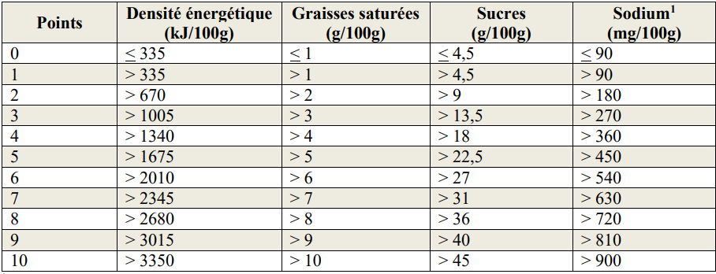
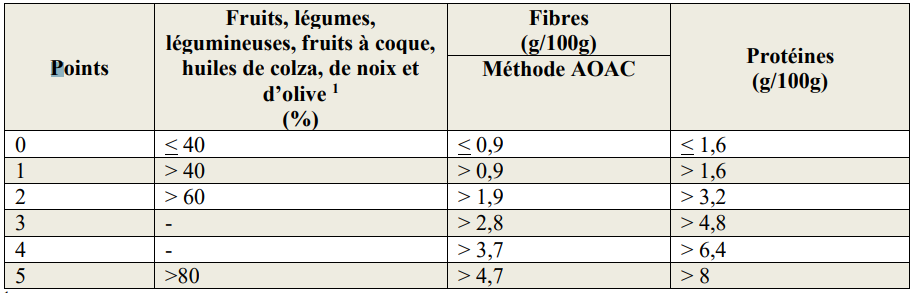
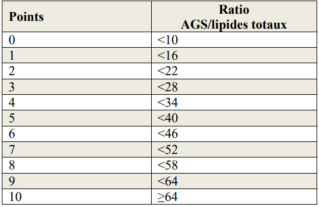
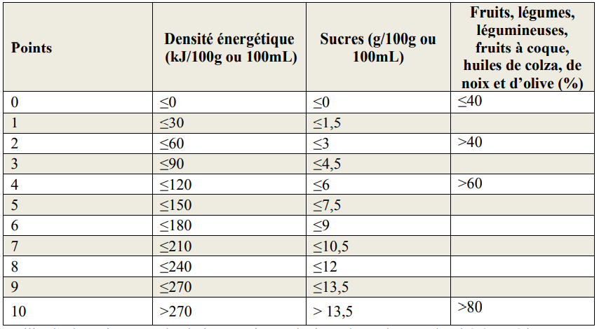
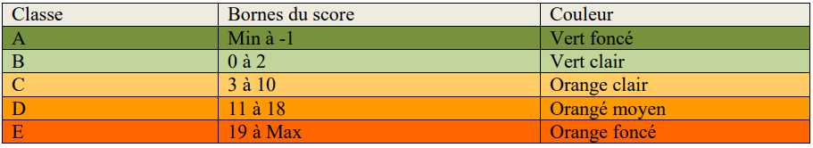
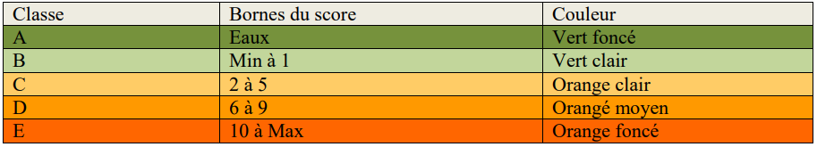
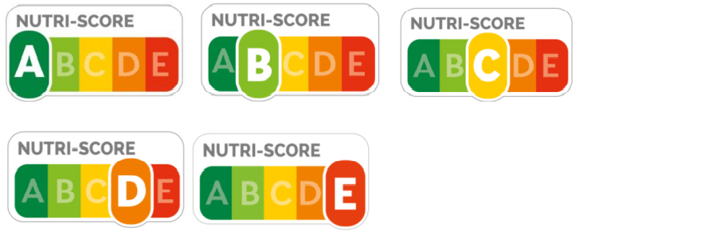
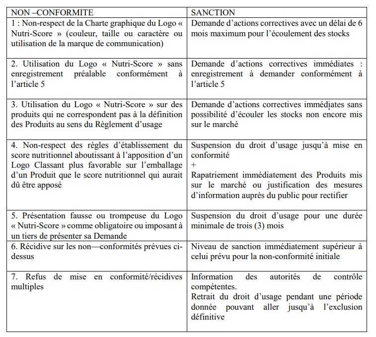
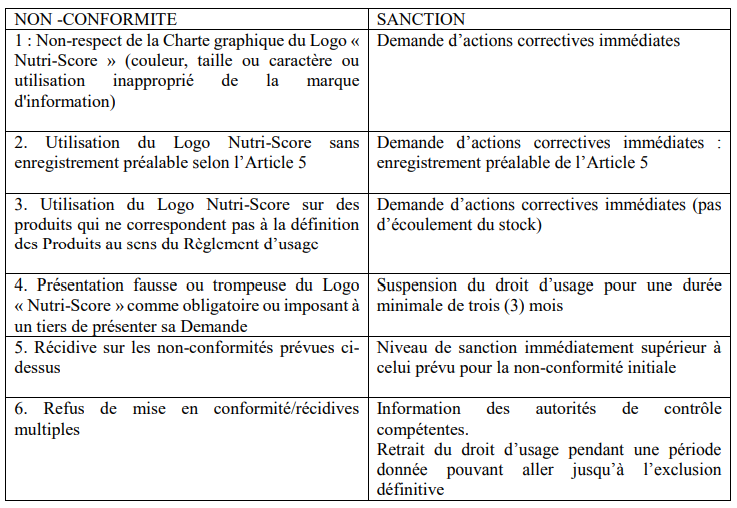

# Règlement grand-ducal du 7 mai 2021 relatif à l’utilisation du logo Nutri-Score.

Nous Henri, Grand-Duc de Luxembourg, Duc de Nassau,

Vu le [règlement (UE) n° 1169/2011](https://legilux.public.lu/eli/reg_ue/2011/1169/jo) du Parlement européen et du Conseil du 25 octobre 2011 concernant l’information des consommateurs sur les denrées alimentaires, modifiant les [règlements (CE) n° 1924/2006](https://legilux.public.lu/eli/reg_ue/2006/1924/jo) et [(CE) n° 1925/2006](https://legilux.public.lu/eli/reg_ue/2006/1925/jo) du Parlement européen et du Conseil et abrogeant la [directive 87/250/CEE](https://legilux.public.lu/eli/dir_ue/1987/250/jo) de la Commission, la [directive 90/496/CEE](https://legilux.public.lu/eli/dir_ue/1990/496/jo) du Conseil, la [directive 1999/10/CE](https://legilux.public.lu/eli/dir_ue/1999/10/jo) de la Commission, la [directive 2000/13/CE](https://legilux.public.lu/eli/dir_ue/2000/13/jo) du Parlement européen et du Conseil, les directives [2002/67/CE](https://legilux.public.lu/eli/dir_ue/2002/67/jo) et [2008/5/CE](https://legilux.public.lu/eli/dir_ue/2008/5/jo) de la Commission et le [règlement (CE) n° 608/2004](https://legilux.public.lu/eli/reg_ue/2004/608/jo) de la Commission, et notamment son article 36 ;

Vu le [règlement (CE) n° 1924/2006](https://legilux.public.lu/eli/reg_ue/2006/1924/jo) du Parlement européen et du Conseil du 20 décembre 2006 concernant les allégations nutritionnelles et de santé portant sur les denrées alimentaires, et notamment ses dispositions relatives aux allégations nutritionnelles ;

Vu la [loi du 28 juillet 2018](https://legilux.public.lu/eli/etat/leg/loi/2018/07/28/a675/jo) instaurant un système de contrôle et de sanctions relatif aux denrées alimentaires ;

Vu la [loi modifiée du 25 septembre 1953](https://legilux.public.lu/eli/etat/leg/loi/1953/09/25/n1/jo) ayant pour objet la réorganisation du contrôle des denrées alimentaires, boissons et produits usuels ;

Vu les avis de la Chambre d’agriculture, de la Chambre de commerce et de la Chambre des métiers ;

Notre Conseil d’État entendu ;

Sur le rapport de Notre Ministre de la Protection des consommateurs, et après délibération du Gouvernement en conseil ;

Arrêtons :

## Art. 1er.

Le logo « Nutri-Score » est utilisé conformément aux modalités fixées dans son règlement d’usage et plus précisément dans le cahier des charges figurant en annexe du présent règlement.

## Art. 2.

Lorsque les exploitants du secteur alimentaire s’engagent à utiliser le logo « Nutri-Score » pour une ou plusieurs de leurs marques propres, cet engagement doit porter sur l’ensemble des denrées alimentaires qu’ils mettent sur le marché luxembourgeois sous les marques concernées.

## Art. 3.

Notre ministre ayant la Protection des consommateurs dans ses attributions est chargé de l’exécution du présent règlement qui sera publié au Journal officiel du Grand-Duché de Luxembourg.

La Ministre de la Protection des consommateurs,   Paulette Lenert

Château de Berg, le 7 mai 2021.   Henri

\**Annexe I :**

I. REGLEMENT D’USAGE DU LOGO « NUTRI-SCORE »

\*Version 21 du 16 juin 2020, Approuvée par Santé publique France*

PREAMBULE

Le [règlement (UE) n°1169 /2011](https://legilux.public.lu/eli/reg_ue/2011/1169/jo) du 25 octobre 2011 concernant l’information des consommateurs sur les denrées alimentaires (ci-après le « [Règlement européen](http://legilux.public.lu/eli/reg_ue/2011/1169/jo) »), impose aux exploitants de denrées alimentaires l’apposition de mentions obligatoires sur leurs produits, afin de garantir un niveau élevé de protection de la santé et des intérêts des consommateurs en fournissant au consommateur final les bases à partir desquelles il peut décider en toute connaissance de cause et utiliser les denrées alimentaires en toute sécurité, dans le respect, notamment, de considérations sanitaires, économiques, écologiques, sociales et éthiques.

Les articles 29 et suivant du [Règlement européen](http://legilux.public.lu/eli/reg_ue/2011/1169/jo) déterminent les règles de l’une de ces mentions, à savoir la déclaration nutritionnelle obligatoire comprenant les informations sur les caractéristiques nutritionnelles permettant aux consommateurs, y compris ceux qui doivent suivre un régime alimentaire spécial, de choisir en toute connaissance de cause.

Afin de faciliter la compréhension de cette déclaration, l’article 35 du [Règlement européen](http://legilux.public.lu/eli/reg_ue/2011/1169/jo) donne la possibilité d’apposer des formes d’expression ou représentations complémentaires sous forme de graphique ou de symbole, dans la mesure où ces formes et représentations respectent des critères exigeants en termes de qualité et de compréhensibilité, tels que posés par ce même article 35.

L’Agence nationale de santé publique, ci-après dénommée « Santé publique France », établissement public administratif de l’État français, chargée notamment de la promotion en santé, a élaboré, sur la base des travaux de l’Institut national de la santé et de la recherche médicale, une signalétique répondant aux critères posés par le [Règlement européen](http://legilux.public.lu/eli/reg_ue/2011/1169/jo). Cette signalétique, ci–après désignée « Logo », a fait l’objet de dépôts auprès de l’INPI (Institut national de la propriété industrielle) et de l’EUIPO (Office européen pour la propriété intellectuelle) au titre de la protection des dessins et modèles industriels ainsi qu’en tant que marque collective.

Un règlement d’usage a été élaboré pour l’exploitation de ce Logo. Ce règlement définit les personnes habilitées à exploiter ce Logo, les conditions d’usage de ce Logo ainsi que la charte graphique à respecter, et les sanctions pouvant affecter le non-respect du règlement d’usage. Si ces personnes remplissent les conditions établies au présent règlement d’usage et les respectent tout au long de leur usage du Logo, plusieurs droits d’usage leur sont automatiquement concédés sur ce Logo, qui diffèrent selon que les produits soient visés dans leurs Demandes ou Notifications. Les exploitants sont informés que Santé Publique France peut suspendre ou résilier tout ou partie des droits d’usage qui leur sont concédés sur le Logo dans les conditions fixées dans le présent règlement d’usage.

La première édition de ce règlement d’usage a été approuvée par Santé publique France le 12 mai 2017.

Santé publique France s’assurera de la pertinence de ce règlement d’usage au regard de l’évolution de l’activité concernée, de telle sorte que le règlement d’usage pourra être révisé.

## Article 1 — DEFINITIONS

1.1 Par « Cahier des charges », on entend le cahier des charges joint en annexe (annexe 1).

1.2 Par « Charte graphique », on entend la charte graphique formalisant les modalités graphiques d’usage du Logo, figurant en annexe (annexe 2).

1.3 Par « Communication générique », on entend la communication promotionnelle à visée générale de l’Exploitant ne visant pas spécifiquement un ou plusieurs Produits.

1.4 Par « Déclaration nutritionnelle obligatoire », on entend la déclaration prévue par les articles 30 et suivants du [Règlement européen](http://legilux.public.lu/eli/reg_ue/2011/1169/jo).

1.5 Par « Demande », on entend la demande d’enregistrement d’un Exploitant au Règlement d’usage.

1.6 Par « EUIPO », on entend l’Office de l’Union européenne pour la propriété intellectuelle.

1.7 Par « Exploitant », on entend toute personne physique ou morale habilitée à utiliser le Logo sur les Produits (tels que définis ci-dessous) en application du Règlement d’usage. A ce titre, on entend par « Exploitant Titulaire » l’Exploitant titulaire ou licencié exclusif des droits de propriété intellectuelle sur ses Produits Sources et par « Exploitant Distributeur » l’Exploitant qui fait toute exploitation commerciale licite de Produits Distribués avec l’accord direct ou indirect de l’Exploitant Titulaire. Un Exploitant peut être Exploitant Titulaire de ses Produits Source et Exploitant Distributeur de Produits Distribués en même temps.

1.8 Par « INPI », on entend l’Institut national de la propriété industrielle.

1.9 Par « Logo », on entend les signalétiques « Nutri-Score » déposées :

aash à l’INPI, en tant que marque collective, le 28 avril 2017 sous les numéros 4357857 et 4357865 ;

bash et auprès de l’EUIPO, en tant que marque collective, le 19 mai 2017, sous les numéros 016762312 et 016762379 et en tant que dessins et modèles industriels, le 20 juillet 2017, sous les numéros 004112415-0001, 004112415-0002 et 004112415-0003.

Le Logo est composé de :

aash 5 logotypes, ci-après dénommés « Logo Classant » présentant les 5 classements de produits sur l’échelle nutritionnelle, associés au mot « Nutri-Score ».

bash Un logotype neutre, ci-après-dénommé « Logo Neutre », élaboré uniquement aux fins de communication générique ou de l’exception de l’Article 6.2, et présentant l’échelle nutritionnelle, sans mise en avant d’un classement, associé au mot « Nutri-Score ».

1.10 Par « Notification », on entend la notification complémentaire d’un Exploitant Distributeur indiquant les Produits Distribués pour lesquels il exerce les droits prévus au Règlement d’usage.

1.11 Par « Produits », on entend les denrées alimentaires soumises à l’obligation de Déclaration nutritionnelle obligatoire. A ce titre, on entend par « Produits Sources », les Produits visés par un Exploitant Titulaire dans une Demande et par « Produits Distribués », les Produits visés par un Exploitant Distributeur dans une Notification. Les Produits Sources d’un Exploitant Titulaire peuvent ainsi être qualifiés de Produits Distribués pour un Exploitant Distributeur.

1.12 Par « Règlement d’usage », on entend le présent règlement d’usage du Logo, ainsi que ses annexes.

1.13 Par « [Règlement européen](http://legilux.public.lu/eli/reg_ue/2011/1169/jo) », on entend le [Règlement (UE) n°1169 /2011](https://legilux.public.lu/eli/reg_ue/2011/1169/jo) du Parlement européen et du Conseil du 25 octobre 2011 concernant l’information des consommateurs sur les denrées alimentaires modifiant les [règlements (CE) n° 1924/2006](https://legilux.public.lu/eli/reg_ue/2006/1924/jo) et [(CE) n° 1925/2006](https://legilux.public.lu/eli/reg_ue/2006/1925/jo) du Parlement européen et du Conseil et abrogeant la [directive 87/250/CEE](https://legilux.public.lu/eli/dir_ue/1987/250/jo) de la Commission, la [directive 90/496/CEE](https://legilux.public.lu/eli/dir_ue/1990/496/jo) du Conseil, la [directive 1999/10/CE](https://legilux.public.lu/eli/dir_ue/1999/10/jo) de la Commission, la [directive 2000/13/CE](https://legilux.public.lu/eli/dir_ue/2000/13/jo) du Parlement européen et du Conseil, les [directives 2002/67/CE](https://legilux.public.lu/eli/dir_ue/2002/67/jo) et [2008/5/CE](https://legilux.public.lu/eli/dir_ue/2008/5/jo) de la Commission et le [règlement (CE) n° 608/2004](https://legilux.public.lu/eli/reg_ue/2004/608/jo) de la Commission.

1.14 Par « Santé Publique France », on entend l’Agence nationale de santé publique, établissement public administratif de l’État, représentée par son directeur général et propriétaire exclusif du Logo.

## Article 2 — OBJET

Le Règlement d’usage a pour objet de définir les conditions et les modalités d’utilisation du Logo par l’Exploitant Titulaire ou par l’Exploitant Distributeur selon les catégories de Produits.

## Article 3 — IDENTIFICATION DU LOGO

Le Logo « Nutri-Score » a été conçu par Santé publique France en respectant les prérogatives posées par l’article 35 du [Règlement européen](http://legilux.public.lu/eli/reg_ue/2011/1169/jo).

Il constitue une forme complémentaire à la Déclaration nutritionnelle obligatoire et vise à aider le consommateur à prendre en compte la qualité nutritionnelle des produits qu’il achète grâce au classement de l’aliment dans l’échelle nutritionnelle à 5 niveaux, calculé conformément aux dispositions du Cahier des charges, annexé au présent Règlement d’usage.

Il est constitué par 5 Logos Classants et 1 Logo Neutre.

Tout usage du Logo vaut acceptation formelle des dispositions du Règlement d’usage.

Seul un Exploitant peut apposer le Logo conformément aux modalités d’utilisation définies ci-après.

## Article 4 — PROPRIETE DU LOGO

L’Exploitant reconnait que Santé publique France est pleinement propriétaire du Logo.

Le droit d’usage du Logo en vertu du Règlement d’usage n’opère aucun transfert des droits de propriété sur le Logo.

## Article 5 — BENEFICIAIRES D’UN DROIT D’USAGE DU LOGO

5.1. Personnes éligibles

L’usage du Logo est réservé aux personnes physiques ou morales, fabricants et distributeurs de Produits mis sur le marché français et/ou européen, sous réserve du respect des conditions du Règlement d’usage.

Les administrations et établissements publics français disposent d’un droit d’usage du Logo, à des fins d’actions publiques dans le champ de la santé, et en dehors du champ concurrentiel. Par dérogation à l’article 5.2.1, les administrations et établissements concernés, doivent en faire la demande par courriel à nutriscore@santepubliquefrance.fr.

Les éditeurs de logiciels et d’applications ainsi que les journalistes qui souhaitent faire usage du Logo Nutri-Score doivent au préalable s’adresser par courriel à nutriscore@santepubliquefrance.fr pour recevoir les conditions d’usage du Logo. La Charte graphique associée au Logo devra être expressément respectée par ces tiers.

5.2. Procédure d’obtention du droit d’usage pour les Produits Sources

5.2.1 **Enregistrement** Avant tout enregistrement, l’Exploitant doit prendre connaissance de l’ensemble de la procédure d’enregistrement décrite sur la page dédiée au Logo : http://santepubliquefrance.fr/Sante-publiqueFrance/Nutri-Score.

Pour les Produits distribués en France, exclusivement ou non, l’Exploitant doit être prêt à transmettre les fichiers demandés à l'Observatoire de la qualité de l'alimentation (Oqali), dans le délai imparti (voir à l’article 9.6du présent Règlement d’usage), via le lien suivant : https://survey.anses.fr/SurveyServer/s/formation7/Oqali_Suivi_Nutri_Score/questionnaire.html

Toute personne éligible en application de l’article 5.1 du Règlement d’usage, souhaitant utiliser le Logo, enregistre sa Demande sur le site suivant : https://www.demarches-simplifiees.fr/commencer/enregistrement_nutri-score

Les Exploitants qui souhaitent inscrire des Produits commercialisés exclusivement en dehors du territoire français pourront s’inscrire à partir de la procédure appelée « Registration procedure of the operator to obtain the right to use the registered collective trademark Nutri-Score » : https://www.demarches-simplifiees.fr/commencer/registration-for-brands-distributed-abroad-only

Cet enregistrement comporte :

aash L’identification du demandeur et de son activité,

bash Le détail par catégories des Produits Sources concernés par l’usage du Logo, et

cash L’engagement à utiliser le Logo pour l’ensemble des Produits Sources qu’il met sur le marché sous la ou les marque(s) qu’il inscrit en tant qu’Exploitant Titulaire, dans le respect du Règlement d’usage.

Un accusé de réception par voie électronique de cet enregistrement est aussitôt transmis à l’Exploitant, avec les fichiers permettant l’usage du Logo, sous réserve des droits d’usage concédés et des conditions spécifiques relatives aux Produits Distribués.

5.2.2 **Changement de circonstances affectant l’Exploitant et son droit d’usage** L’Exploitant s’engage à informer Santé publique France de toute modification affectant sa qualité ou modifiant une des caractéristiques déclarées lors de son enregistrement.

A ce titre, il tient à jour la liste des Produits visés dans sa Demande, notamment selon les catégories de Produits (Produits Sources et/ou Produits Distribués), en faisant application de l’article 9.6. Le droit d’usage du Logo sur un Produit cesse à compter du retrait du Produit lors de cette mise à jour, que ce retrait soit volontairement déclaré par l’Exploitant ou qu’il résulte de l’application de l’article 10 du Règlement d’usage.

Ces modifications sont enregistrées auprès de Santé publique France sur le site dédié.

Étant entendu que si l’Exploitant ne répond plus aux conditions posées par le Règlement d’usage, le droit d’usage du Logo est résilié conformément à l’article 13.2 du Règlement d’usage.

5.3. Procédure d’obtention du droit d’usage pour les Produits Distribués

Tout Exploitant ayant présenté une Demande dans les conditions de l’article 5.2 ci-dessus peut également bénéficier de la licence d’utilisation du Logo sur des Produits Distribués, à condition d’adresser par courriel à l’adresse nutriscore@santepubliquefrance.fr une Notification annuelle contenant l’identification des catégories de Produits Distribués ainsi que l’identité du fabricant et du titulaire des droits de propriété intellectuelle sur ces Produits Distribués. Cette Notification doit être renouvelée chaque année en indiquant, le cas échéant, (i) les catégories de Produits Distribués pour lesquels l’Exploitant Distributeur cesse l’usage du Logo et (ii) les catégories de Produits Distribués pour lesquels l’Exploitant Distributeur débute l’usage du Logo.

L’Exploitant Distributeur s’engage à n’utiliser le Logo que pour les seules catégories de Produits Distribués indiqués dans la Notification et à ne pas utiliser le Logo pour des Produits Distribués n’ayant pas été indiqués au préalable dans une Notification annuelle.

L’Exploitant Distributeur s’engage à n’utiliser le Logo que pour les seules catégories de Produits Distribués dont il fait une exploitation commerciale licite. Ainsi, si les conditions d’exploitation et/ou de distribution des Produits Distribués s’opposent à ce que l’Exploitant Distributeur fasse usage du Logo, la Notification de l’Exploitant Distributeur sera réputée caduque pour ces Produits Distribués et l’Exploitant Distributeur ne dispose pas des droits d’usage du Logo pour ces derniers. Dans ce cas, l’Exploitant Distributeur est seul responsable de sa Notification et de son utilisation frauduleuse du Logo, à ses risques et périls.

## Article 6 — LICENCE D’UTILISATION DU LOGO

Le droit d’usage concédé par Santé Publique France doit respecter les conditions du présent article 6 dans le cadre d’une obligation de résultat, et toute violation par l’Exploitant est susceptible d’entraîner la résiliation partielle ou totale du ou des droits d’usage concédés à l’Exploitant sur le Logo, en application de l’article 10 du Règlement d’usage.

6.1. Droits d’usage du Logo sur les Produits Sources

Le droit d’usage du Logo sur les Produits Sources est concédé par Santé Publique France à l’Exploitant Titulaire, à compter de la réception de la Demande :

aash à titre principal, pour être apposé sur des Produits Sources en tant que présentation complémentaire à la Déclaration nutritionnelle obligatoire conformément aux conditions de l’article 7.1.

bash à titre complémentaire, à des fins de Communication générique ou de communication promotionnelle sur un Produit Source conformément aux conditions de l’Article 8.

L’usage du Logo à des fins de Communication générique ou de communication promotionnelle sur un Produit Source n’est concédé que dans la mesure où l’Exploitant exploite le Logo sur les Produits Sources en tant que présentation complémentaire à la Déclaration nutritionnelle obligatoire selon les modalités et délais de mise en œuvre prévus par le Règlement d’usage. En aucun cas, l’Exploitant n’est autorisé à utiliser le Logo uniquement pour communiquer sur les Produits Sources ou en faire la promotion.

6.2. Droits d’usage du Logo sur les Produits Distribués

Le droit d’usage du Logo sur les Produits Distribués est concédé par Santé Publique France à l’Exploitant Distributeur, à compter de la réception de la Notification et sous réserve que l’Exploitant Distributeur en fasse une exploitation commerciale licite et conforme à ses droits sur les Produits Distribués :

aash à titre principal, et sous réserve du respect des droits de propriété intellectuelle de l’Exploitant Titulaire et de l’utilisation du Logo Classant par l’Exploitant Distributeur sur ces Produits Distribués en application des conditions de l’Article 7.2, pour la commercialisation des Produits Distribués en relation avec le Logo (sans apposition directe du Logo sur les Produits Distribués).

bash à titre complémentaire, à des fins de Communication générique ou de communication promotionnelle sur un Produit Distribué conformément aux conditions de l’Article 8.

L’usage du Logo à des fins de Communication générique ou de communication promotionnelle sur un Produit Distribué n’est concédé que dans la mesure où l’Exploitant Distributeur exploite le Logo en rapport avec les Produits Distribués en tant que présentation complémentaire à la Déclaration nutritionnelle obligatoire selon les modalités et délais de mise en œuvre prévus par le Règlement d’usage. En aucun cas, l’Exploitant Distributeur n’est autorisé (i) à utiliser le Logo uniquement pour communiquer sur les Produits Distribués ou en faire la promotion ou (ii) à utiliser le Logo pour des Produits Distribués n’ayant pas fait l’objet d’une Notification annuelle.

6.3. Non exclusivité

Le Règlement d’usage ne donne aucun droit exclusif d’usage du Logo au profit de l’Exploitant.

6.4. Caractère personnel

Le droit d’usage du Logo est strictement personnel. Il ne peut en aucun cas être cédé ou transmis, par quelque moyen que ce soit.

6.5. Caractère gratuit

Le droit d’usage du Logo est consenti à l’Exploitant à titre gratuit.

## Article 7 — CONDITIONS D’UTILISATION DU LOGO CLASSANT

7.1. Conditions spécifiques aux Produits Sources

7.1.1 **Champ d’application** Si l’Exploitant décide d’utiliser le Logo Classant sur une ou plusieurs de ses marques en application de l’article 6.1 du Règlement d’usage, il a obligation de l’utiliser sur l’ensemble des catégories de Produits qu’il met sur le marché sous ses marques inscrites au Règlement d’usage.

L’Exploitant dispose de 24 mois à compter de la date de son enregistrement pour se conformer à l’ensemble des dispositions du Règlement d’usage pour les Produits Sources. Dans le cas où le nombre de références engagées est supérieur ou égal à 2000, ce délai est porté à 36 mois, avec un seuil de 80% des produits apposant le Logo Classant dans les 24 mois.

Les communications promotionnelles en lien avec un Produit Source devront nécessairement utiliser le Logo Classant adéquat, conformément aux conditions de l’article 7.2 ci-dessous.

7.1.2 **Choix du Logo Classant sur les Produits Sources** aot Recours exclusif au Logo Classant

Seul l’usage d’un Logo Classant est autorisé pour l’usage du Logo en tant que présentation complémentaire à la Déclaration nutritionnelle obligatoire.

En aucun cas l’Exploitant ne peut apposer sur ses Produits le Logo Neutre.

aot Classement du Produit dans l’échelle nutritionnelle : Cahier des charges

Le choix du Logo Classant adéquat pour chaque Produit est déterminé par l’Exploitant conformément au Cahier des charges défini en annexe 1.

L’utilisation du Logo Classant est indissociable du calcul du score nutritionnel de chaque Produit et de son résultat, conformément à ce Cahier des charges.

L’Exploitant est seul responsable du calcul du score nutritionnel.

7.1.3 **Licence d’utilisation du Logo Classant sur les Produits Sources** L’Exploitant Titulaire concède aux Exploitants Distributeurs (i) enregistrés au Règlement d’usage et (ii) disposant des droits d’exploitation des Produits Sources, un droit limité, non-exclusif, incessible, irrévocable, intransférable, excluant l’octroi d’une sous-licence, d’utiliser l’image et le nom des Produits Sources en association avec leurs Logos Classants respectifs, aux seules fins d’exercice des droits d’usage du Logo, à titre gratuit, dans le monde entier et pour la durée de l’enregistrement de l’Exploitant Titulaire au Règlement d’usage. En application de cette licence d’utilisation, les Exploitants Distributeurs peuvent utiliser les Produits Sources en tant que Produits Distribués.

7.2 Conditions spécifiques aux Produits Distribués

7.2.1 **Champ d’application** Si l’Exploitant Distributeur décide d’utiliser le Logo Classant sur un ou plusieurs Produits Distribués en application de l’article 6.2 du Règlement d’usage, il a obligation, avant exercice du droit d’usage comme du droit de communication :

aash Soit d’utiliser le Logo Classant choisi par l’Exploitant Titulaire pour ces Produits Distribués, en application de la licence d’utilisation concédée par l’Exploitant Titulaire à l’article 7.2.3 du Règlement d’usage, étant précisé que l’Exploitant Distributeur ne peut attribuer un autre Logo Classant que celui attribué par l’Exploitant Titulaire à ces Produits Distribués ;

bash Soit, si le(s) titulaire(s) des droits de propriété intellectuelle ne se sont pas enregistré(s) au Règlement d’usage en tant qu’Exploitant(s) Source, d’adresser au(x) dit(s) titulaire(s) concernés un avis d’utilisation préalable à toute utilisation du Logo sur les Produits Distribués protégés par les droits de propriété intellectuelle de ce(s) tiers.

7.2.2 **Avis préalable d’utilisation au(x) titulaire(s) des droits de propriété intellectuelle** Par exception à l’article 6.2, l’Exploitant Distributeur ne peut attribuer de Logo Classant aux Produits Distribués d’un titulaire non enregistré au Règlement d’usage, ni utiliser le Logo sur le ou les Produits Distribués de ce titulaire ou en association avec ce ou ces Produits Distribués, avant d’adresser un avis préalable au(x) titulaire(s) des droits de propriété intellectuelle par lettre RAR. Cette notification inclut notamment :

i. l’identification des catégories de Produits Distribués appartenant au titulaire des droits de propriété intellectuelle et visés par l’Exploitant Distributeur,

ii. la possibilité pour le titulaire de présenter une Demande en tant qu’Exploitant Titulaire afin de déterminer le Logo Classant des Produits Distribués, ou de répondre à l’Exploitant Distributeur en encadrant l’exercice du droit d’usage et/ou du droit de communication promotionnelle pour tout ou partie des Produits Distribués du titulaire,

iii. si l’Exploitant Distributeur dispose des données, le détail du score nutritionnel calculé par l’Exploitant Distributeur et du Logo Classant que l’Exploitant Distributeur compte attribuer à chaque Produit Distribué, ainsi que la possibilité pour le titulaire de modifier le Logo Classant de chaque Produit Distribué en fournissant des données complémentaires ou de restreindre l’utilisation du Logo Classant au droit de communication, sans que cette réponse ne constitue une Demande du titulaire, et

iv. la mention du délai de trois (3) mois courant à compter de la réception de l’avis.

Lorsqu’un avis préalable doit être envoyé à un titulaire non enregistré au Règlement d’usage, l’Exploitant Distributeur doit indiquer dans sa Notification relative aux catégories de Produits Distribués les démarches entreprises pour adresser cet avis et les délais applicables à celui-ci.

Tout usage anticipé du Logo en violation de cette procédure d’avis préalable est un cas de résiliation partielle ou totale (à la discrétion de Santé Publique France) des droits de l’Exploitant Distributeur en application de l’Article 13 du Règlement d’usage.

7.2.3 **Choix du Logo sur les Produits Distribués** A l’issue d’un délai d’attente de trois (3) mois à compter de la date de réception de l’avis préalable par le dernier des titulaires, resté sans réponse de la part d’un ou des titulaire(s), l’Exploitant Distributeur peut exercer les droits de l’article 6.2 du Règlement d’usage de la manière suivante.

Si l’Exploitant Distributeur (i) dispose des données nécessaires pour calculer le score nutritionnel et attribuer un Logo Classant à un Produit Distribué et (ii) a dûment informé le titulaire de ce Logo Classant dans son avis préalable, alors l’Exploitant Distributeur peut

aash attribuer le Logo Classant aux Produits Distribués (notamment par tout étiquetage ou support d’information de rayonnage séparé des Produits Distribués), mais ne peut pas apposer le Logo Classant sur les Produits Distribués eux-mêmes ; et

bash exercer son droit de communication promotionnelle en attribuant le Logo Classant aux Produits Distribués sur les supports de communication, dans les conditions ci-après détaillées.

Si l’Exploitant Distributeur n’a pas les données nécessaires pour calculer le score nutritionnel et attribuer un Logo Classant à un Produit Distribué dans le respect du Cahier des charges, alors en l’absence de réponse du titulaire, l’Exploitant Distributeur ne peut utiliser de Logo Classant et doit limiter son droit d’usage et son droit de communication promotionnelle à l’utilisation du Logo Neutre monochrome avec les Produits Distribués.

Le droit d’usage du Logo est limité à l’utilisation d’un Logo Classant ou Logo Neutre en tant que présentation complémentaire à la Déclaration nutritionnelle obligatoire sur un Produit Distribué. Le Logo Neutre ne peut être utilisé si un Logo Classant est apposé et/ou attribué à un Produit Distribué, et un Logo Classant ne peut être utilisé pour un Produit Distribué en dehors des conditions d’utilisation du présent article 7.2.

En tout état de cause, si l’Exploitant Titulaire exprime son refus après le délai de trois mois d’attente à compter de la date de réception de l’avis préalable, l’Exploitant Distributeur dispose d’un délai d’un (1) mois à compter de la réception du refus pour retirer les Logos Classant sur tous ses étiquetages, supports d’information en rayonnage et supports de communications. De la même manière, si l’Exploitant présente une Demande visant des Produits Distribués, l’Exploitant Distributeur utilise le Logo Classant attribué aux Produits Distribués par l’Exploitant Titulaire et doit remplacer le Logo Classant sur tous ses étiquetages, supports d’information en rayonnage et supports de communication dans un délai d’un (1) mois à compter de la réception de la Demande par Santé publique France.

7.2.4 **Informations obligatoires sur les supports d’information et de communication promotionnelle des Produits Distribués** Si l’Exploitant Distributeur utilise le Logo Classant attribué par l’Exploitant Titulaire aux Produits Distribués, alors l’Exploitant Distributeur doit indiquer sur tout support d’information ou de communication promotionnelle incluant le Produit Distribué, par tous moyens appropriés et adaptés au format du support, que le Logo Classant a été attribué par l’Exploitant Titulaire, sous la seule responsabilité de l’Exploitant Titulaire.

Si l’Exploitant Distributeur utilise le Logo Classant qu’il a attribué à un Produit Distribué dans le respect de la procédure d’avis préalable de l’article 7.2 du Règlement d’usage, alors l’Exploitant Distributeur doit indiquer sur tout support d’information ou de communication promotionnelle incluant le Produit Distribué, par tous moyens appropriés et adaptés au format du support, que le Logo Classant a été attribué par l’Exploitant Distributeur, indépendamment de l’Exploitant Titulaire et sous la seule responsabilité de l’Exploitant Distributeur.

Si l’Exploitant Distributeur ne peut utiliser que le Logo Neutre monochrome avec les Produits Distribués en application de la procédure d’avis préalable de l’article 7.2 du Règlement d’usage, alors l’Exploitant Distributeur doit indiquer sur tout support d’information ou de communication promotionnelle incluant le Produit Distribué, par tous moyens appropriés et adaptés au format du support, que l’Exploitant Distributeur ne dispose pas des informations nécessaires pour le calcul et l’attribution d’un Logo Classant et ne peut pas, pour l’instant, appliquer le Règlement d’usage à ce Produit Distribué.

## Article 8 — UTILISATION DU LOGO A DES FINS DE COMMUNICATION

8.1. Choix du Logo pour des Communications génériques

Pour ses Communications génériques sur le Logo, l’Exploitant peut apposer sur ses supports de communication :

aash Le Logo Neutre,

bash Et/ou au moins 3 des 5 Logos Classants disposés de façon à ne pas induire le consommateur en erreur sur la classification des Produits, notamment en laissant entendre que tous ses produits ont le même classement.

L’Exploitant reconnait et accepte que la Communication générique sur le Logo exclut toute communication promotionnelle sur un Produit, et plus généralement toute attribution ou présentation d’un Logo Classant comme appliqué ou applicable à un Produit. Toute violation de cette obligation se fait aux risques et périls de l’Exploitant et peut entraîner la résiliation de son droit d’usage sur le Produit concerné en application de l’article 13.2.2 du Règlement d’usage.

8.2. Outils de promotion du dispositif Nutri-Score

8.2.1 **Outils élaborés par Santé publique France** L’Exploitant pourra utiliser les outils de promotion du dispositif Nutri-Score dans les conditions détaillées dans le Règlement d’usage des outils Nutri-Score élaborés par Santé publique France (disponible sur la page https://www.santepubliquefrance.fr/determinants-de-sante/nutrition-et-activitephysique/articles/kit-de-promotion-du-dispositif-nutri-score).

8.2.2 **Outils élaborés par l’Exploitant** L’Exploitant pourra réaliser ses propres outils de promotion du dispositif Nutri-Score. En ce cas, l’Exploitant est invité à préciser que « Le Nutri-Score est développé et soutenu par Santé publique France et les pouvoirs publics ».

8.3 Charte graphique

L’Exploitant s’engage à reproduire le Logo dans son intégralité et tel que déposé auprès de l’INPI et de l’EUIPO, en respectant la Charte graphique.

L’Exploitant s’engage à ne faire aucune modification, ajout ou suppression sur le Logo.

Notamment, l’Exploitant s’engage à :

aash ne pas reproduire séparément une partie du Logo, notamment, ne pas reproduire les éléments graphiques seuls ou la dénomination seule,

bash sous réserve des aménagements prévus par la Charte graphique et notamment ceux liés au résultat du score nutritionnel (voir articles 6.2 à 6.4 ci-dessus), ne pas modifier les caractéristiques graphiques du Logo, tant en ce qui concerne la forme que la couleur, ne pas modifier la position des éléments figuratifs les uns par rapport aux autres, ne pas modifier la typographie du Logo, et à

cash ne pas faire d’ajout dans le Logo, notamment ne pas faire figurer de légende, de texte ou toute autre indication ne faisant pas partie du Logo.

Santé Publique France transmet, par voie électronique, à l’Exploitant l’ensemble des supports, documents, fichiers nécessaires à l’usage du Logo.

L’Exploitant s’engage à n’utiliser que ces seuls supports dans le cadre de la reproduction et de l’usage du Logo.

## Article 9 — LIMITES D’UTILISATION

9.1. Respect du Logo en cours d’exploitation

L’Exploitant doit, tout au long de son usage du Logo, respecter les exigences définies par le Règlement d’usage.

9.2. Respect des droits sur le Logo

L’Exploitant s’engage à ne pas déposer, à quelque titre que ce soit (marque, dessin & modèle industriel…) dans quelque territoire que ce soit, des signalétiques ou logos identiques ou similaires au Logo susceptibles de porter atteinte aux droits de propriété intellectuelle de Santé publique France sur le Logo. Notamment, il s’interdit de déposer toute marque ou dessin & modèle industriel reprenant, en tout ou partie, le Logo, en particulier au sein d’un signe plus complexe.

L’Exploitant s’engage à ne pas développer, utiliser ou exploiter, à quelque titre que ce soit et dans quelque territoire que ce soit, des signes identiques ou similaires au Logo, susceptibles de porter atteinte aux droits de propriété intellectuelle de Santé publique France sur le Logo.

L’Exploitant s’engage à ne pas réserver de noms de domaine, dans quelque extension que ce soit, reprenant ou imitant les éléments verbaux du Logo ou susceptibles de porter atteinte aux droits de propriété intellectuelle de Santé publique France.

9.3. Respect de l’utilisation du Logo

Il est expressément interdit à un Exploitant de présenter l’utilisation du Logo comme obligatoire et non comme une présentation complémentaire et facultative de la Déclaration nutritionnelle obligatoire, ainsi que de contraindre un tiers à présenter une Demande. Santé Publique France décline toute responsabilité pour toute demande, action ou réclamation introduite par un tiers à raison des propos, actions ou omissions d’un Exploitant contrevenant à ces interdictions. Toute violation des présentes interdictions peut conduire à l’une des sanctions inscrites à l’Annexe 3.

L’Exploitant s’engage à ne pas utiliser le Logo à des fins politiques, polémiques, contraires à l’ordre public ou aux bonnes mœurs ou susceptibles de porter atteinte à des droits reconnus par la loi et, de manière générale, à ne pas associer le Logo à des actions ou activités susceptibles de porter atteinte à Santé publique France ou lui être préjudiciable, notamment à tout comportement pouvant être associé directement ou indirectement à des actes de contrefaçon ou de concurrence déloyale, dont le détournement de clientèle, le dénigrement ou les pratiques commerciales trompeuses.

9.4. Contrôle et transmission

L’Exploitant accepte que Santé publique France puisse, en qualité de titulaire du Logo, mener des audits afin de contrôler le respect du Règlement d’usage, directement ou par l’intermédiaire de tout tiers indépendant mandaté par Santé Publique France. L’audit permettra notamment de vérifier la véracité de la Demande, de la Notification et de la documentation technique tenue par l’Exploitant par rapport à l’utilisation réelle et effective du Logo.

L’Exploitant accepte que Santé Publique France ait accès, y compris sur site, aux installations et infrastructures affectées à l’utilisation du Logo, ainsi qu’aux informations nécessaires pour mener à bien l’audit. L’Exploitant accepte de répondre à toute question posée lors de l’audit et à permettre l’accès, sous le contrôle de l’Exploitant, à tous les personnels, outils et moyens nécessaires à l’audit. Chaque partie conserve à sa charge les frais occasionnés dans le cadre de la procédure d’audit.

L’Exploitant reconnaît et accepte que Santé Publique France soit tenue de coopérer avec les autorités administratives et judiciaires, notamment celles dédiées au respect du droit de la consommation et du droit de la concurrence, y compris par la transmission de la Demande, de la Notification, de la documentation technique et des rapports d’audit, ce que l’Exploitant autorise expressément.

Dans l’hypothèse où le rapport d’audit ferait apparaître un manquement de l’Exploitant à ses obligations au regard du Règlement d’usage, Santé Publique France peut, à sa discrétion, prendre toute mesure ou sanction à l’encontre de l’Exploitant afin de sanctionner et/ou remédier audit manquement. A défaut de correction des manquements dans les délais imposés par Santé Publique France, cette dernière est de plein droit autorisé à résilier l’adhésion de l’Exploitant au Règlement d’usage, sans préjudice des dommages et intérêts auxquels Santé Publique France pourrait prétendre.

9.5. Documentation technique

L’Exploitant tient à la disposition de Santé publique France et des agents mandatés par elle une documentation technique, pendant toute la durée de l’usage du Logo.

Cette documentation technique, suffisante pour permettre de contrôler le respect des conditions du Règlement d’usage, comprend, notamment :

1° Pour chaque marque qu’il inscrit, la liste des Produits Sources ;

2° La liste des Produits Distribués ainsi que l’identité de leurs Exploitants Sources et/ou de tout titulaire de droits de propriété intellectuelle sur ces Produits Distribués ;

3° Pour chaque Produit :

3.a Le fichier Excel présenté en annexe 4 dûment complété, dont les valeurs permettant le calcul du score nutritionnel ;

3.b Les résultats des calculs des scores nutritionnels ; et

3.c le cas échéant, le renvoi à la documentation technique de l’Exploitant Titulaire ;

4° La liste des supports de communication et de présentation revêtus du Logo.

9.6. Transmission à l’Oqali

Lorsque le Logo est utilisé sur le territoire français suite à l’enregistrement du droit d’usage, le fichier figurant en annexe 4 est transmis à l’Observatoire de l’Alimentation, Oqali, à l’adresse électronique [https://survey.anses.fr/SurveyServer/s/formation7/Oqali_Suivi_Nutri_Score/questionnaire.htm](https://survey.anses.fr/SurveyServer/s/formation7/Oqali_Suivi_Nutri_Score/questionnaire.htm), sous format Excel, dans un délai d’un mois à compter de la mise en œuvre du Logo sur les emballages ou en e-commerce.

L’Oqali n’a pas vocation à vérifier la fiabilité des données du formulaire transmis par l’Exploitant.

Néanmoins, l’Oqali doit s’assurer que le formulaire est correctement rempli, c’est-à-dire sans données manquantes ou ne correspondant pas aux modalités des menus déroulants du formulaire Oqali.

Le non-respect des obligations de cette section peut entraîner, à la discrétion de Santé Publique France, toute sanction appropriée au regard de l’Annexe 3 ainsi que la résiliation, partielle ou totale, de l’enregistrement de l’Exploitant au Règlement d’usage.

9.6.1 **Procédure de suivi des non-conformités :** En cas de formulaire non conforme, une unique relance sera effectuée par l’Oqali. L’Exploitant devra ensuite, dans un délai de 1 mois, transmettre un formulaire conforme.

9.6.2 **Mise à jour** En cas de mise à jour de la Demande (retrait ou ajout de Produits Sources ou encore modification de Produits Sources), l’Exploitant doit transmettre à date, un nouveau formulaire de Demande reprenant l'ensemble des informations transmises précédemment ainsi que les mises à jour concernant toutes les références apposant le Logo. Tout nouveau Produit doit faire l’objet d’une nouvelle transmission à l’Oqali et tout arrêt de l’usage du Logo pour un Produit doit être signalé, dans les deux cas dans un délai de trois (3) mois avant la mise en œuvre par l’Exploitant de sa décision.

L’Exploitant doit également mettre à jour le formulaire transmis à l’Oqali suite aux décisions de sanction de Santé publique France, à sa charge.

Les modifications relatives aux Produits Distribués (retrait, ajout, modifications, avis préalables et délais) doivent être contenues dans la Notification adressée chaque année à la date-anniversaire de la première Notification de l’Exploitant Distributeur.

## Article 10 — INFORMATION ET PROMOTION

Tous actes d’usage, de promotion et d’information relatifs au Logo par l’Exploitant doivent être conformes au Règlement d’usage, aux lois et règlements en vigueur et ne doivent porter atteinte ni aux droits sur le Logo de Santé Publique France, ni à son image ou à ses intérêts.

Santé Publique France ou les pouvoirs publics peuvent être amenés à communiquer sur les entreprises engagées en faveur du Logo dans le cadre de communiqués de presse, dossiers de presse, sur leurs médias propriétaires, dans des interviews, des événements, etc.

L'Exploitant accepte que Santé Publique France ou les pouvoirs publics communiquent sur son engagement en faveur du Logo. Dans le cas contraire, il peut en informer Santé Publique France en envoyant un courriel à nutriscore@santepubliquefrance.fr, dans un délai de deux (2) semaines à compter de la réception de l'enregistrement du droit d'usage.

## Article 11 — DUREE

L’Exploitant est autorisé à utiliser le Logo conformément au Règlement d’usage, à compter de la date de réception des fichiers permettant son usage (sous réserve de la procédure applicable aux Produits Distribués) et jusqu’à la fin de la protection légale du Logo dévolue à Santé publique France, sans préjudice des sanctions et résiliations prévues à l’Article 13.

Santé publique France notifie à l’Exploitant, par tout moyen permettant d’en attester la bonne réception, deux (2) mois avant l’échéance, la date de fin de la protection légale dévolue à Santé publique France au titre du droit de la propriété intellectuelle.

## Article 12 — MODIFICATION DU REGLEMENT D’USAGE

En cas de modification du Règlement d’usage, Santé publique France en informe l’Exploitant par courrier électronique à l’adresse indiquée par l’Exploitant lors de l’enregistrement et que l’Exploitant veillera à toujours conserver active ou, à défaut, à informer Santé publique France de sa modification.

L’Exploitant est réputé avoir pris connaissance et avoir accepté les nouvelles dispositions, sauf notification contraire de sa part par tous moyens et cessation de l’utilisation du Logo dans les soixante (60) jours suivant la notification de la modification par Santé publique France.

L’Exploitant dispose d’un délai raisonnable fixé, le cas échéant, par Santé publique France pour se mettre en conformité avec les nouvelles dispositions du Règlement d’usage.

L’Exploitant est autorisé à poursuivre l’utilisation du Logo, sauf s’il ne répond plus aux nouvelles conditions à l’issue du délai raisonnable de mise en conformité. En pareil cas, l’autorisation est résiliée conformément à l’article 13.2 du Règlement d’usage.

L’Exploitant ne pourra prétendre à aucune indemnisation en raison de la modification du Règlement d’usage.

## Article 13 — RESILIATION DU DROIT D’USAGE DU LOGO

13.1. Dispositions générales

L’Exploitant ne bénéficie d’aucun droit acquis au maintien de son droit d’usage du Logo.

L’Exploitant ne peut prétendre à aucune indemnité du fait de la résiliation du droit d’usage du Logo pour les motifs prévus au présent article.

13.2. Résiliation de l’autorisation du fait de l’Exploitant

13.2.1 **Changement de circonstances affectant la validité de l’autorisation** Le droit d’usage du Logo s’éteint de plein droit et sans notification de Santé publique France dès lors que l’Exploitant ne répond plus aux conditions d’éligibilité prévues à l’article 5.1 du Règlement d’usage.

L’Exploitant devra cesser de fabriquer et de commercialiser des Produits revêtus du Logo dans un délai de trois (3) mois à compter de l’extinction du droit d’usage. Dans le même délai, il devra également cesser d’apposer le Logo sur ses supports d’information et de communication et de manière générale d’informer ou de communiquer sur le Logo. Dans cette même hypothèse, l’Exploitant devra écouler les stocks des Produits dans un délai maximum de six (6) mois à compter de l’extinction du droit d’usage.

13.2.2 **Non-respect du Règlement d’usage par l’Exploitant** En cas de manquement de l’Exploitant aux dispositions du Règlement d’usage, Santé publique France lui notifie les manquements constatés par courrier recommandé avec accusé de réception.

Une liste non exhaustive des manquements possibles accompagnée des sanctions correspondantes est annexée au Règlement d’usage en Annexe 3.

La notification du manquement adressée à l’Exploitant comporte le délai de mise en conformité avec les dispositions du Règlement d’usage et indique si le droit d’usage est suspendu jusqu’à mise en conformité.

À défaut de mise en conformité dans le délai précité, le droit d’usage du Logo est résilié de plein droit du seul fait de l’inexécution de la demande de mise en conformité, sans mise en demeure préalable de Santé publique France.

La suspension et la résiliation du droit d’usage du Logo entraînent l’obligation immédiate pour l’Exploitant de cesser tout usage du Logo et de retirer toute référence au Logo de l’ensemble de ses Produits et supports de communication.

En conséquent, l’Exploitant devra cesser de fabriquer et de commercialiser des Produits revêtus du Logo immédiatement à compter de la date de cessation du droit d’usage du Logo. Dans le même délai, il devra également cesser d’apposer le Logo sur ses supports d’information et de communication et de manière générale d’informer ou de communiquer sur le Logo. L’Exploitant devra écouler les stocks des Produits dans un délai maximum de trois (3) mois à compter de la date effective de suspension et/ou résiliation.

13.2.3 **Sanctions** L’usage non conforme au Règlement d’usage et la poursuite de l’usage du Logo malgré une décision de résiliation constituent des agissements illicites que Santé publique France peut faire sanctionner et dont il peut rechercher réparation devant les tribunaux compétents.

13.3. Usage abusif du Logo

Outre les sanctions prévues aux articles précédents, l’usage non autorisé du Logo par un Exploitant ou par un tiers ouvre le droit à Santé publique France d’intenter toute action judiciaire qu’il juge opportune à son encontre et dans le respect de la législation en vigueur.

## Article 14 — DEFENSE DU LOGO

L’Exploitant s’engage à signaler immédiatement à Santé publique France toute atteinte aux droits sur le Logo dont il aurait connaissance, notamment tout acte de contrefaçon, de concurrence déloyale, ou de parasitisme.

Il appartient à Santé Publique France de prendre seule la décision d’engager, à ses frais, risques et périls, toute action civile ou pénale.

En conséquence, les dommages et intérêts qui résulteront de l’action engagée par Santé Publique France en son nom seront à sa charge ou à son profit exclusif et en conséquent, dans cette hypothèse l’Exploitant ne pourra réclamer aucune indemnité.

## Article 15 — RESPONSABILITE ET GARANTIES

15.1. Responsabilité de l’Exploitant

L’Exploitant Titulaire est seul responsable des conséquences directes ou indirectes qui pourraient résulter de son exploitation du Logo sur ses Produits Sources. Il est seul responsable de l’exactitude, de la sincérité et de la pertinence de son calcul du score nutritionnel ainsi que de son choix du Logo lassant pour chacun de ses Produits Sources, ainsi que de l’usage et la communication sur ces Produits Sources, à ses risques et périls.

L’Exploitant Distributeur est seul responsable de l’exactitude, de la sincérité et de la pertinence de son calcul du score nutritionnel ainsi que de son choix du Logo Classant pour chaque Produit Distribué en application de la procédure de l’article 7.2, ainsi que de l’usage et la communication sur ces Produits Distribués, à ses risques et périls, notamment si l’Exploitant Distributeur (i) ne disposait pas des droits nécessaires pour faire une exploitation commerciale licite des Produits Distribués ou (ii) n’a pas respecté tout ou partie de la procédure de l’article 7.2. L’Exploitant Distributeur est également responsable, lors de l’exploitation commerciale des Produits Distribués, de son utilisation du Logo Classant attribué à un Produit Distribué par son Exploitant Titulaire, même si l’Exploitant Titulaire est responsable du calcul du score nutritionnel ainsi que du choix dudit Logo Classant pour ce Produit Distribué.

En tout état de cause, l’Exploitant reconnaît que toute utilisation incorrecte ou incomplète du Logo, notamment (i) un calcul du score nutritionnel ne respectant pas toutes les règles du Cahier des charges de l’annexe 1 ou réalisé à partir de données incomplètes ou faussé par rapport aux réelles qualités nutritionnelles du Produit ou (ii) l’attribution d’un Logo Classant inexact ou ne correspondant pas à la réalité du score nutritionnel du Produit, qu’elle résulte d’un comportement involontaire ou qu’elle soit réalisée dans l’intention de nuire, engage directement la seule responsabilité de l’Exploitant et est susceptible de constituer une pratique commerciale trompeuse en application de l’article L. 121-1 du [code de la consommation](https://legilux.public.lu/eli/etat/leg/code/consommation). Santé Publique France décline toute responsabilité pour de telles utilisations, notamment en cas d’information ou de communication promotionnelle erronée ou trompeuse de la part de l’Exploitant Distributeur sur un Produit Distribué, qui engagent exclusivement la responsabilité de l’Exploitant qui en est responsable.

15.2. Garantie de l’Exploitant

En cas de mise en jeu de la responsabilité de Santé publique France par un tiers, du fait de l’utilisation non conforme du Logo par l’Exploitant, ce dernier s’engage à en supporter tous les frais et charges en lieu et place de Santé publique France qui pourra l’appeler en garantie.

L’Exploitant garantit notamment Santé Publique France (i) que les contrats ou chaînes de contrats entre l’Exploitant et le titulaire de droits de propriété intellectuelle sur les Produits Distribués, que ce titulaire soit enregistré à titre d’Exploitant Titulaire ou non, ne s’opposent pas à l’exploitation du droit d’usage concédé par Santé Publique France sur le Logo pour les Produits Distribués à l’article 7.2, (ii) de l’absence de la moindre confusion, dans ses communications (à des fins d’information ou à des fins promotionnelles), entre Produits ou entre les Produits et d’autres produits et services, (iii) de l’absence d’erreur ou d’inexactitude dans l’attribution et l’utilisation d’un Logo Classant en relation avec un Produit, ainsi que de toute présentation fausse ou trompeuse de la part de l’Exploitant, en vertu de quoi l’Exploitant indemnisera, défendra et dégagera Santé Publique France de toute responsabilité, concernant tous dommages, obligations, coûts et frais (y compris les honoraires raisonnables d’avocat) ainsi que (iv) contre toute demande résultant d'une réclamation formée par un tiers (notamment un titulaire de droits sur un Produit) alléguant que tout ou partie de l’utilisation des Produits en relation avec le Logo en exécution du présent Règlement d’usage est en violation des droits de propriété intellectuelle de ce tiers ou constitue une faute engageant la responsabilité civile délictuelle de Santé Publique France, notamment au titre de la concurrence déloyale ou parasitaire.

L’Exploitant sera tenu au retrait du marché, dans les plus brefs délais, de tout produit non conforme aux normes en vigueur sur le territoire.

15.3. Garantie de Santé Publique France

Santé Publique France ne donne pas d'autre garantie que celle résultant de son fait personnel et de l'existence matérielle du Logo et de ce qu’à sa connaissance et à la date d’entrée en vigueur du Règlement d’usage, le Logo n’a fait l’objet d’aucune revendication de droits. L’Exploitant reconnaît connaître de manière générale les incertitudes quant à la disponibilité et, d’une manière générale à la validité des marques et des dessins & modèles, et accepte en conséquence la présente autorisation d’usage en pleine connaissance de cause, à ses risques et périls. En conséquence, au cas où Santé publique France perdrait ses droits sur le Logo à la demande d’un tiers, quelles que soient la cause de la perte des droits et sa qualification juridique (nullité, contrefaçon…), l’Exploitant s’engage à ne pas engager la responsabilité de Santé publique France et à ne réclamer à Santé publique France aucun dommage et intérêt.

## Article 16 — LOI APPLICABLE

Le présent règlement est soumis à la loi française, quel que soit le lieu d’utilisation du Logo par l’Exploitant.

## Article 17 — JURIDICTION COMPETENTE

Tout litige résultant de l’interprétation ou de l’exécution du présent Règlement d’usage sera porté devant tout tribunal compétent du ressort de la cour d’appel de Paris.

## Article 18 — ENTREE EN VIGUEUR DU DROIT D’USAGE

L’Exploitant est réputé disposer du droit d’usage, à compter de la date de réception des fichiers permettant son usage après validation de son enregistrement en ligne et de son engagement exprès à respecter le Règlement d‘usage, y inclus ses annexes.

## Article 19 — REGLEMENT DES LITIGES

Santé Publique France ne règle pas les différends éventuels entre Exploitants ou entre un Exploitant et un tiers (les parties). Si Santé Publique France a accès à la preuve d’une violation du Règlement d’usage, appréciée à la discrétion de Santé Publique France, Santé Publique France peut prendre toute mesure appropriée, y compris à titre provisoire ou conservatoire, notamment au regard des sanctions de l’Annexe 3 et de l’Article 13 du Règlement d’usage, afin de mettre fin à la violation contractuelle dans les plus brefs délais.

II. LISTE DES ANNEXES

\**Annexe 1 : Cahier des charges : Classement de l’aliment dans l’échelle nutritionnelle à 5 couleurs**

Pour établir le classement de l’aliment, les fabricants et les distributeurs du secteur alimentaire se conforment aux règles de calcul suivantes à mettre en œuvre successivement :

aash le calcul d’un score nutritionnel de l’aliment ;

bash le classement de l’aliment dans l’échelle nutritionnelle à 5 couleurs sur la base du score calculé.

\**1) Le calcul du score nutritionnel des aliments**

Il est calculé de façon identique pour tous les aliments, sauf pour les fromages, les matières grasses végétales ou animales, les boissons. Pour ces catégories d’aliments, des adaptations mentionnées au 1-b sont à prendre en compte.

\**1-a Cas général**

Le score nutritionnel des aliments repose sur le calcul d’un score unique et global prenant en compte, pour chaque aliment :

aash une composante dite « négative » N,

bash une composante dite « positive » P.

La composante N du score prend en compte les éléments nutritionnels dont il est recommandé de limiter la consommation : densité énergétique (apport énergétique en kJ pour 100 g d’aliment), teneurs en acides gras saturés (AGS), en sucres (en g pour 100g d’aliment). Sa valeur correspond à la somme des points attribués, de 1 à 10, en fonction de la teneur de la composition nutritionnelle de l’aliment (cf. tableau 1). La note pour la composante N peut aller de 0 à 40.

Tableau 1 : Points attribués à chacun des éléments de la composante dite « négative » N

(1) la teneur en sodium correspond à la teneur en sel mentionnée sur la déclaration obligatoire divisée par 2,5.

La composante P est calculée, en fonction de la teneur de l’aliment en fruits, légumes, légumineuses, fruits à coque et huiles de colza, de noix et d’olive, au titre des vitamines qu’ils contiennent, en fibres et en protéines (exprimées en g pour 100 g d’aliment). Pour chacun de ces éléments, des points, allant de 1 à 5 sont attribués en fonction de leur teneur dans l’aliment (cf. tableau 2). La composante positive P du score nutritionnel est la note correspondant à la somme des points définis pour ces trois éléments : cette note est donc comprise entre 0 et 15.

Tableau 2 : Points attribués à chacun des nutriments de la composante dite « positive » P

(1) les fruits et légumes, légumineuses et fruits à coque comprennent de nombreuses vitamines (en particulier les vitamines E, C, B1, B2, B3, B6 et B9 ainsi que la provitamine A) ;

● Calcul du score nutritionnel

Le calcul final du score nutritionnel se fait en soustrayant à la note de la composante négative N la note de la composante positive P avec quelques conditionnalités décrites ci-après.

Score nutritionnel = Total Points N – Total Points P

La note finale du score nutritionnel attribuée à un aliment est donc susceptible d’être comprise entre une valeur théorique de - 15 (le plus favorable sur le plan nutritionnel) et une valeur théorique de + 40 (le plus défavorable sur le plan nutritionnel).

● Application de règles spécifiques

aash Si le total de la composante N est inférieur à 11 points, alors le score nutritionnel est égal au total des points de la composante N auquel est retranché le total de la composante P.

bash Si le total de la composante N est supérieur ou égal à 11 points, et,

aot Si les points pour les « fruits, légumes, légumineuses, fruits à coque et huiles de colza, de noix et d’olive » sont égaux à 5, alors le score nutritionnel est égal au total des points de la composante N auquel est retranché le total de la composante P.

bot Si les points pour les « fruits, légumes, légumineuses, fruits à coque et huiles de colza, de noix et d’olive » sont inférieurs à 5, alors le score nutritionnel est égal au total des points de la composante N auquel est retranché la somme des points « Fibres » et des points « fruits, légumes, légumineuses, fruits à coque et huiles de colza, de noix et d’olive ». Dans ce cas la teneur en protéines n’est donc pas prise en compte pour le calcul du score nutritionnel.

\**1-b Cas particuliers**

● Le Nutri-Score n’étant pas adapté aux *aliments infantiles destinés aux enfants de 0 à 3 ans*, il n’est pas recommandé de l’apposer sur les marques concernées.

\*● Les fromages* : Le score est calculé en prenant en compte la teneur en protéines que le total des points N soit ≥11 ou non

Score nutritionnel = Total Points N – Total Points P

\*● Les matières grasses ajoutées* : La grille d’attribution des points pour les acides gras est calculée sur la composante AGS/lipides totaux avec un démarrage de la grille d’attribution des points à 10% et un pas ascendant de 6%.

Tableau 3 : Grille d’attribution des points pour une composante AGS/lipides totaux dans le cas particulier des matières grasses ajoutées

\*● Les boissons* : Le calcul du score pour les boissons est réalisé en prenant en compte les grilles suivantes :

Tableau 4 : Grille d’attribution des points pour les boissons*

\*La grille d’adaptation pour les boissons vient substituer les colonnes densité énergétique, sucres et fruits, légumes, légumineuses, fruits à coque, huiles de colza, de noix et d’olive aux colonnes utilisées dans le cas général. Les autres colonnes (acides gras saturés, sel, fibres, protéines) restent semblables et doivent être prises en compte.

\**2) Classement de l’aliment dans l’échelle nutritionnelle à cinq niveaux sur la base du score calculé selon 1)**

\**2-a Cas général**

Pour le cas général, les seuils pris en compte sont les suivants :

\**2-b Cas particulier des boissons**

Dans le cas des boissons, les seuils pris en compte sont les suivants :

\**3) Emplacement du symbole graphique sur l’emballage**

Le symbole graphique est placé dans le tiers inférieur de la face avant de l’emballage.

Les denrées alimentaires conditionnées dans des emballages ou récipients dont la face la plus grande a une surface inférieure à 25 cm² ne sont pas concernées.

\**4) Symbole graphique utilisé et caractéristiques**

Le symbole graphique retenu, appelé Nutri-Score, est représenté ci-dessous :

Les caractéristiques du logo, en particulier de taille et de couleur, sont définies dans la charte graphique de la marque collective Nutri-Score.

\**Annexe 2 : Charte graphique**

(document en format PDF téléchargeable via le lien suivant : https://www.santepubliquefrance.fr/media/files/02-determinants-de-sante/nutrition-et-activitephysique/nutri-score/annexe2-charte-graphique)

\**Annexe 3 : Sanctions**

Les tableaux ci-après visent les principaux manquements au présent Règlement d’usage, sans être toutefois exhaustifs, Santé publique France se réservant la possibilité de sanctionner l’Exploitant pour tout manquement au présent Règlement d’usage.

\**3.1.** **Sanctions - Usage du Logo en tant que présentation complémentaire à la déclaration nutritionnelle obligatoire**

3 niveaux de sanctions sont prévus :

aash Demande d’action corrective

bash Suspension du droit d’usage jusqu’à mise en conformité

cash Retrait du droit d’usage par Santé publique France pendant une période fixée

\**3.2.** **Sanctions – Usage du Logo à des fins de communication**

3 niveaux de sanctions sont prévus :

aash Demande d’action corrective

bash Suspension du droit d’usage jusqu’à mise en conformité

cash Retrait du droit d’usage par Santé publique France pendant une période fixée

\**4.** **Documentation Oqali**

(fichier Excel téléchargeable via le lien suivant : [https://www.santepubliquefrance.fr/media/files/02-determinants-de-sante/nutrition-et-activite-physique/nutri-score/annexe4-oqali](https://www.santepubliquefrance.fr/media/files/02-determinants-de-sante/nutrition-et-activitephysique/nutri-score/annexe2-charte-graphique))
