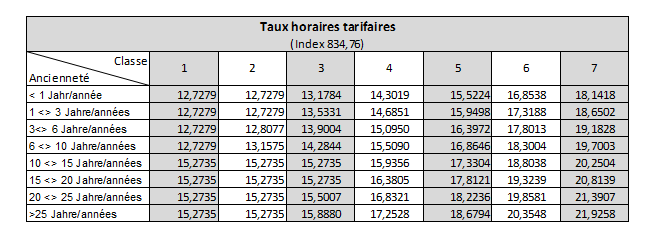

# Règlement grand-ducal du 13 octobre 2021 portant déclaration d’obligation générale de l’avenant I à la convention collective de travail pour le métier d’installateur d’ascenseurs conclue le 23 avril 2018 (valable du 01.05.21 au 31.07.2021) et de l’avenant II à la convention collective de travail pour le métier d’installateur d’ascenseurs conclue le 23 avril 2018 (valable du 01.08.2021 au 31.07.2024) conclus entre la Fédération Luxembourgeoise des Ascensoristes, d’une part et les syndicats OGBL et LCGB, d’autre part.

Nous Henri, Grand-Duc de Luxembourg, Duc de Nassau,

Vu l’article L.164-8 du [Code du Travail](https://legilux.public.lu/eli/etat/leg/code/travail) ;

Sur proposition concordante des assesseurs de l’Office national de conciliation et sur avis des chambres professionnelles compétentes ;

Vu l’avis de la Chambre des salariés du 4 août 2021 ;

Vu l’avis de la Chambre de commerce du 4 août 2021 ;

Vu l’article 1er, paragraphe 1er, de la [loi du 16 juin 2017](https://legilux.public.lu/eli/etat/leg/loi/2017/06/16/a592/jo) sur l’organisation du Conseil d’État et considérant qu’il y a urgence ;

Sur le rapport de Notre ministre du Travail, de l’Emploi et de l’Économie sociale et solidaire et après délibération du Gouvernement en conseil ;

Arrêtons :

## Art. 1er.

Les avenants I et II à la convention collective de travail pour le métier d’installateur d’ascenseurs signée le 23 avril 2018, conclus entre la Fédération Luxembourgeoise des Ascensoristes, d’une part et les syndicats OGBL et LCGB, d’autre part, sont déclarés d’obligation générale pour tout le métier.

## Art. 2.

Conformément au paragraphe (5) de l’article L.164-8 du [Code du travail](https://legilux.public.lu/eli/etat/leg/code/travail), la déclaration d’obligation générale prend effet à partir de la date d’entrée en vigueur des avenants I et II à la convention collective de travail du 23 avril 2018 pour le métier d’installateur d’ascenseurs.

## Art. 3.

Notre ministre du Travail, de l’Emploi et de l’Économie sociale et solidaire est chargé de l’exécution du présent règlement qui sera publié au Journal officiel du Grand-Duché de Luxembourg avec les avenants I et II à la convention collective de travail du 23 avril 2018 pour le métier d’installateur d’ascenseurs.

Le Ministre du Travail, de l’Emploi  et de l’Économie sociale et solidaire,   Dan Kersch

Palais de Luxembourg, le 13 octobre 2021.   Henri

\**FÉDÉRATION LUXEMBOURGEOISE DES ASCENSORISTES**

| **Avenant I à la convention collective de travail pour le métier d’installateur d’ascenseurs conclu le 23 avril 2018.** |
|---|

\***Article 1***

Le présent avenant prolonge la validité de la convention collective de travail signée le 23 avril 2018 pour le métier d’installateur d’ascenseurs du 1er mai 2021 au 31 juillet 2021.

Établi en 5 exemplaires à Luxembourg, le 22 juillet 2021

| **Pour la Fédération Luxembourgeoise** ** des Ascensoristes,** | **Pour le Syndicat OGB-L** |
|---|---|
| ____________________________ Clément WAMPACH, Président | ____________________________ Christophe REWENIG |
| ____________________________ Olivier BRABANT, Vice-président | ____________________________ Alain GAENG (OTIS) Membre de la commission tarifaire |
|  | ____________________________ Johnny De Buysere (KONE) Membre de la commission tarifaire |
|  | ____________________________ Markus JOSTEN (TKElevator) Membre de la commission tarifaire |
|  | ____________________________ Jérôme GABRIELE (Schindler) Membre de la commission tarifaire |
|  | **Pour le syndicat LCGB** |
|  | _______________________ Marc KIRCHEN |

\**FÉDÉRATION LUXEMBOURGEOISE DES ASCENSORISTES**

| **Avenant II à la convention collective de travail pour le métier d’installateur d’ascenseurs conclu le 23 avril 2018.** |
|---|

\**Article 1 :**

Les parties contractantes ont convenu de reconduire la Convention Collective de Travail conclue entre la fédération luxembourgeoise des ascensoristes et les syndicats nationaux représentatifs OGBL et LCGB pour une durée de 36 mois, soit du 1er août 2021 jusqu’au 31 juillet 2024.

\**Article 2 :**

Les parties se sont mises d’accord d’ajouter les modifications suivantes à la convention collective existante. Tous les autres articles resteront inchangés et en vigueur :

a) Modification de l’article 4.6 :

\**Article 4.6.**

Le salarié lié par un contrat de travail à durée indéterminée qui est licencié avec préavis par son employeur, sans qu’il y ait eu un licenciement pour motif grave et sans que le salarié ne puisse prétendre à une pension de vieillesse ou d’invalidité, a droit à une indemnité de départ tel que fixée dans le [Code du Travail](https://legilux.public.lu/eli/etat/leg/code/travail).

L’indemnité est calculée sur la base des salaires effectivement versés au salarié pour les douze derniers mois qui précèdent immédiatement celui de la notification de la résiliation.

Sont compris dans les salaires servant au calcul de l’indemnité de départ, les indemnités pécuniaires de maladie ainsi que les primes et suppléments courants *et les rémunérations pour heures supplémentaires à l’exclusion* des gratifications et de toutes indemnités pour frais accessoires exposés. L’employeur est tenu de régler l’indemnité au moment où le salarié quitte effectivement le travail.

b) Ajout d’un point 9.5

\***Article 9.5.***

\*Sur la fiche de salaire doivent figurer la classe et la fonction du salarié ainsi que la date d’ancienneté dans l’échelon*

c) Ajout d’un dernier alinéa à l’article 10.5.

\***Articles 10.5.***

\*Une fois passé dans la nouvelle classe, le salarié évoluera au prochain échelon de sa nouvelle classe dès qu’il dépasse la durée prévue de cet échelon.*

d) Modification de l’article 11.2 :

\***Article 11.2 : Chèques repas***

\*La contre-valeur nominale du chèque repas est de :*

aash *8,00 euro à partir du mois suivant la signature (donc à partir du mois d’aout 2021)*

bash *8,50 euro à partir du 1.1.2024*

\*La participation salariale restera à 2,80 euro.*

e) Modification de l’article 20.2 et 20.3 :

\***Article 20.2.***

\*Le congé annuel s’élève à 26 jours ouvrables*

\***Article 20.3.***

\*Le congé de récréation annuel des salariés justifiant d’une ancienneté de services continus de 10 ans au moins s’élève à 27 jours ouvrables.*

\*Le congé de récréation annuel des salariés justifiant d’une ancienneté de services continus de 15 ans au moins s’élève à 28 jours ouvrables.*

\*Le congé de récréation annuel des salariés justifiant d’une ancienneté de services continus de 20 ans au moins s’élève à 29 jours ouvrables.*

\*Le congé de récréation annuel des salariés justifiant d’une ancienneté de services continus de 25 ans au moins s’élève à 30 jours ouvrables.*

\*Il appartient à l’employeur de fixer les dates des jours de congé supplémentaires accordés aux salariés justifiant d’une ancienneté de services continus de 10,15, 20 et 25 ans au moins.*

f) Ajout d’un point 2 à l’article 27 :

\***Article 27.2.***

\*Lors d’un entretien avec un supérieur hiérarchique, chaque salarié a le droit de se faire assister par un délégué du personnel, ou à défaut de délégation, d’un membre du personnel*.

g) Modification de l’article 30.1 :

\***Article 30.1.***

\*La présente convention entre en vigueur le 1er août 2021 et viendra à échéance le 31 juillet 2024.*

\**Article 4 : adaptation de l’annexe 1 : taux horaires tarifaires :**

Les parties contractantes ont adapté la grille des salaires tarifaire de l’annexe 1 qui se présente comme suit à partir du 1er août 2021 :

\**Article 5 : augmentation des salaires tarifaires**

Au 1.1.2023, les parties contractantes ont convenu une augmentation de 2,00 % de tous les salaires tarifaires tels qu’ils sont repris à l’annexe 1 et l’annexe 3.

À partir du 1er août 2021, l’annexe 3 alinéa 3 est modifiée et aura la teneur suivante :

\*Les salariés rémunérés hors grille tarifaire (classe 4) ou qui se trouvent au-dessus de la grille tarifaire ont droit à une augmentation garantie de 2 % de leur salaire par période de 5 ans d’ancienneté à l’entreprise et ceci en dehors de l’indexation et en dehors de toute adaptation de rémunération dû à un changement de fonction ou de classe.*

Établi en 5 exemplaires à Luxembourg, le 22 juillet 2021

| **Pour la Fédération Luxembourgeoise** ** des Ascensoristes,** | **Pour le Syndicat OGBL** |
|---|---|
| ____________________________ Clément WAMPACH, Président | ____________________________ Christophe REWENIG |
| ____________________________ Olivier BRABANT, Vice-président | ____________________________ Alain GAENG (OTIS) Membre de la commission tarifaire |
|  | ____________________________ Johnny De Buysere (KONE) Membre de la commission tarifaire |
|  | ____________________________ Markus JOSTEN (TKElevator) Membre de la commission tarifaire |
|  | ____________________________ Jérôme GABRIELE (Schindler) Membre de la commission tarifaire |
|  | **Pour le syndicat LCGB** |
|  | _______________________ Marc KIRCHEN |
