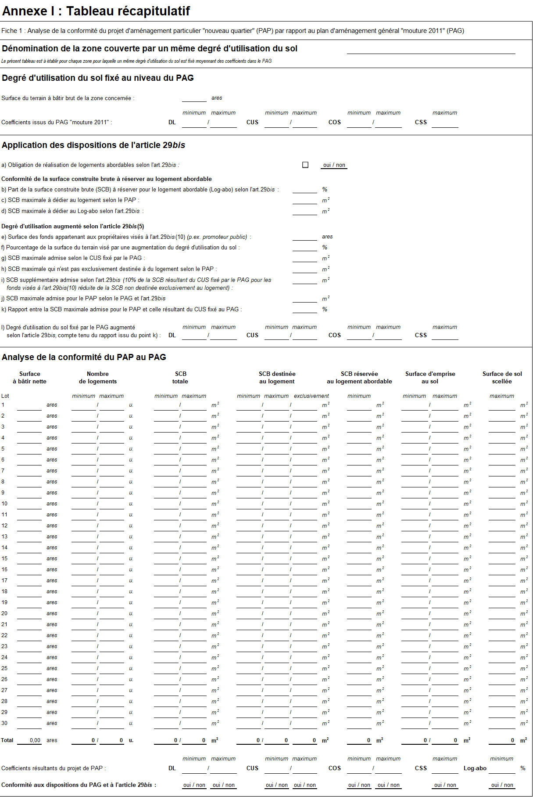
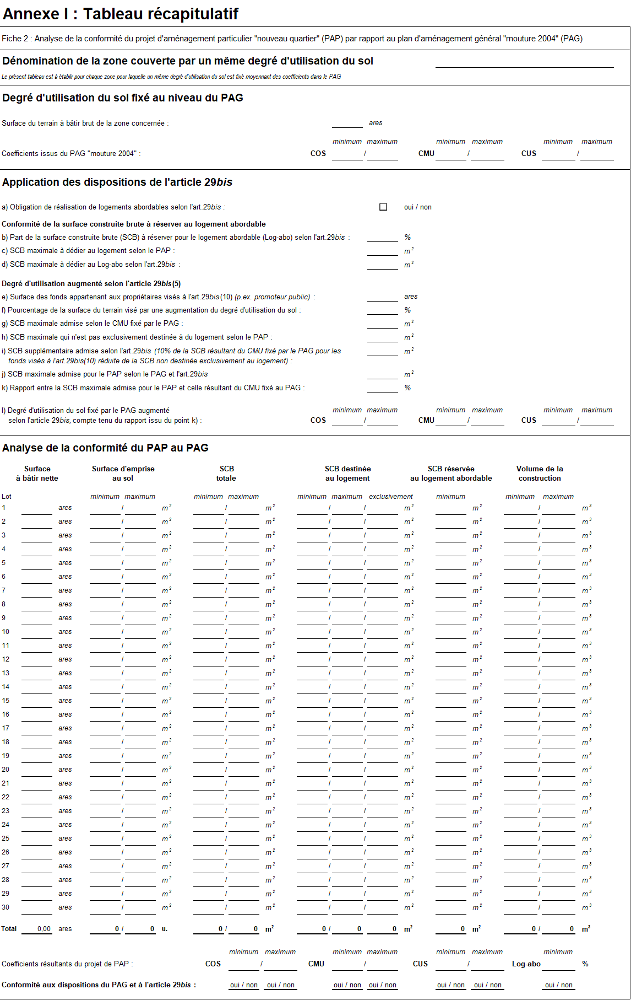

# Règlement grand-ducal du 24 novembre 2021 portant modification : \n1° du règlement grand-ducal du 8 mars 2017 concernant le contenu du plan d’aménagement général d’une commune ; \n2° du règlement grand-ducal du 8 mars 2017 concernant le contenu du rapport justificatif et du plan directeur du plan d’aménagement particulier « nouveau quartier ».

Nous Henri, Grand-Duc de Luxembourg, Duc de Nassau,

Vu la [loi modifiée du 19 juillet 2004](https://legilux.public.lu/eli/etat/leg/loi/2004/07/19/n1/jo) concernant l’aménagement communal et le développement urbain, et notamment ses articles 9, 29, 29*bis* et 108*ter* ;

Les avis de la Chambre d’agriculture, de la Chambre de commerce, de la Chambre des fonctionnaires et employés publics, de la Chambre des salariés et de la Chambre des métiers ayant été demandés ;

Vu l’avis du Syndicat des villes et communes luxembourgeoises ;

Notre Conseil d’État entendu ;

Sur le rapport de Notre Ministre de l’Intérieur et après délibération du Gouvernement en conseil ;

Arrêtons :

## Art. 1er.

Le [règlement grand-ducal du 8 mars 2017](https://legilux.public.lu/eli/etat/leg/rgd/2017/03/08/a321/jo) concernant le contenu du plan d’aménagement général d’une commune est modifié comme suit :

1° L’article 37 est complété par l’alinéa suivant :

> « Sont renseignées dans la partie graphique les zones soumises à l’élaboration d’un plan d’aménagement particulier « nouveau quartier » couvrant des fonds qui tombent sous le champ d’application de l’article 29*bis,* paragraphe 2, alinéa 3, de la [loi modifiée du 19 juillet 2004](https://legilux.public.lu/eli/etat/leg/loi/2004/07/19/n1/jo) concernant l’aménagement communal et le développement urbain. La représentation schématique du degré d’utilisation du sol pour les zones soumises à l’élaboration d’un plan d’aménagement particulier « nouveau quartier » faisant partie intégrante de l’annexe I indique les fonds concernés. » ;

2° À l’annexe I du [même règlement grand-ducal](https://legilux.public.lu/eli/etat/leg/rgd/2017/03/08/a321/jo), la représentation schématique du degré d’utilisation du sol pour les zones soumises à l’élaboration d’un plan d’aménagement particulier « nouveau quartier » est remplacée comme suit :

> « **Représentation schématique du degré d’utilisation du sol pour les zones soumises à l’élaboration d’un plan d’aménagement particulier « nouveau quartier » :**
>
> <table>
> <tr>
> <td colspan="3"><b>Dénomination du nouveau quartier</b></td>
> <td></td>
> </tr>
> <tr>
> <td rowspan="2"><b>COS</b></td>
> <td rowspan="2">max.</td>
> <td rowspan="2"><b>CUS</b></td>
> <td>max.</td>
> </tr>
> <tr>
> <td>(min.)</td>
> </tr>
> <tr>
> <td rowspan="2"><b>CSS</b></td>
> <td rowspan="2">max.</td>
> <td rowspan="2"><b>DL</b></td>
> <td>max.</td>
> </tr>
> <tr>
> <td>(min.)</td>
> </tr>
> <tr>
> <td colspan="4">Zone soumise à la réalisation accrue de log. abordables selon l’art. 29*bis, (*2), al. 3, de la <a href="https://legilux.public.lu/eli/etat/leg/loi/2004/07/19/n1/jo">loi modifiée du 19.07.2004</a></td>
> </tr>
> </table>
>
> » ;

3° À l’annexe II du [même règlement grand-ducal](https://legilux.public.lu/eli/etat/leg/rgd/2017/03/08/a321/jo), la définition « G. Surface construite brute » est complétée par trois alinéas nouveaux qui prennent la teneur suivante :

> « Les surfaces construites brutes attribuées aux différentes affectations d’un immeuble, telles que commerces, bureaux, logements et logements abordables, sont déterminées en additionnant pour chaque affectation précitée l’ensemble des surfaces construites brutes correspondantes, y compris les murs qui englobent les surfaces attribuées à l’affectation respective.
>
> Sans préjudice de ce qui précède, les surfaces occupées par des murs ou parties de murs, qui servent de séparation entre des surfaces connaissant des affectations distinctes, sont attribuées à part égale aux affectations concernées.
>
> Les parties d’utilité commune, dont notamment les espaces de circulation, sont comptabilisées au prorata des surfaces construites brutes attribuées aux diverses affectations. ».

## Art. 2.

Le [règlement grand-ducal du 8 mars 2017](https://legilux.public.lu/eli/etat/leg/rgd/2017/03/08/a324/jo) concernant le contenu du rapport justificatif et du plan directeur du plan d’aménagement particulier « nouveau quartier » est modifié comme suit :

1° À l’article 2, point 2, les termes en format papier et en format « XLS » sont ajoutés entre celui de récapitulatif et ceux de qui reprend ;

2° L’annexe I est remplacée par l’annexe suivante :

## Art. 3.

Notre ministre ayant l’Aménagement communal et le développement urbain dans ses attributions est chargé de l’exécution du présent règlement qui sera publié au Journal officiel du Grand-Duché de Luxembourg.

La Ministre de l'Intérieur,   Taina Bofferding

Palais de Luxembourg, le 24 novembre 2021.   Henri
