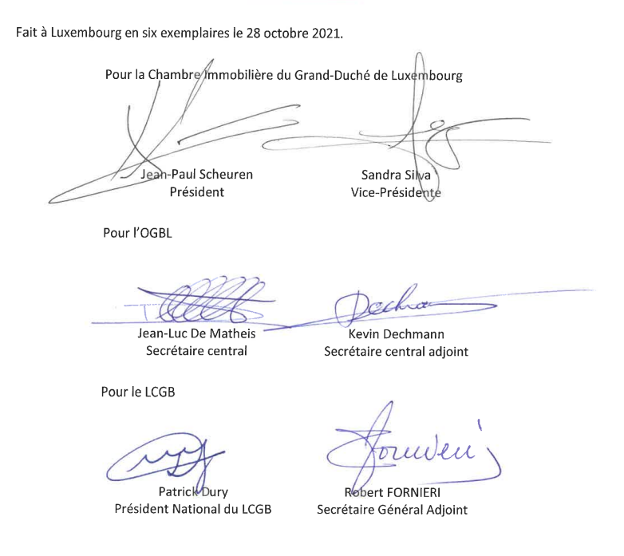

# Règlement grand-ducal du 25 février 2022 portant déclaration d’obligation générale de l’accord interprofessionnel en matière de formation professionnelle continue pour le secteur immobilier conclu le 28 octobre 2021 entre la Chambre immobilière du Grand-Duché de Luxembourg, d’une part et les syndicats OGBL et LCGB, d’autre part.

Nous Henri, Grand-Duc de Luxembourg, Duc de Nassau,

Vu l’article L. 164-8 du [Code du Travail](https://legilux.public.lu/eli/etat/leg/code/travail) ;

Sur proposition concordante des assesseurs de l’Office national de conciliation ;

Vu les avis de la Chambre de commerce, de la Chambre des salariés et de la Chambre des métiers ;

Vu l’article 1er, paragraphe 1er, de la [loi du 16 juin 2017](https://legilux.public.lu/eli/etat/leg/loi/2017/06/16/a592/jo) sur l’organisation du Conseil d’État et considérant qu’il y a urgence ;

Sur le rapport de Notre Ministre du Travail, de l’Emploi et de l’Économie sociale et solidaire et après délibération du Gouvernement en conseil ;

Arrêtons :

## Art. 1er.

L’accord interprofessionnel en matière de formation professionnelle continue pour le secteur immobilier conclu le 28 octobre 2021 entre la Chambre immobilière du Grand-Duché de Luxembourg, d’une part et les syndicats OGBL et LCGB, d’autre part, est déclaré d’obligation générale pour tout le secteur.

## Art. 2.

Conformément au paragraphe (5) de l’article L. 164-8 du [Code du travail](https://legilux.public.lu/eli/etat/leg/code/travail), la déclaration d’obligation générale prend effet à partir de la date d’entrée en vigueur de l’accord interprofessionnel conclu le 28 octobre 2021 pour une durée de 3 ans.

## Art. 3.

Notre ministre ayant le Travail dans ses attributions est chargé de l’exécution du présent règlement qui sera publié au Journal officiel du Grand-Duché de Luxembourg avec l’accord interprofessionnel conclu le 28 octobre 2021.

Le Ministre du Travail, de l’Emploi  et de l’Économie sociale et solidaire,   Georges Engel

Palais de Luxembourg, le 25 février 2022.   Henri

\**Accord interprofessionnel entre**

\**la Chambre lmmobilière du Grand-Duché de Luxembourg**

\**et les syndicats OGBL et LCGB**

\**en matière de formation professionnelle continue**

\**pour le secteur de l’immobilier**

I. **Préambule**

Considérant l’importance du secteur de l’immobilier pour l’économie et l’emploi au Luxembourg :

aot 800 entreprises

bot 2000 salariés

Considérant que de nombreux défis se présentent aux activités des secteurs concernés et aux salariés y occupés :

aot nouvelles exigences légales ;

bot évolutions techniques et technologiques ;

cot contraintes urbanistiques et architecturales ;

dot importance croissante des aspects liés au développement durable ;

eot défis liés à l’amélioration continue de l’efficience et à la transition énergétique ;

fot évolution constante des formes de concertation, de coordination et de collaboration sur objets immobiliers ;

got nouveaux matériaux et procédés ;

hot pénétration de nouvelles formes d’organisation des entreprises ;

iot concurrence internationale ;

Considérant que les entreprises du secteur, conscientes de leur responsabilité sociale et sociétale, veulent continuer à créer des emplois également pour les travailleurs non qualifiés ou faiblement qualifiés ;

Considérant que pour des raisons de productivité et de compétitivité, l’emploi de ces catégories de travailleurs n’est pas une fin en soi mais qu’il faudra tout mettre en oeuvre pour adapter continuellement ces travailleurs aux conditions et exigences du secteur en matière de connaissances requises ;

Considérant l’importance grandissante de la formation professionnelle continue dans de nombreux domaines, notamment eu égard au maintien dans l’emploi et au développement des compétences dans les entreprises concernées ;

Considérant la plue-value qu’une veille technologique structurée pourra apporter aux entreprises concernées dans le but d’accompagner en continu leur adaptation à des exigences changeantes ;

Considérant que la formation professionnelle continue constitue l’un des leviers majeurs pour améliorer la productivité des entreprises par une optimisation des compétences et une amélioration de la qualité du travail ;

qu’elle revêt sans doute un rôle majeur dans la promotion de la santé et de la sécurité au travail et contribue grandement à l’amélioration de la qualité de l’emploi ;

qu’elle ouvre des chances de promotion et de carrière dans des secteurs qui offrent beaucoup de potentialité à des travailleurs qui investissent dans leurs compétences ;

que les entreprises à l’inverse ont tout intérêt à promouvoir les carrières dans l’immobilier des travailleurs actuels et futurs dans une situation de concurrence de plus en plus acharnée envers les meilleurs talents ;

Considérant l’importance grandissante des aspects liés à la durabilité et à la responsabilité sociale et sociétale des entreprises dont la formation professionnelle continue est l’un des aspects majeurs qu’il convient de développer ;

Les parties au présent accord ont décidé de mettre en place un système cohérent de formation professionnelle continue couvrant le secteur de l’immobilier.

II. **Parties de l’accord interprofessionnel**

La Chambre immobilière du Grand-Duché de Luxembourg asbl

Ayant son siège social au 7, rue Alcide de Gasperi, L-1615 Luxembourg ;

| Représentée par son | Président Monsieur Jean-Paul Scheuren et sa Vice-Présidente Madame Sandra Silva ; |
|---|---|

Agissant pour la Chambre lmmobilière du Grand-Duché de Luxembourg ;

Agissant pour le compte des entreprises actives dans les domaines d’activités définis à l’article IV du présent accord ;

et les syndicats représentatifs sur le plan national :

LCGB - Lëtzebuerger Chrëschtleche Gewerkschaftsbond ;

Ayant son siège social au 11, rue du Commerce à L-1351 Luxembourg ;

| Représenté par son | Président national Monsieur Patrick Dury et son Secrétaire Général Adjoint Monsieur Robert Fornieri ; |
|---|---|

et

OGBL - Onofhängege Gewerkschaftsbond Lëtzebuerg

Ayant son siège social au 60, boulevard J.-F. Kennedy à L-4170 Esch-sur-Alzette ;

| Représenté par son | Secrétaire central Monsieur Jean-Luc De Matheis Secrétaire central adjoint Monsieur Kevin Dechmann |
|---|---|

Agissant pour le compte des salariés des entreprises actives dans les secteurs concernés et couvertes par le présent accord et définis à l’article IV du présent accord ;

Conformément aux dispositions de l’article 165-1 du [Code du travail](https://legilux.public.lu/eli/etat/leg/code/travail) ;

Concluent le présent accord interprofessionnel :

III. **Objet**

Les parties au présent accord-cadre conviennent de mettre en place un système de formation professionnelle continue sectoriel cohérent et structuré, s’inscrivant dans le Cadre européen des certifications (CEC) et en accord avec la législation luxembourgeoise en matière de formation professionnelle continue.

Pour cela, elles conviennent de :

aot Créer dans le cadre du présent accord un Centre de Compétences autonome du secteur de l’immobilier, dénommé Académie de l’lmmobilier ;

bot Fixer les modalités de financement de ce système à travers une cotisation obligatoire.

IV. **Domaine d’application**

Le présent accord vaut pour les domaines d’activités commerciales dans les trois domaines de l’immobilier : syndic, vente, promotion.

Les activités couvertes par le présent accord sont définies en conformité à la [loi du 2 septembre 2011](https://legilux.public.lu/eli/etat/leg/loi/2011/09/02/n1/jo) (droit d’établissement) réglementant l’accès aux professions d’artisan, de commerçant, d’industriel ainsi qu’à certaines professions libérales et au [règlement grand-ducal du 1er décembre 2011](https://legilux.public.lu/eli/etat/leg/rgd/2011/12/01/n1/jo) ayant pour objet :

aot d’établir la liste et le champ d’application des activités liées à l’immobilier prévues à l’article 12(1) de la [loi du 2 septembre 2011](https://legilux.public.lu/eli/etat/leg/loi/2011/09/02/n1/jo) réglementant l’accès aux professions d’artisan, de commerçant, d’industriel ainsi qu’à certaines professions libérales ;

bot de déterminer les critères d’équivalence prévus à l’article 12(3) de la [loi du 2 septembre 2011](https://legilux.public.lu/eli/etat/leg/loi/2011/09/02/n1/jo) réglementant l’accès aux professions liées à l’immobilier, de commerçant, d’industriel ainsi qu’à certaines professions libérales.

Le critère principal de sélection se situe au niveau du droit d’établissement : la détention d’une autorisation d’établissement comme agence immobilière, concernant l’un au moins des trois champs d’activités, détermine l’obligation pour l’entreprise de devoir s’acquitter de la cotisation d’obligation générale destinée au financement du Centre de Compétences du secteur de l’immobilier, dénommé Académie de l’Immobilier.

Le fait qu’une entreprise possède une des autorisations d’établissement aux termes de la [loi du 2 septembre 2011 précitée](https://legilux.public.lu/eli/etat/leg/loi/2011/09/02/n1/jo) mais se trouve classée dans un code NACE non spécifié ici, ne saurait préjudicier à cette obligation.

Le fait qu’une entreprise soit classée dans un des codes NACE relatifs à l’immobilier mais exerce une activité non soumise à une autorisation d’établissement aux termes de la [loi](https://legilux.public.lu/eli/etat/leg/loi/2011/09/02/n1/jo) dans le cadre des activités précitées (p.ex. activité industrielle) ne justifie pas le prélèvement d’une cotisation.

Le fait qu’une entreprise détienne plusieurs autorisations d’établissement ne saurait justifier le prélèvement de plusieurs cotisations.

Il en est également ainsi au cas où les autorisations d’établissement effectivement détenues justifieraient le prélèvement de cotisations pour plusieurs Centres de Compétences distincts, y compris ceux ne faisant, le cas échéant, pas partie du présent accord.

Dans ce cas, l’entreprise se verra affilier auprès d’un Centre de Compétences en fonction de son activité principale.

Le Centre de Compétences du secteur de l’immobilier, dénommé Académie de l’Immobilier, fixera les modalités exactes relatives à la perception et à la gestion de la cotisation.

V. **Obligation générale**

Les parties conviennent de demander l’extension, à toutes les entreprises et à tous les salariés des secteurs prédéfinis, des dispositions du présent accord par voie de déclaration d’obligation générale, conformément aux dispositions de l’article L. 164-8 et de l’article L. 165-1 du [Code du travail](https://legilux.public.lu/eli/etat/leg/code/travail).

Le présent accord-cadre ne sortira ses effets qu’après la publication au Mémorial A du règlement-grand-ducal portant déclaration de l’obligation générale y relative. Partant, il ne pourra pas y avoir d’effet rétroactif notamment en relation avec la perception des cotisations qui ne seront dues qu’à partir de la date de parution du règlement grand-ducal relatif à l’obligation générale du présent accord et au plus tôt à partir du 1er janvier 2022.

VI. **Durée**

Conformément à l’article L. 162-9 du [Code du travail](https://legilux.public.lu/eli/etat/leg/code/travail), le présent accord est conclu pour une durée de trois années. À défaut de dénonciation suivant les dispositions des alinéas qui suivent, il est reconduit à titre d’accord à durée indéterminée.

La dénonciation devra être motivée et être en relation avec l’objet de l’accord.

L’accord pourra être dénoncé partiellement ou en sa totalité conformément aux dispositions de l’article L. 162-10 du [Code du travail](https://legilux.public.lu/eli/etat/leg/code/travail) avec un délai de préavis de trois mois avant la date de son échéance. L’accord continuera alors à sortir ses effets jusqu’au premier jour du douzième mois de sa dénonciation ou jusqu’à la mise en vigueur d’un nouvel accord ayant le même objet.

VII. **Contestations et problèmes d’interprétation**

Pour pallier les contestations et clarifier des problèmes d’interprétation en relation avec l’application du présent accord, et notamment en ce qui concerne les dispositions des articles VIII et IX, une Commission paritaire de médiation est mise en place. Celle-ci fera le cas échéant des propositions de médiation aux parties à l’accord et sera composée comme suit :

aot 2 représentants issus des rangs de la Chambre Immobilière du Grand-Duché de Luxembourg

bot 2 représentants issus des rangs des syndicats signataires.

La procédure de travail de cette instance s’inspirera dans les grandes lignes des pratiques et usages de la médiation civile et commerciale.

En cas de persistance du désaccord, les parties pourront saisir l’Office National de Conciliation dans les formes et délais prévus par les articles L. 163-1 ss. du [Code du travail](https://legilux.public.lu/eli/etat/leg/code/travail).

VIII. **Gouvernance**

Le conseil d’administration du Centre de Compétences du secteur de l’immobilier, dénommé Académie de l’lmmobilier, est composé comme suit :

aot Administrateurs A (entreprises) : ils sont nommés par les représentants de la Chambre lmmobilière du Grand-Duché de Luxembourg. Leur nombre est fixé par les statuts de l’Académie de l’lmmobilier.

bot Administrateurs B (salariés) : ils sont nommés par les représentants des syndicats signataires du présent accord. Leur nombre est fixé par les statuts de I’Académie de l’lmmobilier.

Les conseils d’administration se reunissent en présence des administrateurs A et B. Les administrateurs ont cependant des compétences distinctes.

Les administrateurs A ont les compétences les plus élargies sur l’administration du Centre de Compétences du secteur de l’immobilier, dénommé Académie de l’lmmobilier, et ce notamment en relation avec :

aot l’élection du président ;

bot la nomination du directeur ;

cot l’embauche de personnel ;

dot la proposition d’un budget pour l’exercice à venir et du décompte de l’exercice écoulé à l’assemblée générale ;

eot la proposition d’éventuelles adaptations du taux de cotisation destiné au financement de I’Académie de l’lmmobilier, à l’assemblée générale et au comité de gouvernance, conformément aux dispositions de l’article X du présent accord ;

fot la réalisation des infrastructures nécessaires au développement des activités de I’Académie de l’lmmobilier ;

got l’acquisition des terrains, infrastructures et matériel nécessaires à cet objectif ;

hot toutes les opérations généralement quelconques dans l’intérêt de I’Académie.

Pour toutes ces compétences, les administrateurs A ont une voix délibérative et les administrateurs B ont une voix consultative.

En d’autres mots, les administrateurs A ont une compétence illimitée en ce qui concerne l’administration du Centre de Compétences du secteur de l’immobilier.

Tout ce qui touche à la formation est de la compétence commune des administrateurs A et B. Au cas où un problème se pose et concerne à la fois la formation et l’administration, les parties devront se référer à la procédure de médiation telle que prévue à l’article VII.

Les administrateurs A et B ont donc compétence commune en ce qui concerne le domaine de la formation, notamment les programmes de formation, les accès individuels et collectifs.

Comme indiqué ci-avant, pour le cas où un point à l’ordre du jour relatif à la compétence commune des administrateurs A et B d’un point proposé ferait l’objet d’une contestation, les dispositions de l’article VII s’appliquent.

Le principe de base pour la prise de décision des administrateurs A et B est celui de la cogestion paritaire, ce qui signifie que dans le cadre de la prise de décision en ce qui concerne les thèmes de compétence communs des administrateurs A et B, le conseil d’administration est réparti en deux groupes : le groupe A représentant les entreprises et le groupe B représentant les salariés.

La prise de décision se fera a l’unanimité.

En cas de désaccord entre les administrateurs siégeant pour le compte des entreprises et ceux siégeant pour le compte des salariés, la question litigieuse sera réglée suivant les dispositions de l’article VII du présent accord.

En cas de persistance du désaccord, l’Office National de Conciliation pourra être saisi conformément aux dispositions de l’article 163-2 du [Code du travail](https://legilux.public.lu/eli/etat/leg/code/travail).

IX. **Commission de Gouvernance des Centres de Compétences**

Dans le but d’assurer à travers tous les secteurs d’activité l’implication des partenaires sociaux et la cohérence du système de formation professionnelle continue mis en place tant en ce qui concerne l’approche pédagogique, les structures, la gouvernance ou encore la surveillance et les certifications, les parties décident de devenir membres au sein de l’association sans but lucratif dénommée « Commission de Gouvernance des Centres de Compétences ». Une version des statuts est annexée au présent accord et en fait partie intégrante. Véritable organe de cogestion, cette commission a pour objet de soutenir les Centres de Compétences de tous les secteurs dans l’accomplissement de leurs missions en relation avec la formation professionnelle continue.

Ses missions comprendront notamment :

aot soutien aux Centres de Compétences ;

bot conseils quant aux différentes matières de la formation professionnelle continue ;

cot assurance de la gouvernance générale du système ;

dot règlement des différends dans le domaine de la cogestion émanant le cas échéant des Centres de Compétences ;

eot assurance de la cohérence structurelle et pédagogique des programmes de formations visés par le présent accord ;

fot traitement des questions d’accès collectif et individuel ;

got introduction d’un compte personnel de formation ;

hot surveillance du système général de certification mis en place ;

iot traitement des réclamations pouvant surgir dans le cadre des certifications ;

jot prospection et information relative aux offres de formation et création de bases de données sur les formations offertes au Grand-Duché de Luxembourg, dans la Grande Région et en Europe ;

kot assurance de la collaboration entre Centres de Compétences, organisation et gestion de la logistique ;

lot création de liens de collaborations conventionnées ou non avec d’autres personnes physiques ou morales, notamment des organismes de formation ;

mot contribution à l’extension du système vers d’autres secteurs et niveaux de formation ;

not défense des intérêts et représentation du système envers des tiers (ministères, administrations, formation professionnelle au sens large...) ;

oot analyse périodique de la situation et des besoins en formation professionnelle continue ;

pot création de bases de données relatives à la formation professionnelle continue.

Ces attributions pourront le cas échéant être modifiées, étendues ou amendées suivant les décisions de l’assemblée générale de la Commission de Gouvernance dans le but de les préciser ou de les adapter aux réalités du terrain selon la volonté des parties sans que ceci ne nécessite la conclusion d’un nouvel accord. Dans ce cas, les modifications statutaires y relatives engageront les parties du présent accord.

La Commission de Gouvernance des Centres de Compétences s’occupera notamment d’assurer, ensemble avec les Chambres professionnelles compétentes, la validation des acquis de l’expérience professionnelle.

Composition

La Commission de Gouvernance des Centres de Compétences est actuellement composée des membres effectifs suivants :

aot Fédération des Artisans ;

bot Centre de Compétences Génie technique du Bâtiment ;

cot Centre de Compétences Parachèvement ;

dot Syndicats représentatifs sur le plan national.

La Chambre lmmobilière du Grand-Duché de Luxembourg et I’Académie de l’lmmobilier adresseront, le moment venu, une demande d’adhésion à la Commission de Gouvernance des Centres de Compétences. Cette dernière pourra coopter d’autres membres dans l’accomplissement de ses buts. Ces membres devront être actifs dans les domaines de la formation professionnelle ou dans l’insertion ou la réinsertion professionnelle. Ces membres cooptés ne disposeront pas du droit de vote.

Fonctionnement

La Commission de Gouvernance constitue l’organe de cogestion paritaire central du système mis en place.

Les représentants des entreprises disposent toujours du même nombre de voix que les représentants des salariés.

La commission de Gouvernance est repartie en deux groupes. Le groupe représentant les entreprises est composé par des représentants nommés par la Chambre Immobilière du Grand-Duché de Luxembourg et le Centre de Compétences du secteur de l’immobilier.

Le groupe représentant les salariés est composé par des représentants nommés par les syndicats signataires du présent accord.

La prise de décision se fera à l’unanimité.

En cas de désaccord entre les deux groupes, la question litigieuse sera vidée suivant les dispositions de l’article VII du présent accord.

En cas de persistance du désaccord, l’Office National de Conciliation pourra être saisi conformément aux dispositions de l’article 163-2 du [Code du travail](https://legilux.public.lu/eli/etat/leg/code/travail).

La présidence au sein du conseil d’administration, la durée du mandat des administrateurs, la composition du conseil d’administration, son fonctionnement et les procédures liées aux prises de décisions seront par ailleurs déterminés et précisés par le règlement des statuts de la Commission de Gouvernance.

En cas d’intégration d’autres Centres de Compétences (existants ou à créer) fonctionnant suivant la même logique ceux-ci pourront rejoindre le comité par simple demande écrite. La répartition des voix sera alors remaniée de sorte à toujours garantir la parité entre les représentants des entreprises et ceux des salariés.

X. **Financement de la formation professionnelle sectorielle**

Les entreprises des secteurs concernés s’acquitteront d’une cotisation exprimée en pourcentage de la masse salariale brute suivant les indications du Certificat de Masse Salariale, émis annuellement par le Centre Commun de la Sécurité Sociale. Cette cotisation est destinée à assurer le financement des mesures de formation professionnelle.

L’assiette de cotisation comprend le revenu professionnel ainsi que les gratifications, participations et autres avantages, même non exprimés en espèces, dont l’assuré jouit en raison de son occupation soumise à l’assurance, à l’exclusion toutefois des majorations sur les heures supplémentaires ; la valeur des rémunérations en nature est portée en compte suivant la valeur fixée par règlement grand-ducal. Le revenu professionnel visé à la phrase qui précède correspond à la rémunération de base ainsi qu’aux compléments et accessoires, à condition qu’ils soient payables mensuellement en espèces, à l’exception de la rémunération des heures supplémentaires. Les indemnités légales dues par l’employeur au titre d’un préavis sont sujettes à cotisation et sont portées en compte pour la mensualité qu’elles représentent.

Cette cotisation sera applicable à toutes les entreprises des secteurs concernés à partir du 1er janvier 2022  sinon,  en cas de  délais liés  à la  procédure d’obligation  générale,  dès la  publication du règlement grand-ducal afférent.

Dans un premier stade, cette cotisation applicable aux Centres de Compétences visés par l’article Ill et aux entreprises définies à l’article IV, est fixée à 0,5% du revenu professionnel tel que défini à l’alinea 2 du présent article. Elle pourra être modifiée selon les besoins du Centre de Compétences du secteur de l’immobilier sur avis de la Commission de Gouvernance du Centre de Compétences du secteur de l’immobilier prévue à l’article VII du présent accord, moyennant un avenant au présent accord.

Tout en respectant la [loi du 2 aout 2002](https://legilux.public.lu/eli/etat/leg/loi/2002/08/02/n2/jo) relative à la protection des personnes à l’égard du traitement des données à caractère personnel, la Chambre de Commerce communique au Centre de Compétences du secteur de l’immobilier les données relatives aux entreprises visées par le présent accord.

Les modalités exactes relatives à la perception et à la gestion de la cotisation seront fixées par le Centre de Compétences du secteur de l’immobilier, dénommé Académie de l’lmmobilier.

Les signataires de la présente s’engagent à soutenir la demande de faire réaliser la perception et le recouvrement de la cotisation dans la mesure du possible par les services du Centre Commun de la Sécurité Sociale. Outre sa simplicité et les aspects de praticabilité y liés, cette solution pourra contribuer, à terme, à tenir compte de manière plus décisive des aspects de durabilité et de responsabilité sociale des entreprises dans les marchés publics en les incluant dans le cahier des charges opposables aux entreprises, contribuant ainsi à endiguer des pratiques de concurrence déloyale et de dumping social.

