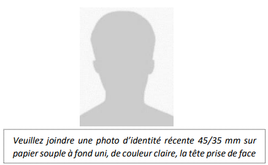
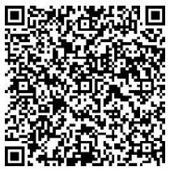
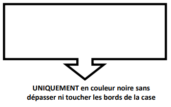

# Règlement grand-ducal du 11 mars 2022 fixant le modèle et le contenu de la carte de stationnement pour personnes handicapées ainsi que de la demande et du certificat médical en vue de l’obtention de cette carte et modifiant le règlement grand-ducal modifié du 26 août 1993 relatif aux avertissements taxés, aux consignations pour contrevenants non-résidents ainsi qu’aux mesures d’exécution de la législation en matière de mise en fourrière des véhicules et en matière de permis à points.

Nous Henri, Grand-Duc de Luxembourg, Duc de Nassau,

Vu la [loi modifiée du 14 février 1955](https://legilux.public.lu/eli/etat/leg/loi/1955/02/14/n3/jo) concernant la réglementation de la circulation sur toutes les voies publiques ;

Vu la [loi du 11 février 2022](https://legilux.public.lu/eli/etat/leg/loi/2022/02/11/a121/jo) portant création d’une carte de stationnement pour personnes handicapées ;

Vu l’avis de la Chambre de commerce ;

Vu l’avis de la Commission nationale pour la protection des données ;

Les avis de la Chambre des métiers, de la Chambre des salariés, de la Chambre d’agriculture, de la Chambre des fonctionnaires et employés publics et du Conseil supérieur des personnes handicapées ayant été demandés ;

Notre Conseil d’État entendu ;

Sur le rapport de Notre Ministre de la Mobilité et des Travaux publics, de Notre Ministre de la Famille et de l’Intégration, de Notre Ministre de l’Intérieur, de Notre Ministre de la Santé et de Notre Ministre de la Sécurité Sociale, et après délibération du Gouvernement en conseil ;

Arrêtons :

## Art. 1er.

La carte de stationnement pour personnes handicapées, ci-après la « carte de stationnement » visée par la [loi du 11 février 2022](https://legilux.public.lu/eli/etat/leg/loi/2022/02/11/a121/jo) portant création d’une carte de stationnement pour personnes handicapées se présente sous forme d’un carton de couleur bleu clair de 148 millimètres de large et de 106 millimètres de haut, le symbole du fauteuil roulant apparaissant en blanc sur un large fond de couleur bleu foncé.

Il existe deux modèles de la carte de stationnement visée à l’alinéa 1er :

1° La carte de stationnement pour personnes physiques

Elle porte au recto :

a) un numéro d’ordre ;

b) la date d’émission ;

c) la date d’expiration de sa validité ;

d) un hologramme restituant une image en relief.

Au verso figurent :

a) le nom du titulaire ;

b) le prénom du titulaire ;

c) le lieu et la date de naissance du titulaire ;

d) la signature du titulaire ;

e) la photo d’identité du titulaire ;

f) un code QR ;

g) les mentions suivantes : « Cette carte autorise son titulaire à bénéficier des facilités de stationnement offertes par l’État membre dans lequel il se trouve. » et « En cas d’utilisation, la carte doit être apposée à l’avant du véhicule, de telle manière que le côté recto soit clairement visible aux fins de contrôle. ».

2° La carte de stationnement pour institutions ou associations

Elle porte au recto :

a) un numéro d’ordre ;

b) la date d’émission ;

c) la date d’expiration de sa validité ;

d) le numéro d’immatriculation du véhicule auquel est attribué la carte ;

e) un hologramme restituant une image en relief.

Au verso figurent :

a) le nom de l’institution ;

b) un code QR ;

c) les mentions suivantes : « Cette carte autorise l’organisme à bénéficier des facilités de stationnement au Grand-Duché de Luxembourg. » et « En cas d’utilisation, la carte doit être apposée à l’avant du véhicule, de telle manière que le côté recto soit clairement visible aux fins de contrôle. ».

Les cartes de stationnement visées au présent article sont plastifiées et correspondent aux modèles reproduits à l’annexe 1.

## Art. 2.

La demande et le certificat médical doivent être conformes au modèles figurant à l’annexe 2. Le certificat médical a une durée de validité de trois mois à compter de la date de délivrance par le médecin-examinateur.

## Art. 3.

L’annexe I « Catalogue des avertissements taxés » du [règlement grand-ducal modifié du 26 août 1993](https://legilux.public.lu/eli/etat/leg/rgd/1993/08/26/n1/jo) relatif aux avertissements taxés, aux consignations pour contrevenants non résidents ainsi qu’aux mesures d’exécution de la législation en matière de mise en fourrière des véhicules et en matière de permis à points est modifiée comme suit :

1° À l’alinéa 1er, la lettre G) est remplacée par le libellé suivant :

> « G) de la [loi du 11 février 2022](https://legilux.public.lu/eli/etat/leg/loi/2022/02/11/a121/jo) portant création d’une carte de stationnement pour personnes handicapées ; ».

2° À la partie G. l’intitulé est remplacé par le libellé suivant :

> « G. [Loi du 11 février 2022](https://legilux.public.lu/eli/etat/leg/loi/2022/02/11/a121/jo) portant création d’une carte de stationnement pour personnes handicapées ; ».

## Art. 4.

Le [règlement grand-ducal modifié du 31 janvier 2003](https://legilux.public.lu/eli/etat/leg/rgd/2003/01/31/n6/jo) concernant la création et l’utilisation d’une carte de stationnement pour personnes handicapées est abrogé.

## Art. 5.

La référence au présent règlement se fait sous la forme suivante : « Règlement grand-ducal du 11 mars 2022 fixant le modèle et le contenu de la carte de stationnement pour personnes handicapées ainsi que de la demande et du certificat médical en vue de l’obtention de cette carte ».

## Art. 6.

Le présent règlement entre en vigueur le premier jour du troisième mois qui suit sa publication au Journal officiel du Grand-Duché de Luxembourg.

## Art. 7.

Notre ministre ayant les Transports dans ses attributions, Notre ministre ayant la Famille et l’Intégration dans ses attributions, Notre ministre ayant l’Intérieur dans ses attributions, Notre ministre ayant la Santé dans ses attributions et Notre ministre ayant la Sécurité Sociale dans ses attributions sont chargés, chacun en ce qui le concerne, de l’exécution du présent règlement qui sera publié au Journal officiel du Grand-Duché de Luxembourg.

Le Ministre de la Mobilité et des Travaux publics,   **François Bausch**   La Ministre de l’Intérieur,   **Taina Bofferding**   Le Ministre de la Famille  et de l’Intégration,   **Corinne Cahen**   La Ministre de la Santé,   **Paulette Lenert**   Le Ministre de la Sécurité sociale,   **Claude Haagen**

Paris, le 11 mars 2022.   Henri

ANNEXE 1

*[image omitted (1.5 MB) — see the official version: https://legilux.public.lu/eli/etat/leg/rgd/2022/03/11/a122/jo]*

*[image omitted (1.5 MB) — see the official version: https://legilux.public.lu/eli/etat/leg/rgd/2022/03/11/a122/jo]*

ANNEXE 1

*[image omitted (1.5 MB) — see the official version: https://legilux.public.lu/eli/etat/leg/rgd/2022/03/11/a122/jo]*

*[image omitted (1.5 MB) — see the official version: https://legilux.public.lu/eli/etat/leg/rgd/2022/03/11/a122/jo]*

ANNEXE 2

\**Demande pour l’obtention d’une carte de stationnement  pour personnes handicapées à mobilité réduite**

|  | **Ministère de la Mobilité et des Travaux publics** **Département de la mobilité et des transports** **Direction de la circulation et sécurité routières** **Service - Cartes de stationnement** **L-2938 Luxembourg** |
|---|---|

\**Je soussigné(e)**

| Nom et prénom : |  |
|---|---|
| N° matricule à 13 chiffres : |  |
| Date et lieu de naissance : | _____ /_____ /_______ à |
| Adresse : |  |
|  |  |
|  |  |
| N° téléphone : |  |
| E-mail : |  |

\**sollicite par la présente,**

aquare L’obtention d’une carte de stationnement pour personnes handicapées

☐ Le renouvellement d’une carte de stationnement pour personnes handicapées

Je vous transmets au verso le certificat médical prévu à cet effet.

\**N.B. Au cas où le demandeur est titulaire d’un permis de conduire en cours de validité ou s’il a introduit une demande en obtention ou en renouvellement du permis de conduire, l’aptitude à la conduite d’un véhicule automoteur sera vérifiée.**

|  | Date : ____ /____ /_________ Signature du requérant ou du tuteur : |  |
|---|---|---|

Les informations qui vous concernent recueillies sur ce formulaire feront l’objet d’un traitement par le Ministère de la Mobilité et des Travaux publics, conformément au [règlement (UE) 2016/679](https://legilux.public.lu/eli/reg_ue/2016/679/jo) relatif à la protection des personnes physiques à l'égard du traitement des données à caractère personnel et à la libre circulation de ces données.

ANNEXE 2

\**Certificat médical**

| Nom et prénom : |  |
|---|---|
| N° matricule à 13 chiffres : |  |

Le requérant :

aash est **incapable** de marcher de façon continue plus de 100 mètres :

| oui | non |
|---|---|

aash se déplace avec :

| une canne | des béquilles | un cadre de marche/rolator | un fauteuil roulant |
|---|---|---|---|

aash est **aveugle** ou gravement malvoyant malgré une correction optique optimale :

| oui | non |
|---|---|

\**1. Antécédents et description détaillée du handicap justifiant l’obtention d’une carte de stationnement**

|  |
|---|
|  |
|  |
|  |
|  |
|  |

\**2. Si le requérant possède un permis de conduire** *(prière de joindre une photocopie recto-verso)*

aash reste apte à conduire : □ oui □ non

bash restrictions à proposer : □ aucune / □ boite automatique obligatoire / □ autres ___________________

cash un avis/examen complémentaire est recommandé : □ oui □ non

si oui préciser lequel : ______________________________________________________________

\**N.B. Au cas où le demandeur est titulaire d’un permis de conduire en cours de validité ou s’il a introduit une demande en obtention ou en renouvellement du permis de conduire, l’aptitude à la conduite d’un véhicule automoteur sera vérifiée.**

| Certificat établit par le Docteur: |  |
|---|---|
|  | __________________________________, le ____/_____/_____ |
|  | (Cachet et signature du médecin) |
