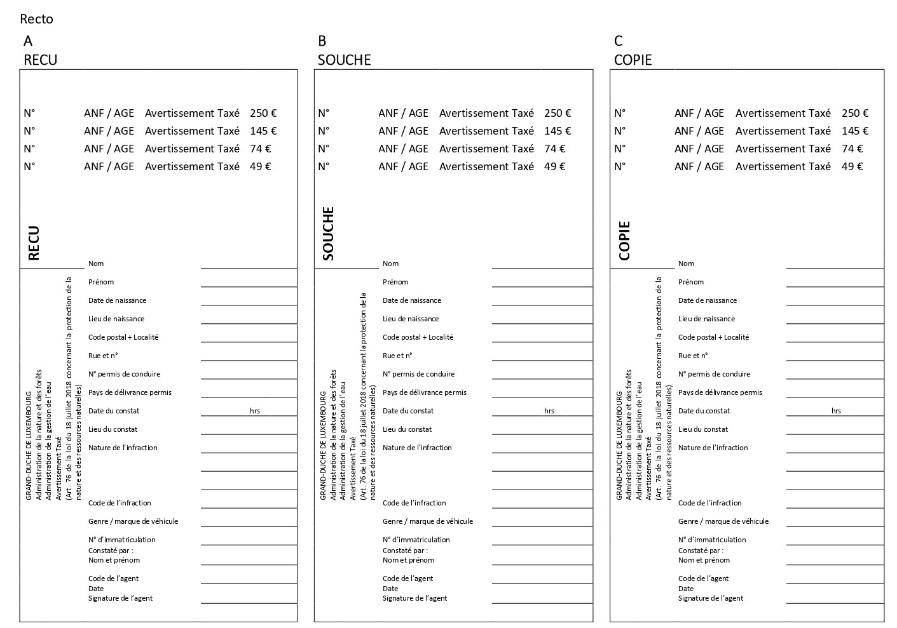
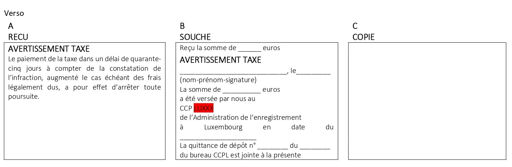
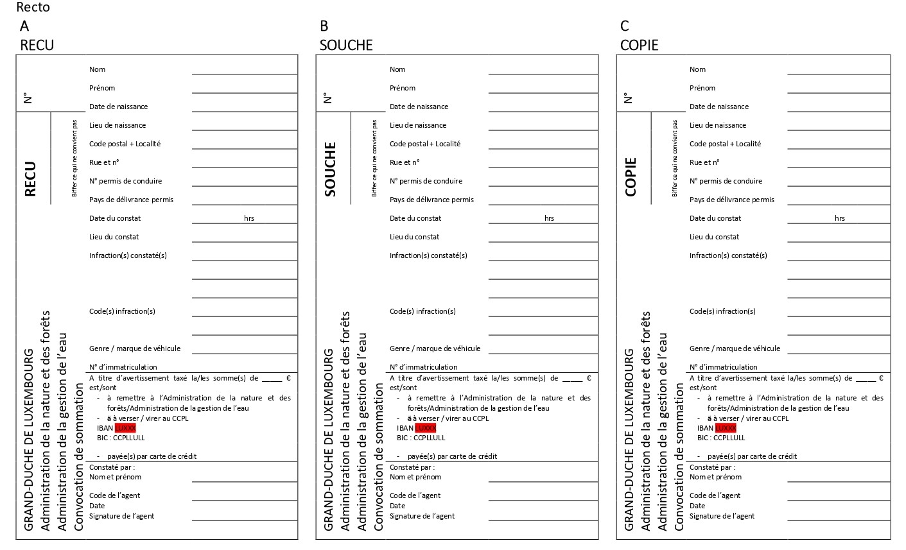
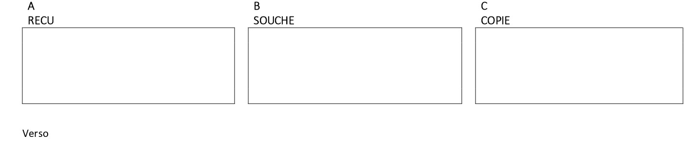

# Règlement grand-ducal du 11 mars 2022 relatif aux avertissements taxés déterminant les modalités d’application de l’avertissement taxé et établissant un catalogue des contraventions soumises à l’avertissement taxé prévu par la loi du 18 juillet 2018 concernant la protection de la nature et des ressources naturelles.

Nous Henri, Grand-Duc de Luxembourg, Duc de Nassau,

Vu les articles 75 et 76 de la [loi du 18 juillet 2018](https://legilux.public.lu/eli/etat/leg/loi/2018/07/18/a771/jo) concernant la protection de la nature et des ressources naturelles ;

Vu les avis de la Chambre des métiers et de la Chambre de commerce ;

Les avis de la Chambre d’agriculture et de la Chambre des salariés ayant été demandés :

Notre Conseil d’État entendu ;

Sur le rapport de Notre Ministre de l’Environnement, de Notre Ministre de la Justice, de Notre Ministre de la Sécurité intérieure et de Notre Ministre des Finances et après délibération du Gouvernement en conseil ;

Arrêtons :

## Art. 1er.

Les montants de la taxe à percevoir pour l’avertissement taxé prévu à l’article 76 de la [loi du 18 juillet 2018](https://legilux.public.lu/eli/etat/leg/loi/2018/07/18/a771/jo) concernant la protection de la nature et des ressources naturelles sont fixés respectivement à 49, 74, 145, et 250 euros.

Le catalogue regroupant les contraventions suivant les différents montants de la taxe à percevoir est repris à l’annexe A.

## Art. 2.

(1) La perception sur place du montant de la taxe se fait soit en espèces, soit par règlement au moyen des seules cartes de crédit et modes de paiement électronique acceptés à cet effet par les officiers et agents de police judiciaire de la Police grand-ducale ainsi que par les agents de l’Administration des douanes et accises, de l’Administration de la nature et des forêts et de l’Administration de la gestion de l’eau.

(2) Lorsque le montant de l’avertissement taxé ne peut pas être perçu sur le lieu même de l’infraction, la convocation est donnée d’après une formule spéciale.

À cet effet est utilisée la formule spéciale de convocation visée à l’article 2, paragraphe 2, du [règlement grand-ducal modifié du 26 août 1993](https://legilux.public.lu/eli/etat/leg/rgd/1993/08/26/n1/jo) relatif aux avertissements taxés, aux consignations pour contrevenants non résidents ainsi qu’aux mesures d’exécution de la législation en matière de mise en fourrière des véhicules et en matière de permis à points pour les convocations données par les officiers et agents de police judiciaire de la Police grand-ducale. Il en est de même pour les convocations données par les agents de l’Administration des douanes et accises. Les formules spéciales de convocation figurant à l’annexe B – 2 sont utilisées pour les convocations données par les agents de l’Administration de la nature et des forêts ou pour celles données par les agents de l’Administration de la gestion de l’eau et sont composées d’un reçu, d’une copie et d’une souche.

L’agent verbalisant supprime les mentions qui ne conviennent pas.

Les formules, dûment numérotées, sont reliées en carnets de quinze exemplaires.

Le contrevenant s’en acquittera dans le délai imparti au bureau de la Police grand-ducale, de l’Administration des douanes et accises, de l’Administration de la nature et des forêts ou de l’Administration de la gestion de l’eau lui désigné par l’agent verbalisant, soit par versement ou virement de la taxe sur un des comptes chèques postaux spécialement ouverts à cet effet au nom de la Police grand-ducale, de l’Administration des douanes et accises, de l’Administration de la nature et des forêts ou de l’Administration de la gestion de l’eau.

## Art. 3.

Sans préjudice des dispositions de l’article 4 applicables en cas de règlement par versement ou virement postal, l’avertissement taxé est donné d’après les formules composées d’un reçu, d’une copie et d’une souche.

À cet effet est utilisée la formule spéciale visée à l’article 3, alinéa 1er du [règlement grand-ducal modifié du 26 août 1993](https://legilux.public.lu/eli/etat/leg/rgd/1993/08/26/n1/jo) relatif aux avertissements taxés, aux consignations pour contrevenants non résidents ainsi qu’aux mesures d’exécution de la législation en matière de mise en fourrière des véhicules et en matière de permis à points, pour les avertissements taxés donnés par les officiers et agents de police judiciaire de la Police grand-ducale. Il en est de même pour les avertissements taxés donnés par les agents de l’Administration des douanes et accises. Les formules spéciales de l’avertissement taxé figurant à l’annexe B – 1 sont utilisées pour les avertissements taxés donnés par les agents de l’Administration de la nature et des forêts ou pour ceux donnés par les agents de l’Administration de la gestion de l’eau et sont composées d’un reçu, d’une copie et d’une souche.

L’agent verbalisant supprime les mentions qui ne conviennent pas.

Ces formules, dûment numérotées, sont reliées en carnets de quinze exemplaires que l’Administration de l’enregistrement, des domaines et de la TVA met à la disposition du directeur général de la Police grand-ducale, du directeur de l’Administration des douanes et accises, du directeur de l’Administration de la nature et des forêts et du directeur de l’Administration de la gestion de l’eau.

Toutes les taxes perçues par les membres de la Police grand-ducale, les agents de l’Administration des douanes et accises, les agents de l’Administration de la nature et des forêts et les agents de l’Administration de la gestion de l’eau sont transmises sans retard à un compte chèque postal déterminé de l’Administration de l’enregistrement, des domaines et de la TVA à Luxembourg.

Les frais de versement, de virement ou d’encaissements éventuels sont à charge du contrevenant lorsque la taxe est réglée par versement postal ou virement bancaire. Elles sont à charge de l’administration si le règlement se fait par carte de crédit ou au moyen d’un mode de paiement électronique.

## Art. 4.

(1) En cas de perception sur place de l’avertissement taxé, le reçu est remis au contrevenant contre le paiement de la somme due en vertu du catalogue des avertissements taxés repris à l’annexe A.

Lorsque la taxe est réglée par versement ou par virement sur un des comptes chèques postaux prévus à l’article 2, le récépissé en cas de versement et la copie en cas de virement servent de reçu au contrevenant.

(2) La copie est remise respectivement au directeur général de la Police grand-ducale, du directeur de l’Administration des douanes et accises, du directeur de l’Administration de la nature et des forêts et du directeur de l’Administration de la gestion de l’eau.

(3) L’information au procureur d’État des avertissements taxés donnés se fait moyennant l’établissement par le directeur général de la Police grand-ducale, le directeur de l’Administration des douanes et accises, le directeur de l’Administration de la nature et des forêts et le directeur de l’Administration de la gestion de l’eau de relevés mensuels.

(4) La souche reste dans le carnet de formules.

Du moment que le carnet est épuisé, il est renvoyé avec toutes les souches et les preuves de paiement y relatives, par les officiers et agents de police judiciaire de la Police grand-ducale au directeur général de la Police grand-ducale, par les agents de l’Administration des douanes et accises au directeur de l’Administration des douanes et accises, par les agents de l’Administration de la nature et des forêts au directeur de l’Administration de la nature et des forêts et par les agents de l’Administration de la gestion de l’eau au directeur de l’Administration de la gestion de l’eau.

Si une ou plusieurs formules n’ont pas abouti à l’établissement d’un avertissement taxé, elles doivent être renvoyées en entier et porter une mention afférente.

En cas de virement ou de versement de la taxe sur un des comptes chèques postaux prévus à l’article 2 du présent règlement, le titre de virement et de versement fait fonction de souche.

(5) En cas d’établissement d’un procès-verbal, la copie est annexée audit procès-verbal et transmise au procureur d’État.

## Art. 5.

Chaque unité de la Police grand-ducale et de l’Administration des douanes et accises, ainsi que l’Administration de la nature et des forêts et l’Administration de la gestion de l’eau doivent tenir chacune un registre spécial indiquant les formules mises à sa disposition, les avertissements taxés donnés et les formules annulées.

Le directeur général de la Police grand-ducale, le directeur de l’Administration des douanes et accises, le directeur de l’Administration de la nature et des forêts et le directeur de l’Administration de la gestion de l’eau établissent au début de chaque mois, en triple exemplaire, un bordereau récapitulatif portant sur les perceptions du mois précédent ; ce bordereau récapitulatif indique les noms et prénoms du contrevenant, son adresse exacte, la date et l’heure de l’infraction, le montant de la taxe perçue et la date du paiement, le numéro d’immatriculation du véhicule ayant, le cas échéant, servi à commettre l’infraction. Un premier exemplaire de ce bordereau est transmis à l’Administration de l’enregistrement, des domaines et de la TVA, un deuxième est transmis au procureur d’État et un troisième exemplaire est conservé par l’Administration qui a émis l’avertissement taxé.

Le directeur général de la Police grand-ducale, le directeur de l’Administration des douanes et accises, le directeur de l’Administration de la nature et des forêts et le directeur de l’Administration de la gestion de l’eau établissent au 31 décembre de chaque année un inventaire des opérations de l’année écoulée. Un exemplaire de cet inventaire est adressé à l’Administration de l’enregistrement, des domaines et la TVA avec les formules annulées. Un autre exemplaire est transmis au procureur d’État.

## Art. 6.

Notre ministre ayant l’Environnement dans ses attributions, Notre ministre ayant la Justice dans ses attributions, Notre ministre ayant la Sécurité intérieure dans ses attributions et Notre ministre ayant les Finances dans ses attributions sont chargés, chacun en ce qui le concerne, de l’exécution du présent règlement qui sera publié au Journal officiel du Grand-Duché de Luxembourg.

La Ministre de l’Environnement, du Climat  et du Développement durable,   Carole Dieschbourg   La Ministre de la Justice,   Sam Tanson   Le Ministre de la Sécurité intérieure,   Henri Kox   La Ministre des Finances,   Yuriko Backes

Paris, le 11 mars 2022   .   Henri

\**ANNEXE A**

Catalogue des avertissements taxés établis conformément à la [loi du 18 juillet 2018](https://legilux.public.lu/eli/etat/leg/loi/2018/07/18/a771/jo) concernant la protection de la nature et des ressources naturelles :

<table>
<tr>
<td>Références aux articles</td>
<td>Code de l’infraction</td>
<td>Nature de l’infraction</td>
<td>Montant de la taxe</td>
</tr>
<tr>
<td rowspan="2">42 et 45</td>
<td>LPN 001</td>
<td>Interdiction ou restriction du droit de circuler par véhicule roulant motorisé ou non, à cheval, à pied</td>
<td>49 €</td>
</tr>
<tr>
<td>LPN 002</td>
<td>Interdiction de la divagation d’animaux domestiques</td>
<td>49 €</td>
</tr>
<tr>
<td>11, paragraphe 3</td>
<td>LPN 003</td>
<td>Stationnement en zone verte de véhicules automoteurs et de roulottes servant à l’habitation admis à la circulation sur les voies publiques en dehors des voies visées par l’art 11, paragraphe 3 de la <a href="https://legilux.public.lu/eli/etat/leg/loi/2018/07/18/a771/jo">loi du 18 juillet 2018</a></td>
<td>74 €</td>
</tr>
<tr>
<td>11, paragraphe 4</td>
<td>LPN 004</td>
<td>Amarrage, à demeure ou saisonnier d’embarcations ou d’établissements flottants de toute espèce aménagées de façon à pouvoir servir soit d’abri, soit à l’habitation ou au séjour</td>
<td>74 €</td>
</tr>
<tr>
<td>18</td>
<td>LPN 005</td>
<td>Exploitation, utilisation, mutilation ou destruction d’espèces végétales sauvages, en dehors des conditions ou dérogations prévues à l’article 18, paragraphe 2 de la <a href="https://legilux.public.lu/eli/etat/leg/loi/2018/07/18/a771/jo">loi du 18 juillet 2018</a></td>
<td>74 €</td>
</tr>
<tr>
<td>73</td>
<td>LPN 006</td>
<td>Destruction, rendre illisible ou déplacement de l’affiche mentionnée à l’article 73 de la <a href="https://legilux.public.lu/eli/etat/leg/loi/2018/07/18/a771/jo">loi du 18 juillet 2018</a></td>
<td>74 €</td>
</tr>
<tr>
<td>11, paragraphe 1er</td>
<td>LPN 007</td>
<td>Stationnement de roulottes, caravanes ou mobilhomes en dehors des zones visées à l’article 11, paragraphe 1er de la <a href="https://legilux.public.lu/eli/etat/leg/loi/2018/07/18/a771/jo">loi du 18 juillet 2018</a></td>
<td>145 €</td>
</tr>
<tr>
<td></td>
<td></td>
<td></td>
<td></td>
</tr>
<tr>
<td></td>
<td></td>
<td></td>
<td></td>
</tr>
<tr>
<td>15, paragraphe 1er</td>
<td>LPN 008</td>
<td>Emploi d’instruments sonores ou exercice d’activités de loisirs susceptibles d’avoir une incidence significative sur l’environnement naturel sans l’autorisation visée à l’article 15, paragraphe 1er de la <a href="https://legilux.public.lu/eli/etat/leg/loi/2018/07/18/a771/jo">loi du 18 juillet 2018</a> ou en violation de celle-ci</td>
<td>145 €</td>
</tr>
<tr>
<td>15, paragraphe 2</td>
<td>LPN 009</td>
<td>Utilisation d’engins automoteurs aux endroits y spécifiés sans l’autorisation visée à l’article 15, paragraphe 2 de la <a href="https://legilux.public.lu/eli/etat/leg/loi/2018/07/18/a771/jo">loi du 18 juillet 2018</a> ou en violation de celle-ci</td>
<td>145 €</td>
</tr>
<tr>
<td rowspan="2">17, paragraphe 6</td>
<td>LPN 010</td>
<td>Taille de haies vives et de broussailles, ainsi que élagage de lisière forestière en dehors de la période prévue à cet effet par l’article 17, paragraphe 6 de la <a href="https://legilux.public.lu/eli/etat/leg/loi/2018/07/18/a771/jo">loi du 18 juillet 2018</a></td>
<td>250 €</td>
</tr>
<tr>
<td>LPN 011</td>
<td>Taille des haies vives et des broussailles, ainsi qu’élagage des lisières de forêts, en utilisant des outils ou méthodes non appropriés ne garantissant pas une taille nette</td>
<td>250 €</td>
</tr>
<tr>
<td></td>
<td></td>
<td></td>
<td></td>
</tr>
<tr>
<td rowspan="3">20, paragraphe 2</td>
<td>LPN 012</td>
<td>Cueillette, ramassage, coupe, détention, transport ou échange des parties aériennes des espèces végétales partiellement protégées au-delà des quantités fixées par le règlement grand-ducal prévu par l’article 20, paragraphe 2 de la <a href="https://legilux.public.lu/eli/etat/leg/loi/2018/07/18/a771/jo">loi du 18 juillet 2018</a> concernant la protection de la nature et des ressources naturelles, à titre lucratif ou pour des besoins non personnels</td>
<td>250 €</td>
</tr>
<tr>
<td>LPN 013</td>
<td>Enlèvement de leur station, déracinement, endommagement ou destruction des parties souterraines des espèces végétales partiellement protégées, de manière intentionnelle</td>
<td>250 €</td>
</tr>
<tr>
<td>LPN 014</td>
<td>Vente ou achat des parties aériennes des espèces végétales partiellement protégées</td>
<td>250 €</td>
</tr>
<tr>
<td rowspan="2"></td>
<td></td>
<td></td>
<td></td>
</tr>
<tr>
<td></td>
<td></td>
<td></td>
</tr>
<tr>
<td></td>
<td></td>
<td></td>
<td></td>
</tr>
</table>

\**ANNEXE B-1**

\**ANNEXE B-2**

