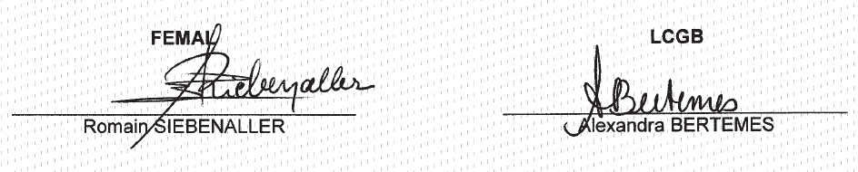
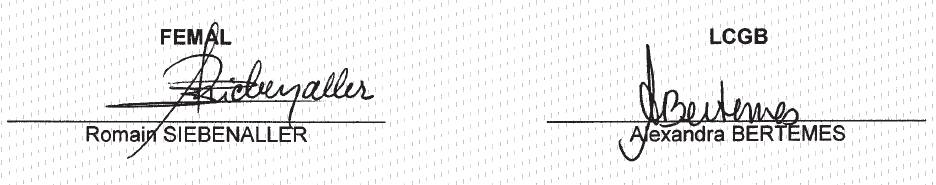

# Règlement grand-ducal du 1er avril 2022 portant déclaration d’obligation générale des avenants I et II à la convention collective de travail du secteur mécaniciens de machines agricoles signés le 22 août 2005 et conclus entre la Fédération des Entreprises du Machinisme Agricole et Industriel du Grand-Duché de Luxembourg asbl, d’une part et le syndicat LCGB, d’autre part.

Nous Henri, Grand-Duc de Luxembourg, Duc de Nassau,

Vu l’article L.164-8 du [Code du Travail](https://legilux.public.lu/eli/etat/leg/code/travail) ;

Sur proposition concordante des assesseurs de l’Office national de conciliation ;

Vu les avis de la Chambre des salariés et de la Chambre des métiers ;

Vu l’article 1er, paragraphe 1er, de la [loi du 16 juin 2017](https://legilux.public.lu/eli/etat/leg/loi/2017/06/16/a592/jo) sur l’organisation du Conseil d’État et considérant qu’il y a urgence ;

Sur le rapport de Notre Ministre du Travail, de l'Emploi et de l’Économie sociale et solidaire et après délibération du Gouvernement en conseil ;

Arrêtons :

## Art. 1er.

Les avenants I et II à la convention collective de travail du secteur mécaniciens de machines agricoles signés le 22 août 2005 et conclus entre la Fédération des Entreprises du Machinisme Agricole et Industriel du Grand-Duché de Luxembourg asbl, d’une part et le syndicat LCGB, d’autre part, sont déclarés d’obligation générale pour tout le secteur.

## Art. 2.

Conformément au paragraphe (5) de l’article L.164-8 du [Code du travail](https://legilux.public.lu/eli/etat/leg/code/travail), la déclaration d’obligation générale prend effet à partir de la date d’entrée en vigueur des avenants I et II à la convention collective de travail.

## Art. 3.

Notre ministre ayant le Travail dans ses attributions est chargé de l'exécution du présent règlement qui sera publié au Journal officiel du Grand-Duché de Luxembourg avec les avenants I et II à la convention collective de travail signés le 22 août 2005.

Le Ministre du Travail, de l’Emploi  et de l’Économie sociale et solidaire,   Georges Engel

Paris, le 1er avril 2022.   Henri

| **Nachtrag I zum Kollektivvertrag des 19. Mai 2000 für den  luxemburgischen landwirtschaftlichen Maschinenhandel** |
|---|

abgeschlossen zwischen der Fédération des Entreprises du Machinisme Agricole et Industriel du Grand-Duché de Luxembourg a.s.b.l. (FEMAL) einerseits, und dem Lëtzebuerger Chrëschtleche Gewerkschaftsbond andererseits:

## Artikel 1: — Vertragsdauer

Der vorliegende Nachtrag verlängert die Gültigkeitsdauer des Kollektivvertrages für die Arbeiter des luxemburgischen landwirtschaftlichen Landmaschinenhandels vom 1. Januar 2003 bis zum 31. Dezember 2004 einschliesslich.

## Artikel 2: — Einmalige Sonderbeträge

Am 10. September 2005 werden folgende einmalige Sonderbeträge ausbezahlt: 219.- € für das Jahr 2002 und 219.- € für das Jahr 2003. Diese Beträge unterliegen nicht der Lohnindexanpassung.

Etwaige bereits bezahlte Sonderbeträge werden angerechnet.

Angefertigt in 6 Exemplaren am 22. August 2005.

| **Nachtrag **Il zum Kollektivvertrag des 19. Mai 2000 für den  luxemburgischen landwirtschaftlichen Maschinenhandel**** |
|---|

abgeschlossen zwischen der Fédération des Entreprises du Machinisme Agricole et Industriel du Grand-Duché de Luxembourg a.s.b.l. (FEMAL) einerseits, und dem Lëtzebuerger Chrëschtleche Gewerkschaftsbond andererseits:

## Artikel 1: — Vertragsdauer

Der vorliegende Nachtrag verlängert die Gültigkeitsdauer des Kollektivvertrages für die Arbeiter des luxemburgischen landwirtschaftlichen Landmaschinenhandels vom 1. Januar 2005 bis zum 31. Dezember 2007 einschliesslich.

## Artikel 2:

Die Tariflöhne und die Effektivlöhne werden am 1. Januar 2006 um 0,10.- € pro Stunde und am 1. Januar 2007 um 0,10.- € pro Stunde erhöht.

## Artikel 3:

Ein einmaliger Sonderbetrag, welcher nicht an die Lohnindexentwicklung gebunden ist, wird folgendermaßen ausbezahlt:

aot 300.- € für das Jahr 2004 am 10. September 2005;

bot 300.- € für das Jahr 2005 am 31. Januar 2006;

cot 300.- € für das Jahr 2006 am 31. Januar 2007.

Etwaige bereits bezahlte Sonderbeträage werden angerechnet.

## Artikel 4:

Ab dem Jahr 2005 erhalten alle Arbeiter, welche seit wenigstens 10 Jahren dem Betrieb angehören, einen zusätzlichen Urlaubstag. Das Eintrittsdatum ist maßgebend.

## Artikel 5: — Organisation der Arbeitszeit.

Es steht den Betrieben frei, die Arbeitszeit ab dem 1. August 2005 nach folgenden Modalitäten zu organisieren, bezogen auf eine Referenzperiode von 6 Monaten.

Sollten die gesetzlichen Bestimmungen ändern, so sind auf Wunsch einer der vertragschließenden Parteien die Modalitäten neu zu verhandeln.

asc Referenzperiode

Die Kompensation der Arbeitsstunden geschieht in einem Zeitraum von 6 Monaten.

Greift der Betrieb auf das Kompensationsmodell zurück, so ist dies zusammen mit Anfang und Ende der Referenzperiode im Betrieb auszuschildern, andernfalls das herkömmliche Prinzip gilt (40 Stunden/Woche, 8 Stunden/Tag). Eine Referenzperiode darf nicht unterbrochen werden und ist bis zum Ende anzuwenden.

o Mindest- und Höchstarbeitsdauer

Es sind pro Woche mindestens 32 Stunden und pro Tag 8 Stunden zu leisten. Die Tagesarbeitszeit kann weniger ais 8 Stunden betragen, wenn in der Woche bereits 40 Stunden geleistet wurden. Die Arbeitswoche erstreckt sich von Montag bis Samstag einschließlich.

Die höchstmögliche Arbeitszeit ohne Überstundenzuschlag beträgt 44 Stunden pro Woche und 10 Stunden pro Tag.

o Kompensation der Arbeitsstunden

AusschließIich diejenigen Stunden, welche zwischen der 8. und der 11. Stunde pro Tag und zwischen der 32. und der 45. Stunde pro Woche geleistet wurden, können während der Referenzperiode kompensiert werden.

Die hereinzuholenden Stunden sind im gemeinsamen Einvernehmen von Arbeiter und Arbeitgeber zu bestimmen.

o Überstunden

Alle Arbeitsstunden, welche die 44. Wochenarbeitsstunde oder die 10. Tagesarbeitsstunde übersteigen, gelten als Überstunde.

Diese Überstunden sind mit 25 % Lohnzuschlag im gleichen Monat auszuzahlen und gelangen nicht ins Kompensationssystem.

o Lohnberechnung

Der Monatslohn wird auf der Basis von 8 Stunden pro Arbeitstag berechnet und wird gegebenenfalls um die außerhalb des Kompensationssystems geleisteten Überstunden und deren Zuschlag erhöht.

Als reguläre Arbeitszeit gelten Urlaub, Feiertage sowie von der Krankenkasse anerkannte Abwesenheitszeiten.

o Ende der Referenzperiode

Am Ende der Referenzperiode wird eine Abrechnung erstellt. Ein eventuelles Manko an Stunden geht zu Lasten des Betriebs. Ein eventueller Überschuss an Stunden wird mit einem Lohnzuschlag von 25 % ausbezahlt.

Ein Übertrag von Fehl- oder überschüssigen Stunden auf die nachfolgende Referenzperiode ist nicht erlaubt.

o Arbeitszeitplan

Der Arbeitszeitplan muss sich über wenigstens eine Woche erstrecken. Er ist dem Arbeiter wenigstens 5 Tage vor lnkrafttreten auszuhändigen und kann anschließend nicht mehr geändert werden.

o Verschiedenes

Die Lohnabrechnung muss während der Referenzperiode alle Angaben enthalten, welche dem Arbeiter Aufschluss geben über sein Arbeitszeitkonto sowohl im als auch außerhalb des Kompensationssystems.

Vorliegende Arbeitszeitregelung darf keine Beeinträchtigung hinsichtlich des bestehenden Arbeitsrechtes nach sich ziehen.

Angefertigt in 6 Exemplaren am 22. August 2005.

