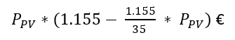
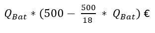

# Règlement grand-ducal du 7 avril 2022 déterminant les mesures d’exécution de la loi modifiée du 23 décembre 2016 instituant un régime d’aides pour la promotion de la durabilité, de l’utilisation rationnelle de l’énergie et des énergies renouvelables dans le domaine du logement et modifiant le règlement grand-ducal modifié du 23 décembre 2016 fixant les mesures d’exécution de la loi du 23 décembre 2016 instituant un régime d’aides pour la promotion de la durabilité, de l’utilisation rationnelle de l’énergie et des énergies renouvelables dans le domaine du logement.

## Art. 1er — Conditions et modalités d’octroi et de calcul de l’aide financière pour un assainissement énergétique durable

(1) Sont visés les bâtiments utilisés intégralement à des fins d’habitation après assainissement énergétique et les parties d’un bâtiment utilisées à des fins d’habitation après assainissement énergétique respectant les exigences et critères déterminés à l’annexe II.

(2) La qualité des matériaux d’isolation utilisés est évaluée moyennant l’indicateur écologique Ieco12 déterminé conformément à l’article 2 du [règlement grand-ducal du 23 décembre 2016](https://legilux.public.lu/eli/etat/leg/rgd/2016/12/23/n41/jo) relatif à la certification de la durabilité des logements.

(3) Les montants alloués pour l’assainissement des éléments de construction de l’enveloppe thermique sont calculés sur base des surfaces de ces éléments après assainissement énergétique. Plus précisément, la surface de l’élément assaini est multipliée par le montant de l’aide financière spécifique respective précisée dans le tableau suivant. Les surfaces des éléments assainis doivent correspondre aux surfaces prises en compte au calcul de la performance énergétique du bâtiment assaini, conformément au [règlement grand-ducal du 9 juin 2021](https://legilux.public.lu/eli/etat/leg/rgd/2021/06/09/a439/jo) concernant la performance énergétique des bâtiments.

<table>
<tr>
<td></td>
<td></td>
<td></td>
<td colspan="3"><b>Aide financière spécifique [euros/m2 assaini]</b></td>
</tr>
<tr>
<td></td>
<td><b>Élément de construction de l’enveloppe thermique assaini</b></td>
<td><b>Catégorie d’isolant thermique</b></td>
<td><b>Standard de performance</b> <b>III</b></td>
<td><b>Standard de performance II</b></td>
<td><b>Standard de performance I</b></td>
</tr>
<tr>
<td rowspan="3">1</td>
<td rowspan="3">Élément contre extérieur : mur extérieur (isolé du côté extérieur<b>, du côté intérieur en combinaison avec une isolation du côté extérieur ou isolé exclusivement du côté intérieur</b>**), toiture inclinée ou plate, dalle inférieure contre extérieur</td>
<td>a. fossile et autres matériaux*</td>
<td>25</td>
<td>30</td>
<td>40</td>
</tr>
<tr>
<td>b. minéral</td>
<td>45</td>
<td>50</td>
<td>60</td>
</tr>
<tr>
<td>c. écologique</td>
<td>70</td>
<td>75</td>
<td>85</td>
</tr>
<tr>
<td rowspan="3">2</td>
<td rowspan="3">Élément contre zone non chauffée ou sol : dalle supérieure contre zone non chauffée, mur ou dalle inférieure contre sol ou zone non chauffée</td>
<td>a. fossile et autres matériaux*</td>
<td>15</td>
<td>20</td>
<td>30</td>
</tr>
<tr>
<td>b. minéral</td>
<td>20</td>
<td>25</td>
<td>35</td>
</tr>
<tr>
<td>c. écologique</td>
<td>30</td>
<td>35</td>
<td>45</td>
</tr>
<tr>
<td>3</td>
<td>Fenêtres et portes-fenêtres</td>
<td></td>
<td>50</td>
<td>55</td>
<td>60</td>
</tr>
</table>

\* matériaux ne répondant pas aux définitions des catégories b. et c.

\**pour une isolation qui est réalisée exclusivement du côté intérieur, les aides financières spécifiques [euros/m2 assaini] indiquées dans le tableau ci-dessus sont diminuées de 25 pour cent ; l’exigence que l’isolant thermique minéral, catégorie b., et l’isolant thermique écologique, catégorie c., doivent être fixés de manière mécanique ne vaut pas pour une isolation qui est réalisée exclusivement du côté intérieur.

Toutefois, mis à part pour les murs contre sol et les dalles inférieures contre sol, aucune aide financière n’est allouée pour les surfaces des éléments assainis avec des isolants thermiques dont la valeur de l’indicateur écologique Ieco12 est supérieure à 50,0 UI6/m².

Mis à part pour les murs contre sol et les dalles inférieures contre sol, aucune aide financière n’est allouée pour les surfaces des éléments assainis avec des isolants thermiques fossiles lorsque la première demande en vue de l’obtention d’un accord de principe est introduite à partir du 1er janvier 2024. Cette disposition ne s’applique pas pour les isolants thermiques fossiles composés à plus de 50 pour cent de matières recyclées.

Par « isolant thermique minéral, catégorie b. », on entend au titre du présent règlement les isolants qui remplissent simultanément les conditions suivantes :

1° ils présentent un indicateur écologique Ieco12 dont la valeur est inférieure ou égale à 23,7 UI6/m²,

2° ils sont intégralement de nature minérale, y compris l’enduit,

3° ils sont fixés majoritairement de manière mécanique, à l’exception de l’enduit.

Par « isolant thermique écologique, catégorie c. », on entend au titre du présent règlement les isolants qui remplissent simultanément les conditions suivantes :

1° ils présentent un indicateur écologique Ieco12 dont la valeur est inférieure ou égale à 23,7 UI6/m² ;

2° ils sont constitués exclusivement de matériaux renouvelables ;

3° ils sont fixés exclusivement de manière mécanique, à l’exception de l’enduit.

Pour la position 3 du tableau, les mesures extérieures des cadres sont prises en compte pour le calcul des montants alloués.

(4) Pour les éléments repris aux positions 1 et 2 du tableau du paragraphe 3, assainis avec des isolants thermiques qui remplissent une des conditions suivantes :

1° ils sont des isolants fossiles composés à plus de 50 pour cent de matières recyclées ;

2° ils sont des isolants minéraux composés à plus de 50 pour cent de matières recyclées ;

3° ils sont des isolants écologiques dont les composants proviennent de cultures certifiées durables, répondant aux critères « Forest Stewardship Council », ci-après « Certificat FSC », « Programme for Endorsement of Forest Certification », ci-après « Certificat PEFC », « Sustainable Forestry Initiative », ci-après « Certificat SFI », ou tout autre certificat équivalent ;

les aides reprises dans le tableau au paragraphe 3 peuvent être augmentées de 15 euros/m2 assaini.

(5) Les aides financières allouées conformément au paragraphe 3, le cas échéant augmentées du montant précisé au paragraphe 4, peuvent être augmentées d’un bonus qui est fonction de la valeur spécifique du besoin en chaleur de chauffage du bâtiment assaini tel que défini au [règlement grand-ducal du 9 juin 2021](https://legilux.public.lu/eli/etat/leg/rgd/2021/06/09/a439/jo) concernant la performance énergétique des bâtiments.

Le bonus est déterminé conformément au tableau suivant :

| **Classes d’isolation thermique** | **Bonus** |
|---|---|
| C | 20 pour cent |
| B | 30 pour cent |
| A | 50 pour cent |

Le droit au bonus de l’aide financière est lié au respect simultané des deux conditions suivantes :

1° la valeur spécifique du besoin en chaleur de chauffage du bâtiment, après la réalisation des mesures d’assainissement énergétique, doit atteindre la classe d’isolation thermique C, B ou A selon les dispositions du [règlement grand-ducal du 9 juin 2021](https://legilux.public.lu/eli/etat/leg/rgd/2021/06/09/a439/jo) concernant la performance énergétique des bâtiments ;

2° la valeur spécifique du besoin en chaleur de chauffage du bâtiment doit être améliorée d’au moins deux classes d’isolation thermique suite à l’assainissement énergétique.

(6) Les mesures d’assainissement visées au paragraphe 3 peuvent être réalisées en plusieurs étapes. Le bonus de l’aide financière pour une mesure d’assainissement énergétique donnée peut être accordé en plusieurs tranches successives, au fur et à mesure que la réalisation de mesures d’assainissement énergétique d’éléments de construction de l’enveloppe thermique du bâtiment mène à une amélioration de la classe d’isolation thermique. Toutefois, pour un bâtiment dont la valeur spécifique du besoin en chaleur de chauffage après assainissement atteint la classe d’isolation thermique B, le bonus de l’aide financière, le cas échéant accordé en deux tranches, ne peut dépasser 30 pour cent de l’aide financière visée au paragraphe 3. Pour un bâtiment dont la valeur spécifique du besoin en chaleur de chauffage après assainissement atteint la classe d’isolation thermique A, le bonus de l’aide financière, le cas échéant accordé en deux ou trois tranches, ne peut dépasser 50 pour cent de l’aide financière.

(7) Pour la mise en œuvre d’une ventilation mécanique contrôlée, les aides financières sont calculées sur la base de la surface de référence énergétique figurant sur le certificat de performance énergétique du bâtiment assaini, établi conformément au [règlement grand-ducal du 9 juin 2021](https://legilux.public.lu/eli/etat/leg/rgd/2021/06/09/a439/jo) concernant la performance énergétique des bâtiments. Pour une maison unifamiliale, la surface de référence énergétique est multipliée par le montant de l’aide financière spécifique précisée dans le tableau suivant. Pour un logement faisant partie d’un immeuble collectif, la surface de référence énergétique du logement, abstraction faite des parties communes, est multipliée par le montant de l’aide financière spécifique précisée dans le tableau suivant. L’aide financière ne peut toutefois dépasser 50 pour cent des coûts effectifs.

<table>
<tr>
<td rowspan="2"></td>
<td colspan="2"><b>Aide financière [ euros / m2 ]</b></td>
</tr>
<tr>
<td>Maison unifamiliale</td>
<td>Logement faisant partie d’un immeuble collectif</td>
</tr>
<tr>
<td>Ventilation avec récupération de chaleur</td>
<td>45</td>
<td>45</td>
</tr>
</table>

La surface de référence énergétique maximale éligible s’élève à 150 m2pour une maison unifamiliale et à 80 m2 pour un logement faisant partie d’un immeuble collectif. Pour l’immeuble collectif, les aides financières sont plafonnées à 30 000 euros.

(8) Pour les investissements et services relatifs à des travaux d’assainissement énergétique ou à la mise en œuvre d’une ventilation mécanique contrôlée pour lesquels la première demande en vue de l’obtention d’un accord de principe est introduite entre le 1er novembre 2022 et le 31 décembre 2025 inclus[^18][^14] et dont la facture est établie au plus tard le 31 décembre 2029[^19][^15], les aides financières allouées conformément :

1\. au paragraphe 3, le cas échéant augmentées du montant précisé au paragraphe 4 et du bonus précisé au paragraphe 5 ;

2\. au paragraphe 7,

sont augmentées d’un bonus financier de 25 pour cent.[^9]

## Art. 2 — Modalités d’octroi et de calcul des aides financières pour les installations solaires photovoltaïques et des installations de stockage

(1) En application de l’article 5, paragraphe 2, alinéa 1er, point 1, de la [loi précitée du 23 décembre 2016](https://legilux.public.lu/eli/etat/leg/loi/2016/12/23/n20/jo), le montant de l’aide financière arrondi à deux décimales près pour une installation solaire photovoltaïque strictement inférieure à 15 kilowatts est déterminé par le biais de la formule suivante :

avec :

Ppv: la puissance électrique de crête de l’installation solaire photovoltaïque concernée exprimée en kilowatt et arrondie à deux décimales près.

En application de l’article 5, paragraphe 2, alinéa 1er, point 2, de la [loi précitée du 23 décembre 2016](https://legilux.public.lu/eli/etat/leg/loi/2016/12/23/n20/jo), le montant de l’aide financière arrondie à deux décimales près pour une installation solaire photovoltaïque supérieure ou égal à 15 kilowatts est de 10 000 euros.

(2) En application de l’article 5, paragraphe 2, alinéa 2, point 1, de la [loi précitée du 23 décembre 2016](https://legilux.public.lu/eli/etat/leg/loi/2016/12/23/n20/jo), le montant de l’aide financière arrondie à deux décimales près pour une installation de stockage strictement inférieure à 9 kilowattheures est déterminé par le biais de la formule suivante :

avec :

QBat: la capacité utile de l’installation de stockage concernée exprimée en kilowattheure et arrondie à deux décimales près.

En application de l’article 5, paragraphe 2, alinéa 2, point 2, le montant de l’aide financière arrondi à deux décimales près pour une installation de stockage supérieur ou égale à 9 kilowattheures est de 2 250 euros.[^22]

## Art. 3 — Conditions et modalités d’octroi et de calcul des aides financières pour les installations solaires thermiques

Sont visées les installations solaires thermiques respectant les exigences et critères requis déterminés à l’annexe II.

## Art. 4 — Conditions et modalités d’octroi et de calcul des aides financières pour les pompes à chaleur

(1) Sont visées les pompes à chaleur respectant les exigences et critères requis déterminés à l’annexe II.

(2) Pour une pompe à chaleur géothermique ainsi qu’une pompe à chaleur combinée à un accumulateur de chaleur latente et un collecteur solaire thermique, le montant de l’aide financière s’élève à :

1° 8 000 euros pour les installations dont la puissance nominative ne dépasse pas 10 kWthermique dans le cas d’une maison unifamiliale ;

2° 800 euros par kWthermique pour les installations d’une puissance nominative de plus de 10 kWthermique dans le cas d’une maison unifamiliale, sans toutefois dépasser 12 000 euros ;

3° 7 500 euros par logement faisant partie d’un immeuble collectif. L’aide financière est plafonnée à 37 500 euros dans le cas d’un immeuble collectif ;

4° 7 500 euros par maison unifamiliale ou par logement faisant partie d’un immeuble collectif raccordés à un réseau de chaleur alimenté par une telle installation. Dans ce cas, l’aide financière est plafonnée à 37 500 euros.

(3) Pour une pompe à chaleur air-eau ou un appareil compact comprenant la ventilation mécanique contrôlée et la pompe à chaleur air rejeté-eau dans un nouveau bâtiment utilisé à des fins d’habitation, le montant de l’aide financière s’élève à :

1° 3 000 euros dans le cas d’une maison unifamiliale ;

2° 2 000 euros par logement faisant partie d’un immeuble collectif. L’aide financière est plafonnée à 10 000 euros dans le cas d’un immeuble collectif.

(4) Pour une pompe à chaleur air-eau ou un appareil compact comprenant la ventilation mécanique contrôlée et la pompe à chaleur air rejeté-eau dans un bâtiment utilisé à des fins d’habitation existant, le montant de l’aide financière s’élève à :

1° 5 000 euros pour les installations dont la puissance nominative ne dépasse pas 10 kWthermique ;

2° 500 euros par kWthermique pour les installations d’une puissance nominative de plus de 10 kWthermique, sans toutefois dépasser 12 000 euros.

(5) Le droit au bonus de 30 pour cent, le cas échéant porté à 50 pour cent,[^11] augmentant les aides financières allouées conformément aux paragraphes 2 et 4, dans le cas du remplacement d’une chaudière alimentée au combustible fossile existante ou d’un chauffage électrique existant combiné à une amélioration de la performance énergétique du système de chauffage, est soumis aux conditions précisées à l’annexe II.

(6) Le droit à l’aide supplémentaire de 50 pour cent des coûts effectifs pour l’enlèvement, la neutralisation et le recyclage du réservoir au fioul est soumis aux conditions précisées à l’annexe II.

(7) Le droit au bonus de 50 pour cent des coûts effectifs de l’adaptation du système de distribution de chaleur existant, dans le cas du remplacement d’une chaudière existante par une pompe à chaleur géothermique reprise au paragraphe 2 ou par une pompe à chaleur air-eau reprise au paragraphe 4, combiné à une adaptation du système de distribution de chaleur existant, est soumis aux conditions précisées à l’annexe II.

## Art. 5 — Conditions et modalités d’octroi et de calcul des aides financières pour les chaudières à bois et les filtres à particules

(1) Sont visés les chaudières à bois et les filtres à particules respectant les exigences et critères requis déterminés à l’annexe II.

Seuls les chaudières à bois et les filtres à particules qui sont installés dans des bâtiments utilisés à des fins d’habitation existants sont éligibles pour une aide financière.

(2) Pour une chaudière à granulés de bois et une chaudière à plaquettes de bois, le montant de l’aide financière s’élève à :

1° 750 euros par kWthermique dans le cas d’une maison unifamiliale, sans toutefois dépasser 7 500 euros ;

2° 750 euros par kWthermique dans le cas d’un immeuble collectif. L’aide financière est plafonnée à 30 000 euros dans le cas d’un immeuble collectif ;

3° 750 euros par kWthermique par maison unifamiliale ou par logement faisant partie d’un immeuble collectif raccordés à un réseau de chaleur alimenté par une telle installation. Dans ce cas, l’aide financière est plafonnée à 30 000 euros.

(3) Le droit au bonus de 15 pour cent pour la mise en place d’un réservoir tampon, augmentant l’aide financière allouée conformément au paragraphe 2, est soumis aux conditions précisées à l’annexe II.

(4) Pour un poêle à granulés de bois dans une maison unifamiliale, l’aide financière s’élève à 30 pour cent des coûts effectifs, sans toutefois dépasser 2 500 euros.

(5) Pour une chaudière à combustion étagée pour bûches de bois et une chaudière combinée bûches de bois et granulés de bois respectivement dans une maison unifamiliale et un immeuble collectif, les aides financières s’élèvent à 350 euros par kWthermique.

(6) Le droit au bonus de 30 pour cent, le cas échéant porté à 50 pour cent,[^12] augmentant les aides financières allouées conformément aux paragraphes 2 et 5, dans le cas du remplacement d’une chaudière alimentée au combustible fossile existante ou d’un chauffage électrique existant combiné à une amélioration de la performance énergétique du système de chauffage, est soumis aux conditions précisées à l’annexe II.

(7) Le droit à l’aide supplémentaire de 50 pour cent des coûts effectifs pour l’enlèvement, la neutralisation et le recyclage du réservoir au fioul est soumis aux conditions précisées à l’annexe II.

## Art. 6 — Conditions et modalités d’octroi et de calcul des aides financières pour un réseau de chaleur et un raccordement à un réseau de chaleur

(1) Pour la mise en place d’un réseau de chaleur alimentant au moins deux bâtiments d’habitation, l’aide financière couvre 50 pour cent des coûts effectifs, sans toutefois dépasser 12 500 euros.

(2) Pour le raccordement d’un bâtiment d’habitation à un réseau de chaleur, l’aide financière s’élève à 250 euros par kWthermique, sans toutefois dépasser 50 pour cent des coûts effectifs.

La puissance thermique nominale installée maximale éligible est fixée à 15 kW pour une maison unifamiliale et à 8 kW pour un logement faisant partie d’un immeuble collectif.

(3) Les aides financières prévues aux paragraphes 1er et 2 ne peuvent être allouées que lorsque le réseau de chaleur est alimenté par des sources d’énergies renouvelables, tel que défini à l’annexe II.

## Art. 7 — Conditions et modalités d’octroi et de calcul de l’aide financière pour le conseil en énergie

(1) Sont visés les services de conseil en énergie et d’accompagnement ponctuel de la mise en œuvre des travaux prestés dans le cadre de la réalisation de travaux d’assainissement énergétique relatifs à l’article 1er.

(2) Pour la prestation d’un conseil en énergie, l’aide financière s’élève à :

1° 1 500 euros pour une maison unifamiliale, sans toutefois dépasser les coûts effectifs du conseil en énergie ;

2° 1 800 euros pour un immeuble collectif se composant de deux logements, sans toutefois dépasser les coûts effectifs du conseil en énergie. À ce montant de base s’ajoute un supplément de 50 euros pour chaque logement supplémentaire. Le montant total est plafonné à 2 600 euros, sans toutefois dépasser les coûts effectifs du conseil en énergie.

Cette aide financière peut, dans le cas où la valeur spécifique du besoin en chaleur de chauffage du bâtiment, après la réalisation des mesures d’assainissement énergétique, atteint au moins la classe d’isolation thermique C, être augmentée de 140 euros pour le calcul d’un pont thermique et des propositions de traitement afférentes, sans toutefois dépasser un montant de 700 euros.

Le contenu obligatoire du conseil en énergie est défini à l’annexe II. Un rapport concluant, reprenant le contenu précisé à l’annexe II, est à établir par le conseiller en énergie avant le commencement des travaux d’assainissement énergétique, excepté pour les travaux d’assainissement se limitant à un seul élément de construction de l’enveloppe thermique.

(3) En vue de la conformité de la mise en œuvre avec le concept d’assainissement énergétique tel que défini à l’annexe II, le conseil en énergie dont question à l’article 1er doit être complété par un accompagnement ponctuel de la mise en œuvre à prester par le conseiller en énergie qui a établi le rapport concluant exigé au paragraphe 2. Cet accompagnement comprend la vérification de la conformité des offres et de la mise en œuvre sur chantier avec les mesures proposées dans le cadre du concept d’assainissement énergétique précité ainsi que, le cas échéant, les conseils requis afin d’atteindre cette conformité.

(4) Pour la réalisation de la vérification de la conformité des offres précitée, l’aide financière s’élève à 75 euros par mesure subventionnée, sans toutefois dépasser un montant de 300 euros.

Pour la réalisation de la vérification de la conformité de la mise en œuvre sur chantier précitée, l’aide financière s’élève à 200 euros par mesure subventionnée, sans toutefois dépasser un montant de 800 euros. Toutefois, pour les travaux d’assainissement se limitant à un seul élément de construction de l’enveloppe thermique et pour lesquels une aide financière pour la prestation d’un conseil en énergie reprise au paragraphe 2 n’a pas été demandée, cette aide financière s’élève à 350 euros pour cette seule mesure subventionnée.

Un rapport final, reprenant le contenu précisé à l’annexe II, est à établir par le conseiller en énergie, excepté pour les travaux d’assainissement se limitant à un seul élément de construction de l’enveloppe thermique.

(5) L’éligibilité du conseil en énergie correspondant au paragraphe 2 dépend de la réalisation et de la subvention d’une des mesures définies aux articles 1er et 3 à 6. L’aide financière pour le conseil en énergie correspondant au paragraphe 2 est diminuée de 50 pour cent au cas où le même objet profite d’une aide financière pour le conseil en énergie sous le régime du [règlement grand-ducal modifié du 12 décembre 2012](https://legilux.public.lu/eli/etat/leg/rgd/2012/12/12/n1/jo) instituant un régime d’aides pour la promotion de l’utilisation rationnelle de l’énergie et la mise en valeur des énergies renouvelables dans le domaine du logement ou sous le régime du [règlement grand-ducal modifié du 23 décembre 2016](https://legilux.public.lu/eli/etat/leg/rgd/2016/12/23/n40/jo) fixant les mesures d’exécution de la [loi modifiée du 23 décembre 2016](https://legilux.public.lu/eli/etat/leg/loi/2016/12/23/n20/jo) instituant un régime d’aides pour la promotion de la durabilité, de l’utilisation rationnelle de l’énergie et des énergies renouvelables dans le domaine du logement. L’aide financière pour le conseil en énergie correspondant au paragraphe 2 est diminuée de 70 pour cent au cas où seules des mesures définies aux articles 3 à 6 sont réalisées.

(6) Un seul conseil en énergie par objet est éligible.

(7) La demande d’aide financière relative au conseil en énergie est traitée ensemble avec la demande d’aide financière relative à l’investissement en question.

## Art. 8 — Procédure

(1) Les demandes d’aides financières en vue de leur liquidation sont introduites après la finalisation des travaux auprès de l’Administration de l’environnement[^23] moyennant un formulaire et des fiches annexes, mis à disposition par l’Administration de l’environnement, le cas échéant sur support électronique.

(2) Toutefois, dans le cas d’un assainissement énergétique visé par l’article 1er, une demande en vue de l’obtention d’un accord de principe doit être introduite par le demandeur avant le commencement des travaux d’assainissement énergétique moyennant un formulaire mis à disposition par l’Administration de l’environnement. Mis à part pour les travaux d’assainissement se limitant à un seul élément de construction de l’enveloppe thermique, la demande en vue de l’obtention d’un accord de principe doit se baser sur un conseil en énergie spécifié à l’article 7.

En cas d’adaptation du concept d’assainissement ou, pour les travaux d’assainissement se limitant à un seul élément de construction de l’enveloppe thermique, de la fiche standardisée décrivant la mesure, une fois l’accord de principe intervenu, le demandeur peut introduire une demande en vue de l’obtention d’un nouvel accord de principe.

(3) Pour un immeuble collectif, un seul dossier de demande est à soumettre à l’Administration de l’environnement, sauf pour les aides visées à l’article 2[^24].

(4) Le formulaire précité est à remplir par le demandeur.

(5) Les fiches annexes précitées, spécifiques aux aides financières sollicitées, sont à valider :

1° dans le cas d’un assainissement énergétique, par le conseiller en énergie tel que défini par le présent règlement ou, pour les travaux d’assainissement se limitant à un seul élément de construction de l’enveloppe thermique, par l’entreprise qui exécute les travaux d’assainissement, laquelle est une personne agréée au titre de la [loi du 21 avril 1993](https://legilux.public.lu/eli/etat/leg/loi/1993/04/21/n3/jo) relative à l’agrément de personnes physiques ou morales, privées ou publiques, autres que l’État, pour l’accomplissement de tâches techniques d’étude et de vérification dans le domaine de l’environnement ;

2° dans le cas d’une installation technique, par le conseiller en énergie tel que défini par le présent règlement, la personne ayant établi le calcul de la performance énergétique, l’architecte responsable du projet ou l’entreprise responsable des travaux ;

3° dans le cas d’un conseil en énergie, par le conseiller en énergie tel que défini par le présent règlement.

(6) La demande doit être accompagnée de factures détaillées et précises, quant aux coûts des matériaux et équipements mis en œuvre, ainsi qu’aux frais d’installation et de conseil en énergie. Le cas échéant, les factures peuvent se référer à un devis détaillé à joindre à la facture. Les factures détaillées peuvent être résumées sur une facture globale, accompagnées de certificats de conformité validés par l’entreprise ou la personne responsable des travaux, sur base de modèles mis à disposition par l’Administration de l’environnement. Lesdites factures doivent être acquittées en due forme. On entend par coûts effectifs les coûts des éléments éligibles définis à l’annexe I hors taxe sur la valeur ajoutée.

Par dérogation à l’alinéa 1er, première phrase, les demandes portant sur les aides visées à l’article 2 sont accompagnées :

1\. d’une facture, acquittée en due forme, précisant expressément et de manière clairement visible :

a) le cas échéant, la puissance électrique de crête totale de l’installation solaire photovoltaïque montée ;

b) le cas échéant, la capacité utile de l’installation de stockage montée ;

2\. d’une offre signée par le demandeur ou tout autre document confirmant la date de commande des installations qui font l’objet d’une demande ;

3\. pour les installations pour lesquelles les conditions techniques de raccordement aux réseaux de basse tension visées par l’article 5, paragraphe 2, de la [loi modifiée du 1er août 2007](https://legilux.public.lu/eli/etat/leg/loi/2007/08/01/n13/jo) relative à l’organisation du marché de l’électricité en exigent, d’une copie de la notification de fin de travaux pour les installations montées dûment envoyée au gestionnaire de réseau concerné.

Au cas où le demandeur est une entreprise, l’aide financière est octroyée en vertu du [règlement (UE) n° 1407/2013](https://legilux.public.lu/eli/reg_ue/2013/1407/jo) de la Commission du 18 décembre 2013 relatif à l’application des articles 107 et 108 du [traité sur le fonctionnement de l’Union européenne](http://data.europa.eu/eli/treaty/tfeu_2012/oj) aux aides de minimis. Le plafond établi à l’article 3, paragraphe 2, dudit règlement ne doit pas être atteint. À cette fin, l’entreprise concernée doit remettre une déclaration au sujet des autres aides de minimis éventuelles relevant du règlement précité ou d’autres règlements de minimis qu’elle a reçues au cours des deux exercices fiscaux précédents et de l’exercice fiscal en cours.

Si les demandes visées aux alinéas 1er et 2 sont introduites par l’intermédiaire d’un crédit-bailleur, elles sont accompagnées :

1\. du mandat donné par le crédit-preneur autorisant celui-ci à demander l’aide et en obtenir le paiement au nom et pour le compte du crédit-preneur ;

2\. du contrat de crédit-bail conclu avec le crédit-preneur indiquant clairement la base légale et le montant de l’aide octroyée au crédit-preneur ainsi que le montant des versements échelonnés dus par le crédit-preneur avec et sans l’aide.[^25]

(7) Dans le cadre de l’instruction des dossiers, l’Administration de l’environnement se réserve le droit de demander la production de toute pièce qu’elle juge nécessaire pour pouvoir constater le respect des conditions imposées par le présent règlement.

(8) Les aides financières prévues par le présent règlement ne sont accordées qu’une seule fois par objet. Pour une maison unifamiliale donnée ou un immeuble collectif donné, une aide financière ne peut être accordée que pour la mise en œuvre d’une seule des trois installations techniques suivantes : pompe à chaleur, chaudière à bois, raccordement à un réseau de chaleur.[^26]

(9) Les aides financières sont directement virées aux comptes bancaires des personnes physiques, des personnes morales de droit privé ou des personnes morales de droit public, autres que l’État, qui ont réalisé les investissements.

Toutefois, les aides financières se rapportant aux installations techniques visées aux articles 3 à 6 peuvent être versées aux comptes bancaires des entreprises ayant réalisé les travaux, sur base d’une demande à introduire par le demandeur avant l’exécution des travaux.

Lorsque les aides financières sont sollicitées moyennant un mandat par le représentant légal d’un groupement au nom et pour compte de plusieurs personnes physiques ou morales bénéficiaires des aides financières faisant partie dudit groupement, elles peuvent être virées aux comptes bancaires du représentant légal précité. Dans ce cas, le représentant légal précité a l’obligation de virer immédiatement sur les comptes bancaires des personnes physiques ou morales bénéficiaires leurs parts respectives. Une copie des virements afférents doit être transmise sans délai à l’Administration de l’environnement.

(10) Les personnes qui vendent, jusqu’à un délai de trois ans après leur réalisation, un logement visé à l’article 1er ou une des installations visées aux articles 2 à 6, pour lesquelles des aides financières leur ont été accordées, doivent faire refléter le montant desdites aides de façon transparente dans le prix de vente. Lorsque cette vente est opérée à un moment où les demandes d’aides financières ont été introduites auprès du Ministre, mais n’ont pas encore été accordées par ce dernier, les demandeurs doivent informer l’acheteur qu’une demande d’aide a été introduite.

## Art. 9 — Modalités d’éligibilité

(1) Sont éligibles les investissements et services pour lesquels la facture est établie entre :

1° le 1er janvier 2022 et le 31 décembre 2029 inclus dans le cas d’un assainissement énergétique d’un bâtiment utilisé à des fins d’habitation après les travaux d’assainissement énergétique ou d’une partie d’un bâtiment utilisée à des fins d’habitation après les travaux d’assainissement énergétique, sous condition que :

a) la première demande en vue de l’obtention d’un accord de principe est introduite entre le 1er janvier 2022 et le 31 décembre 2025 inclus ;

b) l’investissement concerné, à savoir l’élément de construction de l’enveloppe thermique ou la ventilation mécanique contrôlée, ne bénéficie pas d’une aide financière sous le [règlement grand-ducal modifié du 12 décembre 2012](https://legilux.public.lu/eli/etat/leg/rgd/2012/12/12/n1/jo) instituant un régime d’aides pour la promotion de l’utilisation rationnelle de l’énergie et la mise en valeur des énergies renouvelables dans le domaine du logement ni sous le [règlement grand-ducal modifié du 23 décembre 2016](https://legilux.public.lu/eli/etat/leg/rgd/2016/12/23/n40/jo) fixant les mesures d’exécution de la [loi du 23 décembre 2016](https://legilux.public.lu/eli/etat/leg/loi/2016/12/23/n20/jo) instituant un régime d’aides pour la promotion de la durabilité, de l’utilisation rationnelle de l’énergie et des énergies renouvelables dans le domaine du logement.

2° le 1er janvier 2022 et le 31 décembre 2025 inclus dans le cas des installations techniques visées aux articles 3 à 6[^27] ainsi que du conseil en énergie visé à l’article 7, sous condition que l’installation technique concernée ne bénéficie pas d’une aide financière sous le [règlement grand-ducal modifié du 12 décembre 2012](https://legilux.public.lu/eli/etat/leg/rgd/2012/12/12/n1/jo) instituant un régime d’aides pour la promotion de l’utilisation rationnelle de l’énergie et la mise en valeur des énergies renouvelables dans le domaine du logement ni sous le [règlement grand-ducal modifié du 23 décembre 2016](https://legilux.public.lu/eli/etat/leg/rgd/2016/12/23/n40/jo) fixant les mesures d’exécution de la [loi du 23 décembre 2016](https://legilux.public.lu/eli/etat/leg/loi/2016/12/23/n20/jo) instituant un régime d’aides pour la promotion de la durabilité, de l’utilisation rationnelle de l’énergie et des énergies renouvelables dans le domaine du logement. Mis à part pour les installations photovoltaïques, ce délai est prolongé jusqu’au 31 décembre 2029 inclus sous condition que les investissements et services en question soient réalisés conjointement avec l’assainissement énergétique d’un bâtiment existant visé au point 2.

(2) Tout droit à l’aide financière se prescrit par quatre ans à compter du 31 décembre de l’année civile à laquelle se rapporte la facture en question. Le droit au bonus de l’aide financière relative à l’assainissement énergétique se prescrit par quatre ans à compter du 31 décembre de l’année civile à laquelle se rapporte la dernière facture en question. Il ne s’applique qu’aux mesures subventionnées dans le cadre du présent règlement.

(3) Le droit à l’aide financière relative au conseil en énergie se prescrit par quatre ans à compter du 31 décembre de l’année civile à laquelle se rapporte la dernière facture en relation avec une mesure éligible d’un assainissement énergétique d’une maison d’habitation existante.

(4) La demande d’aide financière est à introduire au plus tard le 31 décembre 2031.

## Art. 10 — Disposition abrogatoire

Le [règlement grand-ducal modifié du 23 décembre 2016](https://legilux.public.lu/eli/etat/leg/rgd/2016/12/23/n40/jo) fixant les mesures d’exécution de la [loi du 23 décembre 2016](https://legilux.public.lu/eli/etat/leg/loi/2016/12/23/n20/jo) instituant un régime d’aides pour la promotion de la durabilité, de l’utilisation rationnelle de l’énergie et des énergies renouvelables dans le domaine du logement est abrogé.

## Art. 11 — Disposition transitoire

Pour les investissements visés par l’article 10 du [règlement grand-ducal du 23 décembre 2016](https://legilux.public.lu/eli/etat/leg/rgd/2016/12/23/n40/jo) précité, ce dernier reste applicable.

Par dérogation à l’article 10, paragraphe 1er, alinéa 1er, point 1, du [règlement grand-ducal précité du 23 décembre 2016](https://legilux.public.lu/eli/etat/leg/rgd/2016/12/23/n40/jo), les investissements et services pour lesquels la facture est établie entre le 1er janvier 2017 et le 31 décembre 2029 inclus sont éligibles dans le cas d’un nouveau logement durable visé à l’article 1er du [règlement grand-ducal précité du 23 décembre 2016](https://legilux.public.lu/eli/etat/leg/rgd/2016/12/23/n40/jo), sous condition que l’autorisation de bâtir est demandée entre le 1er janvier 2017 et le 31 décembre 2025 inclus. La demande d’aide financière est introduite au plus tard le 31 décembre 2031.[^21][^17]

## Art. 12 — Intitulé de citation

La référence au présent règlement se fait sous la forme suivante : « règlement grand-ducal du 7 avril 2022 déterminant les mesures d’exécution de la [loi du 23 décembre 2016](https://legilux.public.lu/eli/etat/leg/loi/2016/12/23/n20/jo) instituant un régime d’aides pour la promotion de la durabilité, de l’utilisation rationnelle de l’énergie et des énergies renouvelables dans le domaine du logement. »

## Art. 13 — Mise en vigueur

Le présent règlement grand-ducal produit ses effets au 1er janvier 2022.

## Art. 14 — Formule exécutoire

Notre ministre ayant l’Environnement dans ses attributions et Notre ministre ayant le Budget dans ses attributions sont chargés, chacun en ce qui le concerne, de l’exécution du présent règlement qui sera publié au Journal officiel du Grand-Duché de Luxembourg.

\**Annexe I – Éléments éligibles**

1° En relation avec l’article 1er. Assainissement énergétique durable :

a) Les éléments de construction de l’enveloppe thermique assainis énergétiquement par l’application d’un isolant thermique ou le remplacement des fenêtres, y compris les travaux et les frais de main d’œuvre relatifs aux éléments de construction assainis :

i) Mur extérieur (isolé du côté extérieur ou intérieur) ;

ii) Mur extérieur (isolation du côté intérieur combinée avec une isolation du côté extérieur) ;

iii) Mur contre sol ou zone non chauffée ;

iv) Toiture inclinée ou plate ;

v) Dalle supérieure contre zone non chauffée ;

vi) Dalle inférieure contre zone non chauffée ou sol ou extérieur ;

vii) Fenêtres et portes-fenêtres.

b) La ventilation mécanique contrôlée, c’est-à-dire le module de ventilation avec récupération de chaleur, les gaines de ventilation, les bouches d’aération, les filtres, les installations périphériques (alimentation, régulation) et les frais d’installation y relatifs ;

c) Le conseil en énergie.

2° En relation avec l’article 2. Installation solaire photovoltaïque :

a) Le système complet se composant des panneaux photovoltaïques ou des collecteurs solaires hybrides, des rails de fixation, du câblage électrique DC et AC lié directement à l’installation photovoltaïque, de l’onduleur, des protections électriques et du compteur bidirectionnel ;

b) Les frais d’installation propres aux éléments éligibles ;

c) Les travaux de toiture, de génie civil et les modifications de l’installation électrique existante ne sont pas éligibles.

d) L’installation de stockage de l’électricité produite par l’installation solaire photovoltaïque, lorsque les conditions suivantes sont simultanément remplies :

1\. l’installation de stockage est connectée à une installation solaire photovoltaïque opérée en mode autoconsommation ou dans le cadre d’une communauté énergétique ;

2\. la puissance électrique de crête de l’installation solaire photovoltaïque est supérieure à 4 kW et, dans le cas d’un immeuble collectif à plusieurs unités de logement, supérieure à 1,5 kW par unité de logement ;

3\. la capacité de stockage de l’installation de stockage de l’énergie produite est inférieure ou égale à :

i) 1,5 kWh par kWcrête de l’installation photovoltaïque lorsque l’installation solaire photovoltaïque et l’installation de stockage alimentent un bâtiment utilisé à des fins d’habitation, tout en ne dépassant pas :

aash 12 kWh dans le cas d’une maison unifamiliale ;

bash 9 kWh par unité de logement faisant partie d’un immeuble collectif ;

ii) 1 kWh par kWcrête de l’installation photovoltaïque lorsque l’installation solaire photovoltaïque et l’installation de stockage alimentent un bâtiment qui n’est pas utilisé à des fins d’habitation[^28][^13]

3° En relation avec l’article 3. Installation solaire thermique :

a) Le système complet se composant des collecteurs solaires thermiques, des rails de fixation, de la tuyauterie isolée et du réservoir de stockage solaire ;

b) Le calorimètre ;

c) Les installations périphériques (alimentation, régulation, échangeurs de chaleur) ;

d) Les frais d’installation propres aux éléments éligibles.

4° En relation avec l’article 4. Pompe à chaleur :

a) La pompe à chaleur géothermique et le captage géothermique vertical ou horizontal ;

b) La pompe à chaleur combinée à un accumulateur de chaleur latente et un collecteur solaire thermique, le collecteur solaire thermique n’étant éligible que s’il n’est pas éligible sous l’article 2 ;

c) La pompe à chaleur air/eau ;

d) L’appareil compact comprenant la ventilation mécanique contrôlée avec récupération de chaleur et la pompe à chaleur air rejeté/eau ;

e) La pompe à chaleur hybride ;

f) La pompe à chaleur qui est combinée avec un système de chauffage existant pour former un système hybride ;

g) Les installations périphériques (alimentation, régulation, échangeurs de chaleur, système de distribution de chaleur dans le cas d’immeubles existants (circuit de distribution et radiateurs), équipements d’insonorisation et de protection contre le bruit (aussi insonorisation de l’élément de la pompe à chaleur installé à l’extérieur)) ;

h) Les frais liés à l’enlèvement, la neutralisation et le recyclage d’un réservoir à fioul ;

i) Les frais d’installation propres aux éléments éligibles.

5° En relation avec l’article 5. Chaudière à bois :

a) La chaudière centrale à granulés de bois, y inclus le filtre à particules ;

b) La chaudière centrale à plaquettes de bois, y inclus le filtre à particules ;

c) La chaudière centrale à combustion étagée pour bûches de bois, y inclus le filtre à particules et le réservoir tampon ;

d) La chaudière centrale combinée bûches de bois et granulés de bois, y inclus le filtre à particules et le réservoir tampon ;

e) Le poêle à granulés de bois, y inclus le filtre à particules ;

f) Le filtre à particules, installé sur une chaudière à bois existante ;

g) Les installations périphériques (système d’alimentation, réservoir de stockage du combustible, régulation, échangeurs de chaleur, réservoir tampon) ;

h) Les frais liés à l’enlèvement, la neutralisation et le recyclage d’un réservoir à fioul ;

i) Les frais d’installation propres aux éléments éligibles ;

j) Les travaux de génie civil ne sont pas éligibles.

6° En relation avec l’article 6. Réseau de chaleur et raccordement à un réseau de chaleur :

a) Le réseau de chaleur comprend la partie jusqu’aux stations de transfert incluses ;

b) Le raccordement à un réseau de chaleur comprend la partie à partir de la station de transfert ;

c) Les conduites isolées ;

d) Les pompes de circulation ;

e) Les systèmes de contrôle et de régulation ;

f) Les travaux de tranchées ;

g) Les frais de raccordement (matériel, hors la station de transfert de chaleur, et main d’œuvre) ;

h) Les installations périphériques ;

i) Les frais liés à l’enlèvement, la neutralisation et le recyclage d’un réservoir à fioul ;

j) Les frais d’installation propres aux éléments éligibles.

\**Annexe II – Exigences techniques** **et autres critères spécifiques**

\**Concernant l’art. 1er.** **Assainissement énergétique durable**

1° Les exigences à respecter par les éléments de construction assainis sont regroupées dans le tableau suivant en fonction du standard de performance visé :

> <table>
> <tr>
> <td rowspan="2"></td>
> <td rowspan="2"><b>Élément assaini</b></td>
> <td><b>Standard de performance III</b></td>
> <td><b>Standard de performance II</b></td>
> <td><b>Standard de performance I</b></td>
> </tr>
> <tr>
> <td>Épaisseur minimale de l’isolant thermique en cm</td>
> <td>Valeur U maximale de l’élément de construction en W/(m2K)</td>
> <td>Valeur U maximale de l’élément de construction en W/(m2K)</td>
> </tr>
> <tr>
> <td>1</td>
> <td>Mur extérieur (isolé du côté extérieur)</td>
> <td>15</td>
> <td>0,17</td>
> <td>0,13</td>
> </tr>
> <tr>
> <td>2</td>
> <td>Mur extérieur (isolé du côté intérieur(<i>) ou isolation du côté intérieur combinée avec une isolation du côté extérieur (*</i>))</td>
> <td>8 cm*</td>
> <td>10 cm*</td>
> <td>12 cm*</td>
> </tr>
> <tr>
> <td>3</td>
> <td>Mur contre sol ou zone non chauffée</td>
> <td>12</td>
> <td>0,22</td>
> <td>0,15</td>
> </tr>
> <tr>
> <td>4</td>
> <td>Toiture inclinée ou plate</td>
> <td>20</td>
> <td>0,13</td>
> <td>0,10</td>
> </tr>
> <tr>
> <td>5</td>
> <td>Dalle supérieure contre zone non chauffée</td>
> <td>20</td>
> <td>0,13</td>
> <td>0,10</td>
> </tr>
> <tr>
> <td>6</td>
> <td>Dalle inférieure contre zone non chauffée ou sol ou extérieur</td>
> <td>12</td>
> <td>0,22</td>
> <td>0,15</td>
> </tr>
> <tr>
> <td>7</td>
> <td>Fenêtres et portes-fenêtres</td>
> <td>0,85 W/(m2K)</td>
> <td>0,80</td>
> <td>0,75</td>
> </tr>
> </table>

Les épaisseurs minimales des isolants thermiques indiquées dans le tableau précédent sont applicables à une conductivité thermique de l’isolant de 0,035 W/(mK). À d’autres conductivités thermiques, les épaisseurs minimales sont à convertir en fonction de la conductivité thermique réelle de l’isolant.

\* Les épaisseurs minimales des isolants thermiques indiquées dans le tableau précédent pour les murs extérieurs isolés du côté intérieur sont applicables à une conductivité thermique de l’isolant de 0,040 W/(mK). À d’autres conductivités thermiques, les épaisseurs minimales sont à convertir en fonction de la conductivité thermique réelle de l’isolant.

\**Dans le cas d’une isolation du côté intérieur qui est réalisée en combinaison avec une isolation du côté extérieur, l’isolant appliqué du côté extérieur doit avoir une résistance thermique R d’au minimum 2 (m2K)/W.

Pour les fenêtres, le coefficient de transmission thermique doit comprendre le coefficient de transmission thermique du cadre et de la vitre ainsi que le coefficient de transmission thermique linéique de l’intercalaire. La justification du respect des exigences doit être fournie pour une fenêtre aux dimensions standardisées, c’est-à-dire d’une largeur de 1,23 m et d’une hauteur de 1,48 m.

2° Indépendamment du standard de performance, l’élément de construction assaini n’est éligible que si l’épaisseur du nouvel isolant thermique équivaut au moins à l’épaisseur minimale exigée dans le cas du standard de performance III.

3° Afin d’éviter l’humidité produite par la condensation et les problèmes en résultant (moisissures, etc.), le remplacement des fenêtres doit se faire en principe conjointement soit avec l’isolation thermique des murs extérieurs soit avec la mise en place d’une ventilation mécanique contrôlée. La même contrainte s’applique dans le cas d’un grenier chauffé. Abstraction est faite de cette contrainte, si le mur extérieur ou la toiture du grenier chauffé présente un coefficient de transmission thermique inférieur ou égal à 0,85 W/m2K, 0,80 W/m2K ou 0,75 W/m2K en fonction du standard de performance visé. Pour les éléments de construction existants l’avis du conseiller en énergie ou, le cas échéant, de l’artisan certifié est pris en compte.

4° Au cas où le grenier est chauffé, l’assainissement de la toiture doit inclure la substitution des fenêtres de toiture lorsqu’elles sont âgées de plus de 10 ans et lorsque leur coefficient de transmission thermique est supérieur à 1,4 W/m2K. La fenêtre de remplacement doit présenter un coefficient de transmission thermique inférieur ou égal à 1,4 W/m2K.

5° Lors de la mise en place d’une ventilation mécanique contrôlée avec récupération de chaleur, les critères suivants doivent être respectés :

a) le rendement du système de récupération de chaleur (« Wärmebereitstellungsgrad ») doit être supérieur ou égal à 80 pour cent ;

b) la puissance électrique absorbée ne peut pas dépasser 0,40 W/(m3/h) ;

c) le résultat du test d’étanchéité réalisé conformément au [règlement grand-ducal du 9 juin 2021](https://legilux.public.lu/eli/etat/leg/rgd/2021/06/09/a439/jo) concernant la performance énergétique des bâtiments doit être inférieur ou égal à 2,0 1/h ;

d) au moins 90 pour cent de la surface de référence énergétique doivent être ventilés mécaniquement.

6° La preuve du droit au bonus de l’aide financière s’effectue par l’intermédiaire des certificats de performance énergétique avant et après assainissement énergétique établis conformément au [règlement grand-ducal du 9 juin 2021](https://legilux.public.lu/eli/etat/leg/rgd/2021/06/09/a439/jo) concernant la performance énergétique des bâtiments. Les mesures réalisées et subventionnées dans le cadre du [règlement grand-ducal modifié du 20 avril 2009](https://legilux.public.lu/eli/etat/leg/rgd/2009/04/20/n1/jo) instituant un régime d’aides pour la promotion de l’utilisation rationnelle de l’énergie et la mise en valeur des énergies renouvelables, du [règlement grand-ducal modifié du 12 décembre 2012](https://legilux.public.lu/eli/etat/leg/rgd/2012/12/12/n1/jo) instituant un régime d’aides pour la promotion de l’utilisation rationnelle de l’énergie et la mise en valeur des énergies renouvelables dans le domaine du logement et du [règlement grand-ducal modifié du 23 décembre 2016](https://legilux.public.lu/eli/etat/leg/rgd/2016/12/23/n40/jo) fixant les mesures d’exécution de la [loi du 23 décembre 2016](https://legilux.public.lu/eli/etat/leg/loi/2016/12/23/n20/jo) instituant un régime d’aides pour la promotion de la durabilité, de l’utilisation rationnelle de l’énergie et des énergies renouvelables dans le domaine du logement peuvent être prises en compte pour prouver l’amélioration d’au moins deux classes d’isolation thermique à laquelle le droit au bonus de l’aide financière est lié.

7° Le justificatif suivant est requis lors de la demande de liquidation de l’aide financière : le rapport final relatif à la vérification de la conformité des offres et de la mise en œuvre sur chantier avec les mesures proposées dans le cadre du concept d’assainissement énergétique, excepté pour les travaux d’assainissement se limitant à un seul élément de construction de l’enveloppe thermique.

\**Concernant l’art. 3. Installation solaire thermique**

1° Les collecteurs solaires thermiques doivent être certifiés par la marque de certification européenne Solar Keymark.

2° Ne sont pas éligibles les collecteurs solaires thermiques non-vitrés à tuyaux en polyéthylène et les collecteurs solaires hybrides générant de l’eau chaude et de l’électricité.

3° L’installation solaire thermique doit être équipée d’un calorimètre servant au comptage de la chaleur générée par le circuit solaire.

4° La surface des collecteurs solaires thermiques d’une installation avec un appoint du chauffage doit être supérieure ou égale à 9 m2 dans le cas de collecteurs plans et 7 m2 dans le cas de collecteurs tubulaires sous vide.

5° Lors de la mise en place d’une installation solaire thermique avec un appoint du chauffage dans une nouvelle maison unifamiliale ou un nouvel immeuble collectif, l’équilibrage hydraulique du réseau de chauffage doit être effectué.

\**Concernant l’art. 4. Pompe à chaleur**

1° Les pompes à chaleur suivantes sont éligibles :

a) pompes à chaleur géothermiques moyennant capteurs verticaux (sondes géothermiques) ou capteurs horizontaux (collecteurs et corbeilles géothermiques) ;

b) pompes à chaleur combinées à un accumulateur de chaleur latente et un collecteur solaire thermique ;

c) pompes à chaleur air/eau dans les nouveaux bâtiments utilisés à des fins d’habitation ;

d) pompes à chaleur air/eau dans les bâtiments utilisés à des fins d’habitation existants ;

e) appareils compacts comprenant la ventilation mécanique contrôlée avec récupération de chaleur et la pompe à chaleur air rejeté/eau ;

f) pompes à chaleur géothermiques ou air-eau hybrides dans le cas de bâtiments utilisés à des fins d’habitation existants, qui sont installées en supplément à un chauffage existant pour former un système hybride ou sous forme d’appareils combinés hybrides en remplacement d’un système de chauffage existant, sous condition que la pompe à chaleur puisse fonctionner seule, en mode monovalent et que l’installation hybride couvre au moins 70 pour cent de la demande de chaleur utile sur l’année en mode pompe à chaleur.

Les pompes à chaleur géothermiques moyennant sondes géothermiques sont éligibles pour autant que les forages géothermiques afférents soient autorisés conformément aux dispositions de l’article 23 de la [loi modifiée du 19 décembre 2008](https://legilux.public.lu/eli/etat/leg/loi/2008/12/19/n17/jo) relative à l’eau.

2° Les pompes à chaleur et les pompes à chaleur hybrides doivent respecter les exigences suivantes au niveau du coefficient de performance (COP), déterminé conformément à la norme EN 14511 :

a) pompe à chaleur géothermique eau glycolée/eau : COP ≥ 4,3 au régime B0/W35 ;

b) pompe à chaleur combinée à un accumulateur de chaleur latente et un collecteur solaire thermique : COP ≥ 4,3 au régime B0/W35 ;

c) pompe à chaleur géothermique à détente directe : COP ≥ 4,3 au régime E4/W35 ;

d) pompe à chaleur air/eau (y compris pompe à chaleur air rejeté/eau) : COP ≥ 3,1 au régime A2/W35.

Pour les pompes à chaleur hybrides, la partie pompe à chaleur doit respecter les exigences définies ci-dessus.

3° Pour tous types de pompes à chaleur et pompes à chaleur hybrides[^2] dans le cas de nouveaux bâtiments utilisés à des fins d’habitation, le système de chauffage est à dimensionner de façon à pouvoir alimenter le circuit de chauffage avec une température de départ maximale de 35 °C (W35). Si tel n’est pas le cas, le coefficient de performance (COP) de la pompe à chaleur doit atteindre au moins le seuil demandé au régime W35 avec la température de départ choisie. Le régime de la température de source à prendre en compte est de B0 pour les pompes à chaleur correspondant au paragraphe 2, lettres a) et b), de E4 pour celles correspondant au paragraphe 2, lettre c), et de A2 pour celles correspondant au paragraphe 2, lettre d).[^3]

4° L’alimentation électrique de la pompe à chaleur est équipée d’un compteur électrique séparé ou intégré dans la pompe à chaleur, servant au comptage de la consommation d’électricité de la pompe à chaleur, y compris des consommateurs périphériques. Le compteur électrique couvre la résistance électrique d’appoint et la régulation, l’unité de la pompe à chaleur installée, le cas échéant, à l’extérieur du bâtiment, ainsi que la pompe de circulation du circuit d’eau glycolée. La pompe à chaleur pour laquelle la facture est établie à partir du 1er janvier 2024 est en outre équipée d’un compteur de chaleur.[^4]

5° Lors de la mise en place d’une pompe à chaleur, l’équilibrage hydraulique du réseau de chauffage doit être effectué.

fustom 5*bis*.

La puissance nominative de la pompe à chaleur est déterminée conformément à la norme EN 14511, à 100 pour cent de puissance.[^5]

6° Pour les pompes à chaleur air-eau et les pompes à chaleur air-eau hybrides la puissance acoustique LW (« Schallleistungspegel » ; suivant norme EN 12102) pour l’élément de la pompe à chaleur installé à l’extérieur du bâtiment doit respecter les exigences suivantes :

> | Puissance nominale de la pompe à chaleur suivant norme EN 14511 à 100 pour cent de puissance [kW][^6] | Valeur maximale de la puissance acoustique LW suivant norme EN12102 [dB(A)] * |
> |---|---|
> | ≤ 5 kW | 48 dB(A) |
> | > 5 et ≤ 12 kW | 51 dB(A) |
> | > 12 kW | 55 dB(A) |

\* Pour une installation dont l’élément extérieur dépasse la valeur maximale reprise au tableau ci-dessus, la valeur à prendre en compte peut être réduite par un équipement additionnel d’insonorisation et de protection contre le bruit qui réduit le bruit émis par l’élément extérieur de la pompe à chaleur. La valeur de réduction de bruit en dB(A) doit être garantie et indiquée dans les données techniques de l’équipement d’insonorisation.

Alternativement, si les exigences relatives à la puissance acoustique LW reprises dans le tableau de l’alinéa 1er ne sont pas respectées, le niveau de bruit, augmenté le cas échéant par des termes de correction, causé à la limite du terrain avoisinant constructible le plus proche des équipements techniques fixes de la pompe à chaleur installés à l’extérieur du bâtiment, ne doit pas dépasser 40 dB(A). Aux fins de preuve du respect de cette exigence par l’installation, une évaluation acoustique moyennant un calcul des émissions sonores est établie pour les éléments techniques fixes de la pompe à chaleur installés à l’extérieur du bâtiment. Elle est établie préalablement à l’installation de la pompe à chaleur et exclusivement sur base d’un outil de calcul désigné « calculatrice des émissions sonores » mis à disposition par le ministre.[^7]

7° Les pompes à chaleur et pompes à chaleur hybrides pour des bâtiments utilisés à des fins d’habitation existants sont combinées avec un ballon tampon d’une capacité supérieure ou égale à 30 litres par kWthermique, à l’exception des pompes à chaleur et pompes à chaleur hybrides équipées d’un variateur de fréquence (« inverter ») avec modulation de la vitesse/puissance.[^8]

8° Le droit au bonus alloué conformément à l’article 4, paragraphes 5 à 7, est soumis aux conditions suivantes :

a) remplacement d’une chaudière alimentée en combustible fossile, d’un chauffage électrique direct ou d’un chauffage électrique à accumulation ; l’année de construction de la chaudière ou du chauffage électrique remplacé doit être antérieure d’au moins 10 ans par rapport à l’année de dépôt de la demande d’aide financière ; le chauffage électrique remplacé doit avoir servi comme source de chaleur principale de la maison unifamiliale ou de l’immeuble collectif ;

b) évaluation de la performance énergétique du système de chauffage conformément à la norme EN 15378:2007 ; cette évaluation peut être effectuée à l’aide de l’outil « Heizungscheck » de l’Administration de l’environnement ; le rapport d’évaluation doit être fourni comme preuve ; cette condition ne doit pas être respectée dans le cas du remplacement d’un chauffage électrique ;

c) mise en œuvre de toutes les recommandations de modernisation constatées sur base de l’évaluation précitée en matière de la distribution et de l’émission de la chaleur.

\**Concernant l’art. 5. Chaudière à bois**

1° L’installation à combustion de bois doit disposer d’une combustion contrôlée, c’est-à-dire les phases de dégazage et d’oxydation doivent se laisser régler indépendamment l’une de l’autre. Ainsi, l’installation doit être équipée d’une régulation de puissance et de combustion (capteur de température à la sortie de la chambre de combustion ou sonde lambda dans le tuyau d’échappement) par laquelle l’alimentation en combustible et en air comburant est contrôlée.

2° La chaudière à granulés de bois et la chaudière à plaquettes de bois doivent être équipées d’une alimentation et d’un allumage automatiques. Elles doivent alimenter un circuit de chauffage central.

3° La chaudière à granulés de bois et la chaudière à plaquettes de bois doivent être équipées d’un filtre à particules (type électrostatique ou autre), dont le taux de rétention (« Abscheidegrad ») doit être tel que le taux d’émission de poussières ne dépasse pas 8 mg/m3. L’équipement obligatoire d’un filtre à particules ne vaut pas si la chaudière à granulés de bois ou la chaudière à plaquettes de bois respecte le seuil de 8 mg/m3 en l’absence d’un tel filtre.

4° Le droit au bonus alloué conformément à l’article 5, paragraphe 3 est soumis à la condition que le réservoir tampon a une capacité minimale de 30 l/kWpuissance *thermique nominale* de la chaudière.

5° Le poêle à granulés de bois doit être intégré dans un système de chauffage central et le degré de soutirage de la chaleur utile au caloporteur doit atteindre au moins 50 pour cent.

6° Pour les chaudières à combustion étagée pour bûches de bois et les chaudières combinées bûches de bois et granulés de bois, un réservoir tampon ayant une capacité minimale de 55l/kWpuissance *thermique* nominale de la chaudièredoit être mis en place. Ces chaudières doivent alimenter un circuit de chauffage central.

7° Les chaudières à combustion étagée pour bûches de bois et les chaudières combinées bûches de bois et granulés de bois doivent être équipées d’un filtre à particules (de type électrostatique ou autre), dont le taux de rétention (« Abscheidegrad ») doit être tel que le taux d’émission de poussières après mise en service/réception ne dépasse pas 8 mg/m3. L’équipement obligatoire d’un filtre à particules ne vaut pas si la chaudière à combustion étagée pour bûches de bois ou la chaudière combinée bûches de bois et granulés de bois respecte le seuil de 8 mg/m3 en l’absence d’un tel filtre.

8° Le filtre à particules (de type électrostatique ou autre), doit atteindre un taux de rétention (« Abscheidegrad ») tel que le taux d’émission de poussières ne dépasse pas 8 mg/m3.

9° Les critères suivants sont à respecter par les installations à combustion de bois à la puissance thermique nominale et à une concentration volumétrique d’oxygène dans les fumées de 13 pour cent aux conditions normales de température et de pression (273 K, 1013 hPa) :

a) émissions de poussières ≤ 8 mg/m3 (le cas échéant, avec filtre à particules) ;

b) émissions d’oxydes d’azote (NOx) ≤ 200 mg/m3 ;

c) rendement de production (« Kesselwirkungsgrad ») de la chaudière ≥ 90 pour cent ;

d) rendement de combustion (« feuerungstechnischer Wirkungsgrad ») du poêle à granulés ≥ 90 pour cent.

10° Le cas échéant, les installations à combustion de bois doivent avoir été réceptionnées conformément au [règlement grand-ducal modifié du 7 octobre 2014](https://legilux.public.lu/eli/etat/leg/rgd/2014/10/07/n1/jo) relatif a) aux installations de combustion alimentées en combustible solide ou liquide d’une puissance nominale utile supérieure à 7 kW et inférieure à 20 MW b) aux installations de combustion alimentées en combustible gazeux d’une puissance nominale utile supérieure à 3 MW et inférieure à 20 MW.

11° Le droit au bonus alloué conformément à l’article 5, paragraphes 6 et 7, est soumis aux conditions suivantes :

a) remplacement d’une chaudière alimentée en combustible fossile, d’un chauffage électrique direct ou d’un chauffage électrique à accumulation ; l’année de construction de la chaudière ou du chauffage électrique remplacé doit être antérieure d’au moins dix ans par rapport à l’année de dépôt de la demande d’aide financière ; le chauffage électrique remplacé doit avoir servi comme source de chaleur principale de la maison unifamiliale ou de l’immeuble collectif ;

b) évaluation de la performance énergétique du système de chauffage, après les travaux d’assainissement du système de chauffage, conformément à la norme EN 15378:2007 ; cette évaluation peut être effectuée à l’aide de l’outil « Heizungscheck » de l’Administration de l’environnement ; le rapport d’évaluation doit être fourni comme preuve ; cette condition ne doit pas être respectée dans le cas du remplacement d’un chauffage électrique ;

c) mise en œuvre de toutes les recommandations de modernisation constatées sur base de l’évaluation précitée en matière de la distribution et de l’émission de la chaleur.

\**Concernant l’art. 6. Réseau de chaleur et raccordement à un réseau de chaleur**

1° Le taux de couverture par des sources d’énergie renouvelables, en termes de besoin annuel de chaleur du réseau de chaleur, doit être supérieur ou égal à 75 pour cent. Le respect de cette exigence doit être justifié par la présentation d’un certificat de l’exploitant du réseau de chaleur.

2° Le transfert de chaleur entre le réseau de chaleur et le bâtiment d’habitation doit se faire par l’intermédiaire d’une station de transfert de chaleur.

\**Concernant l’art. 7. Conseil en énergie**

1° Le conseiller en énergie doit jouir de l’indépendance morale, technique et financière nécessaire pour l’accomplissement de sa mission.

2° Le conseiller en énergie est chargé de réaliser le conseil en énergie sur base d’une visite sur place et de fournir au maître de l’ouvrage la documentation du conseil, qui est à joindre à la demande d’un accord de principe avant le commencement des travaux d’assainissement énergétique, excepté pour les travaux d’assainissement se limitant à un seul élément de construction de l’enveloppe thermique.

Le conseil en énergie doit être documenté sous forme d’un concept d’assainissement à établir par le conseiller en énergie, dont le contenu est précisé au point 5 ci-dessous.

Un rapport final, dont le contenu est précisé au point 6 ci-dessous, est à établir par le conseiller en énergie et à joindre à la demande de liquidation des aides financières.

3° Au cas où les travaux d’assainissement se limitent à un seul élément de construction de l’enveloppe thermique, une description de la mesure moyennant une fiche standardisée est à établir par le conseiller en énergie ou par l’entreprise qui exécute les travaux d’assainissement, laquelle doit dans ce cas être une personne agréée au titre de la [loi du 21 avril 1993](https://legilux.public.lu/eli/etat/leg/loi/1993/04/21/n3/jo) relative à l’agrément de personnes physiques ou morales, privées ou publiques, autres que l’État, pour l’accomplissement de tâches techniques d’étude et de vérification dans le domaine de l’environnement. Cette fiche est à joindre à la demande d’un accord de principe avant le commencement des travaux d’assainissement énergétique.

4° À titre de preuve de la conformité de la mise en œuvre par rapport au concept d’assainissement énergétique, le conseiller en énergie doit vérifier la conformité des offres et de la mise en œuvre sur chantier des mesures proposées dans le concept d’assainissement énergétique précité.

Pour les travaux d’assainissement se limitant à un seul élément de construction de l’enveloppe thermique, qui ne sont pas exécutés par une personne agréée au titre de la [loi du 21 avril 1993](https://legilux.public.lu/eli/etat/leg/loi/1993/04/21/n3/jo) relative à l’agrément de personnes physiques ou morales, privées ou publiques, autres que l’État, pour l’accomplissement de tâches techniques d’étude et de vérification dans le domaine de l’environnement, le conseiller en énergie doit vérifier la conformité des offres et de la mise en œuvre sur chantier des mesures proposées sur la fiche.

5° Le concept d’assainissement énergétique intégral doit couvrir :

a) la description de l’objet (type, adresse, propriétaire, situation relative à la protection du patrimoine) et la date de la visite des lieux ;

b) le certificat de performance énergétique avant assainissement établi conformément au [règlement grand-ducal du 9 juin 2021](https://legilux.public.lu/eli/etat/leg/rgd/2021/06/09/a439/jo) concernant la performance énergétique des bâtiments ou le certificat de performance énergétique établi conformément au [règlement grand-ducal modifié du 30 novembre 2007](https://legilux.public.lu/eli/etat/leg/rgd/2007/11/30/n7/jo) concernant la performance énergétique des bâtiments d’habitation, sous condition que le certificat de performance énergétique est encore valide et, au cas où un certificat de performance énergétique a été établi avant la réalisation de l’inventaire global, que ce certificat correspond à la situation telle que décrite au niveau du point a), ainsi qu’un résumé des surfaces et valeurs des coefficients de transmission thermique existants ;

c) le certificat de performance énergétique après assainissement établi conformément au [règlement grand-ducal du 9 juin 2021](https://legilux.public.lu/eli/etat/leg/rgd/2021/06/09/a439/jo) concernant la performance énergétique des bâtiments ;

d) la description des mesures jugées nécessaires par le conseiller (isolation de l’enveloppe thermique et ventilation mécanique contrôlée) pour atteindre l’amélioration de la classe d’isolation thermique C, B ou A. La description des mesures se fait moyennant des fiches standardisées mises à disposition par l’Administration de l’environnement comprenant les informations suivantes :

i) L’épaisseur et le coefficient de transmission thermique de l’isolant ;

ii) Les données relatives à la durabilité des isolants thermiques (type de matériel et indicateur Ieco12) ;

iii) La manière dont l’isolant thermique est fixé à l’élément de construction assaini ;

e) propositions de recours aux matériaux écologiques, comme alternative aux matériaux fossiles ou minéraux ;

f) propositions de recours aux énergies renouvelables et d’amélioration de la performance énergétique du système de chauffage ;

g) les propositions de traitement des ponts thermiques jugées nécessaires par le conseiller afin de garantir une mesure d’isolation thermique efficace, sans risque de condensation, et une réalisation selon les règles de l’art ;

h) la nécessité et la faisabilité de la mise en place d’une ventilation mécanique contrôlée et, le cas échéant, des recommandations comprenant les informations suivantes :

i) système central ou dé-central ;

ii) emplacement de l’appareil de ventilation ;

iii) emplacement des conduits de ventilation ;

iv) rendement du système de récupération de chaleur ;

v) puissance électrique de l’appareil de ventilation ;

i) une recommandation relative à l’ordre chronologique de la mise en œuvre des mesures proposées.

Le concept d’assainissement énergétique devra indiquer, sur base de fiches standardisées, les mesures d’assainissement que le demandeur envisage de réaliser et qui feront l’objet de la demande d’un accord de principe repris au point 2.

6° Le rapport final relatif à la vérification de la conformité des offres et de la mise en œuvre sur chantier avec les mesures proposées dans le cadre du concept d’assainissement énergétique ou, le cas échéant, avec la mesure décrite sur la fiche reprise au point 3, doit inclure :

a) pour la vérification de la conformité des offres, les copies des offres vérifiées ;

b) pour la vérification de la conformité de la mise en œuvre sur chantier :

i) le certificat de performance énergétique après assainissement énergétique, dûment signé et conforme au [règlement grand-ducal du 9 juin 2021](https://legilux.public.lu/eli/etat/leg/rgd/2021/06/09/a439/jo) concernant la performance énergétique des bâtiments ;

ii) une confirmation que tous les éléments de construction assainis de l’enveloppe thermique correspondent au concept d’assainissement énergétique ou, pour les travaux d’assainissement se limitant à un seul élément de construction de l’enveloppe thermique, à la fiche reprise au point 3 ayant fait l’objet d’un accord de principe ainsi que, le cas échéant, une confirmation que les mesures d’assainissement dont la réalisation diffère du concept d’assainissement énergétique ou de la fiche sont conformes aux exigences du présent règlement. Sont à indiquer :

aot les dimensions exactes extérieures de l’élément de construction de l’enveloppe thermique après assainissement énergétique ;

bot pour chaque élément de construction assaini, les caractéristiques suivantes de l’isolant thermique :

aash l’épaisseur ;

bash la conductivité thermique ;

cash l’indicateur écologique Ieco12 déterminé conformément au [règlement grand-ducal du 23 décembre 2016](https://legilux.public.lu/eli/etat/leg/rgd/2016/12/23/n41/jo) relatif à la certification de la durabilité des logements ;

dash la manière dont l’isolant thermique est fixé à l’élément de construction assaini ;

eash les caractéristiques de l’enduit recouvrant l’isolant thermique, pour les murs extérieurs isolés avec des isolants thermiques minéraux.

cot pour les fenêtres assainies, un certificat du fabricant est à joindre mentionnant le coefficient de transmission thermique aux dimensions standardisées, c’est-à-dire à une largeur de 1,23 m et une hauteur de 1,48 m, et conformément au [règlement grand-ducal du 9 juin 2021](https://legilux.public.lu/eli/etat/leg/rgd/2021/06/09/a439/jo) concernant la performance énergétique des bâtiments ;

dot pour chaque élément de construction assaini au niveau du standard de performance II ou I, le coefficient de transmission thermique conformément au [règlement grand-ducal du 9 juin 2021](https://legilux.public.lu/eli/etat/leg/rgd/2021/06/09/a439/jo) concernant la performance énergétique des bâtiments.

iii) le cas échéant, une confirmation de l’installation d’une ventilation mécanique contrôlée. Sont à indiquer :

aot marque et modèle de la ventilation mécanique contrôlée ;

bot type d’installation ;

cot la puissance électrique absorbée ;

dot le rendement du système de récupération de chaleur.

iv) au moins une photo, prise lors de la visite des lieux, pour chaque élément de construction vérifié.

v) le certificat du contrôle d’étanchéité dûment signé et conforme au [règlement grand-ducal du 9 juin 2021](https://legilux.public.lu/eli/etat/leg/rgd/2021/06/09/a439/jo) concernant la performance énergétique des bâtiments (le cas échéant).

Les confirmations précitées sont produites sur base de « fiches de confirmation » mises à disposition par l’Administration de l’environnement.

---

[^18]: [Règlement grand-ducal du 3 décembre 2024 modifiant le règlement grand-ducal modifié du 7 avril 2022 déterminant les mesures d’exécution de la loi du 23 décembre 2016 instituant un régime d’aides pour la promotion de la durabilité, de l’utilisation rationnelle de l’énergie et des énergies renouvelables dans le domaine du logement.](https://legilux.public.lu/eli/etat/leg/rgd/2024/12/03/a494/jo)
[^14]: [Règlement grand-ducal du 31 juillet 2024 modifiant le règlement grand-ducal modifié du 7 avril 2022 déterminant les mesures d’exécution de la loi du 23 décembre 2016 instituant un régime d’aides pour la promotion de la durabilité, de l’utilisation rationnelle de l’énergie et des énergies renouvelables dans le domaine du logement.](https://legilux.public.lu/eli/etat/leg/rgd/2024/07/31/a340/jo)
[^19]: [Règlement grand-ducal du 3 décembre 2024 modifiant le règlement grand-ducal modifié du 7 avril 2022 déterminant les mesures d’exécution de la loi du 23 décembre 2016 instituant un régime d’aides pour la promotion de la durabilité, de l’utilisation rationnelle de l’énergie et des énergies renouvelables dans le domaine du logement.](https://legilux.public.lu/eli/etat/leg/rgd/2024/12/03/a494/jo)
[^15]: [Règlement grand-ducal du 31 juillet 2024 modifiant le règlement grand-ducal modifié du 7 avril 2022 déterminant les mesures d’exécution de la loi du 23 décembre 2016 instituant un régime d’aides pour la promotion de la durabilité, de l’utilisation rationnelle de l’énergie et des énergies renouvelables dans le domaine du logement.](https://legilux.public.lu/eli/etat/leg/rgd/2024/07/31/a340/jo)
[^9]: [Règlement grand-ducal du 24 février 2023 modifiant le règlement grand-ducal du 7 avril 2022 déterminant les mesures d’exécution de la loi du 23 décembre 2016 instituant un régime d’aides pour la promotion de la durabilité, de l’utilisation rationnelle de l’énergie et des énergies renouvelables dans le domaine du logement.](https://legilux.public.lu/eli/etat/leg/rgd/2023/02/24/a102/jo)
[^22]: [Règlement grand-ducal du 19 décembre 2025 fixant les modalités de la demande d’aide dans le cadre de la procédure de préfinancement des installations solaires photovoltaïques et l’inscription au registre des installateurs admis et modifiant : 1° le règlement grand-ducal modifié du 7 avril 2022 déterminant les mesures d’exécution de la loi du 23 décembre 2016 instituant un régime d’aides pour la promotion de la durabilité, de l’utilisation rationnelle de l’énergie et des énergies renouvelables dans le domaine du logement ; 2° le règlement grand-ducal du 7 août 2023 fixant les modalités d’exécution relatives aux aides individuelles au logement.](https://legilux.public.lu/eli/etat/leg/rgd/2025/12/19/a648/jo)
[^11]: [Règlement grand-ducal du 24 février 2023 modifiant le règlement grand-ducal du 7 avril 2022 déterminant les mesures d’exécution de la loi du 23 décembre 2016 instituant un régime d’aides pour la promotion de la durabilité, de l’utilisation rationnelle de l’énergie et des énergies renouvelables dans le domaine du logement.](https://legilux.public.lu/eli/etat/leg/rgd/2023/02/24/a102/jo)
[^12]: [Règlement grand-ducal du 24 février 2023 modifiant le règlement grand-ducal du 7 avril 2022 déterminant les mesures d’exécution de la loi du 23 décembre 2016 instituant un régime d’aides pour la promotion de la durabilité, de l’utilisation rationnelle de l’énergie et des énergies renouvelables dans le domaine du logement.](https://legilux.public.lu/eli/etat/leg/rgd/2023/02/24/a102/jo)
[^23]: [Règlement grand-ducal du 19 décembre 2025 fixant les modalités de la demande d’aide dans le cadre de la procédure de préfinancement des installations solaires photovoltaïques et l’inscription au registre des installateurs admis et modifiant : 1° le règlement grand-ducal modifié du 7 avril 2022 déterminant les mesures d’exécution de la loi du 23 décembre 2016 instituant un régime d’aides pour la promotion de la durabilité, de l’utilisation rationnelle de l’énergie et des énergies renouvelables dans le domaine du logement ; 2° le règlement grand-ducal du 7 août 2023 fixant les modalités d’exécution relatives aux aides individuelles au logement.](https://legilux.public.lu/eli/etat/leg/rgd/2025/12/19/a648/jo)
[^24]: [Règlement grand-ducal du 19 décembre 2025 fixant les modalités de la demande d’aide dans le cadre de la procédure de préfinancement des installations solaires photovoltaïques et l’inscription au registre des installateurs admis et modifiant : 1° le règlement grand-ducal modifié du 7 avril 2022 déterminant les mesures d’exécution de la loi du 23 décembre 2016 instituant un régime d’aides pour la promotion de la durabilité, de l’utilisation rationnelle de l’énergie et des énergies renouvelables dans le domaine du logement ; 2° le règlement grand-ducal du 7 août 2023 fixant les modalités d’exécution relatives aux aides individuelles au logement.](https://legilux.public.lu/eli/etat/leg/rgd/2025/12/19/a648/jo)
[^25]: [Règlement grand-ducal du 19 décembre 2025 fixant les modalités de la demande d’aide dans le cadre de la procédure de préfinancement des installations solaires photovoltaïques et l’inscription au registre des installateurs admis et modifiant : 1° le règlement grand-ducal modifié du 7 avril 2022 déterminant les mesures d’exécution de la loi du 23 décembre 2016 instituant un régime d’aides pour la promotion de la durabilité, de l’utilisation rationnelle de l’énergie et des énergies renouvelables dans le domaine du logement ; 2° le règlement grand-ducal du 7 août 2023 fixant les modalités d’exécution relatives aux aides individuelles au logement.](https://legilux.public.lu/eli/etat/leg/rgd/2025/12/19/a648/jo)
[^26]: [Règlement grand-ducal du 19 décembre 2025 fixant les modalités de la demande d’aide dans le cadre de la procédure de préfinancement des installations solaires photovoltaïques et l’inscription au registre des installateurs admis et modifiant : 1° le règlement grand-ducal modifié du 7 avril 2022 déterminant les mesures d’exécution de la loi du 23 décembre 2016 instituant un régime d’aides pour la promotion de la durabilité, de l’utilisation rationnelle de l’énergie et des énergies renouvelables dans le domaine du logement ; 2° le règlement grand-ducal du 7 août 2023 fixant les modalités d’exécution relatives aux aides individuelles au logement.](https://legilux.public.lu/eli/etat/leg/rgd/2025/12/19/a648/jo)
[^27]: [Règlement grand-ducal du 19 décembre 2025 fixant les modalités de la demande d’aide dans le cadre de la procédure de préfinancement des installations solaires photovoltaïques et l’inscription au registre des installateurs admis et modifiant : 1° le règlement grand-ducal modifié du 7 avril 2022 déterminant les mesures d’exécution de la loi du 23 décembre 2016 instituant un régime d’aides pour la promotion de la durabilité, de l’utilisation rationnelle de l’énergie et des énergies renouvelables dans le domaine du logement ; 2° le règlement grand-ducal du 7 août 2023 fixant les modalités d’exécution relatives aux aides individuelles au logement.](https://legilux.public.lu/eli/etat/leg/rgd/2025/12/19/a648/jo)
[^21]: [Règlement grand-ducal du 3 décembre 2024 modifiant le règlement grand-ducal modifié du 7 avril 2022 déterminant les mesures d’exécution de la loi du 23 décembre 2016 instituant un régime d’aides pour la promotion de la durabilité, de l’utilisation rationnelle de l’énergie et des énergies renouvelables dans le domaine du logement.](https://legilux.public.lu/eli/etat/leg/rgd/2024/12/03/a494/jo)
[^17]: [Règlement grand-ducal du 31 juillet 2024 modifiant le règlement grand-ducal modifié du 7 avril 2022 déterminant les mesures d’exécution de la loi du 23 décembre 2016 instituant un régime d’aides pour la promotion de la durabilité, de l’utilisation rationnelle de l’énergie et des énergies renouvelables dans le domaine du logement.](https://legilux.public.lu/eli/etat/leg/rgd/2024/07/31/a340/jo)
[^28]: [Règlement grand-ducal du 19 décembre 2025 fixant les modalités de la demande d’aide dans le cadre de la procédure de préfinancement des installations solaires photovoltaïques et l’inscription au registre des installateurs admis et modifiant : 1° le règlement grand-ducal modifié du 7 avril 2022 déterminant les mesures d’exécution de la loi du 23 décembre 2016 instituant un régime d’aides pour la promotion de la durabilité, de l’utilisation rationnelle de l’énergie et des énergies renouvelables dans le domaine du logement ; 2° le règlement grand-ducal du 7 août 2023 fixant les modalités d’exécution relatives aux aides individuelles au logement.](https://legilux.public.lu/eli/etat/leg/rgd/2025/12/19/a648/jo)
[^13]: [Règlement grand-ducal du 24 février 2023 modifiant le règlement grand-ducal du 7 avril 2022 déterminant les mesures d’exécution de la loi du 23 décembre 2016 instituant un régime d’aides pour la promotion de la durabilité, de l’utilisation rationnelle de l’énergie et des énergies renouvelables dans le domaine du logement.](https://legilux.public.lu/eli/etat/leg/rgd/2023/02/24/a102/jo)
[^2]: [Règlement grand-ducal du 24 février 2023 modifiant le règlement grand-ducal du 7 avril 2022 déterminant les mesures d’exécution de la loi du 23 décembre 2016 instituant un régime d’aides pour la promotion de la durabilité, de l’utilisation rationnelle de l’énergie et des énergies renouvelables dans le domaine du logement.](https://legilux.public.lu/eli/etat/leg/rgd/2023/02/24/a102/jo)
[^3]: [Règlement grand-ducal du 24 février 2023 modifiant le règlement grand-ducal du 7 avril 2022 déterminant les mesures d’exécution de la loi du 23 décembre 2016 instituant un régime d’aides pour la promotion de la durabilité, de l’utilisation rationnelle de l’énergie et des énergies renouvelables dans le domaine du logement.](https://legilux.public.lu/eli/etat/leg/rgd/2023/02/24/a102/jo)
[^4]: [Règlement grand-ducal du 24 février 2023 modifiant le règlement grand-ducal du 7 avril 2022 déterminant les mesures d’exécution de la loi du 23 décembre 2016 instituant un régime d’aides pour la promotion de la durabilité, de l’utilisation rationnelle de l’énergie et des énergies renouvelables dans le domaine du logement.](https://legilux.public.lu/eli/etat/leg/rgd/2023/02/24/a102/jo)
[^5]: [Règlement grand-ducal du 24 février 2023 modifiant le règlement grand-ducal du 7 avril 2022 déterminant les mesures d’exécution de la loi du 23 décembre 2016 instituant un régime d’aides pour la promotion de la durabilité, de l’utilisation rationnelle de l’énergie et des énergies renouvelables dans le domaine du logement.](https://legilux.public.lu/eli/etat/leg/rgd/2023/02/24/a102/jo)
[^6]: [Règlement grand-ducal du 24 février 2023 modifiant le règlement grand-ducal du 7 avril 2022 déterminant les mesures d’exécution de la loi du 23 décembre 2016 instituant un régime d’aides pour la promotion de la durabilité, de l’utilisation rationnelle de l’énergie et des énergies renouvelables dans le domaine du logement.](https://legilux.public.lu/eli/etat/leg/rgd/2023/02/24/a102/jo)
[^7]: [Règlement grand-ducal du 24 février 2023 modifiant le règlement grand-ducal du 7 avril 2022 déterminant les mesures d’exécution de la loi du 23 décembre 2016 instituant un régime d’aides pour la promotion de la durabilité, de l’utilisation rationnelle de l’énergie et des énergies renouvelables dans le domaine du logement.](https://legilux.public.lu/eli/etat/leg/rgd/2023/02/24/a102/jo)
[^8]: [Règlement grand-ducal du 24 février 2023 modifiant le règlement grand-ducal du 7 avril 2022 déterminant les mesures d’exécution de la loi du 23 décembre 2016 instituant un régime d’aides pour la promotion de la durabilité, de l’utilisation rationnelle de l’énergie et des énergies renouvelables dans le domaine du logement.](https://legilux.public.lu/eli/etat/leg/rgd/2023/02/24/a102/jo)
