# Règlement grand-ducal du 23 mai 2022 concernant la réglementation de la circulation sur la grande voirie et les aires de service.

## Art. 1er.

Sans préjudice des dispositions de l’[arrêté grand-ducal modifié du 23 novembre 1955](https://legilux.public.lu/eli/etat/leg/agd/1955/11/23/n1/jo) portant règlement de la circulation sur toutes les voies publiques en ce qui concerne la circulation sur les autoroutes et les routes pour véhicules automoteurs, qui font partie intégrante de la grande voirie en vertu de l’article 5 de la [loi modifiée du 14 février 1955](https://legilux.public.lu/eli/etat/leg/loi/1955/02/14/n3/jo) concernant la réglementation de la circulation sur toutes les voies publiques, les dispositions du présent règlement s’appliquent aux autoroutes, aux routes pour véhicules automoteurs ainsi qu’à la voirie ouverte à la circulation publique sur les aires de service de Wasserbillig (autoroute A1), de Berchem (autoroute A3), de Pontpierre (autoroute A4) et de Capellen (autoroute A6).

## Art. 2.

Au sens du présent règlement, les termes ci-après ont les significations suivantes :

\*conducteur* : tout conducteur d’un véhicule admis à circuler sur les autoroutes et les routes pour véhicules automoteurs conformément aux articles 156 et 156*ter* de l’[arrêté grand-ducal précité du 23 novembre 1955](https://legilux.public.lu/eli/etat/leg/agd/1955/11/23/n1/jo), à moins qu’il n’en soit spécifié autrement ;

\*aire de service* : aire de ravitaillement et de repos ouverte à la circulation publique et aménagée en bordure d’autoroute et comprenant notamment une zone d’approche, des voies de circulation, des parkings et des établissements à caractère commercial ;

\*zone d’approche* : voie d’accès à l’aire de service située dans le prolongement de la voie de décélération ou, le cas échéant, dans le prolongement de la bretelle de sortie de l’autoroute ;

\*voie voitures* : voie de circulation réservée à la circulation des véhicules automoteurs autres que les autocars et les camions ; toutefois, les véhicules des fournisseurs des établissements à caractère commercial sont autorisés à y circuler ;

\*voie camions* : voie de circulation réservée à la circulation des camions et des autocars ; toutefois, les véhicules des fournisseurs des établissements à caractère commercial sont autorisés à y circuler ;

\*voie mixte* : voie de circulation ouverte à la circulation des véhicules automoteurs ;

\*voirie d’accès par la voirie normale* : voirie reliant la voirie normale à une aire, ouverte à la circulation des véhicules automoteurs ;

\*parking voitures* : parking réservé aux véhicules automoteurs dont la masse maximale autorisée ne dépasse pas 3,5 tonnes ;

\*parking caravanes* : parking réservé aux caravanes, aux camping-cars, aux autocaravanes et aux voitures avec une remorque ;

\*parking autocars* : parking réservé aux autocars ;

\*parking camions* : parking réservé aux camions ;

\*zone d’approvisionnement voitures et caravanes* : zone réservée à la circulation et à l’arrêt des véhicules automoteurs autres que les camions et les autocars, en vue de leur approvisionnement en carburant ;

\*zone d’approvisionnement camions et autocars* : zone réservée à la circulation et à l’arrêt des camions et autocars, en vue de leur approvisionnement en carburant.

## Art. 3.

Les dispositions suivantes sont applicables sur les autoroutes et les routes pour véhicules automoteurs :

1\. À la hauteur des bretelles d’accès et à la hauteur des aires de service, les conducteurs qui circulent sur la chaussée de l’autoroute et les conducteurs qui circulent sur la voie d’accélération doivent suivre la direction indiquée par le signal en place.

Cette disposition est indiquée par le signal D,1a portant l’indication de la ou les directions à suivre.

2\. Aux points-frontière, les conducteurs de camions doivent, le cas échéant, suivre la direction indiquée par le signal en place.

Cette disposition est indiquée par le signal D,1a portant l’indication de la ou les directions à suivre et complété par un panneau additionnel du modèle 1 portant le symbole du véhicule automoteur destiné au transport de choses avec l’inscription de « 3,5t » sur la silhouette du véhicule.

3\. Sur les bretelles d’accès et les aires de service, les conducteurs qui circulent sur la voie d’accélération doivent céder le passage aux conducteurs qui circulent sur les voies de circulation de l’autoroute, conformément à l’article 156 de l’[arrêté grand-ducal modifié précité du 23 novembre 1955](https://legilux.public.lu/eli/etat/leg/agd/1955/11/23/n1/jo).

Cette disposition est indiquée par le signal B,1.

4\. Sur les bretelles d’accès, les dispositions suivantes sont applicables conformément au plan de signalisation qui est annexé au présent règlement comme annexe 1 et qui en fait partie intégrante :

aot en présence d’un îlot médian séparant la bretelle d’accès de la bretelle de sortie, les conducteurs doivent, le cas échéant, contourner celui-ci conformément au signal en place ;

bot un passage pour piétons est aménagé, le cas échéant, à l’intersection avec la voirie normale ;

cot lorsque l’accès à la bretelle se fait par deux branches de voies distinctes, les conducteurs qui accèdent par la branche de droite dans le sens de la circulation doivent céder le passage aux conducteurs qui accèdent par la branche de gauche ;

dot lorsque deux bretelles d’accès se rejoignent en amont de l’autoroute, les conducteurs qui circulent sur la bretelle qui débouche dans l’autre bretelle doivent céder le passage aux conducteurs qui circulent sur celle-ci ;

eot lorsque deux bretelles d’accès se rejoignent en amont de la chaussée de l’autoroute, les conducteurs qui circulent sur ces bretelles doivent suivre les directions indiquées par les signaux en place.

Ces dispositions sont indiquées respectivement par les signaux D,2, E,11a, B,1 et D,1a portant l’indication de la ou les directions à suivre.

5\. La circulation est réglée par des signaux colorés lumineux conformément à l’article 109 de l’[arrêté grand-ducal modifié précité](https://legilux.public.lu/eli/etat/leg/agd/1955/11/23/n1/jo) sur les bretelles d’accès suivantes :

aot sur l’autoroute A6, échangeur Windhof, en direction de Luxembourg-ville ;

bot sur l’autoroute A6, échangeur Mamer, en direction de Luxembourg-ville ;

cot sur l’autoroute A6, échangeur Bridel, en direction de Luxembourg-ville ;

dot sur l’autoroute A6, échangeur Strassen, en direction de Luxembourg-ville.

6\. Sur les bretelles de sortie, les dispositions suivantes sont applicables conformément au plan de signalisation de l’annexe 1 :

aot à l’intersection avec la voirie normale, les conducteurs qui circulent sur la bretelle doivent céder le passage aux conducteurs de véhicules et d’animaux qui circulent dans les deux sens sur la voirie normale et, le cas échéant, lorsque les conditions de visibilité sont réduites, marquer l’arrêt et céder le passage à ces derniers ;

bot un passage pour piétons est aménagé, le cas échéant, à l’intersection avec la voirie normale ;

cot l’accès à la bretelle est interdit aux conducteurs à partir de la voirie normale ou, le cas échéant, à partir de la zone d’approche d’une aire de service en direction de la chaussée de l’autoroute.

Ces dispositions sont indiquées respectivement par les signaux B,1, B,2a, E,11a et C,1a.

7\. La vitesse maximale autorisée est limitée :

aot à 70 km/h sur les voies de décélération menant vers les aires de service et, le cas échéant, sur les bretelles de sortie menant vers les aires de service ;

bot à 70 km/h sur l’A13 (PK 38,450 – PK 40,790) en provenance de l’échangeur Mondorf et en direction de la frontière germano-luxembourgeoise pour les véhicules destinés au transport de choses.

Cette disposition est indiquée par le signal C,14 portant le chiffre « 70 », complété par un panneau additionnel du modèle 1 portant le symbole du véhicule automoteur destiné au transport de choses avec l’inscription « 7,5 t » sur la silhouette du véhicule et par un panneau additionnel du modèle 3b avec l’inscription « ↑ 2 km ↑ » ;

cot aux vitesses telles que reprises à l’annexe 3, qui fait partie intégrante du présent règlement, aux endroits y indiqués.

Ces dispositions sont indiquées par le signal C,14 portant le chiffre de la vitesse maximale limitée.

8\. Aux endroits repris à l’annexe 4, qui fait partie intégrante du présent règlement, il est interdit aux conducteurs de véhicules automoteurs de dépasser des véhicules automoteurs autres que les motocycles à deux roues sans sidecar et les cyclomoteurs à deux roues.

Cette interdiction est indiquée par le signal C,13aa.

## Art. 4.

Sur les aires de service et la voirie reliant la voirie étatique aux aires de service, les dispositions suivantes sont applicables :

1\. La vitesse maximale autorisée est limitée :

aot à 50 km/h dans la zone d’approche et la voirie d’accès par la voirie normale ;

bot à 30 km/h sur les voiries publiques à l’exception de la voirie d’accès par la voirie normale et dans les zones autres que la zone d’approche.

Ces dispositions sont indiquées par le signal C,14 portant le chiffre de la vitesse maximale limitée.

2\. L’accès à la zone d’approche en provenance des zones d’approvisionnement ou des voies de circulation des aires de service est interdit.

Cette interdiction est indiquée par le signal C,1a.

3\. Aux sorties des zones de parking, les conducteurs doivent, le cas échéant, suivre la ou les directions indiquées par le signal en place.

Cette disposition est indiquée par le signal D,1a portant l’indication de la ou les directions à suivre.

4\. L’accès aux voies pour voitures et aux zones d’approvisionnement pour voitures et caravanes est interdit aux conducteurs de camions et aux conducteurs d’autocars. Toutefois, les véhicules des fournisseurs des établissements à caractère commercial sont autorisés à y circuler.

Cette interdiction est indiquée par le signal C,4a portant les symboles des catégories de véhicules concernées, complété par un panneau additionnel du modèle 5a portant l’inscription « excepté fournisseurs ».

5\. L’accès aux voies pour autocars et aux voies pour camions ainsi qu’aux zones d’approvisionnement pour autocars et pour camions est interdit aux conducteurs de véhicules automoteurs d’une masse maximale autorisée inférieure ou égale à 3,5 tonnes. Toutefois, les véhicules des fournisseurs des établissements à caractère commercial sont autorisés à y circuler.

Cette interdiction est indiquée par le signal C,3a, complété par un panneau additionnel du modèle 1 portant le symbole du véhicule automoteur suivi de l’inscription « ≤ 3,5t » et par un panneau additionnel du modèle 5a portant l’inscription « excepté fournisseurs ».

6\. Les conducteurs qui circulent sur la chaussée de la voie publique citée ci-dessous en premier lieu doivent céder le passage aux conducteurs qui circulent sur la chaussée de la voie publique citée en deuxième lieu dont ils s’approchent :

aot les sorties des parkings à hauteur du croisement avec les voies pour autocars et camions, les voies mixtes et les voies pour voitures ;

bot les voies voitures à hauteur du croisement avec les voies pour autocars et camions et les voies mixtes ;

cot les voies mixtes à hauteur du croisement avec les voies pour autocars et camions ;

dot les voies mixtes de la branche droite, dans le sens de la circulation, lorsque deux branches de voies mixtes se rejoignent, à hauteur du croisement avec les voies mixtes de la branche gauche ;

eot les voies camions de la branche droite, dans le sens de la circulation, lorsque deux branches de voies camions se rejoignent, à hauteur du croisement avec les voies camions de la branche gauche.

Cette disposition est indiquée sur les voies non prioritaires par le signal B,1.

7\. Les conducteurs qui circulent sur la chaussée de la voie publique citée ci-dessous en premier lieu doivent marquer l’arrêt et céder le passage aux conducteurs qui circulent sur la chaussée de la voie publique citée en deuxième lieu dont ils s’approchent :

aot les voies pour voitures à hauteur du croisement avec les zones d’approvisionnement voitures et caravanes ;

bot les voies mixtes à hauteur du croisement avec les zones d’approvisionnement voitures et caravanes.

Cette disposition est indiquée sur les voies non prioritaires par le signal B,2a.

8\. Les conducteurs qui circulent sur la chaussée de la voie publique citée ci-dessous en premier lieu doivent céder le passage aux conducteurs qui circulent sur la chaussée de la voie publique citée en deuxième lieu dont ils s’approchent :

aot les voies camions à hauteur du croisement avec les zones d’approvisionnement pour autocars et pour camions.

Cette disposition est indiquée sur les voies non prioritaires par le signal B,1.

9\. L’endroit de l’échangeur de Wasserbillig sur la bretelle de sortie T-T15 (PK 175) est considéré comme intersection à sens giratoire. La circulation est réglementée comme suit :

aot Les conducteurs qui s’engagent dans le giratoire doivent suivre le sens indiqué par les flèches du signal.

Cette disposition est indiquée par le signal D,3 ;

bot Les conducteurs qui circulent sur la chaussée du giratoire doivent marquer l’arrêt et céder le passage aux conducteurs qui circulent sur les chaussées aboutissant dans le giratoire.

Cette disposition est indiquée par le signal B,2a.

10\. Aux endroits indiqués par le signal E,11a et par un marquage au sol conformément à l’article 110 de l’[arrêté grand-ducal modifié précité](https://legilux.public.lu/eli/etat/leg/agd/1955/11/23/n1/jo), un passage pour piétons est aménagé.

11\. Les zones de parking pour camions définies dans l’article 4 et indiquées sur les plans annexés au présent règlement comme annexe 2 sont considérées comme parkings réservés aux camions, le cas échéant, à une ou plusieurs catégories de véhicules. La durée maximale de parcage est limitée à 45 heures.

Cette disposition est indiquée par le signal E,23 complété par un panneau additionnel adapté.

12\. Les zones de parking pour voitures définies dans l’article 4 et indiqués sur les plans annexés au présent règlement comme annexe 2 sont considérés comme parkings réservés aux voitures, le cas échéant, à une ou plusieurs catégories de véhicules. La durée maximale de parcage est limitée à 9 heures.

Cette disposition est indiquée par le signal E,23 complété par un panneau additionnel adapté.

13\. Les zones de parking pour caravanes définies dans l’article 4 et indiquées sur les plans annexés au présent règlement comme annexe 2 sont considérées comme parkings réservés aux caravanes, le cas échéant, à une ou plusieurs catégories de véhicules. La durée maximale de parcage est limitée à 9 heures.

Cette disposition est indiquée par le signal E,23 complété par un panneau additionnel adapté.

14\. Le stationnement et l’arrêt sont interdits dans la zone d’approche.

Cette disposition est indiquée par le signal C,19.

15\. Le stationnement est interdit dans les zones d’approvisionnement ainsi que sur les voies pour voitures, les voies pour autocars, les voies pour camions et les voies mixtes.

Cette disposition est indiquée par le signal C,18.

16\. Aux endroits indiqués par le signal C,18 complété par un panneau additionnel du modèle 5a portant l’inscription « excepté » et « max. 1 h » suivie du symbole des véhicules automoteurs électriques et véhicules automoteurs électriques hybrides, le stationnement est interdit, à l’exception du stationnement des véhicules automoteurs électriques et véhicules automoteurs électriques hybrides raccordés au point de recharge. La durée maximale de stationnement est limitée à 1 heure.

17\. Aux endroits indiqués par le signal C,18 complété par un panneau additionnel du modèle 5b portant l’inscription « excepté handicapés max. 9 h » suivie du symbole du fauteuil roulant, le stationnement est interdit, à l’exception du stationnement des véhicules servant au transport de personnes handicapées à condition qu’ils soient munis d’une carte de stationnement pour personnes handicapées en cours de validité. La durée maximale de stationnement est limitée à 9 heures.

18\. Aux endroits indiqués par le signal C,19 complété par un panneau additionnel du modèle 5a portant l’inscription « excepté autocars », l’arrêt et le stationnement sont interdits, à l’exception de l’arrêt et du stationnement des autocars.

## Art. 5.

La pose, l’entretien et la conservation des signaux routiers incombent à l’Administration des Ponts et Chaussées.

## Art. 6.

Les infractions aux dispositions des articles 3 et 4 sont punies conformément à l’article 7 de la [loi modifiée du 14 février 1955](https://legilux.public.lu/eli/etat/leg/loi/1955/02/14/n3/jo) concernant la réglementation de la circulation sur toutes les voies publiques.

## Art. 7.

Le [règlement grand-ducal modifié du 31 octobre 2008](https://legilux.public.lu/eli/etat/leg/rgd/2008/10/31/n7/jo) concernant la réglementation de la circulation sur la grande voirie et les aires de service et le [règlement grand-ducal du 5 février 2010](https://legilux.public.lu/eli/etat/leg/rgd/2010/02/05/n3/jo) concernant la réglementation de la circulation sur la grande voirie et les aires de service sont abrogés.

## Art. 8.

Notre ministre ayant les Travaux publics dans ses attributions est chargé de l’exécution du présent règlement qui sera publié au Journal officiel du Grand-Duché de Luxembourg.

\**Annexe 1. Plans de signalisation des bretelles d’accès et de sortie**

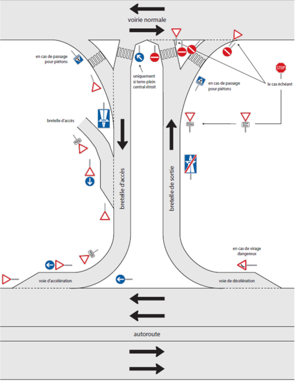

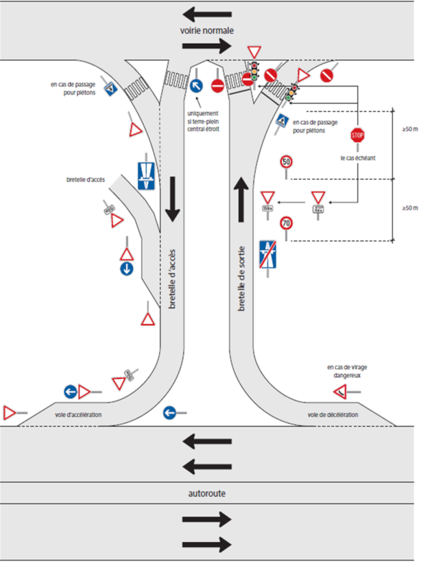

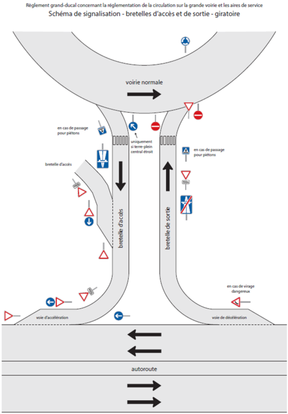

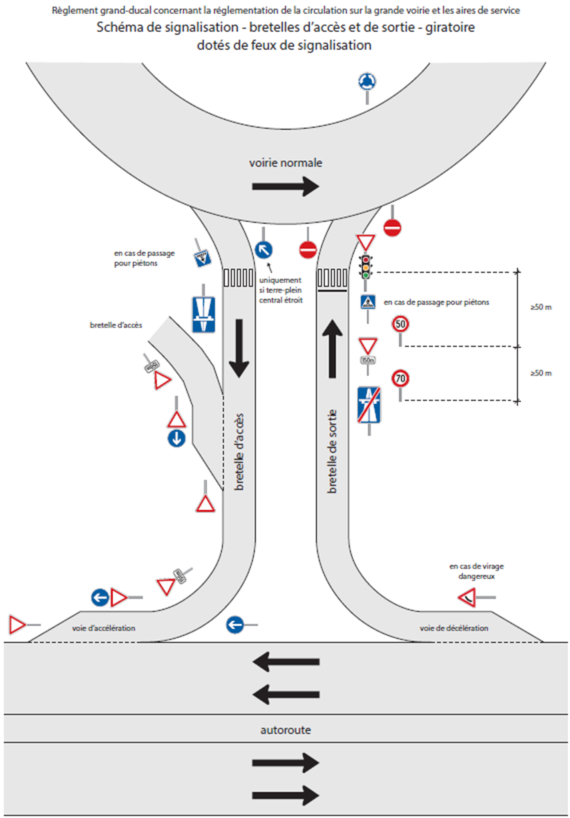

\**Annexe 2. Plans de situation des aires de service**

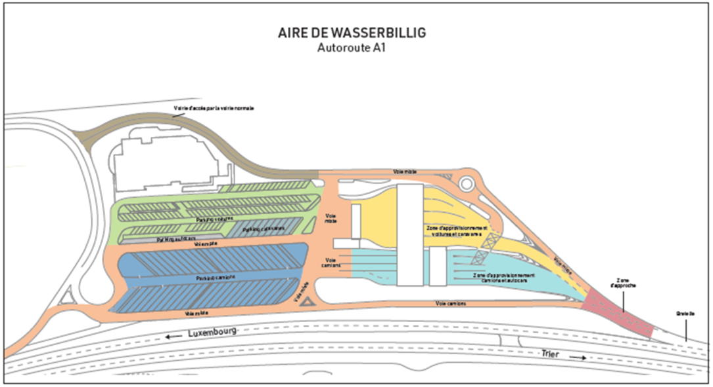

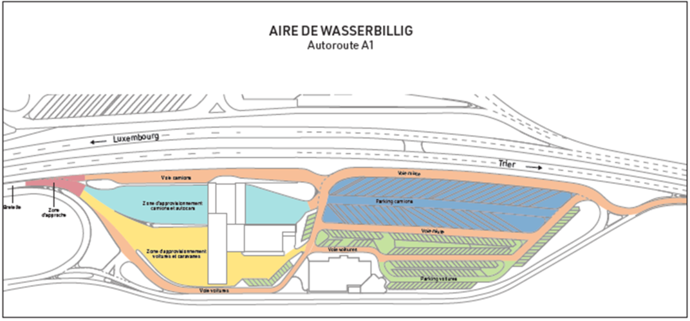

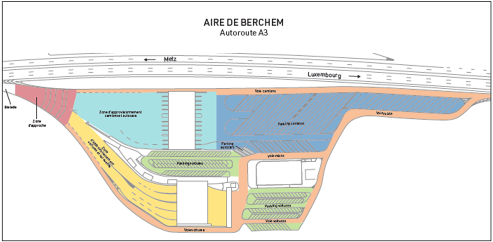

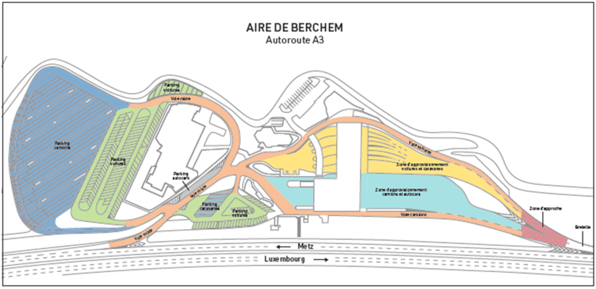

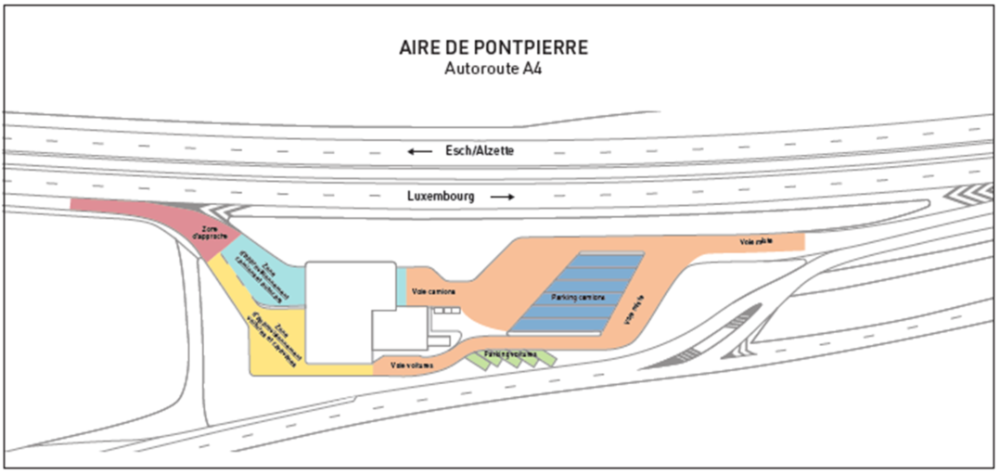

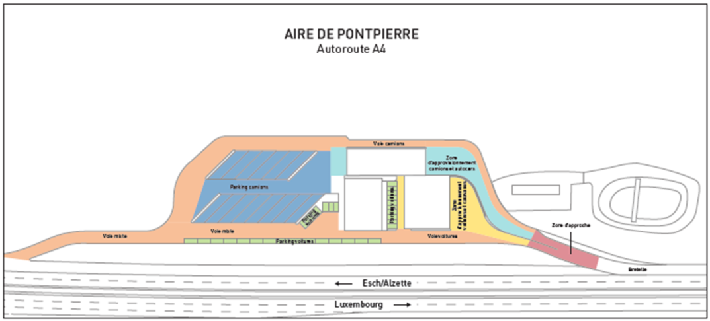

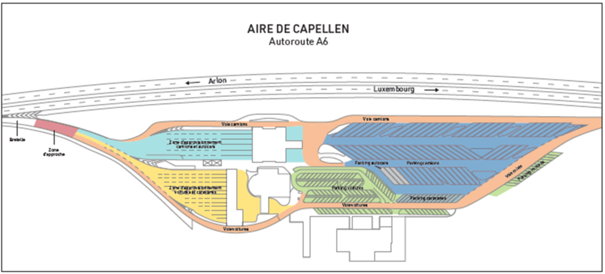

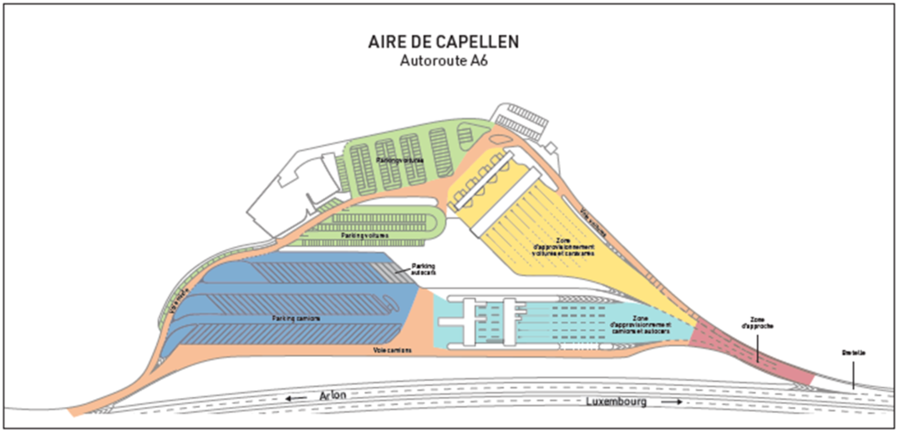

\**Annexe 3. Vitesses maximales dérogatoires**

La vitesse maximale autorisée est limitée à :

\- 50 km/h aux endroits suivants :

| **voie publique** | **localisation du tronçon** | **délimitation du tronçon** |
|---|---|---|
| A1 – Bretelle TRS-G | Giratoire Serra en provenance de Luxembourg et en direction du giratoire Schaffner | PK 0,020 – PK 0,800 |
| A1 – Bretelle T8-T | Giratoire Serra en provenance de Luxembourg et en direction de l’échangeur Sennigerberg | PK 0,810 – PK 1,155 |
| A1 – Bretelle T8-N | Giratoire Serra en provenance de Luxembourg et en direction de l’A7 | PK 0,420 – PK 0,840 |
| A1 – Bretelle N-T15 | Échangeur Wasserbillig – Bretelle de sortie en provenance de Luxembourg | PK 0,080 – PK 0,730 |
| B7 – Bretelle F7-F | Échangeur Schieren – Bretelle d’accès en direction du Friedhof | PK 0,035 – PK 0,305 |
| B7 – Bretelle N-F8 | Échangeur Ettelbruck – Bretelle de sortie en provenance de Luxembourg | PK 0,000 – PK 0,485 |
| B7 – Bretelle F-F8 | Échangeur Ettelbruck – Bretelle de sortie en provenance du Friedhof | PK 0,140 – PK 0,345 |

\- 70 km/h aux endroits suivants :

| **voie publique** | **localisation du tronçon** | **délimitation du tronçon** |
|---|---|---|
| A3 | En provenance du croix de Gasperich et en direction du giratoire Gluck | PK 0,650 – PK 0,100 |
| A4 | En provenance du croix de Cessange en direction du giratoire de Merl | PK 0,515 – PK 0,000 |
| A4 | En provenance de la jonction Lankelz en direction du giratoire de Raemerich | PK 15,750 – PK 16,160 |
| A7 – Bretelle F-N-T8 | Jonction Grunewald – Bretelle en provenance de l’échangeur Waldhof et en direction du giratoire Serra | PK 0,185 – PK 1,340 |
| A7 – Bretelle F-N-G | Jonction Grunewald – Bretelle en provenance de l’échangeur Waldhof et en direction du giratoire Schaffner | PK 0,205 – PK 0,480 |
| A7 – Bretelle F-N-T | Jonction Grunewald – Bretelle en provenance de l’échangeur Waldhof et en direction de l’échangeur Sennigerberg | PK 0,220 – PK 0,800 |
| A7 - Bretelle F2-N | Échangeur Lorentzweiler - Bretelle d’accès en direction de la jonction Grünewald | A7F2-N PR 0,00+060 - A7F2-N PR 0,00+620[^1] |
| A13 | Jonction Lankelz en provenance de l’échangeur Ehlerange | PK 8,655 – PK 8,760 |
| A13 | Jonction Lankelz en direction de l’échangeur Ehlerange | PK 8,735 – PK 8,550 |
| A13 – Bretelle P-L-R | Jonction Lankelz en provenance de l’échangeur Ehlerange | PK 0,200 – PK 0,470 |
| B4 | En provenance du croix de cessange en direction du giratoire de Merl | PK 0,955 – PK 0,435 |
| B4 | En provenance de Hollerich en direction du croix de Cessange | PK 0,780 – PK 0,950 |
| B4A | En provenance de Hollerich en direction du giratoire Merl | PK 0,435 – PK 0,820 |
| B7 – Bretelle F-F8 | Échangeur Ettelbruck – Bretelle de sortie en provenance du Friedhof | PK 0,000 – PK 0,140 |
| B7 | En provenance de l’échangeur Schieren et en direction du giratoire Fridhof | PK 25,670 – PK 26,720 |
| B7 | En provenance de l’échangeur Ettelbruck et en direction du giratoire Fridhof | PK 28,575 – PK 29,500 |
| B7 | En provenance de l’échangeur Ingeldorf en direction de l’échangeur Ettelbruck | PK 29,370 – PK 28,620 |
| B7 | En provenance de l’échangeur Ingeldorf en direction de l’échangeur Schieren | PK 26,700 – PK 25,620 |
| B7 – Bretelle F-F7 | Échangeur Schieren – Bretelle de sortie en provenance du giratoire Fridhof | PK 0,048 – PK 0,515 |

\- **90 km/h aux endroits suivants :**

| **voie publique** | **localisation du tronçon** | **délimitation du tronçon** |
|---|---|---|
| A1 | Wasserbillig (frontière) en direction de Luxembourg | PK 35,665 – PK 35,590 |
| A1 | Wasserbillig (frontière) en direction de Trèves (Allemagne) | PK 35,000 – PK 35,665 |
| A3 | Croix de Gasperich en direction du giratoire Gluck | PK 1,470 – PK 0,650 |
| A4 | En provenance du croix de Cessange en direction de Luxembourg | PK 0,730 – PK 0,515 |
| A4 | Jonction Lankelz en direction du giratoire de Raemerich | PK 14,740 – PK 15,750 |
| A4 | Giratoire de Raemerich en direction de la jonction Lankelz | PK 16,200 – PK 15,500 |
| A6 | Weyler (frontière) en direction de Arlon (Belgique) | PK 20,310 – PK 20,600 |
| A7 | Échangeur Schieren en direction de l’échangeur Ettelbruck | PK 24,735 – PK 24,800 |
| A7 | En provenance de l’échangeur Waldhof, en direction de la jonction Grünewald | PK 0,355 – PK 0,175 |
| A7 – Bretelle F-N-T | Échangeur Grunewald – Bretelle en provenance de l’échangeur Waldhof et en direction du giratoire Serra | PK 0,000 – PK 0,220 |
| A7 – Bretelle F-N-T8 | Échangeur Grunewald – Bretelle en provenance de l’échangeur Waldhof et en direction du giratoire Serra | PK 0,000 – PK 0,185 |
| A7 – Bretelle F-N-G | Échangeur Grunewald – Bretelle en provenance de l’échangeur Waldhof et en direction du giratoire Schaffner | PK 0,000 – PK 0,205 |
| A13 | Giratoire Biff en direction de la jonction Lankelz | PK 0,000 – PK 0,240 |
| A13 | En provenance de l’échangeur Sanem et en direction du giratoire Biff | PK 0,420 – PK 0,000 |
| A13 | En provenance de l’échangeur Differdange et en direction de la jonction de Lankelz | PK 7,450 – PK 8,655 |
| A13 | Jonction de Lankelz en direction de l’échangeur Differdange | PK 8,550 – PK 7,880 |
| A13 | En provenance de l’échangeur Mondorf en direction de Perl (Allemagne) | PK 40,560 – PK 41,155 |
| A13 | En provenance de Perl (Allemagne) en direction de Luxembourg | PK 41,155 – PK 40,560 |

\- **110 km/h aux endroits suivants :**

| **voie publique** | **localisation du tronçon** | **délimitation du tronçon** |
|---|---|---|
| A4 | Échangeur Lallange en direction de la jonction Lankelz | PK 12,310 – PK 14,740 |
| A4 | Jonction Lankelz en direction de l’échangeur Lallange | PK 15,500 – PK 11,980 |
| A13 | Giratoire Biff en provenance de Pétange et en direction de la jonction Lankelz | PK 0,240 – PK 7,200 |
| A13 | En provenance de la jonction Lankelz et en direction du giratoire Biff | PK 7,880 – PK 0,420 |
| A13 | En provenance de l’échangeur Schifflange en direction de la jonction | PK 11,068 – PK 11,860 |

\**Annexe 4. Interdictions de dépassement**

Le dépassement est interdit aux endroits suivants :

| **voie publique** | **localisation du tronçon** | **délimitation du tronçon** |
|---|---|---|
| A3 – Bretelle E-B-G | Croix de Bettembourg – En provenance de Kayl et en direction de Luxembourg | PK 0,775 – PK 1,000 |
| A3 – Bretelle V-G-C | Croix de Gasperich – En provenance du giratoire Gluck en direction du croix de Cessange | PK 0,305 – PK 0,445 |
| A7 | Échangeur Ettelbruck en direction du giratoire Fridhof | PK 24,740 – PK 24,810 |
| B7 | Échangeur Ettelbruck en direction du giratoire Fridhof | PK 25,525 – PK 29,830 |
| B7 | Échangeur Ingeldorf en direction du giratoire Fridhof | PK 30,930 – PK 31,450 |
| B7 | Giratoire Fridhof en direction de la jonction Grunewald | PK 31,130 – PK 28,625 |
| B7 | En provenance du giratoire Fridhof et en direction de la jonction Grunewald | PK 27,700 – PK 26,410 |

---

[^1]: [Règlement grand-ducal du 11 octobre 2022 modifiant le règlement grand-ducal du 23 mai 2022 concernant la réglementation de la circulation sur la grande voirie et les aires de service.](https://legilux.public.lu/eli/etat/leg/rgd/2022/10/11/a524/jo)
