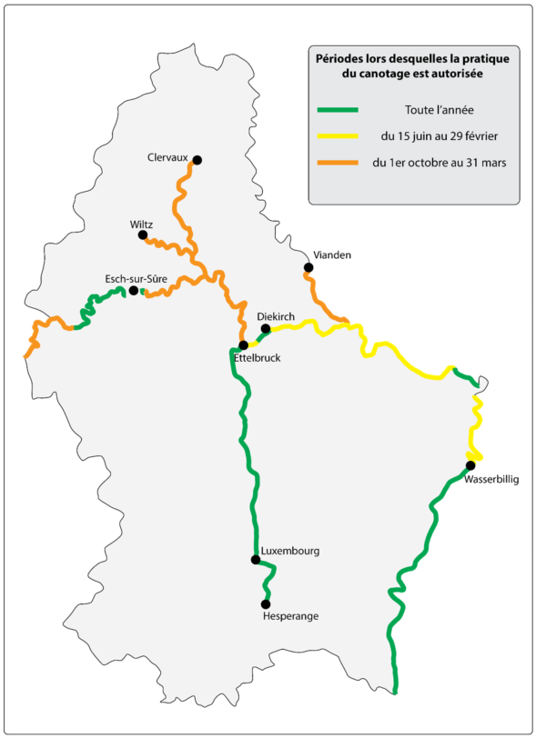

# Règlement grand-ducal du 1er juin 2022 relatif à la pratique du canotage sur les cours d’eau.

Nous, Henri, Grand-Duc de Luxembourg, Duc de Nassau,

Vu la [loi modifiée du 18 juillet 2018](https://legilux.public.lu/eli/etat/leg/loi/2018/07/18/a771/jo) concernant la protection de la nature et des ressources naturelles, et notamment son article 15 ;

Vu l’avis de la Chambre de commerce ;

Les avis de la Chambre d’agriculture, de la Chambre des métiers, de la Chambre des salariés et de la Chambre des fonctionnaires et employés publics ayant été demandés ;

Notre Conseil d’État entendu ;

Sur le rapport de Notre Ministre de l’Environnement, du Climat et du Développement durable et après délibération du Gouvernement en conseil ;

Arrêtons :

## Art. 1er.

Le présent règlement concerne l’exercice, sur les cours d’eau, d’activités sportives et de loisirs organisées au moyen d’embarcations de toute nature avec ou sans moteur.

## Art. 2.

(1) La pratique des activités visées à l’article 1er est uniquement autorisée pendant les périodes et sur les cours d’eau ou parties de cours d’eau suivants :

1° Moselle, pendant toute l’année ;

2° Sûre

a) à partir de Martelange (point kilométrique 134,71 km) jusqu’à Neimillen (point kilométrique 115,7 km), du 1er octobre au 31 mars ;

b) à partir de Neimillen (point kilométrique 115,7 km) jusqu’à Lultzhausen (point kilométrique 100,93 km), pendant toute l’année ;

c) sur le plan d’eau du barrage de compensation IV en aval du barrage principal d’Esch-sur-Sûre (du point kilométrique 94,5 km au point kilométrique 93,1 km) pendant toute l’année ;

d) à partir du barrage de compensation IV en aval du barrage principal d’Esch-sur-Sûre (point kilométrique 93,0 km) jusqu’à l’embouchure de l’Alzette à Ettelbruck (point kilométrique 60,05 km), du 1er octobre au 31 mars ;

e) à partir de l’embouchure de l’Alzette à Ettelbruck (point kilométrique 60,05 km) jusqu’à la confluence de la Prüm et de la Sûre à Steinheim (point kilométrique 22,53 km), en excluant le tronçon indiqué à la lettre f, du 15 juin au 29 février ;

f) sur le parcours d’entraînement de canoës-kayaks situés entre Ingeldorf (point kilométrique 58,4 km) et Diekirch (point kilométrique 56,4 km) pendant toute l’année ;

g) sur le plan d’eau du barrage de Rosport-Ralingen (du point kilométrique 22,53 km au point kilométrique 18,5 km) pendant toute l’année ;

h) à partir de l’embouchure du canal de dérivation de la station hydroélectrique du barrage de Rosport-Ralingen dans la Sûre (point kilométrique 13,40 km) jusqu’à la confluence de la Sûre et de la Moselle à Wasserbillig (point kilométrique 0,0 km) du 15 juin au 29 février.

3° Our, à partir du pont de Vianden (point kilométrique 12,30 km) jusqu’à la confluence de l’Our et de la Sûre à Wallendorf-Pont (point kilométrique 0,0 km), du 1er octobre au 31 mars ;

4° Alzette, à partir de Hespérange (point kilométrique 47,1 km) jusqu’à la confluence de l’Alzette et de la Sûre à Ettelbruck (point kilométrique 0,0 km), pendant toute l’année ;

5° Clerf, à partir de Clervaux (point kilométrique 25,5 km) jusqu’à la confluence de la Clerf et de la Wiltz à Kautenbach (point kilométrique 0,0 km), du 1er octobre au 31 mars ;

6° Wiltz, à partir de Wiltz (point kilométrique 15,4 km) jusqu’à la confluence de la Wiltz et de la Sûre à Goebelsmühle (point kilométrique 0,0 km), du 1er octobre au 31 mars.

(2) Sur tous les autres cours d’eau ou parties de cours d’eau et pendant les périodes non visées au paragraphe 1er, la pratique des activités prévues à l’article 1er est interdite.

(3) Par dérogation au paragraphe 1er, sur les parties des cours d’eau attenant des terrains de camping dûment autorisés, l’utilisation d’embarcations gonflables est autorisée.

(4) Les embarcations sont tenues d’emprunter le cours d’eau à l’endroit où le niveau d’eau est le plus profond ou la vitesse d’écoulement est la plus élevée. Tout contact avec le lit du cours d’eau est à omettre.

(5) Les cours d’eau ou parties de cours d’eau visés au point 1, ainsi que la période pendant laquelle les activités visées à l’article 1er sont autorisées, sont représentés sur le plan à l’annexe I.

## Art. 3.

Sauf sur les parties des cours d’eau formant frontière avec la République Fédérale d’Allemagne, le ministre ayant l’Environnement dans ses attributions peut interdire, pour une durée déterminée et pour des parties déterminées des cours d’eau autorisés, les activités visées à l’article 1er lorsque le niveau des eaux est tel que ces activités risquent de détruire ou de perturber la faune ou la flore.

## Art. 4.

Le ministre ayant l’Environnement dans ses attributions peut pour certains cours d’eau ou certaines parties de cours d’eau accorder des dérogations aux interdictions fixées à l’article 2 :

1° à des fins d’entraînement sportif ou lorsque l’organisation d’une manifestation sportive requiert une telle mesure ;

2° dans un but scientifique ou pédagogique, ainsi que dans l’intérêt de la santé et de la sécurité publiques ou d’autres raisons impératives d’intérêt public.

## Art. 5.

(1) Par dérogation à l’article 1er, l’utilisation d’embarcations de toute nature avec moteur est interdite sur les parties des cours d’eau formant frontière avec la République Fédérale d’Allemagne.

(2) Par dérogation à l’article 2, la pratique des activités visées à l’article 1er est autorisée sur les parties de la Sûre formant frontière avec la République Fédérale d’Allemagne :

1° pendant le jour férié de l’Ascension, si cette date se situe après le 18 mai ;

2° pendant le weekend de la Pentecôte y compris le lundi de Pentecôte ;

3° à partir du jour de la Fête-Dieu « Fronleichnam », si cette date se situe avant le 15 juin.

(3) Sur les parties de la Sûre formant frontière avec la République Fédérale d’Allemagne, les activités visées à l’article 1er sont interdites lorsque le niveau d’eau mesuré à la station hydrométrique de Bollendorf est inférieur à 56 cm.

(4) Sur les parties de la Sûre formant frontière avec la République Fédérale d’Allemagne, et sauf en cas d’urgence, la mise à l’eau et la sortie d’eau des embarcations est uniquement autorisée sur les lieux indiqués sur le plan de l’annexe II.

(5) Sur les parties des cours d’eau formant frontière avec la République Fédérale d’Allemagne, le ministre ne peut accorder des dérogations qu’après concertation avec les autorités compétentes de la « Struktur- und Genehmigungsdirektion Nord » du Bundesland de Rhénanie-Palatinat.

## Art. 6.

Le [règlement grand-ducal du 14 juin 1994](https://legilux.public.lu/eli/etat/leg/rgd/1994/06/14/n2/jo) relatif à la pratique du canotage sur les cours d’eau est abrogé.

## Art. 7.

Notre ministre ayant l’Environnement dans ses attributions est chargé de l’exécution du présent règlement qui sera publié au Journal officiel du Grand-Duché de Luxembourg.

La Ministre de l’Environnement, du Climat et du Développement durable,   Joëlle Welfring

Palais de Luxembourg, le 1er juin 2022.   Henri

\**Annexe I : Périodes lors desquelles la pratique du canotage est autorisée**

\**Annexe II : Lieux autorisés pour la mise à l’eau et la sortie d’eau des embarcations sur les parties de la Sûre formant frontière avec la République Fédérale d’Allemagne**

*[image omitted (0.6 MB) — see the official version: https://legilux.public.lu/eli/etat/leg/rgd/2022/06/01/a278/jo]*

<table>
<tr>
<td><b>Nr.</b></td>
<td><b>Commune</b></td>
<td><b>Description</b></td>
<td colspan="2"><b>Position</b> <b>Coordonnées en UTM 32 N</b></td>
<td><b>Accès</b></td>
</tr>
<tr>
<td>1</td>
<td>Wallendorf</td>
<td>Camping Sauer-Our-Eifelidyll</td>
<td>305111</td>
<td>5528299</td>
<td>public</td>
</tr>
<tr>
<td>2</td>
<td>Wallendorf</td>
<td>Station de pompage « Südeifelwerke AöR »</td>
<td>305587</td>
<td>5527492</td>
<td>public</td>
</tr>
<tr>
<td>3</td>
<td>Wallendorf-Pont</td>
<td>Camping</td>
<td>305342</td>
<td>5528224</td>
<td>privé</td>
</tr>
<tr>
<td>4</td>
<td>Dillingen</td>
<td>Camping</td>
<td>307431</td>
<td>5525744</td>
<td>public</td>
</tr>
<tr>
<td>5</td>
<td>Dillingerbrück</td>
<td>Sous le pont de la Sûre (L1/CR 364 Dillingerbrück)</td>
<td>307440</td>
<td>5525820</td>
<td>public</td>
</tr>
<tr>
<td>6</td>
<td>Bollendorf</td>
<td>Camping Altschmiede</td>
<td>308578</td>
<td>5524355</td>
<td>privé</td>
</tr>
<tr>
<td>7</td>
<td>Bollendorf</td>
<td>Rampe de bateau</td>
<td>310433</td>
<td>5525405</td>
<td>public</td>
</tr>
<tr>
<td>8</td>
<td>Bollendorf-Pont</td>
<td>Banque de graviers</td>
<td>310574</td>
<td>5525324</td>
<td>public</td>
</tr>
<tr>
<td>9</td>
<td>Echternach</td>
<td>Station de bus</td>
<td>314838</td>
<td>5520979</td>
<td>public</td>
</tr>
<tr>
<td>10</td>
<td>Echternach</td>
<td>Promenade sous le pont de la Sûre (L1/N11)</td>
<td>314113</td>
<td>5521434</td>
<td>public</td>
</tr>
<tr>
<td>11</td>
<td>Echternacherbrück</td>
<td>Camping sous le pont de la Sûre (L1/N11)</td>
<td>314920</td>
<td>5520909</td>
<td>public</td>
</tr>
<tr>
<td>12</td>
<td>Echternacherbrück</td>
<td>Sous le pont de la Sûre (B257/E29)</td>
<td>315450</td>
<td>5520959</td>
<td>public</td>
</tr>
<tr>
<td>13</td>
<td>Minden</td>
<td>Pont cyclable (Edinger Straße)</td>
<td>318322</td>
<td>5521880</td>
<td>public</td>
</tr>
<tr>
<td>14</td>
<td>Ralingen-Wintersdorf</td>
<td>Camping Sauertal - rue „Im Sauertal“</td>
<td>320735</td>
<td>5517862</td>
<td>privé</td>
</tr>
<tr>
<td>15</td>
<td>Born</td>
<td>Sauergaas</td>
<td>320985</td>
<td>5514762</td>
<td>public</td>
</tr>
<tr>
<td>16</td>
<td>Langsur-Metzdorf</td>
<td>Ancienne Gare Camping</td>
<td>320132</td>
<td>5514296</td>
<td>privé</td>
</tr>
<tr>
<td>17</td>
<td>Moersdorf</td>
<td>Piste cyclable</td>
<td>320047</td>
<td>5513317</td>
<td>public</td>
</tr>
<tr>
<td>18</td>
<td>Langsur</td>
<td>Sous le pont de la Sûre (Sauertalstraße)</td>
<td>319543</td>
<td>5511129</td>
<td>public</td>
</tr>
<tr>
<td>19</td>
<td>Wasserbillig</td>
<td>Promenade sous le pont de la Sûre</td>
<td>320238</td>
<td>5509879</td>
<td>public</td>
</tr>
</table>
