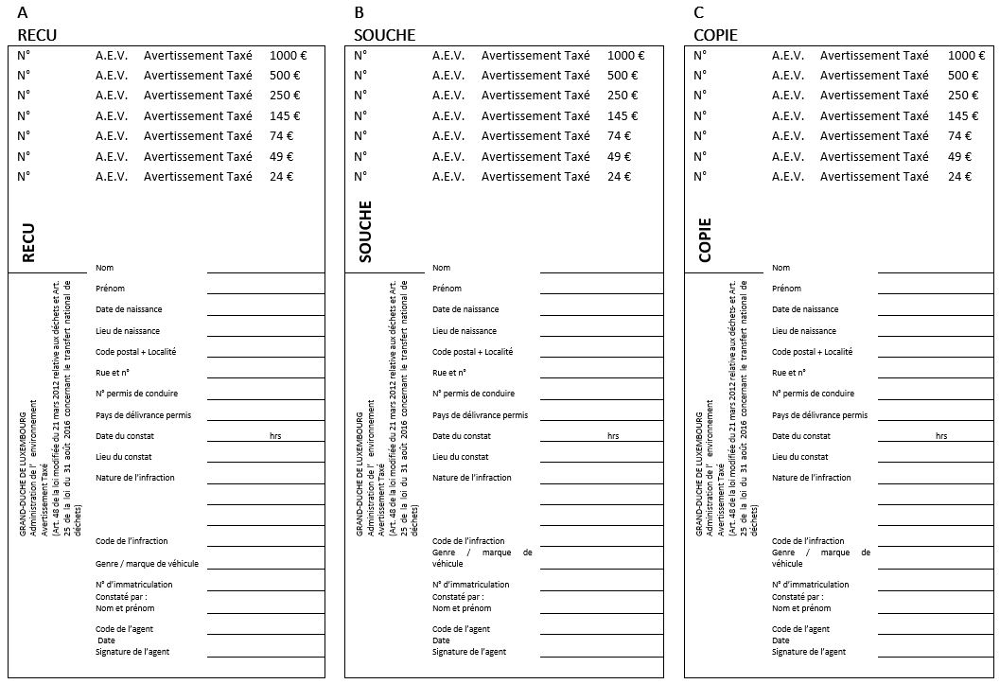
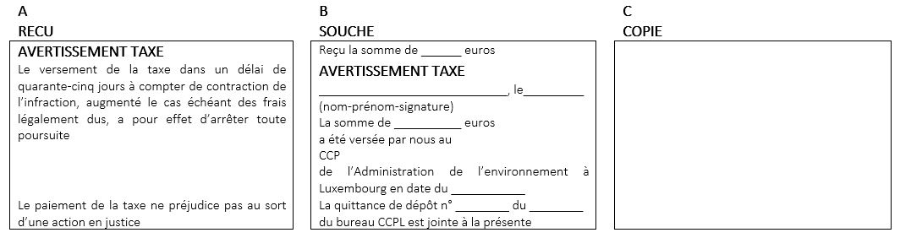
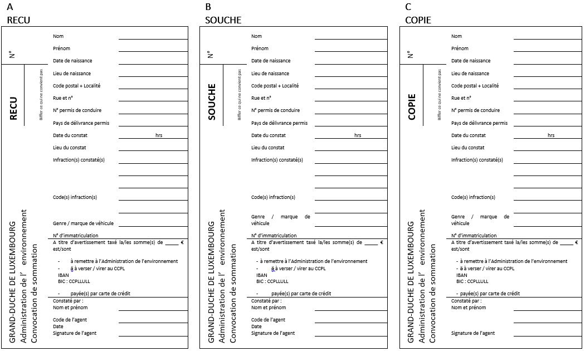
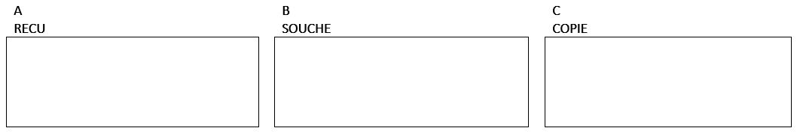

# Règlement grand-ducal du 9 juin 2022 relatif aux avertissements taxés déterminant les modalités d’application de l’avertissement taxé et établissant un catalogue des contraventions soumises à l’avertissement taxé prévu par la loi modifiée du 21 mars 2012 relative aux déchets.

Nous Henri, Grand-Duc de Luxembourg, Duc de Nassau,

Vu le [règlement (CE) n° 1013/2006](https://legilux.public.lu/eli/reg_ue/2006/1013/jo) du Parlement européen et du Conseil du 14 juin 2006 concernant les transferts de déchets ;

Vu la [loi modifiée du 21 mars 2012](https://legilux.public.lu/eli/etat/leg/loi/2012/03/21/n1/jo) relative aux déchets ;

Vu les avis de la Chambre des métiers, de la Chambre de commerce et de la Chambre des salariés ;

Les avis de la Chambre des fonctionnaires et employés publics et de la Chambre d’agriculture ayant été demandés ;

Notre Conseil d’État entendu ;

Sur le rapport de Notre Ministre de l’Environnement, du Climat et du Développement durable, de Notre Ministre de la Sécurité intérieure, de Notre Ministre de la Justice et de Notre Ministre des Finances, et après délibération du Gouvernement en conseil ;

Arrêtons :

## Art. 1er.

Les montants de la taxe à percevoir pour l’avertissement taxé prévu à l’article 48 de la [loi modifiée du 21 mars 2012](https://legilux.public.lu/eli/etat/leg/loi/2012/03/21/n1/jo) relative aux déchets sont fixés respectivement à 24, 49, 74, 145, 250, 500 et 1000 euros, selon la gravité de l’infraction.

Le catalogue regroupant les contraventions suivant les différents montants de la taxe à percevoir est repris à l’annexe A.

## Art. 2.

(1) La perception sur place du montant de la taxe se fait soit en espèces, soit par règlement au moyen des seules cartes de crédit et modes de paiement électronique acceptés à cet effet par les membres de la Police grand-ducale et par les agents de l’Administration des douanes et accises et de l’Administration de l’environnement désignés par l’article 45, paragraphe 1er de la [loi modifiée du 21 mars 2012](https://legilux.public.lu/eli/etat/leg/loi/2012/03/21/n1/jo) relative aux déchets.

(2) Lorsque le montant de l’avertissement taxé ne peut pas être perçu sur le lieu même de l’infraction, la convocation est donnée d’après une formule spéciale.

À cet effet, il est utilisée la formule spéciale de convocation visée à l’article 2, point 2, du [règlement grand-ducal modifié du 26 août 1993](https://legilux.public.lu/eli/etat/leg/rgd/1993/08/26/n1/jo) relatif aux avertissements taxés, aux consignations pour contrevenants non-résidents ainsi qu’aux mesures d’exécution de la législation en matière de mise en fourrière des véhicules et en matière de permis à points pour les convocations données par les membres de la Police grand-ducale. Il en est de même pour les convocations données par les agents de l’Administration des douanes et accises. La formule spéciale de convocation figurant à l’annexe B – 2 est utilisée pour les convocations données par les agents de l’Administration de l’environnement et est composée d’un reçu, d’une copie et d’une souche.

L’agent verbalisant supprime les mentions qui ne conviennent pas.

Ces formules, dûment numérotées, sont reliées en carnets de quinze exemplaires.

L’Administration de l’enregistrement, des domaines et de la TVA met à la disposition du directeur de l’Administration de l’environnement les carnets en question.

Le contrevenant s’en acquitte dans le délai imparti au bureau de la Police grand-ducale, de l’Administration des douanes et accises ou de l’Administration de l’environnement lui désigné par l’agent verbalisant, soit par versement ou virement de la taxe sur un des comptes chèques postaux spécialement ouverts à cet effet au nom de la Police grand-ducale, de l’Administration des douanes et accises ou de l’Administration de l’environnement.

## Art. 3.

Sans préjudice de l’article 4 applicable en cas de règlement par versement postal ou virement, l’avertissement taxé est donné d’après les formules composées d’un reçu, d’une copie et d’une souche.

À cet effet est utilisée la formule spéciale visée à l’article 3, alinéa 1er, du [règlement grand-ducal modifié du 26 août 1993](https://legilux.public.lu/eli/etat/leg/rgd/1993/08/26/n1/jo) relatif aux avertissements taxés, aux consignations pour contrevenants non-résidents ainsi qu’aux mesures d’exécution de la législation en matière de mise en fourrière des véhicules et en matière de permis à points, pour les avertissements taxés donnés par les membres de la Police grand-ducale. Il en est de même pour les avertissements taxés donnés par les agents de l’Administration des douanes et accises. La formule spéciale de l’avertissement taxé figurant à l’annexe B – 1 est utilisée pour les avertissements taxés donnés par les agents de l’Administration de l’environnement et est composée d’un reçu, d’une copie et d’une souche.

L’agent verbalisant supprime les mentions qui ne conviennent pas.

Ces formules, dûment numérotées, sont reliées en carnets de quinze exemplaires que l’Administration de l’enregistrement, des domaines et de la TVA met à la disposition du directeur général de la Police grand-ducale, du directeur de l’Administration des douanes et accises et du directeur de l’Administration de l’environnement.

Toutes les taxes perçues par les membres de la Police grand-ducale, les agents de l’Administration des douanes et accises et les agents de l’Administration de l’environnement sont transmises sans retard à un compte chèque postal déterminé de l’Administration de l’enregistrement, des domaines et de la TVA.

Les frais de versement, de virement ou d’encaissements éventuels sont à charge du contrevenant lorsque la taxe est réglée par versement postal ou virement. Elles sont à charge de l’administration si le règlement se fait par carte de crédit ou au moyen d’un mode de paiement électronique.

## Art. 4.

(1) En cas de perception sur place de l’avertissement taxé, le reçu est remis au contrevenant contre le paiement de la somme due en vertu du catalogue des avertissements taxés repris à l’annexe A.

Lorsque la taxe est réglée par versement ou par virement à un des comptes chèques postaux prévus à l’article 2, le récépissé en cas de versement et la copie en cas de virement servent de reçu au contrevenant.

(2) La copie est remise respectivement au directeur général de la Police grand-ducale, au directeur de l’Administration des douanes et accises et au directeur de l’Administration de l’environnement.

(3) L’information au procureur d’État des avertissements taxés donnés se fait moyennant l’établissement par le directeur général de la Police grand-ducale, le directeur de l’Administration des douanes et accises et le directeur de l’Administration de l’environnement de relevés mensuels.

(4) La souche reste dans le carnet de formules.

Du moment que le carnet est épuisé, il est renvoyé avec toutes les souches et les preuves de paiement y relatives, par les membres de la Police grand-ducale au directeur général de la Police grand-ducale, par les agents de l’Administration des douanes et accises au directeur de l’Administration des douanes et accises et par les agents de l’Administration de l’environnement au directeur de l’Administration de l’environnement.

Si une ou plusieurs formules n’ont pas abouti à l’établissement d’un avertissement taxé, elles doivent être renvoyées en entier et porter une mention afférente.

En cas de virement ou de versement de la taxe à un des comptes chèques postaux prévus à l’article 2, le titre de virement et de versement fait fonction de souche.

(5) Lorsque le montant de l’avertissement taxé ne peut pas être perçu sur le lieu même de l’infraction, le reçu de la convocation est remis au contrevenant.

En cas d’établissement d’un procès-verbal, la copie est annexée audit procès-verbal et transmise au procureur d’État.

(6) La souche reste dans le carnet de formules.

Du moment que le carnet est épuisé, il est renvoyé avec toutes les souches par les membres de la Police grand-ducale au directeur général de la Police grand-ducale, par les agents de l’Administration des douanes et accises au directeur de cette administration et par les agents de l’Administration de l’environnement au directeur de cette administration.

Si une ou plusieurs formules n’ont pas abouti à l’établissement d’un avertissement taxé, elles doivent être renvoyées en entier et porter une mention afférente.

## Art. 5.

Chaque unité de la Police grand-ducale et de l’Administration des douanes et accises, ainsi que l’Administration de l’environnement, tient un registre spécial indiquant les formules mises à sa disposition, les avertissements taxés donnés et les formules annulées.

Le directeur général de la Police grand-ducale, le directeur de l’Administration des douanes et accises et le directeur de l’Administration de l’environnement établissent au début de chaque mois, en triple exemplaire, un bordereau récapitulatif portant sur les perceptions du mois précédent. Ce bordereau récapitulatif indique les noms et prénoms du contrevenant, son adresse exacte, la date et l’heure de l’infraction, le montant de la taxe perçue et la date du paiement, le numéro d’immatriculation du véhicule ayant, le cas échéant, servi à commettre l’infraction. Un exemplaire de ce bordereau est transmis à l’Administration de l’enregistrement, des domaines et de la TVA, et un autre exemplaire sert de relevé d’information au procureur d’État.

Le directeur général de la Police grand-ducale, le directeur de l’Administration des douanes et accises et le directeur de l’Administration de l’environnement établissent au 31 décembre de chaque année un inventaire des opérations de l’année écoulée. Un exemplaire de cet inventaire est adressé à l’Administration de l’enregistrement, des domaines et de la TVA avec les formules annulées. Un autre exemplaire est transmis au procureur d’État.

## Art. 6.

Le [règlement grand-ducal modifiée du 18 décembre 2015](https://legilux.public.lu/eli/etat/leg/rgd/2015/12/18/n9/jo) relatif aux avertissements taxés déterminant les modalités d’application de l’avertissement taxé et établissant un catalogue des contraventions soumises à l’avertissement taxé prévu par la [loi modifiée du 21 mars 2012](https://legilux.public.lu/eli/etat/leg/loi/2012/03/21/n1/jo) relative aux déchets est abrogé.

## Art. 7.

Notre ministre ayant l’Environnement dans ses attributions, Notre ministre ayant la Sécurité intérieure dans ses attributions, Notre ministre ayant la Justice dans ses attributions et Notre ministre ayant les Finances dans ses attributions sont chargés, chacun en ce qui le concerne, de l’exécution du présent règlement qui sera publié au Journal officiel du Grand-Duché de Luxembourg.

La Ministre de l’Environnement, du Climat et du Développement durable,   Joëlle Welfring   Le Ministre de la Sécurité intérieure,   Henri Kox   La Ministre de la Justice,   Sam Tanson   La Ministre des Finances,   Yuriko Backes

Genève, le 9 juin 2022   .   Henri

\**ANNEXE A**

Catalogue des avertissements taxés établis conformément à l’article 48 de la [loi modifiée du 21 mars 2012](https://legilux.public.lu/eli/etat/leg/loi/2012/03/21/n1/jo) relative aux déchets avec référence aux articles :

A. de la [loi modifiée du 21 mars 2012](https://legilux.public.lu/eli/etat/leg/loi/2012/03/21/n1/jo) relative aux déchets ;

B. du [règlement (CE) n° 1013/2006](https://legilux.public.lu/eli/reg_ue/2006/1013/jo) du Parlement européen et du Conseil du 14 juin 2006 concernant les transferts de déchets ;

\**A. Loi modifiée du 21 mars 2012 relative aux déchets**

<table>
<tr>
<td>Références aux articles</td>
<td>Code de l’infraction</td>
<td colspan="2">Nature de l’infraction</td>
<td>Montant de la taxe</td>
</tr>
<tr>
<td>12 (6)</td>
<td>AEV-0001</td>
<td colspan="2">Non-respect de l’interdiction de déposer des imprimés publicitaires à vocation commerciale sur les véhicules</td>
<td>145 €</td>
</tr>
<tr>
<td>12 (6)</td>
<td>AEV-0002</td>
<td colspan="2">Non-respect de l’interdiction de lancer sur la voie publique, des confettis, serpentins et autres projectiles festifs contenant du plastique ou du métal</td>
<td>74 €</td>
</tr>
<tr>
<td>12 (7)</td>
<td>AEV-0003</td>
<td colspan="2">Non-respect de l’interdiction du dépôt et de la distribution d’imprimés publicitaires à vocation commerciale dans des boîtes à lettres sans accord formel du destinataire, à l’exception de la presse d’information gratuite</td>
<td>74 €</td>
</tr>
<tr>
<td>23 (5)</td>
<td>AEV-0004</td>
<td colspan="2">Emballage ou étiquetage non-conforme aux normes internationales et communautaires lors de la collecte, du transport et du stockage temporaire de déchets dangereux</td>
<td>500 €</td>
</tr>
<tr>
<td>25 (1)</td>
<td>AEV-0005</td>
<td colspan="2">Non-respect par des particuliers des dispositions en matière de tri et de recyclage à la source des bio-déchets et déchets de verdure ou de leur collecte séparée en vue de leur compostage, digestion ou autre opération de valorisation</td>
<td>145 €</td>
</tr>
<tr>
<td>30 (9)</td>
<td>AEV-0006</td>
<td colspan="2">Défaut de pouvoir présenter une copie de l’autorisation requise conformément à l’article 30(1) de la <a href="https://legilux.public.lu/eli/etat/leg/loi/2012/03/21/n1/jo">loi modifiée du 21 mars 2012</a> relative aux déchets lors d’un transfert de déchets sur la voie publique</td>
<td>145 €</td>
</tr>
<tr>
<td rowspan="3">30 (10)</td>
<td>AEV-0007</td>
<td colspan="2">Inobservation des dispositions en matière d’équipement des véhicules avec des panneaux d’avertissement blancs avec l’inscription « A » lors du transport de déchets</td>
<td>145 €</td>
</tr>
<tr>
<td>AEV-0008</td>
<td colspan="2">Défaut d’enregistrement valable pour les activités visées par les points 1), 2), 5), 6), 7) de l’article 32 et pour les établissements de la classe 4 en matière d’établissements classés soumis à l’enregistrement en vertu de l’article 32 de la <a href="https://legilux.public.lu/eli/etat/leg/loi/2012/03/21/n1/jo">loi modifiée du 21 mars 2012</a> relative aux déchets</td>
<td>500 €</td>
</tr>
<tr>
<td>AEV-0009</td>
<td colspan="2">Défaut d’enregistrement valable pour les activités visées par les points 3), 4), 8) de l’article 32 de la <a href="https://legilux.public.lu/eli/etat/leg/loi/2012/03/21/n1/jo">loi modifiée du 21 mars 2012</a> relative aux déchets</td>
<td>250 €</td>
</tr>
<tr>
<td>32 (4)</td>
<td>AEV-0010</td>
<td colspan="2">Défaut de pouvoir présenter une copie de l’enregistrement lors d’un transfert de déchets sur la voie publique</td>
<td>145 €</td>
</tr>
<tr>
<td rowspan="18">42</td>
<td></td>
<td colspan="2"><b>Accomplissement d’une activité interdite en relation avec les déchets non dangereux</b></td>
<td></td>
</tr>
<tr>
<td>AEV-0011</td>
<td colspan="2">Incinération de déchets municipaux ménagers à l’air libre</td>
<td>500 €</td>
</tr>
<tr>
<td>AEV-0012</td>
<td colspan="2">Incinération de déchets municipaux non ménagers à l’air libre</td>
<td>500 €</td>
</tr>
<tr>
<td>AEV-0013</td>
<td colspan="2">Incinération de biodéchets ou déchets de verdure à l’air libre</td>
<td>250 €</td>
</tr>
<tr>
<td>AEV-0014</td>
<td colspan="2">Introduction de déchets non autorisés dans des récipients destinés à la collecte sélective de déchets mis à disposition du public</td>
<td>145 €</td>
</tr>
<tr>
<td>AEV-0015</td>
<td colspan="2">Enfouissement non autorisé de déchets non-dangereux dans le sol, des cavernes ou d’autres lieux souterrains</td>
<td>1000 €</td>
</tr>
<tr>
<td>AEV-0016</td>
<td colspan="2">Évacuation de déchets non-dangereux par le réseau de canalisation publique, y inclus les déchets soumis à broyage préalable</td>
<td>500 €</td>
</tr>
<tr>
<td></td>
<td colspan="2"><b>Abandon ou rejet dans des eaux de surface, des eaux souterraines sur des lieux ou voies publiques ou dans la nature</b></td>
<td></td>
</tr>
<tr>
<td></td>
<td colspan="2">déchets non-dangereux d’un volume total</td>
<td></td>
</tr>
<tr>
<td>AEV-0017</td>
<td></td>
<td>< 0.002 m3</td>
<td>145 €</td>
</tr>
<tr>
<td>AEV-0018</td>
<td></td>
<td>≥ 0.002 m3 – 0.05 m3</td>
<td>250 €</td>
</tr>
<tr>
<td>AEV-0019</td>
<td></td>
<td>≥ 0.05 m3 – 0.5 m3</td>
<td>500 €</td>
</tr>
<tr>
<td>AEV-0020</td>
<td></td>
<td>≥ 0.5 m3 – 2.0 m3</td>
<td>1000 €</td>
</tr>
<tr>
<td>AEV-0021</td>
<td colspan="2">mégot (par unité)</td>
<td>145 €</td>
</tr>
<tr>
<td></td>
<td colspan="2">pneumatique(s) d’un volume total</td>
<td></td>
</tr>
<tr>
<td>AEV-0022</td>
<td></td>
<td>< 0.5 m3</td>
<td>250 €</td>
</tr>
<tr>
<td>AEV-0023</td>
<td></td>
<td>≥ 0.5 m3 – 1 m3</td>
<td>500 €</td>
</tr>
<tr>
<td>AEV-0024</td>
<td></td>
<td>≥ 1.0 m3 – 2.0 m3</td>
<td>1000 €</td>
</tr>
</table>

\**B. Règlement (CE) n° 1013/2006 du Parlement européen et du Conseil du 14 juin 2006 concernant les transferts de déchets**

<table>
<tr>
<td><b>Références aux articles</b></td>
<td><b>Code de l’infraction</b></td>
<td><b>Nature de l’infraction</b></td>
<td><b>Montant de la taxe</b></td>
</tr>
<tr>
<td>5</td>
<td>AEV-1001</td>
<td>Absence d’un contrat valable</td>
<td>250 €</td>
</tr>
<tr>
<td>6</td>
<td>AEV-1002</td>
<td>Absence de garantie financière ou d’assurance équivalente</td>
<td>250 €</td>
</tr>
<tr>
<td>9 (7)</td>
<td>AEV-1003</td>
<td>Non-accomplissement des opérations de valorisation ou d’élimination dans les délais fixés par l’article 9 (7)</td>
<td>250 €</td>
</tr>
<tr>
<td>15</td>
<td>AEV-1004</td>
<td>Défaut de certifier la réception des déchets dans le délai fixé par l’article 15 Défaut de certifier l’achèvement de l’opération de valorisation ou d’élimination intermédiaire par l’exploitant de l’installation en question dans le délai fixé par l’article 15</td>
<td>250 €</td>
</tr>
<tr>
<td>16</td>
<td>AEV-1005</td>
<td>Non-respect des exigences en matière de document de mouvement après consentement à un transfert</td>
<td>500 €</td>
</tr>
<tr>
<td rowspan="20">16</td>
<td>AEV-1006</td>
<td>Défaut de pouvoir présenter une copie du document de mouvement lors d’un transfert de déchets sur la voie publique</td>
<td>500 €</td>
</tr>
<tr>
<td></td>
<td>Document de mouvement incomplet ou erroné</td>
<td></td>
</tr>
<tr>
<td>AEV-1007</td>
<td>Case 1 : N° correspondant à la notification</td>
<td>500 €</td>
</tr>
<tr>
<td>AEV-1008</td>
<td>Case 2 : N° de série du transfert/nombre total de transferts</td>
<td>74 €</td>
</tr>
<tr>
<td>AEV-1009</td>
<td>Case 3 : Exportateur - Notifiant</td>
<td>145 €</td>
</tr>
<tr>
<td>AEV-1010</td>
<td>Case 4 : Importateur - Destinataire</td>
<td>145 €</td>
</tr>
<tr>
<td>AEV-1011</td>
<td>Case 5 : Quantité réelle</td>
<td>74 €</td>
</tr>
<tr>
<td>AEV-1012</td>
<td>Case 6 : Date réelle du transfert</td>
<td>74 €</td>
</tr>
<tr>
<td>AEV-1013</td>
<td>Case 7 : Conditionnement</td>
<td>74 €</td>
</tr>
<tr>
<td>AEV-1014</td>
<td>Case 8 a) ou 8 b) ou 8 (c) : Transporteur(s)</td>
<td>74 €</td>
</tr>
<tr>
<td>AEV-1015</td>
<td>Case 9 : Producteur(s) des déchets</td>
<td>250 €</td>
</tr>
<tr>
<td>AEV-1016</td>
<td>Case 10 : Installation d’élimination ou de valorisation</td>
<td>250 €</td>
</tr>
<tr>
<td>AEV-1017</td>
<td>Case 11 : Opération(s) d’élimination – de valorisation</td>
<td>145 €</td>
</tr>
<tr>
<td>AEV-1018</td>
<td>Case 12 : Dénomination et composition des déchets</td>
<td>145 €</td>
</tr>
<tr>
<td>AEV-1019</td>
<td>Case 13 : Caractéristiques physiques</td>
<td>74 €</td>
</tr>
<tr>
<td>AEV-1020</td>
<td>Case 14 i) ou iii) : Identification des déchets</td>
<td>250 €</td>
</tr>
<tr>
<td>AEV-1021</td>
<td>Case 15 : Déclaration de l’exportateur/du notifiant/du producteur</td>
<td>250 €</td>
</tr>
<tr>
<td>AEV-1022</td>
<td>Case 18 : Transfert reçu à l’installation d’élimination ou de valorisation</td>
<td>500 €</td>
</tr>
<tr>
<td>AEV-1023</td>
<td>Case 19 : Signature certifiant l’élimination/la valorisation des déchets</td>
<td>500 €</td>
</tr>
<tr>
<td></td>
<td>Si le montant cumulé des infractions AEV-1007 à AEV-1023 dépasse 500 €, le document est à considérer comme faisant défaut (AEV-1006)</td>
<td></td>
</tr>
<tr>
<td>16 (c)</td>
<td>AEV-1024</td>
<td>Défaut de pouvoir présenter les consentements écrits des autorités compétentes concernées avec les conditions établies par elles</td>
<td>145 €</td>
</tr>
<tr>
<td>18 (1a)</td>
<td>AEV-1025</td>
<td>Document spécifique (Annexe VII du <a href="https://legilux.public.lu/eli/reg_ue/2006/1013/jo">règlement (CE) n° 1013/2006</a>) faisant défaut</td>
<td>500 €</td>
</tr>
<tr>
<td rowspan="16">18 (1a)</td>
<td></td>
<td>Document spécifique incomplet ou erroné (Annexe VII du <a href="https://legilux.public.lu/eli/reg_ue/2006/1013/jo">règlement (CE) n° 1013/2006</a>)</td>
<td></td>
</tr>
<tr>
<td>AEV-1026</td>
<td>Case 1 : Personne qui organise le transfert</td>
<td>145 €</td>
</tr>
<tr>
<td>AEV-1027</td>
<td>Case 2 : Importateur/destinataire</td>
<td>145 €</td>
</tr>
<tr>
<td>AEV-1028</td>
<td>Case 3 : Quantité effective</td>
<td>49 €</td>
</tr>
<tr>
<td>AEV-1029</td>
<td>Case 4 : Date effective du transfert</td>
<td>145 €</td>
</tr>
<tr>
<td>AEV-1030</td>
<td>Case 5 a) ou 5 b) ou 5 c) : Transporteur(s)</td>
<td>145 €</td>
</tr>
<tr>
<td>AEV-1031</td>
<td>Case 6 : Producteur de déchets</td>
<td>145 €</td>
</tr>
<tr>
<td>AEV-1032</td>
<td>Case 7 : Installation de valorisation ou laboratoire</td>
<td>145 €</td>
</tr>
<tr>
<td>AEV-1033</td>
<td>Case 8 : Opération de valorisation (ou d’élimination – déchets visés à l’article 3, paragraphe 4)</td>
<td>74 €</td>
</tr>
<tr>
<td>AEV-1034</td>
<td>Case 9 : Dénomination usuelle des déchets</td>
<td>49 €</td>
</tr>
<tr>
<td>AEV-1035</td>
<td>Case 10 i) ou iii) ou iv) ou v) : Identification des déchets</td>
<td>145 €</td>
</tr>
<tr>
<td>AEV-1036</td>
<td>Case 11 : Pays/État(s) concerné(s)</td>
<td>74 €</td>
</tr>
<tr>
<td>AEV-1037</td>
<td>Case 12 : Déclaration de la personne qui organise le transfert</td>
<td>74 €</td>
</tr>
<tr>
<td>AEV-1038</td>
<td>Case 13 : Signature à la réception des déchets par le destinataire</td>
<td>250 €</td>
</tr>
<tr>
<td>AEV-1039</td>
<td>Case 14 : Transfert reçu par l’installation de valorisation ou par le laboratoire</td>
<td>250 €</td>
</tr>
<tr>
<td></td>
<td>Si le montant cumulé des infractions AEV-1026 à AEV-1039 dépasse 500 €, le document est à considérer comme faisant défaut (AEV-1025)</td>
<td></td>
</tr>
<tr>
<td>18 (2)</td>
<td>AEV-1040</td>
<td>Contrat faisant défaut</td>
<td>250 €</td>
</tr>
</table>

\**ANNEXE B-1**

Recto

Verso

\**ANNEXE B-2**

Recto

Verso

