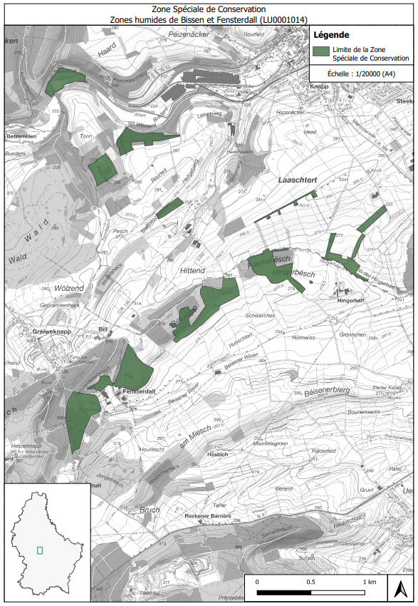

# Règlement grand-ducal du 15 juillet 2022 désignant zone spéciale de conservation et déclarant obligatoires les « Zones humides de Bissen et Fensterdall », et modifiant le règlement grand-ducal du 6 novembre 2009 portant désignation des zones spéciales de conservation.

Nous Henri, Grand-Duc de Luxembourg, Duc de Nassau,

Vu les articles 2, 4, 31 à 35 et 37, de la [loi modifiée du 18 juillet 2018](https://legilux.public.lu/eli/etat/leg/loi/2018/07/18/a771/jo) concernant la protection de la nature et des ressources naturelles ;

Vu la fiche financière ;

Vu l’avis de l’Observatoire de l’environnement naturel ;

Les avis de la Chambre de commerce, de la Chambre des métiers et de la Chambre d’agriculture ayant été demandés ;

Notre Conseil d’État entendu ;

Sur le rapport de Notre Ministre de l’Environnement, du Climat et du Développement durable, et après délibération du Gouvernement en conseil ;

Arrêtons :

## Art. 1er.

Est désignée zone spéciale de conservation et déclarée obligatoire la zone « Zones humides de Bissen et Fensterdall », ci-après la « zone spéciale de conservation », référencée sous le code LU0001014, et faisant partie intégrante du réseau Natura 2000.

## Art. 2.

La zone spéciale de conservation est désignée en vue :

1° du maintien ou, le cas échéant, du rétablissement de l’état de conservation favorable des habitats et espèces d’intérêt communautaire mentionnés à l’article 3 ;

2° de la préservation, du maintien ou, le cas échéant, du rétablissement de la structure et des fonctions spécifiques des habitats d’intérêt communautaire mentionnés à l’article 3, ainsi que de l’état de conservation de leurs espèces typiques ;

3° de la préservation, du maintien ou, le cas échéant, du rétablissement d’une diversité, d’une superficie et d’une qualité des habitats des espèces d’intérêt communautaire mentionnées à l’article 3 ;

4° de la protection contre les perturbations touchant les espèces d’intérêt communautaire mentionnées à l’article 3, pour autant que ces perturbations soient susceptibles d’avoir un effet significatif eu égard aux objectifs du présent article ;

5° de sa contribution à la cohérence du réseau Natura 2000 tant au niveau national qu’au sein de l’Union européenne.

## Art. 3.

Les objectifs spécifiques de conservation de la zone spéciale de conservation, ainsi que les mesures de conservation spéciales à assurer afin de maintenir ou, le cas échéant, rétablir l’état de conservation favorable des habitats et espèces d’intérêt communautaire visés, en l’occurrence à travers les mesures de conservation visées aux articles 32 à 35 et 37 de la [loi modifiée du 18 juillet 2018](https://legilux.public.lu/eli/etat/leg/loi/2018/07/18/a771/jo) concernant la protection de la nature et des ressources naturelles, sont :

1° maintien de l’état de conservation favorable de la population du Triton crêté *Triturus cristatus* :

a) préservation et restauration des plans d’eau, ainsi que des zones humides, boisements feuillus et structures paysagères limitrophes ;

b) amélioration de la connectivité écologique ;

2° maintien, voire rétablissement de l’état de conservation favorable des lacs et plans d’eau eutrophes naturels avec végétation du *Magnopotamion* ou *Hydrocharition* (3150) :

a) préservation et restauration des plans d’eau ;

b) aménagement de bandes de protection herbagères autour des plans d’eau ;

3° maintien, voire rétablissement de l’état de conservation favorable de la population du Castor d’Europe *Castor fiber* :

a) préservation et restauration des zones humides, mégaphorbiaies et ripisylves ;

b) amélioration de l’hydromorphologie des cours d’eau ;

4° rétablissement de l’état de conservation favorable des mégaphorbiaies hygrophiles d’ourlets planitiaires et des étages montagnard à alpin (6430) :

a) restauration surfacique des ourlets le long des cours d’eau et lisières forestières ;

b) fauchage très tardif voire pluriannuel ;

5° maintien, voire rétablissement de l’état de conservation favorable de la population du Cuivré des marais *Lycaena dispar* :

a) restauration et extension surfacique des prairies humides, bandes herbacées et mégaphorbiaies ;

b) exploitation extensive, y favoriser le fauchage très tardif ;

c) préservation des bandes refuges à fauchage pluriannuel ;

6° rétablissement de l’état de conservation favorable des forêts alluviales à *Alnus glutinosa* et *Fraxinus excelsior* (*Alno-Padion*, *Alnion incanae*, *Salicion albae*) (91E0*) :

a) restauration et extension surfacique des forêts alluviales ;

b) abandon de l’exploitation ;

7° rétablissement de l’état de conservation favorable des tourbières boisées (91D0*) :

a) préservation et restauration des tourbières boisées ;

b) abandon de l’exploitation ;

8° maintien, voire rétablissement de l’état de conservation favorable des hêtraies du *Luzulo-Fagetum* (9110) et de l’*Asperulo-Fagetum* (9130), ainsi que des chênaies pédonculées ou chênaies-charmaies sub-atlantiques et médio-européennes du *Carpinion betuli* (9160) :

a) préservation et restauration des futaies feuillues ;

b) préservation de gros arbres, d’arbres de classes d’âge avancées et d’arbres biotopes ;

c) aménagement de lisières structurées ;

9° rétablissement de l’état de conservation favorable des pelouses sèches semi-naturelles et faciès d’embuissonnement sur calcaires (*Festuco-Brometalia*) (6210*) :

a) préservation, restauration et extension surfacique des pelouses sèches ;

b) gestion par pâturage ou fauchage extensif ;

10° rétablissement de l’état de conservation favorable des prairies maigres de fauche de basse altitude (*Alopecurus pratensis, Sanguisorba officinalis*) (6510) :

a) préservation, restauration et extension surfacique des prairies maigres de fauche ;

b) exploitation extensive, y favoriser le fauchage tardif.

## Art. 4.

Les mesures de conservation spéciales de la zone spéciale de conservation sont déclinées en objectifs opérationnels et précisées dans un plan de gestion approprié.

## Art. 5.

La délimitation de la zone spéciale de conservation est indiquée sur le plan figurant en annexe. La zone spéciale de conservation couvre une superficie totale de 64,85 hectares.

## Art. 6.

Le [règlement grand-ducal du 6 novembre 2009](https://legilux.public.lu/eli/etat/leg/rgd/2009/11/06/n6/jo) portant désignation des zones spéciales de conservation est modifié comme suit :

1° À l’article 4, le point (11.) est supprimé.

2° L’annexe 1 est modifiée comme suit :

a) Au tableau 1, la ligne portant le numéro 11, faisant référence au site LU0001014, est supprimée.

b) À la carte 1, la référence au site LU0001014 est supprimée.

c) Au tableau 2, la ligne portant le numéro LU0001014 est supprimée.

d) Au tableau 3, la ligne portant le numéro LU0001014 est supprimée.

3° À l’annexe 2, la carte portant le titre « Zone Spéciale de Conservation « Zones humides de Bissen et Fensterdall » (LU0001014) » est supprimée.

## Art. 7.

La référence au présent règlement se fait sous la forme suivante : « Règlement grand-ducal du 15 juillet 2022 désignant zone spéciale de conservation les « Zones humides de Bissen et Fensterdall » ».

## Art. 8.

Notre ministre ayant l’Environnement dans ses attributions est chargé de l’exécution du présent règlement qui sera publié au Journal officiel du Grand-Duché de Luxembourg.

La Ministre de l’Environnement,  du Climat et du Développement durable,   Joëlle Welfring

Cabasson, le 15 juillet 2022.   Henri

ANNEXE

