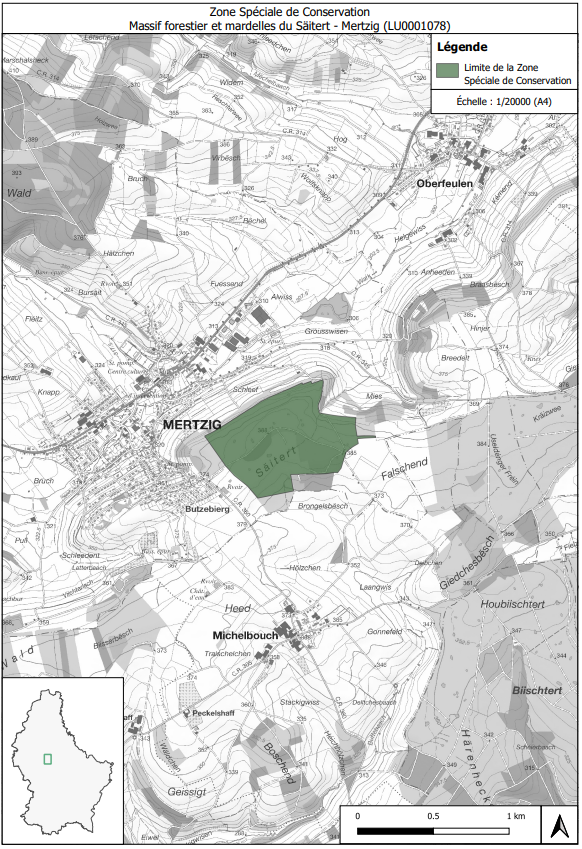

# Règlement grand-ducal du 15 juillet 2022 désignant zone spéciale de conservation et déclarant obligatoire la zone « Massif forestier et mardelles du Säitert - Mertzig ».

Nous Henri, Grand-Duc de Luxembourg, Duc de Nassau,

Vu les articles 2, 4, 31 à 35 et 37, de la [loi modifiée du 18 juillet 2018](https://legilux.public.lu/eli/etat/leg/loi/2018/07/18/a771/jo) concernant la protection de la nature et des ressources naturelles ;

Vu la fiche financière ;

Vu l’avis de l’Observatoire de l’environnement naturel ;

Les avis de la Chambre de commerce, de la Chambre des métiers et de la Chambre d’agriculture ayant été demandés ;

Notre Conseil d’État entendu ;

Sur le rapport de Notre Ministre de l’Environnement, du Climat et du Développement durable, et après délibération du Gouvernement en conseil ;

Arrêtons :

## Art. 1er.

Est désignée zone spéciale de conservation et déclarée obligatoire la zone « Massif forestier et mardelles du Säitert - Mertzig », ci-après la « zone spéciale de conservation », référencée sous le code LU0001078, et faisant partie intégrante du réseau Natura 2000.

## Art. 2.

La zone spéciale de conservation est désignée en vue :

1° du maintien ou, le cas échéant, du rétablissement de l’état de conservation favorable des habitats et espèces d’intérêt communautaire mentionnés à l’article 3 ;

2° de la préservation, du maintien ou, le cas échéant, du rétablissement de la structure et des fonctions spécifiques des habitats d’intérêt communautaire mentionnés à l’article 3, ainsi que de l’état de conservation de leurs espèces typiques ;

3° de la préservation, du maintien ou, le cas échéant, du rétablissement d’une diversité, d’une superficie et d’une qualité des habitats des espèces d’intérêt communautaire mentionnées à l’article 3 ;

4° de la protection contre les perturbations touchant les espèces d’intérêt communautaire mentionnées à l’article 3, pour autant que ces perturbations soient susceptibles d’avoir un effet significatif eu égard aux objectifs du présent article ;

5° de sa contribution à la cohérence du réseau Natura 2000 tant au niveau national qu’au sein de l’Union européenne.

## Art. 3.

Les objectifs spécifiques de conservation de la zone spéciale de conservation, ainsi que les mesures de conservation spéciales à assurer afin de maintenir ou, le cas échéant, rétablir l’état de conservation favorable des habitats et espèces d’intérêt communautaire visés, en l’occurrence à travers les mesures de conservation visées aux articles 32 à 35 et 37 de la [loi modifiée du 18 juillet 2018](https://legilux.public.lu/eli/etat/leg/loi/2018/07/18/a771/jo) concernant la protection de la nature et des ressources naturelles, sont :

1° rétablissement de l’état de conservation favorable de la population du Triton crêté *Triturus cristatus* :

a) préservation et restauration des plans d’eau, ainsi que des zones humides, structures paysagères et boisements feuillus limitrophes ;

b) amélioration de la connectivité écologique ;

2° maintien, voire rétablissement de l’état de conservation favorable des lacs et plans d’eau eutrophes naturels avec végétation du *Magnopotamion* ou *Hydrocharition* (3150) :

a) préservation et restauration des plans d’eau ;

b) aménagement de bandes de protection herbagères autour des plans d’eau ;

3° maintien, voire rétablissement de l’état de conservation favorable de la population du Murin de Bechstein *Myotis bechsteinii* :

a) préservation et restauration de futaies feuillues stratifiées irrégulières présentant des strates herbacées et arbustives ;

b) préservation de gros arbres, d’arbres de classes d’âge avancées, d’arbres biotopes et d’arbres morts ;

c) préservation et restauration de mardelles ;

d) aménagement de lisières structurées et d’îlots de vieillissement ;

4° maintien, voire rétablissement de l’état de conservation favorable de la population du Grand Murin *Myotis myotis* :

a) préservation et restauration de futaies feuillues de classes d’âge avancées ;$

b) aménagement de lisières structurées et d’îlots de vieillissement ;

c) amélioration de la connectivité écologique ;

5° maintien, voire rétablissement de l’état de conservation favorable des hêtraies du *Luzulo-Fagetum* (9110) et de l’*Asperulo-Fagetum* (9130) :

a) préservation et restauration des futaies feuillues ;

b) préservation de gros arbres, d’arbres de classes d’âge avancées, d’arbres biotopes et d’arbres morts ;

c) aménagement de lisières structurées.

## Art. 4.

Les mesures de conservation spéciales de la zone spéciale de conservation sont déclinées en objectifs opérationnels et précisées dans un plan de gestion approprié.

## Art. 5.

La délimitation de la zone spéciale de conservation est indiquée sur le plan figurant en annexe. La zone spéciale de conservation couvre une superficie totale de 45,14 hectares.

## Art. 6.

Notre ministre ayant l’Environnement dans ses attributions est chargé de l’exécution du présent règlement qui sera publié au Journal officiel du Grand-Duché de Luxembourg.

La Ministre de l’Environnement, du Climat  et du Développement durable,   Joëlle Welfring

Cabasson, le 15 juillet 2022.   Henri

ANNEXE

