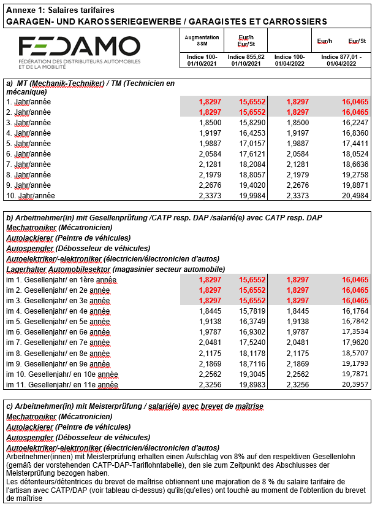
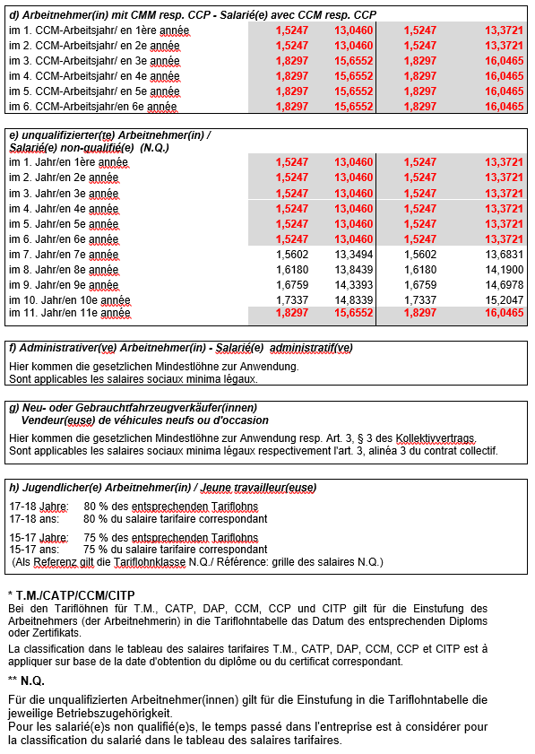

# Règlement grand-ducal du 25 octobre 2022 portant déclaration d'obligation générale de la convention collective pour le secteur des garages et carrosseries au Luxembourg signée le 28 juillet 2022, conclue entre la Fédération des distributeurs automobiles et de la mobilité (FEDAMO) asbl et la Fédération des entreprises de carrosserie et des métiers connexes du Grand-Duché de Luxembourg asbl, d'une part et les syndicats OGBL et LCGB, d'autre part.

Nous Henri, Grand-Duc de Luxembourg, Duc de Nassau,

Vu l’article L.164-8 du [Code du Travail](https://legilux.public.lu/eli/etat/leg/code/travail) ;

Sur proposition concordante des assesseurs de l’Office national de conciliation ;

Vu les avis de la Chambre de commerce et de la Chambre des salariés ;

Les avis de la Chambre des Métiers, de la Chambre des Fonctionnaires et Employés publics et de la Chambre d’Agriculture ayant été demandés ;

Vu l’article 1er, paragraphe 1er, de la [loi du 16 juin 2017](https://legilux.public.lu/eli/etat/leg/loi/2017/06/16/a592/jo) sur l’organisation du Conseil d’État et considérant qu’il y a urgence ;

Sur le rapport de Notre ministre du Travail, de l’Emploi et de l’Économie sociale et solidaire et après délibération du Gouvernement en conseil ;

Arrêtons :

## Art. 1er.

La convention collective de travail pour le secteur des garages et carrosseries au Luxembourg signée le 28 juillet 2022 et couvrant la période du 1er janvier 2022 au 31 décembre 2023, conclue entre la Fédération des distributeurs automobiles et de la mobilité (FEDAMO) asbl et la Fédération des entreprises de carrosserie et des métiers connexes du Grand-Duché de Luxembourg asbl, d’une part et les syndicats OGBL et LCGB, d’autre part, est déclarée d’obligation générale pour tout le secteur.

## Art. 2.

Conformément à l’article L. 164-8, paragraphe 5, du [Code du travail](https://legilux.public.lu/eli/etat/leg/code/travail), la déclaration d’obligation générale prend effet à partir de la date d’entrée en vigueur de la convention collective de travail pour le secteur des garages et carrosseries au Luxembourg signée le 28 juillet 2022.

## Art. 3.

Notre ministre ayant le Travail dans ses attributions est chargé de l'exécution du présent règlement qui sera publié au Journal officiel du Grand-Duché de Luxembourg avec la convention collective de travail pour le secteur des garages et carrosseries au Luxembourg signée le 28 juillet 2022.

Le Ministre du Travail, de l’Emploi  et de l’Économie sociale et solidaire,   Georges Engel

Palais de Luxembourg, le 25 octobre 2022.   Henri

\**CONVENTION COLLECTIVE DE TRAVAIL** **POUR LE SECTEUR DES GARAGES ET CARROSSERIES AU LUXEMBOURG**

passée entre la

\**FEDERATION DES DISTRIBUTEURS AUTOMOBILES ET DE LA MOBILITE, a.s.b.l. (FEDAMO)**

et la

\**FEDERATION DES ENTREPRISES DE CARROSSERIE ET DES METIERS CONNEXES DU GRAND-DUCHE DE LUXEMBOURG, a.s.b.l.**

d'une part,

et les

syndicats signataires de la convention, soit la

\**CONFEDERATION SYNDICALE INDEPENDANTE DU LUXEMBOURG  (« ONOFHÄNGEGE GEWERKSCHAFTSBOND LËTZEBUERG »)**

\**(OGB-L)**

et la

\**CONFEDERATION LUXEMBOURGEOISE DES SYNDICATS CHRETIENS  (« LETZEBUERGER CHRËSCHTLECHE GEWERKSCHAFTSBOND »)**

\**(LCGB)**

d'autre part.

En cas de divergences d'interprétation, seul le texte français fait foi.

\**TABLE DES MATIERES**

## Article 1 — Parties signataires de la convention

Entre la

FEDERATION DES DISTRIBUTEURS AUTOMOBILES ET DE LA MOBILITE, a.s.b.l. (FEDAMO)

et l'

FEDERATION DES ENTREPRISES DE CARROSSERIE ET DES METIERS CONNEXES DU GRAND-DUCHE DE LUXEMBOURG, a.s.b.l.

d'une part,

et les syndicats signataires de la convention, soit la

CONFEDERATION SYNDICALE INDEPENDANTE DU LUXEMBOURG (OGBL)

et la

CONFEDERATION LUXEMBOURGEOISE DES SYNDICATS CHRETIENS (LCGB)

d'autre part,

la convention collective de travail suivante est passée.

## A — OBJET ET CHAMP D'APPLICATION

### Article 2 — Objet

2.1 La présente convention collective de travail a pour but de maintenir la paix sociale en créant et en garantissant un droit conventionnel unique, de réglementer toutes les affaires concernant les relations de travail et de lutter contre la concurrence déloyale et le travail au noir.

### Article 3 — Champ d'application

3.1 La convention est applicable à toutes les entreprises du secteur des garages et des carrosseries établies de manière autonome au Grand-Duché de Luxembourg, incluant par conséquent toutes les entreprises qui exécutent un ou plusieurs des travaux, livraisons ou prestations ci-après : vente, réparation, débosselage et peinture, entretien et prestations de services sur des véhicules motorisés de tous types et accessoires.

Dans l'activité de constructeur – réparateur de carrosserie, le volet de la conception et la fabrication, donc de la construction de carrosserie au sens large (Fahrzeug- und Karosseriebau) est explicitement exclu du champ d'application.

3.2 La convention est applicable à tous les salariés occupés par lesdites entreprises, sauf disposition contraire prévue par le présent texte.

Fait également partie de la présente convention le personnel administratif dans le sens des fonctions d'encadrement et de support non directement liées à l'exécution de l'activité principale de l'entreprise.

3.3 Les vendeurs/vendeuses de véhicules neufs et d'occasion sont également soumis(es) aux dispositions de la convention collective de travail. Parmi celles-ci, les dispositions des articles 16 à 22 compris relatifs à la réglementation salariale et à la gratification sont généralement d'application. Pour autant qu'ils soient rémunérés à la commission, il revient toutefois à chaque partie au contrat de travail individuel d'apprécier si elle fixe une gratification et s'il s'agit d'une gratification selon l'article 22 ou d'une gratification définie autrement.

Par conséquent, le contrat de travail individuel doit indiquer clairement si le vendeur/la vendeuse de véhicules neufs ou d'occasion tombe sous le coup de cette définition ; dans l'affirmative, la représentation du personnel doit en être informée.

3.4 Sont expressément exclus du champ d'application :

aash tous les apprentis sous contrat d'apprentissage soumis aux dispositions particulières relatives aux contrats d'apprentissage du [code du travail](https://legilux.public.lu/eli/etat/leg/code/travail),

bash les salariés ayant la qualité de cadres supérieurs au sens de l'article L. 162-8 (3) du [code du travail](https://legilux.public.lu/eli/etat/leg/code/travail) qui possèdent un pouvoir de décision arbitraire réel, dont la fonction contient une autorité bien définie ou l'accès à des informations confidentielles et qui disposent d'un salaire nettement plus élevé que les salariés couverts par les dispositions de la convention collective, ou autre disposition.

## B — EMBAUCHES ET LICENCIEMENTS

### Article 4 — Embauche et période d'essai

4.1 En règle générale, la relation de travail est régie par le [code du travail](https://legilux.public.lu/eli/etat/leg/code/travail/20220416), sauf dispositions contraires plus favorables s'en écartant stipulées dans la présente convention collective. La présente disposition ne peut pas porter préjudice à des salariés qui bénéficient d'accords internes à l'entreprise plus favorables.

4.2 Toute embauche de personnel est réalisée en collaboration avec l'Administration de l'emploi et conformément aux dispositions légales y afférentes.

4.3 Hormis dans les cas exceptionnels autorisés par la loi, le contrat de travail est conclu pour une durée indéterminée.

4.4 Le contrat de travail est réalisé par écrit, en deux exemplaires, dont un est destiné à l'employeur et le second au salarié. Lors de la signature du contrat, une copie de la présente convention collective est remise au salarié par l'employeur.

4.5 Le contrat de travail doit contenir les informations suivantes :

aot le type et la nature du poste à occuper et des travaux à exécuter ;

bot la durée normale du travail ;

cot le salaire de base à l'embauche, ainsi que, le cas échéant, toutes les prestations et rémunérations supplémentaires ;

dot la période d'essai éventuellement prévue ;

eot les dispositions plus favorables pour le salarié qui s'écartent de la loi ou de la convention collective.

Le contrat de travail ne peut en aucun cas comporter des dispositions qui seraient préjudiciables au salarié au regard de la loi ou de la présente convention.

4.6 En principe, une période d'essai peut être fixée à chaque nouvelle embauche et doit être définie dans le contrat de travail.

4.7 Si le contrat de travail ne contient pas de période d'essai, il est réputé conclu à durée indéterminée, sauf s'il s'agit d'un contrat de travail à durée déterminée selon le point 4.3. La preuve du contraire n'est pas autorisée.

4.8 La période d'essai convenue mutuellement ne peut pas être inférieure à deux semaines ni dépasser :

aot trois mois pour les salariés non qualifiés et les salariés détenteurs du CCM ou du CITP ;

bot six mois pour les salariés détenteurs du DAP(CATP) ou d'une formation professionnelle au moins reconnue comme équivalente ;

cot douze mois pour les salariés dont le traitement de début de carrière brut atteint un montant fixé par règlement grand-ducal.

(4.700,77 euros à l'indice 877,01 au 1er avril 2022)

4.9 La période d'essai n'excédant pas un mois doit être exprimée en semaines complètes ; une période d'essai excédant un mois doit être exprimée en mois complets.

4.10 Après l'expiration de la période d'essai, l'embauche est réputée définitive. La période d'essai ne peut être ni prolongée ni renouvelée.

4.11 Pendant la période d'essai, le contrat peut être résolu par l'une des deux parties.

4.12 Pendant la période d'essai, les délais de préavis suivants sont applicables :

aot autant de jours que la période d'essai convenue comporte de semaines ;

bot quatre jours par mois d'essai convenu, avec toutefois un minimum de 15 jours et un maximum d'un mois.

### Article 5 — Licenciements et délais de préavis

5.1 En principe, chacune des parties peut procéder à tout moment à une résiliation pour autant que les délais de préavis ci-après soient respectés :

a) **en cas de résiliation par le salarié :**

un (1) mois pour une ancienneté de service inférieure à 5 ans,

deux (2) mois pour une ancienneté de service comprise entre 5 et 9 ans inclus,

trois (3) mois pour une ancienneté de service de 10 ans et plus ;

b) **en cas de résiliation par l'employeur :**

deux (2) mois pour une ancienneté de service inférieure à 5 ans,

quatre (4) mois pour une ancienneté de service comprise entre 5 et 9 ans inclus,

six (6) mois pour une ancienneté de service de 10 ans et plus.

5.2 Le délai de préavis, pour l'employé comme le salarié, commence :

aot le 15 du mois en cours si la communication écrite est notifiée avant cette date ;

bot le 1er du mois suivant si la communication écrite est notifiée après le 14 du mois en cours.

5.3 En cas de résiliation par l'employeur, le salarié a droit, conformément à l'article L.124-7 du [code du travail](https://legilux.public.lu/eli/etat/leg/code/travail), aux indemnités de départ suivantes par ancienneté de service :

> | comprise entre 5 et 10 ans : comprise entre 10 et 15 ans : comprise entre 15 et 20 ans : comprise entre 20 et 25 ans : comprise entre 25 et 30 ans : de 30 ans et plus : | 1 mois de salaire 2 mois de salaire 3 mois de salaire 6 mois de salaire 9 mois de salaire 12 mois de salaire |
> |---|---|

Par dérogation aux dispositions visées dans l'alinéa qui précède, l'employeur d'une entreprise occupant moins de 20 salariés peut opter soit pour les indemnités de départ exposées, soit pour la prolongation des délais de préavis définis dans l'alinéa 4.1. Ces délais de préavis sont alors portés à 5, resp. 8, resp. 9, resp. 12, resp. 15, resp. 18 mois.

5.4 En cas de résiliation par l'employeur, le salarié a droit à six (6) jours de congé pour rechercher un nouvel emploi. La rémunération de ces jours est à la charge de l'entreprise, à la condition que le salarié se soit inscrit comme demandeur d'emploi auprès de l'Administration de l'emploi.

5.5 Dans les entreprises occupant plus de 150 salariés, avant que l'employeur ne prononce un licenciement, le salarié concerné doit être convoqué à un entretien préalable, et ce, deux (2) jours à l'avance, par courrier recommandé.

Le licenciement proprement dit peut être notifié au salarié par courrier recommandé au plus tôt le jour suivant et au plus tard huit (8) jours après l'entretien préalable.

5.6 Le salarié peut exiger une motivation précise du licenciement dans un délai d'un mois par courrier recommandé ; l'employeur doit fournir cette motivation par écrit par courrier recommandé dans le mois qui suit la réception de la demande.

5.7 La dissolution de la relation de travail peut se faire de commun accord.

### Article 6 — Restrictions en matière de résiliation et dispositions supplémentaires

6.1 Si un comité du personnel existe dans l'entreprise, toutes les résiliations et tous les licenciements doivent lui être communiqués.

6.2 Le comité du personnel reçoit, contre accusé de réception, une copie de la lettre de licenciement, ainsi que la convocation à l'entretien préalable, le cas échéant.

6.3 Lors de l'entretien préalable, le salarié concerné peut être assisté d'un membre du personnel de son choix, d'un représentant du personnel, ou d'un représentant d'un des syndicats représentatifs au niveau national représentés au sein du comité du personnel.

6.4 L'employeur ne peut pas prononcer un licenciement pour les motifs suivants :

a) l'activité pour l'exécution de la présente convention ;

b) l'appartenance à une organisation de travailleurs ;

c) l'activité syndicale et le travail de recrutement ;

d) une incapacité de travail due à une maladie ou un accident, et ce, pas avant l'expiration des 26 semaines suivant la survenance de l'incapacité de travail ;

e) la participation à une grève conforme au droit.

6.5 A son départ de l'entreprise, le salarié récupère ses documents et reçoit une attestation spécifiant la nature et la durée de l'occupation. Cette attestation ne peut contenir aucune remarque préjudiciable au salarié.

6.6 En cas de licenciements collectifs, les dispositions légales correspondantes doivent s'appliquer.

6.7 Si un salarié est licencié pour des motifs technico-économiques, il peut faire valoir une priorité de réembauche pendant une année à compter du départ de l'entreprise. Le salarié doit alors faire une demande écrite en ce sens, après quoi l'employeur est obligé de l'informer des postes vacants correspondant à toutes ses qualifications pendant ladite année.

6.8 Si le salarié rompt le contrat conformément à la convention, il a droit au paiement immédiat du salaire qui lui est encore dû après l'expiration du délai de préavis.

## C — DUREE DU TRAVAIL

### Article 7 — Durée du travail hebdomadaire et journalière

7.1 La durée du travail hebdomadaire normale est de 40 heures.

7.2 La durée du travail journalière normale doit être fixée à 8 heures et devrait être répartie sur 5 jours de la semaine si aucune exigence interne particulière ne s'oppose à cette réglementation.

7.3 Dans ce cas, il est possible, via un accord d'entreprise avec la représentation du personnel ou les salariés concernés, d'introduire la réglementation de la durée du travail selon l'article L. 211-6 du [code du travail](https://legilux.public.lu/eli/etat/leg/code/travail). Toutes les heures prestées et commencées au-delà de ladite durée du travail visée par l'accord d'entreprise sont considérées comme des heures supplémentaires.

7.4 Le début du travail et la fin du travail sont déterminés en fonction des exigences, dispositions et instructions internes correspondantes.

7.5 L'employeur est tenu d'occuper le salarié pendant la durée du travail fixée et de lui payer le salaire convenu.

7.6 Le salarié est tenu de commencer le travail à l'heure et de ne pas le terminer prématurément. Le temps nécessaire pour se changer et se laver n'est pas compris dans la durée du travail fixée.

7.7 L'employeur a le droit de contrôler la ponctualité de l'arrivée et du départ du salarié, le cas échéant, au moyen de systèmes de pointage horaire.

7.8 Tout salarié est tenu d'exécuter son travail consciencieusement et professionnellement.

7.9 L'employeur a le droit de contrôler la prestation de travail du salarié, par exemple par le biais du remplissage de fiches de travail et d'autres dispositifs techniques tels que des systèmes de pointage horaire.

7.10 En cas de maladie, le salarié est tenu d'en informer son employeur le jour même, si possible au cours de la première heure de travail prévue. Dans les trois jours à compter de son premier jour d'absence, le salarié doit en outre transmettre à l'employeur un certificat médical attestant l'incapacité de travail du salarié (à compter de son premier jour d'absence) et fixant la durée prévisible de son absence.

7.11 Les éventuelles prolongations ultérieures des déclarations de maladie doivent être communiquées à l'employeur dans les délais précités.

7.12 En cas de non-respect des dispositions visées par ce point, l'absence est réputée injustifiée, la durée de l'absence n'est pas rémunérée et l'employeur peut résilier le contrat de travail pour absence injustifiée sur le lieu de travail.

7.13 Si le salarié souhaite exercer des activités professionnelles ou indépendantes supplémentaires, il en informera son employeur au moins 2 mois à l'avance. Une activité professionnelle ou indépendante dans le domaine technique en dehors de l'atelier requiert l'autorisation écrite expresse de l'employeur.

7.14 La durée du travail comprise entre 22 et 6 heures est réputée travail de nuit. La durée du travail supplémentaire les dimanches et jours fériés s'étend de 6 heures le dimanche ou le jour férié à 6 heures le jour suivant.

7.15 Sous réserve d'un accord particulier entre les employeurs et la délégation du personnel, sinon les salariés concernés, la durée du travail journalière est interrompue par une pause du travail et divisée si possible en deux périodes identiques. La pause ne peut pas durer moins d'une demi-heure et ne doit pas excéder deux heures.

7.16 Les salariés qui garantissent un service de garde, sans devoir être présent sur le lieu de travail, en dehors de leurs heures de travail normales, reçoivent une indemnité de 10 % de leur salaire horaire normal par heure. Pour les heures réellement travaillées du service de garde (heures de route comprises), le salarié a droit au salaire horaire de base, majoré d'une prime de garde de 10 %, à la majoration pour heures supplémentaires, ainsi qu'à d'autres majorations éventuelles comme, notamment, la majoration pour travail de nuit, pour travail du dimanche et pour travail des jours fériés, conformément à l'article 8.

7.17 Les dispositions de la loi relative à la protection des jeunes travailleurs (articles L.341-1 à L.345-2 du [code du travail](https://legilux.public.lu/eli/etat/leg/code/travail)) sont applicables aux jeunes jusqu'à 18 ans accomplis.

7.18 Le travail à temps partiel est régi par les dispositions légales des articles L.123-1 à L.123-8 du [code du travail](https://legilux.public.lu/eli/etat/leg/code/travail).

### Article 8 — Travail supplémentaire, heures supplémentaires ; travail du dimanche et des jours fériés ; travail de nuit

8.1 Les heures supplémentaires, ainsi que le travail de nuit, du dimanche et des jours fériés sont uniquement autorisées dans des cas urgents et dans le cadre des dispositions légales et de la convention collective y afférentes.

8.2 Sont réputées heures supplémentaires toutes les heures de travail prestées en sus de la durée du travail hebdomadaire et journalière normale fixée par la loi et la présente convention et les heures de travail commencées.

8.3 Pour les travaux précités (travail supplémentaire et heures supplémentaires), les majorations du salaire horaire suivantes doivent être payées :

> | pour les heures supplémentaires et le travail supplémentaire : pour le travail du dimanche : pour le travail des jours fériés : pour le travail de nuit : pour le travail de nuit en cas de travail posté : | 40 % 100 % 100 % 50 % 15 % |
> |---|---|

8.4 Si le contrat de travail du salarié prévoit une rémunération mensuelle, le salaire horaire normal est calculé comme suit :

( Rémunération   mensuelle )/(173) =   salaire   horaire   normal

Le travail supplémentaire, les heures supplémentaires, le travail du dimanche, de jour férié et de nuit sont rémunérés sur la base du salaire horaire normal ainsi calculé, avec les majorations correspondantes.

8.5 A la demande du (de la) salarié(e), et avec l'approbation de l'employeur, les heures supplémentaires et le travail supplémentaire presté les dimanches et jours fériés peuvent être compensés par le même nombre d'heures libres, la majoration prévue devant toutefois être payée dans tous les cas.

## D — CONGES ET INTERRUPTIONS DE TRAVAIL, JOURS FERIES LEGAUX

### Article 9 — Le congé annuel payé

9.1 Les salariés obtiennent le droit à des congés après une occupation ininterrompue de trois mois auprès du même employeur.

9.2 Le congé annuel payé est régi par le [code du travail](https://legilux.public.lu/eli/etat/leg/code/travail) et s'élève à 26 jours ouvrables pour une semaine de 5 jours.

9.3 Pour chaque jour de congé, le salarié a droit à une indemnité à hauteur du salaire horaire moyen des trois (3) mois précédant le congé, sur la base du salaire mensuel brut, les compléments de salaire pour travail supplémentaire et heures supplémentaires prestés pendant la période de référence devant être pris en compte.

9.4 Le congé annuel de la première année de travail est calculé à raison d'1/12 par mois entier. Un mois commencé qui dépasse le 15e jour de calendrier constitue un mois entier.

9.5 Si le contrat de travail prend fin dans le courant de l'année, le salarié a droit à 1/12 du congé annuel qui lui est dû par mois entier, et ce, sans préjudice des dispositions légales et conventionnelles en cas de résiliation ou de licenciement.

9.6 Un mois commencé qui dépasse le 15e jour de calendrier constitue dans ce cas un mois entier.

9.7 Le congé de maternité prescrit par la loi, ainsi que le congé d'accueil prévu par la loi en cas d'adoption d'un enfant ne privent pas le (la) salarié(e) du droit au congé annuel payé qui lui dû.

### Article 10 — Congé payé supplémentaire

10.1 Tout salarié a droit, en vertu de la présente convention collective, à un jour de congé payé supplémentaire, le 27ème jour.

10.2 En outre, un jour de congé supplémentaire lié à l'ancienneté dans l'entreprise est garanti à tous les salariés ayant au moins 15 ans d'ancienneté complète portant les congés à 28 jours. Pour les salariés d'une ancienneté complète de 25 ans ininterrompus dans l'entreprise, un 29ème jour de congé supplémentaire est ajouté.

### Article 11 — Le congé extraordinaire

11.1 Un salarié empêché pour des raisons personnelles de se présenter au travail a droit à un congé extraordinaire, conformément aux dispositions de l'article L.233-16 du [code du travail](https://legilux.public.lu/eli/etat/leg/code/travail). Le droit à un congé extraordinaire n'est pas soumis aux conditions relatives à la période d'attente de trois mois visés à l'article 9.

11.2 Ce congé extraordinaire s'élève à :

1\. un jour pour le décès d'un parent au deuxième degré du salarié ou de son conjoint ou partenaire ;

2\. dix jours pour le père en cas de naissance d'un enfant ;

3\. un jour pour chaque parent en cas de mariage d'un enfant ;

4\. deux jours en cas de déménagement sur une période de trois ans d'occupation auprès du même employeur, sauf si le salarié doit déménager pour des raisons professionnelles ;

5\. trois jours pour le décès du conjoint ou du partenaire ou d'un parent au premier degré du salarié ou de son conjoint ou partenaire;

6\. trois jours pour le mariage et un jour pour la déclaration de partenariat du salarié ;

7\. dix jours en cas d'accueil d'un enfant de moins de seize ans en vue de son adoption, sauf en cas de bénéfice du congé d'accueil prévu au chapitre IV, section 8, du présent titre.

8\. cinq jours en cas de décès d'un enfant mineur,

Au sens du présent article on entend par:

«partenaire»: toute personne ayant fait inscrire au répertoire civil et dans un fichier visé par les articles 1126 et suivants du [Nouveau Code de procédure civile](https://legilux.public.lu/eli/etat/leg/code/procedure_civile) un partenariat au sens de la [loi du 9 juillet 2004](https://legilux.public.lu/eli/etat/leg/loi/2004/07/09/n3/jo) relative aux effets de certains partenariats.»

« enfant » : tout enfant né dans le mariage, hors mariage ou adoptif.

À l'exception des points 2 et 7 visés à l'alinéa premier les congés extraordinaires ne peuvent être pris qu'au moment où l'événement donnant droit au congé se produit et doivent obligatoirement être pris consécutivement à l'événement ; ils ne peuvent être reportés sur le congé ordinaire.

11.3 Tout représentant des salariés élu a droit au congé qui lui revient à des fins syndicales, de formation ou de formation continue, ainsi qu'à la dispense du travail qui lui est due pour l'exercice de son mandat, conformément aux dispositions du [code du travail](https://legilux.public.lu/eli/etat/leg/code/travail) relatives aux représentations du personnel.

11.4 L'indemnité du congé extraordinaire correspond à celui du congé annuel et le calcul se fera suivant l'article 9.3.

### Article 12 — Congé pour formation professionnelle continue

12.1 Depuis le 1er avril 2001, tout salarié a droit à un crédit d'heures mensuel dénommé « crédit-formation ». Depuis cette date, tout salarié du secteur des garages luxembourgeois capitalise le droit à la formation professionnelle et à la formation professionnelle continue à raison d'une heure par mois.

12.2 Pour les salariés sous contrat de travail à durée déterminée, le crédit d'heures est calculé au prorata de leur travail partiel, et ce, sur la base d'au moins 160 heures par mois pour le travail à temps plein dans le cadre de la semaine de 40 heures.

12.3 Par « formation professionnelle » et « formation professionnelle continue », on entend, au sens de la présente convention, toute action de formation visant à améliorer la qualification professionnelle du salarié et/ou correspondant aux intérêts de l'entreprise, y compris les actions de formation organisées par le constructeur automobile ou la représentation de la marque, que le cours de formation soit à l'initiative du salarié ou de l'employeur.

12.4 Le crédit d'heures peut être utilisé pour les actions de formation et de formation continue reprises ci-après :

a) à l'initiative du salarié

aash toute action de formation qui correspond aux dispositions de la présente convention et pour laquelle le temps à utiliser est compris totalement ou partiellement dans la durée du travail normale ;

bash pour des examens ou des tests, pendant la durée du travail normale, en relation avec une des actions de formation correspondant à la présente convention ;

cash pour préparer un examen ou un test, et ce, à hauteur de 8 heures maximum par examen ou test ;

dash pour quitter le travail plus tôt afin de pouvoir participer, dans le respect des horaires, aux cours de formation et de formation continue en dehors des heures de travail normales.

b) à l'initiative de l'employeur

aash pour toutes les actions de formation et de formation continue internes et externes que l'employeur juge nécessaires à la qualification requise du salarié.

12.5 Un jour de formation ou de formation continue ne peut être déduit du crédit d'heures des salariés travaillant à temps partiel que *prorata temporis* par rapport à leur occupation à temps partiel, les heures non comprises dans ce calcul au prorata étant soit rémunérées comme heures de travail soit compensées par le temps libre correspondant. Ceci s'applique uniquement aux actions de formation ou de formation continue à l'initiative de l'employeur.

12.6 Les heures de formation sont imputées au salarié à partir du premier mois dans une entreprise du secteur, le salarié ayant toutefois le droit de recourir au crédit-formation seulement après une période ininterrompue de trois mois auprès du même employeur. Le crédit d'heures inutilisé pendant l'année est reporté à l'année suivante et reste disponible.

12.7 Afin d'éviter et de régler d'éventuels litiges, une commission paritaire qui prend ses décisions à l'unanimité est formée entre la délégation du personnel et la direction de l'entreprise. Si le litige ne peut pas être réglé ou si aucune délégation du personnel n'existe dans l'entreprise, la commission paritaire entre partenaires sociaux prévue par la convention collective doit s'en occuper.

Changement d'entreprise / Interruption de carrière

12.8 Si un salarié change d'entreprise, tout en restant dans le secteur des garages, un maximum de douze heures de crédit-formation sera transféré pour lui de l'ancien au nouvel employeur. Le solde des heures de formation inutilisées sera perdu. Auprès d'un nouvel employeur, le salarié a le droit d'utiliser le crédit-formation après une période de carence renouvelée ininterrompue de trois mois.

12.9 Un salarié qui revient dans le secteur des garages après l'avoir quitté n'a pas droit au crédit d'heures qui restait avant son départ, sauf si la durée de l'interruption de carrière dans le secteur n'a pas excédé un mois.

12.10 Le salarié dont la carrière est interrompue par un congé parental ou par un congé sans solde prolongé conserve le crédit d'heures qui lui était dû au moment de l'interruption et peut à nouveau faire valoir ce droit lorsqu'il reprend sa carrière.

12.11 Pour permettre aux salariés absents en raison d'un congé parental ou d'un congé sans solde d'améliorer leurs connaissances et leur qualification professionnelles afin qu'ils puissent se réintégrer sans problèmes à leur retour, l'employeur s'engage à informer les salariés concernés de toutes les actions de formation et de formation continue organisées pendant leur absence et à leur en permettre l'accès.

Coûts et remboursement des coûts

12.12 L'employeur peut exiger des salariés qui résilient leur contrat de travail et quittent l'entreprise le remboursement des coûts engagés par l'entreprise pour la formation et la formation continue, y compris ceux visés par la loi correspondante du 22 juin 1999. Ne peuvent entrer ici en ligne de compte que les coûts engagés pendant le mois en cours au moment de la résiliation du contrat et les douze mois précédents.

12.13 A titre exceptionnel, le remboursement des coûts peut concerner le mois en cours ainsi que les 24 mois précédents si l'action de formation en question s'étend sur une période continue d'au moins 24 mois (p. ex. cours cyclique ou modulaire s'étendant sur deux ans ou plus et représentant un coût considérable pour l'entreprise). Dans ce cas, la commission paritaire mentionnée plus haut décidera de la période à considérer pour le remboursement des coûts.

12.14 Le remboursement des coûts exigé ne pourra en aucun cas dépasser les montants fixés par la [loi du 22 juin 1999](https://legilux.public.lu/eli/etat/leg/loi/1999/06/22/n1/jo) et devra prendre en compte les abattements prescrits par la loi précitée.

12.15 Un remboursement des coûts ne peut être exigé que si le salarié était au courant des coûts encourus et du montant d'un éventuel remboursement avant le début de la formation ou de la formation continue.

12.16 Aucun remboursement des coûts ne peut être exigé si le contrat a été résilié par l'employeur. Ceci s'applique également en cas de résiliation pour faute grave.

### Article 13 — Congé social

13.1 Tout salarié a droit à 12 heures de congé social payé par année de calendrier, et ce, selon les modalités de la liste ci-après :

a) Cas en relation directe avec la personne du salarié :

asc citations à comparaître (procédures personnelles) ; examens dans le cadre d'études privées ;

bsc situations privées exceptionnelles (p. ex. : incendie, inondation ou autres catastrophes en rapport avec le domicile fixe du demandeur).

b) Cas en relation avec une des personnes qui constituent le ménage du salarié (conjoint, partenaire en union libre, parents et enfants) et pour le(s)quel(s) l'assistance du salarié s'avère indispensable dans le cadre d'une situation exceptionnelle et particulière :

asc soins et assistance en cas de maladie ou d'accident ;

bsc visites médicales ainsi que circonstances médicales et thérapeutiques particulières ;

csc problèmes en relation avec la scolarité d'un enfant (problèmes et interventions d'ordre médical, psychopédagogique).

13.2 Le droit au congé social se limite en principe aux cas exposés ci-dessus. Toutefois, si le salarié introduit une demande de congé social dont le motif n'est pas repris dans la liste, la commission compétente en matière de congé social (voir plus loin) peut néanmoins accorder ce congé si elle juge la demande fondée.

13.3 L'octroi du congé social nécessite dans chaque cas le dépôt de la demande par le salarié à la commission compétente en matière de congé social. La demande émanant du demandeur doit être motivée et, le cas échéant, comprendre les documents officiels en relation avec la demande du congé social (attestations officielles, certificats médicaux etc.).

13.4 La demande doit contenir toutes les informations telles que la date de début, la durée et la date de fin du congé social demandé. Lorsque cela se justifie, la commission compétente en matière de congé social peut prolonger la période prévue pour la présentation des documents officiels.

13.5 Le congé social est disponible à hauteur de 12 heures par année de calendrier par salarié (calculé au prorata pour les salariés à temps partiel). Il est fractionnable (heures, jour complet) selon les besoins propres à chaque situation du demandeur pour laquelle ledit congé est demandé. La commission compétente peut accorder au demandeur, si sa situation l'exige, la prolongation non rémunérée du congé social. Ceci s'applique également si un salarié a déjà épuisé son crédit de congé social et qu'il est confronté à nouveau à une situation qui justifierait l'octroi d'un congé social.

13.6 L'entreprise instaure une commission compétente en matière de congé social. Ladite commission se composera d'un membre de la direction et d'un membre du comité du personnel, s'il existe. Si aucun comité du personnel n'existe, un représentant est nommé dans les rangs des salariés. Toute demande doit être soumise à cette commission compétente en matière de congé social. Les membres de ladite commission décident toujours de commun accord de l'acceptation ou du rejet de la demande.

### Article 14 — Interruptions du travail payées

14.1 Les dispositions ci-après sont applicables à des interruptions de travail particulières :

a) Si un salarié est victime d'un accident du travail qui requiert la suspension de son travail, le salaire total pour ce jour de travail est dû ;

b) le salaire total est dû en cas de sauvetage ou de transport d'une personne accidentée dans l'entreprise, ainsi qu'en cas d'enquêtes internes concernant des accidents dans l'entreprise ;

c) pour des consultations médicales nécessaires en urgence pendant la durée du travail, le salarié peut être exempté de 8 heures de travail maximum par an, tout en percevant son salaire ;

d) le salarié ne peut en outre subir aucune perte de salaire lorsqu'il est empêché de prester ses heures par une citation à comparaître, sauf s'il est l'accusé. Ceci n'est toutefois applicable qu'une fois par an.

### Article 15 — Jours fériés légaux

15.1 En vertu de l'art. L.232-2 du [code du travail](https://legilux.public.lu/eli/etat/leg/code/travail) sont réputés jours fériés légaux : le Nouvel An, le lundi de Pâques, le 1ermai, le jour de l'Europe (9 mai), l'Ascension, le lundi de Pentecôte, la fête nationale (23 juin), l'Assomption, la Toussaint, le 1er jour de Noël (25 décembre) et le 2e jour de Noël (26 décembre).

15.2 Si l'un de ces jours tombe un jour de semaine chômée, les dispositions légales seront appliquées.

15.3 Pour les heures de travail prestées les jours fériés, le salaire correspondant plus une majoration de 100 % doivent être payés conformément à l'art. 8.3.

15.4 N'a aucun droit à une indemnité pour jour férié le salarié ou l'apprenti :

aash qui n'a pas travaillé par sa propre faute ou sans l'accord motivé personnel ou écrit de l'employeur soit le jour précédant soit le jour suivant le jour férié ;

bash qui a été absent du travail pendant plus de 3 jours sans justification dans les 25 jours ouvrables qui précèdent le jour férié, y compris dans le cas où le motif de l'absence aurait justifié son absence.

## E — REGLEMENTATION SALARIALE ET CLASSIFICATION

### Article 16 — Salaire social minimum

16.1 Le salaire fait l'objet d'une libre convention entre l'employeur et le salarié, mais il ne peut pas être inférieur aux salaires horaires définis par la présente convention, exposés dans une annexe (Annexe 1) aux présentes et représentant des taux minimum, c'est-à-dire qu'il ne peut être modifié qu'en faveur du salarié.

16.2 Les salaires horaires appliqués conformément à la présente convention sont fonction des dispositions du point 18.2, selon la qualification ou l'ancienneté ininterrompue du salarié dans l'entreprise.

16.3 Les salaires conventionnels fixés sont basés sur la semaine de 40 heures et doivent être adaptés aux fluctuations de l'indice du coût de la vie, conformément à l'article 21 de la présente convention. Les grilles des salaires conventionnels font partie intégrante de la convention.

16.4 En vertu des dispositions de l'article 30, les salariés et salariées doivent être traités de manière égale en ce qui concerne les conditions salariales et de travail, sans aucune forme de discrimination.

16.5 Les jeunes de moins de 18 ans qui ne sont pas sous contrat d'apprentissage perçoivent au minimum :

austom Jeunes âgés de 15 à 17 ans : 75 % du salaire conventionnel correspondant

bustom Jeunes âgés de 17 à 18 ans : 80 % du salaire conventionnel correspondant

custom La grille des salaires conventionnels NQ est utilisée comme référence.

16.6 Les apprentis sous contrat d'apprentissage sont rémunérés selon les indemnités d'apprentissage officielles.

16.7 Les autres salariés non repris dans la grille des salaires de la présence convention collective sont indemnisés par le salaire social minimum légal.

16.8 D'éventuelles conditions salariales plus favorables ne sont pas affectées par la présente convention et restent intactes et applicables.

### Article 17 — Compensation salariale en cas de maladie et d'accident

17.1 En cas de maladie et d'accident, le salarié a le droit de recevoir son traitement et d'autres avantages résultant de son contrat de travail, conformément aux dispositions des points 7.10 à 7.12 et de l'article L.121-6 section 3 du [code du travail](https://legilux.public.lu/eli/etat/leg/code/travail).

### Article 18 — Classification et qualification

18.1 La structure des salaires est basée sur des catégories salariales définies comme suit :

asc salariés non qualifiés (NQ)

bsc salariés avec CCM respectivement avec CCP

csc salariés avec CITP

dsc salariés avec CATP respectivement avec DAP

esc salariés détenteurs d'un diplôme de technicien en mécanique (TM)

fsc salariés détenteurs du brevet de maîtrise

gsc salariés administratifs

hsc Vendeurs/euses de véhicules neufs ou d'occasion

18.2 La classification dans les différentes catégories salariales est réalisée sur la base des attestations à présenter à l'embauche, sauf pour les salariés non qualifiés (NQ) pour lesquels la classification est basée sur l'ancienneté dans l'entreprise.

18.3 Les salariés détenteurs du brevet de maîtrise perçoivent une majoration de 8 % du salaire conventionnel de l'artisan qui leur est dû et qu'ils ont touché au moment de l'obtention du brevet de maîtrise.

18.4 Les salariés qui possèdent un diplôme du cours « Electricité automobile/Electronique automobile » Helfent perçoivent une majoration de 5 % du salaire qui leur est dû.

18.5 Pour calculer l'ancienneté dans l'entreprise des salariés non qualifiés sont prises en compte les années de travail prestées dans l'entreprise dans le cadre d'un contrat de travail avant l'âge de 18 ans.

18.6 Les dispositions ci-après (applicables à la carrière selon la grille des salaires conventionnels) s'appliquent aux travailleurs non qualifiés qui changent de secteur de travail au cours de leur carrière et qui reviennent à un moment ultérieur dans le secteur des garages.

a) S'ils n'ont plus travaillé dans leur profession (qualification), ces années de travail ne sont pas comptabilisées pour leur carrière.

b) S'ils ont continué à travailler dans leur profession (qualification), ces années sont pleinement comptabilisées. Dans ce cas, ils doivent prouver (certificat de travail) qu'ils ont continué à travailler dans leur profession (qualification).

### Article 19 — Paiement des salaires

19.1 La période de salaire correspond à un mois de calendrier. Toutefois, des avances peuvent également être versées à titre exceptionnel sur la base d'une convention individuelle écrite entre l'employeur et le salarié.

19.2 Le salarié doit avoir perçu le salaire du mois précédent au plus tard le 5 de chaque mois. Si le paiement des salaires tombe un jour chômé, le paiement doit être effectué le jour qui précède le jour chômé.

19.3 Le salarié reçoit une fiche de paie détaillée au plus tard lors du versement de la rémunération de chaque mois.

19.4 Chaque salarié doit recevoir un décompte avec l'indication séparée des traitements et des déductions avec le décompte final, c.-à-d. que le décompte doit comprendre le traitement de base brut, le nombre d'heures prestées, le salaire horaire, les majorations etc. de manière à ce que le salarié puisse constater et recalculer son salaire facilement. En outre, les nom et adresse de l'employeur, ainsi que le mois rémunéré doivent être mentionnés.

### Article 20 — Retenues sur le salaire

20.1 Les retenues sur le salaire ne peuvent être faites que dans les cas où cela se justifie ; elles doivent être motivées et mentionnées sur la fiche de paie.

20.2 Aucune absence injustifiée ne sera rémunérée.

### Article 21 — Adaptation des salaires au coût de la vie

21.1 Conformément au [code du travail](https://legilux.public.lu/eli/etat/leg/code/travail), tant les salaires conventionnels que les salaires effectifs sont adaptés aux fluctuations de l'indice du coût de la vie selon les dispositions légales en vigueur.

### Article 22 — Gratification

22.1. Tous les salariés reçoivent une gratification annuelle :

aash pour les salariés administratifs (tels que définis à l'article 3.2) la gratification s'élève à 600 Euro.

bash pour les salariés manuels qui - à cause de leur ancienneté élevée - ont dépassé la grille des salaires tarifaires, la gratification s'élève à 450 Euro par an.

cash pour les autres salariés, la gratification s'élève à 400 euros par an.

22.1 Ces gratifications mentionnées à l'alinéa précédent ne sont pas cumulables, pas liées aux fluctuations de l'indice du coût de la vie et ne sont par conséquent pas adaptées. En général, le montant total de la gratification est versé au salarié concerné en fonction d'un temps plein (c.-à-d. que les gratifications sont adaptées en cas de temps partiel, de congé parental etc.).

22.2 La période de référence pour le paiement de la gratification s'étend du 1erdécembre au 30 novembre de chaque année. La gratification annuelle est payée au plus tard au mois de décembre.

22.3 Lorsque le contrat de travail commence ou expire dans le courant de l'année de calendrier, le salarié a droit à 1/12 de la gratification par mois de travail. Les quotes-parts des mois de travail de plus de 15 jours de calendrier doivent être comptées comme mois de travail entiers.

22.4 En cas de licenciement du salarié pour motif grave, aucune gratification n'est due.

22.5 La présente disposition ne peut pas porter préjudice à un salarié bénéficiant d'autres accords internes plus favorables concernant une gratification annuelle.

22.6 Ceci s'applique en particulier aux salariés de l'ADAL qui ont été embauchés avant le 1erjanvier 2011 comme employés et dont la gratification est encore calculée aux conditions de l'avenant à la convention collective du 20 février 2000 et reste également maintenue.

## F — DISPOSITIONS SOCIALES

### Article 23 — Représentation du personnel

23.1 La représentation du personnel par la délégation du personnel est régie par les dispositions du [code du travail](https://legilux.public.lu/eli/etat/leg/code/travail) concernant la délégation du personnel.

### Article 24 — Préretraite Solidarité (« Vorzeitiger Ruhestand »)

24.1 À partir de 57 ans, les salariés peuvent demander leur retraite anticipée, selon les dispositions du [code du travail](https://legilux.public.lu/eli/etat/leg/code/travail) concernant la préretraite-solidarité.

## G — CONDITIONS DE TRAVAIL ET DISPOSITIONS PARTICULIERES

### Article 25 — Outillage et vêtements de travail

25.1 L'outillage et le matériel de travail ainsi que le matériel de bureau sont mis à la disposition de chaque salarié par l'employeur.

25.2 Après l'expiration de la période d'essai, chaque salarié technique dispose gratuitement de deux tenues de travail (blouse et pantalon, combinaison) par an et uniquement selon les besoins.

25.3 Les salariés travaillant dans des zones où ceci est nécessaire reçoivent gratuitement une paire de chaussures de sécurité. Le port des chaussures de sécurité est obligatoire.

dustom Les chaussures sont remplacées gratuitement une fois par an lorsque la paire usée ou élimée est présentée et échangée.

### Article 26 — Responsabilité du salarié

26.1 Le salarié n'est tenu responsable des dommages qu'il a causés aux véhicules, machines, outils, vêtements de travail, chaussures de travail et matériaux que s'il a agi incorrectement ou si une faute, c.-à-d. une préméditation ou une négligence grave, peut lui être imputée. L'employeur doit prouver que le salarié a provoqué un dommage intentionnellement ou a commis une faute grave.

bustom Les salariés doivent impérativement garder confidentiels les secrets d'affaires et d'entreprise.

### Article 27 — Sécurité, santé et hygiène

27.1 Les dispositions de l'Association d'assurance contre les accidents, ainsi que d'éventuelles réglementations internes sont applicables.

27.2 L'employeur est tenu de respecter les prescriptions en matière de prévention des accidents et de prendre les mesures *ad hoc* pour prévenir les accidents ; il doit, entre autres, garder le matériel sanitaire correspondant à disposition dans chaque entreprise.

27.3 Pour des travaux spécifiques, ainsi que pour des travaux dangereux et nocifs pour la santé, l'employeur met à disposition le matériel et les vêtements de protection adéquats.

27.4 Toutes les machines doivent être dotées des dispositifs de protection habituels.

27.5 Chaque entreprise doit être équipée :

aot de systèmes de ventilation et d'installations d'évacuation des produits de combustion parfaitement opérationnels ;

bot d'un (d')aspirateur(s) pour les interventions au niveau des freins ;

cot d'extincteurs visibles et clairement identifiés.

27.6 Les fosses de travail doivent être pourvues d'une bordure de sécurité ainsi que d'une sortie de secours et doivent pouvoir être couvertes lorsqu'elles ne sont pas utilisées.

27.7 L'employeur doit prévoir un local adéquat, satisfaisant aux conditions d'hygiène en vigueur, où les salariés pourront prendre leurs repas, et ce, en conformité avec les dispositions correspondantes du [code du travail](https://legilux.public.lu/eli/etat/leg/code/travail). Ceci s'applique également à l'entreposage des vêtements pour lequel des aménagements correspondants doivent exister.

27.8 En outre, l'entreprise doit veiller à des conditions d'hygiène parfaites, notamment, en ce qui concerne la présence des installations de lavage et de douche correspondantes, de toilettes ou analogues.

27.9 Le savon professionnel nécessaire est mis gratuitement à la disposition des salariés par l'employeur.

27.10 Les salariés sont quant à eux tenus de se conformer aux mesures de sécurité et de contribuer à garantir un travail exempt d'accidents.

### Article 28 — Travail au noir

28.1 Sous réserve des dispositions visées au point 7.13 de la présente convention collective, le salarié ne peut exécuter aucune activité professionnelle pour des tiers après la fin de la durée du travail fixée ni pendant les jours de congé et les jours fériés.

28.2 Les salariés qui se sont à l'évidence rendus coupables de travail au noir peuvent être licenciés sans préavis. Dans les autres cas, les dispositions correspondantes du [code du travail](https://legilux.public.lu/eli/etat/leg/code/travail) en matière d'interdiction du travail au noir sont d'application.

### Article 29 — Exécution et interprétation de la convention, arbitrage, commission des conventions

29.1 La garantie de l'exécution précise des dispositions de la convention collective ainsi que la promotion de la coopération et de sa direction incombent à une commission paritaire des conventions composée de maximum 3 représentants de l'ADAL, de la FEGARLUX, de l'OGBL et de la LCGB.

29.2 La convocation de la commission des conventions peut être demandée à tout moment par l'une des parties signataires de la convention avec mention de l'ordre du jour.

29.3 La commission des conventions a pour but de veiller au respect scrupuleux de la convention collective et, en cas de doute, de prendre, sur demande et dans les deux mois, une décision quant à l'interprétation des accords conventionnels.

29.4 La commission des conventions a en outre, et en particulier, les missions suivantes : l'examen des infractions aux dispositions et à l'objet de la convention collective communiquées par écrit, l'examen d'un règlement pacifique de différends éventuels, la détermination de l'indemnisation ainsi que la surveillance de leur exécution.

A l'occasion des réunions de la commission des conventions, les présidents des parties signataires de la convention occupent la présidence à tour de rôle.

Un recours peut être introduit auprès des instances judiciaires légalement compétentes contre des décisions de la commission des conventions ou si aucune décision n'a été prise par ladite commission dans le délai de deux mois.

### Article 30 — Egalité entre hommes et femmes

30.1 L'employeur garantit l'égalité de rémunération entre les hommes et les femmes pour un même travail ou un travail de valeur égale, conformément au [règlement grand-ducal du 10 juillet 1974](https://legilux.public.lu/eli/etat/leg/rgd/1974/07/10/n1/jo) et des textes de loi liés. En outre, les dispositions des articles L.251-1 à L.253-4 du [code du travail](https://legilux.public.lu/eli/etat/leg/code/travail) s'appliquent expressément.

### Article 31 — Lutte contre le harcèlement sexuel et moral

31.1 Les entreprises du secteur de la distribution automobile et du débosselage/peinture visés par le champ d'application de la présente CCT et leurs salariés s'engagent à s'abstenir sur les lieux de travail de tout acte de harcèlement sexuel ou moral ainsi que tous comportements, gestes, propos à connotation sexuelle ou fondés sur le sexe qui offensent grossièrement la dignité d'une femme ou d'un homme au travail.

31.2 Les entreprises s'engagent à veiller à ce que tout harcèlement sexuel ou moral, survenant à l'intérieur de leurs entreprises et dont elles ont connaissance, cesse immédiatement.

31.3 Les salariés sont tenus d'informer leur employeur de tous faits dont ils ont personnellement connaissance et qui sont susceptibles d'être qualifiés d'harcèlement sexuel ou moral. Les mesures destinées à mettre fin au harcèlement sexuel ou moral ne peuvent pas être prises au détriment de la victime du harcèlement.

31.4 Les actes de harcèlement sexuel ou moral constituent une violation grave de la présente convention et peuvent, en tant que tels, aboutir à un licenciement pour motif grave du ou des acteurs du harcèlement sexuel ou moral.

### Article 32 — Droits et obligations généraux

32.1 Les droits et obligations des parties signataires de la convention découlant de la signature de la convention collective sont applicables pendant toute la durée du contrat. A cet égard, les parties signataires de la convention reconnaissent expressément que l'objet de la convention collective exclut toute menace ou concrétisation d'une grève ou d'un lock-out pendant la durée du contrat. Les parties signataires de la convention s'engagent par conséquent à entreprendre, pendant cette période, toutes les actions qui pourraient promouvoir la bonne coopération entre les salariés et les employeurs au niveau des entreprises.

32.2 Les parties signataires de la convention s'engagent à faire traduire le texte de la convention en allemand. Les coûts de traduction seront partagés en quatre parts égales entre l'ADAL, la FEGARLUX, l'OGBL et la LCGB. Toutefois, en cas de problèmes d'interprétation, le texte français fait foi.

### Article 33 — Durée et résiliation de la convention collective

33.1 La présente convention collective entre en vigueur le 1er janvier 2022 (pour les modifications apportées aux article 3, 4, 9, 11, 15, 31 et 33) et est conclue pour une durée de 2 ans pour prendre fin le 31 décembre 2023.

Les modifications aux articles 8 et 10 seront mis en application à partir du 1er janvier 2023.

En ce qui concerne le différentiel éventuel de salaire des mois déjà échus depuis le 1er janvier 2022, les entreprises disposent d'une période transitoire jusqu'au 31 décembre 2022 pour régulariser la situation des salariés concernés.

33.2 La convention peut être résiliée pour la première fois au plus tôt le 1erjanvier 2024, en respectant un délai de préavis de trois (3) mois. Avant toute résiliation conforme au droit, les parties signataires de la convention doivent tenter de proposer une conciliation par le biais de négociations qui sont lancées au plus tard six (6) semaines avant la date d'échéance.

33.3 Si aucune résiliation ou demande de négociations n'a lieu à la date fixée à l'alinéa 33.2, la convention se poursuit tacitement et peut être ensuite résiliée, ou des négociations peuvent être demandées, le premier de chaque mois, en respectant le préavis prévu.

33.4 La partie signataire de la convention qui demande les négociations visant au renouvellement ou à l'amélioration de la convention collective doit soumettre ses propositions d'amendements par écrit à l'autre partie, lesdites propositions pouvant concerner tant des clauses isolées que la convention en entier.

### Article 34 — Dispositions finales

34.1 Toutes les dispositions légales et tous les pourcentages exposés dans la présente convention collective sont uniquement présentés à titre informatif pour une meilleure compréhension. En cas d'amendements ou d'adaptations des textes de loi respectifs, la présente convention collective doit être adaptée en conséquence, autrement dit, dès leur entrée en vigueur, les adaptations et amendements en question des textes de loi correspondants, sont automatiquement repris dans la présente convention collective et remplacent ainsi les dispositions et pourcentages jusqu'alors applicables sans que l'on doive recourir à de nouvelles négociations entre les partenaires conventionnels.

34.2 Le présent texte remplace toutes les conventions collectives antérieures existantes et leurs annexes de la FEGARLUX et de l'ADAL, à l'exception de la réglementation visée au point 22.6 de la présente convention collective. Tous les autres accords, pour autant qu'ils ne soient pas spécifiés par écrit en tant qu'annexe au présent texte et signés par toutes les parties, sont réputés inexistants.

34.3 La déclaration d'obligation générale de la convention visée par les parties signataires prend effet à sa publication dans le Mémorial.

34.4 La présente convention collective est approuvée par les parties et signées en six exemplaires.

Luxembourg, le 28 juillet 2022

| **Fédération des Distributeurs Automobiles et de la Mobilité A.S.B.L. (FEDAMO)** |  | **Fédération des entreprises de carrosserie et des métiers connexes du Grand-Duché de Luxembourg A.S.B.L. ( ADAL )** |
|---|---|---|
| Philippe MERSCH Président |  | Matteo MASSARO Président |
| Marc DEVILLET Vice-président |  | Daniel ROEMEN Vice-président |
| **Confédération syndicale indépendante du Luxembourg « OGBL »** |  | **Confédération luxembourgeoise des syndicats chrétiens (LCGB)** |
| Carlo GAGGIOLI président du comité OGBL Garages |  | Reinaldo CAMPOLARGO président du comité LCGB Garages |
| José GONCALVES secrétaire central adjoint OGBL |  | Laure BELLION secrétaire syndicale LCGB |

