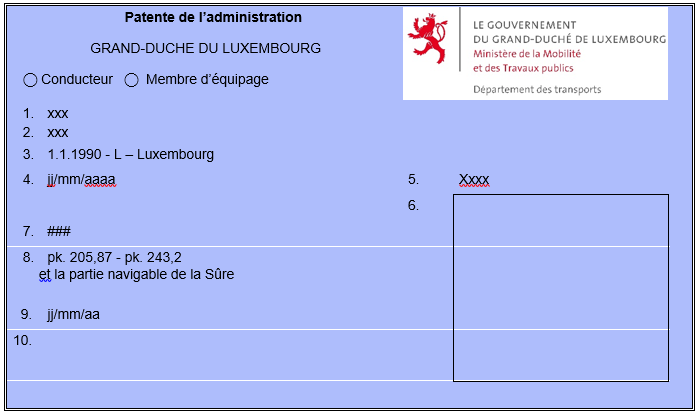
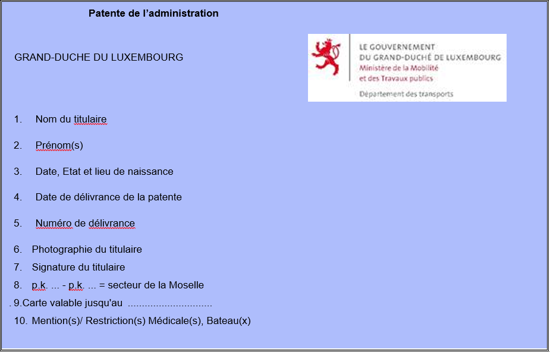

# Règlement grand-ducal du 7 décembre 2022 portant instauration et détermination des modalités de délivrance des titres de qualification pour les personnes intervenant dans l’exploitation de bâtiments utilisés pour les besoins des services publics nationaux ; et portant modification du règlement grand-ducal du 11 septembre 2020 fixant le programme, la durée et les modalités de contrôle des connaissances de la formation professionnelle spéciale portant sur la recherche et la constatation des infractions ainsi que sur les dispositions pénales en matière de navigation fluviale.

Nous Henri, Grand-Duc de Luxembourg, Duc de Nassau,

Vu la [loi du 7 décembre 2022](https://legilux.public.lu/eli/etat/leg/loi/2022/12/07/a607/jo) relative à la reconnaissance des qualifications professionnelles dans le domaine de la navigation intérieure ;

Vu l’avis de la Chambre des fonctionnaires et des employés publics ;

Notre Conseil d’État entendu ;

Sur le rapport de Notre Ministre de la Mobilité et des Travaux publics, de Notre Ministre de la Justice, de Notre Ministre des Finances, de Notre Ministre de l’Intérieur et de Notre Ministre de la Fonction publique et après délibération du Gouvernement en conseil ;

Arrêtons :

## Art. 1er — Champ d’application

Le présent règlement grand-ducal a pour objet l’instauration et la détermination des modalités de délivrance du certificat de qualification pour personnes intervenant dans l’exploitation de bâtiments utilisés par l’Armée luxembourgeoise, la Police grand-ducale, le Corps grand-ducal d’incendie et de secours et le Service de la navigation.

Le présent règlement ne s’applique pas à la conduite de menues embarcations, c’est-à-dire des bâtiments dont la longueur maximale de la coque, gouvernail et beaupré non compris, est inférieure à 20 mètres. Le présent règlement ne s’applique non plus à la conduite d’un bâtiment autorisé au transport de plus de 12 passagers, d’un bac, ou d’une barge de poussage.

## Art. 2 — La patente de l’administration

Sur demande auprès du ministre ayant les Transports dans ses attributions, ci-après « ministre », la patente de l’administration est délivrée lorsque le candidat remplit les conditions de capacité professionnelle, linguistique et médicale fixées aux articles 3, 4 et 5 du présent règlement grand-ducal.

Le modèle de la patente de l’administration est fixé à l’annexe I.

## Art. 3 — Capacité professionnelle

La condition de la capacité professionnelle est établie par le fait que le candidat :

1° soit :

a) est titulaire d’un permis de navigation de plaisance de type fluvial conformément au [règlement grand-ducal modifié du 8 octobre 2009](https://legilux.public.lu/eli/etat/leg/rgd/2009/10/08/n2/jo) relatif à l’exécution de la [loi du 23 septembre 1997](https://legilux.public.lu/eli/etat/leg/loi/1997/09/23/n1/jo) portant réglementation de la navigation de plaisance et portant modification de certaines autres dispositions légales et modifiant l’article 8 du [règlement grand-ducal du 20 mars 1967](https://legilux.public.lu/eli/etat/leg/rgd/1967/03/20/n4/jo) concernant l’exécution de l’article 54, nos 2 et 3 de la [loi du 14 juillet 1966](https://legilux.public.lu/eli/etat/leg/loi/1966/07/14/n1/jo) sur l’immatriculation des bateaux de navigation intérieure et l’hypothèque fluviale ; et

b) a 120 heures de temps de navigation sur un bateau de navigation intérieure visé par le présent règlement grand-ducal, documenté par l’administration d’origine ou dans un livret de service ; et

c) a passé avec succès un examen théorique et pratique sur base du programme de formation visé à l’annexe II faisant l’objet d’une évaluation d’aptitude et de contrôle visée à l’article 7 ;

2° soit :

a) est titulaire d’un titre de qualification comme conducteur ou de matelot au titre de la [loi du 7 décembre 2022](https://legilux.public.lu/eli/etat/leg/loi/2022/12/07/a607/jo) relative à la reconnaissance des qualifications professionnelles dans le domaine de la navigation intérieure ; et

b) a 60 heures de temps de navigation sur un bateau de navigation intérieure visé par le présent règlement grand-ducal ;

3° soit est titulaire d’un certificat de qualification équivalent d’un État riverain de la Moselle ou d’un État rhénan.

## Art. 4 — Capacité médicale

La capacité médicale est prouvée sur base d’une attestation délivrée par un médecin agréé au Grand-Duché de Luxembourg.

Les normes de délivrance de l’attestation médicale sont celles fixées dans les normes ES-QIN.

## Art. 5 — Capacité linguistique

La capacité linguistique est établie en prouvant un niveau d’expression et de compréhension du vocabulaire nautique en langue allemande et française satisfaisant établi par une attestation délivrée à l’issue d’une procédure d’évaluation transparente et objective conformément à l’article 7 et correspondant aux critères fixés à l’annexe III.

Sont dispensés de la procédure d’évaluation prévue à l’alinéa 1er les titulaires d’un certificat de radiotéléphonie national ou étranger en vigueur, ainsi que les candidats-fonctionnaires et les fonctionnaires ayant trois ans d’expérience dans leur administration d’origine.

## Art. 6 — Droit de circulation

La patente de l’administration, autorisant son titulaire à naviguer dans le cadre des attributions de son service sur la Moselle internationale entre les points kilométriques 205,870 et points kilométriques 243,200 et la partie navigable de la Sûre, doit pouvoir être présenté à tout moment par le conducteur ou le membre d’équipage pendant son service.

La patente de l’administration indique les bateaux que le titulaire de la patente de l’administration est habilité à conduire.

La patente de l’administration indique aussi les restrictions médicales éventuelles.

La patente de l’administration perd sa validité de plein droit en cas de cession, à quelque titre que ce soit, à un tiers.

Le titulaire de la patente de l’administration est tenu d’informer immédiatement son supérieur hiérarchique ou, en cas d’empêchement, l’agent en service le plus élevé en rang, de toute incapacité l’empêchant d’exercer ses fonctions et d’assurer des services sûrs et de qualité. Le titulaire de la patente administrative doit en faire de même en cas de toute restriction médicale dont il a connaissance afin que le ministre peut imposer des mesures de réduction de risque conformément à l’article 18, paragraphe 5, de la [loi du 7 décembre 2022](https://legilux.public.lu/eli/etat/leg/loi/2022/12/07/a607/jo) relative à la reconnaissance des qualifications professionnelles dans le domaine de la navigation intérieure.

## Art. 7 — Autorisation d’examinateur ou d’évaluateur

En plus des examinateurs qualifiés, membres de la commission d’examen définie à l’article 14, paragraphe 6, de la [loi du 7 décembre 2022](https://legilux.public.lu/eli/etat/leg/loi/2022/12/07/a607/jo) relative à la reconnaissance des qualifications professionnelles dans le domaine de la navigation intérieure, le ministre peut désigner comme examinateurs des personnes dûment qualifiées qui font passer en son nom les évaluations d’aptitude et de contrôle visées aux articles 3 et 5 qui doivent être :

a) titulaire d’une patente de Rhin, d’un certificat de qualification de l’Union européenne ou d’une patente, donnant droit à circuler sur la Moselle internationale depuis au moins 5 ans à compter du jour de l’épreuve pratique ; et

b) avoir assuré, pendant une période d’au moins 24 mois précédant immédiatement la demande, des temps de navigation suffisants permettant de prouver de disposer de suffisamment d’expérience en la matière et concernant la qualification pour laquelle la formation est assurée.

La désignation d’examinateur autorise son titulaire à évaluer les compétences d’un candidat qui souhaite détenir une patente de l’administration.

L’examinateur ne doit pas évaluer un candidat auquel il a dispensé lui-même une formation, à moins qu’il n’ait reçu un accord explicite écrit par le ministre.

## Art. 8 — Validité et conditions de maintien de la patente de l’administration

La validité de la patente de l’administration est de 13 années ou jusqu’au premier réexamen des aptitudes médicales prévu à l’article 18, paragraphe 3, de la [loi du 7 décembre 2022](https://legilux.public.lu/eli/etat/leg/loi/2022/12/07/a607/jo) relative à la reconnaissance des qualifications professionnelles dans le domaine de la navigation intérieure.

Elle est renouvelée pour la même durée lorsque soit l’agent, soit le service public national d’affectation du candidat, ou les autres services d’urgence pour les besoins desquels un tel titre de qualification a été établi, apporte la preuve que :

a) le candidat a conduit un bateau visé par le présent règlement grand-ducal au moins 8 jours pendant les douze mois précédents qui est à attester par l’administration d’origine ou un dans le livret de service ; et

b) le candidat possède une attestation médicale valide.

Le nombre minimal de jours de conduite hors tâches d’instruction, exigé pour le renouvellement de la validité de la patente de l’administration peut être réduit pour les candidats au prorata du temps consacré à la formation.

Les titulaires d’une patente de l’administration doivent, afin de maintenir leur qualification, effectuer en moyenne annuelle 8 jours de temps de navigation sur un bateau visé par le présent règlement grand-ducal qui est à attester par l’administration d’origine ou un dans le livret de service.

## Art. 9 — Retrait, refus de renouvellement, suspension

(1) Le ministre peut retirer ou refuser le renouvellement de la patente de l’administration si des exigences relatives aux certificats de qualification ne sont plus satisfaites.

(2) Le ministre peut suspendre la validité de la patente de l’administration lorsque la suspension est nécessaire pour des raisons de sécurité ou d’ordre public.

(3) Les limitations ou restrictions éventuelles de la portée quant à la patente de l’administration délivrée en fonction du présent règlement sont inscrites sur celle-ci.

La durée de la suspension est fixée à un maximum de 12 mois et pourra être portée jusqu’à un maximum de 24 mois dans le cas de récidive dans un délai de trois ans à partir du jour où une première suspension a pris fin.

(4) Les décisions prévues en vertu de l’article 9, paragraphes 1er et 2, sont prises par le ministre après enquête administrative et sur avis motivé de la commission visée à l’article 14 de la [loi du 7 décembre 2022](https://legilux.public.lu/eli/etat/leg/loi/2022/12/07/a607/jo) relative à la reconnaissance des qualifications professionnelles dans le domaine de la navigation intérieure.

Contre ces décisions, un recours en réformation est ouvert devant le tribunal administratif.

À cette fin la commission a pour mission d’instruire le dossier, d’entendre l’intéressé dans ses explications et moyens de défense, de dresser procès-verbal et d’émettre un avis motivé pris à la majorité des voix.

Le ministre adresse quinze jours avant la séance de la commission une convocation par lettre recommandée à l’intéressé, l’invitant à s’y présenter soit seul, soit assisté par un avocat.

Si l’intéressé ne se présente pas devant la commission malgré deux convocations par lettre recommandée, la procédure sera exécutée par défaut.

(5) Les décisions visées par l’article 9, paragraphe 1er, prennent effet à partir de leur notification aux intéressés. La notification par voie postale s’effectue sous pli fermé et recommandé accompagné d’un avis de réception et elle ne sera réputée accomplie qu’en cas d’acceptation ou de refus d’acceptation de la lettre recommandée par le destinataire.

(6) La décision prise par le ministre en vertu de l’article 9, paragraphe 2, qui suspend la validité de la patente de l’administration est communiquée à l’intéressé sous pli fermé recommandé et accompagné d’un avis de réception.

(7) Si l’intéressé accepte la lettre recommandée, il est tenu de faire inscrire la mention de la décision sur sa patente de l’administration endéans les quinze jours suivant la remise de la lettre. La décision devient effective le jour de l’inscription de la mention, ou à défaut, quinze jours après la date de l’acceptation de la lettre recommandée.

Si l’intéressé refuse d’accepter la lettre recommandée, ou qu’en cas d’absence, il omet de la retirer dans le délai lui indiqué par l’Entreprise des postes et télécommunications, la décision devient effective quinze jours après la date de ce refus ou après la date d’échéance de ce délai.

## Art. 10 — Taxes

La patente de l’administration étant un document personnel, la délivrance et le renouvellement sont en principe soumis à des taxes d’instruction.

Sont exemptés de l’acquit d’une telle taxe d’instruction, les agents d’administrations publiques et les agents de service d’urgence où l’employeur se substitue à l’employé à l’obligation du paiement desdites taxes.

Il est dû une taxe d’instruction non remboursable pour :

a) la délivrance d’une patente de l’administration à hauteur de 100 euros ;

b) le renouvellement d’une patente de l’administration à hauteur de 50 euros.

Les taxes précitées sont prélevées pour le compte de l’État et payables à l’Administration de l’enregistrement, des domaines et de la TVA.

## Art. 11 — Disposition modificative

À l’article 2 du [règlement grand-ducal du 11 septembre 2020](https://legilux.public.lu/eli/etat/leg/rgd/2020/09/11/a779/jo) fixant le programme, la durée et les modalités de contrôle des connaissances de la formation professionnelle spéciale portant sur la recherche et la constatation des infractions ainsi que sur les dispositions pénales en matière de navigation fluviale, la quatrième partie du programme de formation professionnelle spéciale est complétée par une nouvelle lettre e) libellée comme suit :

> e) les dispositions pénales de la [loi du 7 décembre 2022](https://legilux.public.lu/eli/etat/leg/loi/2022/12/07/a607/jo) relative à la reconnaissance des qualifications professionnelles dans le domaine de la navigation intérieure. »

## Art. 12 — Dispositions abrogatoires

Sont abrogés :

1°. le [règlement grand-ducal modifié du 30 décembre 1992](https://legilux.public.lu/eli/etat/leg/rgd/1992/12/30/n2/jo) portant application de la [Directive N° 91/672/CEE](https://legilux.public.lu/eli/dir_ue/1991/672/jo) du Conseil du 16 décembre 1991 sur la reconnaissance réciproque des certificats de conduite nationaux de bateaux pour le transport de marchandises et de personnes par navigation intérieure ; et

2°. le [règlement grand-ducal du 17 mars 1998](https://legilux.public.lu/eli/etat/leg/rgd/1998/03/17/n4/jo) relatif aux certificats de conduite de bateaux de navigation intérieure.

## Art. 13 — Dispositions transitoires

Les candidats intervenant dans l’exploitation de bâtiments visés à l’article 1er utilisés pour les besoins de l’Armée luxembourgeoise, la Police grand-ducale, le Corps grand-ducal d’incendie et de secours et le Service de la navigation et titulaires d’un des titres visés à l’article 3 peuvent, par dérogation à ce même article, obtenir la transcription de leur qualification vers une patente de l’administration sur le seul vu de leur certificat médical visé à l’article 4 s’ils en font la demande pendant une durée maximale de deux ans après la date d’entrée en vigueur du présent règlement grand-ducal.

## Art. 14 — Intitulé de citation

La référence au présent règlement se fait sous la forme suivante : « règlement grand-ducal du 7 décembre 2022 portant instauration et détermination des modalités de délivrance des titres de qualification pour les personnes intervenant dans l’exploitation de bâtiments utilisés pour les besoins des services publics nationaux ».

## Art. 15 — Entrée en vigueur

Le présent règlement entre en vigueur le jour de sa publication au Journal officiel du Grand-Duché du Luxembourg.

## Art. 16 — Formule exécutoire

Notre ministre ayant les Transports dans ses attributions, Notre ministre ayant la Justice dans ses attributions, Notre ministre ayant les Finances dans ses attributions, Notre ministre ayant l’Intérieur dans ses attributions et Notre ministre ayant la Fonction publique dans ses attributions sont chargés, chacun en ce qui le concerne, de l’exécution du présent règlement qui sera publié au Journal officiel du Grand-Duché du Luxembourg.

Le Ministre de la Mobilité  et des Travaux publics,   François Bausch

Vientiane, le 7 décembre 2022.   Henri

\**ANNEXE I**

\**Patente pour la conduite de bateaux de navigation intérieure sur la Moselle**

\**(85 mm x 54 mm - Fond bleu)**

(recto)

(verso)

\**ANNEXE II**

\**Programme de formation et d’examen pour l’obtention d’une patente de l’administration**

L’examen théorique est réussi lorsque le candidat a reçu au moins 3/5ème du total des points des matières dans la partie théorique.

L’examen pratique est réussi lorsque le candidat atteste un contrôle satisfaisant du bâtiment lors d’une conduite sur le ou les bateaux fluviaux concernés sur la Moselle internationale.

Un règlement d’examen à approuver par le ministre peut préciser les modalités de l’examen pratique et théorique.

\**Remarque préalable :**

\**Connaissances exigées** (colonne 3)

1 - Connaissances détaillées

2 - Connaissances de base

| 1 | 2 | 3 |
|---|---|---|
| chiffre | Matières examinées |  |
| **1.** | **Connaissance des règlements, guides et manuels** |  |
| **1.1** | **Règlement de police pour la navigation de la Moselle** |  |
|  | Chapitre 1 à 7 | 1 |
|  | Chapitre 9, 10, 11 | 1 |
|  | **Annexes** |  |
|  | Signalisation des bateaux | 1 |
|  | Signaux sonores | 1 |
|  | Panneaux de signalisation pour la navigation | 1 |
|  | Balisage de la voie navigable | 1 |
|  | Carnet de contrôle des huiles usées | 1 |
|  | **Guides / manuels** |  |
|  | Radiotéléphonie | 2 |
|  | Elimination des déchets | 2 |
| **1.2** | **Règlement de visite des bateaux intérieure (BinSchUO) et du Standard européen établissant les prescriptions techniques des bateaux de navigation intérieure (ES-TRIN)** |  |
|  | Structure et contenu | 2 |
|  | Contenu du certificat de bateau de navigation intérieure | 2 |
| **1.3** | **Prévention des accidents** | 2 |
| **2.** | **Connaissances professionnelles** |  |
|  | (capacités nautiques, techniques de l'exploitation du bateau) |  |
| **2.1** | **Conduite du bateau** |  |
|  | Conduite, manœuvrabilité | 2 |
|  | Fonction des installations de gouverne et propulsion | 2 |
|  | Action du courant, du vent et de la succion | 2 |
|  | Flottabilité, stabilité et leur application pratique | 2 |
|  | Ancrage et amarrage | 2 |
| **2.2** | **Connaissances des machines** |  |
|  | Construction, fonctionnement des moteurs, fonction des installations électriques | 2 |
|  | Manipulation, contrôle de fonctionnement | 2 |
|  | Mesures à prendre en cas de dérangement | 2 |
| **2.3** | **Chargement et déchargement** |  |
|  | Arrimage de la cargaison | 2 |
| **2.4** | **Conduite en cas de circonstances particulières** |  |
|  | Mesures en cas d'avaries, premiers secours, colmatage d'une voie d'eau | 2 |
|  | Utilisation d'appareils de sauvetage | 2 |

\**ANNEXE III**

\**Exigences en matière de compétences linguistiques**

Les exigences en matière de compétences linguistiques sont applicables autant à l’utilisation des expressions conventionnelles qu’à celle du langage clair. Pour satisfaire aux exigences linguistiques, le candidat à une patente de l’administration ou le titulaire d’une patente de l’administration devra faire l’objet d’une évaluation et prouver qu’il a un niveau au moins équivalent au niveau opérationnel.

Les locuteurs compétents doivent satisfaire aux conditions suivantes :

a) pouvoir communiquer efficacement dans les échanges en phonie (téléphone/radiotéléphone) et en face à face ;

b) pouvoir s’exprimer avec précision et clarté sur des sujets courants, concrets et professionnels ;

c) pouvoir utiliser des stratégies de communication appropriées pour échanger les messages et pour détecter et résoudre les malentendus (par exemple pour vérifier, confirmer ou clarifier des informations) dans un contexte général ou professionnel ;

d) pouvoir traiter efficacement et assez facilement les difficultés linguistiques induites par des complications ou des événements imprévus survenant dans le cadre d’une situation de travail ordinaire ou d’une tâche de communication qu’ils connaissent bien en temps normal ;

e) pouvoir utiliser un dialecte ou un accent compréhensible pour la communauté nautique.

[Dir. (UE) 2017/2397](https://legilux.public.lu/eli/dir_ue/2017/2397/jo) et [Dir. 2021/1233](https://legilux.public.lu/eli/dir_ue/2021/1233/jo).
