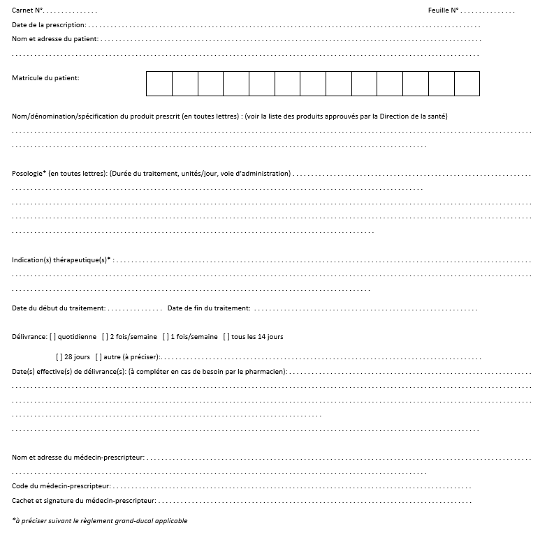

# Règlement grand-ducal du 8 février 2023 modifiant le règlement grand-ducal modifié du 18 janvier 2005 déterminant le modèle du carnet à souches prévu à l’article 30-1 de la loi modifiée du 19 février 1973 concernant la vente de substances médicamenteuses et la lutte contre la toxicomanie.

Nous Henri, Grand-Duc de Luxembourg, Duc de Nassau,

Vu la [loi modifiée du 19 février 1973](https://legilux.public.lu/eli/etat/leg/loi/1973/02/19/n1/jo) concernant la vente de substances médicamenteuses et la lutte contre la toxicomanie, et notamment son article 7 ;

Vu l’avis du Collège médical ;

Vu l’article 1er, paragraphe 1er, de la [loi modifiée du 16 juin 2017](https://legilux.public.lu/eli/etat/leg/loi/2017/06/16/a592/jo) sur l’organisation du Conseil d’État et considérant qu’il y a urgence ;

Sur le rapport de Notre Ministre de la Santé et après délibération du Gouvernement en conseil ;

Arrêtons :

## Art. 1er.

L’annexe C du [règlement grand-ducal modifié du 18 janvier 2005](https://legilux.public.lu/eli/etat/leg/rgd/2005/01/18/n3/jo) déterminant le modèle du carnet à souches prévu à l’article 30-1 de la [loi modifiée du 19 février 1973](https://legilux.public.lu/eli/etat/leg/loi/1973/02/19/n1/jo) concernant la vente de substances médicamenteuses et la lutte contre la toxicomanie est remplacé par l’annexe C du présent règlement.

## Art. 2.

Les carnets à souches conformes au modèle à utiliser dans le cadre de la prescription de cannabis et de certains de ses dérivés à des fins médicales, tels que déterminés par le [règlement grand-ducal modifié du 21 août 2018](https://legilux.public.lu/eli/etat/leg/rgd/2018/08/21/a868/jo) déterminant les modalités de prescription et d’accès à l’usage de cannabis à des fins médicales, ainsi que le contenu et la durée de la formation spéciale pour les médecins-spécialistes et modifiant : 1° le [règlement grand-ducal modifié du 19 février 1974](https://legilux.public.lu/eli/etat/leg/rgd/1974/02/19/n1/jo) portant exécution de la [loi du 19 février 1973](https://legilux.public.lu/eli/etat/leg/loi/1973/02/19/n1/jo) sur la vente de substances médicamenteuses et la lutte contre la toxicomanie ; 2° le [règlement grand-ducal modifié du 18 janvier 2005](https://legilux.public.lu/eli/etat/leg/rgd/2005/01/18/n3/jo) déterminant le modèle du carnet à souches prévu à l’article 30-1 de la [loi modifiée du 19 février 1973](https://legilux.public.lu/eli/etat/leg/loi/1973/02/19/n1/jo) concernant la vente de substances médicamenteuses et la lutte contre la toxicomanie peuvent être utilisés jusqu’au 31 décembre 2023, à condition que la durée de délivrance de la prescription ne dépasse pas vingt-huit jours.

## Art. 3.

Le ministre ayant la Santé dans ses attributions est chargé de l’exécution du présent règlement qui sera publié au Journal officiel du Grand-Duché de Luxembourg.

La Ministre de la Santé,   Paulette Lenert

Nan, le 8 février 2023   .   Henri

\**Annexe**

\**ANNEXE C**

\**Modèle du carnet à souches**

\**à utiliser dans le cadre de la prescription de cannabis et de certains de ses dérivés à des fins médicales**

\**Prescription**

