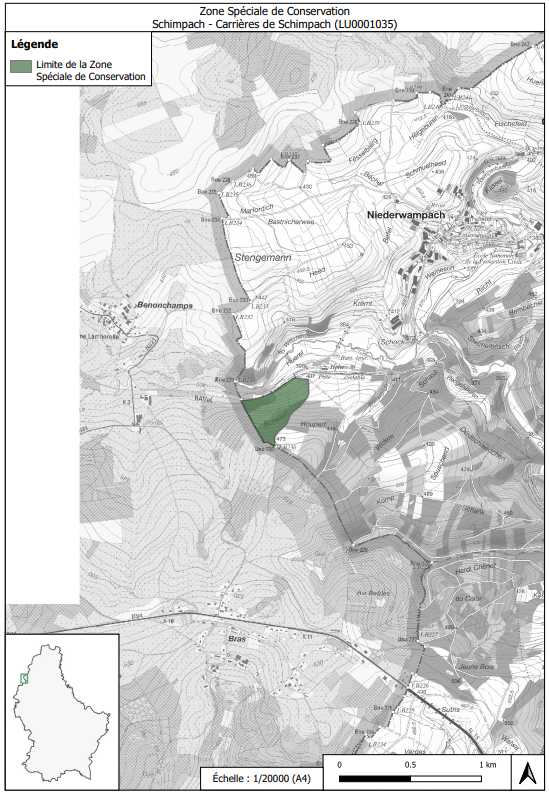

# Règlement grand-ducal du 24 mai 2023 désignant zone spéciale de conservation et déclarant obligatoire la zone « Schimpach - Carrières de Schimpach » et modifiant le règlement grand-ducal modifié du 6 novembre 2009 portant désignation des zones spéciales de conservation.

Nous Henri, Grand-Duc de Luxembourg, Duc de Nassau,

Vu les articles 2, 4, 31 à 35 et 37, de la [loi modifiée du 18 juillet 2018](https://legilux.public.lu/eli/etat/leg/loi/2018/07/18/a771/jo) concernant la protection de la nature et des ressources naturelles ;

Vu la fiche financière ;

Vu l’avis de l’Observatoire de l’environnement naturel du 23 novembre 2022 ;

Vu l’avis de la Chambre de commerce ;

Les avis de la Chambre des métiers et de la Chambre d’agriculture ayant été demandés ;

Notre Conseil d’État entendu ;

Sur le rapport de Notre Ministre de l’Environnement, du Climat et du Développement durable, et après délibération du Gouvernement en conseil ;

Arrêtons :

## Art. 1er.

Est désignée zone spéciale de conservation et déclarée obligatoire la zone « Schimpach - Carrières de Schimpach », ci-après la « zone spéciale de conservation », référencée sous le code LU0001035, et faisant partie intégrante du réseau Natura 2000.

## Art. 2.

La zone spéciale de conservation est désignée en vue :

1° du maintien ou, le cas échéant, du rétablissement de l’état de conservation favorable des habitats et espèces d’intérêt communautaire mentionnés à l’article 3 ;

2° de la préservation, du maintien ou, le cas échéant, du rétablissement de la structure et des fonctions spécifiques des habitats d’intérêt communautaire mentionnés à l’article 3, ainsi que de l’état de conservation de leurs espèces typiques ;

3° de la préservation, du maintien ou, le cas échéant, du rétablissement d’une diversité, d’une superficie et d’une qualité des habitats des espèces d’intérêt communautaire mentionnées à l’article 3 ;

4° de la protection contre les perturbations touchant les espèces d’intérêt communautaire mentionnés à l’article 3, pour autant que ces perturbations soient susceptibles d’avoir un effet significatif eu égard aux objectifs du présent article ;

5° de sa contribution à la cohérence du réseau Natura 2000 tant au niveau national qu’au sein de l’Union européenne.

## Art. 3.

Les objectifs spécifiques de conservation de la zone spéciale de conservation, ainsi que les mesures de conservation spéciales à assurer afin de maintenir ou, le cas échéant, rétablir l’état de conservation favorable des habitats et espèces d’intérêt communautaire visés, en l’occurrence à travers les mesures de conservation visées aux articles 32 à 35 et 37 de la [loi modifiée du 18 juillet 2018](https://legilux.public.lu/eli/etat/leg/loi/2018/07/18/a771/jo) concernant la protection de la nature et des ressources naturelles, sont :

1° maintien, voire rétablissement de l’état de conservation favorable des roches siliceuses avec végétation pionnière du *Sedo-Scleranthion* ou du *Sedo albi-Veronicion dillenii* (8230) :

a) préservation et restauration des roches ;

b) aménagement d’un périmètre de protection autour des roches ;

c) abandon de l’exploitation ;

d) gestion par débroussaillage ponctuel, le cas échéant ;

2° maintien, voire rétablissement de l’état de conservation favorable des habitats du Grand Murin *Myotis myotis* :

a) préservation des cavités souterraines, mines et galeries, et tunnels abandonnés ;

b) maintien ou rétablissement de l’accès aux orifices miniers par sécurisation adaptée ;

c) préservation et restauration des bocages, bosquets, ripisylves et futaies feuillues, ainsi que des lisières forestières structurées ;

d) désignation d’îlots de vieillissement ;

e) amélioration de la connectivité écologique ;

f) préservation de la quiétude en période d’hivernation ;

g) prévention de la pollution lumineuse ;

3° maintien, voire rétablissement de l’état de conservation favorable des habitats du Murin à oreilles échancrées *Myotis emarginatus* et du Grand Rhinolophe *Rhinolophus ferrumequinum* :

a) préservation des cavités souterraines, mines et galeries, et tunnels abandonnés ;

b) maintien ou rétablissement de l’accès aux orifices miniers par sécurisation adaptée ;

c) préservation et restauration des pâtures riches en structures paysagères telles que bocages et bosquets, ainsi que des lisières forestières structurées ;

d) amélioration de la connectivité écologique ;

e) préservation de la quiétude en période d’hivernation ;

f) prévention de la pollution lumineuse.

## Art. 4.

Les mesures de conservation spéciales de la zone spéciale de conservation sont déclinées en objectifs opérationnels et précisées dans un plan de gestion approprié.

## Art. 5.

La délimitation de la zone spéciale de conservation est indiquée sur le plan figurant en annexe. La zone spéciale de conservation couvre une superficie totale de 11,03 hectares.

## Art. 6.

Le [règlement grand-ducal modifié du 6 novembre 2009](https://legilux.public.lu/eli/etat/leg/rgd/2009/11/06/n6/jo) portant désignation des zones spéciales de conservation est modifié comme suit :

1° À l’article 4, le point (30.) est supprimé ;

2° L’annexe 1 est modifiée comme suit :

a) Au tableau 1, la ligne portant le numéro 30, faisant référence au site LU0001035, est supprimée ;

b) À la carte 1, la référence au site LU0001035 est supprimée ;

c) Aux tableaux 2 et 3, la ligne portant le numéro LU0001035 est supprimée ;

3° À l’annexe 2, la carte portant le titre « Zone Spéciale de Conservation « Schimpach - Carrières de Schimpach » (LU0001035) » est supprimée.

## Art. 7.

La référence au présent règlement se fait sous la forme suivante : «  règlement grand-ducal du 24 mai 2023 désignant zone spéciale de conservation la zone « Schimpach - Carrières de Schimpach » ».

## Art. 8.

Notre ministre ayant l’Environnement dans ses attributions est chargé de l’exécution du présent règlement qui sera publié au Journal officiel du Grand-Duché de Luxembourg.

La Ministre de l’Environnement, du Climat et du Développement durable,   Joëlle Welfring

Palais de Luxembourg, le 24 mai 2023.   Henri

ANNEXE

Pour visualiser la carte en haute définition, [cliquez ici](http://data.legilux.public.lu/filestore/eli/etat/leg/rgd/2023/05/24/a266/jo/fr/pdfa/annexe/1/eli-etat-leg-rgd-2023-05-24-a266-jo-fr-pdfa-annexe-1.pdf).
