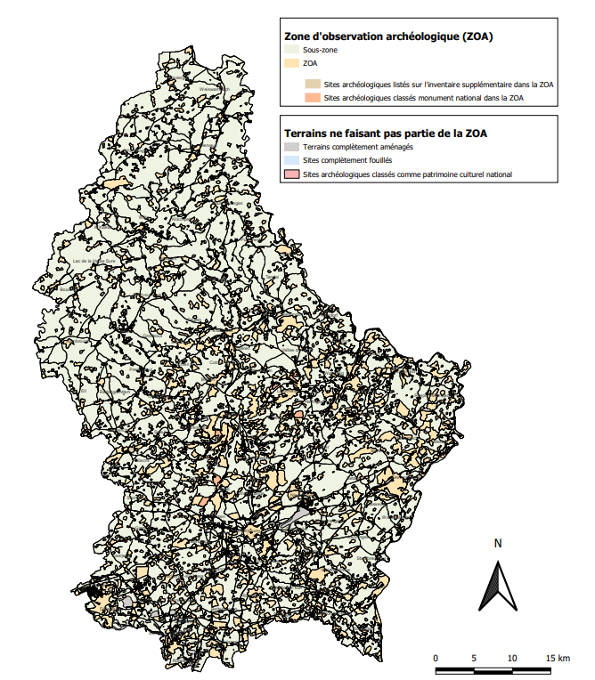

# Règlement grand-ducal du 26 juillet 2023 portant délimitation de la zone d’observation archéologique.

Nous Henri, Grand-Duc de Luxembourg, Duc de Nassau,

Vu la [loi du 25 février 2022](https://legilux.public.lu/eli/etat/leg/loi/2022/02/25/a80/jo) relative au patrimoine culturel, et notamment son article 4 ;

Vu la consultation publique organisée conformément à l’article 4 de la [loi précitée du 25 février 2022](https://legilux.public.lu/eli/etat/leg/loi/2022/02/25/a80/jo) ;

Vu l’avis de la Chambre de Commerce du 14 juillet 2023 ;

L’avis de la Chambre des métiers ayant été demandé ;

Le Conseil d’État entendu ;

Sur le rapport de la Ministre de la Culture et après délibération du Gouvernement en conseil ;

Arrêtons :

## Art. 1er.

La zone d’observation archéologique est délimitée conformément à l’annexe.

## Art. 2.

Le ministre ayant la Culture dans ses attributions est chargé de l’exécution du présent règlement qui sera publié au Journal officiel du Grand-Duché de Luxembourg.

La Ministre de la Culture,   Sam Tanson

Cabasson, le 26 juillet 2023.   Henri

Zone d’observation archéologique

Pour visualiser la carte en haute définition, [cliquez ici](https://data.legilux.public.lu/filestore/eli/etat/leg/rgd/2023/07/26/a563/jo/fr/pdfa/annexe/1/eli-etat-leg-rgd-2023-07-26-a563-jo-fr-pdfa-annexe-1.pdf).
