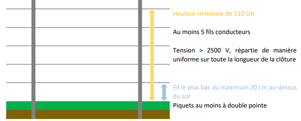
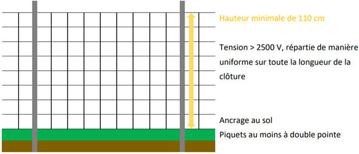
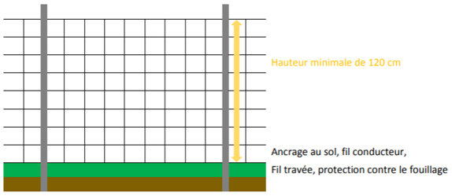

# Règlement grand-ducal du 30 août 2023 concernant l’indemnisation des dégâts matériels commis par certaines espèces animales protégées et les subventions pour les mesures préventives y relatives.

## Chapitre 1er — Généralités

### Art. 1er — Objet

Le présent règlement a pour objet l’indemnisation des dégâts commis par les espèces animales protégées suivantes, ainsi que le subventionnement des mesures préventives y relatives :

1\. le loup (*Canis lupus)* ;

2\. le castor d’Eurasie (*Castor fiber)*, ci-après dénommé « castor » ;

3\. le blaireau européen (*Meles meles)*, ci-après dénommé « blaireau » ;

4\. le corbeau freux (*Corvus frugilegus)*, la corneille noire (*Corvus corone)* et le choucas des tours (*Coloeus monedula)* ; ci-après dénommés « corvidés »

### Art. 2 — Définitions

Au sens du présent règlement, on entend par :

1° « preuve évidente de présence du loup » : faits concrets prouvant la présence d’un loup, tels par exemple la capture de l’animal vivant, la présence du cadavre du loup, une preuve génétique, une photo, une localisation par télémétrie.

2° « indice confirmé de présence du loup » : indice vérifié par une personne expérimentée, tel par exemple une trace ou une prédation, sur demande de l’Administration de la nature et des forêts, ci-après dénommée « l’administration », permettant de confirmer que l’auteur des dégâts est le loup. La personne expérimentée peut vérifier et confirmer l’indice sur le terrain ou le faire à l’aide d’une documentation pertinente établie par une personne tierce.

### Art. 3 — Bénéficiaires

Le ministre ayant l’Environnement dans ses attributions accorde des indemnisations et subventions financières :

1° à tout propriétaire ou détenteur subissant des dégâts aux animaux d’élevage ou aux chiens de chasse pendant l’exercice de la chasse, respectivement aux chiens de protection de troupeaux pendant l’exécution de leur mission, causés par le loup, et à tout propriétaire ou détenteur qui met en place des dispositifs de prévention d’attaques de loups ;

2° à tout exploitant agricole tel que défini par la [loi modifiée du 2 août 2023](https://legilux.public.lu/eli/etat/leg/loi/2023/08/02/a489/jo) concernant le soutien au développement durable des zones rurales, ainsi qu’à tout propriétaire subissant des dégâts causés par le castor à sa forêt, à ses arbres fruitiers ou à ses arbres faisant partie d’un système agro-forestier ;

3° à tout exploitant agricole tel que défini par la [loi modifiée du 2 août 2023](https://legilux.public.lu/eli/etat/leg/loi/2023/08/02/a489/jo) concernant le soutien au développement durable des zones rurales subissant des dégâts causés par le blaireau et les corvidés.

## Chapitre 2 — Indemnisation des dégâts commis par le loup et subventions pour dispositifs de prévention d’attaques

### Art. 4 — Indemnisation des dégâts causés aux animaux d’élevage

(1) Le ministre indemnise les dégâts directs causés aux animaux d’élevage qui ont été tués ou blessés par le loup, dans les cas suivants :

1° au cas où le loup est identifié comme l’auteur de la mort respectivement des blessures de l’animal concerné, à hauteur de :

a) 100 pour cent de la valeur vénale de l’animal tué par le loup ou euthanasié à la suite d’une attaque de loup jusqu’à concurrence maximale de 200 % de la valeur vénale moyenne des animaux de cette même catégorie ;

b) 100 pour cent des frais de vétérinaire en relation avec le traitement de l’animal blessé jusqu’à concurrence de la valeur vénale de l’animal ;

2° au cas où le loup ne peut pas être exclu comme l’auteur de la mort respectivement des blessures de l’animal concerné, à hauteur de :

a) 75 pour cent de la valeur vénale de l’animal tué ou euthanasié jusqu’à concurrence maximale de 200 % de la valeur vénale moyenne des animaux de cette même catégorie ;

b) 75 pour cent des frais de vétérinaire en relation avec le traitement de l’animal blessé jusqu’à concurrence de la valeur vénale de l’animal ;

(2) Le ministre indemnise 100 pour cent de la valeur vénale des animaux d’élevage évadés ou égarés définitivement :

1° lorsque le loup est identifié comme l’auteur de la mort respectivement de la blessure d’autres animaux d’élevage faisant partie du même troupeau qui a été attaqué ; ou

2° lorsqu’il est constaté, sur base d’éléments de preuve rapportés par le propriétaire ou l’exploitant, que l’évasion ou l’égarement est dû à la présence du loup.

(3) L’identification du loup comme auteur ou comme auteur probable de la mort ou des blessures de l’animal concerné est réalisée par un agent de l’Administration de la nature et des forêts, conformément à l’article 6.

(4) À partir de la troisième attaque de loup sur un même pâturage ou un même troupeau, indemnisée en vertu du paragraphe 1er, les propriétaires ou détenteurs de moutons et de chèvres doivent mettre en place des dispositifs de prévention d’attaques conformément à l’article 7 pour pouvoir bénéficier à nouveau des indemnisations prévues aux paragraphes 1er et 2.

(5) La valeur vénale de l’animal est déterminée au cas par cas par une expertise réalisée par des agents assermentés de l’Administration des services technique de l’agriculture.

Les facteurs suivants sont pris en compte : l’espèce, l’appartenance raciale, le sexe, l’âge, l’état de gestation, le niveau de performance et le type d’élevage visé.

### Art. 5 — Indemnisation des dégâts causés aux chiens de chasse

(1) Au cas où le loup est identifié comme l’auteur de la mort respectivement des blessures d’un chien de chasse au cours d’un exercice de chasse, le ministre indemnise :

1° 100 pour cent de la valeur vénale du chien de chasse tué ;

2° 100 pour cent des frais de vétérinaire en relation avec le traitement du chien de chasse blessé jusqu’à concurrence de la valeur vénale du chien concerné et dans la limite de 4 000 euros.

L’identification du loup comme auteur de la mort ou des blessures de l’animal concerné est réalisée par un agent de l’administration conformément à l’article 6.

(2) La valeur vénale du chien de chasse est déterminée par une expertise réalisée par des agents assermentés de l’Administration luxembourgeoise vétérinaire et alimentaire.

### Art. 6 — Constat des dégâts et établissement du lien avec le loup

(1) Aux fins d’être indemnisé conformément aux article 4, paragraphes 1er et 2, et article 5, paragraphe 1er, la personne lésée informe l’administration d’une attaque présumée du loup ayant causé la mort ou la blessure d’animaux d’élevage ou de chiens de chasse, dans les meilleurs délais et au plus tard dans les vingt-quatre heures suivant le constat d’une telle attaque.

En cas de blessure de l’animal d’élevage ou du chien de chasse, le vétérinaire traitant procède à une prise d’échantillons qu’il envoie à l’administration. L’administration envoie la prise d’échantillons à un laboratoire spécialisé pour procéder à une analyse génétique.

(2) Jusqu’à l’arrivée des agents de l’administration, la personne lésée protège le cadavre de toute contamination.

(3) L’administration procède à une inspection et à un examen de tous les indices présents sur les lieux et établit une expertise endéans les vingt-quatre heures suivant l’information de l’attaque présumée du loup.

Au cas où l’expertise identifie le loup comme l’auteur de la mort respectivement des blessures de l’animal concerné, l’indemnisation se fait conformément aux article 4, paragraphe 1er, point 1er et paragraphe 2, point 1er, et article 5, paragraphe 1er.

Au cas où l’expertise ne peut pas exclure le loup comme l’auteur de la mort respectivement des blessures de l’animal concerné, l’administration procède à une prise d’échantillons qui sont envoyés à un laboratoire spécialisé pour procéder à une analyse génétique.

Au cas où l’analyse génétique identifie le loup comme l’auteur de la mort respectivement des blessures de l’animal concerné, l’indemnisation se fait conformément à l’article 4, paragraphe 1er, point 1er et paragraphe 2, point 1er, et article 5, paragraphe 1er.

Au cas où l’analyse génétique n’est pas concluante et n’exclut pas le loup comme l’auteur de la mort respectivement des blessures de l’animal concerné, l’indemnisation se fait conformément à l’article 4, paragraphe 1er, point 2.

### Art. 7 — Subventions pour la mise en place de dispositifs de prévention d’attaques

Le ministre accorde des subventions financières pour l’achat et la mise en place des dispositifs de prévention d’attaques de loups suivants :

1° pour les propriétaires ou détenteurs de moutons ou de chèvres, 75 pour cent du coût d’achat et de mise en place de clôtures électriques à conducteurs, de clôtures électriques à filet ou de clôtures fixes type Ursus comme dispositifs de prévention d’attaques de loups, et dont les modalités de mise en place sont précisées à l’annexe. Cette subvention est accordée au demandeur qui rapporte :

a) au moins une preuve évidente de présence du loup, dans un rayon de 10 kilomètres autour du pâturage concerné, indépendamment des frontières nationales, au cours des douze mois précédant la demande, ou

b) en l’absence de preuve évidente de présence du loup, au moins trois indices confirmés de présence du loup dans un rayon de 10 kilomètres autour du pâturage concerné, indépendamment des frontières nationales, au cours des douze mois précédant la demande.

2° pour les propriétaires ou détenteurs de moutons ou de chèvres détenant au moins cent moutons ou chèvres, 100 pour cent du prix d’achat de chiens de protection de troupeaux, dans les limites d’un chien par tranche de cent animaux et de 1 000 euros par chien.

Cette subvention est accordée au demandeur qui rapporte :

a) un certificat de formation spéciale relative à la détention et à la gestion de chiens de protection de troupeaux ;

b) un certificat de formation spéciale pour chiens de troupeaux attestant le passage avec succès de l’examen y relatif par le chien ;

c) la détention et l’utilisation d’au moins deux chiens de protection par troupeau ;

d) la mise en place préalable de clôtures comme dispositif de prévention d’attaques de loups conformément au point 1er, à l’exception du demandeur qui pratique le pâturage itinérant.

3° pour les propriétaires ou détenteurs d’autres animaux d’élevage et d’équidés, à l’exception des volailles, si au moins trois attaques de loup sur une même surface endéans une période de trois mois ont été constatées, 75 pour cent du coût d’achat et de mise en place de clôtures électriques à conducteurs, de clôtures électriques à filet ou de clôtures fixes type Ursus comme dispositifs de prévention d’attaques de loups, et dont les modalités de mise en place sont précisées à l’annexe.

## Chapitre 3 — Dégâts commis par le castor

### Art. 8 — Indemnisation des dégâts causés aux cultures agricoles

(1) Le ministre indemnise 100 pour cent des dégâts causés aux cultures agricoles par le castor.

(2) L’exploitant agricole introduit une demande d’indemnisation, prévue à l’article 11, dans les meilleurs délais et au plus tard quinze jours à partir du constat des dégâts de castor.

La demande précise la nature des dégâts, fournit une estimation de la surface endommagée ainsi qu’une évaluation financière des dégâts.

(3) L’identification du castor comme auteur du dommage est réalisée par un agent de l’administration endéans un délai de quinze jours à partir de l’introduction de la demande d’indemnisation.

(4) Au cas où une identification respectivement une évaluation des dégâts par un agent de l’administration n’est plus possible dans le délai mentionné au paragraphe 3 suite à la destruction des preuves, l’exploitant n’est pas indemnisé.

### Art. 9 — Indemnisation des dégâts causés aux arbres

(1) Le ministre indemnise 100 pour cent des dégâts causés aux arbres par le castor à partir d’un montant de 250 euros de dégâts.

(2) Le propriétaire introduit une demande d’indemnisation, prévue à l’article 11, dans un délai d’un an à partir de la survenance des dégâts de castor.

La demande précise la nature des dégâts, fournit une estimation du nombre d’arbres endommagés ainsi qu’une évaluation financière des dégâts.

(3) L’identification du castor comme auteur des dégâts est réalisée par un agent de l’administration dans un délai d’un mois à partir de l’introduction de la demande d’indemnisation.

(4) Au cas où une identification respectivement une évaluation des dégâts par un agent de l’administration n’est plus possible dans le délai visé au paragraphe 3 suite à la destruction des preuves, le propriétaire n’est pas indemnisé.

## Chapitre 4 — Dégâts commis par le blaireau et les corvidés

### Art. 10 — Indemnisation des dégâts causés aux cultures agricoles

(1) Le ministre indemnise 100 pour cent des dégâts causés aux cultures agricoles par le blaireau et les corvidés.

(2) L’exploitant agricole introduit une demande d’indemnisation, prévue à l’article 11, dans les meilleurs délais et au plus tard quinze jours à partir du constat des dégâts de blaireau ou de corvidés. La demande précise la nature des dégâts, fournit une estimation de la surface endommagée ainsi qu’une évaluation financière des dégâts.

(3) L’indemnisation comprend la perte de récolte et les frais occasionnés par le remblaiement et le réensemencement des cultures endommagées.

L’estimation des dégâts tient compte de la possibilité de limiter ces derniers par la remise en état des cultures endommagées dans l’année même.

Lorsqu’un fonds endommagé, ayant donné lieu à indemnisation calculée sur la récolte perdue, est remis en culture avant la date normale d’enlèvement de la récolte, les dégâts constatés dans la nouvelle culture ne sont pas indemnisés.

(4) Le dommage causé par le blaireau et les corvidés n’est pas indemnisé lorsque le propriétaire ou exploitant a négligé de prendre les précautions qui, dans des circonstances ordinaires, auraient suffi pour écarter le dommage.

(5) L’identification du blaireau respectivement des corvidés comme auteurs des dégâts est réalisée par un agent de l’administration dans un délai de quinze jours à partir de l’introduction de la demande d’indemnisation.

(6) L’exploitant agricole perd tout droit à indemnisation au cas où une identification respectivement une évaluation des dégâts par un agent de l’administration n’est plus possible dans le délai visé au paragraphe 5, suite à la destruction des preuves.

## Chapitre 5 — Procédures

### Art. 11 — Demandes d’indemnisation ou de subvention financière

(1) La demande d’indemnisation ou de subvention est introduite sur base du formulaire de demande élaboré par l’administration à cette fin. La demande est adressée à l’administration.

(2) La demande de subvention pour l’achat respectivement la mise en place de dispositifs de prévention d’attaques de loups prévue à l’article 7, points 1er et 3, est introduite avant l’achat respectivement le commencement des travaux de mise en place des mesures de prévention.

(3) La demande de subvention est accompagnée :

1° pour l’acquisition et la mise en place de clôtures prévues à l’article 7, points 1er et 3 :

a) d’un extrait de plan cadastral ou d’un extrait de carte topographique avec indication des fonds faisant l’objet des travaux de mise en place de dispositifs de prévention ;

b) d’un devis des coûts d’achat respectivement de mise en place des mesures de prévention ; et

c) d’un descriptif des spécificités techniques des mesures de prévention utilisées.

Pour la détermination du montant de la subvention, les frais de personnel ne dépassent pas les tarifs usuels pour la rémunération des travaux en régie au moment de la demande.

2° pour l’acquisition de chiens de protection de troupeaux, d’un contrat de vente précisant au moins le prix et la race du chien ainsi que les éléments visés à l’article 7, point 2, alinéa 2.

Les dépenses faisant l’objet d’une subvention sont justifiées sur base de factures.

(4) Le montant d’indemnisation des cultures agricoles est défini au cas par cas par une expertise réalisée par des agents de l’Administration de la nature et des forêts et suit les valeurs de production fixées par le Service d’économie rurale qui sont publiées sur un site électronique prévu à cet effet.[^1]

(5) Le montant d’indemnisation des arbres est défini au cas par cas par une expertise réalisée par des agents de l’administration.

(6) Le ministre approuve les demandes sur avis de l’administration.

### Art. 12 — Versement des subventions

Les subventions prévues à l’article 7, points 1er et 3 sont versées après la fin des travaux et après contrôle de leur bonne exécution constatée dans un procès-verbal de réception par un agent de l’administration.

### Art. 13 — Remboursement de subventions et d’indemnisations

Les subventions ou indemnisations sont remboursées à l’État s’il est constaté que le bénéficiaire ne s’est pas conformé aux conditions à la base de leur octroi.

Sont écartées les demandes d’indemnisation des dégâts prévues aux articles 8 à 10 lorsque les cultures agricoles ou les arbres endommagés ne respectent pas les dispositions de l’article 16 de la [loi modifiée du 18 juillet 2018](https://legilux.public.lu/eli/etat/leg/loi/2018/07/18/a771/jo) concernant la protection de la nature et des ressources naturelles respectivement ses règlements d’exécution.

## Chapitre 6 — Disposition finale

### Art. 14 — Formule exécutoire et de publication

Le ministre ayant l’Environnement dans ses attributions et le ministre ayant les Finances dans ses attributions sont chargés, chacun en ce qui le concerne, de l’exécution du présent règlement qui sera publié au Journal officiel du Grand-Duché de Luxembourg.

\**Annexe**

Modalités de mise en place des mesures de prévention

\**1. Clôture électrique à fils conducteurs**

Pour les clôtures électriques à fils conducteurs, la hauteur minimale est de 110 cm. Le nombre minimal de fils conducteurs est de 5. Le fil conducteur le plus bas doit se trouver à une hauteur maximale de 20 cm au-dessus du sol. La tension minimale est de 2500 V ; néanmoins 4000 V sont recommandés. Il faut veiller à ce que la tension soit répartie de manière uniforme sur toute la longueur de la clôture.

\**2. Clôture électrique à filet**

Pour les clôtures électriques à filet, la hauteur minimale est de 110 cm. Il faut veiller à ce que le filet soit bien tendu sur toute la longueur, et solidement ancré au sol. La tension minimale est de 2500 V ; néanmoins 4000 V sont recommandés. Il faut veiller à ce que la tension soit répartie de manière uniforme sur toute la longueur de la clôture.

\**3. Clôture fixe type Ursus**

Pour les clôtures fixes, la hauteur minimale est de 120 cm. Elle peut être en treillis métallique ou similaire. Il faut veiller à ce que la clôture soit bien tendue sur toute la longueur, et solidement ancrée au sol. Un fil travée en bas de la clôture respectivement une protection contre le creusement évitent que le loup passe par-dessous de la clôture. 1-2 fils conducteurs électriques proches du sol peuvent augmenter la protection (cf. 1.).

---

[^1]: [Règlement grand-ducal du 23 avril 2025 modifiant le règlement grand-ducal du 30 août 2023 concernant l’indemnisation des dégâts matériels commis par certaines espèces animales protégées et les subventions pour les mesures préventives y relatives.](https://legilux.public.lu/eli/etat/leg/rgd/2025/04/23/a155/jo)
