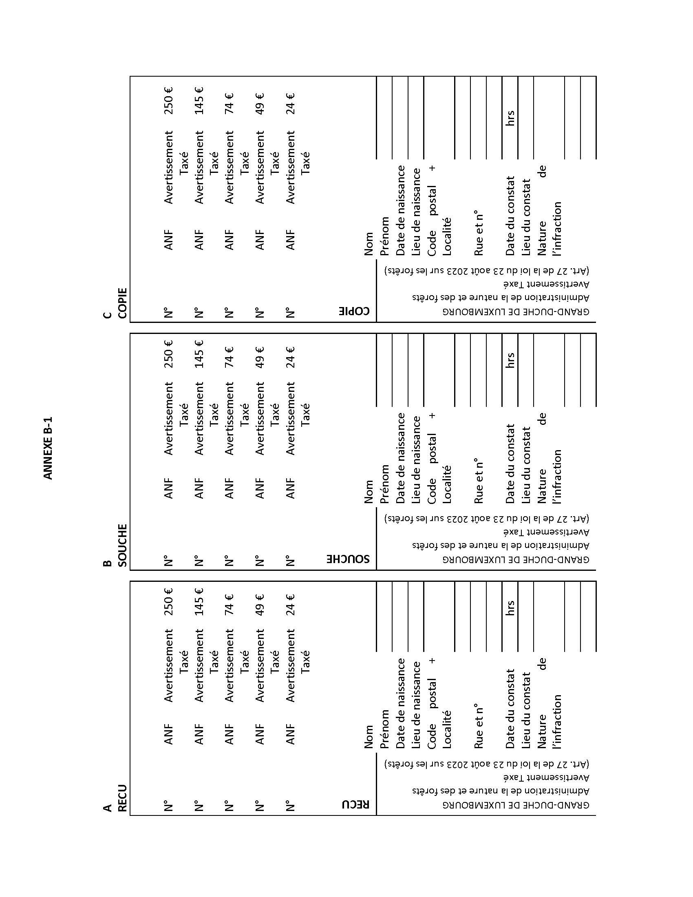
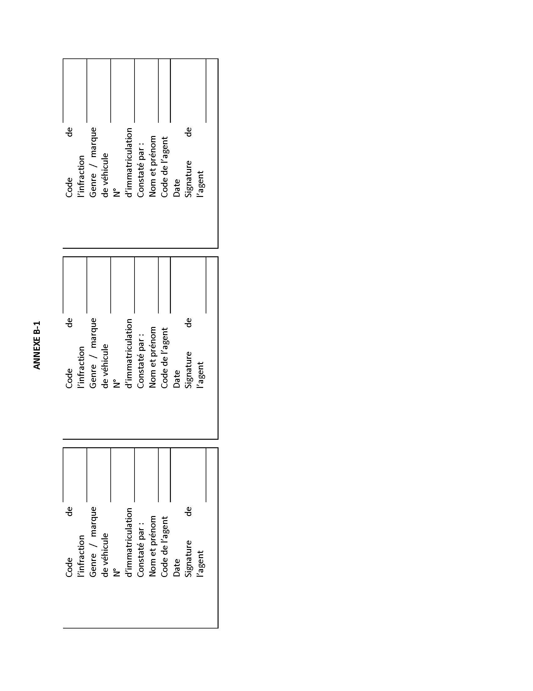
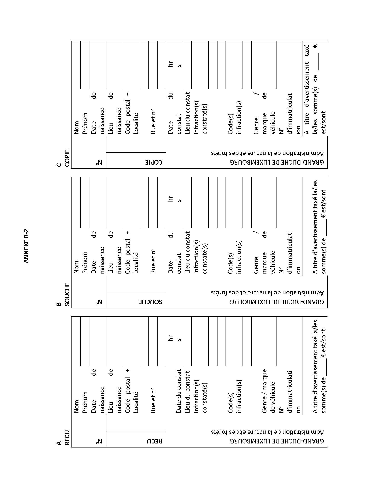
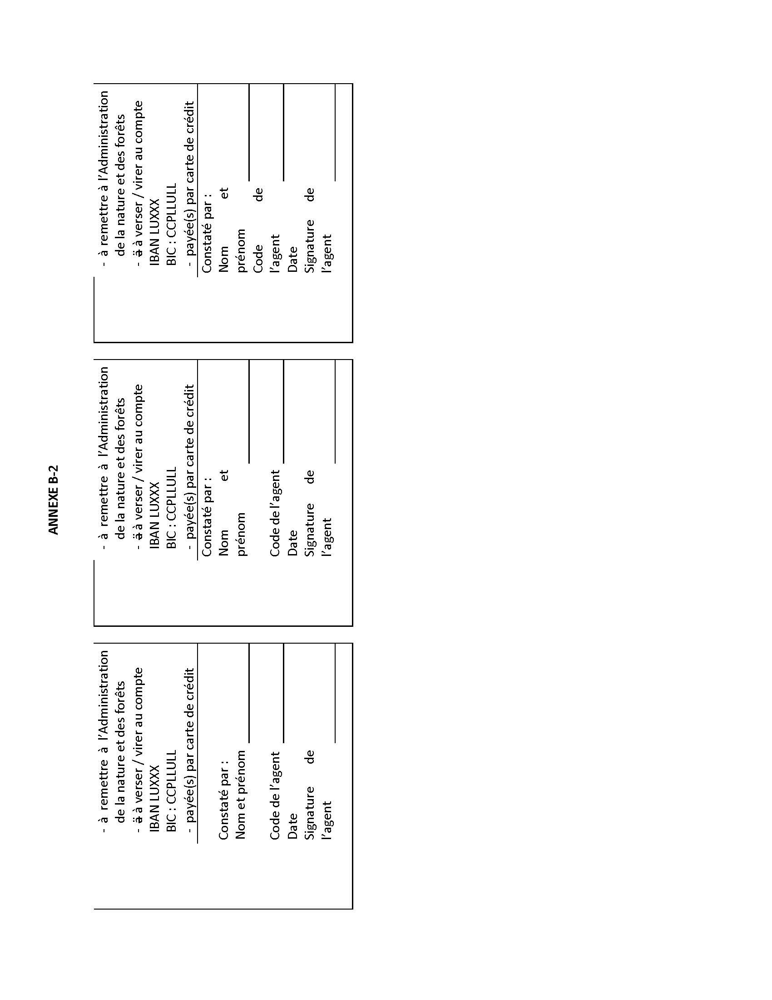

# Règlement grand-ducal du 25 septembre 2023 relatif aux avertissements taxés déterminant les modalités d’application de l’avertissement taxé et établissant un catalogue des contraventions soumises à l’avertissement taxé prévu par la loi sur les forêts.

Nous Henri, Grand-Duc de Luxembourg, Duc de Nassau,

Vu l’article 27 de la [loi du 23 août 2023](https://legilux.public.lu/eli/etat/leg/loi/2023/08/23/a544/jo) sur les forêts ;

Vu l’avis de la Chambre de commerce ;

Les avis de la Chambre des métiers et de la Chambre d’agriculture ayant été demandés ;

Le Conseil d’État entendu ;

Sur le rapport de la Ministre de l’Environnement, du Climat et du Développement durable, de la Ministre de la Justice, du Ministre de la Sécurité intérieure et de la Ministre des Finances et après délibération du Gouvernement en conseil ;

Arrêtons :

## Art. 1er.

Les montants de la taxe à percevoir pour l’avertissement taxé prévu à l’article 27 de la [loi du 23 août 2023](https://legilux.public.lu/eli/etat/leg/loi/2023/08/23/a544/jo) sur les forêts sont fixés respectivement à 24, 49, 74, 145 et 250 euros.

Le catalogue regroupant les contraventions suivant les différents montants de la taxe à percevoir est repris à l’annexe A.

## Art. 2.

(1) La perception sur place du montant de la taxe se fait soit en espèces, soit par règlement au moyen des seules cartes de crédit et modes de paiement électronique acceptés à cet effet.

L’avertissement taxé est donné d’après les formules composées d’un reçu, d’une copie et d’une souche.

À cet effet est utilisée la formule spéciale visée à l’article 3, alinéa 1er, du [règlement grand-ducal modifié du 26 août 1993](https://legilux.public.lu/eli/etat/leg/rgd/1993/08/26/n1/jo) relatif aux avertissements taxés, aux consignations pour contrevenants non résidents ainsi qu’aux mesures d’exécution de la législation en matière de mise en fourrière des véhicules et en matière de permis à points, pour les avertissements taxés donnés par les membres de la Police grand-ducale.

Les formules spéciales de l’avertissement taxé figurant à l’annexe B – 1 sont utilisées pour les avertissements taxés donnés par les agents de l’Administration de la nature et des forêts et sont composées d’un reçu, d’une copie et d’une souche.

L’agent verbalisant supprime les mentions qui ne conviennent pas.

Ces formules, dûment numérotées, sont reliées en carnets de quinze exemplaires que l’Administration de l’enregistrement, des domaines et de la TVA met à la disposition du directeur général de la Police grand-ducale et du directeur de l’Administration de la nature et des forêts.

(2) Lorsque le montant de l’avertissement taxé ne peut pas être perçu sur le lieu même de l’infraction, le contrevenant se voit remettre la sommation de payer la taxe dans le délai lui imparti. En cas d’établissement d’un procès-verbal, la copie de l’avertissement taxé est annexée audit procès-verbal et sera transmise au procureur d’État.

À cet effet est utilisée la formule spéciale de convocation visée à l’article 2, paragraphe 2, du [règlement grand-ducal modifié du 26 août 1993](https://legilux.public.lu/eli/etat/leg/rgd/1993/08/26/n1/jo) relatif aux avertissements taxés, aux consignations pour contrevenants non résidents ainsi qu’aux mesures d’exécution de la législation en matière de mise en fourrière des véhicules et en matière de permis à points pour les convocations données par les membres de la Police grand-ducale.

Les formules spéciales de convocation figurant à l’annexe B – 2 sont utilisées pour les convocations données par les agents de l’Administration de la nature et des forêts et sont composées d’un reçu, d’une copie et d’une souche.

L’agent verbalisant supprime les mentions qui ne conviennent pas.

Les formules, dûment numérotées, sont reliées en carnets de quinze exemplaires.

Le contrevenant acquitte l’avertissement taxé dans le délai imparti soit au bureau de la Police grand-ducale ou de l’Administration de la nature et des forêts qui lui est désigné par l’agent verbalisant, soit par versement ou virement de la taxe sur un compte bancaire déterminé de la Police grand-ducale ou de l’Administration de la nature et des forêts.

Toutes les taxes perçues par les membres de la Police grand-ducale et les agents de l’Administration de la nature et des forêts sont transmises sans retard à un compte chèque postal déterminé de l’Administration de l’enregistrement, des domaines et de la TVA.

Les frais de versement, de virement ou d’encaissement éventuels sont à charge du contrevenant, lorsque la taxe est réglée par versement ou virement bancaire. Elles sont à charge de l’État si le règlement se fait par carte de crédit ou au moyen d’un mode de paiement électronique.

## Art. 3.

(1) En cas de perception sur place de l’avertissement taxé, le reçu est remis au contrevenant contre le paiement de la somme due en vertu du catalogue des avertissements taxés repris à l’annexe A.

Lorsque la taxe est réglée par versement ou par virement sur un des comptes bancaires prévus à l’article 2, le récépissé en cas de versement et la copie en cas de virement servent de reçu au contrevenant.

(2) La copie est remise respectivement au directeur général de la Police grand-ducale et au directeur de l’Administration de la nature et des forêts.

(3) L’information au procureur d’État des avertissements taxés donnés se fait moyennant l’établissement par le directeur général de la Police grand-ducale et le directeur de l’Administration de la nature et des forêts de relevés mensuels.

(4) La souche reste dans le carnet de formules.

Du moment que le carnet est épuisé, il est renvoyé avec toutes les souches et les preuves de paiement y relatives, par les membres de la Police grand-ducale au directeur général de la Police grand-ducale et par les agents de l’Administration de la nature et des forêts au directeur de l’Administration de la nature et des forêts.

Si les formules n’ont pas abouti à l’établissement d’un avertissement taxé, elles sont renvoyées en entier et portent une mention afférente.

En cas de virement ou de versement de la taxe sur un des comptes bancaires prévus à l’article 2, le titre de virement et de versement fait fonction de souche.

(5) En cas d’établissement d’un procès-verbal, la copie de l’avertissement taxé est annexée audit procès-verbal et transmise au procureur d’État.

## Art. 4.

Chaque unité de la Police grand-ducale ainsi que l’Administration de la nature et des forêts tiennent un registre spécial indiquant les formules mises à sa disposition, les avertissements taxés donnés et les formules annulées.

Le directeur général de la Police grand-ducale et le directeur de l’Administration de la nature et des forêts établissent au début de chaque mois, en triple exemplaire, un bordereau récapitulatif portant sur les perceptions du mois précédent. Ce bordereau récapitulatif indique les noms et prénoms du contrevenant, son adresse exacte, la date et l’heure de l’infraction, le montant de la taxe perçue et la date du paiement, le numéro d’immatriculation du véhicule ayant, le cas échéant, servi à commettre l’infraction. Un premier exemplaire de ce bordereau est transmis à l’Administration de l’enregistrement, des domaines et de la TVA, un deuxième est transmis au procureur d’État et un troisième exemplaire est conservé par l’administration qui a émis l’avertissement taxé.

Le directeur général de la Police grand-ducale et le directeur de l’Administration de la nature et des forêts établissent au 31 décembre de chaque année un inventaire des opérations de l’année écoulée. Un exemplaire de cet inventaire est adressé à l’Administration de l’enregistrement, des domaines et de la TVA avec les formules annulées. Un autre exemplaire est transmis au procureur d’État.

## Art. 5.

Le ministre ayant la Gestion durable des forêts et l’Administration de la nature et des forêts dans ses attributions, le ministre ayant les Affaires pénales dans ses attributions, le ministre ayant la Police grand-ducale dans ses attributions et le ministre ayant les Finances dans ses attributions, sont chargés, chacun en ce qui le concerne, de l’exécution du présent règlement qui sera publié au Journal officiel du Grand-Duché de Luxembourg.

La Ministre de l’Environnement, du Climat et du Développement durable,   Joëlle Welfring   La Ministre de la Justice,   Sam Tanson   Le Ministre de la Sécurité intérieure,   Henri Kox   La Ministre des Finances,   Yuriko Backes

Palais de Luxembourg, le 25 septembre 2023.   Henri

\**ANNEXE A**

Catalogue des avertissements taxés établis conformément à la [loi du 23 août 2023](https://legilux.public.lu/eli/etat/leg/loi/2023/08/23/a544/jo) sur les forêts :

| Références aux articles | Code de l’infraction | Nature de l’infraction | Montant de la taxe |
|---|---|---|---|
| 8 paragraphe 1 | LF 001 | Coupe d’arbres d’un volume supérieur à 40 mètres cube sans notification telle que prévue à l’article 8 paragraphe 1er de la [loi du 23 août 2023](https://legilux.public.lu/eli/etat/leg/loi/2023/08/23/a544/jo) sur les forêts | 49 € |
| 6 | LF 002 | Prélèvement ou enlèvement de produits de la forêt en violation de l’article 6 de la [loi du 23 août 2023](https://legilux.public.lu/eli/etat/leg/loi/2023/08/23/a544/jo) sur les forêts | 74 € |
| 10, point°8 | LF 003 | Enlèvement hors du peuplement des rémanents de coupe d’un diamètre inférieur à 5 centimètres | 74 € |
| 5 | LF 004 | Le fait de porter ou d’allumer du feu en forêt en dehors des zones spécialement aménagées à cet effet à des fins récréatives pour le public | 250 € |
| 8 paragraphe 6 | LF 005 | Débardage en infraction de l’article 8, paragraphe 6 de la [loi du 23 août 2023](https://legilux.public.lu/eli/etat/leg/loi/2023/08/23/a544/jo) sur les forêts | 250 € |
| 9 paragraphe 5 | LF 006 | Utilisation de moins de 50 pour cent de plants et semences d’essences forestières adaptés à la station pour les semis et les plantations forestières | 250 € |
| 10, point°7 | LF 007 | Récolte de l’arbre entier sans autorisation telle que prévue par l’article 11 point 7 de la [loi du 23 août 2023](https://legilux.public.lu/eli/etat/leg/loi/2023/08/23/a544/jo) sur les forêts | 250 € |

