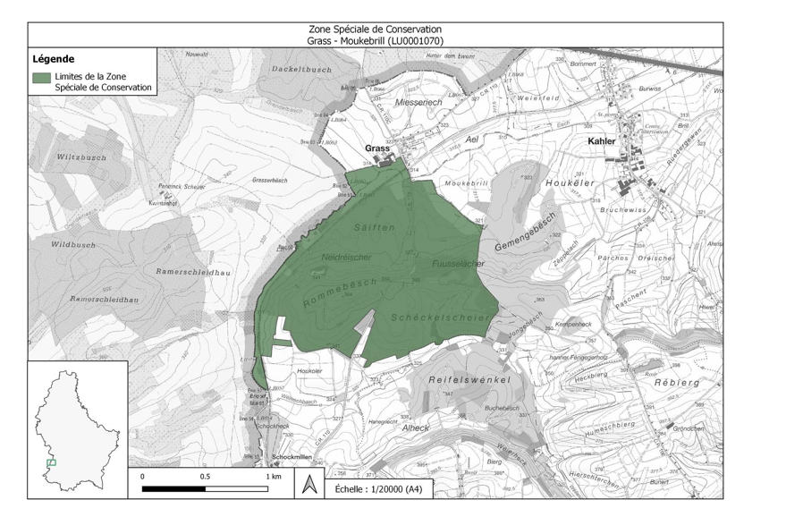

# Règlement grand-ducal du 6 octobre 2023 désignant zone spéciale de conservation et déclarant obligatoire la zone « Grass - Moukebrill », et modifiant le règlement grand-ducal modifié du 6 novembre 2009 portant désignation des zones spéciales de conservation.

Nous Henri, Grand-Duc de Luxembourg, Duc de Nassau,

Vu les articles 2, 4, 31 à 35 et 37, de la [loi du 18 juillet 2018](https://legilux.public.lu/eli/etat/leg/loi/2018/07/18/a771/jo) concernant la protection de la nature et des ressources naturelles ;

Vu l’avis de l’Observatoire de l’environnement naturel ;

Les avis de la Chambre de commerce, de la Chambre des métiers et de la Chambre d’agriculture ayant été demandés ;

Le Conseil d’État entendu ;

Sur le rapport de la Ministre de l’Environnement, du Climat et du Développement durable, et après délibération du Gouvernement en conseil ;

Arrêtons :

## Art. 1er.

Est désignée zone spéciale de conservation et déclarée obligatoire la zone « Grass - Moukebrill », ci-après la « zone spéciale de conservation », référencée sous le code LU0001070, et faisant partie intégrante du réseau Natura 2000.

## Art. 2.

La zone spéciale de conservation est désignée en vue :

1° du maintien ou, le cas échéant, du rétablissement de l’état de conservation favorable des habitats et espèces d’intérêt communautaire mentionnés à l’article 3 ;

2° de la préservation, du maintien ou, le cas échéant, du rétablissement de la structure et des fonctions spécifiques des habitats d’intérêt communautaire mentionnés à l’article 3 , ainsi que de l’état de conservation de leurs espèces typiques ;

3° de la préservation, du maintien ou, le cas échéant, du rétablissement d’une diversité, d’une superficie et d’une qualité des habitats des espèces d’intérêt communautaire mentionnées à l’article 3 ;

4° de la protection contre les perturbations touchant les espèces d’intérêt communautaire mentionnés à l’article 3 , pour autant que ces perturbations soient susceptibles d’avoir un effet significatif eu égard aux objectifs du présent article ;

5° de sa contribution à la cohérence du réseau Natura 2000 tant au niveau national qu’au sein de l’Union européenne.

## Art. 3.

Les objectifs spécifiques de conservation de la zone spéciale de conservation, ainsi que les mesures de conservation spéciales à assurer afin de maintenir ou, le cas échéant, rétablir l’état de conservation favorable des habitats et espèces d’intérêt communautaire visés, en l’occurrence à travers les mesures de conservation visées aux articles 32 à 35 et 37 de la [loi modifiée du 18 juillet 2018](https://legilux.public.lu/eli/etat/leg/loi/2018/07/18/a771/jo) concernant la protection de la nature et des ressources naturelles, sont :

1° maintien, voire rétablissement de l’état de conservation favorable des lacs et plans d’eau eutrophes naturels avec végétation du *Magnopotamion* ou *Hydrocharition* (3150) :

a) préservation et restauration des plans d’eau ;

b) aménagement de nouveaux plans d’eau ;

c) aménagement de bandes de protection herbagères autour des plans d’eau ;

2° maintien, voire rétablissement de l’état de conservation favorable de la population du Triton crêté *Triturus cristatus* :

a) préservation et restauration des plans d’eau, ainsi que des zones humides, structures paysagères et boisements limitrophes ;

b) amélioration de la connectivité écologique

3° maintien, voire rétablissement de l’état de conservation favorable des hêtraies de l’*Asperulo-Fagetum* (9130) et des chênaies pédonculées ou des chênaies-charmaies sub-atlantiques et médio-européennes du *Carpinion betuli* (9160) :

a) préservation, restauration et extension surfacique des futaies feuillues ;

b) préservation et restauration des micro-stations ;

c) préservation de gros arbres, d’arbres de classes d’âge avancées, d’arbres biotopes et d’arbres morts ;

d) aménagement de lisières structurées ;

e) aménagement d’îlots de vieillissement ;

4° maintien, voire rétablissement de l’état de conservation favorable des populations du Murin de Bechstein *Myotis bechsteinii* :

a) préservation et restauration de futaies feuillues stratifiées irrégulières présentant des strates herbacées et arbustives ;

b) préservation de gros arbres, d’arbres de classes d’âge avancées, d’arbres biotopes et d’arbres morts ;

c) préservation et restauration de mardelles ;

d) aménagement de lisières structurées et d’îlots de vieillissement ;

5° maintien, voire rétablissement de l’état de conservation favorable de la population du Grand Murin *Myotis myotis* :

a) préservation et restauration de futaies feuillues de classes d’âge avancées ;

b) aménagement de lisières structurées et d’îlots de vieillissement ;

c) préservation et restauration des bocages, bosquets et ripisylves ;

d) amélioration de la connectivité écologique ;

e) prévention de la pollution lumineuse ;

6° maintien, voire rétablissement de l’état de conservation favorable des forêts alluviales à *Alnus glutinosa* et *Fraxinus excelsior* (*Alno-Padion*, *Alnion incanae*, *Salicion albae*) (91E0*) :

a) préservation, restauration et extension surfacique des forêts alluviales ;

b) maintien et amélioration de la qualité et de l’hydromorphologie des cours d’eau ;

c) restauration de la dynamique naturelle des fonds de vallée ;

d) abandon de l’exploitation ;

7° rétablissement de l’état de conservation favorable des mégaphorbiaies hygrophiles d’ourlets planitiaires et des étages montagnard à alpin (6430) :

a) restauration et extension surfacique des ourlets le long des cours d’eau et lisières forestières ;

b) fauchage très tardif voire pluriannuel.

## Art. 4.

Les mesures de conservation spéciales de la zone spéciale de conservation sont déclinées en objectifs opérationnels et précisées dans un plan de gestion approprié.

## Art. 5.

La délimitation de la zone spéciale de conservation est indiquée sur le plan figurant en annexe. La zone spéciale de conservation couvre une superficie totale de 200,72 hectares.

## Art. 6.

Le [règlement grand-ducal modifié du 6 novembre 2009](https://legilux.public.lu/eli/etat/leg/rgd/2009/11/06/n6/jo) portant désignation des zones spéciales de conservation est modifié comme suit :

1° À l’article 4, le point (42.) est supprimé.

2° L’annexe 1 est modifiée comme suit :

a) Au tableau 1, la ligne portant le numéro 42, faisant référence au site LU0001070, est supprimée.

b) À la carte 1, la référence au site LU0001070 est supprimée.

c) Aux tableaux 2 et 3, la ligne portant le numéro LU0001070 est supprimée.

3° À l’annexe 2, la carte portant le titre « Zone Spéciale de Conservation « Grass - Moukebrill » (LU0001070) » est supprimée.

## Art. 7.

La référence au présent règlement se fait sous la forme suivante : « règlement grand-ducal du 6 octobre 2023 désignant zone spéciale de conservation la zone « Grass - Moukebrill » ».

## Art. 8.

Le ministre ayant l’Environnement dans ses attributions est chargé de l’exécution du présent règlement qui sera publié au Journal officiel du Grand-Duché de Luxembourg.

La Ministre de l’Environnement, du Climat  et du Développement durable,   Joëlle Welfring

Palais de Luxembourg, le 6 octobre 2023.   Henri

ANNEXE

Pour visualiser la carte en haute définition, veuillez [cliquer ici](https://data.legilux.public.lu/filestore/eli/etat/leg/rgd/2023/10/06/a651/jo/fr/pdfa/annexe/1/eli-etat-leg-rgd-2023-10-06-a651-jo-fr-pdfa-annexe-1.pdf).
