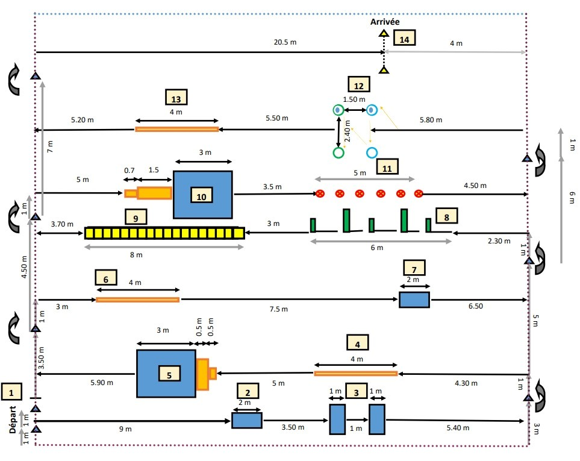
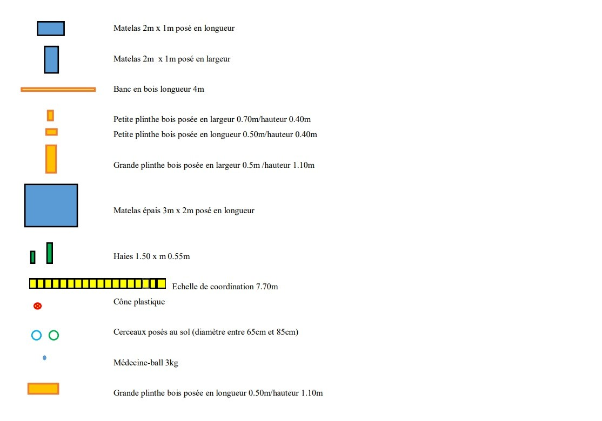
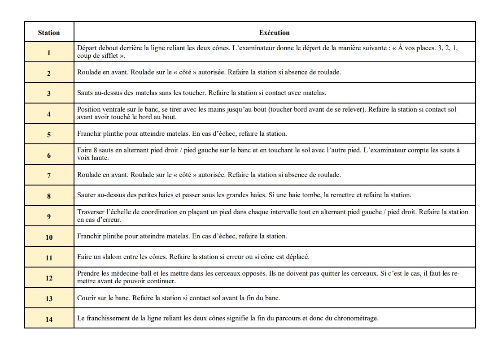

# Règlement grand-ducal du 16 novembre 2023 portant modification du règlement grand-ducal modifié du 29 juillet 2020 déterminant les modalités de recrutement du personnel policier.

Nous Henri, Grand-Duc de Luxembourg, Duc de Nassau,

Vu la [loi modifiée du 16 avril 1979](https://legilux.public.lu/eli/etat/leg/loi/1979/04/16/n1/jo) fixant le statut général des fonctionnaires de l’État, et notamment son article 2 ;

Vu la [loi modifiée du 18 juillet 2018](https://legilux.public.lu/eli/etat/leg/loi/2018/07/18/a621/jo) sur la Police grand-ducale, et notamment son article 67 ;

Vu la fiche financière ;

L’avis de la Chambre des fonctionnaires et employés publics ayant été demandé ;

Vu l’article 1er, paragraphe 1er, de la [loi modifiée du 16 juin 2017](https://legilux.public.lu/eli/etat/leg/loi/2017/06/16/a592/jo) sur l’organisation du Conseil d’État et considérant qu’il y a urgence ;

Sur le rapport du Ministre de la Sécurité intérieure et après délibération du Gouvernement en conseil ;

Arrêtons :

## Art. 1er.

L’annexe B est remplacée par l’annexe B suivante :

«

\**ANNEXE B**

Les candidats doivent accomplir un parcours en salle avec différentes stations, dont les temps minima pour réussir sont fixés comme suit :

Candidat masculin : 1 minute et 10 secondes

Candidat féminin : 1 minute et 20 secondes

Chaque station qui n’est pas exécutée ou faussement exécutée doit être répétée. Le candidat doit avoir correctement exécuté une station avant de pouvoir passer à la prochaine station.

Si le candidat n’atteint pas le temps requis au premier essai, il a droit à un deuxième essai.

»

## Art. 2.

Le ministre ayant la Police grand-ducale dans ses attributions est chargé de l’exécution du présent règlement qui sera publié au Journal officiel du Grand-Duché de Luxembourg.

Le Ministre de la Sécurité intérieure,   Henri Kox

Palais de Luxembourg, le 16 novembre 2023.   Henri
