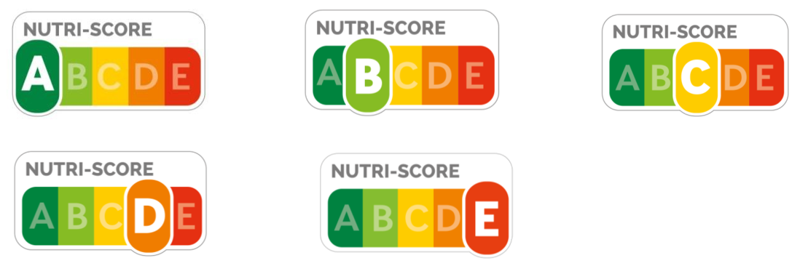

# Règlement grand-ducal du 30 janvier 2024 portant modification du règlement grand-ducal du 7 mai 2021 relatif à l’utilisation du logo Nutri-Score.

Nous Henri, Grand-Duc de Luxembourg, Duc de Nassau,

Vu le [règlement (UE) n° 1169/2011](https://legilux.public.lu/eli/reg_ue/2011/1169/jo) du Parlement européen et du Conseil du 25 octobre 2011 concernant l’information des consommateurs sur les denrées alimentaires, modifiant les [règlements (CE) n° 1924/2006](https://legilux.public.lu/eli/reg_ue/2006/1924/jo) et [(CE) n° 1925/2006](https://legilux.public.lu/eli/reg_ue/2006/1925/jo) du Parlement européen et du Conseil et abrogeant la [directive 87/250/CEE](https://legilux.public.lu/eli/dir_ue/1987/250/jo) de la Commission, la [directive 90/496/CEE](https://legilux.public.lu/eli/dir_ue/1990/496/jo) du Conseil, la [directive 1999/10/CE](https://legilux.public.lu/eli/dir_ue/1999/10/jo) de la Commission, la [directive 2000/13/CE](https://legilux.public.lu/eli/dir_ue/2000/13/jo) du Parlement européen et du Conseil, les [directives 2002/67/CE](https://legilux.public.lu/eli/dir_ue/2002/67/jo) et [2008/5/CE](https://legilux.public.lu/eli/dir_ue/2008/5/jo) de la Commission et le [règlement (CE) n° 608/2004](https://legilux.public.lu/eli/reg_ue/2004/608/jo) de la Commission, et notamment son article 36 ;

Vu le [règlement (CE) n° 1924/2006](https://legilux.public.lu/eli/reg_ue/2006/1924/jo) du Parlement européen et du Conseil du 20 décembre 2006 concernant les allégations nutritionnelles et de santé portant sur les denrées alimentaires, et notamment ses dispositions relatives aux allégations nutritionnelles ;

Vu la [loi modifiée du 28 juillet 2018](https://legilux.public.lu/eli/etat/leg/loi/2018/07/28/a675/jo) instaurant un système de contrôle et de sanctions relatif aux denrées alimentaires ;

Vu la [loi modifiée du 25 septembre 1953](https://legilux.public.lu/eli/etat/leg/loi/1953/09/25/n1/jo) ayant pour objet la réorganisation du contrôle des denrées alimentaires, boissons et produits usuels ;

Vu la [loi du 8 septembre 2022](https://legilux.public.lu/eli/etat/leg/loi/2022/09/08/a502/jo) portant création et organisation de l’Administration luxembourgeoise vétérinaire et alimentaire ;

Vu l’avis de la Chambre de commerce ;

Les avis de la Chambre d’agriculture et de la Chambre des métiers ayant été demandés ;

Le Conseil d’État entendu ;

Sur le rapport du Ministre de l’Agriculture, de la Viticulture et du Développement rural, et après délibération du Gouvernement en conseil ;

Arrêtons :

## Art. 1er.

L’annexe I du [règlement grand-ducal du 7 mai 2021](https://legilux.public.lu/eli/etat/leg/rgd/2021/05/07/a396/jo) relatif à l’utilisation du logo Nutri-Score est remplacée par l’annexe I du présent règlement.

## Art. 2.

À la suite de l’article 2 du [même règlement](https://legilux.public.lu/eli/etat/leg/rgd/2021/05/07/a396/jo), il est inséré un article 2*bis* nouveau qui prend la teneur suivante :

> **Art. 2*bis*.**
>
> Les exploitants du secteur alimentaire ont la possibilité de demander au ministre ayant l’Agriculture dans ses attributions, ci-après « ministre », une autorisation pour mettre en place des projets-pilotes dans les cas où ils souhaiteraient utiliser le logo « Nutri-Score » sur des denrées alimentaires non préemballées.
>
> À cet effet, afin d’utiliser le logo « Nutri-Score » sur des denrées alimentaires non préemballées, les exploitants du secteur alimentaire notifient ces projets-pilotes au ministre, par simple lettre.
>
> Le ministre, sur avis de l’Administration luxembourgeoise vétérinaire et alimentaire, ci-après « ALVA », fixe les conditions particulières destinées à encadrer les projets-pilotes ainsi que leur durée. La durée maximale d’un projet pilote est fixée à 3 ans.
>
> Lorsque les exploitants du secteur alimentaire décident de mettre en place un tel projet-pilote, cet engagement doit porter sur l’ensemble des denrées alimentaires non préemballées offertes à la consommation au sein d’un établissement donné par ces exploitants.
>
> En outre, les exploitants du secteur alimentaire mettent à la disposition des consommateurs une déclaration nutritionnelle conforme aux articles 30 à 34 du [règlement (UE) n° 1169/2011](https://legilux.public.lu/eli/reg_ue/2011/1169/jo) du Parlement européen et du Conseil du 25 octobre 2011 concernant l’information des consommateurs sur les denrées alimentaires, modifiant les [règlements (CE) n° 1924/2006](https://legilux.public.lu/eli/reg_ue/2006/1924/jo) et [(CE) n° 1925/2006](https://legilux.public.lu/eli/reg_ue/2006/1925/jo) du Parlement européen et du Conseil et abrogeant la [directive 87/250/CEE](https://legilux.public.lu/eli/dir_ue/1987/250/jo) de la Commission, la [directive 90/496/CEE](https://legilux.public.lu/eli/dir_ue/1990/496/jo) du Conseil, la [directive 1999/10/CE](https://legilux.public.lu/eli/dir_ue/1999/10/jo) de la Commission, la [directive 2000/13/CE](https://legilux.public.lu/eli/dir_ue/2000/13/jo) du Parlement européen et du Conseil, les [directives 2002/67/CE](https://legilux.public.lu/eli/dir_ue/2002/67/jo) et [2008/5/CE](https://legilux.public.lu/eli/dir_ue/2008/5/jo) de la Commission et le [règlement (CE) n° 608/2004](https://legilux.public.lu/eli/reg_ue/2004/608/jo) de la Commission.

## Art. 3.

L’article 3 du [même règlement](https://legilux.public.lu/eli/etat/leg/rgd/2021/05/07/a396/jo) est modifié comme suit :

> **Art. 3.**
>
> Le ministre ayant l’Agriculture dans ses attributions est chargé de l’exécution du présent règlement qui sera publié au Journal officiel du Grand-Duché du Luxembourg.

## Art. 4.

Le ministre ayant l’Agriculture dans ses attributions est chargé de l’exécution du présent règlement qui sera publié au Journal officiel du Grand-Duché du Luxembourg.

La Ministre de l’Agriculture, de l’Alimentation et de la Viticulture,   Martine Hansen

Cuzco, le 30 janvier 2024.   Henri

\**ANNEXE I :**

\**RÈGLEMENT D’USAGE DU LOGO « NUTRI-SCORE »**

Version du 24 avril 2023 approuvée par Santé publique France

\**PRÉAMBULE**

Le [règlement (UE) n°1169/2011](https://legilux.public.lu/eli/reg_ue/2011/1169/jo) du 25 octobre 2011 concernant l’information des consommateurs sur les denrées alimentaires (ci-après le «  **[Règlement européen](https://legilux.public.lu/eli/reg_ue/2011/1169/jo)**  ») impose aux exploitants de denrées alimentaires l’apposition de mentions obligatoires sur leurs produits afin de garantir un niveau élevé de protection de la santé et des intérêts des consommateurs en fournissant au consommateur final les bases à partir desquelles il peut décider en toute connaissance de cause et utiliser les denrées alimentaires en toute sécurité, dans le respect, notamment, de considérations sanitaires, économiques, écologiques, sociales et éthiques.

Les articles 29 et suivants du [Règlement européen](https://legilux.public.lu/eli/reg_ue/2011/1169/jo) déterminent les règles de l’une de ces mentions, à savoir la déclaration nutritionnelle obligatoire comprenant les informations sur les caractéristiques nutritionnelles permettant aux consommateurs, y compris ceux qui doivent suivre un régime alimentaire spécial, de choisir en toute connaissance de cause (ci-après la « Déclaration »). Afin de faciliter la compréhension de cette déclaration, les articles 35 à 37 du [Règlement européen](https://legilux.public.lu/eli/reg_ue/2011/1169/jo) permettent soit des formes d’expression et de présentation complémentaires de la déclaration nutritionnelle obligatoire, soit des informations sur les denrées alimentaires fournies à titre volontaire.

L’Agence nationale de santé publique, ci-après dénommée « **Santé publique France** », établissement public administratif de l’État français, chargée notamment de la promotion en santé, a élaboré, sur la base des travaux de l’Institut national de la santé et de la recherche médicale (Inserm) de France, une signalétique répondant aux critères posés par le [Règlement européen](https://legilux.public.lu/eli/reg_ue/2011/1169/jo). Cette signalétique, ci-après désignée « **Logo** », a fait l’objet de dépôts au titre de la protection des dessins et modèles industriels ainsi qu’en tant que marques collectives sous les numéros et dans les pays identifiés en ANNEXE 3 : Liste des droits, des pays et des Régulateurs.

Un règlement d’usage a été élaboré pour l’exploitation de ce Logo dans les États-membres de l’Union européenne, les États de l’Espace Économique européen et les pays tiers reconnaissant les droits communautaires de propriété intellectuelle sur le Logo (ci-après les « **Territoires** » de l’ANNEXE 3 : Liste des droits, des pays et des Régulateurs).

Ce règlement définit les personnes habilitées à exploiter ce Logo, les conditions générales d’utilisation de ce Logo (notamment ses modalités de calcul ou la charte graphique à respecter), les conditions particulières applicables selon les Territoires et les autorités nationales de supervision et de concession de droits sur le Logo (ci-après les « **Régulateurs** ») ainsi que les sanctions pouvant affecter le non-respect des conditions du règlement d’usage.

Si ces personnes remplissent les conditions établies au présent règlement d’usage et les respectent tout au long de leur usage du Logo, plusieurs droits d’usage du Logo leur sont automatiquement concédés par Santé Publique France (et/ou le(s) Régulateur(s) sur le(s) Territoire(s)). Les exploitants sont informés que Santé Publique France et/ou tout Régulateur peut suspendre ou résilier tout ou partie des droits d’usage qui leur sont concédés sur le Logo sur un ou plusieurs Territoire(s) dans les conditions fixées par le présent règlement d’usage.

La première édition de ce règlement d’usage a été approuvée par Santé publique France le 12 mai 2017. Santé publique France et les Régulateurs s’assureront de la pertinence de ce règlement d’usage au regard de l’évolution de l’activité concernée, de telle sorte que le règlement d’usage pourra être révisé.

## Article 1 — DÉFINITIONS

\**1.1** - Par « **Algorithme** » : la méthode de calcul décrite dans le Cahier des charges utilisée pour calculer le score nutritionnel d’un Produit et déterminer le Logo Classant correspondant. À cet égard, on entend par

aash l’ « **Algorithme Originel** » l’Algorithme original décrit dans la sous-annexe 1-A de ANNEXE 1 : Cahier des charges, et

bash l’ « **Algorithme Actualisé** » l’Algorithme Actualisé décrit dans la sous-annexe 1-B de ANNEXE 1 : Cahier des charges.

\**1.2** - Par « **Cahier des charges** », on entend le cahier des charges joint en ANNEXE 1 : Cahier des charges.

\**1.3** - Par « **Charte graphique** », on entend la charte graphique formalisant les modalités graphiques d’usage du Logo figurant en ANNEXE 2 : Charte graphique.

\**1.4** - Par « **Communication générique** », on entend la communication promotionnelle à visée générale de l’Exploitant ne visant pas spécifiquement un ou plusieurs Produits.

\**1.5** - Par « **Déclaration »,** on entend la déclaration nutritionnelle obligatoire prévue par les articles 30 et suivants du [Règlement européen](https://legilux.public.lu/eli/reg_ue/2011/1169/jo).

\**1.6** - Par « **Demande** », on entend la demande d’enregistrement d’un Exploitant au Règlement d’usage.

\**1.7** - Par « **EUIPO** », on entend l’Office de l’Union européenne pour la propriété intellectuelle.

\**1.8** - Par « **Exploitant** », on entend toute personne physique ou morale habilitée à utiliser le Logo sur les Produits (tels que définis ci-dessous) en application du Règlement d’usage. À ce titre, on entend par :

aash « **Exploitant Titulaire** » l’Exploitant titulaire ou licencié exclusif des droits de propriété intellectuelle sur ses Produits Sources, et par

bash « **Exploitant Distributeur** » l’Exploitant qui fait toute exploitation commerciale licite de Produits Distribués avec l’accord direct ou indirect de l’Exploitant Titulaire.

Un seul et unique Exploitant peut être en même temps Exploitant Titulaire pour ses Produits Sources et un Exploitant Distributeur pour des Produits Distribués.

\**1.9** - Par « **Exploitant Titulaire Tiers** », on entend un titulaire de droits de propriété intellectuelle qui n’a pas fait de Demande, et qui n’est donc pas enregistré selon le Règlement d’usage.

\**1.10** - Par « **INPI** », on entend l’Institut national de la propriété industrielle de France.

\**1.11** - Par « **Logo** », on entend les signalétiques « Nutri-Score » déposées dans les Territoires et recensées en ANNEXE 3 : Liste des droits, des pays et des Régulateurs des présentes. Le Logo est composé de :

aash 5 logotypes, ci-après dénommés « **Logo Classant** » représentant les 5 classements de produits sur l’échelle nutritionnelle, associés au mot « Nutri-Score », et faisant ressortir une des cinq lettres A-B-C-D-E. Le Logo Classant est déterminé en utilisant l’Algorithme Originel ou l’Algorithme Actualisé conformément au Règlement d’usage. Les Logos Classants sont dits « logos packaging » dans la Charte Graphique.

bash Un logotype neutre, ci-après-dénommé « Logo Neutre », élaboré uniquement aux fins de communication générique, et présentant l’échelle nutritionnelle, sans mise en avant d’un classement, associé au mot « Nutri-Score ». Le Logo Neutre ne fait ressortir aucune lettre et correspond au « logo communication » dans la Charte Graphique.

\**1.12** - Par « **Produits** », on entend toutes denrées alimentaires dans le commerce, pour lesquels une déclaration nutritionnelle a été faite, que la déclaration nutritionnelle résulte de la Déclaration nutritionnelle obligatoire ou d’une base volontaire conformément au Règlement européen. À ce titre, on entend par « **Produits Sources** », les Produits identifiés par un Exploitant Titulaire et par « **Produits Distribués** », les Produits identifiés par un Exploitant Distributeur. Les Produits Sources d’un Exploitant Titulaire peuvent ainsi être qualifiés de Produits Distribués pour un Exploitant Distributeur.

\**1.13** - Par « **Règlement d’usage** », on entend le présent règlement d’usage du Logo, ainsi que ses ANNEXES, notamment les conditions particulières applicables selon les Territoires, à l’exclusion de tout autre document.

\**1.14** - Par « **Règlement européen »**, on entend le [Règlement (UE) n° 1169/2011](https://legilux.public.lu/eli/reg_ue/2011/1169/jo) du Parlement européen et du Conseil du 25 octobre 2011 concernant l’information des consommateurs sur les denrées alimentaires modifiant les [règlements (CE) n° 1924/2006](https://legilux.public.lu/eli/reg_ue/2006/1924/jo) et [(CE) n° 1925/2006](https://legilux.public.lu/eli/reg_ue/2006/1925/jo) du Parlement européen et du Conseil et abrogeant la [directive 87/250/CEE](https://legilux.public.lu/eli/dir_ue/1987/250/jo) de la Commission, la [directive 90/496/CEE](https://legilux.public.lu/eli/dir_ue/1990/496/jo) du Conseil, la [directive 1999/10/CE](https://legilux.public.lu/eli/dir_ue/1999/10/jo) de la Commission, la [directive 2000/13/CE](https://legilux.public.lu/eli/dir_ue/2000/13/jo) du Parlement européen et du Conseil, les [directives 2002/67/CE](https://legilux.public.lu/eli/dir_ue/2002/67/jo) et [2008/5/CE](https://legilux.public.lu/eli/dir_ue/2008/5/jo) de la Commission et le [règlement (CE) n° 608/2004](https://legilux.public.lu/eli/reg_ue/2004/608/jo) de la Commission.

\**1.15** - Par « **Régulateur** », on entend l’autorité nationale publique ou privée qui dispose d’un droit exclusif sur le Logo pour son Territoire, en vertu duquel le Régulateur peut établir des conditions particulières d’habilitation des Exploitants ou d’utilisation du Logo sur ledit Territoire. Les Régulateurs sont identifiés par Territoire en ANNEXE 3 : Liste des droits, des pays et des Régulateurs du Règlement d’usage. Si le Régulateur délègue des missions à des tiers sous contrat, cela est constaté dans l’ANNEXE 3 ou l’ANNEXE respective pour le Territoire.

\**1.16** - Par « **Santé Publique France** », on entend l’Agence nationale de santé publique, établissement public administratif de l’État, représentée par son directeur général, propriétaire exclusif du Logo et des droits de propriété intellectuelle y afférent, Régulateur compétent pour la France.

\**1.17** - Par « **Territoire** », on entend les États-membres de l’Union européenne, les États de l’Espace Économique européen et les pays tiers reconnaissant les droits communautaires de propriété intellectuelle sur le Logo, dans lesquelles l’utilisation du Logo est soumise au Règlement d’usage.

## Article 2 — OBJET ET PORTÉE

\*2.1.* *Objet*

Le Règlement d’usage a pour objet de définir les conditions et les modalités d’utilisation du Logo par l’Exploitant Titulaire ou par l’Exploitant Distributeur selon les catégories de Produits.

\*2.2.* *Acceptation*

L’Exploitant qui souhaite utiliser le Logo sur un Territoire doit déposer une Demande devant le Régulateur compétent pour ce Territoire ou, à défaut ou en cas de Demande portant sur plusieurs Territoires, auprès de Santé publique France qui la transmettra aux différents Régulateurs. Seul un Exploitant peut apposer le Logo conformément aux modalités d’utilisation définies ci-après. La présentation d’une Demande emporte acceptation sans réserve du présent Règlement d’usage.

Certaines utilisations exceptionnelles du Logo sont prévues au Règlement d’usage pour des tiers qui ne sont pas des Exploitants. Toute utilisation du Logo par ces tiers vaut acceptation formelle des conditions du Règlement d’usage.

\*2.3.* *Hiérarchie contractuelle*

Le Règlement d’usage se compose, par ordre de priorité contractuelle décroissant (i) du Règlement d’usage, (ii) des ANNEXES 1 à 3 et (iii) selon les Territoires, des conditions particulières applicables à ces Territoires et établies aux ANNEXES 4 et suivantes. Ces documents contractuels constituent un ensemble contractuel et l’intégralité de la relation entre l’Exploitant, le Régulateur et Santé Publique France, à l’exclusion de tout autre document.

Les ANNEXES Territoires établies aux ANNEXES 4 et suivantes ont principalement pour objet d’apporter des précisions sur les conditions d’application du Règlement d’usage sur les Territoires. En tout état de cause, en cas de contradictions entre le Règlement d’usage et ses ANNEXES, les conditions du Règlement d’usage et notamment le droit communautaire applicable au Règlement d’usage priment sur les conditions des ANNEXES. En cas d’évolution d’une ANNEXE, la dernière version de l’ANNEXE publiée avec le Règlement d’usage prévaut sur les autres versions.

## Article 3 — IDENTIFICATION ET PROPRIÉTÉ DU LOGO

Le Logo « Nutri-Score » a été conçu par Santé publique France dans le respect du [Règlement européen](https://legilux.public.lu/eli/reg_ue/2011/1169/jo). Il vise à aider le consommateur à prendre en compte la qualité nutritionnelle des produits qu’il achète grâce au classement de l’aliment dans une échelle nutritionnelle à 5 niveaux, calculé conformément aux conditions de l’ANNEXE 1 : Cahier des charges du présent Règlement d’usage.

Il est constitué par 5 Logos Classants et 1 Logo Neutre.

L’Exploitant reconnait que (i) Santé publique France est pleinement propriétaire du Logo et seul titulaire des droits de propriété intellectuelle sur le Logo et que (ii) les Régulateurs disposent d’un droit exclusif sur le Logo pour leurs Territoires respectifs. À ce titre, chaque Régulateur dispose du droit d’enregistrer la Demande de l’Exploitant et d’autoriser l’utilisation du Logo par l’Exploitant pour le Territoire pour lequel il est compétent. Le(s) droit(s) d’usage du Logo concédé(s) en vertu du Règlement d’usage n’opère(nt) aucun transfert des droits de propriété sur le Logo.

## Article 4 — BÉNÉFICIAIRES D’UN DROIT D’USAGE DU LOGO

\*4.1.* *Personnes éligibles*

L’usage du Logo est réservé aux Exploitants, personnes physiques ou morales, fabricants et distributeurs de Produits mis sur les marchés des Territoires, sous réserve du respect des conditions du Règlement d’usage.

Par exception, les administrations et établissements publics des Territoires concernés disposent d’un droit d’usage du Logo, à des fins d’actions publiques dans le champ de la santé, et en dehors du champ concurrentiel. Par dérogation aux Articles 4.2 et 4.3, les administrations et établissements concernés doivent faire une demande d’utilisation exceptionnelle par courriel électronique au Régulateur compétent sur leur Territoire avant tout usage du Logo.

Par exception, les éditeurs de logiciels et d’applications disposent d’un droit d’usage du Logo à des fins d’assistance des Exploitants ou d’information du public. Par dérogation aux Articles 4.2 et 4.3, les éditeurs de logiciels et d’applications concernés doivent faire une demande d’utilisation exceptionnelle par courriel au Régulateur compétent sur leur Territoire avant tout usage du Logo.

Dans tous les cas, l’ANNEXE 2 : Charte graphique associée au Logo devra être expressément respectée par tous les Exploitants et les tiers bénéficiant de dérogations.

\*4.2.* *Procédure d’obtention du droit d’usage pour les Produits Sources*

La Demande faite par l’Exploitant doit notamment être conforme aux conditions particulières applicables au Territoire visé pour l’usage du Logo telles qu’établies aux ANNEXES 4 et suivantes. À défaut de Régulateur compétent pour le Territoire visé par l’Exploitant, l’Exploitant peut s’inscrire à partir de la procédure appelée « *Registration procedure of the operator to obtain the right to use the registered collective trademark Nutri-Score* » :

[https://www.demarches-simplifiees.fr/commencer/ns_international_registration_procedure](https://www.demarches-simplifiees.fr/commencer/ns_international_registration_procedure)

Il en va de même si le Régulateur compétent pour le Territoire visé par l’Exploitant n’a pas établi sa propre procédure de Demande d’enregistrement. Pour des raisons de clarté, l’utilisation de la procédure susmentionnée intitulée « *Registration procedure of the operator to obtain the right to use the registered collective trademark Nutri-Score* » visant un Territoire dans lequel le Régulateur n’a pas établi sa propre procédure de Demande d’enregistrement ne porte pas atteinte aux autres droits et obligations dudit Régulateur prévus dans le présent Règlement d’usage.

En tout état de cause, la Demande comporte au moins les trois (3) éléments suivants :

aash L’identification de l’Exploitant demandeur et de son activité ;

bash Le détail par catégories des Produits Sources concernés par l’usage du Logo ainsi que les droits de propriété intellectuelle dont il est titulaire sur lesdits Produits Sources ; et

cash L’engagement à utiliser le Logo sur le Territoire pour l’ensemble des Produits Sources qu’il met sur le marché sous la ou les marque(s) qu’il inscrit en tant qu’Exploitant Titulaire, dans le respect du Règlement d’usage.

Chaque Régulateur concerné, à condition que le Régulateur ait établi sa propre procédure de Demande d’enregistrement pour son Territoire, enregistre cette Demande et concède à l’Exploitant un droit d’utilisation du Logo sur les Produits Sources et pour son Territoire, dans le respect des conditions du Règlement d’usage et des ANNEXES 4 et suivantes applicables aux Territoires visés par la Demande.

\*4.3.* *Procédure d’obtention du droit d’usage pour les Produits Distribués*

Tout Exploitant ayant présenté une Demande d’enregistrement au titre de l’article 4.2 ci-dessus peut également bénéficier, devant le même Régulateur et dans le même Territoire, d’une licence restreinte d’utilisation du Logo en relation avec des Produits Distribués sous réserve de la condition suspensive suivante.

La licence d’utilisation n’est étendue aux Produits Distribués qu’à la condition que l’Exploitant Distributeur délivre au moins trois mois à l’avance un avis à l’Exploitant Titulaire et/ou à un Exploitant Titulaire Tiers détenant des droits de propriété intellectuelle sur les Produits Distribués, de l’intention de l’Exploitant Distributeur d’utiliser le Logo en relation avec les Produits Distribués.

L’Exploitant Distributeur s’engage à n’utiliser le Logo que pour les catégories de Produits Distribués (i) pour lesquelles un avis préalable a été délivré à l’Exploitant Titulaire ou à l’Exploitant Titulaire Tiers détenant des droits de propriété intellectuelle sur les Produits Distribués et (ii) dont il fait une exploitation commerciale licite.

Ainsi, si les conditions d’exploitation et/ou de distribution des Produits Distribués s’opposent à ce que l’Exploitant Distributeur fasse usage du Logo, la licence d’utilisation de l’Exploitant Distributeur sur le Logo sera réputée caduque pour ces Produits Distribués et l’Exploitant Distributeur ne dispose pas des droits d’usage du Logo pour ces derniers.

L’Exploitant Distributeur est seul responsable de la notification préalable à l’Exploitant Titulaire ou à l’Exploitant Titulaire Tiers détenant des droits de propriété intellectuelle sur les Produits Distribués, et de son utilisation du Logo, à ses risques et périls. La licence d’utilisation du Logo en relation avec les Produits Distribués comporte d’autres conditions préalables, recensées ci-dessous et dans les ANNEXES 4 et suivantes selon les Territoires.

Suite à l’avis préalable de trois mois de l’Exploitant Distributeur prévu au présent article 4.3 du Règlement d’usage, l’Exploitant Titulaire ne peut pas s’opposer à l’utilisation par l’Exploitant Distributeur du Logo en relation avec les Produits Distribués sauf si (i) les conditions contractuelles entre l’Exploitant Titulaire et l’Exploitant Distributeur en disposent autrement et/ou (ii) l’Exploitant Distributeur est en violation du présent Règlement d’usage.

\*4.4.* *Changement de circonstances affectant l’Exploitant et son droit d’usage*

L’Exploitant s’engage à informer le Régulateur compétent de toute modification affectant sa qualité ou modifiant une des caractéristiques déclarées lors de l’enregistrement de sa Demande. À ce titre, il tient à jour la liste des Produits Sources visés dans sa Demande.

Le droit d’usage du Logo sur un Produit cesse à compter du retrait du Produit, que ce retrait soit volontairement déclaré par l’Exploitant lors de la mise à jour de la Demande ou qu’il résulte de l’application de l’Article 12 du Règlement d’usage.

Ces modifications sont enregistrées auprès du Régulateur compétent pour le Territoire, selon les conditions des ANNEXES 4 et suivantes applicables à ce Territoire.

Si l’Exploitant ne répond plus aux conditions posées par le Règlement d’usage, le droit d’usage du Logo est résilié conformément à l’Article 12.2 du Règlement d’usage.

## Article 5 — LICENCE D’UTILISATION DU LOGO

Le droit d’usage concédé par un Régulateur pour un Territoire doit respecter les conditions du présent article dans le cadre d’une obligation de résultat. Toute violation par l’Exploitant est susceptible d’entraîner la résiliation partielle ou totale du ou des droits d’usage concédés à l’Exploitant sur le Logo, en application de l’Article 12 du Règlement d’usage.

\*5.1.* *Droits d’usage du Logo sur les Produits Sources*

Le droit d’usage du Logo sur les Produits Sources est concédé par le Régulateur à l’Exploitant Titulaire sur le Territoire, à compter de la réception de la Demande :

aash à titre principal, pour être apposé sur des Produits Sources conformément aux conditions de l’Article 6.1.

bash à titre complémentaire, à des fins de Communication générique ou de communication promotionnelle sur un Produit Source conformément aux conditions de l’Article 7.

L’usage du Logo à des fins de Communication générique ou de communication promotionnelle sur un Produit Source n’est concédé que dans la mesure où l’Exploitant exploite le Logo sur les Produits Sources à titre principal, selon les modalités et délais de mise en œuvre prévus par le Règlement d’usage.

En aucun cas l’Exploitant n’est autorisé à utiliser le Logo uniquement pour communiquer sur les Produits Sources ou en faire la promotion.

\*5.2.* *Droits d’usage du Logo en relation avec les Produits Distribués*

Le droit d’usage du Logo en relation avec les Produits Distribués est concédé par le Régulateur à l’Exploitant Distributeur sur le Territoire, à compter de la levée de la condition suspensive et sous réserve que l’Exploitant Distributeur en fasse une exploitation commerciale licite et conforme à ses droits sur les Produits Distribués :

aash à titre principal, pour être utilisé en relation avec les Produits Distribués (sans apposition directe du Logo sur les Produits Distribués) sous réserve (i) du respect des droits de propriété intellectuelle de l’Exploitant Titulaire et/ou de l’Exploitant Titulaire Tiers et (ii) des conditions de l’Article 6.2 ;

bash à titre complémentaire, à des fins de Communication générique ou de communication promotionnelle sur un Produit Distribué conformément aux conditions de l’Article 7.

L’usage du Logo à des fins de Communication générique ou de communication promotionnelle sur un Produit Distribué n’est concédé que dans la mesure où l’Exploitant Distributeur exploite le Logo en rapport avec les Produits Distribués à titre principal, selon les modalités et délais de mise en œuvre prévus par le Règlement d’usage. En aucun cas, l’Exploitant Distributeur n’est autorisé (i) à utiliser le Logo uniquement pour communiquer sur les Produits Distribués ou en faire la promotion ou (ii) à utiliser le Logo pour des Produits Distribués tant que la condition suspensive n’a pas été levée.

\*5.3.* *Non exclusivité*

Le Règlement d’usage ne donne aucun droit exclusif d’usage du Logo au profit de l’Exploitant.

\*5.4.* *Caractère personnel*

Le droit d’usage du Logo est strictement personnel. Il ne peut en aucun cas être cédé ou transmis par l’Exploitant, par quelque moyen que ce soit.

\*5.5.* *Caractère gratuit*

Le droit d’usage du Logo est consenti à l’Exploitant à titre gratuit.

## Article 6 — CONDITIONS D’UTILISATION DU LOGO CLASSANT

\*6.1.* *Conditions spécifiques aux Produits Sources*

6.1.1 Champ d’application

Si l’Exploitant Titulaire décide d’utiliser le Logo Classant sur une ou plusieurs de ses marques en application de l’Article 5.1 du Règlement d’usage, il a obligation de l’utiliser sur l’ensemble des catégories de Produits qu’il met sur le marché sous ses marques inscrites au Règlement d’usage.

L’Exploitant dispose alors de 24 mois à compter de la date de son enregistrement auprès du Régulateur pour se conformer à l’ensemble des dispositions du Règlement d’usage pour les Produits Sources dans le Territoire concerné. Dans le cas où le nombre de références engagées est supérieur ou égal à 2000, ce délai est porté à 36 mois, avec un seuil de 80% des produits apposant le Logo Classant dans les 24 mois.

Les communications promotionnelles en lien avec un Produit Source devront nécessairement utiliser le Logo Classant adéquat, conformément aux conditions de l’Article 7 ci-dessous.

6.1.2 Choix du Logo Classant sur les Produits Sources

• Recours exclusif au Logo Classant

Seul l’usage d’un Logo Classant est autorisé pour l’usage du Logo à titre principal. En aucun cas l’Exploitant ne peut apposer le Logo Neutre sur ses Produits Sources.

• Classement du Produit dans l’échelle nutritionnelle

Le choix du Logo Classant adéquat pour chaque Produit Source est déterminé par l’Exploitant conformément à l’ANNEXE 1 : Cahier des charges. L’utilisation du Logo Classant est indissociable du calcul du score nutritionnel de chaque Produit Source et de son résultat, conformément à ce Cahier des charges. L’Exploitant est seul responsable du calcul du score nutritionnel.

• Modification de l’Algorithme

La date d’entrée en vigueur de l’Algorithme Actualisé dans tous les Territoires est le 31 décembre 2023, sous réserve, le cas échéant, des stipulations des ANNEXES Territoires établies aux ANNEXES 4 et suivantes.

Avant l’entrée en vigueur de l’Algorithme Actualisé, l’Exploitant doit utiliser pour ses Produits le Logo Classant conformément à l’Algorithme Originel.

Dès l’entrée en vigueur de l’Algorithme Actualisé, le Logo Classant de tous les Produits nouvellement mis sur le marché par un Exploitant devra être calculé selon l’Algorithme Actualisé. Dès l’entrée en vigueur de l’Algorithme Actualisé, le Logo Classant de tous les Produits commercialisés par un Exploitant sous sa marque enregistrée sur un Territoire après l’entrée en vigueur de l’Algorithme Actualisé devra être calculé selon l’Algorithme Actualisé.

Toutefois, sous réserve, le cas échéant, des stipulations des ANNEXES Territoires établies aux ANNEXES 4 et suivantes, le Logo Classant des Produits qui ont déjà été fabriqués ou mis sur le marché et sur lesquels un Logo Classant a été apposé avant la date d’entrée en vigueur de l’Algorithme Actualisé, peut être calculé conformément à l’Algorithme Originel pendant une période de vingt-quatre (24) mois suivant cette entrée en vigueur, à condition que l’Exploitant respecte toutes les stipulations du Règlement d’usage pendant cette période transitoire. À tout moment pendant cette période transitoire de vingt-quatre (24) mois, l’Exploitant peut décider de calculer le Logo Classant de ses Produits conformément à l’Algorithme Actualisé.

L’Exploitant est seul responsable de l’utilisation de l’Algorithme adéquat. L’Exploitant devra notamment veiller à ce que, vingt-quatre (24) mois après l’entrée en vigueur de l’Algorithme Actualisé, tous ses Produits mis ou restant sur le marché portent le Logo Classant adéquat, calculé selon l’Algorithme Actualisé.

Au cours de cette période transitoire de vingt-quatre (24) mois, l’Exploitant doit suivre et contrôler lequel Algorithme, entre l’Algorithme Originel et l’Algorithme Actualisé, est utilisé pour déterminer le Logo Classant de ses Produits sur le marché. L’Exploitant s’engage à mentionner au consommateur, sur simple demande de ce dernier, et au Régulateur, sur simple demande de ce dernier, lequel Algorithme, entre l’Algorithme Originel et l’Algorithme Actualisé, a été utilisé pour déterminer le Logo Classant de quelconque de ses Produits.

6.1.3 Licence d’utilisation du Logo Classant sur les Produits Sources

Lorsque la condition suspensive de l’article 4.3 est levée, l’Exploitant Titulaire concède aux Exploitants Distributeurs (i) enregistrés au Règlement d’usage et (ii) disposant de droits d’exploitation commerciale des Produits Sources appropriés, un droit limité, non-exclusif, incessible, irrévocable, intransférable, excluant l’octroi d’une sous-licence, d’utiliser l’image et le nom des Produits Sources en association avec leurs Logos Classants respectifs, aux seules fins d’exercice des droits d’usage du Logo, à titre gratuit, dans le monde entier et pour la durée de l’enregistrement de l’Exploitant Titulaire au Règlement d’usage. En application de cette licence d’utilisation, les Exploitants Distributeurs peuvent utiliser les Produits Sources en tant que Produits Distribués, avec les Logos Classants attribués par les Exploitants Titulaires.

\*6.2.* *Conditions spécifiques aux Produits Distribués*

6.2.1 Champ d’application

Si l’Exploitant Distributeur décide d’utiliser le Logo Classant en relation avec un ou plusieurs Produits Distribués en application de l’Article 5.2 du Règlement d’usage, il a obligation, avant tout exercice d’un droit sur le Logo de reprendre et d’utiliser le Logo Classant choisi par l’Exploitant Titulaire pour ces Produits Distribués, en application de la licence d’utilisation concédée par l’Exploitant Titulaire à l’Article 6.1.3 du Règlement d’usage. Il est expressément précisé que dans cette situation, l’Exploitant Distributeur ne peut attribuer un autre Logo Classant que celui attribué par l’Exploitant Titulaire à ces Produits Distribués.

Pendant la période transitoire de vingt-quatre (24) mois suivant l’entrée en vigueur de l’Algorithme Actualisé conformément à l’article 6.1.2 du Règlement d’usage, l’Exploitant Titulaire reste seul décisionnaire de l’utilisation soit de l’Algorithme Originel, soit de l’Algorithme Actualisé pour ses Produits qui ont été fabriqués ou mis sur le marché avant la date d’entrée en vigueur de l’Algorithme Actualisé, et le Distributeur est tenu par la décision de l’Exploitant Titulaire. Dans l’hypothèse où le Logo Classant d’un Produit en particulier est modifié en raison de l’Algorithme Actualisé, l’Exploitant Titulaire s’engage à notifier les Exploitants Distributeurs à l’avance et dans un délai raisonnable pour mentionner (i) le Logo Classant choisi par l’Exploitant Titulaire, et (ii) la date précise à laquelle cette modification sera effective. La modification d’un Logo Classant pour un Produit Distribué devra s’effectuer en même temps que la modification du Logo Classant pour le Produit Source correspondant.

Si le(s) titulaire(s) des droits de propriété intellectuelle ne se sont pas enregistré(s) au Règlement d’usage en tant qu’Exploitant(s) Titulaire(s), l’Exploitant Distributeur doit informer ces titulaires préalablement à tout usage du Logo en relation avec les Produits Distribués comme prévu à l’article 4.3.

6.2.2 Avis préalable d’utilisation aux Exploitants Titulaires Tiers

L’avis préalable de l’article 4.3 peut notamment inclure la liste des catégories des Produits Distribués visés par l’Exploitant Distributeur dont le tiers est titulaire des droits de propriété intellectuelle, la possibilité pour l’Exploitant Titulaire Tiers de présenter une Demande en tant qu’Exploitant Titulaire afin de déterminer le Logo Classant des Produits Distribués, et si l’Exploitant Distributeur dispose des données nécessaires, les détails du score nutritionnel calculé par l’Exploitant Distributeur et le Logo Classant correspondant que l’Exploitant Distributeur compte attribuer à chaque Produit Distribué.

À compter de l’entrée en vigueur de l’Algorithme Actualisé, l’Exploitant Distributeur déterminera, le cas échéant, le Logo Classant des Produits commercialisés de l’Exploitant Titulaire Tiers selon l’Algorithme Actualisé, et non selon l’Algorithme Originel. Dans l’hypothèse où un Exploitant Distributeur a notifié à un Exploitant Titulaire Tiers, un Logo Classant calculé conformément à l’Algorithme Originel, l’Exploitant Distributeur doit informer par écrit l’Exploitant Titulaire Tiers du nouveau Logo Classant avant l’entrée en vigueur de l’Algorithme Actualisé, dans la mesure où le Logo Classant attribué aux Produits est modifié du fait de l’entrée en vigueur de l’Algorithme Actualisé. Cette notification écrite à l’Exploitant Titulaire Tiers n’est pas considérée comme un avis préalable au sens de l’article 4.3 du Règlement d’usage.

6.2.3 Choix du Logo en relation avec les Produits Distribués

Si l’Exploitant Distributeur a rempli les conditions de l’article 6.2.1 et, le cas échéant celles de l’article 6.2.2, et dispose des informations nutritionnelles nécessaires, il peut alors exercer les droits de l’article 5.2 du Règlement d’usage de la manière suivante :

aash l’Exploitant Distributeur peut attribuer le Logo Classant en relation avec les Produits Distribués (notamment par tout étiquetage ou support d’information de rayonnage séparé des Produits Distribués), mais ne peut pas apposer le Logo Classant sur les Produits Distribués eux-mêmes ; et

bash l’Exploitant Distributeur peut exercer son droit de communication promotionnelle en attribuant le Logo Classant aux Produits Distribués sur ses supports de communication, dans les conditions ci-après détaillées.

Si l’Exploitant Distributeur n’a pas les données nécessaires pour calculer le score nutritionnel et attribuer un Logo Classant à un Produit Distribué dans le respect du Cahier des charges, alors l’Exploitant Distributeur ne peut pas utiliser de Logo Classant.

Dans tous les cas, l’Exploitant Distributeur ne peut pas utiliser le Logo Neutre monochrome avec les Produits Distribués.

La réponse éventuelle de l’Exploitant Titulaire Tiers à l’avis préalable de l’Exploitant Distributeur ne constitue pas une Demande d’enregistrement au sens du Règlement d’usage. Si un Exploitant a déjà présenté une Demande d’enregistrement pour des Produits Distribués qui sont déjà notés en application du Règlement d’usage, l’Exploitant Distributeur utilisera le Logo Classant attribué aux Produits Distribués par l’Exploitant Titulaire conformément à cette Demande d’enregistrement, et doit remplacer le Logo Classant sur tous ses étiquetages, supports d’information en rayonnage et supports de communication dans un délai d’un (1) mois à compter de la réception de la Demande par le Régulateur.

## Article 7 — UTILISATION DU LOGO À DES FINS DE COMMUNICATION

\*7.1.* *Communications génériques et communications promotionnelles*

À moins que le Régulateur n’établisse des conditions particulières d’utilisation du Logo à des fins de Communication générique et/ou de communication promotionnelle pour le Territoire concerné dans les ANNEXES 4 et suivantes, l’Exploitant s’engage à ne reproduire et n’utiliser le Logo qu’à partir des supports, documents et fichiers transmis par le Régulateur et dans le respect de la Charte graphique de l’ANNEXE 2 : Charte graphique.

L’Exploitant reconnait et accepte que la Communication générique sur le Logo exclut toute communication promotionnelle sur un Produit, et plus généralement toute attribution ou présentation d’un Logo Classant comme appliqué ou applicable à un Produit. Toute violation de cette obligation se fait aux risques et périls de l’Exploitant et peut entraîner la résiliation de son droit d’usage sur le Produit concerné en application de l’Article 12.3 du Règlement d’usage.

\*7.2.* *Charte graphique*

Le Régulateur transmet à l’Exploitant l’ensemble des supports, documents et fichiers nécessaires à l’usage du Logo. L’Exploitant s’engage à reproduire le Logo dans son intégralité tel que déposé dans les droits de propriété intellectuelle enregistrés sur le Territoire (recensés à l’ANNEXE 3 : Liste des droits, des pays et des Régulateurs) et à s’assurer à tout moment que son utilisation du Logo respecte l’ANNEXE 2 : Charte graphique.

L’Exploitant s’engage à ne faire aucune modification, ajout ou suppression sur le Logo et s’engage notamment, sans que cette liste soit limitative, à :

aash ne pas reproduire séparément une partie du Logo, et notamment à ne pas reproduire les éléments graphiques seuls ou la dénomination seule du Logo ;

bash sous réserve des aménagements prévus par la Charte graphique et notamment ceux liés au résultat du score nutritionnel (voir Article 6 ci-dessus), ne pas modifier :

asc les caractéristiques graphiques du Logo, tant en ce qui concerne la forme que la couleur,

bsc la position des éléments figuratifs les uns par rapport aux autres, et/ou

csc la typographie du Logo ; et à

cash ne pas faire d’ajout dans le Logo, notamment ne pas faire figurer de légende, de texte ou toute autre indication ne faisant pas partie du Logo.

\*7.3.* *Informations obligatoires sur les supports de communication promotionnelle des Produits Distribués*

Si l’Exploitant Distributeur utilise le Logo Classant attribué par l’Exploitant Titulaire aux Produits Distribués, alors l’Exploitant Distributeur doit indiquer sur tout support d’information ou de communication promotionnelle incluant le Produit Distribué, par tous moyens appropriés et adaptés au format du support, que le Logo Classant a été attribué par l’Exploitant Titulaire, sous la seule responsabilité de l’Exploitant Titulaire.

Si l’Exploitant Distributeur utilise le Logo Classant qu’il a attribué à un Produit Distribué dans le respect de la procédure d’avis préalable de l’Article 6.2 du Règlement d’usage, alors l’Exploitant Distributeur doit indiquer sur tout support d’information ou de communication promotionnelle incluant le Produit Distribué, par tous moyens appropriés et adaptés au format du support, que le Logo Classant a été attribué par l’Exploitant Distributeur, indépendamment de l’Exploitant Titulaire et sous la seule responsabilité de l’Exploitant Distributeur.

\*7.4.* *Utilisation du Logo Classant dans le cadre de communications promotionnelles*

L’Exploitant s’engage à utiliser le Logo Classant conformément au Règlement d’usage, de manière loyale et sans provoquer la moindre confusion au cours de communications promotionnelles. Le Logo Classant ne peut être associé qu’à un seul Produit. Tout Exploitant s’interdit d’utiliser le Logo Classant pour un groupe de Produits, sauf si chaque Produit de ce groupe a le même Logo Classant.

Toute violation de cette obligation se fait aux risques et périls de l’Exploitant et peut entraîner la résiliation de son droit d’usage sur le Produit concerné en application de l’Article 12.3 du Règlement d’usage.

## Article 8 — LIMITES D’UTILISATION

\*8.1.* *Respect du Logo en cours d’exploitation*

L’Exploitant doit, tout au long de son usage du Logo, respecter les exigences définies par le Règlement d’usage.

\*8.2.* *Respect des droits sur le Logo*

L’Exploitant s’engage à ne pas déposer, à quelque titre que ce soit (marque, dessin & modèle industriel…) dans quelque territoire que ce soit, des signalétiques ou logos identiques ou similaires au Logo susceptibles de porter atteinte aux droits de propriété intellectuelle de Santé publique France sur le Logo. Notamment, il s’interdit de déposer toute marque ou dessin & modèle industriel reprenant, en tout ou partie, le Logo, en particulier au sein d’un signe plus complexe.

L’Exploitant s’engage à ne pas développer, utiliser ou exploiter, à quelque titre que ce soit et dans quelque territoire que ce soit, des signes identiques ou similaires au Logo, susceptibles de porter atteinte aux droits de propriété intellectuelle de Santé publique France sur le Logo.

L’Exploitant s’engage à ne pas réserver de noms de domaine, dans quelque extension que ce soit, reprenant ou imitant les éléments verbaux du Logo ou susceptibles de porter atteinte aux droits de propriété intellectuelle de Santé publique France.

\*8.3.* *Respect de l’utilisation du Logo*

Il est expressément interdit à un Exploitant de présenter l’utilisation du Logo comme obligatoire et non, au choix du Régulateur sur le Territoire concerné conformément aux articles 35 et 36 du [Règlement européen](https://legilux.public.lu/eli/reg_ue/2011/1169/jo), comme une présentation complémentaire de la Déclaration ou comme une information fournie à titre volontaire. Il est expressément interdit à un Exploitant de contraindre un tiers à présenter une Demande auprès d’un Régulateur.

Santé Publique France et le Régulateur compétent déclinent toute responsabilité pour toute demande, action ou réclamation introduite par un tiers à raison des propos, actions ou omissions d’un Exploitant contrevenant à ces interdictions sur un Territoire. Toute violation des présentes interdictions peut conduire à une sanction du Régulateur, sans préjudice des sanctions de Santé Publique France.

L’Exploitant s’engage à ne pas utiliser le Logo à des fins politiques, polémiques, contraires à l’ordre public ou aux bonnes mœurs ou susceptibles de porter atteinte à des droits reconnus par la loi et, de manière générale, à ne pas associer le Logo à des actions ou activités susceptibles de porter atteinte ou d’être préjudiciable à Santé publique France et/ou aux Régulateurs, notamment à tout comportement pouvant être associé directement ou indirectement à des actes de contrefaçon ou de concurrence déloyale, dont le détournement de clientèle, le dénigrement ou les pratiques commerciales trompeuses.

\*8.4.* *Contrôle et transmission*

L’Exploitant accepte que Santé publique France et/ou tout Régulateur compétent pour le Territoire sur lequel il a présenté sa Demande puissent, en qualité respectivement de titulaire et de licencié exclusif du Logo sur le Territoire, conduire tout audit afin de contrôler le respect du Règlement d’usage, directement ou par l’intermédiaire de tout tiers indépendant mandaté à cette fin. L’audit permettra notamment de vérifier la véracité de la Demande et de la documentation technique tenue par l’Exploitant par rapport à l’utilisation réelle et effective du Logo, et l’usage adéquat de l’Algorithme conformément au Règlement d’usage.

Chaque Régulateur est libre de déterminer plus avant les conditions de ses audits sur son Territoire au sein des ANNEXES 4 et suivantes du Règlement d’usage. En tout état de cause, l’Exploitant accepte que le Régulateur compétent et/ou Santé publique France ait accès, y compris sur site, aux installations et infrastructures affectées à l’utilisation du Logo, ainsi qu’aux informations nécessaires pour mener à bien l’audit. L’Exploitant accepte de répondre à toute question posée lors de l’audit et à permettre l’accès, sous le contrôle de l’Exploitant, à tous les personnels, outils et moyens nécessaires à l’audit. Chaque partie conserve à sa charge les frais occasionnés dans le cadre de la procédure d’audit.

L’Exploitant reconnaît et accepte que Santé Publique France et les Régulateurs sont tenus de coopérer avec les autorités administratives et judiciaires des Territoires concernés, notamment celles dédiées au respect du droit de la consommation et du droit de la concurrence, y compris par la transmission de la Demande, de la documentation technique et des rapports d’audit, ce que l’Exploitant autorise expressément.

Dans l’hypothèse où le rapport d’audit ferait apparaître un manquement de l’Exploitant à ses obligations au regard du Règlement d’usage, Santé Publique France et/ou le Régulateur peuvent, à leur discrétion, prendre toute mesure ou sanction à l’encontre de l’Exploitant afin de sanctionner et/ou remédier audit manquement.

\*8.5.* *Documentation technique*

Chaque Régulateur est libre de déterminer plus avant, au sein des ANNEXES 4 et suivantes du Règlement d’usage, les conditions de présentation et le contenu de la documentation technique que l’Exploitant est censé créer et maintenir sur son utilisation du Logo au sein du Territoire.

## Article 9 — INFORMATION ET PROMOTION

Tous actes d’usage, de promotion et d’information relatifs au Logo par l’Exploitant doivent être conformes au Règlement d’usage, aux lois et règlements en vigueur et ne doivent porter atteinte ni aux droits sur le Logo de Santé Publique France, ni aux droits concédés au Régulateur sur le Territoire, ni à leur image ou à leurs intérêts.

Santé Publique France, les Régulateurs ou les pouvoirs publics peuvent être amenés à communiquer sur les entreprises engagées en faveur du Logo et leurs marques concernées dans le cadre de communiqués de presse, dossiers de presse, sur leurs médias propriétaires, dans des interviews, des évènements, etc. L’Exploitant accepte que Santé Publique France, les Régulateurs ou les pouvoirs publics communiquent sur son engagement en faveur du Logo et de ses marques concernées. À cet effet, l’Exploitant concède à Santé Publique France, aux Régulateurs et aux pouvoirs publics, à compter de la date de sa Demande et pour la durée d’enregistrement de l’Exploitant, une licence non exclusive, non sous-licenciable, gratuite et mondiale, d’utilisation des marques concernées par le Logo pour leurs propres besoins d’information et de promotion. Dans le cas contraire, il peut en informer le(s) Régulateur(s) concerné(s), dans un délai de deux (2) semaines à compter de la réception de l’enregistrement du droit d’usage sur le Logo.

## Article 10 — DURÉE

L’Exploitant est autorisé à utiliser le Logo conformément au Règlement d’usage, à condition d’avoir validé sa Demande et de s’être engagé à respecter le Règlement d’usage et ses ANNEXES, à compter de la date de réception des fichiers permettant son usage (sous réserve de la procédure applicable aux Produits Distribués) et jusqu’à la fin de la protection légale des droits de propriété intellectuelle dévolus à Santé publique France. Il peut y être mis fin par toute sanction du Régulateur et/ou de Santé publique France ou dans les cas de résiliation prévus par le Règlement d’usage.

Le Régulateur notifie à l’Exploitant, par tout moyen permettant d’en attester la bonne réception, deux (2) mois avant l’échéance, la date de fin de la protection légale sur le Logo.

## Article 11 — MODIFICATION DU RÈGLEMENT D’USAGE

En cas de modification du Règlement d’usage, le Règlement d’usage modifié s’applique aux Exploitants enregistrés avant et après son entrée en vigueur, sans préjudice de la possibilité des Exploitants de retirer leur Demande.

En cas de modification du Règlement d’usage, les Régulateurs informeront les Exploitants dans les conditions exposées ci-dessous. En cas de modification des conditions particulières pour un Territoire par le Régulateur compétent, le Régulateur informera les Exploitants dans les conditions exposées ci-dessous.

Le Régulateur notifie les modifications à l’Exploitant par courrier électronique à l’adresse indiquée par l’Exploitant lors de l’enregistrement de sa Demande, et que l’Exploitant veille à toujours conserver active ou, à défaut, à informer le Régulateur de sa modification.

L’Exploitant est réputé avoir pris connaissance et avoir accepté les nouvelles conditions du Règlement d’usage, sauf notification contraire de sa part par tous moyens ou cessation de l’utilisation du Logo dans les soixante (60) jours suivant la notification de la modification par le Régulateur, la date du courriel de notification faisant foi.

L’Exploitant dispose d’un délai raisonnable fixé, le cas échéant, par Santé publique France et/ou le Régulateur compétent pour le Territoire concerné, pour se mettre en conformité avec les nouvelles dispositions du Règlement d’usage.

L’Exploitant est autorisé à poursuivre l’utilisation du Logo, sauf s’il ne répond plus aux nouvelles conditions à l’issue du délai raisonnable de mise en conformité. En pareil cas, la sous-licence non exclusive qui lui était concédée est résiliée conformément à l’article 12.2 du Règlement d’usage.

L’Exploitant ne pourra prétendre à aucune indemnisation en raison d’une modification du Règlement d’usage.

## Article 12 — RÉSILIATION DU DROIT D’USAGE DU LOGO

\*12.1.* *Dispositions générales*

L’Exploitant ne bénéficie d’aucun droit acquis au maintien de son droit d’usage du Logo.

L’Exploitant ne peut prétendre à aucune indemnité du fait de la résiliation du droit d’usage du Logo pour les motifs prévus au présent article.

\*12.2.* *Résiliation de l’autorisation du fait de l’Exploitant*

12.2.1 Changement de circonstances affectant la validité de l’enregistrement

Le droit d’usage du Logo s’éteint de plein droit et sans notification de Santé publique France et/ou du Régulateur compétent dès lors que l’Exploitant ne répond plus aux conditions d’éligibilité prévues à l’Article 4 du Règlement d’usage.

L’Exploitant devra cesser de fabriquer et de commercialiser des Produits revêtus du Logo dans un délai de trois (3) mois à compter de l’extinction du droit d’usage. Dans le même délai, il devra également cesser d’apposer le Logo sur ses supports de communication et de manière générale de communiquer sur le Logo. Dans cette même hypothèse, l’Exploitant devra écouler les stocks des Produits le plus vite possible à compter de la date effective de suspension et/ou résiliation, (i) soit dans un délai de trois (3) mois pour les Produits Distribués sans Logo Classant apposé (ii) soit au maximum jusqu’à leurs dates de péremption respectives pour les Produits sur lesquels le Logo est apposé.

12.2.2 Non-respect du Règlement d’usage par l’Exploitant

Chaque Régulateur est libre soit (i) d’établir ses règles procédurales et son barème de sanction ou soit (ii) d’utiliser des règles existantes en sus des conditions du Règlement d’usage, à condition de les inclure ou du moins y faire clairement référence au sein des ANNEXES 4 et suivantes du Règlement d’usage spécifiques à chaque Territoire.

En cas de manquement de l’Exploitant aux dispositions du Règlement d’usage relevé par Santé publique France, Santé publique France notifie les manquements constatés à l’Exploitant par courrier recommandé avec accusé de réception, avec copie simple au Régulateur concerné, le cas échéant.

En cas de manquement relevé par le Régulateur, celui-ci fait application des sanctions prévues aux conditions particulières des ANNEXES 4 et suivantes applicables au Territoire ou à défaut, du présent Article.

En tout état de cause, la notification du manquement adressée à l’Exploitant comporte au moins le délai de mise en conformité avec les clauses du Règlement d’usage et indique si le droit d’usage est suspendu jusqu’à mise en conformité. À défaut de mise en conformité dans le délai précité, le droit d’usage du Logo est résilié de plein droit du seul fait de l’inexécution de la demande de mise en conformité, sans mise en demeure préalable de Santé publique France et/ou du Régulateur.

La suspension et la résiliation du droit d’usage du Logo entraînent l’obligation immédiate pour l’Exploitant de cesser tout usage du Logo et de retirer toute référence au Logo de l’ensemble de ses Produits et supports de communication.

En conséquent, l’Exploitant devra cesser de fabriquer et de commercialiser des Produits revêtus du Logo immédiatement à compter de la date de cessation du droit d’usage du Logo. Dans le même délai, il devra également cesser d’apposer le Logo sur ses supports d’information et de communication et de manière générale d’informer ou de communiquer sur le Logo. L’Exploitant devra écouler les stocks des Produits le plus vite possible à compter de la date effective de suspension et/ou résiliation, (i) soit dans un délai de trois (3) mois pour les Produits Distribués sans Logo Classant apposé (ii) soit au maximum jusqu’à leurs dates de péremption respectives pour les Produits sur lesquels le Logo est apposé.

12.2.3 Sanctions

L’usage non conforme au Règlement d’usage et la poursuite de l’usage du Logo malgré une décision de résiliation constituent des agissements illicites que Santé publique France et/ou les Régulateurs peuvent faire sanctionner et dont ils peuvent rechercher réparation devant les tribunaux compétents.

\*12.3.* *Usage abusif du Logo*

Outre les sanctions prévues aux Articles précédents, l’usage non autorisé du Logo par un Exploitant ou par un tiers ouvre le droit à Santé publique France et/ou aux Régulateurs concernés d’intenter toute action judiciaire qu’ils jugent opportune à son encontre et dans le respect de la législation en vigueur.

## Article 13 — DÉFENSE DU LOGO

L’Exploitant s’engage à signaler immédiatement au Régulateur et/ou à Santé publique France toute atteinte aux droits sur le Logo dont il aurait connaissance, notamment tout acte de contrefaçon, de concurrence déloyale, ou de parasitisme.

Il appartient à Santé Publique France, avec les Régulateurs le cas échéant, de prendre la décision d’engager, à leurs frais, risques et périls, toute action civile ou pénale.

En conséquence, les dommages et intérêts qui résulteront de l’action engagée par les Régulateurs et/ou Santé Publique France au nom de Santé Publique France seront à leur charge ou profit exclusifs et en conséquent, dans cette hypothèse l’Exploitant ne pourra réclamer aucune indemnité.

## Article 14 — RESPONSABILITÉ ET GARANTIES

\*14.1.* *Responsabilité de l’Exploitant*

L’Exploitant Titulaire est seul responsable des conséquences directes ou indirectes qui pourraient résulter de son exploitation du Logo sur ses Produits Sources. Il est seul responsable, à ses risques et périls, de (i) l’exactitude, de la sincérité, de la pertinence et de la conformité de son calcul du score nutritionnel, de (ii) l’utilisation sous-jacente de l’Algorithme adéquat dans les Territoires conformément au Règlement d’usage, (iii) de son choix du Logo Classant pour chacun de ses Produits Sources, ainsi que (iv) de l’usage et la communication sur ces Produits Sources.

L’Exploitant Distributeur est seul responsable, à ses risques et périls, de (i) l’exactitude, de la sincérité, de la pertinence et de la conformité de son calcul du score nutritionnel (le cas échéant), de (ii) l’utilisation sous-jacente de l’Algorithme adéquat dans les Territoires conformément au Règlement d’usage, de (iii) son choix du Logo Classant pour chaque Produit Distribué en application de la procédure de l’Article 6.2, ainsi que de (iv) l’usage et la communication sur ces Produits Distribués, notamment si l’Exploitant Distributeur (a) ne disposait pas des droits nécessaires pour faire une exploitation commerciale licite des Produits Distribués ou (b) n’a pas respecté tout ou partie de la procédure de l’Article 6.2. L’Exploitant Distributeur est également responsable, lors de l’exploitation commerciale des Produits Distribués, de son utilisation du Logo Classant attribué à un Produit Distribué par son Exploitant Titulaire, même si l’Exploitant Titulaire est responsable du calcul du score nutritionnel ainsi que du choix dudit Logo Classant pour ce Produit Distribué.

En tout état de cause, l’Exploitant reconnaît que toute utilisation incorrecte ou incomplète du Logo, notamment (i) un calcul du score nutritionnel ne respectant pas toutes les règles du Cahier des charges et du Règlement d’usage, ou réalisé à partir de données incomplètes ou faussé par rapport aux qualités nutritionnelles réelles du Produit, ou qui ne repose pas sur l’utilisation de l’Algorithme approprié ou (ii) l’attribution d’un Logo Classant inexact ou ne correspondant pas à la réalité du score nutritionnel du Produit, qu’elle résulte d’un comportement involontaire ou qu’elle soit réalisée dans l’intention de nuire, engage directement la seule responsabilité de l’Exploitant et est susceptible de constituer une pratique commerciale trompeuse au regard du droit communautaire et, notamment, de la [directive n°2005/29/CE](https://legilux.public.lu/eli/dir_ue/2005/29/jo) du 11 mai 2005 relative aux pratiques commerciales déloyales des entreprises vis-à-vis des consommateurs telle que transposée dans les Territoires ou de tout droit applicable équivalent dans les Territoires. Santé Publique France et/ou les Régulateurs déclinent toute responsabilité pour de telles utilisations, notamment en cas d’information ou de communication promotionnelle erronée ou trompeuse de la part de l’Exploitant Distributeur sur un Produit Distribué, qui engagent exclusivement la responsabilité de l’Exploitant qui en est responsable.

Les Exploitants sont seuls responsables des informations qu’ils fournissent aux consommateurs en ce qui concerne l’Algorithme utilisé pour déterminer le Logo Classant, eu égard aux lois et règlements applicables. Les Exploitants doivent veiller à ce que la modification du Logo Classant en raison du changement des règles de calcul avec le passage de l’Algorithme Originel à l’Algorithme Actualisé n’induise pas en erreur sur l’information sur les denrées alimentaires au sens du [Règlement européen](https://legilux.public.lu/eli/reg_ue/2011/1169/jo), et plus généralement n’induise pas en erreur les consommateurs, notamment au regard de la [directive n° 2005/29/CE](https://legilux.public.lu/eli/dir_ue/2005/29/jo) du 11 mai 2005 relative aux pratiques commerciales déloyales des entreprises vis-à-vis des consommateurs.

\*14.2* *Garantie de l’Exploitant*

En cas de mise en jeu de la responsabilité de Santé publique France et/ou d’un Régulateur par un tiers du fait de l’utilisation non conforme du Logo par l’Exploitant, l’Exploitant s’engage à en supporter tous les frais et charges en lieu et place de Santé publique France et le Régulateur, qui pourront l’appeler en garantie.

L’Exploitant garantit notamment Santé Publique France et les Régulateurs concernés (i) que les contrats ou chaînes de contrats entre l’Exploitant et le titulaire de droits de propriété intellectuelle sur les Produits Distribués, que ce titulaire soit enregistré à titre d’Exploitant Titulaire ou non, ne s’opposent pas à l’exploitation du droit d’usage concédé par Santé Publique France et les Régulateurs sur le Logo pour les Produits Distribués à l’Article 6.2, (ii) de l’absence de la moindre confusion, dans ses communications (à des fins d’information ou à des fins promotionnelles), entre Produits ou entre les Produits et d’autres produits et services, (iii) de l’absence d’erreur ou d’inexactitude dans l’attribution et l’utilisation d’un Logo Classant en relation avec un Produit, ainsi que de toute présentation fausse ou trompeuse de la part de l’Exploitant, en vertu de quoi l’Exploitant indemnisera, défendra et dégagera Santé Publique France de toute responsabilité, concernant tous dommages, obligations, coûts et frais (y compris les honoraires raisonnables d’avocat) ainsi que (iv) contre toute demande résultant d’une réclamation formée par un tiers (notamment un titulaire de droits sur un Produit) alléguant que tout ou partie de l’utilisation des Produits en relation avec le Logo en exécution du présent Règlement d’usage est en violation des droits de propriété intellectuelle de ce tiers ou constitue une faute engageant la responsabilité civile délictuelle de Santé Publique France et/ou du Régulateur, notamment au titre de la concurrence déloyale ou parasitaire.

L’Exploitant sera tenu au retrait du marché, dans les plus brefs délais, de tout produit non conforme aux normes en vigueur sur le(s) Territoire(s).

\*14.3.* *Garantie de Santé Publique France*

Santé Publique France ne donne pas d’autre garantie que celle résultant de son fait personnel et de l’existence matérielle du Logo et de ce qu’à sa connaissance et à la date d’entrée en vigueur du Règlement d’usage, le Logo n’a fait l’objet d’aucune revendication de droits. L’Exploitant reconnaît connaître de manière générale les incertitudes quant à la disponibilité et, d’une manière générale, quant à la validité des marques et des dessins & modèles, et accepte en conséquence la présente autorisation d’usage en pleine connaissance de cause, à ses risques et périls. En conséquence, au cas où Santé publique France perdrait ses droits sur le Logo à la demande d’un tiers, quelles que soient la cause de la perte des droits et sa qualification juridique (nullité, contrefaçon…), l’Exploitant s’engage à ne pas engager la responsabilité de Santé publique France et à ne réclamer à Santé publique France aucun dommage et intérêt.

Les Régulateurs sont libres de proposer des garanties différentes au sein des conditions particulières applicables à leurs Territoire au sein des ANNEXES 4 et suivantes du Règlement d’usage.

## Article 15 — LOI APPLICABLE

Le présent Règlement d’usage est soumis au droit communautaire, quel que soit le lieu d’utilisation du Logo par l’Exploitant. Le Règlement d’usage dispose de conditions particulières par Territoire contenues aux ANNEXES 4 et suivantes, pour lesquelles le droit national de ce Territoire s’applique. En cas de contradiction, le droit du Règlement d’usage prime sur celui de ses ANNEXES.

## Article 16 — JURIDICTION COMPÉTENTE

Tout litige résultant de l’interprétation ou de l’exécution du présent Règlement d’usage sera porté devant tout tribunal compétent du ou des Territoire(s) concerné(s).

## Article 17 — RÈGLEMENT DES LITIGES

Santé Publique France ne règle pas les différends éventuels entre Exploitants ou entre un Exploitant et/ou un Régulateur et/ou un tiers (les parties). Si Santé Publique France a accès à la preuve d’une violation du Règlement d’usage, appréciée à la discrétion de Santé Publique France, Santé Publique France peut prendre toute mesure appropriée, y compris à titre provisoire ou conservatoire, notamment au regard de l’Article 12 du Règlement d’usage, afin de mettre fin à la violation contractuelle dans les plus brefs délais. Les Régulateurs peuvent également prendre, en cas de manquement constaté sur le Territoire sur lequel ils sont compétents, toute mesure appropriée, appréciée à leur discrétion, y compris à titre provisoire ou conservatoire, afin de mettre fin à la violation contractuelle dans les plus brefs délais.

\**ANNEXE 1 : Cahier des charges**

\**ANNEXE 1-A : Cahier des charges de l’Algorithme Originel**

Des modifications rédactionnelles ont été apportées à la description de l’algorithme Originel afin d’assurer une meilleure cohérence avec la description de l’algorithme Adapté dans l’annexe 1B.

Afin d’établir la classification d’un produit alimentaire sur l’échelle nutritionnelle à 5 couleurs, les industriels et les distributeurs, doivent se conformer aux règles de calcul suivantes, qui seront mises en œuvre successivement :

aash Calcul du score nutritionnel du produit alimentaire ;

bash Classement du produit alimentaire sur l’échelle nutritionnelle à 5 couleurs sur la base du score nutritionnel calculé.

\**1) Calcul du score nutritionnel du produit alimentaire**

Le score nutritionnel est calculé de la même manière pour tous les produits alimentaires (avec des règles spécifiques pour les fromages), à l’exception des matières grasses animales et végétales et des boissons. Pour ces catégories de produits alimentaires, les adaptations mentionnées au point 1-b doivent être prises en compte.

\**1-a Cas général**

Le score nutritionnel des produits alimentaires repose sur le calcul d’un score unique et global qui prend en compte, pour chaque produit alimentaire :

aash une composante “négative” N

bash une composante “positive” P

aash La composante N du score prend en compte les éléments nutritionnels dont la consommation doit être limitée : énergie, acides gras saturés, sucres et sodium. Pour chacun de ces éléments, des points de 1 à 10 sont attribués en fonction de la teneur pour 100 g de produit alimentaire (voir tableau 1). La composante négative N correspond à la somme de ces points et peut donc varier de 0 à 40.

\**Tableau 1 :** Points attribués à chacun des éléments de la composante négative N

| **Points** | **Énergie (KJ/100g)** | **Acides gras saturés** **(g/100g)** | **Sucres (g/100g)** | **Sodium*** **(mg/100g)** |
|---|---|---|---|---|
| 0 | < 335 | <1 | <4.5 | <90 |
| 1 | > 335 | > 1 | > 4.5 | > 90 |
| 2 | > 670 | > 2 | > 9 | > 180 |
| 3 | > 1005 | > 3 | > 13.5 | > 270 |
| 4 | > 1340 | > 4 | > 18 | > 360 |
| 5 | > 1675 | > 5 | > 22.5 | > 450 |
| 6 | > 2010 | > 6 | > 27 | > 540 |
| 7 | > 2345 | > 7 | > 31 | > 630 |
| 8 | > 2680 | > 8 | > 36 | > 720 |
| 9 | > 3015 | > 9 | > 40 | > 810 |
| 10 | > 3350 | > 10 | > 45 | > 900 |

\* la teneur en sodium correspond à la teneur en sel mentionnée dans la déclaration nutritionnelle obligatoire divisée par 2,5.

aash La composante P est calculée sur la base de la quantité de fibres, de protéines, et de fruits, légumes, légumes secs, fruits à coque et huiles de colza, de noix et d’olive contenue dans le produit alimentaire. Pour chacun de ces éléments, des points de 1 à 5 sont attribués en fonction de la teneur pour 100 g de produit alimentaire (voir tableau 2). La composante positive P correspond à la somme de ces points et peut donc varier de 0 à 15.

\**Tableau 2 :** Points attribués à chacun des éléments de la composante positive P

| **Points** | **Protéines** **(g/100g)** | **Fibres** **(g/100g)** | **Fruits, légumes, légumes secs, fruits à coques, huiles de colza, de noix et d’olive*** **(%)** |
|---|---|---|---|
| 0 | < 1.6 | <0.9 | <40 |
| 1 | > 1.6 | > 0.9 | > 40 |
| 2 | > 3.2 | > 1.9 | > 60 |
| 3 | > 4.8 | > 2.8 | - |
| 4 | > 6.4 | > 3.7 | - |
| 5 | > 8.0 | > 4.7 | 80 |

\* les fruits, légumes, légumes secs et fruits à coques contiennent de nombreuses vitamines (en particulier les vitamines E, C, B1, B2, B3, B6 et B9 ainsi que la provitamine A)

La liste des fruits, légumes, légumes secs, fruits à coque et huiles de colza, de noix et d’olive inclus dans cette composante est détaillée dans le Questions & Réponses, disponible en ligne.

→ Calcul du score nutritionnel

En fonction du score obtenu pour la composante N, le score nutritionnel final est calculé de la façon suivante :

aash Si le total de la composante N est inférieur à 11 points ou si le produit est du fromage, alors le score nutritionnel est égal au total des points de la composante N auquel est retranché le total de la composante P.

\**Score nutritionnel = total points N - total points P**

bash Si le total de la composante N est supérieur ou égal à 11 points et

asc Si le total des points pour les "Fruits, légumes, légumes secs, fruits à coque et huiles de colza, noix et olive" est égal à 5, alors le score nutritionnel est égal au total des points de la composante N auquel est retranché le total de la composante P.

\**Score nutritionnel = total points N - total points P**

bsc Si le total des points pour les "Fruits, légumes, légumes secs, fruits à coque, huiles de colza, noix et olive" est inférieur à 5, alors le score nutritionnel est égal au total des points de la composante N auquel est retranché la somme des points pour les "Fibres" et les "Fruits, légumes, légumes secs, fruits à coque, huiles de colza, de noix et d’olive". Dans ce cas, la teneur en protéines n’est donc pas prise en compte dans le calcul du score nutritionnel.

\**Score nutritionnel = total points N – points “Fibres”– points “Fruits, légumes, légumes secs, fruits à coque, huiles de colza, de noix et d’olive”**

\**1-b Cas particuliers**

Afin de tenir compte de la composition nutritionnelle spécifique de certaines catégories de produits et d’aligner leur classification en fonction du Nutri-Score avec les recommandations alimentaires, certaines adaptations de l’algorithme ont été effectuées.

→ Matières grasses animales et végétales : La grille d’attribution des points pour les acides gras saturés est remplacée par une grille d’attribution des points sur le ratio acides gras saturés/lipides (voir Tableau 3).

\**Tableau 3 :** Grille d’attribution des points pour le ratio acides gras saturés/lipides dans le cas particulier des matières grasses animales et végétales*

| **Points** | **Ratio** **Acides gras saturés/lipides** |
|---|---|
| 0 | <10 |
| 1 | <16 |
| 2 | <22 |
| 3 | <28 |
| 4 | <34 |
| 5 | <40 |
| 6 | <46 |
| 7 | <52 |
| 8 | <58 |
| 9 | <64 |
| 10 | ≥64 |

\* La grille d’attribution des points pour le "ratio acides gras saturés/lipides" dans le cas des matières grasses animales et végétales remplace la colonne "acides gras saturés" utilisée dans le cas général. Les autres colonnes (énergie, sucres, sodium, fruits, légumes, légumineuses, noix et huiles de colza, de noix et d’olive, fibres et protéines) sont identiques et doivent être prises en compte.

La liste des produits inclus dans la catégorie « matières grasses animales et végétales » est détaillée dans le Questions & Réponses, disponible en ligne.

\*→ Boissons* : Les scores pour les boissons sont calculés en utilisant une grille d’attribution des points spécifique pour l’énergie, les sucres et les fruits, légumes, légumes secs, fruits à coque et huiles de colza, de noix et d’olive (voir tableau 4).

\**Tableau 4 :** Grille d’attribution des points pour les boissons*

| **Points** | **Énergie** **(kJ/100g ou 100mL)** | **Sucres** **(g/100g ou 100mL)** | **Fruits, légumes, légumes secs, fruits à coques, huiles de colza, noix et olive** **(%)** |
|---|---|---|---|
| 0 | ≤ 0 | ≤ 0 | ≤ 40 |
| 1 | ≤ 30 | ≤ 1,5 |  |
| 2 | ≤ 60 | ≤ 3 | > 40 |
| 3 | ≤ 90 | ≤ 4,5 |  |
| 4 | ≤ 120 | ≤ 6 | > 60 |
| 5 | ≤ 150 | ≤ 7,5 |  |
| 6 | ≤ 180 | ≤ 9 |  |
| 7 | ≤ 210 | ≤ 10,5 |  |
| 8 | ≤ 240 | ≤ 12 |  |
| 9 | ≤ 270 | ≤ 13,5 |  |
| 10 | > 270 | > 13,5 | > 80 |

\* La grille d’attribution des points pour les boissons substitue les colonnes énergie, sucres et fruits, légumes, légumes secs, fruits à coque et huiles de colza, de noix et d’olive aux colonnes utilisées dans le cas général. Les autres colonnes (acides gras saturés, sodium, fibres et protéines) sont identiques et doivent être prises en compte.

La liste des produits inclus dans la catégorie des « boissons » est détaillée dans le Questions & Réponses, disponible en ligne.

2\) **Classement du produit alimentaire sur l’échelle nutritionnelle à 5 couleurs sur la base du score n utritionnel calculé selon 1)**

\**2-a Cas général**

Dans le cas général, le Nutri-Score est attribué selon les seuils suivants :

| Seuils du score | Classe | Couleur |
|---|---|---|
| Min à - 1 | A | Vert foncé |
| 0 à 2 | B | Vert clair |
| 3 à 10 | C | Jaune |
| 11 à 18 | D | Orange clair |
| 19 à max | E | Orange foncé |

\**2-b Cas particulier des boissons**

Pour les boissons, le Nutri-Score est attribué selon les seuils suivants :

| Score ranges | Classe | Couleur |
|---|---|---|
| Eaux | A | Vert foncé |
| Min à - 1 | B | Vert clair |
| 2 à 5 | C | Jaune |
| 6 à 9 | D | Orange clair |
| 10 à max | E | Orange foncé |

\**ANNEXE 1-B : Cahier des charges de l’Algorithme Actualisé**

Afin d’établir la classification d’un produit alimentaire sur l’échelle nutritionnelle à 5 couleurs, les industriels et les distributeurs, doivent se conformer aux règles de calcul suivantes, qui seront mises en œuvre successivement :

aash Calcul du score nutritionnel du produit alimentaire ;

bash Classement du produit alimentaire sur l’échelle nutritionnelle à 5 couleurs sur la base du score nutritionnel calculé.

1\) **Calcul du score nutritionnel du produit alimentaire**

Le score nutritionnel est calculé de la même manière pour tous les produits alimentaires (avec des règles spécifiques pour les fromages et les viandes rouges), à l’exception des “matières grasses animales et végétales, fruits à coques et graines”, et des boissons. Pour ces catégories de produits alimentaires, les adaptations mentionnées au point 1-b doivent être prises en compte.

\**1-a Cas général**

Le score nutritionnel des produits alimentaires repose sur le calcul d’un score unique et global qui prend en compte, pour chaque produit alimentaire :

aash une composante “négative” N

bash une composante “positive” P

aash La composante N du score prend en compte les éléments nutritionnels dont la consommation doit être limitée : énergie, acides gras saturés, sucres et sel. Selon les éléments, des points de 1 à 20 sont attribués en fonction de la teneur pour 100 g de produit alimentaire (voir tableau 5). La composante négative N correspond à la somme de ces points et peut donc varier de 0 à 55.

\**Tableau 5 :** Points attribués à chacun des éléments de la composante négative N

| **Points** | **Énergie** **(KJ/100g)** | **Acides gras saturés** **(g/100g)** | **Sucres** **(g/100g)** | **Sel** **(g/100g)** |
|---|---|---|---|---|
| 0 | ≤ 335 | ≤ 1 | ≤ 3,4 | ≤ 0,2 |
| 1 | > 335 | > 1 | > 3,4 | > 0,2 |
| 2 | > 670 | > 2 | > 6,8 | > 0,4 |
| 3 | > 1005 | > 3 | > 10 | > 0,6 |
| 4 | > 1340 | > 4 | > 14 | > 0,8 |
| 5 | >1675 | > 5 | > 17 | > 1 |
| 6 | > 2010 | > 6 | > 20 | > 1,2 |
| 7 | > 2345 | > 7 | > 24 | > 1,4 |
| 8 | > 2680 | > 8 | > 27 | > 1,6 |
| 9 | > 3015 | > 9 | > 31 | > 1,8 |
| 10 | > 3350 | > 10 | > 34 | > 2 |
| 11 |  |  | > 37 | > 2,2 |
| 12 |  |  | > 41 | > 2,4 |
| 13 |  |  | > 44 | > 2,6 |
| 14 |  |  | > 48 | > 2,8 |
| 15 |  |  | > 51 | > 3 |
| 16 |  |  |  | > 3,2 |
| 17 |  |  |  | > 3,4 |
| 18 |  |  |  | > 3,6 |
| 19 |  |  |  | > 3,8 |
| 20 |  |  |  | > 4 |

aash La composante P est calculée sur la base de la quantité de fibres, de protéines, de fruits, de légumes, de légumes secs dans le produit alimentaire. Selon les éléments, des points de 1 à 7 sont attribués en fonction de la teneur pour 100 g de produit alimentaire (voir tableau 6). La composante positive P correspond à la somme de ces points et peut donc varier de 0 à 17.

Pour la viande rouge et ses produits dérivés, le nombre de points pour les protéines est limité à 2. La composante positive P peut donc varier de 0 à 12 points.

\**Tableau 6 :** Points attribués à chacun des éléments de la composante positive P

| **Points** | **Protéines*** **(g/100g)** | **Fibres** **(g/100g)** | **Fruits, légumes,** **légumes secs**** **(%)** |
|---|---|---|---|
| 0 | ≤ 2,4 | ≤ 3,0 | <40 |
| 1 | > 2,4 | > 3,0 | > 40 |
| 2 | > 4,8 | > 4,1 | > 60 |
| 3 | > 7,2 | > 5,2 | - |
| 4 | > 9,6 | > 6,3 | - |
| 5 | > 12 | > 7,4 | 80 |
| 6 | > 14 |  |  |
| 7 | > 17 |  |  |

\* Pour la viande rouge et ses produits dérivés : 2 points au maximum peuvent être attribués pour les protéines

La liste des produits inclus dans la catégorie « viande rouge et produits dérivés » est détaillée dans le Questions & Réponses, disponible en ligne.

\** La liste des fruits, légumes et légumes secs inclus dans cette composante est détaillée dans le Questions & Réponses, disponible en ligne.

→ Calcul du score nutritionnel

En fonction du score obtenu pour la composante N, le score nutritionnel final est calculé de la façon suivante :

aash Si le total de la composante N est inférieur à 11 points ou si le produit est du fromage, alors le score nutritionnel est égal au total des points de la composante N auquel est retranché le total de la composante P.

\**Score nutritionnel = total points N - total points P**

bash Si le total de la composante N est supérieur ou égal à 11 points, alors le score nutritionnel est égal au total des points de la composante N auquel est retranché la somme des points pour les "Fibres" et les "Fruits, légumes et légumes secs". Dans ce cas, la teneur en protéines n’est donc pas prise en compte dans le calcul du score nutritionnel.

\**Score nutritionnel = total points N – points “Fibres” – points “Fruits, légumes, légumes secs”**

\**1-b Cas particuliers**

Les grilles d’attribution des points utilisées pour calculer le score nutritionnel pour les cas particuliers sont détaillées ci-après :

→ *Matières grasses animales et végétales, fruits à coque et graines* : les scores pour les matières grasses animales et végétales, les fruits à coques et les graines sont calculés en utilisant les grilles d’attribution des points suivantes (voir tableaux 7 et 8) :

\**Tableau 7 :** Points attribués à chacun des éléments de la composante négative N dans le cas particulier des matières grasses animales et végétales, fruits à coque et graines

| **Points** | **Énergie issus des acides gras saturés** **(kJ/100g)*** | **Sucres** **(g/100g)** | **Acides gras saturés/Lipides** | **Sel** **(g/100g)** |
|---|---|---|---|---|
| 0 | ≤ 120 | ≤ 3,4 | < 10 | ≤ 0,2 |
| 1 | > 120 | > 3,4 | < 16 | > 0,2 |
| 2 | > 240 | > 6,8 | < 22 | > 0,4 |
| 3 | > 360 | > 10 | < 28 | > 0,6 |
| 4 | > 480 | > 14 | < 34 | > 0,8 |
| 5 | > 600 | > 17 | < 40 | > 1 |
| 6 | > 720 | > 20 | < 46 | > 1,2 |
| 7 | > 840 | > 24 | < 52 | > 1,4 |
| 8 | > 960 | > 27 | < 58 | > 1,6 |
| 9 | > 1080 | > 31 | < 64 | > 1,8 |
| 10 | > 1200 | > 34 | ≥ 64 | > 2 |
| 11 |  | > 37 |  | > 2,2 |
| 12 |  | > 41 |  | > 2,4 |
| 13 |  | > 44 |  | > 2,6 |
| 14 |  | > 48 |  | > 2,8 |
| 15 |  | > 51 |  | > 3 |
| 16 |  |  |  | > 3,2 |
| 17 |  |  |  | > 3,4 |
| 18 |  |  |  | > 3,6 |
| 19 |  |  |  | > 3,8 |
| 20 |  |  |  | > 4 |
|  |  |  |  |  |

\* l’énergie issue des acides gras saturés est obtenue à partir de la déclaration nutritionnelle obligatoire à l’arrière des emballages, via la formule suivante :

| Énergie   issue   des   acides   gras   saturés   =   Acides   gras   saturés   (g)/( 100 g )   ×   37 |
|---|

\**Tableau 8 :** Points attribués à chacun des éléments de la composante positive P dans le cas particulier des matières grasses animales et végétales, fruits à coque et graines

| **Points** | **Protéines** **(g/100g)** | **Fibres** **(g/100g)** | **Fruits, légumes,** **légumes secs** **(g/100g)*** |
|---|---|---|---|
| 0 | ≤ 2,4 | ≤ 3,0 | ≤ 40 |
| 1 | > 2,4 | > 3,0 | >40 |
| 2 | > 4,8 | > 4,1 | > 60 |
| 3 | > 7,2 | > 5,2 | - |
| 4 | > 9,6 | > 6,3 | - |
| 5 | > 12 | > 7,4 | > 80 |
| 6 | > 14 |  |  |
| 7 | > 17 |  |  |

\* dans la catégorie des matières grasses animales et végétales uniquement, les huiles dérivées d’ingrédients inclus dans la liste des « Fruits, légumes et légumes secs », dans le cas général, sont éligibles pour être comptabilisés dans la composante « Fruits, légumes, légumes secs » (par exemple, les huiles d’olive et avocat peuvent donc être comptabilisées dans la composante « Fruits, légumes, légumes secs »).

→ Calcul du score nutritionnel pour les matières grasses animales et végétales, les fruits à coques et les graines

En fonction du score obtenu pour la composante N, le score nutritionnel final est calculé de la façon suivante :

aash Si le total de la composante N est inférieur à 7 points, alors le score nutritionnel est égal au total des points de la composante N auquel est retranché le total de la composante P.

\**Score nutritionnel = total points N - total points P**

bash Si le total de la composante N est supérieur ou égal à 7 points, alors le score nutritionnel est égal au total des points de la composante N auquel est retranché la somme des points pour les "Fibres" et les "Fruits, légumes et légumes secs". Dans ce cas, la teneur en protéines n’est donc pas prise en compte dans le calcul du score nutritionnel.

\**Score nutritionnel = total points N – points “Fibres” – points “Fruits, légumes, légumes secs”**

→ *Boissons* : Les scores pour les boissons sont calculés en utilisant les grilles d’attribution suivantes (voir tableaux 9 et 10). Dans ce cas particulier, la composante négative N inclus également des points pour la présence d’édulcorants :

\**Tableau 9 :** Points attribués à chacun des éléments de la composante négative N dans le cas particulier des boissons

| **Points** | ****É**nergie** **(kJ/100 mL)** | **Sucres** **(g/100mL)** | **Acides gras** **saturés** **(g/100 mL)** | **Sel** **(g/100mL)** | **Édulcorants** **(présence/absence)*** |
|---|---|---|---|---|---|
| 0 | ≤30 | ≤0,5 | ≤1 | ≤0,2 |  |
| 1 | ≤90 | ≤2 | >1 | >0,2 |  |
| 2 | ≤150 | ≤3,5 | >2 | >0,4 |  |
| 3 | ≤210 | ≤5 | >3 | >0,6 |  |
| 4 | ≤240 | ≤6 | >4 | >0,8 | Présence |
| 5 | ≤270 | ≤7 | >5 | >1 |  |
| 6 | ≤300 | ≤8 | >6 | >1,2 |  |
| 7 | ≤330 | ≤9 | >7 | >1,4 |  |
| 8 | ≤360 | ≤10 | >8 | >1,6 |  |
| 9 | ≤390 | ≤11 | >9 | >1,8 |  |
| 10 | >390 | >11 | >10 | >2 |  |
| 11 |  |  |  | >2,2 |  |
| 12 |  |  |  | >2,4 |  |
| 13 |  |  |  | >2,6 |  |
| 14 |  |  |  | >2,8 |  |
| 15 |  |  |  | >3 |  |
| 16 |  |  |  | >3,2 |  |
| 17 |  |  |  | >3,4 |  |
| 18 |  |  |  | >3,6 |  |
| 19 |  |  |  | >3,8 |  |
| 20 |  |  |  | >4 |  |

\* La liste des édulcorants inclus dans cette composante est détaillée dans le Questions & Réponses, disponible en ligne.

\**Tableau 10 :** Points attribués à chacun des éléments de la composante positive P dans le cas particulier des boissons

| **Points** | **Protéines** **(g/100mL)** | **Fibres** **(g/100mL)** | **Fruits, légumes, légumes secs*** **(%)** |
|---|---|---|---|
| 0 | ≤1,2 | ≤3 | ≤40 |
| 1 | >1,2 | >3 | - |
| 2 | >1,5 | >4,1 | >40 |
| 3 | >1,8 | >5,2 | - |
| 4 | >2,1 | >6,3 | >60 |
| 5 | >2,4 | >7,4 | - |
| 6 | >2,7 |  | >80 |
| 7 | >3,0 |  |  |

\* La liste des fruits, légumes et légumes secs inclus dans cette composante est détaillée dans le Questions & Réponses, disponible en ligne.

→ Calcul du score nutritionnel pour les boissons

Le score nutritionnel est égal au total des points de la composante N auquel est retranché le total de la composante P.

\**Score nutritionnel = total points N - total points P**

3\) **Classement du produit alimentaire sur l’échelle nutritionnelle à 5 couleurs sur la base du score nutritionnel calculé selon 1)**

\**2-a Cas général**

Dans le cas général, le Nutri-Score est attribué selon les seuils suivants :

| Seuils du score | Classe | Couleur |
|---|---|---|
| Min à 0 | A | Vert foncé |
| 1 à 2 | B | Vert clair |
| 3 à 10 | C | Jaune |
| 11 à 18 | D | Orange clair |
| 19 à max | E | Orange foncé |

\**2-b Cas particulier des matières grasses animales et végétales, fruits à coques et graines**

Pour les matières grasses animales et végétales, fruits à coques et graines, le Nutri-Score est attribué selon les seuils suivants :

| Seuils du score | Classe | Couleur |
|---|---|---|
| Min à -6 | A | Vert foncé |
| -5 à 2 | B | Vert clair |
| 3 à 10 | C | Jaune |
| 11 à 18 | D | Orange clair |
| 19 à max | E | Orange foncé |

\**2-c Cas particulier des boissons**

Pour les boissons, le Nutri-Score est attribué selon les seuils suivants :

| Seuils du score | Classe | Couleur |
|---|---|---|
| Eaux | A | Vert foncé |
| Min à 2 | B | Vert clair |
| 3 à 6 | C | Jaune |
| 7 à 9 | D | Orange clair |
| 10 à max | E | Orange foncé |

\**ANNEXE 2 : Charte graphique**

Il est recommandé de placer le symbole graphique dans le tiers inférieur de la face avant de l’emballage. Les denrées alimentaires conditionnées dans des emballages ou récipients dont la face la plus grande a une surface inférieure à 25 cm² ne sont pas concernées.

Le symbole graphique retenu, appelé Nutri-Score, est représenté ci-dessous :

Les caractéristiques du logo, en particulier de taille et de couleur, sont définies dans la charte graphique de la marque collective Nutri-Score.

(document en format PDF téléchargeable via le lien suivant : [https://www.santepubliquefrance.fr/media/files/02-determinants-de-sante/nutrition-et-activite-physique/nutri-score/annexe2-charte-graphique](https://www.santepubliquefrance.fr/media/files/02-determinants-de-sante/nutrition-et-activite-physique/nutri-score/annexe2-charte-graphique))

\**ANNEXE 3 : Liste des droits, des pays et des Régulateurs**

<table>
<tr>
<td></td>
<td>Territoire</td>
<td>Régulateur</td>
<td>Droits de propriété intellectuelle sur le Logo</td>
</tr>
<tr>
<td rowspan="4">Union européenne</td>
<td>Allemagne</td>
<td>RAL gemeinnützige GmbH, Fränkische Straße 7, 53229 Bonn nutri-score@ral.de +49 (0) 228 - 688 95 200</td>
<td rowspan="5">Marques collectives communautaires n°016762312 et n°016762379 du 19 mai 2017 Dessins et modèles industriels communautaires n°004112415-0001, 004112415-0002 et 004112415-0003 du 20 juillet 2017 ; <b>Pour la France</b>, marques collectives n°4357857 et n°4357865 du 28 avril 2017 <b>Pour le Royaume Uni,</b> marques collectives n°UK00916762312 et n°UK00916762379.</td>
</tr>
<tr>
<td>Belgique</td>
<td>Service Public Fédéral Santé Publique, Sécurité de la Chaîne alimentaire et Environnement : nutri-score@health.fgov.be Avenue Galilée 5/2 – 1210 Bruxelles</td>
</tr>
<tr>
<td>France</td>
<td>Santé publique France : nutriscore@santepubliquefrance.fr 12, rue du Val d’Osne – 94 415 Saint-Maurice Cedex Téléphone : 01 41 79 67 00 – Fax : 01 41 79 67 67</td>
</tr>
<tr>
<td>Luxembourg</td>
<td>Ministère de l’Agriculture, de la Viticulture et du Développement rural 1, rue de la Congrégation – L-1352 Luxembourg nutriscore@alva.etat.lu</td>
</tr>
<tr>
<td>Autres</td>
<td>Suisse</td>
<td>Office fédéral de la sécurité alimentaire et des affaires vétérinaires OSAV Schwarzenburgstrasse 155, 3003 Berne, Suisse nutri-score@blv.admin.ch</td>
</tr>
</table>

\**« … »**

\**ANNEXE 8 : Conditions particulières pour le Luxembourg**

Les présentes conditions particulières s’appliquent à l’usage du Logo sur le Territoire : Grand-Duché de Luxembourg, ci-après « Luxembourg ». Elles sont soumises au Règlement d’usage et aux ANNEXES 1 à 3.

## Article 1 — Droit applicable au Logo au Luxembourg

Au Luxembourg, le [règlement grand-ducal du 7 mai 2021](https://legilux.public.lu/eli/etat/leg/rgd/2021/05/07/a396/jo) relatif à l’utilisation du logo Nutri-Score régit les modalités d’utilisation dudit logo (le Logo constitue une information facultative sur les denrées alimentaires conformément à l’article 36 du [Règlement européen UE 1169/2011](https://legilux.public.lu/eli/reg_ue/2011/1169/jo)). Le Ministère de l’Agriculture est l’autorité compétente pour la mise en œuvre dudit règlement et agit en tant que Régulateur tel que prévu par les conditions d’usage du Nutri-Score.

En conséquence, le droit d’usage du Logo concédé à titre principal par le Ministère de l’Agriculture via un enregistrement de l’Exploitant auprès de Santé publique France est un droit d’apposition pour les Produits Sources et d’utilisation pour les Produits Distribués en tant qu’information facultative sur les denrées alimentaires conformément à l’article 36 du [Règlement européen UE 1169/2011](https://legilux.public.lu/eli/reg_ue/2011/1169/jo).

## Article 2 — Conditions particulières d’obtention du droit d’usage du Logo

\*2.1.* *Enregistrement de la Demande des Produits Sources*

Avant tout enregistrement, l’Exploitant doit prendre connaissance de l’ensemble de la procédure administrative prévue pour le Luxembourg sous le lien [https://securite-alimentaire.public.lu/fr/professionnel/Denrees-alimentaires/Etiquetage/Nutri-Score.html](https://securite-alimentaire.public.lu/fr/professionnel/Denrees-alimentaires/Etiquetage/Nutri-Score.html) et la procédure d’enregistrement décrite sur la page dédiée : [http://santepubliquefrance.fr/Sante-publique-France/Nutri-Score](http://santepubliquefrance.fr/Sante-publique-France/Nutri-Score).

L’enregistrement pour le Luxembourg doit se faire via la procédure internationale sur le site de Santé Publique France sous le lien suivant : [https://www.demarches-simplifiees.fr/commencer/ns_international_registration_procedure](https://www.demarches-simplifiees.fr/commencer/ns_international_registration_procedure)

Par la suite, Santé publique France met à disposition de l’Exploitant les documents nécessaires à son utilisation.

## Article 3 — Entrée en vigueur de l’Algorithme Actualisé

Au Luxembourg, l’entrée en vigueur de l’Algorithme Actualisé mentionné à l’article 6.1.2 du Règlement d’usage est conditionnée par la publication d’un règlement grand-ducal au plus tard le 30 décembre 2023, qui fixe le Cahier des charges de l’Algorithme Actualisé conformément à la [loi nationale du 28 juillet 2018](https://legilux.public.lu/eli/etat/leg/loi/2018/07/28/a675/jo) instaurant un système de contrôle et de sanctions relatif aux denrées alimentaires. Si aucun règlement grand-ducal n’est publié avant le 31 décembre 2023, l’Algorithme Actualisé entrera en vigueur au Luxembourg le jour suivant la publication d’un tel règlement grand-ducal.

Par souci de clarté, l’entrée en vigueur de l’Algorithme Actualisé au Luxembourg fait courir le début de la période transitoire de 24 mois mentionnée à l’article 6.1.2 du Règlement d’usage.

## Article 4 — Conditions particulières d’utilisation du Logo

\*4.1.* *Communications génériques*

Pour ses Communications génériques sur le Logo, l’Exploitant peut apposer sur ses supports de communication :

aash Le Logo Neutre,

bash Et/ou 1 ou 2 Logos Classants correspondant aux scores nutritionnels d’une gamme de Produits si (i) le score nutritionnel individuel de chaque Produit de cette gamme est représenté par ce ou ces deux Logos Classants, et (ii) les Logos Classants n’induisent pas le consommateur en erreur quant à la classification des Produits,

cash Et/ou au moins 3 des 5 Logos Classants si les Produits de la marque ont plus de deux Logos Classants différents, à condition que les Logos Classants soient disposés de façon à ne pas induire le consommateur en erreur sur la classification des Produits, notamment en laissant entendre que tous ses produits ont le même classement.

\*4.2.* *Outils de promotion du dispositif Nutri-Score*

L’Exploitant peut réaliser ses propres outils de promotion du dispositif Nutri-Score. En ce cas, l’Exploitant doit préciser que « *Le Nutri-Score est développé par Santé publique France et soutenu par les autorités publiques (luxembourgeoises)* » sur tous les supports de communication concernés.

## Article 5 — Audit

\*5.1.* *Documentation technique*

L’Exploitant tient à la disposition des organes de contrôle officiel luxembourgeois une documentation technique pendant toute la durée de l’usage du Logo. Cette documentation technique, suffisante pour permettre de contrôler le respect des conditions du Règlement d’usage, comprend, notamment :

1\. Pour chaque marque qu’il inscrit, la liste des Produits Sources ;

2\. La liste des Produits Distribués ainsi que l’identité de leurs Exploitants Titulaires et/ou de tout titulaire de droits de propriété intellectuelle sur ces Produits Distribués ;

3\. Pour chaque Produit:

a. Le fichier Excel de la valeur nutritionnelle dûment complété, notamment avec les valeurs permettant le calcul du score nutritionnel. Ce fichier Excel est disponible à l’adresse suivante [https://www.santepubliquefrance.fr/determinants-de-sante/nutrition-et-activite-physique/articles/nutri-score](https://www.santepubliquefrance.fr/determinants-de-sante/nutrition-et-activite-physique/articles/nutri-score) ;

b. Les résultats des calculs des scores nutritionnels ;

c. Le cas échéant, le renvoi à la documentation technique de l’Exploitant Titulaire ; et

d. L’Algorithme utilisé (entre l’Algorithme Originel et l’Algorithme Actualisé) pour déterminer le score nutritionnel et le Logo Classant, pendant la période transitoire de vingt-quatre (24) mois.

4\. La liste des supports de communication et de présentation revêtus du Logo.

\*5.2.* *Contrôle*

L’Exploitant doit accepter que les contrôles d’application et d’utilisation du Logo sont réalisés par les autorités de contrôles officiels luxembourgeoises et qui appliquent le barème des sanctions prévues à l’article 6 ci-contre.

## Article 6 — Sanctions

3 niveaux de sanctions sont applicables :

aash Demande d’actions correctives

bash Suspension du droit d’usage jusqu’à mise en conformité

cash Retrait du droit d’utilisation du logo par le Régulateur au Luxembourg pendant une période fixée

## Article 7 — Communication

Conformément à l’article 9 du Règlement d’usage, le Régulateur sur le territoire luxembourgeois peut être amené à communiquer sur les entreprises engagées en faveur du Logo et de ses marques concernées.

Si l’Exploitant ne souhaite pas faire l’objet d’une telle communication, il doit informer le Régulateur en envoyant un e-mail à : nutriscore@alva.etat.lu dans un délai de deux (2) semaines à partir de son enregistrement sur le site de Santé Publique France.
