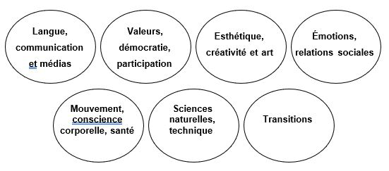
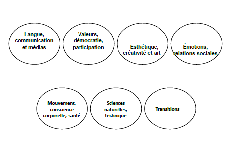

# Règlement grand-ducal du 17 juin 2024 portant établissement du cadre de référence national « Éducation non formelle des enfants et des jeunes ».

Nous Henri, Grand-Duc de Luxembourg, Duc de Nassau,

Vu la [loi modifiée du 4 juillet 2008](https://legilux.public.lu/eli/etat/leg/loi/2008/07/04/n1/jo) sur la jeunesse et notamment son article 31 ;

Vu l’avis de la Chambre de commerce ;

Le Conseil d’État entendu ;

Sur le rapport du Ministre de l’Éducation nationale, de l’Enfance et de la Jeunesse, et après délibération du Gouvernement en conseil ;

Arrêtons :

## Art. 1er.

Le cadre de référence national se compose des cinq annexes suivantes :

1° L’annexe I intitulée « Lignes directrices sur l’éducation non formelle des enfants et des jeunes », dans laquelle figurent :

a) les objectifs généraux ;

b) les principes pédagogiques fondamentaux selon les différents groupes d’âge de la petite enfance, de l’âge scolaire et de la jeunesse pour l’action des services d’éducation et d’accueil pour enfants, des mini-crèches, des assistants parentaux et des services pour jeunes.

2° L’annexe II intitulée « Lignes directrices pour l’élaboration du concept d’action général et du journal de bord applicables aux services d’éducation et d’accueil pour enfants et aux mini-crèches ».

3° L’annexe III intitulée « Lignes directrices sur l’éducation plurilingue dans la petite enfance ».

4° L’annexe IV intitulée « Lignes directrices pour l’élaboration du concept d’action général et du journal de bord applicable aux services pour jeunes ».

5° L’annexe V intitulée « Lignes directrices pour l’élaboration du projet d’établissement et du rapport d’activité pour les assistants parentaux ».

## Art. 2.

Le ministre ayant l’Éducation nationale, l’Enfance et la Jeunesse dans ses attributions est chargé de l’exécution du présent règlement qui sera publié au Journal officiel du Grand-Duché de Luxembourg.

Le Ministre de l’Éducation nationale, de l’Enfance et de la Jeunesse,   Claude Meisch

Palais de Luxembourg, le 17 juin 2024.   Henri

\**I. Annexes**

\**SOMMAIRE**

## INTRODUCTION

Le cadre de référence national sur l’éducation non formelle des enfants et des jeunes a introduit en 2016 les objectifs pédagogiques fondamentaux de même que les principes et caractéristiques de l’éducation non formelle au Luxembourg.

Au centre des réflexions figurait l’environnement d’apprentissage à concevoir, c’est-à-dire la question de savoir quelles conditions-cadres pédagogiques sont nécessaires pour favoriser au mieux les processus éducatifs et d’assimilation dans les services d’éducation et d’accueil pour enfants, auprès des assistants parentaux et dans le travail avec les jeunes. L’éducation est comprise comme un processus actif au quotidien et le concept d’éducation non formelle illustre la façon dont les pédagogues peuvent apporter leur soutien et mettre sur pied des offres orientées vers les besoins éducatifs, les développements et les intérêts des enfants et des jeunes. La tâche dite d’accompagnement éducatif par les pédagogues se réfère à l’autonomie des processus d’assimilation des enfants : les enfants et les adolescents sont soutenus dans l’exploration du monde et en même temps renforcés dans leur esprit d’initiative et leur responsabilité. Il est également essentiel que l’éducation non formelle ne soit pas considérée comme une activité individuelle : l’apprentissage se fait dans le cadre d’échanges réguliers avec d’autres enfants respectivement d’autres jeunes et avec des adultes. Les expériences et les découvertes sont faites ensemble et les points de vue sont partagés.

Soutenir les processus d’auto-apprentissage des enfants et des jeunes signifie que les réflexions pédagogiques ne sont pas axées sur la fixation d’objectifs, mais sur les possibilités et les intérêts des enfants et des jeunes. C’est précisément la perception des potentiels de ces derniers qui constitue une tâche importante des pédagogues dans l’éducation non formelle : la manière dont, en tant que modèles et personnes de références, ils peuvent – par leur attitude, l’organisation de la journée et la conception de l’offre – créer un environnement qui procure un sentiment de sécurité et qui en même temps permet un apprentissage autonome. C’est cela qui fait l’objet du cadre de référence national sur l’éducation non formelle.

Depuis l’introduction du dispositif d’assurance qualité dans l’éducation non formelle, les services d’éducation et d’accueil pour enfants, les services pour jeunes et les assistants parentaux se réfèrent aux orientations du cadre de référence national sur l’éducation non formelle dans l’élaboration de leurs concepts et dans la mise en œuvre de ces derniers sans pour autant perdre de vue les circonstances locales et les lignes directrices spécifiques aux gestionnaires.

Dans cette version révisée du cadre de référence national certains passages de la première édition ont été légèrement modifiés, d’autres ont été ajoutés dans leur intégralité. L’élaboration a été accompagnée et suivie par une « commission du cadre de référence » introduite par la loi. La partie générale portant sur « l’orientation pédagogique » (partie I) est à présent complétée par des contributions sur l’importance de l’auto-évaluation (voir point sous I.2.), sur les droits de l’enfant (chapitre I.4.), sur l’attitude pédagogique fondamentale (chapitre I.6.) et sur l’environnement de jeu et d’apprentissage dans l’éducation non formelle (voir chapitre I.7.).

Dans les parties spécifiques à l’âge « petite enfance » et « âge scolaire » a été ajouté un nouveau champ d’action qui décrit les différentes transitions dans ces tranches d’âge de même que les multiples incitations et possibilités d’apprentissage qui en découlent. La partie « jeunesse » a été simplifiée pour une meilleure lisibilité (chapitres IV.1.-IV.5.7.). Une nouvelle section décrit le cadre de l’éducation non formelle dans les services pour jeunes autres que les maisons de jeunes (chapitre IV.6.).

L’ensemble des lignes directrices pour l’élaboration des concepts et des journaux de bord ont été révisées sur la base des expériences acquises dans le cadre du dispositif de l’assurance qualité. Les lignes directrices sur l’éducation plurilingue dans la petite enfance ont été revues par un conseil scientifique sur l’éducation plurilingue et leur présentation a été simplifiée.

Le cadre de référence national sur l’éducation non formelle décrit de quelle manière et dans quels domaines les processus éducatifs peuvent être promus et ce faisant, comment les compétences et ressources des enfants et des jeunes peuvent être soutenues dans l’éducation non formelle. Comme dans la première édition du cadre de référence national, l’image de « l’enfant compétent », doté de capacités et d’intérêts divers dès la naissance, est au premier plan des considérations pédagogiques. De même, pour la « jeunesse », sont considérés comme essentiels à toute réflexion pédagogique les thèmes, potentiels et compétences des jeunes.

## Annexe I — « Lignes directrices sur l’éducation non formelle des enfants et des jeunes »

\**Cadre de référence national sur l’éducation non-formelle des enfants et des jeunes**

### A — PARTIE GÉNÉRALE

#### I — ORIENTATION PÉDAGOGIQUE

##### I.1° — IMAGE DE L’ENFANT/DU JEUNE

L’image qu’on a de l’enfant/du jeune détermine l’approche éducative. Elle forme ainsi le point de départ du choix des méthodes et de l’aménagement de l’environnement d’apprentissage dans l’éducation non formelle. Les enfants et les jeunes sont considérés comme des individus uniques qui font partie intégrante des systèmes sociaux, mais aussi comme des citoyens et citoyennes égaux de la société – une perspective qui se reflète également dans la notion d’éducation sous tendant le présent cadre de référence.

aot **Les enfants et les jeunes sont des individus compétents** qui ont chacun un parcours (éducatif) unique. Dès leur plus jeune âge, ils apprennent avec chacun de leurs sens. Leur développement est mu par leur curiosité, leur créativité, leur plaisir de jouer et d’apprendre ainsi que par leur quête d’un sens et d’une signification dans le monde. Leur envie d’exploration est révélatrice de leur soif de découvertes et de leur besoin de relever de nouveaux défis. (1) Pour les jeunes, le développement est avant tout synonyme de quête d’une identité propre dans les conditions-cadres de la société. Le potentiel éducatif des enfants et des jeunes se base, en interaction avec leurs ressources et conditions-cadres sociales, sur leurs intérêts et talents individuels, leurs idées et leurs théories intuitives. (2) En acquérant de plus en plus de compétences, ils diversifient leur répertoire de formes d’expression symboliques, telles que la/les langue(s), la créativité ou la musique. En outre, à l’adolescence, les valeurs des jeunes se consolident et ils prennent de plus en plus d’autonomie et de responsabilité, un processus qui leur permet d’exprimer leur personnalité unique de diverses manières et d’engager un dialogue avec les autres.

Le bien-être des enfants et des jeunes dépend de la satisfaction de leurs besoins fondamentaux ; ceux-ci couvrent tant les besoins physiologiques – tels que l’alimentation, le calme et le mouvement – qu’une sensation de sécurité et de protection. La possibilité de la réalisation de soi acquiert de plus en plus d’importance. (3) La quête d’appartenance, d’échange et de participation est tout aussi essentielle que le désir d’autonomie et d’indépendance.

aot **Les enfants et les jeunes sont des êtres sociaux et culturels,** qui apprennent avec les autres et des autres en interagissant avec eux. En tant que « co-constructeurs du savoir, de l’identité, de la culture et des valeurs », (4) ils contribuent activement à la conception tant de leurs propres processus éducatifs que de la culture d’apprentissage au sein des institutions non formelles. Dans le cadre de ce processus de co-construction, les enfants et les jeunes sont des partenaires égaux des adultes, qui profitent de leurs expériences et compétences individuelles. Ils génèrent un savoir et façonnent leur identité par leurs interactions et leur participation à différents contextes qui ont une importance pour eux sur le plan culturel. (5)

Les enfants et les jeunes étendent leur répertoire de rôles en participant activement à différents systèmes, tels que la famille ou les institutions de l’éducation formelle et non formelle. Ils s’intègrent dans des processus relevant de la dynamique de groupe et trouvent leur place au sein du groupe de pairs.

aot **Les enfants et les jeunes sont des membres égaux de la société** et jouissent de leurs propres droits. Ceux-ci portent notamment sur la liberté d’expression, l’information, la santé et la sécurité, le repos, les loisirs et le jeu, ainsi que l’éducation. (6) À cet égard, l’éducation s’entend comme un épanouissement complet de la personnalité, du talent et des aptitudes intellectuelles et physiques de l’enfant ou du jeune. (7)

L’enfance et la jeunesse sont des phases autonomes de la vie, qui occupent une place significative au sein d’une société. C’est pour cette raison que les enfants et les jeunes ont à leur disposition des structures de qualité, adaptées à leur âge et à leur développement, qui leur permettent de participer et d’assumer des responsabilités.

##### I.2° — RÔLE DES PÉDAGOGUES

Les pédagogues occupent une position centrale au niveau de l’accompagnement du parcours éducatif des enfants et des jeunes. Leur rôle est étroitement lié à l’image de l’enfant ou du jeune ainsi qu’à la notion d’éducation dans des schémas non formels. Ce sont dans une large mesure les compétences personnelles et professionnelles des pédagogues qui détermineront si et dans quelle mesure les potentiels de chaque enfant ou jeune pourront s’épanouir au sein des institutions de l’éducation non formelle. Pour accompagner les enfants et les jeunes de manière compétente, les pédagogues doivent notamment faire preuve d’une réflexion continue sur leur propre parcours (éducatif) (8) et sur l’éducation en général, mais aussi avoir envie d’apprendre tout au long de leur vie et de poursuivre leur développement personnel. Il est fondamental que les pédagogues aient conscience du rôle important de modèle qui leur revient, pour les enfants surtout, mais aussi pour les jeunes. Une attention particulière sera portée à la manière réfléchie dont les pédagogues géreront le multilinguisme sur le terrain.

aot **Les pédagogues sont d’importantes personnes de référence pour les enfants et les jeunes.** Ils montrent à ces derniers qu’ils les respectent et leur font confiance et veillent à leur bien-être. La sérénité et le sens de l’humour sont deux qualités fondamentales qui permettent de créer une atmosphère positive et qui favorisent le sentiment d’appartenance, la créativité, l’imagination et la motivation. (9) Les pédagogues accompagnent les processus de développement et d’éducation des enfants et des jeunes en témoignant de l’empathie et de la sensibilité pour leurs besoins et intérêts, tout en tenant compte des particularités propres à chaque catégorie d’âge. Ils focalisent toutefois aussi leur attention sur le groupe dans son ensemble et sur sa dynamique, afin d’équilibrer au mieux les besoins individuels et les exigences spécifiques au groupe. (10) Ils mettent en place des processus de négociation, surtout mais pas uniquement pour les jeunes, et établissent des conditions-cadres structurelles d’apprentissage tout en leur laissant leur espace de liberté.

bot **Les pédagogues sont les partenaires du processus de co-construction,** ils explorent le savoir et la culture avec les enfants et les jeunes par le biais d’échanges et de coopération. (11) Les situations quotidiennes sont perçues comme une occasion d’apprendre qui peut être utilisée pour étendre les compétences des enfants et des jeunes. (12) Dans le sens d’une pédagogie inclusive, ils exploitent leurs observations régulières et leurs notes pour mettre sur pied des programmes d’apprentissage et de jeu ouverts adaptés à l’environnement de vie et aux intérêts des enfants et des jeunes. La prise en considération et l’exploitation conscientes des différences individuelles au sein du groupe offrent également un potentiel éducatif considérable pour l’ensemble des parties prenantes. L’éducation non formelle a également pour mission de prendre en compte et d’exploiter au niveau pédagogique les différents acquis et compétences linguistiques des enfants et des jeunes. Les processus éducatifs de qualité favorisent l’action propre, l’autonomie et l’efficacité personnelle et offrent diverses possibilités de participation. Le fait d’offrir suffisamment de temps et d’espace à l’action autonome permet aux enfants et aux jeunes d’apprendre à leur propre rythme.

cot **Les pédagogues coopèrent** avec toutes les personnes et institutions impliquées dans le domaine de l’éducation. En font notamment partie, au niveau de l’éducation non formelle, les familles des enfants et des jeunes, le personnel qualifié externe ainsi que l’école ou les autres institutions (éducatives) locales. L’objectif premier de cette coopération est l’aménagement en commun de champs d’action favorisant l’apprentissage et le développement et au sein desquels les enfants et les jeunes peuvent s’épanouir. Cette coopération et les échanges avec les parents sont particulièrement importants pour l’enfant lors de transitions. (13) Pour les jeunes, c’est l’ouverture à l’espace social, aux autres institutions pour jeunes et aux associations qui se trouve à l’avant-plan. Une collaboration de qualité requiert la présence de structures fiables et se caractérise par un intérêt mutuel. Il est souhaitable que les institutions impliquées discutent ouvertement de leur notion d’éducation et qu’elles élaborent une culture d’apprentissage commune. (14)

dot **Les pédagogues réalisent de manière régulière des réflexions** sur leurs actions pédagogiques. Les offres éducatives et les méthodes de travail doivent en permanence être reconsidérées et remises en question sous un angle professionnel, tant au niveau individuel qu’au niveau de l’équipe. Le travail professionnel dans l’éducation non formelle requiert une volonté d’apprendre tout au long de la vie et de se développer au niveau professionnel. Il doit être prévu un cadre approprié permettant une remise en question de l’attitude pédagogique, des valeurs personnelles qui guident les interventions pédagogiques, des comportements spécifiques à la profession et de la pratique professionnelle. Au premier plan de cette ouverture aux influences extérieures et à l’autocritique doivent toujours être placés le bien-être et le développement sain de l’enfant. Les décisions et réflexions pédagogiques doivent être abordées au sein de l’équipe pédagogique à l’aide de procédures d’auto-évaluation structurées.

##### I.3° — NOTION DE L’ÉDUCATION

\**Par éducation s’entend la confrontation active et dynamique d’un individu à lui-même et à son environnement.**

L’éducation doit répondre à trois exigences : (15)

aot l’autodétermination,

bot la participation au développement social et

cot la prise de responsabilités.

L’éducation s’acquiert d’une part au moyen de processus d’apprentissage formels qui se déroulent au sein d’institutions éducatives comme l’école et qui aboutissent à des diplômes et des qualifications reconnus. D’autre part, l’éducation englobe également des processus non formels et informels qui peuvent aussi bien avoir lieu dans la vie quotidienne qu’au sein d’institutions.

\**Éducation non formelle**

Par éducation non formelle s’entend toute forme d’éducation organisée suivie sur une base volontaire et revêtant un caractère d’offre. Elle renvoie au travail éducatif organisé en dehors du système scolaire formel, qui s’adresse à un public cible bien défini et qui poursuit des objectifs éducatifs spécifiques. Quant aux objectifs, la durée et les outils d’apprentissage, l’éducation non formelle fonctionne de manière systématique. Toutefois, les objectifs, les contenus et les méthodes sont en grande partie aménagés par les participants eux-mêmes. (16) Les institutions éducatives non formelles ont la chance de pouvoir offrir aux enfants et aux jeunes la possibilité de jouer, de s’amuser et de se détendre tout en leur proposant des espaces libres où intégrer leurs intérêts propres. (17)

Tout comme pour les processus éducatifs formels, les adultes de référence et les pairs jouent un rôle essentiel dans le processus de co-construction. Les institutions de l’éducation non formelle attachent une importance particulière à la transmission de « compétences sociales et personnelles ainsi qu’à la promotion et au renforcement de l’implication dans les processus politiques et sociétaux ». (18) Les schémas non formels peuvent également servir d’organe de communication entre la famille, l’école et l’univers des enfants et des jeunes. (19) Ils permettent par ailleurs de promouvoir le multilinguisme sans que celui-ci soit lié à des objectifs didactiques prédéfinis et offrent aux enfants et aux jeunes l’espace dont ils ont besoin pour acquérir par eux-mêmes et approfondir leurs compétences linguistiques individuelles.

\**Éducation informelle**

L’éducation informelle est non planifiée et ne suit pas de cadre défini. Elle se fait au quotidien, que ce soit au sein de la famille, du groupe de pairs ou via différents médias. Les individus concernés la perçoivent rarement comme une extension de leurs connaissances et de leurs capacités. (20)

Les processus éducatifs non formels et informels prennent de plus en plus d’importance au niveau de l’organisation de la vie des enfants et des jeunes. (21)

\**Éducation intégrale**

Éducation ne signifie pas seulement acquisition de connaissances. Elle est le fruit de processus d’assimilation basés sur la co-construction et se manifeste dans le développement de compétences individuelles qui permettent de relever de nouveaux défis. L’éducation contribue à responsabiliser (22) l’individu et le rend apte à gérer sa vie de manière autonome ainsi qu’à exploiter les possibilités d’auto-apprentissage.(23) « Dans ce sens, l’éducation représente pour tous les enfants la principale ressource pour affronter leur vie quotidienne et façonner leur avenir ». (24)

Au sens de l’éducation intégrale, il est important que les processus éducatifs qui se déroulent pendant la journée au sein de schémas formels, non formels et informels se réfèrent les uns aux autres. Les enfants et les jeunes peuvent ainsi étendre et approfondir leurs intérêts individuels de manière volontaire et autonome. Les connaissances nouvellement acquises ne peuvent être comprises qu’en s’appuyant sur des expériences personnelles (25) et, ainsi, devenir davantage pertinentes pour le développement de la personnalité et des compétences propres.

Les processus éducatifs s’entendent comme des processus d’interaction entre l’individu et l’environnement, qui s’étendent tout au long de la vie. L’individu modifie son environnement, qui, à son tour, agit différemment sur lui. (26) Il est ici question du positionnement central de l’être humain au sein du processus d’assimilation du monde, ainsi que de l’intégration des expériences propres et de la réflexion sur celles-ci au regard de l’évolution de l’image que l’on a du monde et de soi-même. (27)

\**Jouer et apprendre, des processus éducatifs de premier plan**

La capacité d’assimiler le monde par le jeu et l’apprentissage constitue le fondement de l’éducation. Jouer et apprendre sont des processus indissociables l’un de l’autre, surtout pour les enfants.

\**L’importance des processus d’apprentissage dans les institutions de l’éducation non formelle**

Les processus d’apprentissage modifient et élargissent le répertoire de comportements. L’apprentissage permet aux enfants et aux jeunes de répondre de mieux en mieux aux exigences changeantes de leur environnement. (28) L’individu, avec ses expériences spécifiques et ses acquis bien définis, est au cœur de tous les processus d’apprentissage. La réussite des processus d’apprentissage dépend donc de ses conditions, pistes et objectifs d’apprentissage personnels. L’individualisation et la différenciation, la participation et l’orientation sur le processus sont autant de mécanismes qui permettent d’engranger des expériences d’apprentissage qui sont significatives pour eux et viennent s’ajouter aux connaissances et compétences déjà acquises.

L’apprentissage est aussi un processus social. L’expérience et l’exploration en commun aident considérablement à acquérir une compréhension approfondie des choses et à assimiler de nouvelles compétences, non seulement dans l’interaction entre les adultes et les enfants/jeunes, mais surtout au sein du groupe de pairs. (29) Les enfants et les jeunes apprennent avec les autres et des autres en interagissant avec leur environnement. Dans les schémas de co-construction, ils s’investissent pleinement et poursuivent activement leurs intérêts.

L’apprentissage peut se faire de différentes manières : en expérimentant, en questionnant et en explorant, en jouant, en apprenant sur un modèle, en essayant et en se trompant, par le biais du hasard, en réfléchissant, en s’exerçant et en reproduisant, en testant ses limites, etc. Les institutions de l’éducation non formelle offrent la possibilité d’engranger des expériences diversifiées, sans aucune contrainte en termes d’objectif ou de temps, et d’expérimenter différentes pistes d’apprentissage.

\**L’importance du jeu dans les institutions de l’éducation non formelle**

Les processus de jeu représentent à tout âge une source d’expérience indispensable à tous les niveaux du développement de la personnalité. Le jeu est une forme d’apprentissage fondamentale qui est active, riche en découvertes et structurante et qui génère un nouvel apprentissage lors de son exécution. (30) La capacité à jouer est innée chez chaque être humain et procure un sentiment jouissif. Elle permet aux enfants d’appréhender réellement leur environnement avec tous leurs sens et d’apprendre de nouvelles choses. Un jeu diversifié permet aux enfants d’acquérir des connaissances et de les structurer de manière autonome. Les jeux de rôle permettent d’utiliser, de tester et d’exercer les langues en fonction de la situation et de la personne. Pour les jeunes, jouer signifie se positionner par rapport aux autres, s’essayer à différents rôles et se lancer dans des activités expérimentales. Le jeu leur permet de tester la vie d’adulte de façon ludique et d’en retirer leurs propres expériences.

Il est fondamental que les schémas non formels intègrent des formes de jeu libre. Celui-ci stimule de façon optimale la motivation, l’acquisition de compétences socio-communicatives et la pensée divergente des enfants et des jeunes. (31) Par ailleurs, dans les institutions non formelles, le jeu a également une fonction psycho-hygiénique, dans le sens qu’il permet aux enfants et aux jeunes de se détendre après l’école et d’évacuer leur stress.

Les processus de jeu répétitifs permettent aux enfants et aux jeunes d’affiner sans cesse leur compréhension du monde. (32)

\**Les compétences, fondement de la capacité à juger et à agir**

Les compétences allient le savoir au savoir-faire et représentent ainsi le fondement d’une action réussie et responsable. (33) Plus un individu approfondira sa capacité à juger et à agir, plus il adoptera un comportement flexible et approprié dans des situations quotidiennes, mais aussi face aux défis de la vie en société. (34)

Les compétences sont le fruit de la mise en réseau des capacités intellectuelles, des acquis spécifiques à un domaine, des aptitudes et routines, de la motivation à agir et des valeurs personnelles. (35) C’est la combinaison de tous ces facteurs qui permettra de mettre les acquis en œuvre de façon responsable et appropriée à la situation.

Le travail éducatif orienté vers les compétences en appelle aux ressources des enfants et des jeunes et leur ouvre diverses expériences d’apprentissage. Les compétences se développent à travers l’apprentissage autonome, généré par les interactions entre l’individu et son environnement. Un lien étroit entre les différents environnements d’apprentissage est indispensable au développement continu de ces compétences, au-delà de toute institution éducative.

Les compétences acquises par les enfants et les jeunes sont les suivantes : **la compétence individuelle, la compétence sociale, la compétence technique et la compétence méthodologique.** (36) Ces quatre types de compétences sont interdépendants et étroitement liés les uns aux autres.

aot **La compétence individuelle** se fonde sur la confiance en soi, l’esprit d’initiative et une image positive de soi. Elle couvre la capacité et la volonté d’approfondir et d’épanouir ses talents et son potentiel. (37) Les enfants et les jeunes dotés d’une haute compétence individuelle se fient à leurs capacités et peuvent évaluer de manière réaliste les défis auxquels ils font face. C’est sur cette base que se développe la résilience qui permet aux enfants et aux jeunes de rester aptes, même dans des situations difficiles. (38) Parmi les autres compétences individuelles figurent l’initiative de nouer des contacts, la prise de responsabilité et les stratégies de résolution des difficultés.

bot **La compétence sociale** englobe la capacité à juger et à agir dans diverses situations sociales. Elle se fonde sur la capacité et la volonté d’aller à la rencontre d’autres personnes de manière empathique et responsable. Le comportement des enfants et jeunes socialement compétents est basé sur les relations et guidé par des valeurs. Ils font preuve, par exemple, d’une capacité à coopérer et à communiquer, d’une capacité à travailler en équipe et à gérer les conflits ainsi que d’une compréhension des notions de démocratie et d’interculturalité. Ces aptitudes s’appuient sur la capacité à se confronter de manière constructive aux règles et aux normes ainsi qu’à leur définition, déterminée dans une large mesure par les compétences linguistiques.

cot **Par compétence technique** s’entend la capacité à juger et à agir dans différents champs d’action. Cette compétence repose sur l’assimilation de termes et concepts pertinents qui peuvent être réutilisés de manière autonome et approfondie. Les enfants et jeunes disposant de compétences techniques manipulent activement les différents matériaux et se prêtent à des formes variables d’expérimentation et d’exploration. Plus la compétence technique s’accroît, plus les enfants et les jeunes parviennent à développer des stratégies – y compris créatives – pour résoudre les problèmes et prendre leurs propres décisions.

dot **La compétence méthodologique** est étroitement liée à la compétence technique et peut uniquement être assimilée à l’aide de contenus concrets. Ainsi, pour chaque champ d’action, des techniques et méthodes de travail spécifiques ou des stratégies d’assimilation et d’apprentissage sont considérées comme efficaces et utiles. En général, les compétences méthodologiques englobent la capacité à résoudre les problèmes, la capacité de réflexion, la pensée en réseau et en particulier les compétences relatives aux méthodes d’apprentissage. Ces dernières se basent sur la réflexion relative aux contenus d’apprentissage et aux processus d’apprentissage propres. L’individu prend ainsi conscience du fait « qu’il apprend, de ce qu’il apprend et de comment il l’apprend ». (39) La capacité croissante à planifier, exécuter et évaluer des processus d’apprentissage ad hoc favorise l’apprentissage tout au long de la vie.

On attirera par ailleurs l’attention sur la **méta-compétence**, qui désigne la capacité à évaluer le stade de développement de ses compétences propres et la nécessité de les développer encore. (40) La méta-compétence se développe à mesure que la capacité de réflexion se renforce. Le fait de donner régulièrement aux enfants et aux jeunes l’occasion de réfléchir aux conséquences de leurs actes fait naître chez eux la capacité à s’autoévaluer de manière réaliste. Ils sont ainsi mieux à même de relever les défis auxquels ils font face, par exemple les différentes transitions au sein du système éducatif. Ils comprennent immédiatement s’ils peuvent gérer une situation d’eux-mêmes ou s’ils ont besoin de l’aide d’autres personnes, ou encore s’ils peuvent déjà y arriver maintenant ou s’ils n’y parviendront qu’après avoir renforcé leurs compétences. La capacité à gérer les défis et à les relever avec succès contribue au développement d’une image positive de soi et, ainsi, à une plus grande efficacité personnelle et capacité d’action.

La compétence démocratique illustre bien l’interaction complexe entre les différents types de compétences. Elle s’appuie sur des compétences techniques liées aux processus sociétaux et politiques. (41) Les compétences individuelles et sociales, telles que la capacité à adopter une autre perspective, à gérer les conflits et à participer, permettent également d’utiliser les possibilités d’implication. En sa qualité de compétence méthodologique, l’analyse sociologique constitue par ailleurs une condition essentielle à la prise de décisions démocratiques. Les bases du développement de la compétence démocratique sont jetées dès la petite enfance.

##### I.4° — PRINCIPES ÉDUCATIFS GÉNÉRAUX

L’aménagement de programmes d’apprentissage dans les institutions éducatives pour les enfants et les jeunes obéit à des principes éducatifs généraux qui sont en adéquation avec l’image de l’enfant/du jeune ainsi qu’avec la notion d’éducation sous-tendant le présent cadre de référence :

\**Individualisation et différenciation**

Chaque enfant/jeune est unique en termes de personnalité, de contexte socio-culturel, de besoins et potentiels d’apprentissage et de rythme de développement. L’individualisation signifie que les programmes d’apprentissage et les processus éducatifs sont aménagés en fonction des caractéristiques de la personnalité et des compétences de chaque enfant/jeune. À travers une observation continue et systématique, un dialogue et une écoute attentive, les pédagogues peuvent découvrir les intérêts des enfants et jeunes et s’en inspirer dans leur travail éducatif différencié. (42) La diversification des méthodes et des formes d’apprentissage, un équipement vaste et adapté au développement, doté d’outils éducatifs et de matériel de jeu ainsi qu’un espace suffisant et aménageable de manière flexible constituent des aspects essentiels de la différenciation.

\**Diversité**

La diversité d’une société pluraliste se reflète dans ses institutions éducatives. La diversité signifie que chaque personne est unique et qu’elle se distingue des autres tant par des caractéristiques immuables telles que le sexe, l’ethnie ou les capacités physiques que par des caractéristiques variables, telles que la religion, le statut social, la/les langue(s) ou l’éducation. (43) Cette diversité joue un rôle précieux en pédagogie, en ce qu’elle constitue une ressource fondamentale qui vient enrichir les processus éducatifs. Au sein d’une société multilingue, la diversité linguistique revêt une importance particulière. La pédagogie de la diversité vise à favoriser l’égalité et l’équilibre des chances tout en préservant les différences individuelles, à « supporter les ambivalences et à développer la coopération en dépit des différences initiales. » (44)

La remise en question permanente par les pédagogues de leurs propres pensées et actions s’inscrit par conséquent pleinement dans une pédagogie de la diversité. Ils doivent se confronter consciemment à leurs propres préjugés en étant conscients de l’influence considérable que leurs valeurs et normes exercent notamment sur les jeunes enfants. (45)

\**Inclusion**

L’inclusion part du postulat que tous les êtres humains, avec leurs différences individuelles, leurs besoins particuliers et leurs talents propres, sont des êtres « normaux ».

Le fondement de la pensée inclusive est de faire en sorte que les enfants et les jeunes perçoivent la diversité et sachent l’apprécier. (46) Une pédagogie inclusive crée un environnement d’apprentissage qui tient compte des besoins et dispositions de chacun en matière d’apprentissage et qui permet à chaque enfant ou jeune de développer son potentiel. Cela signifie pouvoir réagir aux différences entre les enfants et jeunes en concevant des programmes d’apprentissage et des offres pédagogiques qui les incitent à s’investir avec leurs expériences et compétences individuelles. « Une pédagogie de l’inclusion ne pourra réussir que si elle reconnaît véritablement l’individualité et les besoins de l’ensemble des apprenants. » (47)

\**Multilinguisme**

Le multilinguisme est une réalité sociale au Luxembourg, et une ressource importante pour la société. Avec les trois langues officielles du pays et le grand nombre de citoyens qui parlent encore une autre langue à la maison, il est tout naturel que le multilinguisme intègre pleinement la vie quotidienne et professionnelle. Cette « écologie multilingue » (48) est à la fois une chance et un défi pour le système éducatif.

Au Luxembourg, il est primordial de maîtriser plusieurs langues pour mener à bien son parcours éducatif. L’utilisation consciente et permanente du multilinguisme est donc un aspect essentiel de l’éducation intégrale. D’après les résultats de diverses recherches internationales, les langues familiales jouent un rôle essentiel dans l’acquisition d’autres langues. (49) En faisant preuve de considération pour les langues familiales des enfants et des jeunes et en les sollicitant volontairement, les pédagogues renforcent le développement de la personnalité et de l’identité de ces derniers, ce qui offre à chacun d’entre eux, qu’elle(s) que soi(en)t sa/ses langue(s) familiale(s), un atout sur le plan éducatif. Les pédagogues qui reconnaissent le multilinguisme comme un principe éducatif transversal placent les enfants et les jeunes au centre de l’intérêt et s’adaptent à leurs besoins. En tant que modèles, ils donnent aux enfants et aux jeunes une autonomie dans le choix de la langue et augmentent ainsi leur participation. Cela contribue également à l’inclusion de tous les enfants et de tous les jeunes. (50) En outre, une éducation multilingue réunit les conditions essentielles à l’acquisition de compétences interculturelles, telles que l’empathie, la capacité à modifier sa perspective ainsi que le dépassement de l’ethnocentrisme. (51) Elle favorise par ailleurs les compétences translinguistiques (par exemple les transferts d’une langue à l’autre) ainsi que les compétences métalinguistiques et cognitives, (52) qui enrichissent la capacité générale à s’exprimer et le parcours éducatif d’un individu.

Le concept ouvert et holistique des institutions de l’éducation non formelle, en particulier, offre à tous les enfants et jeunes la possibilité d’apprendre et de vivre le multilinguisme en permanence. Ainsi, un lien est immédiatement fait avec la pratique du multilinguisme dans toutes les autres situations du quotidien des enfants et des jeunes et au sein de leur famille.

\**Les droits de l’enfant**

Il a déjà été souligné dans la section « Image de l’enfant » (chapitre I.1.), que le présent cadre de référence et donc les réflexions sur l’éducation non formelle se réfèrent à la Convention internationale des droits de l’enfant. Il existe plusieurs liens directs entre l’éducation non formelle et la Convention relative aux droits de l’enfant. Les adultes ont le devoir et la responsabilité de mettre en œuvre ces droits de l’enfant. Outre cette condition d’« adultes responsables », les droits de l’enfant ont comme principes l’universalité (tous les enfants sont égaux en ce qui concerne leurs droits) et l’indivisibilité (tous les droits ont la même importance et sont interdépendants). (53)

La Convention contient une multitude de droits qui peuvent être différenciés selon les droits de protection, de prestation et de participation (les trois « P », en anglais : protection, provision, participation). Sans prétendre à l’exhaustivité, ci-dessous certaines dispositions qui concernent directement l’éducation non formelle :

aot Aucun enfant ne peut être désavantagé en raison de son origine nationale, ethnique ou sociale, de sa langue ou de sa religion. (Article 2)

bot L’enfant a le droit, dans toute question ou procédure le concernant, d’exprimer librement son opinion et de voir cette opinion prise en considération. (Article 12)

cot Tout enfant a le droit d’être protégé contre toute forme de violence physique, mentale ou morale, maltraitance ou négligence. (Article 19)

dot Tout enfant a droit au repos, aux loisirs, au jeu et à la récréation. (Article 31)

Les établissements d’éducation et d’accueil ont pour base conceptuelle la mise en œuvre des droits de l’enfant et le bien-être de l’enfant. Pour le travail au quotidien de l’éducation non formelle, les objectifs suivants peuvent être mis en avant :

aot Les enfants apprennent qu’ils ont des droits et connaissent leurs droits.

bot Les enfants font l’expérience de « vivre ces droits », c’est-à-dire les enfants ont de nombreuses occasions de réaliser par exemple leurs droits de participation et apprennent que le fait d’avoir des propres droits signifie, tant pour les adultes que pour eux-mêmes, qu’il existe des règles régissant les relations humaines.(54)

Une pédagogie orientée vers les besoins des enfants et axée sur « l’enfant compétent » met l’accent sur la réalisation des droits de l’enfant, tant en termes de conditions-cadres que d’activités pédagogiques. Des normes telles que la primauté du bien-être de l’enfant, une participation adaptée à l’âge, le droit au jeu et une pédagogie inclusive, tenant compte des préjugés sont fortement ancrées dans la vie pédagogique quotidienne et leur mise en œuvre fait toujours l’objet de réflexions pédagogiques.

##### I.5° — CARACTÉRISTIQUES DE L’ÉDUCATION NON FORMELLE

L’éducation non formelle se distingue par certaines caractéristiques qui s’orientent à l’image de l’enfant/du jeune ainsi qu’à la notion d’éducation sous-tendant le présent cadre de référence. En sus des principes éducatifs généraux, ces caractéristiques guident également la mise en place de l’ensemble des programmes d’apprentissage tout au long de la journée, et ce afin d’aider les enfants et les jeunes à exprimer leurs intérêts et à se confronter activement à leur environnement.

\**Base volontaire**

La participation aux activités et projets des institutions de l’éducation non formelle se fait sur une base volontaire. Si pour les jeunes enfants, ce sont les parents qui décident d’accepter ou non l’offre, cet aspect revêt davantage d’importance pour les adolescents, car c’est essentiellement à eux que revient cette décision. Cela accroîtra leur motivation intrinsèque et leur volonté de participation.

\**Ouverture**

En fonction de la composition du groupe, de l’équipe, des circonstances locales et des réflexions conceptuelles, c’est la structure ou le gestionnaire responsable d’une institution non formelle qui décide de la mise en œuvre concrète des objectifs pédagogiques. L’ouverture à l’égard des enfants et des jeunes et de leurs besoins donne naissance à une multitude de modèles conceptuels de base.

En sus de cette ouverture en matière d’objectifs et de méthodologie, l’ouverture comme principe de travail signifie que les crèches, maisons relais ou maisons de jeunes s’ouvrent vers l’extérieur, c’est-à-dire qu’elles cherchent à échanger avec les autres organisations et institutions, « impliquent les personnes issues de l’environnement de l’institution dans le travail pédagogique et permettent aux enfants d’explorer leur environnement ». (55)

\**Participation**

La co-responsabilité et la co-décision sont tant des objectifs du travail avec les enfants et les jeunes que des principes méthodologiques fondamentaux.

On peut établir une distinction entre les différents degrés de participation (56) (la participation sporadique, la participation réelle ou l’autodétermination), mais également entre les différents modèles de participation (formes parlementaires, par exemple le parlement des enfants et des jeunes, formes ouvertes, par exemple les forums de discussion, et formes de participation orientées vers le projet). Même si le choix des formes de participation dépend des enfants et des jeunes ainsi que des intérêts, besoins et conditions sur place, le principe d’impliquer les enfants et les jeunes dans le processus de décision et non seulement dans la réalisation demeure une caractéristique fondamentale de l’éducation non formelle.

Les enfants et les jeunes sont vus comme des participants à leurs processus éducatifs, au sens de co-constructeurs de celui-ci. La création d’espaces libres, le transfert de responsabilité, la transparence des décisions et le fait de les interroger régulièrement sur leurs envies et leurs propositions génère l’apparition d’une forme quotidienne de participation qui permet aux enfants et aux jeunes de se confronter activement à eux-mêmes, à leurs intérêts et envies et à leur environnement et ainsi, seulement, à un processus éducatif actif.

\**Orientation vers la personne**

Les méthodes et objectifs de l’éducation non formelle sont déterminés en fonction des enfants et jeunes et adaptés dans la mesure du possible à leurs besoins et intérêts. Cette adaptation peut entraîner divers changements non seulement dans la planification, mais également dans le déroulement de la journée, dans le sens que de nouvelles priorités sont établies. Les processus éducatifs dans le travail avec les enfants et les jeunes se caractérisent en ce qu’ils « se fondent sur les expériences des enfants et des jeunes eux-mêmes. Ils renvoient de façon plus nette à une pratique réelle, dans le cadre de laquelle les enfants et les jeunes deviennent des coproducteurs décisifs de leur propre parcours éducatif. Ainsi, ils aménagent eux-mêmes leur vie et leurs sujets quotidiens et contribuent également en quelque sorte à écrire le scénario de leur vie ». (57)

Toutes sortes d’occasions et de points d’intérêt sont exploités afin de soutenir les processus éducatifs. La pédagogie de l’éducation non formelle se base sur le quotidien et l’environnement des enfants et des jeunes et s’emploie à donner des impulsions éducatives pertinentes tant au niveau de leur parcours que dudit environnement : (58) « Le fait de valoriser les schémas favorisant les processus d’apprentissage moins formalisés, qui contribuent à l’éducation des enfants et des jeunes, vient renforcer le principe selon lequel les intérêts et l’environnement des enfants doivent jouer un rôle fondamental dans la planification et/ou l’exécution de ces offres ». (59)

\**Apprentissage par l’exploration**

L’action concrète et l’apprentissage par la recherche sont à l’avant-plan de l’éducation non formelle, devant l’apprentissage de connaissances théoriques. D’après le principe selon lequel « l’éducation est une découverte avec tous les sens », les dimensions affective et pratique de l’apprentissage sont mises en exergue, en plus de la dimension cognitive. On sait que le fait d’appréhender l’environnement joue un rôle essentiel dans les processus de traitement des informations des jeunes enfants et qu’il est important de solliciter différentes perceptions sensorielles dans le cadre des processus éducatifs. Afin de favoriser un apprentissage complet et exploratoire, l’éducation non formelle a recours à un large éventail d’activités et de formes de travail, offrant ainsi de manière ciblée des projets et activités répondant aux capacités et aux intérêts les plus divers.

L’objectif est de donner aux enfants et aux jeunes la possibilité d’essayer et d’expérimenter dans des domaines qui leur sont peu familiers et ainsi, à travers « l’expérience de succès insoupçonnés », (60) celle de développer de nouvelles capacités et de la confiance en soi. L’apprentissage par l’exploration dans l’éducation non formelle signifie qu’il existe un espace libre au sein duquel les expériences sont autorisées et les erreurs et fausses pistes bienvenues, car elles font partie du processus d’apprentissage.

\**Orientation vers le processus**

En règle générale, dans l’éducation non formelle, l’assimilation de connaissances et de capacités n’a pas une fin prédéfinie ; c’est plutôt le processus qui prévaut, en fonction de la personnalité de chacun. À cet égard, l’acquisition de compétences ne doit pas être vue comme un produit final : la voie individuelle de l’apprentissage, ainsi que le fait d’assimiler et d’engranger des expériences sont tout aussi importants.

L’ouverture des programmes d’apprentissage de l’éducation non formelle permet d’essayer différentes méthodes et de proposer toutes sortes de projets, sans contraintes de temps ou de résultats. Les processus éducatifs s’articulent autour des intérêts et des capacités des enfants et des jeunes, qui sont impliqués de manière responsable et autonome dans l’apprentissage orienté sur le processus. Ainsi, le résultat du processus éducatif n’est pas anticipé, mais tout l’art de la pédagogie réside dans le fait « d’inciter les enfants et les jeunes à se confronter de manière autonome au monde, sachant que le résultat de cette confrontation est ouvert ». (61) Le processus d’apprentissage et, avec lui, la manière d’expérimenter, d’explorer et de questionner des enfants et des jeunes sont volontairement soutenus et encouragés.

\**Apprentissage en partenariat**

L’apprentissage non formel utilise de manière ciblée des méthodes de coopération actives et implique des processus relevant de la dynamique de groupe. Les expériences de groupe stimulent les capacités et aptitudes sociales et apportent un réel soutien dans le domaine de la compétence sociale, essentiel pour l’éducation non formelle. Puisqu’elle met la priorité sur la coopération et le travail d’équipe, l’éducation non formelle peut se définir comme le fait d’apprendre des autres et avec les autres. À cet égard, les individus du même âge forment un groupe de référence qui fournit à l’enfant ou au jeune des repères et le guide dans ses questionnements et ses processus de développement. (62) La comparaison des processus d’apprentissage et des résultats obtenus au sein du groupe de pairs est particulièrement utile pour développer la compétence méthodologique.

Dans le cadre de l’éducation non formelle, les pédagogues sont non seulement invités à travailler avec le groupe, à accompagner les processus relevant de la dynamique de groupe et à encourager les actions entreprises en commun, mais également à participer activement à différentes activités, à prendre régulièrement position par rapport à des déclarations, des jugements et des actions et à faire preuve d’un engagement actif dans leur rôle d’« autre parmi les semblables ». (63)

Dans le travail avec les jeunes, le fait d’engager des interactions sociales revêt une importance fondamentale : « Le travail avec les jeunes n’est envisageable que dans le cadre d’expériences de groupe et d’activités de coopération. L’éducation non formelle doit créer de multiples situations qui permettent aux jeunes de communiquer et dialoguer... ». (64)

\**Relation et dialogue**

Dans le cadre du travail avec les enfants et les jeunes, les pédagogues représentent d’importantes personnes de référence, qui sont chargées de créer un climat de communication ouverte, mais aussi de respect et d’estime. Même si la situation varie en fonction de l’âge des enfants et des jeunes, les relations entre ces derniers et leurs personnes de référence adultes demeurent d’importants critères de qualité dans le contexte de la promotion du développement et du soutien aux jeunes. Seule une relation de confiance permettra d’installer une atmosphère détendue et propice à l’apprentissage dans laquelle les intérêts des enfants et des jeunes seront pris en compte et leur développement individuel encouragé. (65) Le travail relationnel au sein de l’éducation non formelle exige un dialogue continu et une écoute active. Cela permet « de s’inspirer des enfants et d’apprendre d’eux, de préserver leurs théories, leurs hypothèses et leur imagination et de les suivre dans leur manière de donner un sens à leur environnement ». (66)

Le travail avec les enfants et les jeunes exerce une fonction de protection et de soutien, en ce sens que ces derniers y jouissent d’un lieu de reconnaissance au sein duquel ils peuvent essayer de nouveaux comportements et proposer des expériences alternatives dans un environnement à la fois empathique et exigeant. (67)

\**Autonomie et efficacité personnelle**

Un des objectifs centraux de l’éducation non formelle est de permettre aux enfants et aux jeunes de faire l’expérience de l’autodétermination et de l’efficacité personnelle. Les diverses possibilités d’agir de manière active et autonome permettent de développer, d’expérimenter et d’utiliser des compétences de gestion de problèmes. (68) La capacité à résoudre les problèmes et la confiance en son efficacité personnelle sont considérées comme des facteurs essentiels, y compris dans le cadre de la recherche sur la résilience, et encouragent les enfants et les jeunes à contribuer activement à la gestion du stress et des différents défis qui se posent à eux. (69) La notion d’« Empowerment » est souvent utilisée à cet égard dans l’éducation non formelle ; elle se réfère aux mesures visant à renforcer l’autodétermination et l’autonomie d’un individu.

##### I.6° — L’ATTITUDE PÉDAGOGIQUE

Afin de remplir leur rôle d’accompagnateurs éducatifs, l’attitude pédagogique des pédagogues joue un rôle central. La participation, l’inclusion et le renforcement de la résilience ne sont que quelques-uns des éléments de l’éducation non formelle qui doivent non seulement être planifiés et conçus à l’avance, mais dont la mise en œuvre dépend de l’attitude pédagogique et donc des compétences personnelles et professionnelles des pédagogues. Une attitude professionnelle se caractérise par le fait qu’elle permet au personnel pédagogique d’agir de manière flexible et réfléchie dans de nombreuses situations et ce, malgré des exigences contraires et des conditions contextuelles modifiées. (70) En ce sens, l’attitude pédagogique apporte un soutien aux pédagogues (71) ainsi qu’à l’enfant qui a besoin d’une stabilité intérieure dans un monde en mutation rapide. (72)

Même si l’attitude doit être flexible pour s’adapter aux contextes, il existe certaines caractéristiques essentielles qui doivent être prises en compte dans l’éducation non formelle afin que l’éducation au sens d’auto-éducation et de co-construction puisse avoir lieu.

Pour mettre en œuvre l’éducation non formelle, il faut des pédagogues qui : (73)

aot valorisent les enfants et les jeunes et leur font confiance ;

bot sont des modèles et des personnes de référence pour les enfants et les jeunes ;

cot répondent aux besoins, aux inquiétudes et aux craintes des enfants et des jeunes ;

dot donnent aux enfants et aux jeunes suffisamment de temps et d’espace pour se développer dans une atmosphère motivante et sans peur ;

eot aident les enfants et les jeunes à trouver leur place et leur rôle au sein de la communauté ;

fot apprécient le caractère unique de chaque enfant et chaque jeune et voient la diversité comme un enrichissement et une ressource ;

got placent les forces et les intérêts des enfants et des jeunes au premier plan et offrent une variété d’expériences d’apprentissage ;

hot soutiennent la participation des enfants et des jeunes au quotidien ;

iot encouragent les enfants et les jeunes à jouer et à découvrir l’environnement de manière ludique et avec tous leur sens ;

jot écoutent et respectent les idées et les suggestions des enfants et des jeunes.

Dans le sens inverse se laissent également identifier des comportements contraires à l’éthique professionnelle. Dans l’éducation non formelle, les attitudes et les comportements suivants sont à proscrire, à savoir (voir Reckahner Reflexionen, 2017) : (74)

aot traiter les enfants et les jeunes de manière discriminatoire, irrespectueuse, humiliante ou grossière ;

bot faire des commentaires dévalorisants et décourageants des réalisations et des performances des enfants et des jeunes ;

cot réagir au comportement des enfants et des jeunes de manière dénigrante ou excluante ;

dot ignorer les blessures verbales, physiques ou médiatiques, entre les enfants ou les jeunes ;

eot ignorer les préoccupations, les craintes et les intérêts des enfants et des jeunes et refuser de les aider.

##### I.7° — ENVIRONNEMENT DE JEU ET D’APPRENTISSAGE

###### I.7°1 — L’aménagement de l’environnement de jeu et d’apprentissage

Un environnement de jeu et d’apprentissage aménagé de manière pédagogique exerce une influence positive sur les processus éducatifs des enfants. Dans le cadre de l’éducation non formelle, il est impératif de concevoir des espaces intérieurs et extérieurs qui sont adaptés à l’âge des enfants et qui tiennent compte de leurs besoins et intérêts. (75) Les salles sont aménagées de manière à dégager une atmosphère agréable et à procurer un sentiment de sécurité. En même temps, les salles favorisent la rencontre, le mouvement, le repos, ainsi que le jeu et la créativité. (76) Les enfants ont besoin d’espace tant pour des activités de groupe que pour des activités individuelles et des possibilités de retrait. (77) L’aménagement prévoit également des espaces de mouvement et un endroit où chaque enfant peut ranger ses affaires personnelles.

Le matériel de jeu et d’apprentissage influence également les processus éducatifs des enfants. Le matériel se veut varié et adapté à l’âge des enfants. Du matériel structuré et non structuré devrait être disponible en quantité suffisante et en bon état. De plus, il est essentiel que le matériel de jeu soit librement accessible afin de soutenir l’autodétermination et l’esprit d’initiative des enfants.

Afin de tenir compte de tous ces aspects lors de la conception de l’environnement de jeu et d’apprentissage, les principes (78) suivants sont à considérer :

\**Structure**

Les espaces ont besoin d’une structuration claire afin de permettre aux enfants de s’orienter et de se sentir en sécurité. De ce point de vue, il est opportun que les différents espaces d’une pièce soient clairement délimités.(79) En outre, des endroits dédiés pour chaque matériel de jeu et d’apprentissage permettent aux enfants de les trouver et de les ranger de manière autonome. (80)

\**Fonctionnalité**

La répartition d’une pièce en différents espaces fonctionnels permet aux enfants d’avoir plus facilement une vue d’ensemble et apporte ainsi clarté et orientation. Les enfants peuvent facilement reconnaître à quoi est destiné un espace fonctionnel et son équipement. (81)

\**Accessibilité**

L’environnement de jeu et d’apprentissage aménagé de manière à ce que les enfants puissent l’explorer de façon autonome est synonyme de participation et renforce la capacité d’autodétermination des enfants. (82)

\**Flexibilité**

Le quotidien d’une institution de l’éducation non formelle est varié. Les différentes phases d’une journée ainsi que les besoins individuels des enfants entraînent des exigences particulières en matière d’aménagement de l’espace. Un aménagement flexible permet de réorganiser facilement les salles et de les adapter aux besoins individuels des enfants. (83)

\**Documentation**

Lors de l’aménagement de l’environnement de jeu et d’apprentissage un espace de documentation est prévu afin de donner de la visibilité aux expériences des enfants. Des exemples tels que les dessins des enfants ou des photos d’évènements et d’activités illustrent le quotidien de l’institution. Une telle documentation renforce la mémoire visuelle des enfants et sert d’amorce à des échanges du personnel pédagogique avec les enfants et les parents.

###### I.7°2 — Être à l’extérieur avec les enfants

Les processus d’apprentissage de l’enfant à l’extérieur de la structure font partie intégrante de l’éducation non formelle. Les enfants ont besoin de cet espace d’expérience proche de la nature afin d’être stimulés non seulement dans le domaine cognitivo-intellectuel, mais aussi affectivement, sensoriellement et dans le domaine de la motricité. Un environnement d’apprentissage à l’intérieur de la structure n’est pas en mesure de fournir toutes les stimulations et tous les espaces d’expériences requis. Il est nécessaire de prendre en compte les espaces extérieurs (comme par exemple les aires de jeux) et d’utiliser de manière régulière les espaces extérieurs naturels (forêt, prairie).

Les découvertes de l’enfant, ses actions originales et autonomes et donc sa curiosité peuvent ici être encouragées de manière globale. (84) Il est proposé un environnement d’apprentissage dans lequel les enfants peuvent faire des expériences pratiques, directes, actives et avec tous leurs sens. (85) L’offre des « espaces de mouvement » est ainsi enrichie par une multitude de mouvements intégrés dans la vie quotidienne. Les espaces de jeux et de découvertes naturels permettent aux enfants d’apprendre par eux-mêmes, de découvrir, de ressentir et de comprendre le monde. (86) C’est pour cette raison que l’extérieur de la structure doit être conçu de manière à être proche de la nature.

La forêt, mais aussi les environs immédiats, sont utilisés comme un espace de découverte et de mouvement qui offre une variété de possibilités insoupçonnées. « Être à l’extérieur » avec les enfants constitue une opportunité de se retrouver ensemble et de vivre une expérience partagée et constitue une base pour l’apprentissage social. Des promenades découvertes dans la commune encouragent l’exploration de la ville ou du village d’origine du point de vue de l’enfant. (87)

« Être à l’extérieur » est un élément important de la promotion de la santé : les diverses possibilités d’exercice, le jeu libre au grand air, l’exploration et la découverte de la nature, la découverte du village ou du quartier, répondent aux intérêts et aux besoins des enfants. Les espaces extérieurs naturels tels que la prairie, la forêt et les environs immédiats ne peuvent être remplacés par des espaces intérieurs ou par un espace extérieur aménagé du service d’éducation non formelle.

###### I.7°3 — Travail pédagogique ouvert et partiellement ouvert

Basées sur une notion de l’éducation qui place l’auto-éducation et la co-construction au premier plan, les offres destinées aux enfants doivent être conçues de manière à encourager la « propre activité de l’enfant ». (88) L’esprit d’initiative de l’enfant, son envie d’exploration, sa soif de découverte et sa curiosité sont soutenus par les services d’éducation non formelle qui offrent un environnement varié et différencié et ainsi de nombreuses possibilités d’expériences diverses.

Le concept pédagogique peut tenir compte de cette diversité et de la participation active des enfants en mettant en œuvre des concepts de travail ouvert qui non seulement se basent sur les intérêts des enfants mais qui tiennent compte également des possibilités d’aménagement des institutions. La condition préalable à ce processus d’ouverture est une compréhension commune entre les pédagogues quant au modèle de travail ouvert qui est recherché et aux étapes visées. (89)

Le travail ouvert peut être réalisé de diverses manières, comme p.ex. par le travail intergroupe, l’aménagement de salles avec des espaces à thèmes ou des ateliers, la mise à disposition d’un large éventail de matériel de jeu polyvalent (« objets pour jouer » au lieu de « jouets ») ou encore par la prise en compte du jeu libre dans la planification quotidienne. (90) Quelle que soit la méthodologie choisie, le principe du travail ouvert est que les offres sont proposées sur une base volontaire.

En fonction de l’âge des enfants, il est préférable d’adopter une approche progressive, dans laquelle les tout-petits passent leur journée avec leur éducateur de référence et leurs pairs (« groupe cocon ») et n’explorent que progressivement l’espace ouvert. (91)

Outre le travail dit « ouvert », il existe également des concepts de travail partiellement ouvert, tels que pour les offres ouvertes à tous les groupes. Les enfants appartiennent à des groupes fixes, mais des activités intergroupes sont proposées à intervalles réguliers (par exemple, une période déterminée de la journée est réservée à l’utilisation libre des espaces à thèmes).

Le rôle et la répartition des tâches des professionnels sont à clarifier au sein de l’équipe. Indépendamment du modèle de travail ouvert choisi, les facteurs suivants sont déterminants pour la qualité pédagogique du travail ouvert : la coopération avec les parents, la mise en place d’une relation dans le sens d’une attention émotionnelle et d’un « attachement », les pédagogues qui se conçoivent comme des accompagnateurs éducatifs moyennant l’observation et la documentation.

Un concept de familiarisation adapté et des éducateurs de référence sont également essentiels dans le travail ouvert pour le bien-être et le développement sain des enfants. (92)

| Schroen & Achten (2011) Gisbert (2004) Maslow (1954), Strätz et al. (2008) Moss (2008, p. 7) Fraundorfer (2012) Assemblée générale des Nations Unies (1989) Assemblée générale des Nations Unies (1989, article 29) Strätz et al. (2008) Katschnig (2007), Liebertz (2007) Ahnert (2008b) Fthenakis (2008) Bäck, Bayer-Chisté & Hajszan (2004) Griebel & Niesel (2004) Oberhuemer (2006) Klafki (1996) Commission européenne (2001, 2002), Conseil de l’Europe (2002, 2006), UNESCO (1998) cf. Rauschenbach (2004, p. 118) Harring, Rolfs & Palentien (2007, p. 9) Honig & Haag (2011) Bechtel, Lattke & Nuissl (2005) Schronen & Achten (2011), Rauschenbach (2012, p. 4-6) cf. Charlotte Bühler Institut (2009, p. 3) Bundesjugendkuratorium (2001, p. 17) Landesarbeitsgemeinschaft Elterninitiativen (2011, p. 17) Spitzer (2002) Hartmann, Stoll, Chisté & Hajszan (2010) von Felden (2004) Neubauer & Stern (2007) Istance & Dumont (2010) Callies (1975) Hartmann (1997) Dunlop (2003) Klieme et al. (2007) Brödel (2002) Weinert (1999) Strasmann & Schüller (1996) Strasmann & Schüller (1996) Wustmann (2011) Gisbert (2002, p. 12) Weinert (2001) Darmstädter Appell (1995) Weltzien (2010) cf. Gardenswartz & Rowe (1994) Yagci-Grobner & Prochazka (2009, p. 924) Wagner (2010a) Booth, Ainscow & Kingston (2006) Weilguny, Resch, Samhaber & Hartel (2011, p. 30) Neumann, Schnoor & Seele (2012) de Cillia (2008) | Kirsch, C., Mortini, S., Andersen, K., & Aleksić, G. (2018) Viernickel, Völkel & Focali (2009) Berk (2011), Engel de Abreu, Cruz-Santos, Tourinho, Martin & Bialystok (2012), Schneider (2003) cf. Maywald (2016) cf.KTK, Verband Katholischer Tageseinrichtungen Kinderrechte im Kindergarten BMFSFJ (2005, p. 254) cf. Stufen der Partizipation nach Hart (1992) Rauschenbach (2010, p. 48) cf. Cloos, Köngeter, Müller & Thole (2009) BMFSFJ (2005, p. 254) Giesecke (1971, p. 173) Deller (2003, p. 325) cf. Nörber (2003) Thole (2006, p. 6) Willems et al. (2010, p. 82) cf. Bodeving (2009), Braun & Wetzel (2005) Dahlberg (2004, p. 27) cf. Braun & Wetzel (2005), Laevers & Declercq (2011), Schröder (2005) cf. Bäck, Hajszan & Bayer-Chisté (2008), Hornstein (2004) Wustmann (2009) Schwer,C., Solzbacher,C. (2014) Rodner,M. ,Greine,R.(2012) Paetzholdt-Hofner, S. (2016) cf. Service national de la jeunesse (2019b) Reckahner Reflexionen zur Ethik pädagogischer Beziehungen (2017) Franz , M. (2018) Von der Beek, M. Buck, A. Rufenach (2010) Service national de la jeunesse (2017) Knauf H. (2013) Knauf, H.(2013) Service national de la jeunesse (2017) cf Service national de la jeunesse (2019b) Knauf, H.(2013) Knauf, H.(2013) H. Österreicher H. & E. Prokop E. (2006)  cf. Krenz, A (2017), Krenz,A.(2019) Krenz (2014) Kober-Murg, I. & Parz-Kovacic, B. (2014) Schäfer (2011) Lill, G. (2012) Regel G. & Ahrnes S. (2016) Haug-Schnabel, G. & Bensel, J.(2017) Rohnke (2019) |
|---|---|

### B — PARTIE SPÉCIFIQUE À L’ÂGE

#### II — PETITE ENFANCE

##### II.1° — INTRODUCTION AU GROUPE D’ÂGE

Dès leur naissance, les enfants sont des personnalités compétentes qui ne cessent de gagner en autonomie dans les premières années de leur vie. Ils gagnent en assurance grâce aux multiples processus moteurs qu’ils entreprennent, et développent des compétences linguistiques complètes, dans plusieurs langues parfois. Des liens fiables avec leurs premières personnes de référence permettent aux enfants de développer des relations de confiance avec de plus en plus d’individus, y compris avec des personnes extérieures à leur famille. Ils engagent leurs premières relations d’amitié avec des enfants de leur âge et repoussent leurs limites pour assimiler les règles sociales. Dans le même temps, ils développent de la compassion et de l’empathie, d’après le modèle d’adultes sensibles et réceptifs, qui encouragent en permanence l’enfant à exprimer ce qu’il ressent. Le renforcement de la volonté propre des enfants et un nombre suffisant de possibilités d’autodétermination adaptées à leur âge sont des moteurs importants du développement d’une conscience stable du moi.

Chez les tout-petits et les enfants en bas âge, l’imitation, la reproduction et la variation des actions prévalent.(93) Le développement dans les différents domaines – cognitif, moteur, linguistique, social et émotionnel – s’accomplit intégralement à l’aide de chacun des sens, toutefois pas en continu dans la plupart des cas. Le développement de l’enfant se fait plutôt par à-coups ; par ailleurs, l’enfant peut parfois revenir à des stades de développement antérieurs, au niveau desquels il se sent davantage en sécurité. Ces phases exigent un accompagnement particulièrement attentionné et encourageant de la part des adultes.

Sur la base de relations stables, les enfants peuvent explorer leur environnement, mais aussi prendre consciemment de plus en plus de distance par rapport à leurs personnes de référence ; ils acquièrent ainsi davantage d’espace pour prendre leurs propres décisions. À mesure que les enfants gagnent en autonomie, leur besoin d’être en permanence à proximité physique de leurs personnes de référence s’amenuise et l’importance des relations sociales avec leurs pairs passe à l’avant-plan. Toutefois, les jeunes enfants ont encore constamment besoin de protection et de sécurité pour pouvoir relever délibérément et avec curiosité les défis auxquels ils font face.

##### II.2° — RÔLE DES PÉDAGOGUES

Les pédagogues des institutions de l’éducation non formelle sont souvent les premières personnes de référence des jeunes enfants, en dehors des membres de leur famille. Au début, une conception professionnelle des rôles se traduit surtout par le développement d’une relation de confiance avec chaque enfant et ses parents. Les pédagogues, en tant qu’élément de l’institution éducative, sont conscients de leur responsabilité en matière de politique éducative et de la position clé qu’ils occupent au sein de la société. Leur acceptation fondamentale de l’éducation et de la prise en charge extrafamiliales des jeunes enfants est essentielle à un travail éducatif de qualité. (94)

\**Les pédagogues, d’importantes personnes de référence pour les enfants**

Les pédagogues savent qu’un lien sûr et stable, engagé dès la période d’adaptation au sein de l’institution, est fondamental pour l’apprentissage des enfants. La grande disponibilité d’un nombre limité de personnes de référence garantit à chaque enfant un sentiment de sécurité et satisfait son besoin de proximité et de contact. (95) Les pédagogues font preuve d’une réactivité sensible (96) en percevant les signaux non verbaux et verbaux des enfants et en y réagissant de manière appropriée. Cette réaction empathique s’exprime par une attention, un intérêt et un engagement pédagogique et aide les enfants à exprimer leurs émotions ainsi qu’à développer leurs raisonnements et actions. (97) Dans ce processus, il est notamment fondamental que le personnel pédagogique présente de solides compétences dans les langues parlées au Luxembourg.

Pour développer des liens sûrs et être stimulé individuellement, chaque enfant a besoin de bénéficier à intervalles réguliers de la pleine attention d’adultes. Les activités routinières ou les soins offrent de bonnes conditions pour ce faire.

\**Les pédagogues, des partenaires dans le processus de co-construction**

La compétence professionnelle des pédagogues englobe la connaissance des étapes importantes du développement ainsi que des besoins des jeunes enfants et de leur comportement en matière d’apprentissage. L’éducation des jeunes enfants a principalement lieu dans leur dialogue avec les adultes. Les interactions, que ce soit en tête à tête ou en petit groupe, permettent ainsi à toutes les personnes impliquées d’assimiler collectivement des connaissances de manière co-constructive, de donner un sens aux différents processus du monde (98) et de les accompagner et exprimer verbalement.

Les pédagogues sont conscients du fait que les situations du quotidien et les soins offrent une bonne occasion de stimuler et développer les compétences des enfants. Ils conçoivent par ailleurs des offres pédagogiques basées sur les intérêts de chaque enfant et qui les incitent à agir de façon active, à apprendre et à explorer avec chacun de leurs sens, mais aussi à communiquer. Les pédagogues font confiance aux compétences individuelles des enfants et encouragent leur attitude exploratoire. L’envie des enfants d’explorer leur environnement avec curiosité et ouverture se manifeste dès lors que leurs besoins d’attachement sont satisfaits et qu’ils se sentent bien et en sécurité. (99)

Tout petits déjà, les enfants ont envie de nouer des contacts avec des enfants de leur âge. Une implication empathique et sensible des pédagogues dans les interactions entre les jeunes enfants aident ces derniers à élargir leur répertoire de possibilités d’action. (100) À cet égard, les adultes sont conscients de leur rôle d’exemple au niveau des interactions sociales positives.

Dans une société pluraliste et multilingue, la pratique pédagogique exige de la part des pédagogues des compétences interculturelles telles que l’ouverture, la tolérance, l’aptitude à changer de perspective, ainsi que l’aptitude à gérer les différences. Les compétences spécifiques des pédagogues en termes de linguistique et de soutien linguistique aident les enfants à assimiler une ou plusieurs langues dans le contexte multilingue du Luxembourg. En adoptant une réflexion sur soi et sur la pratique qui tient compte des préjugés, les pédagogues peuvent se confronter à leurs propres stéréotypes, dans le but de favoriser consciemment le bien-être et l’apprentissage d’enfants issus de différentes cultures ou parlant différentes langues. (101)

\**Les pédagogues, un élément des réseaux**

Les parents des jeunes enfants sont les principaux partenaires des pédagogues au niveau du développement optimal de l’enfant. Pour que la coopération réussisse, il est fondamental que les pédagogues soient conscients de l’attitude qu’ils adoptent à l’égard des parents et qu’ils la remettent sans cesse en question. (102) La collaboration se caractérise par l’estime et le respect, identifie les parents en tant qu’experts de leurs enfants et crée des possibilités de participation. Le conseil aux parents constitue une mission importante des pédagogues.

Les pédagogues font preuve d’empathie par rapport aux craintes et aux inquiétudes des parents, surtout lors de la phase de familiarisation. Ils les aident à accompagner leur enfant avec compréhension lors de la phase de séparation. (103) La réussite de l’adaptation, qui représente dans la plupart des cas la première expérience de transition vécue par un enfant et sa famille, est indispensable à la réussite des transitions suivantes, par exemple le passage à d’autres institutions de l’éducation non formelle ou à l’école fondamentale. (104)

La mise en réseau avec d’autres partenaires d’éducation, tels que les enseignants, les centres de conseil ou les représentants d’institutions locales, est synonyme de partage de la responsabilité, au profit d’une éducation intégrale des enfants. Lors de processus de transition, ce type de coopération contribue notamment à garantir la continuité des processus d’apprentissage et de développement des enfants.

##### II.3° — CONDITIONS-CADRES POUR LES PROCESSUS ÉDUCATIFS DANS LES INSTITUTIONS NON FORMELLES

\**Espaces intérieurs et extérieurs**

« Un espace reflète la vie qui s’y déroule ». (105) Les salles et leur aménagement transmettent d’une part aux tout-petits et aux enfants en bas âge un sentiment de protection, et d’autre part, ils leur offrent suffisamment de place pour explorer, découvrir, se déplacer et communiquer. La répartition de la pièce d’un groupe en différents espaces fonctionnels permet à l’enfant d’avoir un meilleur aperçu de celle-ci. Le mobilier ainsi que les lavabos et les toilettes sont adaptés à la taille des enfants, de sorte qu’ils puissent les utiliser de manière autonome. L’atmosphère de la pièce est lumineuse et conviviale, les sols sont doux et chauds, les exigences en matière de sécurité et d’hygiène sont respectées.

Tapis, coussins, rideaux, jouets doux contribuent à créer un espace douillet dans lequel les enfants se sentent protégés. Les lits à barreaux ou les matelas se trouvent dans un espace calme ou dans une pièce séparée. Des surfaces généreuses, tant à l’intérieur qu’à l’extérieur, ainsi que la mise à disposition de matériel spécialisé incitent les enfants à s’engager dans des activités de motricité globale (marcher à quatre pattes, courir, monter les escaliers, grimper et se balancer, …). L’espace prévu pour les repas peut faire partie de la salle du groupe, mais il est préférable qu’il se trouve dans une pièce séparée. Les repas sont pris en petits groupes.

À l’extérieur, l’aménagement de différents types de sols permet aux enfants de s’engager dans diverses activités de motricité globale et d’expériences sensorielles. L’espace est protégé du vent et partiellement du soleil et satisfait aux dispositions de sécurité en vigueur. (106)

\**Matériel de jeu et d’apprentissage**

Un aménagement diversifié et motivant des espaces fonctionnels à l’aide de jeux et matériaux naturels structurés et non structurés stimule les processus de jeu et d’apprentissage créatifs et de recherche. Les matériaux servent au développement des enfants et sont librement accessibles. Ils sont rangés de telle manière à ce qu’ils soient accessibles aux enfants et en bon état. Une décoration des murs appropriée aux enfants à l’aide d’images ou de photos faisant référence à l’actualité favorise également les processus éducatifs. (107) La diversité culturelle et ethnique des enfants se reflète également dans les matériaux de jeu et d’apprentissage. (108)

Les éléments pouvant être facilement réorganisés (escaliers, échelles, marches et différents niveaux dans la pièce) permettent aux enfants de s’engager dans de nombreuses activités motrices et d’adopter de nouvelles perspectives. Un espace, par exemple un atelier pour enfants, est consacré aux travaux créatifs ; (109) les jouets sonores et les instruments sont particulièrement utiles pour stimuler les sens. D’autres espaces invitent de par leur aménagement aux jeux de rôle et de construction.

Un espace réservé aux livres, ou une bibliothèque pour enfants librement accessible contenant de nombreux livres et médias, est aménagé de façon conviviale. La disposition de l’espace, par exemple à un niveau supérieur, permet aux enfants de se retirer à leur gré pour se plonger dans leurs livres d’images ou les médias acoustiques.

L’eau et le sable sont des matériaux naturels indispensables, car ils stimulent les sens et invitent à la création et à l’expérimentation. Les enfants y ont donc accès tant à l’intérieur qu’à l’extérieur.

L’espace extérieur est équipé d’appareils fixes et de matériaux mobiles, tels que des murs d’escalade, des toboggans, des troncs d’arbre pour exercer leur équilibre, des véhicules et des ballons. Les niches et les recoins dans lesquels les enfants peuvent se cacher, ainsi que les buissons et cavernes où ils peuvent se dérober au regard des adultes stimulent leur imagination et leur procurent un sentiment de liberté. (90)

\**Organisation de la journée**

L’organisation de la journée au sein des institutions de l’éducation non formelle pour les tout-petits et les enfants en bas âge se caractérise par des horaires fixes qui favorisent l’établissement de routines et de rituels familiers. Ceux-ci permettent aux enfants de s’orienter et de se sentir en sécurité et stimulent le développement de la notion du temps. Dans le même temps, il est indispensable, particulièrement pour cette tranche d’âge, de tenir compte de manière flexible du rythme biologique et des besoins d’attention, de communication, de jeu, de mouvement ou de détente, entre autres, que peuvent manifester les enfants de manière spontanée. Pour les nourrissons et les tout-petits, l’organisation de la journée s’adapte prioritairement à leur rythme individuel, par exemple à leurs heures de repas, de soins et de sieste. Pour les enfants en bas âge aussi, le rythme journalier individuel est primordial dans l’organisation des situations de groupe et du quotidien. Les soins, les changements de couche ainsi que les phases de repos sont aménagés de manière individuelle en réduisant au maximum les temps d’attente.

L’organisation de la journée se caractérise par de longs créneaux qui permettent aux enfants de vivre et d’assimiler à leur propre rythme le changement entre les activités et les processus routiniers, c’est-à-dire entre les phases plus calmes et plus actives. (111) Les pédagogues verbalisent les différentes étapes de la journée et annoncent les activités prévues. (112)

\**Environnement (d’apprentissage) social**

Dès les premières années de leur vie, les enfants sont des partenaires d’interaction socialement compétents qui engrangent d’importantes expériences d’éducation et de développement en jouant avec les autres. (113) Les connaissances et compétences peuvent donc être vues comme le fruit d’interactions sociales et de l’assimilation cognitive de celles-ci. (114)

Dès leur plus jeune âge, les enfants utilisent le groupe comme environnement d’apprentissage social. Ils apprennent notamment en imitant les pédagogues et leurs pairs dans les situations quotidiennes et via des formes d’imitation ludiques. En jouant en groupe avec les enfants de leur âge, les enfants sont en permanence encouragés à tester et faire accepter leurs idées, à les adapter à d’autres propositions ou à faire des compromis. Ce faisant, les enfants acquièrent non seulement de nombreux comportements pro-sociaux, mais ils apprennent aussi à évaluer leurs propres compétences de manière réaliste.

Les pédagogues doivent accompagner avec sensibilité la création de relations entre les tout-petits et les enfants en bas âge en concevant activement le cadre de l’apprentissage social. Ce cadre s’appuie sur une observation générale et sur les notes relatives au développement de chaque enfant et est favorisé par un partenariat éducatif de confiance avec les parents.

##### II.4° — CHAMPS D’ACTION DE L’ÉDUCATION NON FORMELLE

###### II.4°1 — Émotions et relations sociales

En interagissant avec leur environnement socioculturel, les enfants développent de la confiance (en soi) et de l’assurance, qui deviennent des éléments à part entière de leur identité. Grâce à leurs expériences autonomes avec chacun de leurs sens et à leurs échanges avec leurs personnes de référence, ils se façonnent une image intérieure d’eux-mêmes, de leurs envies et de leurs capacités croissantes. Ce faisant, les enfants acquièrent la notion de leurs ressources et obtiennent une image positive d’eux-mêmes. (115)

Dès la naissance, les enfants disposent de capacités émotionnelles et sociales, qu’ils utilisent activement pour développer leurs relations et mettre en place leurs interactions. Les expériences précoces en matière d’attachement influencent durablement la structure du comportement et de la personnalité de l’enfant. Elles déterminent le développement des compétences des jeunes enfants et peuvent avoir un effet stimulant ou inhibiteur. (116) Pouvoir avoir recours à des facteurs de protection dans son environnement immédiat est indispensable au déroulement des processus d’adaptation et de développement de l’enfant. Des liens stables dans l’environnement social sont essentiels au développement de la faculté de résilience dans des situations émotionnellement éprouvantes. (117)

\**Émotion et interaction**

Dès la naissance, tous les enfants disposent d’un répertoire d’émotions primaires, telles que la joie, la colère, l’intérêt, la tristesse, la surprise, la peur et le dégoût. Vers 2 ans, des émotions secondaires viennent s’ajouter à ces émotions de base, par exemple la fierté, la honte, la culpabilité, la jalousie, l’embarras et la compassion. (118) Les actions des jeunes enfants sont majoritairement dictées par leurs émotions. En grandissant et moyennant l’accompagnement compréhensif de ses personnes de référence, l’enfant parvient progressivement à accepter ses sentiments comme une partie de lui-même, à les contrôler en partie et à les réguler dans ses rapports avec les autres.

Dans une phase importante du développement du moi, les enfants traversent un processus d’individualité lors duquel ils manifestent du rejet et de l’entêtement, y compris à l’égard de leurs personnes de référence. (119) Lorsqu’ils comprennent que leurs efforts d’autonomie sont pris au sérieux, ils se voient eux-mêmes comme des personnes indépendantes avec leur volonté propre et apprennent ainsi à faire confiance à leurs sentiments.

Parmi les principales tâches de développement figure également le fait d’engager des relations avec autrui et de trouver sa place dans l’environnement social des enfants du même âge. L’interaction avec les pairs représente donc un environnement d’apprentissage ludique de premier plan qui favorise le développement des compétences sociales. Dès leur plus jeune âge, les enfants manifestent de l’intérêt pour les enfants de leur âge, en tant que partenaires d’interactions. Les enfants se comprennent de manière ludique en utilisant un large éventail de formes d’expression mimiques et gestuelles. Ils imitent également le comportement des autres. (120) Ils utilisent des objets comme stratégie sociale afin d’engager des contacts de façon amicale ; néanmoins, ils ont aussi recours à l’agression physique dans le but de s’affirmer ou d’obtenir quelque chose. (121) Ils font par ailleurs leurs premières expériences linguistiques, la langue représentant un moyen de communication important et stimulant.

\**Sexualité**

La sexualité fait partie intégrante de la personnalité d’un individu. L’identité sexuelle est étroitement liée au développement physique et émotionnel de l’enfant. Dès sa naissance, l’enfant appréhende son propre corps et ses propres besoins de manière ludique, spontanée, curieuse et décomplexée ; ce rapport avec le corps se fonde sur une interaction entre l’individualité de l’enfant et ses modèles au sein de la famille et de la société. La découverte de son corps avec chacun de ses sens est un facteur essentiel au développement de l’identité du moi et de l’autonomie. (122) Ce faisant, les enfants éprouvent des sensations de sensualité, d’apaisement et de détente. Soigner le bébé de manière respectueuse, par exemple en le massant ou en lui appliquant délicatement une crème, permet à l’enfant d’acquérir une image positive de son corps.

À mesure que son intérêt pour les différentes caractéristiques sexuelles croît, l’enfant apprend à faire la distinction entre les deux sexes et s’identifie lui-même consciemment en tant que fille ou garçon. Cette identification par rapport à un sexe est indispensable pour que l’enfant évolue en un individu apte à aimer et à construire des relations. (123)

\**Culture de conflit constructive**

Dès leur plus jeune âge, les enfants portent de l’intérêt aux interactions avec les enfants de leur âge. La communication entre pairs peut prêter à des malentendus et à des conflits, mais elle offre aussi la possibilité de développer des capacités propices à l’échange social, de définir des règles et de faire des compromis. (124) En jouant aussi, les enfants apprennent que les jouets peuvent avoir une importance variable pour chacun et ils intègrent cette perception dans leur propre représentation du monde. Pour qu’il assimile la capacité à gérer les conflits, il est fondamental que l’enfant soit confronté à des différends dans le cadre desquels il a la possibilité d’intervenir activement. (90)

\**Environnement de jeu et d’apprentissage**

Les exemples suivants démontrent comment un environnement de jeu et d’apprentissage de qualité peut favoriser le développement de compétences chez les enfants :

aot Les espaces de retrait permettent aux enfants de jouer sans être dérangés, qu’ils soient seuls, à deux ou en petit groupe.

bot Des éléments d’aménagement permettant d’installer une atmosphère agréable soutiennent les phases de détente et favorisent la sensation de bien-être (par ex. : matelas, coussins et couvertures, peluches).

cot Le matériel et le mobilier servant à renforcer l’identité du moi aident les enfants à se percevoir en tant que personnalité autonome (par ex. : tiroir personnel, portefeuille de développement, photos de famille, miroir).

dot Le matériel sensoriel permet aux enfants d’avoir une perception de leur corps et de tenter de nouvelles expériences (par ex. : jouets de préhension, pataugeoire, mousse, peinture pour le corps).

eot Les possibilités de mouvement et le matériel permettant d’exprimer ses émotions (par ex. : jouet en tissu, coussin de colère, instruments, livres d’images) aident l’enfant dans le processus de perception (de son corps) et d’analyse de ses sentiments.

fot Le matériel servant aux jeux de groupe permet d’établir le contact au sein d’un groupe de pairs et favorise la coopération (par ex. : matériel pour jeux de rôle, matériel de construction, parachute).

got Les accessoires permettant de s’amuser et de rire stimulent l’humour et le bien-être au sein du groupe (par ex. : nez de clown, marionnettes).

hot Les fêtes favorisent le sentiment de communauté et permettent de vivre et d’exprimer diverses émotions (par ex. : joie, enthousiasme, amusement).

###### II.4°2 — Valeurs, participation et démocratie

Pour aménager son parcours de vie de manière responsable, parvenir à cohabiter au sein d’une communauté et contribuer au façonnement de son environnement, l’être humain a besoin de valeurs et de les partager. (126) Les institutions de l’éducation non formelle constituent une partie de la société et à ce titre, elles permettent aux enfants de vivre leurs premières expériences de cohabitation au sein d’un groupe hétérogène. Les pédagogues aident les enfants à développer un système de valeurs fondamental qui leur permet de trouver leurs marques dans un monde complexe. (127)

La découverte de sa volonté propre et les aspirations à l’autonomie qui y sont souvent liées représentent un défi particulier pour les enfants en bas âge. Ce sont les expériences vécues lors de cette phase de développement qui détermineront si et comment l’enfant parviendra à s’intégrer dans les processus de groupe, reconnaîtra à tout un chacun le droit d’intervenir et de participer et revendiquera ce droit. Les adultes qui permettent aux enfants de vivre ce genre d’expériences et de construire des relations stables au moyen d’une réflexion sur eux-mêmes transmettent à ces derniers la continuité et le cadre dont ils ont besoin pour développer leur capacité à participer.

\**Valeurs et normes**

Les enfants réussiront plus facilement à consolider leurs normes et valeurs sociétales et leurs compétences sociales en suivant l’exemple des adultes et en vivant dans différentes communautés. Dès la petite enfance, les filles et garçons assimilent les valeurs et règles de leur environnement, par exemple la façon de se dire bonjour, de demander, de remercier ou le fait d’être prévenant à l’égard des personnes, des animaux et des choses. Les jeunes enfants acquièrent ces valeurs et normes sans y porter de regard critique, mais en grandissant, ils les remettent régulièrement en question et s’interrogent sur leur admissibilité et leur pertinence. Il est donc important que les règles soient adaptées à l’âge et à la situation, mais aussi qu’elles soient compréhensibles et concevables pour les enfants. Par ailleurs, les enfants sont davantage enclins à accepter et à respecter les règles lorsqu’ils peuvent participer à la prise de décisions. (129)

\**Participation et démocratie**

Ce sont essentiellement les valeurs conditionnées par la société, les conditions structurelles et les opinions personnelles des adultes de référence qui détermineront si oui ou non l’attitude coopérative d’un enfant pourra évoluer en véritable participation démocratique. Pour que l’enfant puisse s’épanouir en un individu conscient de son caractère unique, il est indispensable que les personnes de son entourage reconnaissent sa participation comme un principe fondamental et l’appliquent au quotidien.

L’attitude participative doit être intégrée dans le quotidien et les enfants doivent pouvoir l’observer et l’expérimenter, par exemple lors du réaménagement d’un espace ou d’un échange de matériel. Les pédagogues sont chargés de permettre à tous les enfants, dans la mesure du possible, de tester les expériences adaptées à leur âge, qui garantissent la transparence et la traçabilité des processus participatifs. Cela signifie par exemple percevoir et verbaliser les souhaits et les besoins de chaque enfant, impliquer tous les enfants concernés dans les processus de décision, leur permettre d’avoir une influence et prendre au sérieux de manière égale les propositions et décisions de chacun. Cela n’est possible qu’au moyen de relations solides et fiables avec des personnes de référence à qui ils font confiance et qui leur laissent suffisamment d’espace pour percevoir et exprimer leurs besoins de manière consciente et sans censure, surtout chez les très jeunes enfants. En grandissant, les enfants apprennent des termes et des formulations qui leur permettent de nommer, décrire et intégrer naturellement dans leur personnalité leurs envies et souhaits. Ils apprennent que leurs sensibilités propres sont importantes et que chaque individu a le droit d’avoir ses propres sentiments, besoins et souhaits et une façon appropriée de les gérer. Les pédagogues disposent des compétences linguistiques nécessaires pour aider les enfants à formuler leurs désirs.

\**Environnement de jeu et d’apprentissage**

Les exemples suivants démontrent comment un environnement de jeu et d’apprentissage de qualité peut favoriser le développement de compétences chez les enfants :

aot L’aménagement de l’espace permet aux plus jeunes de choisir et utiliser de manière autonome le matériel d’apprentissage et de jeu (par ex. : étagères ouvertes, casiers et tiroirs à hauteur des yeux des enfants, suffisamment de surfaces de jeu).

bot Les tout-petits et les enfants en bas âge sont encouragés à observer les autres enfants et à s’investir de temps à autre dans leurs actions (par ex. : estrades ou deuxième niveau comme lieu d’observation ; suffisamment de matériel intéressant pour tous les groupes d’âge).

cot L’organisation de la journée obéit à des règles concises, simples et claires qui constituent le fondement de la cohabitation au sein du groupe. Ces règles sont également disponibles par écrit pour les adultes (en plusieurs langues), dans la salle du groupe ou dans le vestiaire.

dot Du matériel diversifié permettant d’acquérir et consolider les compétences de négociation et de résolution des conflits se trouve à disposition (par ex. : déguisements et accessoires pour jeux de rôle, jeux de coopération, livres d’images et autres médias).

###### II.4°3 — Langue, communication et médias

La langue, principal moyen de communication de l’homme et spécifique à ce dernier, lui permet d’exprimer ses besoins, ses émotions et ses réflexions, mais aussi d’organiser ses relations sociales, traiter des informations et acquérir du savoir. Le développement de la langue est ainsi étroitement lié au développement cognitif. (129) Ainsi, une acquisition réussie de la langue est le fondement de l’apprentissage tout au long de la vie et de tout parcours éducatif individuel, particulièrement dans une société multilingue. Dans ce contexte, l’apprentissage continu des langues nationales et d’éducation luxembourgeoises, accompagné d’un respect pour la/les langue(s) familiale(s) de l’enfant, représente une mission importante dans les institutions d’éducation non formelle.

L’éducation plurilingue continue est une mission transversale dans les institutions de l’éducation non formelle. Elle couvre l’ensemble des interactions, activités quotidiennes et programmes d’apprentissage. Un dialogue attentif entre adultes et enfants est indispensable pour reconnaître les besoins et intérêts individuels des enfants et pour favoriser pleinement leur développement linguistique. Les différents acquis linguistiques des enfants constituent une ressource précieuse sur laquelle toutes les autres expériences linguistiques peuvent être construites. Des impressions sensorielles différenciées ainsi que des contextes variés et significatifs dans lesquels les actions linguistiques des enfants sont défiées, accompagnées et soutenues de manière authentique et ludique sont d’autres éléments indispensables de l’éducation linguistique. (130)

\**Acquisition des langues et communication**

La capacité à acquérir et à développer une langue est d’origine génétique. L’acquisition de plusieurs langues dans la petite enfance se fait également dans une large mesure de manière implicite et inconsciente, tant qu’elle est encouragée par un environnement d’apprentissage et de vie favorable. (131) Même si les enfants sont activement impliqués dans leur processus d’apprentissage, ce n’est que lorsqu’ils bénéficient de l’attention émotionnelle et linguistique de leurs personnes de confiance et du modèle linguistique de celles-ci que les enfants parviennent à acquérir des langues. Les références sociales ainsi que l’intégration de stimulations linguistiques dans des contextes d’action concrets sont des expériences importantes, surtout pour les enfants qui n’en sont qu’aux prémices de l’acquisition d’une ou de plusieurs langues. Les situations du quotidien et les tâches répétitives permettant de vivre des expériences sensorielles diversifiées et de bénéficier de la pleine attention des adultes sont l’occasion d’avoir un contact intensif avec les langues (par ex. : repas, soins du corps, jeux de doigts et comptines à mimer). Les aspects non verbaux et para verbaux de la communication, tels que le langage corporel, l’intonation ou le contact visuel, explicitent les contenus parlés, favorisent la compréhension de la langue et facilitent l’acquisition des langues. (132) En outre, les pédagogues aident les enfants à apprendre les langues en leur apportant des soutiens linguistiques ciblés (par exemple à travers la parole qui accompagne l’action, en posant des questions ouvertes, en complétant et en élargissant les propos des enfants ou en leur donnant un feedback correctif). Le contact naturel et riche avec les langues nationales du Luxembourg dans des situations revêtant une importance pour les enfants est étendu à l’aide d’offres linguistiques ciblées (par exemple, lire des histoires à voix haute et en discuter, parler en rimes ou chanter des chansons). (133)

Les pédagogues qui parlent eux-mêmes plusieurs langues et qui les utilisent de manière flexible et adéquate en fonction des situations peuvent soutenir les enfants dans l’acquisition des langues et dans leur comportement linguistique grâce au modèle qu’ils représentent sur le plan du langage et de la communication. Pour ce faire, les pédagogues doivent constamment remettre en question leur propre utilisation de la langue et leur comportement de communication dans le but de les améliorer. (134) Il est essentiel que les pédagogues soient prêts à reconnaître plusieurs langues comme moyen de communication à un niveau égal, tant au quotidien que dans le cadre d’offres éducatives planifiées. Il convient notamment de souligner la coopération respectueuse entre pédagogues et parents, ainsi que la reconnaissance et la promotion de la/des langue(s) parlée(s) à la maison, ces facteurs ayant une influence considérable sur l’estime de soi et le développement identitaire des enfants. (135) L’acquisition de nouvelles langues est également soutenue et complétée par une (des) langue(s) familiale(s) bien développée(s).

Lors de l’acquisition de plusieurs langues, le mélange et l’alternance dynamiques des langues sont tout à fait normal et naturel. Par conséquent, cette utilisation flexible des langues ne doit en aucun cas être considérée comme des lacunes linguistiques, mais plutôt comme des pratiques linguistiques complexes et quotidiennes d’enfants qui grandissent dans une société hétérogène et multilingue. L’utilisation naturelle de plusieurs langues au cours de la croissance est une ressource importante et, en même temps, une condition sine qua non pour suivre des processus éducatifs au Luxembourg, particulièrement dans les schémas non formels. Un contact précoce avec la diversité linguistique et culturelle au sein d’un environnement pédagogique consciemment organisé est le fondement d’une cohabitation réussie dans une société pluraliste.

\**Littératie et médias**

La littératie précoce englobe l’ensemble des compétences des enfants dans leur rapport avec les livres, les histoires et l’écriture, y compris avant l’apprentissage à proprement parler de la lecture et de l’écriture. (136) Parmi les expériences précoces de littératie figurent par exemple les jeux de doigts et les jeux linguistiques simples, les premiers griffonnages des enfants, les histoires contées avant d’aller se coucher ou encore la découverte des livres d’images et des symboles. L’accès régulier et encadré par des pédagogues à des livres (d’images) diversifiés en plusieurs langues offre notamment aux jeunes enfants des chances indéniables pour leur parcours éducatif. En complément, les offres médiatiques axées sur le développement, telles que les histoires à écouter, les lectures d’un livre d’images avec projection d’images sur le mur ou les courts métrages, constituent le fondement de l’acquisition de la compétence médiatique.

Les expériences précoces et diversifiées de littératie sont essentielles à une éducation linguistique intégrale et favorisent le processus d’acquisition de la langue écrite sur le long terme. Elles revêtent donc une importance de premier plan, surtout pour les enfants qui grandissent dans un environnement dans lequel ils ne reçoivent que peu de stimulations linguistiques ou ne peuvent vivre que peu d’expériences avec les livres, les histoires et l’écriture.

\**Environnement de jeu et d’apprentissage**

Les exemples suivants démontrent comment un environnement de jeu et d’apprentissage de qualité peut favoriser le développement de compétences chez les enfants :

aot L’aménagement des espaces intérieurs et extérieurs permet de s’attarder, de s’asseoir en groupe et d’avoir des discussions tranquilles (par ex. : niches et estrades, sièges confortables pour les enfants et les adultes, espaces de retrait).

bot L’organisation variable des espaces éveille l’attention des enfants, les incite à s’étonner et à se poser des questions et ouvre des possibilités linguistiques (par ex. : nouvelles images, objets inconnus).

cot Un matériel diversifié qui incite à parler et à communiquer est accessible dans tous les espaces de l’institution (par ex. : matériel sensoriel, objets de tous les jours à manipuler seul, matériel de jeux de rôles, téléphone, marionnettes à doigt et à gaine).

dot La diversité linguistique et culturelle se reflète dans l’équipement et l’aménagement de la pièce (par ex. : livres en différentes langues et écritures, accessoires pour se déguiser et pour jouer en famille, images et musiques provenant de différentes cultures, affiches et informations multilingues pour les parents).

eot Des livres (d’images) et des médias à écouter portant sur différents sujets et permettant de développer les sens internes, tels l’attention, l’imagination et la mémoire, se trouvent à disposition tant dans un espace de lecture accueillant que dans d’autres espaces de la salle du groupe (par ex. : espace pour jeux de société, espace douillet).

fot Le matériel permet de vivre diverses expériences de littératie (par ex. : lettres et écritures, chiffres et symboles dans la salle du groupe, instruments d’écriture et de dessin, magazines). Un équipement de bureau simple incite à découvrir et à expérimenter.

###### II.4°4 — Esthétique, créativité et art

L’enfant s’approprie le monde en s’appuyant sur l’ensemble de ses impressions sensorielles et sur leur interprétation créative individuelle. La curiosité et le plaisir de créer ainsi que l’encouragement des adultes motivent les enfants à faire de nouvelles découvertes et à tester de nouvelles formes d’expression. Ces expériences contribuent non seulement au développement de la créativité et de la capacité d’expression de l’enfant, mais elles ont aussi une influence considérable sur la différenciation des compétences cognitives et émotionnelles.

\**Créativité et esthétique**

La créativité est vue comme la capacité à trouver de nouvelles solutions dans les domaines les plus divers, de manière individuelle ou objective. (137) Le jeu et la création stimulent la créativité de l’enfant ainsi que sa capacité à adopter une pensée divergente et, par là même, la compétence de résolution de problèmes. Les performances créatives et la reconnaissance de celles-ci procurent joie et satisfaction aux enfants. Ces sensations et expériences les motivent à relever délibérément de nouveaux défis. L’esthétique englobe toutes les expériences sensorielles et la manière dont elles sont évaluées par l’enfant lui-même et par la société. L’enfant a notamment besoin d’accumuler des impressions sensorielles diversifiées pour faire naître dans son esprit des images internes qu’il exprime de manière individuelle et créative.

Les institutions de l’éducation non formelle permettent aux enfants de vivre des expériences sensorielles multiples et stimulent l’envie de créer et la créativité des enfants. Ce faisant, elles aident les enfants à s’approprier leur environnement. Un environnement consciemment organisé de manière esthétique joue un rôle de modèle ; il favorise le bien-être et fait en sorte que tous les participants se sentent pris en considération et respectés.

\**Formes d’expression créatives et expérimentation de l’art**

Les processus créatifs et les formes d’expression artistiques contribuent au développement et à la différenciation du répertoire d’images interne. Ils rendent les enfants aptes à reproduire et à communiquer leurs perceptions et sensations de diverses manières. Toute nouvelle forme d’expression est en même temps une nouvelle possibilité de se confronter de manière fantaisiste à son environnement. Les discussions portant sur les processus créatifs et leurs résultats favorisent surtout les compétences socio-communicatives ainsi que la compétence méthodologique.

La conception créative propre incite en même temps les enfants à se confronter aux produits artistiques et à des cultures qui leur sont inconnues. Les contacts précoces des enfants avec l’art, dès lors qu’ils sont minutieusement accompagnés, élargissent la gamme d’expériences esthétiques et de possibilités d’expression des enfants. Des pièces consciemment préparées et du matériel variable, du temps en suffisance et une attention particulière permettent aux enfants de découvrir et d’expérimenter de nombreuses formes d’expression créatives et artistiques. (138)

\**Les arts visuels et le modelage** ouvrent aux enfants de nombreuses expériences sensorielles et leur permettent de reproduire leurs images intérieures. La manipulation libre et ludique de matériel et d’outils très diversifiés favorise le développement de la motricité fine et de la coordination entre les yeux et les mains, ainsi que l’acquisition de compétences techniques.

\**La musique, la danse et le rythme** sont des formes d’expression élémentaires qui sont à la fois extrêmement attrayantes pour les enfants de tout âge et à tout stade de développement et largement indépendantes de la langue. La musique transmet de multiples impressions sensorielles et permet de vivre des expériences émotionnelles différenciées. En chantant, en jouant de la musique et en dansant ensemble, les enfants apprennent non seulement à affiner leur ouïe et à améliorer leur coordination, mais aussi à activer de larges zones de leur cerveau. (139) Le développement cognitif est ainsi lui aussi stimulé.

\**L’art de la scène** permet aux enfants d’endosser les rôles les plus divers et de recourir de manière fantaisiste à diverses formes d’expression et accessoires. L’utilisation de leur propre voix, qui constitue un élément d’expression unique, élargit leurs horizons personnels. La possibilité d’essayer différentes langues et de les utiliser de manière créative contribue de manière ludique à la différenciation du répertoire linguistique propre.

\**Environnement de jeu et d’apprentissage**

Les exemples suivants démontrent comment un environnement de jeu et d’apprentissage de qualité peut favoriser le développement de compétences chez les enfants :

aot Les espaces intérieurs et extérieurs sont consciemment organisés de manière esthétique (par ex. : sélection de couleurs et de matériaux, sources de lumière, « illustration » d’éléments issus de différents styles et cultures).

bot Tant l’espace intérieur qu’extérieur permet de réaliser des activités créatives et artistiques en toute tranquillité (par ex. : grandes surfaces au mur et au sol libres, surfaces faciles à nettoyer, emplacements protégés des intempéries à l’extérieur).

cot Des dispositifs permettant de réaliser et rassembler des produits créatifs sont à disposition (par ex. : cordes à linge, casiers servant à faire sécher de grandes peintures, pièces connexes où ranger les travaux non achevés).

dot Les travaux des enfants peuvent être présentés en tout endroit de l’institution (par ex. : panneaux d’affichage, cadres, surfaces de rangement et vitrines dans le couloir, tableaux muraux réglables).

eot Du matériel structuré et non structuré doté de différentes propriétés se trouve à la disposition des enfants, qui peuvent s’en servir de manière autonome (par ex. : papier, tissu, bois, couleurs, pinceaux, argile, matériaux naturels comme le sable, les pierres, les coquillages, les plumes).

fot Des déguisements et accessoires se prêtant aux jeux de rôle et au théâtre sont accessibles aux enfants (par ex. : vêtements, foulards, bandeaux, chapeaux ; marionnettes ; coulisses simples, rideau de théâtre).

got Les instruments sonores et de musique, les CD et DVD comportant différents morceaux de musique, les sons et bruits peuvent être librement utilisés.

hot La présentation d’œuvres d’art individuelles (par ex. : tableaux ou sculptures d’artistes connus) incite à observer de manière approfondie (par ex. : sièges confortables ou coussins devant les œuvres ; albums illustrés, catalogues, reproductions).

###### II.4°5 — Mouvement, conscience corporelle et santé

La santé se définit comme un concept positif qui met en avant l’importance des ressources sociales et individuelles ainsi que des capacités physiques. (140) Une attention particulière portée à son propre corps et le sentiment rassurant d’être accepté sont des conditions essentielles à la santé et au bien-être des enfants en bas âge. En faisant preuve de considération pour les compétences des enfants et en les promouvant, les institutions de l’éducation non formelle renforcent les facteurs de résilience tels que la compétence sociale, la gestion du stress et l’auto-efficacité. (141) Des liens stables et de confiance ainsi que le fait d’encourager l’envie de découverte des enfants jouent à cet égard un rôle fondamental.

En adoptant un comportement qui tient compte des aspects d’hygiène de vie, les pédagogues permettent par ailleurs aux enfants de s’orienter et leur donnent les impulsions nécessaires pour prêter attention à eux-mêmes et à leur environnement.

\**Perception et mouvement**

Le mouvement est la première et la plus élémentaire forme d’expression dans une vie. La différenciation du répertoire de mouvements est étroitement liée au développement de la perception, ceux-ci s’influençant mutuellement. En vivant des expériences motrices et sensorielles, les enfants s’ouvrent l’accès au monde et à eux-mêmes. (142) La combinaison de chacun de leurs sens et le lien entre les différentes impressions sensorielles (intégration sensorielle) (143) sont essentielles pour que l’enfant mène à bien son apprentissage moteur et cognitif.

Dans les premières années de la vie, le corps se développe à une vitesse vertigineuse. Dans le même temps, le désir d’autonomie et d’indépendance par rapport aux personnes de référence adultes ne cesse de croître. Un environnement bien préparé crée suffisamment d’espace pour que l’enfant puisse expérimenter et élargir ses capacités nouvellement acquises sans danger, à son propre rythme. (144) Ce faisant, les enfants entraînent non seulement leurs muscles, leur coordination, leur souplesse et leur endurance, mais ils développent aussi leur propre représentation du corps en tant qu’élément de la représentation de soi, ainsi que la capacité à s’orienter dans l’espace. En vivant diverses expériences physiques autonomes, les enfants acquièrent de la confiance en soi et se façonnent des compétences sociales ainsi que leurs premières connaissances du monde. (145) Dans le même temps, ils ont besoin de la présence attentive des pédagogues, qui les encouragent lors de leurs essais, les soutiennent en cas de besoin et leur proposent des activités physiques ciblées.

\**Santé et bien-être**

Le bien-être signifie que l’on se sent en harmonie avec son corps. Les enfants qui savent et sentent ce qui fait du bien à leur corps et ce qui lui nuit et qui peuvent exprimer leurs sensations de manière adéquate sont également mieux à même de reconnaître leurs limites et de relever les défis. Une bonne conscience corporelle influence le développement de la perception de soi et des autres, de la confiance en soi et de l’empathie.

Pour que les tout-petits et enfants en bas âge aient une perception positive de leur corps et aient confiance en eux dans leur environnement, il est indispensable qu’ils vivent de nombreuses expériences positives avec leur propre corps, mais aussi qu’ils obtiennent une réponse sensible à leurs besoins physiques. Les contacts physiques avec les enfants, notamment lors des soins et des activités routinières, sont attentifs et respectueux et sont exploités à des fins de développement relationnel et d’éducation.

L’attention qu’ils accordent à leur propre corps permet aux enfants de développer une certaine responsabilité par rapport à leur santé physique et psychique. Les pédagogues soutiennent ce processus en octroyant aux enfants de plus en plus d’autodétermination, notamment par rapport à leurs besoins physiques, et en les habilitant ainsi à renforcer leur santé. (146)

Dans le cadre d’une éducation intégrale de la santé, les pédagogues mettent prioritairement en œuvre des concepts de promotion de la santé, qu’ils complètent toutefois à l’aide de mesures de prévention, telles que des explications sur la manière de prévenir les maladies et accidents.

\**Repas et habitudes alimentaires**

Les repas sont des points fixes sociaux importants dans une journée, qui permettent aux enfants de s’échanger avec leurs camarades. Dans une atmosphère détendue, les enfants se sentent en sécurité, mais ces repas en commun leur procurent également de la joie et du plaisir. Les pédagogues mangent avec les enfants et initient ou accompagnent les conversations à table dans les différentes langues. Ils s’adressent aux enfants en leur témoignant de l’attention.

Une alimentation équilibrée est à la base d’un développement sain. Les repas adaptés aux enfants offrent par ailleurs l’occasion de vivre de nombreuses expériences sensorielles et éveillent l’appétit. Les repas sont préparés en fonction de la tradition gastronomique du pays et de la diversité culturelle des familles. (147)

Les repas font partie intégrante d’une culture alimentaire complète, qui comprend entre autres l’esthétique des salles de repas, mais aussi des rituels familiers et des règles convenues ensemble. En respectant les besoins des enfants, tels que la faim, la saturation, le rythme et les habitudes alimentaires ainsi que les discussions autonomes à table, les pédagogues leur offrent l’espace nécessaire pour prendre leurs propres décisions et favorisent leur autonomie. Ils peuvent ainsi déterminer eux-mêmes la sélection des plats et la taille des portions. Ils sont impliqués dans l’organisation de la table et, en fonction des possibilités, dans la préparation des repas.

\**Environnement de jeu et d’apprentissage**

Les exemples suivants démontrent comment un environnement de jeu et d’apprentissage de qualité peut favoriser le développement de compétences chez les enfants :

aot L’aménagement harmonieux de l’institution favorise le bien-être physique et psychique (par ex. : couleurs, acoustique, éclairage, notamment en tenant compte de la lumière du jour).

bot Un terrain intérieur et extérieur diversifié permet aux enfants de vivre de multiples expériences physiques et d’adopter d’autres perspectives (par ex. : ballons, toboggans, balançoires, véhicules, estrades, fossés).

cot Les espaces de retrait leur permettent de se relaxer, d’évacuer leur stress et de se protéger d’un niveau de bruit trop important (par ex. : niches, haies, niveaux surélevés, cavernes).

dot Un espace de coussins invite à jouer, construire, se cacher et bouger (par ex. : coussins, matelas, couvertures, ballons en tissu, blocs en polystyrène, boîtes).

eot De petites tables pouvant accueillir de quatre à six enfants veillent à installer une atmosphère agréable pendant les repas.

fot L’utilisation de vaisselle et couverts solides, en porcelaine et en verre, d’une taille adaptée aux enfants leur permet de couper leur nourriture et manger de manière autonome, apportant ainsi une contribution essentielle à la culture alimentaire.

###### II.4°6 — Sciences et technique

Dès leur naissance, les enfants manifestent un intérêt spontané pour leur environnement et l’explorent avec une motivation intrinsèque, par le jeu et la recherche. (148) Dès les premiers mois de leur vie, les enfants ont la notion des quantités (49) et peuvent faire la distinction entre les objets animés et inanimés. (150) Leurs théories intuitives innées par rapport aux mathématiques, à la physique et à la biologie se développent et se modifient à mesure qu’ils acquièrent de l’expérience et des connaissances. L’apprentissage par la recherche permet aux enfants de découvrir les structures d’ordre et les principes, ainsi que les liens de cause à effet.

Ces processus de développement et d’apprentissage sont accompagnés par des pédagogues attentifs, qui manifestent eux-mêmes de la curiosité et l’envie d’apprendre. Ils orientent l’attention des enfants sur des phénomènes mathématiques, naturels et techniques, verbalisent ces phénomènes de même que les processus d’exploration des enfants et cherchent des explications avec eux.

\**Mathématiques**

La pensée mathématique permet aux enfants de s’ouvrir au monde et de s’orienter dans celui-ci. (151) L’éducation mathématique, qui est rattachée à l’environnement de vie et d’expérience individuel de l’enfant, libère le potentiel de créativité tant de ce dernier que des adultes qui l’accompagnent.

L’acquisition de capacités mathématiques (précoces) est notamment favorisée par des expériences sensorielles en bas âge et par des processus de perception complets. (152) En font notamment partie la sensation que l’enfant a de son propre corps et de la position de celui-ci dans l’espace, ainsi que l’expérience de la distance, de la vitesse et de différentes perspectives. (153) Le fait d’expérimenter les rythmes, par exemple dans l’organisation de la journée, permet de développer une notion du temps fondamentale.

En manipulant les matériaux naturels et du quotidien, les enfants engrangent des expériences basiques par rapport à la différence et au tri, à la construction de rangées ainsi qu’aux chiffres et aux mesures. Ils étudient des formes (géométriques), des modèles, des structures et des symétries, font diverses expériences avec les quantités et les chiffres et comprennent que les termes et concepts mathématiques font partie intégrante du quotidien. (154) Si les enfants sont incités à décrire ces expériences avec leurs propres mots, mais aussi en utilisant les termes exacts, ils élargiront plus facilement leur vocabulaire individuel et développeront une première notion des mathématiques.

\**Nature et écologie**

En se confrontant, par la recherche, à la nature animée et inanimée, les filles et garçons cherchent des réponses à leurs observations et aux questions qui en résultent. (155) L’exploration et la recherche sont mues par la question du pourquoi et par l’envie d’avoir accès au monde. La curiosité, l’étonnement et une observation attentive posent les bases des connaissances scientifiques. Ces expériences, qui étaient auparavant indépendantes de la langue, sont de plus en plus verbalisées et offrent aux enfants l’occasion d’échanger avec les autres enfants et les adultes, ainsi que d’élargir leurs compétences linguistiques individuelles.

Le contact avec les animaux et les plantes, l’observation du ciel, de la terre et des éléments naturels sont des fondements indispensables de la formation (pré-linguistique) de concepts et du développement de compétences scientifiques. Des expériences naturelles sensorielles directes permettent par ailleurs aux enfants de développer une conscience écologique, d’être attentifs à l’environnement et d’agir de manière durable. C’est ainsi qu’ils seront prêts à prendre des responsabilités et à assimiler le fait que l’être humain fait partie de la nature et du cosmos en général.

\**Technique**

Très jeunes déjà, les enfants manifestent de l’intérêt pour les phénomènes et produits techniques et mécaniques. Les filles comme les garçons engrangent des expériences techniques de base en construisant, assemblant, séparant et modifiant les matériaux, en fabriquant des produits et en utilisant des outils. Les découvertes qu’ils font au cours de ces processus sont essentielles à l’acquisition d’une compréhension fondamentale des rapports et principes techniques.

Un environnement bien préparé aide les enfants à développer leurs idées propres et à les mettre en œuvre de manière méthodique. Le fait de donner aux enfants des consignes sur la façon de manipuler correctement les matériaux et des outils favorise l’acquisition de compétences techniques et les aide à adopter un comportement qui tient compte des aspects de sécurité.

\**Environnement de jeu et d’apprentissage**

Les exemples suivants démontrent comment un environnement de jeu et d’apprentissage de qualité peut favoriser le développement de compétences chez les enfants :

aot L’aménagement des espaces invite les garçons et filles à observer et à explorer. Ils offrent diverses possibilités pour rassembler et exposer des objets intéressants (par ex. : tables roulantes avec possibilité de rangement, coins fenêtre sécurisés, éléments de pièce flexibles).

bot Les chiffres, signes, formes et symboles sont intégrés à l’aménagement de tous les espaces utilisés (par ex. : calendriers et horloges ; étiquetage des étagères à l’aide de symboles ; matériel simple pour calculer, par ex. : abaque, matériel Montessori).

cot Les affiches, images, modèles et livres portant sur des sujets techniques, mathématiques et scientifiques et qui éveillent la curiosité des enfants sont régulièrement remplacés (par ex. : photos impressionnantes de constructions techniques, illustrations de phénomènes naturels particuliers).

dot Les objets techniques du quotidien relevant de divers champs d’activité incitent les enfants à tenter de nouvelles expériences (par ex. : outils simples, règles, balances, loupes, mégaphones, « yaourt phones »).

eot Divers matériaux de construction, d’un degré de difficulté variable, se trouvent à disposition (par ex. : éléments de construction simples, jeux à encastrer simples, matériaux de construction plus complexes).

fot Un atelier à l’équipement diversifié permet aux enfants de découvrir différentes techniques artisanales (par ex. : marteaux, scies, foreuses, traitement de matériel structuré et non structuré).

got Un espace extérieur aménagé en tenant compte de la nature les aide à vivre intensément les différentes saisons et à être en contact direct avec la nature (par ex. : plates-bandes, nichoirs, hôtels à insectes, arbres à escalader, points panoramiques et d’observation, cours d’eau, pierres pour s’asseoir et à escalader).

###### II.4°7 — Transitions dans la petite enfance

On entend par « transitions » des restructurations profondes de la vie de la personne, (156) qui « sont stockées sous la forme de souvenirs significatifs » ; (157) il faut compter parmi elles les transitions dans le domaine éducatif. Le parcours éducatif des enfants au Luxembourg est marqué depuis le début par de nombreuses transitions et changements d’institution. Pour les tout-petits en particulier, le passage de l’environnement familial auquel ils sont habitués à une institution éducative non formelle représente une importante tâche de déploiement qui s’accompagne de multiples défis, mais aussi de nombreuses incitations au développement.(158) Au travers de la différenciation précoce entre institutions d’éducation non formelle et formelle et leurs environnements langagiers distincts, l’enfant est tenu d’accomplir des tâches complexes d’adaptation et d’ajustement entre ces différents systèmes et leurs conditions de fonctionnement. (159)

Pour que ces transitions se déroulent de manière positive, une coopération centrée sur l’enfant et aux responsabilités partagées et délimitées s’impose entre parents et personnel pédagogique, ainsi que, le cas échéant, entre diverses institutions éducatives.

\**Forme particulière des premières transitions**

Les premières expériences transitionnelles de l’enfant ne sont pas seulement décisives pour son bien-être et son parcours éducatif ; elles déterminent également sa maîtrise des transitions à venir tout comme le développement de sa résilience individuelle. (160)

Dans le cadre d’un accompagnement transitionnel centré sur l’enfant, le personnel pédagogique prend en compte, de façon sensible et adaptée, les besoins fondamentaux de l’enfant et fait droit à son besoin de sécurité et de structuration. (161) Le tout-petit en particulier a besoin d’une attention soutenue et d’une atmosphère de sécurité et de confiance, créée par des personnes de référence sur qui il sait pouvoir compter, de façon à pouvoir explorer son monde et s’ouvrir à ce qui est nouveau. (162) Le fondement d’une relation stable entre accompagnant pédagogique et enfant est posé pendant les premiers moments à l’arrivée dans l’institution – un travail qui demande également l’implication des parents. La recherche sur l’attachement montre que, dans cette interaction, un élément particulièrement déterminant est constitué par la qualité, la régularité et le contenu émotionnel positif de la relation entre l’enfant et ses personnes de référence. (163)

Outre la maîtrise du passage du milieu familial à une institution d’éducation non formelle, l’enfant aura également à gérer des micro-transitions au quotidien (164) – c’est-à-dire de petits changements dans la routine de la journée. Il s’agit par exemple des changements de lieux, d’activités et de personnes au cours de la journée. Ces changements, qui nécessitent une grande transparence et une bonne lisibilité dans leur déroulement, exigent de l’enfant des réorientations et des adaptations constantes. (165) Afin de ménager un espace suffisant pour permettre le bien-être, un moindre stress (166) et la mise en place de relations de confiance, il faut que ces petits passages quotidiens soient soigneusement planifiés, mis en forme et adaptés ; cela exige en outre des accords clairs au sein de l’équipe pédagogique ainsi qu’avec les parents. (167)

\**Intégration à la structure d’éducation et d’accueil**

Une intégration soigneusement préparée et individualisée, basée sur un concept de familiarisation objectivement et professionnellement fondé et fixé par écrit, constitue un critère de qualité décisif pour toute institution éducative accueillant des tout-petits. (168) Un accompagnement professionnel du passage de la famille à une institution se distingue notamment par un concept de familiarisation à phases successives, qui prévoit une prise de connaissance et un pré-accueil en compagnie des parents avant même l’entrée de l’enfant en structure d’éducation et d’accueil ; ce moment permettra d’obtenir des informations sur le développement de l’enfant, ses habitudes ainsi que son parcours éducatif antérieur. L’accompagnement des parents, le besoin de personnes de référence, le besoin d’une séparation consciente en phase de familiarisation, (169) de même que la prise en compte d’expériences transitionnelles variées, sont des éléments indispensables d’un concept de familiarisation de qualité.

Pendant l’ensemble de la phase de familiarisation, le personnel pédagogique veille à maintenir un équilibre entre les besoins du nouvel enfant arrivé et des autres enfants du groupe, tout en favorisant des activités communes afin que de nouveaux contacts puissent se créer dans une dynamique de groupe modifiée.

\**Coopération avec les parents**

Une maîtrise réussie des transitions éducatives demande de nombreux efforts d’adaptation de la part de l’enfant, mais aussi du système familial tout entier. Une planification soigneuse et des consignes claires au sein de l’équipe pédagogique assurent, pendant toute la durée de la phase de familiarisation, que l’enfant et ses parents puissent disposer de personnes de référence sur qui compter. Ce faisant, le personnel pédagogique tient compte du fait que les parents vivent ce passage dans un « double rôle », puisqu’ils auront d’une part à soutenir leur enfant, et d’autre part à maîtriser eux-mêmes de façon active les exigences de la transition. (170) Sur ce point, il s’avère particulièrement utile de mettre à profit les compétences linguistiques et culturelles générales du personnel pédagogique. Ce dernier accompagne le déroulement de l’intégration par des conversations informelles, des entretiens d’intégration et de développement, ainsi que par la mise à disposition de documentation et de sources d’information à l’intention des parents ; ce faisant, ils ont un rôle d’interlocuteur empathique en cas de questions, d’incertitudes ou de préoccupations chez les parents.

\**Coopération avec le personnel des institutions éducatives connexes**

Afin de garantir une bonne continuité des processus d’apprentissage et de développement de l’enfant (171) au long de son parcours transitionnel, il est important de mettre en place des structures de coopération et d’information fiables entre les équipes pédagogiques de la structure d’éducation et d’accueil et des institutions éducatives ultérieures ou connexes. La continuité du trajet éducatif de l’enfant sera d’autant mieux assurée si les différents acteurs connaissent les concepts et cadres de référence pédagogiques, les offres et méthodes pédagogiques, les pratiques et le matériel avec lesquels l’enfant s’est déjà familiarisé.

\**Suggestions pratiques**

Les exemples ci-après indiquent quelques manières d’étayer un accompagnement transitionnel de qualité dans la petite enfance :

aot Le concept d’action général comprend une description spécifique du concept de familiarisation. En outre, les parents ont à leur disposition des informations écrites en plusieurs langues du déroulement de la phase de familiarisation sous la forme d’étapes concrètes et vérifiables.

bot Avant même l’entrée dans l’institution, l’enfant et ses parents ont la possibilité de découvrir le nouvel environnement de vie de l’enfant et de faire connaissance avec les futures personnes de référence (p.ex. séance d’introduction de l’enfant avec son futur groupe, visite guidée des parents dans l’institution).

cot La durée de la phase de familiarisation est planifiée en concertation avec les parents et flexible en fonction des besoins de l’enfant et des possibilités de la famille.

dot Les objets transitionnels (p.ex. peluche, jouet, tissu) facilitent le changement de l’environnement familial à l’environnement de l’institution et ont un rôle de régulateur émotionnel. La maîtrise de la transition peut également être soutenue par la présence de photos des membres de la famille et la prise en compte d’habitudes familiales (p.ex. dictons simples, comptines, rituels habituels lors des soins).

eot Les routines de soins et les séquences quotidiennes sont d’abord effectuées par les parents, puis par la personne de référence en présence des parents. De cette manière, l’éducateur apprend à connaître les habitudes et les particularités de l’enfant, par exemple pour ce qui est du portage ou de la mise au lit ; l’enfant, de son côté, pourra développer une relation de confiance dans un cadre rassurant avec la personne de référence qui au départ lui est étrangère.

fot Les rituels et les situations récurrentes dans le déroulé des journées permettent à l’enfant de mieux intérioriser les situations de son nouveau quotidien et d’être rassuré dans son nouvel environnement (p.ex. rituels d’habillage/de déshabillage ; annonce préalable des repas et des soins, ceux-ci se déroulant toujours de la même manière ; signes d’au revoir comme rituel de séparation avec les parents).

got Le libre accès à des espaces « tranquilles » (p.ex. coin douillet, bibliothèque de livres d’images, tapis avec objets souples, coussins, niches) permet à l’enfant en phase d’intégration de satisfaire ses besoins en matière de repos et de détente.

hot Un accompagnement qui tient compte de la langue et de la culture des familles et du manque d’expérience concernant les structures et institutions éducatives du Luxembourg permet un échange factuel, motivé et sans jugement de valeur sur les attentes de chacun, de façon à éviter les malentendus. Dans cette démarche, la notion d’éducation plurilingue ainsi que les référents pour l’éducation plurilingue sont des éléments de soutien et d’orientation pour le personnel éducatif.

iot Pour le personnel pédagogique, les échanges professionnels, les visites réciproques, les formations continues ou cours de perfectionnement communs, ainsi qu’une élaboration commune de l’offre d’accompagnement aux parents, contribuent à la continuité des expériences éducatives de l’enfant lors du passage du service d’éducation et d’accueil pour jeunes enfants /de l’accueil de jour vers la structure d’éducation et d’accueil pour enfants scolarisés et l’école.

| Haug-Schnabel & Bensel (2010) Van Dieken (2008) Ahnert (2008a) Ainsworth, Bell & Stayton (1974) Remsperger (2011) Fthenakis (2008) Viernickel (2010) Viernickel (2010) Wagner (2010b) Bäck, Hajszan & Bayer-Chisté (2008) Fürstaller, Funder & Datler (2012) Griebel & Niesel (2004) Schronen & Achten (2011, p. 36) Tietze, Bolz, Grenner, Schlecht & Wellner (2005a) Tietze et al. (2005a) Tietze et al. (2005a) van Dieken (2008) Diebold (2010) van Dieken (2008) Tietze & Viernickel (2002) Kasüschke (2010) Viernickel (2006) Cantzler (2009) Ahnert (2006) Wustmann (2011) Völkel & Viernickel (2009) Kluge (2006) Petzold (2006) Haug-Schnabel & Bensel (2010) Wanzeck-Sielert (2005) Weinhold (2010) Ahnert & Schnurrer (2006) Dittrich, Dörfler & Schneider (2001) Krenz (2008) Bayerisches Staatsministerium für Arbeit und Sozialordnung, Familie und Frauen & Staatsinstitut für Frühpädagogik München (2007) Seewald-Blunert (2011) Hartmann, Hajszan, Pfohl-Chalaupek, Stoll & Hartel (2009) Zimmer (2012) cf. en résumé Hartmann et al. (2009) Günther & Günther (2007) Tracy (2007) Charlotte Bühler Institut (2009) Viernickel, Völkel & Focali (2009) Hartmann et al. (2009) Brodbeck (2006) Beek (2010) Weinberger (2005) | WHO (1986) Fröhlich-Gildhoff, Dörner & Rönnau (2007) Zimmer (2012) Ayres (2002) Von der Beek, Buck & Rufenach (2010) Wolf (2012) WHO (1986) Cremaschi (2006) Lück (2009) Landerl & Butterworth (2003) cf. en résumé Gisbert (2004 Lorenz (2006), Streit & Royar (2009) Hielscher (2008a, b) Hasemann (2003) Fthenakis et al. (2009a) Lück (2009) Griebel & Niesel (2019) Gutknecht & Kramer (2018, p. 11) Griebel & Niesel (2019) Bollig (2016) Becker-Stoll, Niesel & Wertfein (2009) ; Service National de la Jeunesse (2018) Gutknecht & Kramer (2018, p. 13) Ahnert (2007) Ahnert & Gappa (2008) Gutknecht & Kramer (2018, p. 11) Gutknecht & Kramer (2018) Brooker (2008) ; O´Connor (2018) Gutknecht & Kramer (2018) Tietze & Viernickel (2016) ; Service National de la Jeunesse (2016) Bensel & Haug-Schnabel (2009, p. 34) Charlotte Bühler Institut (2009) Hellmich (2007) |
|---|---|

#### III — ÂGE SCOLAIRE

##### III.1° — INTRODUCTION AU GROUPE D’ÂGE

C’est sans nul doute lors de la période préscolaire et de l’école fondamentale que l’individu traverse le plus grand nombre de phases de développement. Lorsqu’ils intègrent l’éducation préscolaire, les enfants disposent déjà d’une image stable d’eux-mêmes, maîtrisent au moins une langue, peuvent trouver leur place au sein de différentes communautés et manifestent de plus en plus d’intérêt pour la lecture et l’écriture.

Les changements physiques les plus marquants de cette période sont l’apparition des nouvelles dents, le premier changement de silhouette et tous les changements indissociables du début de la puberté. (172) Chez les filles, ces processus de maturité commencent généralement dès le dernier tiers de l’école fondamentale.(173)

La pensée pré-opérationnelle de la période préscolaire laisse place, lors des premières années de scolarité, à la pensée opérationnelle, qui rend les enfants aptes à gérer des opérations concrètes telles que la résolution de problèmes mathématiques. (174) Les enfants commencent à dépasser l’anthropomorphisme pour adopter une vision du monde plus objective, qui se manifeste notamment dans l’intérêt accru qu’ils portent aux sujets scientifiques. (175) En grandissant, les enfants acquièrent des connaissances sur leur pensée et leur apprentissage. Ces compétences métacognitives leur permettent de développer des stratégies d’apprentissage individuelles et de maîtriser des tâches de manière ciblée, par exemple l’apprentissage d’autres langues.

Les enfants en âge préscolaire montrent et indiquent leurs émotions de façon encore assez directe et non censurée ; les enfants plus âgés apprennent à évaluer leur propre façon d’exprimer leurs sentiments et celle des autres de manière plus différenciée. Ils comprennent que les gens ne sont pas seulement « gentils ou méchants », mais qu’ils réagissent différemment (émotionnellement parlant) en fonction des situations. Ils se rendent par ailleurs de plus en plus compte qu’ils ressentent eux-mêmes des émotions diverses et qu’ils ne sont pas non plus constants dans leur façon de les exprimer. (176) C’est au plus tard dans leur sixième année que les filles et garçons comprennent que le sexe d’un individu est constant et que cet élément est communément admis, et qu’ils l’intègrent dans leur représentation du monde. Les adultes sensibles au genre, en tant que modèles, et plus tard en tant que partenaires de confrontation, contribuent au développement d’une représentation éclairée des rôles de l’homme et de la femme.

Tandis que, pour les plus jeunes enfants, les activités de groupe sont importantes pour assurer la cohésion d’un groupe, les enfants plus âgés attachent une grande importance au partage d’opinions et de valeurs dans leurs relations d’amitié et au sein de la communauté avec leurs pairs. Le renforcement de l’autonomie, de la mobilité et de l’indépendance par rapport à la famille ainsi que l’intégration dans différents groupes de pairs sont des tâches de développement essentielles. (177) Vers la fin de l’école fondamentale, les enfants cherchent des espaces libres, seuls ou en groupe, où ils peuvent régler leurs conflits, exercer des processus de négociations et engranger leurs premières expériences démocratiques de manière autonome, loin du regard des adultes.

L’acquisition et l’utilisation permanente de plusieurs langues posent des défis de taille aux enfants dans des sociétés multilingues. Afin de mener à bien cette tâche de développement spécifique, les enfants ont besoin d’espace, de temps et d’occasions leur permettant d’approfondir de manière autonome leurs différentes langues et de les utiliser dans des situations du quotidien.

Au début de la puberté, surtout, les enfants ont besoin d’être accompagnés de manière individuelle par des adultes patients afin de pouvoir gérer leur quotidien scolaire, la vie au sein du groupe de pairs ou les conflits familiaux.

##### III.2° — RÔLE DES PÉDAGOGUES

Les pédagogues sont conscients de leur responsabilité en matière de politique de l’éducation et de la position clé qu’ils occupent au sein de la société, et ils réfléchissent au rôle qui leur revient dans un système complexe. Dans les institutions non formelles pour les enfants d’âge scolaire, ils doivent répondre à différentes attentes, tant de la part des enfants que des familles ou du système scolaire. Il est fondamental que les pédagogues aient une notion professionnelle de leur rôle pour satisfaire aux multiples tâches et exigences des institutions non formelles et attacher à l’aménagement sensé des loisirs l’importance qui lui revient.

Les pédagogues se voient eux-mêmes comme des apprenants, contribuant ainsi au développement de l’institution non formelle en tant qu’organisation apprenante, en mesure de réagir de manière appropriée aux changements de la société. Cette attitude est étroitement liée aux processus d’apprentissage des enfants. (178)

\**Les pédagogues, d’importantes personnes de référence pour les enfants**

« Les enfants d’âge scolaire ont besoin de partenaires adultes dotés de compétences professionnelles et personnelles qui portent de l’estime à tous les enfants en tant qu’être unique et s’adressent à eux activement, « d’égal à égal », les accompagnent et les encouragent ». (179) Des relations de confiance dans une atmosphère détendue et bienveillante sont essentielles pour mener à bien et de manière décontractée les processus d’apprentissage, sans aucun jugement ni contrainte en termes de performance. Dans ce contexte, il est indispensable que les pédagogues soient respectueux, orientés vers les ressources des enfants, authentiques et qu’ils encouragent chaque enfant à découvrir ses compétences propres et à les développer.(180)

En grandissant, les enfants attachent de plus en plus d’importance au groupe de pairs, y compris dans le sens amical. La tâche des pédagogues est de prêter attention à ces relations ainsi qu’à l’ensemble de la dynamique de groupe et à les utiliser au profit de processus d’apprentissage socio-émotionnels. Les pédagogues créent des possibilités en termes d’espace et de temps permettant aux enfants de vivre diverses expériences sociales, accompagnent les processus de négociation des enfants (181) et montrent l’exemple en termes de respect mutuel.

\**Les pédagogues, des partenaires dans le processus de co-construction**

La compétence professionnelle des pédagogues englobe les connaissances relatives aux étapes importantes de développement, aux besoins spécifiques et au comportement d’apprentissage des enfants d’âge scolaire, ainsi qu’au fait que les enfants grandissent dans une société pluraliste et multilingue. Pour pouvoir aménager des situations du quotidien de qualité et mûrement réfléchies, les pédagogues doivent être conscients que celles-ci représentent des facteurs importants au niveau des processus éducatifs et de l’acquisition des compétences. Les pédagogues veillent à accorder aux enfants suffisamment de temps et d’espace pour qu’ils puissent jouer librement, se détendre et bouger, mais aussi pouvoir se retrouver avec leurs pairs en toute tranquillité au cours de la journée.

Les idées, questions et hypothèses des enfants constituent le point de départ de discussions, de processus de jeu et d’apprentissage, mais aussi d’offres éducatives et de projets. À cet égard, les pédagogues font confiance aux compétences de l’enfant et lui offrent des espaces libres adaptés à son développement pour qu’il puisse se livrer à ses propres activités, prendre ses propres responsabilités et engager des processus de participation. Parmi les compétences professionnelles essentielles des pédagogues figure la nécessité d’adopter la perspective des enfants et de les aider à développer leurs propres idées en adoptant une posture de questionnement. Les compétences de direction contribuent à structurer les processus de groupe – avec la participation maximale des enfants – de manière appropriée et orientée vers l’apprentissage. (182)

Il est important de soutenir la compétence méthodologique des enfants d’âge scolaire, compte tenu des répercussions durables de cette dernière sur l’apprentissage tout au long de la vie. À cet égard, les pédagogues se servent des concepts et des théories intuitives des enfants comme point de départ pour des processus d’apprentissage accompagnés. L’apprentissage est placé au cœur de la réflexion commune à l’aide de contenus concrets. (183)

Dans une société pluraliste, une utilisation compétente de la diversité linguistique et culturelle constitue l’une des qualifications clés des pédagogues. Dans ce cadre, les pédagogues doivent disposer de compétences linguistiques et de promotion de la langue bien spécifiques afin d’aider tous les enfants dans le processus individuel d’assimilation de la langue. Ce faisant, il est essentiel que les pédagogues adoptent une réflexion sur eux-mêmes et sur la pratique en tenant compte des préjugés afin de se confronter à leurs propres stéréotypes. (184) La pédagogie interculturelle, qui considère consciemment la diversité comme une chance pour les expériences d’apprentissage, « jette les bases d’un avenir paisible, tous les individus participant de manière égale à la société ». (185) Elle vise à encourager l’ouverture, la tolérance, la capacité à changer de perspective ainsi qu’à gérer la différence. La tâche d’une pédagogie sensible au sexe est d’aider les enfants, indépendamment de leur sexe, à épanouir leurs potentiels individuels. (186)

Les pédagogues sont sensibles à l’importance des médias (numériques) dans la vie des enfants d’âge scolaire et disposent eux-mêmes de compétences médiatiques. Ils réfléchissent sur leur propre attitude vis-à-vis des nouveaux médias et du comportement médiatique des enfants, prennent position et sont prêts à capter les intérêts des enfants et à les utiliser pour les processus éducatifs. (187)

\**Les pédagogues, un élément des réseaux**

Les pédagogues des institutions de l’éducation non formelle pour les enfants d’âge scolaire font partie intégrante d’un réseau complexe composé de diverses coopérations. Les partenariats d’éducation avec les parents, les écoles, le personnel qualifié externe, les institutions locales et les organismes de loisirs ont pour objectif de favoriser le bien-être et l’éducation des enfants selon le principe d’une responsabilité partagée.

Une coopération respectueuse avec les parents signifie les reconnaître en tant qu’experts de leurs enfants et favorise l’apparition de possibilités de participation.

Pour ce faire, les pédagogues doivent avoir conscience de l’attitude qu’ils adoptent par rapport aux parents et la remettre en question. (188) Pendant la période d’adaptation, ils aident les parents à accompagner leurs enfants avec compréhension. Il est essentiel d’informer et de conseiller les familles, par exemple dans le cadre d’entretiens consacrés au développement de l’enfant, pendant toute la durée que ce dernier passe au sein d’une institution non formelle.

Lors de transitions, par exemple lors de l’entrée à l’école ou du passage à l’école secondaire, une interconnexion supplémentaire avec les enseignants est importante pour qu’un lien soit assuré entre les processus éducatifs des enfants.

Pour que les institutions non formelles et formelles puissent collaborer en continu, il est essentiel que toutes les parties prenantes soient en contact d’égale à égale. Le philosophe grec Thucydide (455-396 av. J.-C.) avait déjà constaté que seules des institutions poursuivant les mêmes buts et mises au même niveau pouvaient apprendre l’une de l’autre. La collaboration sert à développer des structures de coopération et d’information fiables, à utiliser des synergies, mais aussi à se confronter à différentes cultures d’apprentissage. En coopérant étroitement au niveau de l’encouragement individuel de chaque enfant et en convenant ensemble des conseils à fournir aux parents, les différentes institutions favorisent dans une large mesure l’égalité des chances. (189)

##### III.3° — CONDITIONS-CADRES POUR LES PROCESSUS ÉDUCATIFS DANS LES INSTITUTIONS NON FORMELLES

\**Espaces intérieurs et extérieurs**

« L’espace est un accessoire de travail et de jeu. » (190) Un environnement aménagé de manière pédagogique exerce une influence positive sur les processus éducatifs des enfants. Par la façon dont ils sont aménagés et équipés, les espaces des institutions non formelles incitent donc à l’autodétermination, à l’esprit d’initiative et à l’autogestion. (191)

Les espaces multifonctionnels permettent d’élaborer des offres de jeu et d’apprentissage différenciées et adaptées aux intérêts individuels des enfants. Des pièces claires et bien aérées dotées de niches et d’un équipement flexible permettent aux enfants de se livrer à diverses activités, seuls ou en groupe. Les enfants peuvent être impliqués dans l’aménagement et la réorganisation des locaux. Chaque enfant dispose d’un emplacement où conserver ses affaires personnelles. (192)

Il est particulièrement important pour les enfants plus jeunes de prévoir des espaces douillets où ils peuvent se retirer et se détendre après l’école. Les institutions de qualité servent par ailleurs les repas dans des endroits spécialement prévus à cet effet, repas qui peuvent être pris à des heures variables en fonction de l’arrivée des enfants. Dans l’espace réservé aux devoirs, chaque enfant jouit de suffisamment de place et de calme pour se concentrer et travailler sans être dérangé. À l’intérieur et à l’extérieur, les enfants ont besoin de suffisamment de place pour bouger, jouer et faire du sport. Des surfaces asphaltées, du gazon et des superficies horticoles permettent aux enfants de se livrer à diverses activités. Les arbres offrent de l’ombre, les bancs et tables invitent à la discussion, à la lecture et au jeu. L’aménagement de l’espace vient appuyer la fonction d’instance de communication entre la famille, l’école et l’enfant qui incombe à l’institution non formelle.(193) Cette dernière offre ainsi, par exemple, des salles de séjour équipées de sièges pour les parents ou une cafétéria pour les parents. (194)

\**Matériel de jeu et d’apprentissage**

Les pièces sont divisées en plusieurs espaces à thèmes, ou bien l’institution dispose de différentes pièces fonctionnelles équipées de matériel diversifié, qui répondent aux intérêts des enfants. Un espace qui invite l’enfant « à le questionner » (195) comporte également des jeux sélectionnés et des matériaux (naturels) lui permettant d’expérimenter, construire et concevoir de manière créative. Un espace de travail lui offre la possibilité de traiter du bois ou d’autres matériaux appropriés à l’aide d’un véritable outil. Dans des centres de recherche spéciaux dotés d’ouvrages de référence ou d’ordinateurs, les enfants sont incités à engager eux-mêmes des processus d’apprentissage. D’autres espaces fonctionnels sont équipés de matériel se prêtant aux jeux de rôle ou au théâtre, de jeux de société et d’apprentissage, de livres et de médias numériques.

Le matériel de jeu et de travail, le matériel pour la motricité fine, les mathématiques et les sciences naturelles ainsi que pour la promotion de la langue, les instruments, livres et médias numériques ainsi que les accessoires pour les jeux de rôle sont choisis selon des critères tenant compte de l’aspect du genre, afin que les enfants puissent développer leurs potentiels individuels indépendamment de leur sexe. La diversité ethnique, culturelle, linguistique ainsi que celle des rôles attribués aux deux sexes se reflète par ailleurs dans le matériel d’apprentissage et de jeu. (196)

De l’espace en suffisance, ou encore l’accès à une salle de gymnastique ou à une cour permet également de satisfaire le besoin d’activité physique des enfants. Des appareils fixes et du matériel mobile qu’ils peuvent utiliser de façon autonome favorisent un large éventail de capacités de motricité globale et d’activités de groupe. (197)

\**Organisation de la journée**

Le temps que les enfants passent dans les institutions de l’éducation non formelle comprend les routines journalières telles que l’arrivée, les repas et les devoirs, suffisamment de possibilités pour jouer à l’intérieur et à l’extérieur ainsi que des offres éducatives planifiées. Une journée correctement organisée offre aux enfants structure et orientation. Les rituels les aident à trouver leurs marques, surtout les plus jeunes d’entre eux. Dans le même temps, les pédagogues aménagent les horaires de manière flexible, de sorte à pouvoir répondre aux besoins et intérêts de chaque enfant ou à tenir compte d’événements particuliers.

Grâce à l’« équilibre entre espace libre et structures claires » (198) ainsi qu’aux possibilités de participation adaptées à leur âge, les enfants apprennent à gérer leur temps libre de manière responsable. Ainsi, ils peuvent en partie choisir quand ils font leurs devoirs. Les pédagogues octroient aux enfants des niches de temps lors desquelles ils ne sont pas surveillés et peuvent s’adonner à des occupations qu’ils ont choisies eux-mêmes, et les conseillent sur la manière d’aménager leur temps libre en leur préparant des offres adaptées et en les encourageant à approfondir leurs intérêts, points forts et talents. (199)

Les pédagogues gèrent les loisirs des enfants de manière responsable, en aménageant les transferts d’une activité à l’autre et en leur évitant des temps d’attente trop longs. Compte tenu des plages de temps souvent réduites dans les institutions de l’éducation non formelle, il est particulièrement important que les enfants puissent poursuivre les activités non achevées les jours suivants et construire des communautés de jeu et de travail sur le long terme.

\**Environnement (d’apprentissage) social**

Considérer l’apprentissage comme un événement social contribue largement au développement d’une culture positive de l’apprentissage dans les institutions de l’éducation non formelle. Dans le cadre du partenariat éducatif, les enfants, les pédagogues et les parents sont vus comme « une communauté d’apprenants par l’expérimentation ». (200)

En grandissant, les enfants attachent de plus en plus d’importance à leurs pairs dans les processus de jeu et d’apprentissage. Parmi ceux-ci, les enfants trouvent aisément des réponses à leurs questions, (201) peuvent échanger avec des enfants qui partagent leurs centres d’intérêt et se servent de ce groupe comme d’un environnement d’apprentissage social. À cet égard, les pédagogues aident les enfants à s’identifier et à s’orienter, leur montrent les rôles différenciés en fonction du sexe, leur apprennent à adopter un comportement pro social et se tiennent à leur disposition pour qu’ils puissent s’y confronter. Ils accompagnent avec sensibilité les processus relevant de la dynamique de groupe et permettent à tous les enfants de se sentir membres d’une communauté. Ce faisant, ils veillent à la satisfaction du besoin d’appartenance des enfants et leur offrent la précieuse chance d’apprendre des autres et avec les autres.

L’environnement (d’apprentissage) social des enfants englobe également les infrastructures et endroits de la commune que les enfants fréquentent à titre régulier et qui sont en adéquation avec leurs intérêts.

##### III.4° — CHAMPS D’ACTION DE L’ÉDUCATION NON FORMELLE

###### III.4°1 — Émotions et relations sociales

Les émotions influencent l’état d’esprit, la perception de l’environnement, l’apprentissage social et cognitif ainsi que le comportement en général, particulièrement à l’égard des autres. (202)

Dans une société de plus en plus complexe et pluraliste, les compétences émotionnelles et sociales sont essentielles pour maîtriser sa vie et avoir de la satisfaction dans différents microsystèmes tels que la famille, le groupe de pairs ou les institutions non formelles. Ces compétences clés sont également la base d’un apprentissage tout au long de la vie et du développement de la compétence méthodologique et de la résilience. Les amitiés et les réseaux sociaux avec les pairs revêtent une importance particulière pour le développement de l’identité, de la personnalité et de la morale.

Le rôle d’enfant scolarisé est lié à des tâches et exigences spécifiques. Compte tenu de l’enseignement structuré, les enfants doivent être concentrés plus longtemps à l’école et leur besoin de mouvement n’est pas entièrement satisfait. Les institutions de l’éducation non formelle sont par conséquent tenues de répondre aux besoins de chaque enfant et de veiller au maintien d’un équilibre émotionnel. Celui-ci suppose des phases de repos, de détente et d’activité physique, ainsi que des espaces libres permettant aux enfants de mettre en œuvre leurs propres idées et d’interagir au sein du groupe de pairs. Les enfants ont besoin de suffisamment de temps et d’espace pour aménager leurs loisirs de manière autonome, et ce afin de reconnaître leurs points forts et leurs intérêts dans les domaines de l’art, de l’artisanat et du sport et de pouvoir les développer sans être jugés par des adultes. C’est là un aspect important pour le développement de leurs compétences socio-émotionnelles et de leur identité personnelle.

\**Émotion et interactions**

Les enfants d’âge scolaire disposent déjà d’un large éventail de sentiments primaires, mais aussi d’émotions complexes et partiellement contradictoires. La compétence émotionnelle signifie pouvoir gérer ses propres émotions et les sentiments des autres de manière appropriée. Être conscient de ses sentiments, pouvoir les verbaliser et les exprimer en fonction de la situation, mais aussi reconnaître et comprendre les sentiments des autres sont des compétences déterminantes. La différenciation croissante des compétences sociales et communicatives permet aux enfants de réfléchir à leurs propres sentiments et aux émotions des autres et à échanger sur celles-ci.

Les contacts avec les pairs sont liés à des processus de développement spécifiques et permettent aux enfants de vivre d’autres expériences sociales et émotionnelles que celles qu’ils vivent avec les adultes. Cette « culture de l’enfant » particulière ainsi que le développement de relations d’amitié sont essentiels pour que les enfants acquièrent et consolident des capacités sociales. (203) Les enfants d’âge scolaire comprennent que les relations sociales font partie d’un système de relations stables qui se prolongent au-delà du présent immédiat. Leurs amitiés se caractérisent par des intérêts communs, un intérêt pour les problèmes des autres et une tolérance croissante à l’égard des divergences d’opinion. (204)

Un choix diversifié d’offres de loisirs permet à tous les enfants d’apprendre avec une motivation intrinsèque. Les interactions socio-émotionnelles au sein du groupe de pairs sont essentielles au bien-être individuel et constituent le fondement de la motivation d’apprentissage et de performance. (205) Les découvertes neurobiologiques attestent qu’une expérience émotionnelle positive joue un rôle important dans les processus d’apprentissage. (206) Les sujets qui suscitent l’intérêt, la curiosité et les sentiments positifs s’ancreront plus facilement dans les structures neuronales que les sujets assimilés à l’anxiété, au stress ou à l’ennui.

\**Sexualité**

« L’assimilation de connaissances différenciées sur les rôles respectifs des hommes et des femmes et la formation d’une identité sexuelle stable sont des tâches de développement importantes chez les enfants et les jeunes. » (207) La perception positive de son propre corps favorise un accès décomplexé au sexe et à la sexualité. Contrairement au sexe biologique, défini de nature, l’identité sexuelle sociale se construit en interaction avec l’environnement. Au sein du groupe de pairs, chaque enfant est intensément confronté à lui-même, aux rôles généralement attribués aux filles et garçons et aux femmes et hommes, mais aussi aux modèles reconnus ou exigés par la société. Les expériences vécues dans les institutions éducatives sont tout aussi déterminantes pour acquérir la notion des rôles des femmes et des hommes que les représentations dans les médias et les attentes de l’entourage. Pour les enfants, le sentiment amoureux et l’engouement sont des expériences relationnelles importantes qui provoquent souvent des sentiments contradictoires. Il est essentiel que les personnes de référence fassent preuve de confidence et de sérieux à l’égard de ces sentiments.

Le développement psychosexuel est étroitement lié au processus de maturation cognitive. Grâce à des connaissances approfondies et à un vocabulaire adapté, les enfants sont en mesure de parler de sujets d’ordre sexuel. Les enfants informés et confiants sont mieux protégés contre les atteintes à leur intégrité sexuelle, car ils sont mieux à même de catégoriser les différentes situations et y réagissent de manière plus appropriée.(208) Pour ce faire, il est essentiel que le point de vue de tous les enfants soit pris au sérieux et que leurs limites soient respectées.

\**Culture de conflit constructive**

Les conflits sont inhérents à la cohabitation humaine. En vivant des relations au sein de différents microsystèmes, les enfants bénéficient de chances d’apprentissage diversifiées leur permettant d’acquérir et de différencier leurs compétences sociales. Le développement d’une culture du conflit signifie reconnaître les conflits, s’y risquer et les gérer ensemble de manière constructive. Les compétences linguistiques différenciées favorisent largement ce processus.

Dans leurs relations sociales avec les enfants de leur âge, les enfants prennent conscience de la multiplicité et de la diversité des points de vue par rapport aux situations réelles. Les opinions contradictoires et les conflits qui en découlent peuvent être négociés ensemble jusqu’à parvenir à une perspective globale grâce à un processus de co-construction. En jouant ensemble, les enfants engrangent des expériences en termes de collaboration, de prévenance, de capacité à s’imposer et d’équité. En convenant des règles (du jeu), en passant des accords sur la base d’un respect mutuel et en faisant preuve d’une véritable volonté de coopération, les enfants acquièrent petit à petit une morale autonome. (209) Grâce au dialogue, ils développent de l’empathie et de la compréhension pour les points de vue des autres, apprennent à accepter la critique et acquièrent la capacité d’autoréflexion. L’humour atténue les confrontations, facilite la gestion des conflits et favorise l’esprit d’équipe.

\**Environnement de jeu et d’apprentissage**

Les exemples suivants démontrent comment un environnement de jeu et d’apprentissage de qualité peut favoriser le développement de compétences chez les enfants :

aot Les espaces de retrait permettent aux enfants de s’éloigner temporairement du groupe et leur offrent l’espace dont ils ont besoin pour se retrouver seuls ou pour échanger en toute tranquillité avec leurs pairs.

bot Un équipement agréable crée une atmosphère propice au bien-être et à la relaxation (par ex. : poufs, meubles capitonnés, couvertures, tapis).

cot L’utilisation d’une bibliothèque/médiathèque permet aux enfants d’emprunter des livres, des magazines et des DVD abordant des sujets socio-émotionnels.

dot Le matériel suscitant certains sentiments (par ex. : CD de musique romantique, images effrayantes, objets dégoûtants) poussent l’enfant à se confronter à des émotions complexes.

eot Les jeux en équipe ainsi que les activités de groupe et les activités en extérieur favorisent le sentiment de coopération et de communauté (par ex. : basket, tennis, badminton, course d’orientation).

fot L’espace et le matériel permettant de créer des produits (de groupe) autonomes (par ex. : pièce de théâtre, cabaret, journal, vidéo, photo) favorisent l’activité autonome des enfants et l’analyse individuelle de leurs émotions.

got Le travail de projet sur la confrontation avec des sujets pertinents pour son âge (par ex. : l’amour, la sexualité, les modèles des hommes et des femmes dans les médias) sensibilise l’enfant et l’aide à se façonner une opinion individuelle.

###### III.4°2 — Valeurs, participation et démocratie

Les valeurs sont le fondement des normes, du sens des responsabilités et de la participation à des processus sociaux. En interaction avec son environnement et accompagné par des adultes réfléchis, l’enfant développe une notion de base de l’éthique, qui lui permet de s’orienter pour acquérir une pensée et une action autonomes.(210) Pour les enfants d’âge scolaire, les notions de justice, d’équité et de morale ainsi que la confrontation critique avec les règles prennent de plus en plus d’importance.

Dans la mesure où chaque enfant a la possibilité de participer de manière efficace et durable aux décisions qui concernent sa vie ou celle d’un groupe, il apprend à percevoir activement les droits et obligations qui lui reviennent au sein d’une communauté. (211) Il acquiert de cette manière des compétences démocratiques et se développe progressivement en citoyen autonome et responsable, dont les actions s’appuient sur les droits de l’homme fondamentaux.

\**Valeurs et normes**

La vie au sein d’une société pluraliste, dans laquelle les individus vivent ensemble avec leurs différents concepts de vie, langues, religions, cultures et traditions sans discrimination aucune, exige de la part de ces individus un haut degré de volonté à coexister, la capacité à coopérer et l’acceptation des valeurs et normes.(212) La découverte des droits de l’homme fondamentaux, tels que l’inaliénabilité de la vie humaine, le droit à la liberté individuelle et à l’intégrité, la solidarité par rapport aux minorités et aux personnes défavorisées, la prise de responsabilité ainsi qu’une gestion responsable des ressources, contribue à l’« équin-dignité » (213) de tous les individus, au-delà de leur diversité.

\**Participation et démocratie**

Si dans leur quatrième et cinquième année, les enfants tentent encore souvent de régler les différends et les conflits physiquement, le renforcement de leurs compétences linguistiques et sociales les aide à trouver des solutions à ceux-ci à l’aide d’échanges verbaux. Il est donc fondamental de promouvoir et renforcer les compétences linguistiques de l’enfant pour lui permettre de gérer les conflits. À l’âge prépubère surtout, les enfants s’exercent à négocier et tester les règles et conventions avec beaucoup d’implication et de persévérance. (214) Ils peuvent ainsi discuter des activités du groupe, mais aussi des différents événements de la journée avec les pédagogues ainsi qu’avec les autres membres du groupe, y compris sur leur propre initiative, conformément à des règles convenues. Le mode et le résultat de ces processus de négociation dépend de si l’enfant parvient ou non à trouver un équilibre entre ses propres besoins et ceux du groupe et à les verbaliser sous une forme appropriée. Les acquis individuels, les différentes cultures familiales, la culture de participation de l’institution ainsi que le modèle des adultes imprègnent également la culture de communication et de conflit des adolescents. (215)

En grandissant, les enfants remettent en question leurs modèles et s’interrogent sur leur véracité. Les adultes doivent être prêts à porter un regard critique sur leur comportement et leur notion de la participation, à abandonner leur propre pouvoir, à offrir des possibilités de co-décision et à répondre avec respect aux arguments et demandes des enfants. Le concept pédagogique de l’institution décrit clairement la forme sous laquelle les enfants peuvent ou doivent s’impliquer dans des processus participatifs. La transparence et l’ouverture lors des processus de décision ainsi que la volonté des adultes à reconnaître les enfants comme des partenaires égaux y sont également établies. Cela permet de sensibiliser toutes les parties prenantes à l’importance de la participation au sein de l’institution et de mettre en avant le caractère contraignant de ce concept.

\**Environnement de jeu et d’apprentissage**

Les exemples suivants démontrent comment un environnement de jeu et d’apprentissage de qualité peut favoriser le développement de compétences chez les enfants :

aot L’institution propose des ouvrages et des possibilités d’information pour les enfants, les parents et l’équipe pédagogique sur des sujets de société ainsi que sur diverses formes de participation (par ex. : quotidiens, littérature pour enfants engagée, droits des enfants des Nations Unies, concept pédagogique de l’institution, informations sur les différentes religions).

bot L’équipement et le matériel favorisent les discussions de groupe et les processus participatifs (par ex. : tableau, urnes électorales, pastilles adhésives pour les votes). Les résultats négociés sont enregistrés de manière à ce que tout le monde y ait accès (par écrit).

cot Le harcèlement, la violence et les sujets analogues sont thématisés. Des informations sur ces sujets, diversifiées et accessibles à tous gratuitement, se trouvent à disposition (par ex. : ouvrages spécialisés ou pour enfants, films, documentations, informations sur les interlocuteurs et interlocutrices).

dot Le plan de table, la disposition des plats (par ex. : buffet) ainsi que l’aménagement de la pièce permettent aux enfants de décider de manière autonome ce qu’ils ont envie de manger, quand et en quelle quantité, ou à quelle communauté de table ils ont envie de se joindre. Chaque enfant a la possibilité de donner son avis sur la qualité des repas, de formuler ce qu’il aime et ce qu’il n’aime pas et, par là même, d’avoir de l’influence sur l’élaboration du menu (par ex. : à l’aide de tableaux d’affichage, de boîtes à suggestions, de questionnaires).

eot Les formes d’expression propres à la culture des enfants et des jeunes (par ex. : BD, graffiti ou pop-art, mode et musique) sont intégrées dans le travail éducatif et favorisées par des conditions-cadres adaptées (par ex. : espaces de retrait pour écouter de la musique, discuter et philosopher ; différents médias).

###### III.4°3 — Langue, communication et médias

La compétence linguistique est le fondement d’un parcours éducatif réussi. Elle est essentielle à la réussite des processus sociaux et de la participation au sein d’une société hétérogène de la connaissance, dans laquelle la présence de plusieurs langues représente une ressource importante de même qu’une condition préalable pour les processus éducatifs dans les schémas non-formels.

Avec l’âge, l’acquisition et la différenciation des langues d’éducation acquièrent de plus en plus d’importance. Les institutions de l’éducation non formelle sont par conséquent chargées, en complément aux cours de langue dispensés à l’école, d’aider les enfants d’âge scolaire à renforcer leurs compétences en langage familier, mais aussi à approfondir de maintes façons leur connaissance des langues d’éducation. La stimulation continue de la langue couvre l’ensemble des interactions, des événements quotidiens et des programmes d’apprentissage.

\**Langue et communication**

Lorsqu’ils entrent à l’école, la plupart des enfants disposent de structures linguistiques de base, du moins au niveau de leur(s) langues familiales. À cet égard, il y a lieu de garder à l’esprit que les compétences multilingues peuvent être très différentes selon les enfants au début de la scolarité, étant donné que le processus d’assimilation linguistique est influencé par différents facteurs, notamment le stade de développement de la/des première(s) langue(s)/langue(s) parlée(s) à la maison, des acquis au niveau d’autres langues, de la motivation à apprendre ainsi que des conditions d’apprentissage, telles que la diversité et la qualité de l’offre linguistique. (216) En vieillissant, les enfants élargissent et différencient leur vocabulaire et apprennent à comprendre et à reproduire des contenus de plus en plus abstraits. Par ailleurs, l’acquisition d’autres langues a une influence positive sur le développement cognitif, étant donné qu’elle favorise entre autres la pensée analytique et les capacités métalinguistiques. (217) Ils analysent la langue et la remettent en question, comparent les différentes langues, réfléchissent plus précisément aux mots et à leur signification, saisissent les doubles sens et les métaphores. (218) La prise de conscience que leur propre multilinguisme est une ressource précieuse enrichit le développement identitaire et la biographie éducative des jeunes.

À l’école fondamentale, les enfants découvrent que la maîtrise de plusieurs langues est également une condition sine qua non à leur propre réussite scolaire et éducative. Les compétences linguistiques différenciées dans les langues parlées au Luxembourg aident non seulement les enfants à mener à bien leurs tâches scolaires, mais influencent aussi de plus en plus leur manière de communiquer. À travers leurs diverses expériences linguistiques, les enfants apprennent à observer et appliquer les règles et conditions d’une communication réussie, ainsi qu’à comprendre et utiliser les formes d’expression non verbales et para verbales. (219) Les compétences translinguistiques, telles que les transferts d’une langue à l’autre, l’alternance ou le mélange dynamique des langues, sont les preuves du bon développement du multilinguisme et ne doivent donc en aucun cas être interprétées comme une incompétence linguistique. (220) L’acquisition de plusieurs langues est notamment un processus complexe et dynamique dont l’intensité et la rapidité varient d’un enfant à l’autre.

Les pédagogues sont conscients de leur importance en tant que modèles linguistiques différenciés et réfléchis. En respectant les compétences linguistiques individuelles des enfants, ils aménagent un environnement diversifié qui promeut la langue, captent les intérêts de chaque enfant et se tiennent à leur disposition pour mener des entretiens et des discussions. Les situations de communication quotidiennes offrent de nombreuses possibilités de fournir des stimulations linguistiques dans des contextes d’action concrets, d’expérimenter différentes formes de communication et de langues et de les aborder de manière créative, ludique et humoristique.

\**Littératie, lecture et écriture**

La littératie englobe l’ensemble des compétences des enfants dans leur rapport avec les livres, les histoires et l’écriture. Les expériences diversifiées en matière de littératie favorisent sur le long terme le processus d’acquisition de la langue écrite et sont par conséquent particulièrement importantes, surtout pour les enfants issus de familles où le contact avec les livres, les histoires et l’écriture est moins cultivé.

Les schémas non formels offrent les conditions idéales pour accompagner et soutenir l’acquisition de la langue écrite des enfants sans aucune contrainte en termes de performance. Des adultes éloquents qui aiment parler sont à la disposition des enfants, en leur qualité de modèles, mais aussi de partenaires au niveau de l’utilisation ludique et non censurée des différentes langues et écritures. Un environnement motivant contribue à éveiller la curiosité des enfants pour la langue écrite et à préserver leur envie de lire et d’écrire.

\**Médias numériques**

Dans le contexte d’une société de la connaissance technique, les médias numériques font partie intégrante de l’environnement quotidien des enfants. La mission éducative des institutions non formelles est donc de promouvoir la compétence médiatique des enfants. Celle-ci rend les enfants aptes à utiliser les différents médias de façon de plus en plus autonome et réfléchie, tant dans leur intérêt propre qu’au profit d’échanges sociaux ou pour participer à la société. (221) L’utilisation ludique, créative et pratique des technologies de l’information et de la communication par les enfants plus âgés s’observe notamment dans le développement et l’application d’une langue propre aux jeunes, influencée par le groupe de pairs et qui est surtout utilisée dans la communication numérique (SMS, Internet).

La confrontation créative et ludique aux médias numériques s’étend avec l’âge, lorsque les enfants commencent à les utiliser de manière ciblée comme outils de travail et d’information. La coopération avec les parents permet aux pédagogues de développer des méthodes en fonction des acquis des enfants, de planifier des offres médiatiques complémentaires individuelles et, ainsi, de contribuer à l’équilibre des chances. (222)

\**Environnement de jeu et d’apprentissage**

Les exemples suivants démontrent comment un environnement de jeu et d’apprentissage de qualité peut favoriser le développement de compétences chez les enfants :

aot L’aménagement de l’espace offre la possibilité de s’asseoir en groupe, d’organiser des tables rondes plus grandes et d’avoir des discussions en toute tranquillité (par ex. : sièges confortables pour les enfants et les adultes, espaces de retrait à l’intérieur et à l’extérieur).

bot L’institution dispose de différents systèmes de communication et d’information pour les enfants et les adultes (par ex. : panneau d’affichage, système d’arrivée et de départ, boîte aux lettres, bourse d’échange, affiches pour les parents).

cot La diversité linguistique et culturelle se reflète dans l’équipement (par ex. : livres écrits dans différentes langues et écritures, dictionnaires, accessoires pour les jeux de rôle, musique et histoires à écouter, affiches et informations multilingues pour les parents).

dot Des outils linguistiques diversifiés permettent aux enfants de faire leurs devoirs de manière autonome (par ex. : dictionnaires, listes de vocabulaire, affiches d’apprentissage, accès Internet).

eot Une offre soigneusement triée d’ouvrages pour enfants et pour jeunes les motive à utiliser de manière autonome des livres de divers genres ou écrits dans différentes langues (par ex. : ouvrages engagés pour enfants, poésie, ouvrages pratiques, encyclopédies, magazines pour enfants, BD, romans graphiques). Une médiathèque permet aux enfants d’emprunter des films et des CD.

fot L’équipement et l’aménagement des espaces incitent à lire et à écrire (par ex. : lettres et chiffres dans la salle du groupe, équipement de bureau diversifié, instructions de construction, recettes de cuisine, accès à un ordinateur et à une imprimante).

got Des espaces spéciaux stimulent l’utilisation ludique et créative de la langue, de l’écriture et des médias (par ex. : imprimerie, bureau de poste, rédaction, studio de photos).

hot Les enfants peuvent utiliser les différents médias numériques, si besoin avec l’aide de personnes compétentes, en fonction de leurs envies propres (par ex. : appareil photo, caméra, ordinateur, enregistreur).

###### III.4°4 — Créativité, art et esthétique

À une époque de changement technologique, économique et social fulgurant, la créativité, en tant que compétence clé, (223) constitue la meilleure garantie pour parvenir à aménager et maîtriser sa vie.

Les enfants sont curieux et spontanés, expérimentent et trouvent des solutions non conventionnelles ; ils sont donc créatifs dans leurs actions autonomes. Une pensée divergente les rend entre autres aptes à identifier la complexité d’une tâche et à générer des solutions. Les pédagogues soutiennent les enfants en leur offrant un accompagnement attentif. (224) Leur approche dépourvue de tout préjugé aide les enfants à percevoir et utiliser leur potentiel de créativité et à se sentir efficaces et précieux. Ces compétences sont des ressources essentielles pour tous les processus d’apprentissage des enfants.

\**Créativité et esthétique**

La créativité doit être vue comme une dimension intellectuelle complexe qui présuppose la présence de différentes compétences cognitives, telles que la capacité à réorganiser des structures. Toutes les formes d’activité humaine qui sont nouvelles et ont de la valeur pour la personne qui les exécute peuvent être définies comme prestations créatives. (225)

L’esthétique englobe toutes les expériences sensorielles et leurs évaluations individuelles et sociétales. La réflexion et la discussion sur les attributions esthétiques (« beau » ou « moche » par exemple) sont les points de départ d’une perception sensible et différenciée des courants et évaluations de la société. La confrontation critique avec ses propres idées, celles des pairs ou celles de l’ « opinion publique » permet aux enfants de tenir compte des préjugés dans leur évolution et leur action au sein d’une société multiculturelle.

\**Formes d’expression créatives et expérience de l’art**

Bien que la créativité fasse partie de chaque champ d’action, elle est soulignée, renforcée et favorisée par une offre artistique diversifiée. Les activités musicales, créatrices et théâtrales vécues de manière ludique et accompagnées de manière attentive stimulent entre autres les processus de sensibilité et de découverte, le développement d’une image positive de soi ainsi que le développement émotionnel et cognitif des filles et garçons. Les processus créatifs activent les zones du cerveau les plus diverses, ce qui favorise les processus de croissance et d’association. (226) Les processus de création réalisés avec plaisir et couronnés de succès motivent les enfants à réitérer l’expérience, renforcent leur confiance en soi et favorisent l’apprentissage autonome.

Le contact minutieusement préparé avec différentes œuvres d’art initie les enfants à leur propre culture ainsi qu’à des cultures étrangères, les incite à imiter, élargit leurs formes d’expression et contribue au développement de leurs connaissances.

\**Les arts visuels et le modelage** sont des moyens d’expression qui permettent aux enfants de laisser des traces de leur travail individuel. Les institutions de l’éducation non formelle soutiennent ces processus créatifs en proposant des thèmes ouverts et en mettant du matériel diversifié à disposition des enfants. Les pédagogues accompagnent les enfants en témoignant du respect pour leur travail et en attirant davantage leur attention sur le plaisir de la réalisation plutôt que sur l’évaluation du produit final.

\**La musique, la danse et le rythme** sont extrêmement attrayants pour les enfants de tout âge et à tout stade de développement, notamment parce qu’ils sont largement indépendants de la langue. Ils ont un effet motivant ou apaisant sur les enfants et favorisent l’envie d’activité physique et la formation d’une communauté. Le choix et la réception de la musique ainsi que les échanges par rapport aux différents interprètes sont particulièrement importants au niveau de la cohésion du groupe de pairs. Les adultes tiennent compte des intérêts musicaux spécifiques des enfants et répondent à leurs préférences. Une écoute attentive et un échange objectif encouragent les enfants à se confronter aux différentes formes et aux différents styles de musique et à élargir leur répertoire musical.

Les morceaux de musique particulièrement rythmés motivent les enfants à bouger et à danser librement, contribuent à les désinhiber et les encouragent à s’initier à la danse dirigée avec les autres.

\**Les arts de la scène** permettent aux enfants de se glisser dans les rôles les plus divers, que ce soit pour une improvisation libre ou une pièce de théâtre à mémoriser. En combinaison avec la mimique et la gestuelle, la voix, en tant qu’élément d’expression aux possibilités multiples, élargit la capacité de représentation des enfants. Les enfants parviennent ainsi à mieux maîtriser leur corps et à gérer leurs émotions de manière différenciée. La possibilité d’essayer différentes langues de manière autonome et de les utiliser de manière créative contribue de manière ludique à élargir et consolider le répertoire linguistique de chaque enfant. La présentation et la prise de parole en public, préparées et accompagnées avec sensibilité par les adultes, leur donne la sécurité dont ils ont besoin pour mener à bien leurs tâches scolaires et, plus tard, professionnelles.

\**Environnement de jeu et d’apprentissage**

Les exemples suivants démontrent comment un environnement de jeu et d’apprentissage de qualité peut favoriser le développement de compétences chez les enfants :

aot L’aménagement esthétique des espaces intérieurs et extérieurs intègre les idées et souhaits individuels des enfants et sert de modèle.

bot Les espaces intérieurs et extérieurs offrent aux enfants la possibilité de modeler et créer et d’interpréter des rôles, mais aussi d’écouter de la musique en toute tranquillité (par ex. : ateliers, surfaces libres, murs à peindre, métiers à tisser ; possibilités de retrait, cloisons réglables ou paravents ; raccordements pour les supports sonores).

cot Des pièces et emplacements clairement délimités offrent calme et tranquillité.

dot L’équipement invite à essayer divers matériaux, outils et techniques (par ex. : matériel de création tel que papier, carton, tissu, métal, verre, céramique, argile ; outils pour peindre, sculpter, plastifier).

eot Les instruments, supports sonores, accessoires et déguisements incitent les enfants à faire de la musique et à danser, mais aussi à faire des jeux de rôle ou du théâtre.

fot Des médias permettant d’approfondir les expériences artistiques se trouvent à disposition (par ex. : catalogues d’exposition et de musée, reproductions, albums illustrés, CD, DVD).

###### III.4°5 — Mouvement, conscience corporelle et santé

La santé, en tant que condition sine qua non au développement personnel, social et économique, représente à la fois la base de la réalisation de soi et de la participation à la société. (227) En plus de facteurs extérieurs souvent immuables, le comportement personnel axé sur la santé est essentiel pour rester en bonne santé.

Une éducation intégrale à la santé a donc pour objectif d’habiliter chaque enfant à assumer la responsabilité de son propre bien-être et à adopter des conditions de vie saines. Le renforcement des ressources individuelles et sociales des enfants ainsi que la réflexion en commun sur les compétences des enfants les aident à relever ce défi.

Lorsqu’ils entrent à l’école, les enfants se retrouvent confrontés dans une plus large mesure à des exigences en termes de concentration et de persévérance, à des contraintes de performance et à l’échec. Les institutions de l’éducation non formelle peuvent offrir une compensation aux enfants en leur donnant l’espace et les possibilités dont ils ont besoin pour se reposer, réaliser des activités de loisirs attrayantes, mais aussi vivre des expériences positives et évacuer le stress en pratiquant suffisamment d’activité physique.

\**Mouvement, jeu et sport**

Au fur et à mesure de leur développement moteur, les enfants élargissent leur répertoire de mouvements et leur rayon de déplacement et prennent davantage confiance en leurs capacités. Les filles et garçons ont besoin d’espaces (libres) qui leur offrent des possibilités multiples et complexes pour tester et améliorer leur force, leur coordination, leur endurance, leur rapidité et leur mobilité. Pour compenser la journée passée assis à l’école et un environnement majoritairement sédentaire, les institutions de l’éducation non formelle doivent permettre aux enfants de réaliser des mouvements autorégulés et d’avoir facilement accès aux offres attrayantes en matière d’activité physique. (228) En jouant librement et en faisant des expériences créatives, les enfants mesurent la différence entre tension et détente à travers la transition consciente entre activité et repos. Les pédagogues éveillent l’envie et la curiosité des enfants d’expérimenter de nouvelles offres de jeu, de sport et de détente et contribuent ainsi à un aménagement diversifié des loisirs, y compris en dehors de l’institution. (229)

Les pairs, en tant que partenaires de jeu, sont de plus en plus importants pour les activités de groupe. Les jeux de mouvement initiés par les enfants ou guidés, les activités sportives de groupe ainsi que l’apprentissage et le respect de règles du jeu stimulent les compétences individuelles et sociales et peuvent contribuer à briser les barrières de la langue. À cet âge, le fait de mesurer ses propres capacités à celles des autres revêt une importance de premier plan. La reconnaissance sociale est souvent liée aux capacités sportives, particulièrement chez les garçons. Les pédagogues doivent faire preuve d’une grande sensibilité pour intégrer tous les enfants de manière égale dans les activités sportives et organiser des compétitions, notamment, de façon attrayante et originale. (230)

\**Santé et bien-être**

Les perceptions sensorielles différenciées améliorent la sensibilité que l’enfant a de son propre corps et de l’environnement et sont fondamentales pour le développement cognitif. Connaître son corps, percevoir ses besoins et ses limites et prendre des décisions autonomes à son sujet permettent à l’enfant de mettre des limites là où cela s’avère nécessaire. La promotion de la maîtrise corporelle et de la régulation des émotions aide les enfants à contrôler leurs impulsions afin de pouvoir mieux gérer les exigences posées par l’environnement social, par exemple l’école et le groupe de pairs. (231)

La puberté, qui commence souvent très tôt à l’heure actuelle, pose aux enfants des défis de développement complexes et demande un degré élevé de compréhension et d’empathie de la part des pédagogues. Les enfants dotés d’une conscience corporelle marquée sont mieux à même de comprendre les changements, physiques surtout, et de les intégrer dans leur identité. (232)

Un haut degré d’autodétermination rend les enfants aptes à prendre leurs responsabilités pour leur corps et leur santé. En apprenant à percevoir leurs sentiments et à les exprimer de manière appropriée, à gérer les conflits sans violence et à dissiper les tensions de manière consciente, ils renforcent leur résistance aux facteurs de stress psychiques et physiques. (233)

Le trio gagnant « mouvement, alimentation, détente » est essentiel à la promotion de la santé au sens strict du terme. (234) Une activité physique suffisante entraîne et renforce la musculature, l’appareil de soutien et la circulation sanguine, active le système immunitaire et favorise une croissance saine. Une alimentation équilibrée fournit au corps l’énergie dont il a besoin pour accomplir ces activités. Des moments de détente ciblés veillent à offrir aux enfants un équilibre psychique, notamment par rapport à l’environnement scolaire.

Les institutions de l’éducation non formelle contribuent par ailleurs largement à la prévention de la dépendance, en proposant aux enfants un climat de discussion ouvert et des informations objectives adaptées à leur âge, ainsi qu’en concluant un partenariat éducatif de confiance avec les parents.

\**Repas et habitudes alimentaires**

Les repas sont marqués par une culture de l’alimentation et de la table hédoniste, englobant tant l’aménagement esthétique des salles de repas et la présentation appétissante des plats que les rituels et règles de table convenus ensemble. Dans une atmosphère détendue, la cohabitation sociale et l’échange autonome avec les pairs se trouvent à l’avant-plan, surtout chez les enfants plus âgés. Les pédagogues mangent avec les enfants, participent aux discussions à table et les encouragent à goûter de nouveaux plats. Les repas sont préparés en fonction de la tradition gastronomique du pays ainsi que de la diversité culturelle des familles. (235)

Les enfants sont impliqués dans le choix et, en fonction des possibilités, la préparation des plats. Leurs besoins (faim, soif, saturation, rythme et habitudes alimentaires, etc.) sont respectés. En expérimentant la participation et la responsabilité propre, ils acquièrent des compétences techniques pour leur comportement alimentaire personnel. (236) Ils apprennent à faire la distinction entre les produits alimentaires et les produits d’agrément et développent, ce faisant, une capacité différenciée au plaisir.

Les enfants développent un rapport particulier aux aliments en voyant les repas comme des produits de la nature et de l’agriculture. Dans les schémas d’apprentissage non formels, ils peuvent rechercher des informations sur l’origine et le traitement des produits alimentaires, prêter davantage attention à la provenance et à la qualité de ceux-ci et traiter eux-mêmes les aliments.

Grâce au contact direct qu’ils créent avec la nature en cultivant, en entretenant et en récoltant, les enfants évoluent en des consommateurs responsables. (237) La confrontation avec la production régionale, écologique, bio et issue du commerce équitable leur inculque le rapport entre la santé humaine et la protection de l’environnement.

\**Environnement de jeu et d’apprentissage**

Les exemples suivants démontrent comment un environnement de jeu et d’apprentissage de qualité peut favoriser le développement de compétences chez les enfants :

aot Les espaces extérieurs et intérieurs réservés à l’exercice physique et aménagés de façon diversifiée permettent aux filles et garçons de tout âge de faire de multiples expériences motrices (par ex. : mur d’escalade, différents draps et cordes, skate-boards, matériel de jonglerie). La salle de gymnastique de l’école est aussi disponible comme solution alternative.

bot Un chantier de construction pour l’activité physique doté de grands objets invite à jouer, à construire, à se cacher et à bouger (par ex. : matelas, coussins, boîtes, planches, pneus, tuyaux).

cot Les surfaces permettant de cultiver des herbes, des légumes ou des fruits offrent aux enfants la possibilité de participer aux cycles de croissance et d’apprendre à agir de manière responsable avec les aliments (par ex. : culture d’herbes dans le jardin ou sur l’appui de fenêtre, arbustes à baies dans la cour).

dot De petites tables pouvant accueillir de quatre à six enfants veillent à installer une atmosphère agréable pendant les repas.

eot Les affiches, images, ouvrages pratiques et autres médias transmettent aux enfants des informations d’actualité relatives à la santé (par ex. : pyramide alimentaire, habitudes alimentaires dans d’autres cultures, anatomie du corps humain, visite médicale).

fot Une boîte contenant des outils de massage permet aux enfants de vivre des expériences sensorielles et de se détendre (par ex. : pinceaux, brosses, éponges, balles de massage, ouate).

###### III.4°6 — Sciences et technique

Dans une société hautement technique, il va de soi que les institutions de l’éducation non formelle offrent elles aussi les conditions-cadres permettant aux enfants de développer et approfondir au quotidien leurs compétences mathématiques, scientifiques et techniques de manière autonome. En grandissant, les enfants apprennent les règles et principes fondamentaux, sont en mesure de les abstraire, de les transmettre à d’autres situations et d’en déduire des schémas d’action pour résoudre leurs problèmes quotidiens. (238)

Ces processus sont soutenus par les pédagogues, qui abordent eux-mêmes les phénomènes mathématiques, scientifiques et techniques en faisant preuve de curiosité, d’envie d’apprendre et de réflexion. Ils tiennent compte des théories intuitives des enfants et déterminent des offres éducatives adaptées à leurs intérêts et talents individuels. (239) Dans le sens d’une pédagogie soucieuse de l’égalité entre les sexes, les filles et garçons doivent bénéficier d’un accès positif égal à l’éducation mathématique et technique.

Les compétences mathématiques, scientifiques et techniques sont des fondements essentiels de l’apprentissage tout au long de la vie (240) et marquent à ce titre de façon déterminante le parcours éducatif de l’enfant. Compte tenu de la modernisation technologique croissante, ces compétences sont également essentielles pour pouvoir participer à la société. (241)

\**Mathématiques**

Sur la base des expériences mathématiques déjà engrangées, les enfants acquièrent un accès différencié aux mathématiques au cours de leur scolarité. Les processus de l’éducation non formelle mettent l’accent sur des mathématiques adaptées à l’enfant, (242) qui lui permettent de s’y confronter de manière ludique. Les filles et garçons approfondissent leurs notions de grandeur, de quantité, de forme et d’espace dans leurs problèmes quotidiens et réels. Ce faisant, ils acquièrent la capacité à utiliser les principes mathématiques comme des « outils » dans différents contextes. (243)

Les questionnements et énigmes mathématico-philosophiques invitent les enfants à réfléchir, à tirer des conclusions et à tester des solutions alternatives. Ils les incitent à réfléchir à leurs propres stratégies et à échanger avec les autres. Ce processus renforce les compétences linguistiques et sociales ainsi que la compétence méthodologique des enfants.

\**Nature et écologie**

Les sciences naturelles combinent les connaissances biologiques, physiques, chimiques, astronomiques, géologiques et météorologiques et constituent le fondement d’une pensée et d’une action écologiques. Dans les schémas non formels, l’accès spontané et direct des enfants à la nature est préservé et encouragé. L’intérêt autonome et ludique pour les phénomènes naturels représente tant l’occasion de se détendre et s’amuser que le point de départ d’une recherche et d’une expérimentation systématiques. (244) Ces expériences permettent surtout aux enfants d’élargir leurs connaissances techniques et leurs compétences linguistiques, mais aussi de prendre confiance en leur efficacité personnelle. En vivant des expériences simples et en étant guidés dans leurs observations quotidiennes de la nature animée et inanimée, les enfants acquièrent l’accès à la pensée et au travail scientifiques.

Les découvertes sur les liens et interactions entre les différentes influences sur la nature, l’homme et l’environnement inculquent aux enfants la notion des relations écologiques et de l’importance de l’être humain dans le cosmos. L’éducation au développement durable (245) met non seulement l’accent sur l’exploration, la compréhension et la protection de la nature, mais également sur la confrontation avec des questions relevant de l’égalité sociale et de la diversité culturelle, de l’équilibre écologique et de l’efficacité économique. Sur cette base, les enfants développent une conscience environnementale, une pensée prévoyante ainsi qu’un comportement de consommation et d’achat durable et orienté vers les ressources.(246)

\**Technique**

L’éducation technique élémentaire comprend l’acquisition de connaissances techniques de base et l’application quotidienne des principes et appareils techniques dans différents contextes. (247) À mesure qu’ils élargissent leurs connaissances, les enfants peuvent porter un regard critique sur l’utilité et les dangers des développements techniques et s’interroger sur leurs répercussions sur la société.

Au sein des institutions de l’éducation non formelle, l’action et l’essai revêtent une importance primordiale vis-à-vis de la création et de la manipulation des produits techniques. En échangeant avec les autres sur leurs idées et les différentes pistes de solution, les enfants se voient comme des individus créatifs et imaginatifs et découvrent des approches diversifiées.

Le choix et l’accompagnement conscients des principaux domaines techniques, tels que la mécanique, les techniques de construction, le son et l’espace ou l’architecture, permettent aux enfants de se confronter de près à de multiples possibilités d’application. Du matériel diversifié incite tant les filles que les garçons à construire et à inventer.

Les informations et connaissances spécialisées sur les réalisations techniques ainsi que sur leurs inventeurs, toutes époques et cultures confondues, inculquent aux enfants un aperçu intéressant du développement de la technique. Dans le même temps, ils apprennent à témoigner du respect pour l’inventivité humaine.

\**Environnement de jeu et d’apprentissage**

Les exemples suivants démontrent comment un environnement de jeu et d’apprentissage de qualité peut favoriser le développement de compétences chez les enfants :

aot Des espaces bien équipés et entretenus ainsi que des possibilités d’expérimentation et de recherche favorisent les expériences autorégulées et l’apprentissage individuel (par ex. : livres, matériel et médias, modèles, appareils techniques de découpe, instructions de construction).

bot Du matériel de jeu et de travail axé sur les mathématiques, la technique ou les sciences naturelles est à disposition dans tous les espaces de l’institution (par ex. : abaque, matériel Montessori ; dominos, backgammon ; microscope, jumelles ; règles, balances ; compas, thermomètres ; matériel de construction de différents degrés de difficulté).

cot Des accessoires pour les jeux de rôle permettent de reprendre les observations environnementales des enfants ou des occasions particulières (par ex. : travaux, compétition de billard, voyage dans l’espace).

dot L’aménagement de l’espace et le programme de la journée permettent aux enfants de participer aux travaux artisanaux et techniques des adultes (par ex. : cuisine, réparations, travaux de construction, jardinage).

eot L’écologie et le développement durable se reflètent dans le choix des matériaux et l’aménagement de l’espace (par ex. : couleurs écologiques, tri des déchets et possibilités de compostage, maximum d’efforts pour éviter le plastique ou l’aluminium ; appareils électriques économes en énergie, chargeurs pour les piles).

fot Un espace extérieur aménagé en tenant compte de la nature aide les enfants à vivre intensément les différentes saisons et à être en contact direct avec la nature (par ex. : plates-bandes, pots de fleurs ; nichoirs, hôtels à insectes ; points panoramiques et d’observation, différentes structures de surface ; cours d’eau, mares).

got Les enfants ont la possibilité de prendre soin des animaux et/ou des plantes tant à l’intérieur qu’à l’extérieur ; des ouvrages pratiques leur offrent des informations et instructions complémentaires (par ex. : aquarium, terrarium).

###### III.4°7 — Transitions à l’âge scolaire

On entend par « transitions » des restructurations profondes de la vie de la personne, (248) par lesquelles l’individu fait l’expérience de changements significatifs dans son identité, son rôle et son statut ; (249) il faut compter parmi elles les transitions dans le domaine éducatif. Les transitions sont des éléments inévitables de chaque biographie individuelle ; elles s’accompagnent de différentes contraintes transitionnelles, mais comportent tout autant de facteurs de stimulation et d’occasions d’apprentissage. (250) C’est pourquoi l’entrée à la structure d’éducation et d’accueil pour enfants scolarisés ou le changement de celle-ci, de même que l’entrée à l’école, nécessitent une attention particulière et un accompagnement réfléchi de la part de toutes les parties prenantes à cette transition. Les transitions réussies recèlent l’opportunité d’une plus grande assurance, d’une plus grande autonomie et de bonds en compétence.

\**Intégration dans la structure d’éducation et d’accueil pour enfants scolarisés**

Lors de l’entrée en Service d’éducation et d’accueil ou un changement de Service d’éducation et d’accueil, beaucoup d’enfants disposent déjà d’expériences transitionnelles antérieures dont les compétences qu’ils y ont acquises pourront leur être utiles pour la maîtrise du nouveau passage. Néanmoins, ces enfants se trouveront eux aussi confrontés à de nouveaux défis. Ils entrent dans un environnement d’apprentissage auquel ils ne sont pas habitués, vont devoir engager une coopération avec de nouveaux camarades de jeux et d’autres adultes que ceux qu’ils connaissaient, et se développer dans un rôle d’écolier. Pour les familles dont l’enfant découvre une institution éducative pour la première fois, l’entrée en Maison Relais représente un défi important, qui doit être accompagné par le personnel éducatif avec précaution et selon une optique centrée sur l’enfant. Cette expérience transitionnelle ne se présente pas seulement lors du passage du service d’éducation et d’accueil pour jeunes enfants au service d’éducation et d’accueil pour enfants scolarisés ; une phase de familiarisation doit également être planifiée en commun avec les parents lorsque l’enfant change de Service d’éducation et d’accueil, par exemple lors d’un déménagement.

Le personnel pédagogique planifie et organise, en commun avec les parents, la phase de familiarisation et en adapte le déroulement de façon individuelle selon les besoins de l’enfant. (251) De plus, l’équipe éducative veille à décaler les phases de familiarisation des différents enfants, de façon à ce que les nouveaux arrivants soient accueillis un par un et successivement. Cette organisation contribue à ménager, pour chaque enfant, un temps suffisant pour installer la relation entre le personnel éducatif et le nouvel arrivant et permettre la création de contact entre enfants, sans empêcher de répondre aux besoins du groupe existant. Des après-midis de découverte avant l’entrée proprement dite, ainsi que la reprise de séquences et de routines de l’environnement familial du nouvel arrivant ou du service d’éducation et d’accueil pour enfants faciliteront « l’arrivée » et favorisent le bien-être de l’enfant dans son nouvel environnement.

\**Coopération avec les parents**

Une gestion professionnelle de la transition implique les parents dans le passage en tant que partenaires éducatifs et les considère comme des experts pour ce qui touche à leur enfant et son changement de situation.(252) À l’âge scolaire aussi, il convient de prendre en considération le « double rôle » des parents, qui ont à soutenir leur enfant dans sa transition tout en devant eux-mêmes maîtriser de façon active les exigences de celle-ci. Par un intérêt sincère et en instaurant une relation d’égal à égal, le personnel pédagogique manifeste qu’il est toujours disponible en tant qu’interlocuteur de confiance pour toutes questions dans le cadre du processus transitionnel. Différentes formes de collaboration, par exemple des conversations informelles au quotidien, des entretiens de développement et de transition, un apport d’informations au début de l’année scolaire ou en cas de changement d’école, etc., sont les garants d’un échange régulier d’informations. Tirer parti des compétences linguistiques du personnel pédagogique peut soutenir une communication transparente dans la langue préférée des parents.

\**Scolarisation et coopération soutenue avec l’institution scolaire**

Le but commun du personnel pédagogique des institutions d’éducation non formelle et formelle est une scolarisation réussie de tous les enfants dont ils ont la charge. La transition sera considérée réussie lorsque l’enfant se trouve à l’aise à l’école et ne s’y sent pas exclu, qu’il entretient de bons rapports avec les adultes et les autres enfants, qu’il est intéressé et motivé et adopte une attitude positive devant le fait d’apprendre, qu’il se sait efficace et doué de compétences qui lui sont propres, et qu’il progresse dans ses apprentissages.(253) La continuité des expériences éducatives peut être assurée par des relations de coopération intensives et des contacts étroits entre les personnels encadrants des institutions d’éducation formelle et non formelle. C’est ainsi par exemple, dans le cas d’enfants plus grands, qu’un contact avec une Maison des jeunes peut leur donner la possibilité d’apprendre à connaître une structure qu’ils fréquenteront éventuellement après avoir quitté le service d’éducation et d’accueil.

Surtout dans le cas d’enfants disposant de peu de ressources personnelles et familiales et/ou confrontés à des situations particulièrement pénibles, les transitions peuvent ne pas être dénuées de risque et s’avérer très exigeantes. L’élaboration de systèmes de transition à haut degré de professionnalisme et des relations de coopération continues avec les écoles et les offres de soutien existant dans l’espace social (collaboration avec des experts extérieurs, institutions de loisirs locales) sont des facteurs importants pour que ces groupes-cibles puissent maîtriser les transitions de manière positive et sans trop de difficultés d’adaptation. (254)

Les passages horizontaux,(255) par exemple du service d’éducation et d’accueil à l’Éducation préscolaire ou à l’école, sont plus faciles à appréhender par les enfants si les structures, les approches, les méthodes et le matériel utilisé sont connus de toutes les parties prenantes. Par exemple, la coopération entre institutions d’éducation formelle et non formelle sera facilitée par un accord sur les objectifs de la coopération, une transparence réciproque sur l’action de chacun et un calendrier de coopération commun entre les partenaires. Parmi d’autres éléments favorables, on peut évoquer des projets réalisés en commun et qui répondent aux intérêts des enfants, ou encore des pratiques concertées pour les devoirs à domicile. (256)

\**Suggestions pratiques**

Les exemples ci-après montrent quelques manières d’étayer un accompagnement transitionnel de qualité à l’âge scolaire :

aot La connaissance des concepts éducatifs des institutions d’éducation non formelle et formelle avoisinantes, ainsi que de leurs méthodes et offres éducatives spécifiques, sensibilise le personnel pédagogique à tenir compte des discontinuités dans le processus d’apprentissage de l’enfant.

bot La forme concrète du parcours d’intégration et du passage dans les institutions éducatives connexes et ultérieures est ancrée dans le projet pédagogique. La démarche d’intégration s’articule sur les besoins individuels de l’enfant et de sa famille ; outre l’intégration, elle thématise également la phase de sortie du service d’éducation et d’accueil et, le cas échéant, le passage à l’institution d’éducation non formelle suivante (p.ex. la Maison des jeunes).

cot En particulier dans le cas de démarches pédagogiques inclusives ou ouvertes, il est important de veiller à l’orientation et à la sécurité des enfants nouvellement arrivés et de favoriser la création de nouvelles amitiés.

dot Tant avec les enfants qu’avec les parents, les transitions imminentes sont thématisées en temps utile et les sujets de transition ainsi que les sujets scolaires sont abordées en entretien (p.ex. des entretiens individuels concernant les attentes des enfants ainsi que sur leurs compétences déjà acquises, des entretiens concernant le développement avant l’entrée à l’école, soirée de parents pour les futurs enfants scolarisés).

eot Une offre différenciée en jeux et matériels éducatifs, respectant le niveau de développement de l’enfant, favorise l’apprentissage ludique des compétences de base (p.ex. matériels d’alphabétisation, de mathématiques et de science, matériels de lecture et d’écriture, jeux de construction stimulants).

fot Des activités dirigées et des impulsions pédagogiques variées permettent à l’enfant de se préparer à son nouveau rôle d’écolier, et renforcent ses compétences transitionnelles (p.ex. matériel pour jeux de rôles autour du thème de l’école, des impulsions à soutenir la capacité de résilience et la maîtrise du stress).

got Des équipes de transition composées du personnel pédagogique des différentes institutions éducatives (délégués à la transition), le cas échéant assistés d’experts (p.ex. psychologues, ergothérapeutes) facilitent la collaboration dans le cas de systèmes éducatifs complexes ou de situations particulières. Cette collaboration comprend notamment des rencontres, activités et formations continues communes, de même que des moments réguliers de mise en réseau et d’échange, dans le respect des dispositions relatives au droit sur la protection des données.

hot Une approche définie en commun par le service d’éducation et d’accueil et l’école en ce qui concerne les devoirs à domicile, peut servir de « passerelle » entre institutions d’éducation formelle et non formelle. Cette approche, qui sera également communiquée aux parents, comprendra par exemple des accords sur les horaires à réserver pour les devoirs et les conditions favorisant la réalisation desdits devoirs. (257)

| Rossmann (2010) Oerter & Dreher (2008) Rossmann (2010) Elschenbroich (2002) Haug-Schnabel & Bensel (2007) Landesarbeitsgemeinschaft Elterninitiativen (2011) Strätz et al. (2008) Strätz et al. (2008, p. 33) Vollmer (2008) Vollmer (2008) OCDE (2012) Gisbert (2004), Pramling-Samuelson & Asplund-Carlsson (2007) Wagner (2010b) Service National de la Jeunesse (2011, p. 13) Charlotte Bühler Institut (2009) Marci-Boehncke (2011), Strätz et al. (2008) Bäck, Hajszan & Bayer-Chisté (2008) Sächsisches Staatsministerium für Soziales & Sächsisches Staatsministerium für Kultus (2007),Strätz et al. (2008) Schronen (2003, cité d’après Schronen & Achten, 2011, p. 35) Walden & Borrelbach (2002) Tietze et al. (2005b) Honig & Haag (2011) Strätz et al. (2008) Bergs-Winkels (2011, p. 67) Tietze et al. (2005b) Tietze et al. (2005b) Kneidinger (2009, p. 20) Strätz et al. (2008), Tietze et al. (2005b) Rietmann & Hensen (2008) Kneidinger (2009) Wahl (sans indication de l’année) Viernickel (2006) Konecny & Leitner (2006) Ostermayer (2009) Spitzer (2002) Viernickel (2006, p. 71) Wanzeck-Sielert(2005) Viernickel (2006) Charlotte Bühler Institut (2009) Hartmann et al. (2009) MGFFI (2010) Juul (2003) Seewald-Blunert (2011) Sturzbecher & Großmann (2003) Schneider, Wanka & Rössl (2009) Wenzel (2004) cf. Berk (2011) Günther & Günther (2007) | Schneider (2003) Baacke (1999), Fthenakis et al. (2009b) Siraj-Blatchford & Siraj-Blatchford (2006) Braun (2011) Braun (2008) Brodbeck (2006) Grawe (2004) Bründel (2009) Jasmund (2009) Zimmer (2004) Michalek (2006), Brodtmann (1997) Flammer (2009) Oerter & Dreher (2008) (233) WHO (1986), Wustmann (2011) Becker (2008) Cremaschi (2006) (236) Maurer (2005, p. 11) Famiani (2006) cf. en résumé Fthenakis et al. (2009a) Gisbert (2004) Commission européenne (2006) Lück (2009) Burtscher (2011) OCDE (1999) Lück (2009) UNESCO (2005) UNESCO (2009) Friedrich (2010), Fthenakis et al. (2009c) Griebel & Niesel (2019) Faust (2013) Griebel & Niesel (2019) Tietze & Viernickel (2016) Griebel & Niesel (2019) ; Service National de la Jeunesse (2019c) Wildgruber & Griebel (2016) Bollig (2016) Höhn (2016) Sächsisches Staatsministerium für Soziales & Sächsisches Staatsministerium für Kultus (2007) Sächsisches Staatsministerium für Soziales & Sächsisches Staatsministerium für Kultus (2007, p. 10) |
|---|---|

#### IV — JEUNESSE

##### IV.1° — INTRODUCTION AU GROUPE D’ÂGE

Les caractéristiques et contextes de la croissance seront présentés ci-dessous à partir de différentes perspectives des sciences sociales. L’accent sera principalement mis sur les processus d’apprentissage et de développement cognitifs, émotionnels et sociaux et sur les tâches de développement des jeunes. Cette démarche a pour but de montrer comment ces derniers appréhendent la confrontation avec les conditions de développement internes et externes et les chances et risques inhérents à ce processus.

Nous présenterons ensuite le potentiel important du travail en milieu ouvert avec les jeunes : il permet d’aider et d’encourager les jeunes dans les tâches de développement propres à leur âge, en particulier dans la formation de leur propre identité et leur intégration sociale. Nous décrirons également les caractéristiques et conditions permettant de définir le travail en milieu ouvert avec les jeunes en tant qu’institution de l’éducation non formelle. Pour finir, nous présenterons les concepts et approches utilisés dans les maisons de jeunes pour générer les multiples champs d’action (contenus d’apprentissage) venant concrètement soutenir les jeunes dans leur développement.

\**La conception de la jeunesse dans une perspective de sciences sociales :**

\**Tâches de développement et défis des adolescents**

L’adolescence se définit comme la phase de transition de l’enfance à l’âge adulte. (258) Elle se caractérise par le développement biologique, physique, social et culturel des jeunes et dure plus longtemps dans notre société moderne. (259) Sous l’angle de la psychologie du développement et de la sociologie des jeunes, l’adolescence débute aujourd’hui dès l’âge de 12 ans et dure au-delà de 25 ans, en raison du développement physique et cognitif plus précoce des jeunes. (260)

Pour les jeunes, cette période représente une phase de profonds changements, qui peut être vue comme une possibilité de développement et d’apprentissage, mais aussi comme une période risquée comportant son lot de défis et d’épreuves. Les changements touchent tous les domaines de la vie d’un jeune, mais principalement les aspects physiques, psychiques et sociaux. (261) En sciences sociales, la jeunesse est donc étudiée tant sous l’angle de la psychologie du développement que sous celui des théories de la société et de la socialisation.

La psychologie du développement se réfère aux tâches de développement des jeunes pour mettre en lumière l’ensemble des changements et exigences de l’adolescence. (262) Ces tâches se déroulent en parallèle du rapport individuation/socialisation : elles se réalisent dans l’interaction entre les modifications internes (personnelles et cognitives) et les influences externes (sociales et sociétales). (263) En menant à bien ces tâches de développement propres à la jeunesse, les jeunes parviennent à se façonner une personnalité et à s’intégrer dans la société. Ces tâches supposent également

aot que pendant la puberté, les jeunes apprennent à se confronter aux changements physiques et à développer une identité sexuelle propre ;

bot que les jeunes réorganisent leurs relations avec leurs parents et avec leurs frères et sœurs et qu’ils deviennent plus indépendants de leur famille d’un point de vue émotionnel ;

cot qu’ils construisent et maintiennent des relations plus matures avec les jeunes de leur âge ; (264)

dot qu’ils cherchent leur propre identité, autrement dit qu’ils ébauchent un concept de soi et un style de vie qui leur sont propres ;

eot qu’ils développent une compétence intellectuelle et sociale, une conscience de soi et un esprit d’initiative ;

fot qu’ils prennent de plus en plus leurs responsabilités vis-à-vis des exigences scolaires de leur métier ou dans leurs relations avec les autres et qu’ils créent ainsi les conditions nécessaires à une existence autonome en tant que personnes adultes ;

got qu’ils développent leur propre système de valeurs et leurs propres principes moraux ;

hot qu’ils développent une conscience éthique et politique et un sens des responsabilités qui tiennent compte de leur propre comportement et de leurs propres actions. (265)

Les jeunes grandissent dans un environnement complexe, au sein de nombreux systèmes sociétaux partiels, dont font partie la famille, l’école ou encore l’espace social. (266) Par leurs caractéristiques particulières et leurs propriétés structurelles ainsi que par les interactions relationnelles qui y ont lieu, les systèmes partiels exercent une influence sur le processus de développement des jeunes.

La sociologie de la jeunesse décrit la jeunesse actuelle sous cette perspective théorique de la société et définit de plus en plus cette période par une diversification accrue et une hétérogénéité. En résumé, on peut établir les caractéristiques sociétales suivantes :

aot La prolongation et la différenciation des processus éducatifs ;

bot La transformation du passage du système éducatif au marché du travail ;

cot La diversité des projets de vie ;

dot La tendance à l’individualisation ;

eot La mondialisation au sens large ;

fot L’hétérogénéité ethnico-culturelle de la société ;

got L’importance des médias ;

hot L’inégalité au niveau de la répartition des ressources sociales et socio-économiques.

La croissance des jeunes dans la société moderne est donc marquée par une diversité des processus de développement individuels.

Au niveau de la socialisation des jeunes, ces caractéristiques de la société moderne ont pour conséquence, d’une part, qu’ils sont confrontés à de multiples possibilités d’action parmi lesquelles ils peuvent et doivent faire un choix et, d’autre part, que les cadres d’orientation traditionnels, sources de sécurité lors du développement de leur identité, disparaissent de plus en plus. (267) Ainsi, les jeunes d’aujourd’hui sont plus que jamais incités à être acteurs de leur propre développement et à s’engager de plus en plus pour son bon déroulement.

Comme le montre la recherche sur la jeunesse, la réussite de ces tâches ne dépend pas seulement des compétences personnelles, mais aussi des ressources sociales et socio-économiques dont les jeunes disposent en fonction de leur origine sociale. La jeunesse se caractérise donc également par une répartition inégale des chances au niveau de la réalisation des exigences et tâches de développement. (268)

Avec les tâches complexes de la jeunesse, ce sont aussi les exigences posées aux institutions éducatives qui se sont multipliées. Les institutions de l’éducation non formelle pour les jeunes interviennent en complément des écoles. Au Luxembourg, les maisons de jeunes sont tenues de décrire leur haut potentiel éducatif sous forme de concept et de le rendre visible et utilisable aux fins d’une éducation intégrale.

##### IV.2° — LE TRAVAIL EN MILIEU OUVERT AVEC LES JEUNES, UN LIEU DE L’ÉDUCATION NON FORMELLE

\**Orientation actuelle du travail en milieu ouvert avec les jeunes**

Conformément au [règlement grand-ducal du 28 janvier 1999](https://legilux.public.lu/eli/etat/leg/rgd/1999/01/28/n4/jo) concernant l’agrément gouvernemental à accorder aux gestionnaires de services pour jeunes, les domaines de compétence des maisons de jeunes luxembourgeoises peuvent se résumer comme suit :

###### IV.2°1 — Lieu de rencontre

« Pour le domaine de la jeunesse l’accueil comprend notamment l’organisation d’un ou de plusieurs lieux de rencontre visant essentiellement à favoriser la communication et la création de liens sociaux entre les jeunes et entre les jeunes et le personnel éducatif. » ([Règlement grand-ducal du 28 janvier 1999](https://legilux.public.lu/eli/etat/leg/rgd/1999/01/28/n4/jo) concernant l’agrément gouvernemental à accorder aux gestionnaires de services pour jeunes, Art. 4)

Les activités sont décrites comme suit :

\**1. Animation**

« Pour le domaine de la jeunesse l’animation comprend notamment des initiatives socioculturelles de même que des structures s’adressant aux jeunes et visant leur développement personnel et leur fonctionnement dans la société en tant qu’individu et en groupe. L’animation des jeunes est organisée sous accompagnement éducatif et pendant les loisirs des jeunes. La participation des jeunes à l’animation est volontaire. » ([Règlement grand-ducal du 28 janvier 1999](https://legilux.public.lu/eli/etat/leg/rgd/1999/01/28/n4/jo) concernant l’agrément gouvernemental à accorder aux gestionnaires de services pour jeunes, Art. 4)

\**2. Formation**

« Pour le domaine de la jeunesse la formation sociale comprend notamment toute formation visant essentiellement le développement et l’acquisition des compétences pouvant servir dans la réalisation et l’exercice des activités d’animation, d’accueil, de consultation, d’aide, d’assistance, de guidance et de formation. » ([Règlement grand-ducal du 28 janvier 1999](https://legilux.public.lu/eli/etat/leg/rgd/1999/01/28/n4/jo) concernant l’agrément gouvernemental à accorder aux gestionnaires de services pour jeunes, Art. 4)

\**3. Information**

« L’information jeunesse vise au maintien et à l’épanouissement des droits et responsabilités des jeunes, à favoriser chez les jeunes des choix libres et responsables en connaissance de cause, à les aider à conquérir leur autonomie en les aidant à réaliser leur choix personnel à partir d’une large information polyvalente, complète et sans réserve. Une information active peut se faire par des points d’information ou un travail de rue en faveur des jeunes. » ([Règlement grand-ducal du 28 janvier 1999](https://legilux.public.lu/eli/etat/leg/rgd/1999/01/28/n4/jo) concernant l’agrément gouvernemental à accorder aux gestionnaires de services pour jeunes, Art. 4)

En plus des domaines de compétences établis par la loi, d’autres domaines d’action des maisons de jeunes font leur apparition. En font partie en première ligne le travail de prévention, les conseils à bas seuil d’exigence et la participation.

Les services généraux des maisons de jeunes englobent la contribution à l’épanouissement des jeunes, le soutien à l’intégration sociale et professionnelle, le renforcement de la confiance en soi et de la solidarité et la participation active des jeunes ([règlement grand-ducal du 28 janvier 1999](https://legilux.public.lu/eli/etat/leg/rgd/1999/01/28/n4/jo) concernant l’agrément gouvernemental à accorder aux gestionnaires de services pour jeunes ; article 6).

Par ailleurs, on note depuis longtemps déjà qu’une bonne connaissance de l’infrastructure sociale et l’implication de l’environnement local sont indispensables à la planification d’offres adaptées aux besoins des jeunes. (269) Ainsi, la mise en réseau est une tâche importante de la maison de jeunes et fait dans le même temps partie intégrante d’une politique prévoyante de la jeunesse : « La mise en réseau au niveau local et régional des structures travaillant dans des contextes différents avec les mêmes jeunes permettra de mieux réagir à certains défis concernant l’intégration sociale, la prévention » (deuxièmes Lignes directrices pour la politique de la jeunesse ; Ministère de la Famille, de la Solidarité Sociale et de la Jeunesse, SNJ 2004)

\**Objectifs éducatifs du travail en milieu ouvert avec les jeunes**

Dans le cadre du travail en milieu ouvert avec les jeunes, l’éducation non formelle a pour objectif de soutenir les jeunes au niveau du développement de leur personnalité afin qu’ils puissent gérer tous les aspects de leur vie de manière autonome. À travers des processus éducatifs non formels, les jeunes doivent développer des capacités et des compétences qui leur permettent de mener à bien les multiples tâches de vie et de développement, de participer aux processus sociétaux et de prendre leurs responsabilités pour eux-mêmes et pour leur environnement.

La notion d’éducation au sein des institutions de travail en milieu ouvert avec les jeunes vise avant toute chose a) à promouvoir le développement de la personnalité des jeunes, c’est-à-dire les aider à acquérir de l’autonomie, un esprit d’initiative et de la responsabilité. Elle soutient b) la formation de compétences et valeurs sociales et sociétales et favorise ce faisant l’intégration sociale. Les structures du travail avec les jeunes permettent et favorisent la rencontre entre des jeunes issus de différents contextes sociaux et culturels. Les maisons de jeunes sont un lieu d’encouragement au sein duquel les jeunes apprennent à avoir une perception positive d’eux-mêmes et à avoir suffisamment confiance pour prendre leur vie en main. Par ailleurs, le travail en milieu ouvert avec les jeunes propose toute une série d’offres qui sensibilisent et motivent les jeunes à se confronter à des thématiques telles que les nouveaux médias, la politique, la technique ou l’environnement.

La notion d’éducation au sens du travail en milieu ouvert avec les jeunes va ainsi au-delà du transfert formel de connaissances et vise « la stimulation de toutes les forces […], l’assimilation du monde […] et l’épanouissement de la personnalité […] ». (270) Vue sous cet angle, l’éducation au sein des institutions de travail en milieu ouvert avec les jeunes n’est pas un instrument unidimensionnel, mais un processus actif qui contribue au développement de l’individu au sens large. (271)

\**Caractéristiques structurelles du travail en milieu ouvert avec les jeunes**

Le travail en milieu ouvert avec les jeunes peut se définir comme un environnement d’apprentissage et d’expérience ouvert, indépendant, fréquenté sur une base volontaire, au sein duquel diverses possibilités d’éducation situationnelles sont élaborées pour les jeunes. (272) Étant donné que l’offre du travail en milieu ouvert avec les jeunes n’est pas liée à un parcours fixe, mais qu’elle se caractérise par une orientation vers la personne et une ouverture, les événements, sujets et questions d’actualité qui revêtent de l’importance actuellement dans la vie des jeunes peuvent être soulevés de manière éducative dans les maisons de jeunes. C’est ainsi qu’apparaît un cadre permettant d’aider individuellement les jeunes, de soutenir concrètement leur motivation et leur orientation et de leur fournir des conseils et des informations ciblés et pertinents.

Grâce aux caractéristiques du volontariat et de la discursivité, les jeunes sont fondamentalement libres de décider s’ils souhaitent participer ou non aux offres du travail en milieu ouvert avec les jeunes et développer et discuter de leurs propres envies et points de vue dans ce contexte. Le travail en milieu ouvert avec les jeunes se distingue par son accessibilité à bas seuil et son approche orientée vers les circonstances de vie et le monde des jeunes. Il parvient à s’adapter aux intérêts de ces derniers, qui contribuent à sa conception et à son organisation. (273) On peut y voir une vision fondamentale de la maison de jeunes comme lieu de participation.

L’apprentissage au sein d’une maison de jeunes se caractérise aussi par une pédagogie souple (sans qu’elle soit pour autant quelconque ou involontaire) et par la co-construction par les jeunes eux-mêmes. Les processus éducatifs qui ont ainsi lieu peuvent être vus comme des processus relationnels et en constante mutation. (274)

Si les contenus éducatifs sont favorisés par des conditions-cadres bien définies (objectifs politiques, concepts d’action), leur application fait toutefois partie intégrante du travail pédagogique. Ils ne sont donc pas transmis principalement par un travail de médiation et des ateliers ou séminaires pédagogiques : ils sont bien davantage une conséquence des situations et interactions quotidiennes qui naissent librement dans un cadre ouvert ou qui y sont initiées de manière ciblée. (275)

Une éducation non formelle de ce type est synonyme d’éducation par la découverte et l’expérience et par l’assimilation de connaissances et compétences dans un contexte social. Elle peut être considérée comme un apprentissage vivant et actif qui répond au plus près aux intérêts des jeunes.

À cet égard, la réussite des processus éducatifs dépend largement de la façon d’agir des pédagogues au sein de la maison de jeunes. En effet, le champ d’expérience mis à la disposition des jeunes dans le cadre du travail en milieu ouvert avec les jeunes est influencé par l’attitude que les pédagogues adoptent par rapport à leur activité et la conception qu’ils ont de celle-ci. (276)

##### IV.3° — RÔLE DES PÉDAGOGUES

Les pédagogues aident les jeunes à mener à bien les tâches de développement propres à leur âge. Leur mission est de donner à la maison de jeunes un cadre didactique et d’utiliser son caractère ouvert et situationnel pour des activités pédagogiques. Ils saisissent la situation, les intérêts et les besoins des jeunes au sein de la maison de jeunes et leur permettent de les exploiter et de les expérimenter à l’aide d’offres et de projets.

Un élément essentiel de cette activité est le travail relationnel avec les jeunes. La création et le maintien d’un climat de confiance et d’un schéma pédagogique au sein duquel les jeunes peuvent évoluer, interagir, tester et apprendre en toute sécurité font également partie intégrante du travail des pédagogues, de même que les offres de soutien, d’éducation et de conseil. Dans ses interactions avec les jeunes, le personnel pédagogique évolue entre vie quotidienne et professionnalisme : il participe, il intervient discrètement de manière pédagogique dans la vie quotidienne ou propose des offres et des prestations pédagogiques ciblées et visibles. (267) Les pédagogues jouent également le rôle de modèles pour les jeunes. Ils leur font découvrir des alternatives aux modèles d’action et de pensée des différentes cultures de la jeunesse, leur donnant par là même un sentiment de sécurité et de confiance. Ils leur offrent toutefois aussi des zones de friction. (278)

\**Encadrement méthodique et didactique du quotidien de la maison de jeunes**

L’une des tâches principales des pédagogues est de créer un cadre approprié permettant aux jeunes d’assimiler les processus éducatifs au sein de la maison de jeunes. Ce faisant, ils doivent notamment identifier par la voie ludique et expérimentale la situation, l’ambiance et les interactions déjà en place au sein de l’institution. Ils s’investissent ainsi continuellement eux-mêmes dans l’action en cours, activement ou passivement en fonction de la situation, et en deviennent un élément à part entière. (279) Ils se gardent au maximum d’intervenir de manière directive, mais sont pédagogiquement perceptibles pour les jeunes, présents par la communication, motivants et, le cas échéant, provocants. (280) Par ailleurs, ils sont sans cesse amenés à réajuster leurs rôles, positions, approches et potentiels d’action dans le cadre de leur travail et veillent à les adapter aux situations en place, aux thématiques variables et aux groupes cibles.

Les processus de mutation décrits sont une caractéristique essentielle du travail pédagogique de la maison de jeunes. Les pédagogues doivent faire preuve pour ce faire d’une certaine « tolérance de la différence », c’est-à-dire qu’ils doivent être ouverts à la diversité et à l’instabilité des jeunes et être en mesure de reconnaître leurs intérêts et particularités propres. (281)

Les processus de clarification prennent essentiellement la forme de processus de négociation, dans le cadre desquels des décisions communes sont élaborées ou examinées par les pédagogues et les jeunes. Le travail pédagogique avec les jeunes devient ainsi un processus de co-construction sans cesse recommencé et personnalisé, qui ne peut être planifié qu’à certaines conditions. Les pédagogues et les jeunes sont étroitement liés dans leurs interactions, c’est-à-dire que le travail pédagogique se fait essentiellement au niveau relationnel. Pour mener à bien ce processus de co-construction, les pédagogues doivent faire preuve, entre autres, d’empathie, d’une compétence d’interaction et de la capacité à expliquer et préparer différentes options d’action auxquelles les jeunes peuvent recourir spontanément.

\**Élaboration des offres en fonction des jeunes**

Par ailleurs, les pédagogues s’emparent des tâches de développement et des intérêts des jeunes en élaborant des offres et des projets qui leur permettent de s’y confronter en permanence de manière consciente, active et approfondie. À cet égard, les intérêts et besoins de tous les jeunes de la maison de jeunes sont pris en compte de manière égale. Les offres du travail avec les jeunes permettent et favorisent la rencontre entre des jeunes issus de différents contextes sociaux et culturels. Elles leur permettent d’avoir une perception positive d’eux-mêmes dans leurs activités et dans leurs interactions avec les autres et de développer leur confiance en eux. Afin de favoriser la participation des jeunes dans le quotidien de la maison de jeunes, ceux-ci sont impliqués dans le choix, la planification et la mise en œuvre des offres.

\**Aperçu des connaissances et des compétences techniques**

Les pédagogues disposent de connaissances scientifiques spécialisées et d’un répertoire de connaissances et aptitudes pédagogiques, méthodiques et didactiques qui peuvent se résumer comme suit :

aot Connaissance fondamentale des problèmes, tâches et possibilités d’intervention propres à la jeunesse ainsi que des risques et chances inhérents à ceux-ci ;

bot Connaissance des principes de base des sciences humaines et sociales et des méthodes du travail social ;

cot Connaissance des dispositions et directives légales de la politique de la jeunesse et du travail avec les jeunes ainsi que des objectifs et lignes directrices de l’organisme gestionnaire de la structure ;

dot Connaissance des caractéristiques structurelles, des approches et des contenus d’apprentissage du travail en milieu ouvert avec les jeunes ainsi que du rôle des jeunes en tant que co-constructeurs des processus pédagogiques ;

eot Compétence de planification et d’exécution des offres et projets adaptés aux jeunes ;

fot Connaissance des groupes cibles de la maison de jeunes, de leur situation de vie actuelle et du type de jeunes qui ne viennent pas dans la maison de jeunes ;

got Connaissance du système scolaire luxembourgeois et des infrastructures spécifiques aux jeunes ;

hot Capacité de communication qui permet de comprendre et prendre en compte les différents codes linguistiques des groupes cibles et institutions et d’être sensible aux différents styles de communication ;

iot Capacité à gérer les conflits et connaissance des méthodes de gestion des conflits ;

jot Connaissance d’au moins deux des langues administratives du Grand-Duché de Luxembourg, dont le luxembourgeois ;

kot Capacité d’expression orale et écrite, connaissance de la rédaction de rapports et de concepts, capacité à préparer et à présenter des contenus ;

lot Compétences dans les domaines des relations publiques et du marketing ;

mot Compétences dans le domaine de la gestion de projet ; (282)

not Compétences dans le domaine de l’auto-évaluation et de l’assurance qualité ;

oot Connaissance de l’environnement communal et socio-spatial de la maison de jeunes, des structures de coopération et des réseaux communaux et institutionnels ; (283)

pot Modération professionnelle de processus avec les jeunes, les bénévoles et les autres acteurs et partenaires de coopé ration concernés.

\**Auto-évaluation et assurance qualité**

L’exigence d’un développement continu de la qualité dans le cadre du travail en milieu ouvert avec les jeunes est le signe d’un professionnalisme accru. Avec l’organisme gestionnaire de la structure, les pédagogues sont responsables de remettre systématiquement en question leur pratique professionnelle et de la développer en répondant au plus près aux intérêts et aux besoins des jeunes. (284) Les pédagogues doivent savoir ce qu’ils veulent faire, pourquoi, comment et sous quelles exigences de qualité, et pouvoir justifier, motiver, remettre en question et communiquer leur pratique vis-à-vis des connaissances spécialisées spécifiques à la profession. (285) Afin de développer plus avant leur travail pédagogique individuel, ils doivent donc contrôler à intervalles réguliers des éléments de détail de leur action quotidienne et les modifier si besoin. Les processus d’évaluation de ce type peuvent être utilisés comme processus d’autoréflexion, de sorte à permettre aux jeunes de vivre des expériences et développements d’apprentissage. Les évaluations sont considérées comme un outil utile qui stimule l’apprentissage et le développement de la personnalité. À cet égard, l’assurance qualité est un processus permanent de description et de remise en question des objectifs et résultats qui se reflète dans le développement et la révision des concepts des institutions.

##### IV.4° — CONDITIONS-CADRES DES PROCESSUS ÉDUCATIFS

Parmi les différentes conditions-cadres des processus éducatifs du travail en milieu ouvert avec les jeunes, les principales caractéristiques structurelles et les ressources des maisons de jeunes seront présentées en premier lieu, compte tenu de leur potentiel de promotion des processus éducatifs. Nous décrirons ensuite les méthodes de travail et les concepts du travail en milieu ouvert avec les jeunes.

###### IV.4°1 — Structures et ressources éducatives des institutions de travail en milieu ouvert avec les jeunes

\**Fonctions des espaces intérieurs et extérieurs**

L’appropriation des espaces par les jeunes et la flexibilité de ces espaces leur offrent de nouvelles marges de manœuvre et leur permettent de se mettre en relation avec les autres, d’être reconnaissables, de se faire remarquer et de se montrer. (286) Ce sont là les conditions de l’expérimentation et du renforcement d’une identité propre. (287) Les espaces de la maison de jeunes peuvent être utilisés et aménagés librement et servent de lieux de rencontre, mais aussi de confrontations, de jeux et de spectacles. Ils favorisent ainsi les processus d’apprentissage, qui ont toujours lieu dans le cadre d’un public interne, lequel conditionne la réalisation de ces processus d’apprentissage. (288) L’espace offert fournit un environnement où les jeunes peuvent s’approprier un « espace de vie » et l’aménager, ce qui leur permet d’élargir leurs expériences quotidiennes. L’espace intérieur d’une maison de jeunes est équipé de salles de séjour et de différentes pièces fonctionnelles (par ex. cuisine, salle multimédia, etc.), que les jeunes peuvent utiliser pour réaliser des activités thématiques.

Les espaces réservés au sport et au jeu, le hall d’entrée ainsi que les installations extérieures proches de la nature offrent également aux jeunes des espaces propices aux expériences, qu’ils peuvent utiliser avec chacun de leurs sens : arbres et haies, buttes, niches ou surfaces libres peuvent servir d’espaces de jeu et de contact informel, ou encore offrir un espace où se retirer ou un espace « scénique ». Les jeunes peuvent venir « occuper » ces endroits, qui leur permettent de passer un peu de temps dans un espace intermédiaire sans devoir pénétrer à l’intérieur de la maison de jeunes. (289) Les ateliers, jardins ou terrains de jeu de construction leur donnent par ailleurs la possibilité de se confronter de manière active et productive à l’environnement.

\**Équipement matériel et programmes d’apprentissage**

Les offres du travail en milieu ouvert avec les jeunes requièrent un équipement matériel adéquat. Un équipement technique de base est indispensable au processus pédagogique et les espaces doivent être fonctionnels, esthétiques et modifiables. De plus, les maisons de jeunes disposent d’un équipement de travail (équipement multimédia, ustensiles de cuisine, livres et magazines, matériel artistique ou appareils sportifs par exemple).

L’équipement matériel des maisons de jeunes invite les jeunes de toutes les catégories d’âge à s’occuper, à bouger et à se mettre en scène de diverses manières. Associés aux approches didactiques et méthodiques, l’aménagement des salles et le matériel mis à disposition se transforment en dispositifs de l’offre pédagogique qui viennent soutenir les processus éducatifs de tout type : par exemple, le billard devient un lieu de mise en scène des genres, mais également un point d’entrée pédagogique, tandis que le coin canapé devient un lieu de retrait pour les filles ou garçons qui se lient d’amitié, et la cuisine un forum où s’échanger les nouvelles. (290)

\**Une atmosphère positive comme condition indispensable à la réussite des processus éducatifs**

Il est indispensable que les jeunes se sentent bien dans la maison de jeunes et s’y rendent régulièrement pour que puissent s’y tenir des processus d’apprentissage non formels. Étant donné que les jeunes répondent à l’offre sur une base volontaire, le travail en milieu ouvert avec les jeunes doit sans cesse rétablir l’appartenance à leur lieu social comme condition à l’établissement d’une relation de travail. (291) Une atmosphère positive, c’est-à-dire conviviale et basée sur la confiance, est donc essentielle pour avoir accès aux jeunes.

Par ailleurs, les projets et offres du travail en milieu ouvert avec les jeunes doivent permettre aux jeunes de s’amuser, les motiver et répondre à leurs intérêts. Pour qu’ils aient envie de venir dans la maison de jeunes et s’y ouvrent, ils doivent y trouver un environnement tolérant et de confiance qui facilite leur contact aux autres, les motive à engager des interactions et les aide à trouver leur propre place.

\**Possibilités d’accès à la maison de jeunes**

L’offre du travail en milieu ouvert avec les jeunes est adaptée aux intérêts et aux besoins de ces derniers. Les conditions d’accès à la maison de jeunes permettent aux adolescents de tout âge et de toute nationalité, qu’ils soient fille ou garçon, d’utiliser de manière égale les offres de cette dernière. Le matériel et les locaux sont également adaptés aux différents groupes d’intérêt et catégories d’âge. Les jeunes doivent avoir facilement accès à la maison de jeunes. Les heures d’ouverture leur permettent d’y rester pendant leur temps libre. Afin que tous les jeunes puissent utiliser de manière égale les offres de la maison de jeunes, il est primordial d’assurer un accès sans obstacles aux différents locaux. Il est par ailleurs judicieux de diviser les espaces en fonction des contenus thématiques et des événements, ou à des fins de délimitation.

###### IV.4°2 — Approches et concepts des institutions de travail en milieu ouvert avec les jeunes

\**Apprendre dans le cadre de projets et d’activités**

Les pédagogues adaptent les différents projets et activités qu’ils élaborent aux intérêts et aux besoins des jeunes et les impliquent généralement dans la planification et la mise en place de ceux-ci. Ce faisant, ils tiennent compte des différences des jeunes en termes d’âge, de sexe et d’origine socioculturelle et adaptent leurs offres en conséquence.

La réalisation de projets thématiques permet de traiter des sujets nouveaux ou d’actualité de manière autonome et ciblée, ainsi que d’acquérir les ressources auprès de tiers. (292) Le travail en milieu ouvert avec les jeunes donne ainsi de nombreuses possibilités de collaboration responsable et autonome en s’appuyant sur le monde des jeunes. Il concrétise ainsi les chances d’un apprentissage orienté vers l’action, participatif, démocratique et intégral et utilise explicitement les composants communicatifs et cognitifs des processus relevant de la dynamique de groupe inhérents à l’apprentissage social. Le travail de projet est par ailleurs particulièrement adapté à la coopération avec d’autres instituts et institutions communales.

\**Apprendre dans le contexte du groupe**

Les approches du travail en milieu ouvert avec les jeunes reposent majoritairement sur la méthode du travail social de groupe. L’objectif du travail social ou pédagogique de groupe dans le cadre du travail en milieu ouvert avec les jeunes est de favoriser le développement de ces derniers par le biais de l’apprentissage social, sur la base d’un concept pédagogique de groupe. (293) Cette approche est particulièrement appropriée pour transmettre des expériences, des résultats et des éclairages positifs qui aident le jeune à respecter l’autre, à avoir confiance en lui et à surmonter les difficultés de développement et les problèmes comportementaux.

Concrètement, le travail en groupe permet d’utiliser la tendance des jeunes à imiter les autres jeunes de leur âge, à apprendre d’eux et à se comparer à eux pour développer leurs propres normes, idées et valeurs. (294) Le groupe en tant que structure offre aux jeunes un espace d’apprentissage et d’expérience, mais il permet aussi de s’appuyer sur les processus relevant de la dynamique de groupe, comme les conflits ou le potentiel de développement du groupe, pour impulser des processus d’apprentissage. Ce type de travail de groupe social et orienté vers la culture propre aux jeunes se base sur la communauté des jeunes du même âge, qui partagent par exemple les mêmes intérêts et motivations. S’applique par ailleurs une approche fondée sur un travail pédagogique de groupe dans le cadre de laquelle les contenus d’apprentissage sont davantage focalisés sur les sujets du travail de groupe plutôt que sur la structure du groupe. C’est notamment le cas des groupes de soutien scolaire.

\**Le travail individuel en tant que programme de soutien et d’apprentissage**

Au-delà du travail de groupe, le travail individuel est une autre approche de plus en plus importante du travail en milieu ouvert avec les jeunes. (295) Le travail individuel avec les jeunes peut constituer une importante méthode de conseil et de médiation, notamment en cas de problèmes intrafamiliaux ou scolaires, lors du passage de l’école à la formation ou au monde professionnel, mais aussi en cas de difficultés d’orientation ou de problèmes avec soi. Les pédagogues de la maison de jeunes sont souvent les premiers interlocuteurs de ceux-ci en cas de problèmes urgents. Puisqu’ils bénéficient de la confiance des jeunes et grâce à leur point de vue neutre mais empathique, ils peuvent élaborer avec ces derniers des solutions alternatives, leur montrer de nouvelles perspectives et contribuer à la résolution des conflits. Grâce à leur fonction de relais et leurs compétences techniques, ils peuvent si besoin les renvoyer vers d’autres services spécialisés.

\**Aménagement des processus éducatifs socio-spatiaux**

Le travail en milieu ouvert avec les jeunes favorise les processus d’assimilation et d’éducation, y compris ceux qui se déroulent en dehors de ses locaux, notamment dans l’espace public. (296) À cet égard, il prend appui sur l’environnement dans lequel les jeunes grandissent et développe des offres et projets adéquats et flexibles qui répondent de près à leurs besoins et intérêts. Cela sous-entend également la mise en réseau avec les partenaires de coopération de l’espace social, tels que les associations, l’administration communale, les écoles ou les autres institutions pour jeunes.

Le travail socio-spatial avec les jeunes a pour objectif d’aider ces derniers à conquérir et s’approprier les espaces publics au sein de la collectivité et, ainsi, de promouvoir leur identité socio-spatiale. (297) Cela implique notamment que les jeunes se confrontent d’eux-mêmes à leur environnement, contribuent à son organisation et puissent se mettre en scène et se positionner en dehors de la maison de jeunes, au sein d’un cadre protégé. L’environnement de vie, le quartier ou la commune deviennent ainsi une partie de l’espace public au sein de laquelle les jeunes ont l’occasion de s’investir de manière créative, sportive ou encore politique dans la vie quotidienne. Ainsi, le travail socio-spatial avec les jeunes s’emploie à préserver et à développer les espaces de vie sociaux et est vu comme un lobby pour les jeunes et leurs intérêts dans l’espace social. Les pédagogues pénètrent également dans l’espace social par le biais de leur travail et tentent ainsi d’entrer en contact, par exemple, avec des bandes et des groupes du quartier qui, pour différentes raisons, ne profitent pas des offres de la maison de jeunes. Grâce à des approches socio-spatiales et une pédagogie de l’expérience (projets d’aménagement dans l’espace social ou rallyes dans le quartier, par exemple), les jeunes ont en outre la possibilité de redécouvrir l’espace social et de profiter par là même de processus d’apprentissage personnels ou relevant de la dynamique de groupe.

\**Mise en réseau et coopérations avec l’école**

Au cours des dernières années, les structures de l’éducation non formelle et institutions scolaires se sont ouvertes à la collaboration. (298) Au Luxembourg, cette ouverture se traduit par la mise en œuvre de projets pilotes de l’école à plein temps, dont le fondement conceptuel est de combiner les possibilités d’apprentissage formelles et non formelles. (299)

Les approches éducatives formelles et non formelles sont associées grâce à l’application d’une notion élargie de l’éducation, qui renvoie tant aux contenus cognitifs et scolaires qu’aux contenus sociaux, émotionnels et culturels et qui inclut le développement de la personnalité. (300) Compte tenu de la nécessité sociale de développer les offres de prise en charge et d’enseignement à plein temps pour les enfants et les jeunes, la coopération entre les différentes institutions éducatives offre une réelle chance à ce niveau, que ce soit dans la pratique scolaire ou dans le domaine du travail avec les jeunes. Ainsi, le travail en milieu ouvert avec les jeunes intègre ses approches dans une forme élargie et ouverte du quotidien scolaire et contribue activement à les mettre en place, sous la forme de projets par exemple. À titre alternatif ou complémentaire, la maison de jeunes devient le trait d’union entre l’école et les institutions et associations de l’espace social et favorise, grâce à cette mise en réseau, la formation de multiples lieux d’apprentissage pour les jeunes au sein de l’espace communal. (301) Les possibilités d’une collaboration constructive apparaissent dans les expériences positives de réaménagement des cours de récréation ou de projets communs dans le cadre desquels l’école s’ouvre à l’environnement des jeunes. (302) Les institutions du travail en milieu ouvert avec les jeunes permettent à ces derniers de faire leurs devoirs et leur offrent un soutien scolaire. Les jeunes, en particulier ceux qui sont issus de milieux défavorisés, ont ainsi davantage de chances de mener à bien leur parcours éducatif formel.

\**Apprendre en participant**

L’un des principaux objectifs du travail en milieu ouvert avec les jeunes est de les mettre en capacité de faire leurs propres choix et de les inciter à assumer une co-responsabilité sociétale et un engagement social. (303) Ce concept de participation ne doit pas seulement permettre aux jeunes de contribuer à définir le champ d’activité du travail avec les jeunes, mais aussi de favoriser leur implication politique dans la société et la défense de leurs intérêts. Le travail participatif avec les jeunes vise donc la participation de ceux-ci à la société et à la collectivité sociale. Cette approche considère d’une part la co-responsabilité comme un droit des jeunes à participer aux décisions sociopolitiques par le biais du travail avec les jeunes, et d’autre part, elle permet de répondre aux attentes des jeunes qui souhaitent s’engager en tant que tels pour la société. La participation dans la mise en place et la réalisation des processus quotidiens de la maison de jeunes a pour but de favoriser l’apparition des compétences d’un citoyen démocratique en tant qu’individu autonome, responsable et engagé.

##### IV.5° — CHAMPS D’ACTION

Les conditions structurelles du travail en milieu ouvert avec les jeunes comportent toute une série de contenus d’apprentissage et d’aspects éducatifs qui seront décrits ci-après sous le titre « Champs d’action de l’éducation non formelle ». Ceux-ci peuvent être considérés comme des domaines thématiques de l’éducation non formelle. Par ailleurs, le chapitre « Environnement d’expérience et d’apprentissage » expose quelques exemples relatifs aux activités ou offres par le biais desquelles ces possibilités éducatives peuvent être concrètement élaborées et transmises dans la pratique quotidienne de la maison de jeunes.

###### IV.5°1 — Émotions, relations sociales

Les conditions d’apprentissage et d’expérience offertes par les institutions du travail en milieu ouvert avec les jeunes aident ces derniers à développer des capacités sociales, émotionnelles et cognitives et leur apprennent comment les utiliser. Ces compétences non techniques, telles que les compétences sociales et interculturelles, l’empathie, la capacité à communiquer, l’esprit critique, la tolérance, la capacité à coopérer, l’engagement et l’apprentissage autorégulé occupent une place de plus en plus centrale dans les offres du travail en milieu ouvert avec les jeunes compte tenu de leur importance croissante.

\**Le groupe en tant qu’environnement d’apprentissage social**

Le groupe est un important environnement d’apprentissage social, dans lequel les jeunes apprennent à interagir et à se confronter à d’autres jeunes. Les processus de groupe favorisent la création d’une communauté avec les jeunes du même âge, la représentation de sa propre personne dans le groupe et l’orientation vers des intérêts, thématiques et processus de développement communs. (304) Les interactions de groupe peuvent par ailleurs favoriser les expériences de communauté et l’esprit d’équipe, de même que l’acquisition de compétences individuelles et sociales. Lorsqu’ils sont confrontés à leurs propres limites ou à des situations conflictuelles, les jeunes assimilent un sens de la réalité qui les aide à mieux s’évaluer eux-mêmes et à mieux apprécier leurs propres capacités pour l’avenir. (305)

\**L’importance des pairs dans l’éducation et le développement des jeunes**

Avec la famille et l’école, le groupe de pairs représente aujourd’hui une importante instance de socialisation, qui dispose d’un potentiel éducatif significatif. (306) Lors du processus d’éloignement de la maison familiale, c’est principalement dans leurs contacts avec leurs amis et les jeunes de leur âge que les jeunes trouvent orientation, appartenance et reconnaissance. Le groupe de pairs aide le jeune à trouver son identité, en ce sens qu’il lui offre des possibilités d’identification et des styles de vie spécifiques et qu’il confirme la représentation qu’il se fait de lui-même. Dans le milieu ouvert de la maison de jeunes, le groupe de pairs bénéficie de l’espace nécessaire pour tester collectivement des modèles et comportements sociaux. Le groupe de pairs offre sécurité et stabilité et aide le jeune à gérer les incertitudes qui se manifestent à l’adolescence. À travers leurs contacts avec les jeunes de leur âge, les adolescents développent et expriment des opinions et des valeurs pour eux-mêmes ainsi que dans leur confrontation avec la société. De plus, dans leurs interactions au sein du groupe de pairs, les jeunes découvrent de manière autonome et responsable comment mener un processus de négociation, traiter un conflit et organiser le quotidien. Ainsi, le groupe de pairs offre un espace libre social, propice à l’expérimentation de différents comportements sociaux, et autorise des formes d’activité sociale qui s’avéreraient risquées à l’âge adulte. Si le groupe de pairs revêt une telle importance pour mener à bien les tâches de développement propres à l’adolescence, c’est aussi parce que les jeunes sont confrontés à des thématiques et intérêts communs ou similaires et sont ainsi forts d’une véritable « expertise » dans leur cohabitation réciproque. (307)

Du fait que les jeunes bénéficient de la faible structure préexistante et de la malléabilité de la maison de jeunes tout en pouvant compter sur le soutien et les conseils des pédagogues, le travail en milieu ouvert réunit les conditions idéales pour permettre aux jeunes de tester les règles de base de la cohabitation sociale au sein du groupe de pairs.

\**Apprendre dans le cadre d’approches spécifiques au sexe – éducation sexuelle**

Dans le cadre des offres d’éducation sexuelle et des activités spécifiques au sexe, le travail en milieu ouvert avec les jeunes offre tant aux garçons qu’aux filles la possibilité de se confronter aux thématiques qui leur importent ainsi qu’au rôle subjectif spécifique au sexe dans la société. Ce faisant, ils sont pris au sérieux et estimés, avec les particularités et les intérêts et attitudes qui leur sont propres. Cela permet de renforcer l’autodétermination sexuelle des jeunes filles et jeunes garçons et de favoriser le développement de leur estime de soi.

\**Conditions d’assimilation d’une culture constructive du conflit**

L’expression et la mise en œuvre des intérêts et opinions des jeunes entraînent souvent leur lot de conflits. De même, la confrontation avec les normes du monde adulte et la recherche de sa place et de son statut propre au sein du groupe de pairs et dans les relations avec l’autre sexe sont elles aussi des tâches de développement qui peuvent faire naître des tensions et des situations conflictuelles. Avec ses principes fondés sur le volontariat, la discursivité et la promotion de la responsabilité propre, le travail en milieu ouvert avec les jeunes offre de bonnes conditions pour concrétiser des stratégies constructives de résolution des conflits dans les interactions avec les autres jeunes et les pédagogues. En se confrontant collectivement aux idées et souhaits des autres, les jeunes peuvent découvrir que la cohabitation au sein d’une communauté sous-entend également des engagements et des obligations et que la tolérance et la considération de l’autre sont des piliers tout aussi essentiels de la cohabitation sociale que la résolution pacifique des conflits. Une culture constructive du conflit est marquée par la négociation, l’écoute, l’estime et l’acceptation des opinions et valeurs divergentes ainsi que par une argumentation objective. Elle peut générer de nouvelles expériences d’apprentissage qui peuvent elles aussi contribuer à élargir les horizons intellectuels des jeunes et à les ouvrir à de nouvelles choses.

\**Environnement d’expérience et d’apprentissage**

aot Activités et sujets liés au sexe au sein de la maison de jeunes ;

bot Recours à la médiation de pairs ;

cot Mesures relevant de la pédagogie d’expérience et d’aventure et visant à renforcer l’esprit d’équipe ;

dot Jeux de rôle ;

eot Toute autre activité et mesure pertinente.

###### IV.5°2 — Valeurs, démocratie, participation

\**Promotion et développement des valeurs et normes individuelles**

Le système de valeurs se développe grâce à la cohabitation avec les autres ; il est le fruit de l’interaction entre les personnes. Tandis que les enfants assimilent surtout les valeurs et normes de leur famille et de leurs parents, c’est plutôt le contraire chez les jeunes, la plupart du temps. Pendant l’adolescence, ceux-ci remettent en question les normes et valeurs de la famille. Ce processus est essentiel au développement d’une identité propre, car la délimitation consciente des autorités contribue également, surtout chez les jeunes, à imprégner durablement une conscience individuelle des valeurs.

Il appartient au travail en milieu ouvert avec les jeunes de placer ces derniers dans une situation qui leur permette de remettre en question, de consolider ou de revoir leurs valeurs intuitives et subjectives à travers leurs interactions avec les autres jeunes et les adultes. Ceci se produit au cours d’un processus de développement et de co-construction (dans le cadre d’un travail relationnel de confiance) avec les pédagogues et les autres jeunes.

Au cours du processus de développement identitaire, les jeunes cherchent tout simplement à se confronter et à s’opposer aux adultes. Il est par conséquent important que les pédagogues fassent preuve d’authenticité, de capacités relationnelles, d’engagement sincère et qu’ils aient un système de valeurs clair, réfléchi et ouvertement communiqué. (308) La formation et l’acceptation de valeurs et normes présupposent également que les pédagogues demandent à ce que les règles et normes soient développées et respectées et veillent à ce que les jeunes vivent une culture quotidienne promouvant les valeurs et les règles (par ex. habitudes alimentaires ; gestion des conflits ; respect entre les sexes, utilisation de la langue, etc.). (309)

\**Participation et éducation démocratique**

Les approches participatives permettent aux jeunes d’apprendre les limites et les possibilités d’ingérence, de participation et de modification. Ils peuvent également découvrir les conditions d’une action réussie et responsable dans le contexte social. (310) Le rôle central et la marge de manœuvre de la participation sont confirmés par la possibilité de prendre des responsabilités et de participer de manière informelle partout dans la maison de jeunes. Ainsi, le caractère volontaire de l’offre du travail en milieu ouvert génère automatiquement la possibilité de participer, car les jeunes décident eux-mêmes d’emblée de répondre ou non à cette offre. L’absence de règlements stricts et de directives bureaucratiques entraîne par ailleurs forcément une certaine discursivité dans le quotidien de la maison de jeunes, dans le cadre de laquelle les conditions concrètes de l’institution sont élaborées par les pédagogues et les jeunes.

La pratique du travail en milieu ouvert avec les jeunes au Luxembourg comporte également des méthodes d’apprentissage démocratique (par ex. comités ou forums de jeunes), au sein desquelles les jeunes sont davantage impliqués dans le choix, la planification et l’exécution des activités et projets. Par la discussion structurée qui s’y tient, les opinions des jeunes peuvent être prises en compte dans les processus d’action de la maison de jeunes, dans un cadre adapté. (311)

\**Acquisition de compétences interculturelles et promotion de l’intégration**

L’hétérogénéité culturelle des visiteurs des institutions pour jeunes du Luxembourg donne lieu à des situations d’apprentissage diversifiées, car la confrontation avec les autres cultures, mais aussi la gestion des conflits culturels donne la possibilité de remettre en question sa propre identité et de découvrir et accepter d’autres traditions, styles de vie, opinions, etc. Étant donné qu’à l’heure actuelle, plus de 42 % des jeunes vivant au Luxembourg sont issus de l’immigration, il s’agit d’un aspect important de l’éducation, qui favorise par ailleurs l’intégration sociale.(312)

Dans le cadre du travail en milieu ouvert avec les jeunes, ces derniers ont la chance de rencontrer des jeunes originaires de différents pays et d’apprendre de cette hétérogénéité des cultures et traditions. Ils apprennent à être ouverts et tolérants à l’égard des autres, que ce soit dans les situations du quotidien ou dans le cadre d’activités de groupe. Le travail interculturel avec les jeunes ouvre la voie à l’intégration en leur permettant de connaître et comprendre d’autres cercles culturels, en éveillant leur curiosité à l’égard des autres et en contribuant à surmonter les divisions. Les possibilités de communication des jeunes originaires de différents pays sont favorisées de façon ludique et adaptée aux jeunes. L’acquisition de compétences interculturelles passe par l’assimilation d’une compétence émotionnelle et de la sensibilité interculturelle à prendre en considération et à reconnaître les concepts de perception, de pensée, de sensation et d’action des jeunes originaires d’autres pays dans ses actions individuelles et interactions.

\**Environnement d’expérience et d’apprentissage**

aot Participation à l’aménagement des programmes ;

bot Planification et réalisation responsable des offres pédagogiques de loisirs ;

cot Jeux de coopération ;

dot Collaboration rémunérée ;

eot Transparence et intelligibilité des décisions des pédagogues ;

fot Les conditions-cadres sont prédéfinies, les règles du jeu sont négociables ;

got Bien d’autres encore.

###### IV.5°3 — Langue, communication, médias

\**Le potentiel éducatif du multilinguisme**

Le travail en milieu ouvert avec les jeunes favorise l’exploitation compétente de la diversité linguistique et culturelle chez les jeunes. Il s’agit notamment d’utiliser le potentiel de l’hétérogénéité de la société luxembourgeoise et de vivre le multilinguisme au sein du travail avec les jeunes. La maîtrise de plusieurs langues permet aux jeunes d’engager un échange constructif avec la société, de comprendre ses valeurs et attitudes et de les intégrer dans leur propre système d’action ou de s’en distancier.

Par ailleurs, la langue joue un rôle important pour développer un sentiment d’appartenance et s’identifier à une société. À travers leurs interactions au sein du service pour jeunes, les jeunes, surtout ceux qui pratiquent moins les langues nationales, acquièrent une plus grande assurance dans la pratique des langues luxembourgeoise, française et/ou allemande. Il s’agit là d’un aspect éducatif significatif au Luxembourg, compte tenu de l’hétérogénéité linguistique et des exigences et chances que celle-ci suppose.

\**Assimilation de la compétence médiatique**

L’utilisation des médias digitaux est devenue essentielle dans le monde des jeunes et façonne nombre de leurs domaines de vie. Les jeunes utilisent les médias numériques avec aisance et y attachent une grande importance car ils leur offrent un haut degré de nouvelles opportunités de participation et de réseautage. Les médias peuvent également être un lieu vivant pour la découverte de soi, le développement de la personnalité et l’échange de connaissances.

Une compréhension globale des médias, de leurs opportunités et de leurs risques est essentielle pour le travail en milieu ouvert avec les jeunes. Celui-ci peut profiter de son accès privilégié auprès des jeunes pour développer leurs capacités et aptitudes concernant l’utilisation des médias. Les offres et projets pédagogiques leur permettent de se pencher de manière active et consciente sur les technologies et contenus médiatiques. Les offres d’éducation en médias s’adaptent à l’environnement des jeunes et ont pour objectif de doter ces derniers de compétences, connaissances, capacités, aptitudes, d’un discernement critique et de critères d’évaluation, afin qu’ils apprennent à utiliser les offres et contenus médiatiques de manière autonome et avec un esprit critique. (313)

L’assimilation des compétences d’utilisation devra aller de pair avec une réflexion au sujet des contenus médiatiques. L’élaboration et la publication de contenus propres sur les réseaux sociaux de la structure pour jeunes leur font comprendre l’effet que peuvent produire des contenus médiatiques. Ils apprennent en même temps à assumer la responsabilité liée à leur manipulation médiatique (utilisation et conception de médias).

Lors de l’acquisition de compétences médiatiques, les adolescents utilisent principalement l’apprentissage sur un modèle. Les jeunes ont besoin de soutien pour pouvoir utiliser l’offre médiatique de manière créative, sensée, sûre et propice au développement. Leurs modèles de comportement face aux médias sont avant tout les pairs, parents et les travailleurs de jeunesse.

\**Stimulation des compétences linguistiques par la culture**

L’art et la culture constituent des moyens d’expression, et en tant que tels, ils offrent un espace de communication et de représentation. Tout comme les médias, le théâtre, la littérature, la musique, le cinéma, mais aussi les arts plastiques et la danse, sont des modes de transmission de savoir, de réflexions et de ressenti qui ne s’expriment pas seulement à travers une forme d’art, mais que l’on laisse exister et que l’on partage avec les autres.

Faire participer les jeunes à des activités culturelles s’avère, contrairement aux idées reçues, avoir un impact très positif tant qu’elles sont véhiculées comme une expérience et non comme un savoir qui ne peut être remis en question.

L’art est expression, il attend donc une réaction. Les jeunes qui font l’expérience de l’art, l’explorent, où y participent activement, développent des compétences linguistiques communicatives de même qu’un esprit critique et apprennent à connaître et utiliser des formes d’expression qui enrichissent leur vocabulaire et perfectionnent leur présentation. L’expérience artistique se prête particulièrement bien à un cadre éducatif non formel car elle peut être vécue, discutée et pratiquée librement, indépendamment de connaissances préalables et sans la pression de donner une mauvaise réponse.

\**Environnement d’expérience et d’apprentissage**

aot Les jeunes considèrent les travailleurs de jeunesse comme des interlocuteurs compétents pour les sujets médiatiques ;

bot L’utilisation des médias contribue à rendre les offres attractives et à atteindre de nouveaux groupes cibles ;

cot Le travail avec les jeunes a un effet équilibrant là où les jeunes sont livrés à eux-mêmes en ce qui concerne leur manipulation des médias ;

dot Acquisition de compétences clés grâce à des projets et activités médiatiques ;

eot Expression d’expériences de la propre vie ;

fot Utilisation de jeux vidéo dans le travail avec les jeunes ;

got Codage (programmation) avec des jeunes ;

hot Plateformes d’apprentissage, thématiques et d’échange ;

iot Le théâtre et la littérature étant les territoires naturels de la langue, la musique et le cinéma permettent également la transmission de la passion pour la langue, ses choix et son rythme ;

jot Une analyse critique de l’art et du thème traité favorise le choix des mots pour exprimer la libre pensée ;

kot L’apprentissage de techniques de posture et d’expression verbale avec des pédagogues d’art dramatique permet au jeune de prendre le contrôle sur son expression et sur l’image qu’il donne de lui ;

lot Les arts plastiques, le théâtre et le cinéma invitent à étudier le lien entre le visuel et la parole, à parler de mise en scène et de contexte et d’établir des parallèles avec le propre vécu, notamment en ce qui concerne les réseaux sociaux ;

mot L’écriture créative favorise une meilleure appréciation de ses propres compétences linguistiques.

###### IV.5°4 — Créativité, art, culture

Le travail en milieu ouvert avec les jeunes crée des espaces dans lesquels ces derniers peuvent tant vivre et partager les formes d’expression propres à la culture jeune que voir la culture comme une possibilité de conception artistique et créative.

\**Promotion de l’épanouissement autonome de la culture propre aux jeunes**

Le fait de développer et expérimenter diverses formes d’expression et scènes de la culture propre aux jeunes est un élément central de la jeunesse, à travers lequel les jeunes appréhendent leur environnement réel et se confrontent de manière active à eux-mêmes ainsi qu’à la société. Il appartient au travail en milieu ouvert avec les jeunes de laisser de l’espace aux formes d’expression des sous-cultures, mais aussi de les remettre en question sous un angle critique et d’y réfléchir avec les jeunes. Par ce biais, les jeunes apprennent à se confronter à leur propre culture et à consolider leur personnalité.

\**L’apprentissage comme processus de conception créatif**

Dans le cadre de ses projets et activités axés sur la politique, la culture, la pédagogie de l’expérience et la pédagogie médiatique, le travail en milieu ouvert avec les jeunes offre un potentiel d’apprentissage culturel diversifié. (314) Les jeunes ont le droit de prendre activement part à la vie artistique et culturelle. L’éducation culturelle éveille leur potentiel créatif et renforce leur compétence d’action et leur autodétermination. En assimilant des compétences culturelles, les jeunes deviennent aptes à aménager leur propre vie et leur cohabitation sociale de manière autonome et créative. Les compétences créatives ouvrent aux jeunes de nouveaux environnements de perception, de pensée et d’action et les aident, d’un point de vue pratique, à surmonter les crises et les étapes de développement complexes. En même temps, elles génèrent également des compétences sociales, telles que l’esprit d’équipe, la capacité de communication ou l’esprit critique.

Les possibilités concrètes des jeunes en termes d’activités créatives et musicales sont très vastes : assister à une pièce de théâtre et en interpréter soi-même, tourner des vidéos, jouer de la musique, peindre, danser, écrire, faire de la photographie, ou encore utiliser les médias et l’ordinateur de façon créative. De plus, la promotion des styles de danse propres à la culture des jeunes (streetdance, hip-hop, break-dance) occupe une place centrale dans le cadre du travail en milieu ouvert avec les jeunes.

\**Environnement d’expérience et d’apprentissage**

aot Offre diversifiée en matière de conception artistique, culturelle et médiatique ;

bot Représentations publiques lors d’événements ;

cot Participation à l’aménagement des pièces de la maison de jeunes ;

dot Présentations et expositions dans des bâtiments publics ;

eot Groupe musique de la maison de jeunes, troupe de danse de la maison de jeunes ;

fot Bien d’autres encore.

###### IV.5°5 — Mouvement, conscience corporelle, santé

\**La santé et le bien-être comme champs d’apprentissage**

Grâce à son accès privilégié aux jeunes, le travail en milieu ouvert avec les jeunes est en mesure de sensibiliser ces derniers à leur corps, leur santé et leur bien-être général. (315) Il inculque ainsi aux jeunes, dans le cadre de la promotion de la santé, que le mouvement et une alimentation saine font partie intégrante d’un mode de vie responsable. L’élaboration d’offres sportives, dans le cadre desquelles les jeunes peuvent se tester sans contrainte en termes de performance, et l’association entre activité physique et plaisir font également partie des tâches éducatives du travail en milieu ouvert avec les jeunes, de même que l’information et les conseils ciblés sur tous les sujets pertinents en matière de santé des adolescents. Un développement et une promotion de la santé basés sur la réflexion sous-entendent également la confrontation respectueuse et critique avec les jeunes qui consomment du tabac, de l’alcool et des substances illicites. De cette façon, les jeunes ne sont pas laissés seuls face à leur comportement, mais sont sensibilisés à adopter une attitude responsable vis-à-vis des conséquences et risques inhérents à la consommation de ces produits.

Sur cette base, le renforcement de l’estime de soi et du sens des responsabilités des jeunes doit également être considéré comme un objectif éducatif du travail en milieu ouvert avec les jeunes.

\**Gérer les changements physiques et émotionnels**

Accepter les changements physiques qui surviennent à l’adolescence et façonner sa propre identité sexuelle sont des tâches de développement de première importance. La façon dont les filles et garçons vivent et considèrent leur propre corps et le fait qu’ils se sentent bien ou non dans leur peau a une incidence déterminante sur l’image qu’ils ont d’eux-mêmes et sur leur joie de vivre. Ces facteurs influencent de manière décisive le bien-être et l’état de santé subjectif des jeunes. L’estime pour son propre corps est donc absolument fondamentale pour pouvoir gérer de manière responsable sa santé et sa sexualité. Elle contribue par ailleurs à ce que les jeunes prêtent attention à leur corps, le traitent de manière sensible et attentive et se préservent eux-mêmes des influences négatives et des problèmes de santé.

Les maisons de jeunes abordent les thèmes précités, ainsi que bien d’autres sujets relatifs à la santé et au développement physique, dans le cadre de l’éducation sexuelle et de la prévention et sensibilisent les jeunes à développer une conscience positive de leur corps, à percevoir ses capacités motrices et sensorielles et à agir de façon responsable avec celui-ci. L’objectif est de soutenir et d’accompagner les jeunes, garçons et filles, dans le processus de développement d’une autodétermination sexuelle responsable et d’une identité sexuelle propre.

\**La prévention orientée vers les ressources comme stratégie d’apprentissage**

Dans le cadre du travail en milieu ouvert avec les jeunes, la prévention est considérée comme une forme d’éducation complète et orientée vers la personne, dont le but est la confrontation ouverte et positive avec les valeurs, normes et modèles comportementaux sociaux et sociétaux. (316) Le travail en milieu ouvert avec les jeunes fait face aux crises et aux conflits qui apparaissent au cours des processus de développement des jeunes et aborde les agissements risqués et divergents à l’aide d’approches de prévention positives, orientées vers leurs ressources et leurs compétences, afin de renforcer leur sentiment d’amour-propre et leurs stratégies de résolution des difficultés. Ce faisant, le travail en milieu ouvert avec les jeunes prend le parti de ces derniers. Il s’engage pour offrir aux jeunes un droit à l’autonomie et à la différence et pour leur ouvrir les droits et possibilités en termes de participation politique et d’influence.

Les pédagogues ne considèrent pas les jeunes comme des preneurs de risques déficitaires, mais bien comme des partenaires (potentiellement) compétents et égaux. Ils voient les jeunes comme les acteurs de leur développement et produisent dans ce sens avec eux des activités et schémas de soutien, d’incitation et de détente autour des thématiques liées à la protection de la jeunesse et à la prévention de la violence, à l’alimentation saine et à la prévention contre la drogue et l’alcool. (317)

\**Environnement d’expérience et d’apprentissage**

aot Matériel d’information sur de nombreux sujets relatifs à la santé ;

bot Activités liées à la thématique de l’alimentation (production de ses propres aliments, cours de cuisine) ;

cot Offres de détente et d’entraînement ;

dot Jeux de mouvement ;

eot Initiation et/ou participation à des campagnes de prévention ;

fot Bien d’autres encore.

###### IV.5°6 — Sciences naturelles, environnement, technique

\**Éducation écologique**

Dans le cadre du travail en milieu ouvert avec les jeunes, ces derniers sont incités et sensibilisés à s’engager de manière responsable pour préserver l’environnement. Les projets et activités liés à l’éducation à l’environnement permettent d’élargir les connaissances des jeunes quant aux thématiques écologiques, au développement durable et à la politique environnementale. Ceci suppose également que les pédagogues doivent éveiller l’intérêt des jeunes vis-à-vis des questions d’ordre économique, politique et social ainsi que des développements technologiques et scientifiques et leur offrir la possibilité de participer à leur réalisation et leur mise en place. L’apprentissage d’expériences et la participation sont à cet égard des principes importants qui peuvent être mis en œuvre dans des offres pratiques diversifiées. Pour renforcer le sens des responsabilités écologiques de la jeune génération, les concepts du travail en milieu ouvert avec les jeunes comportent également des mesures et principes d’action ayant pour objectif la protection de l’environnement et l’éducation à l’environnement. Dans le cadre de projets de coopération avec d’autres institutions aux niveaux communal et régional autour de la thématique de l’écologie, les jeunes découvrent la qualité de leur propre espace de vie et de ses produits et acquièrent la notion des interdépendances à l’échelle mondiale. Ils sont de plus incités à exercer leur coresponsabilité personnelle et à réfléchir à leurs propres habitudes de vie et de consommation et, le cas échéant, à les modifier.

\**Orientation vers l’avenir et questions de durabilité**

La recherche sur la jeunesse montre que les jeunes sont sensibles aux questions relevant de l’avenir et du développement durable, voire inquiets pour certains, et qu’ils font preuve d’une grande volonté d’engagement et d’un grand potentiel pour ce qui est de s’investir concrètement pour le bien-être de l’être humain ou la protection de l’environnement. (318) Le travail en milieu ouvert avec les jeunes leur offre un cadre et un forum de discussion, mais également de multiples possibilités pratiques et créatives de se confronter aux questions touchant au développement durable, de s’informer et de poursuivre leur éducation, ainsi que d’échanger leurs opinions et ressentis sur ce sujet. Le but d’une éducation à la politique de développement et à la durabilité dans le cadre du travail en milieu ouvert avec les jeunes est de sensibiliser les jeunes et de les rendre aptes à se percevoir comme un élément à part entière de la société et, dans ce sens, à assumer les responsabilités de leurs propres actions au sein de cette dernière. Pour ce faire, il est notamment important d’adopter une réflexion commune sur les questions d’avenir, liées par exemple à la consommation critique, à la sécurité alimentaire ou encore au changement climatique et à la protection de l’environnement. En outre, toutes les approches méthodologiques du travail en milieu ouvert avec les jeunes peuvent être utilisées pour évoquer les aspects du développement durable et les intégrer dans le quotidien de l’institution.

\**Environnement d’expérience et d’apprentissage**

aot Activités de sensibilisation des jeunes aux thématiques écologiques ;

bot Projets et activités promouvant un mode de vie sain, jeux de rôle ;

cot Application de concepts écologiques au sein de la maison de jeunes (par ex. utilisation de produits issus du commerce équitable, recyclage, utilisation des produits régionaux) ;

dot Faire de l’éducation à l’environnement l’un des sujets des campagnes d’information ;

eot Initiation de ou participation à des campagnes de sensibilisation ;

fot Organisation d’ateliers sur la protection de l’environnement et de la nature ;

got Bien d’autres encore.

###### IV.5°7 — Transitions

Le développement des jeunes peut se définir comme un processus de transition vers l’âge adulte, qui se caractérise par la formation de pistes de vie individuelles. Au sein de ce processus s’épanouissent des communautés sociales, des modes de vie culturels et des modèles d’orientation sociopolitiques spécifiques.(319)

En sus des tâches de développement précitées, le fait d’être engagé pour un emploi rémunéré fait également partie des tâches de transition décisives à l’adolescence. (320) À cet égard, compte tenu des changements sociétaux, il est de plus en plus difficile à l’heure actuelle de définir ce en quoi consiste précisément la réussite des processus de transition de l’école vers le travail rémunéré et de déterminer les performances que les jeunes doivent accomplir pour ce faire. (321) Les jeunes défavorisés sont souvent les grands perdants de cette évolution, comme en témoigne leur présence disproportionnée dans les mesures d’insertion professionnelle. Si elles sont censées amortir et favoriser la transition, elles sont aussi controversées, du point de vue scientifique, pour ce qui est de leur effet réel et de leur reconnaissance par les employeurs potentiels. (322) Afin d’aider les jeunes à mener à bien ces processus de transition, le travail en milieu ouvert avec les jeunes met à leur disposition un large éventail d’offres d’éducation, d’information et de conseil. Il leur offre un soutien personnalisé et des conseils au niveau de la recherche d’emploi, de l’entrée dans la vie professionnelle, de la recherche d’une place de formation, de l’activité professionnelle après la formation et de la gestion du chômage des jeunes. Ce faisant, les pédagogues s’adaptent aux besoins et aux conditions-cadres de l’environnement des jeunes et mettent leur potentiel et leurs compétences au cœur du questionnement. En tant qu’offre facile d’accès, le travail en milieu ouvert avec les jeunes a, au moment de l’orientation professionnelle et du choix d’une profession, une fonction de relais entre les jeunes en recherche d’emploi, les écoles, les institutions d’aide professionnelle pour les jeunes et les entreprises de formation.

\**Environnement de développement et d’apprentissage**

aot Préparation à la candidature ;

bot Jeux de rôle et sessions d’entraînement sur le processus de candidature ;

cot Échange d’expériences dépassant le cadre du champ d’activité ;

dot Contacts avec les centres de formation et entreprises ;

eot Accompagnement vers les entreprises, institutions et bureaux ;

fot Bien d’autres encore.

##### IV.6° — AUTRES SERVICES POUR JEUNES QUE LES MAISONS DE JEUNES QUI TRAVAILLENT POUR ET AVEC LES JEUNES

###### IV.6°1 — Objectif de l’éducation non formelle et du travail avec les jeunes

L’objectif de l’éducation non formelle et du travail avec les jeunes est le développement personnel et social des jeunes. Leurs contextes sociaux, leurs droits, leurs attentes et leurs compétences doivent être pris en compte et respectés indépendamment de leur situation sociale. Il faut montrer aux jeunes qu’ils font partie intégrante de la société : ils doivent participer activement et de manière autonome à la conception de leur environnement social.

Au-delà des offres pédagogiques existantes, le travail relationnel incluant l’établissement d’une relation de confiance est très important. Il convient de renforcer l’estime personnelle des jeunes et leur confiance en eux-mêmes tout comme leur capacité à gérer les conflits et leur esprit critique. Il faut également promouvoir leur sens des responsabilités individuel, ainsi que leurs capacités de communication et d’autodétermination. (323)

###### IV.6°2 — Le secteur jeunesse et les « services pour jeunes »

La plupart des structures actives dans le domaine de l’éducation non formelle des jeunes et du travail avec les jeunes, et qui bénéficient d’un soutien financier de l’État sont des maisons de jeunes. Mais d’autres structures sont également subventionnées. Outre l’accueil et l’encadrement des jeunes, le « [Règlement grand-ducal du 28 janvier 1999](https://legilux.public.lu/eli/etat/leg/rgd/1999/01/28/n4/jo) concernant l’agrément gouvernemental à accorder aux gestionnaires de services pour jeunes » prévoit aussi la mise en œuvre de projets et d’activités, de formations, la transmission d’informations et la médiation. Il en résulte qu’une multitude d’offres et de domaines d’activités sont pris en charge par les services pour jeunes. Toutes ces missions varient de l’offre de conseil, de l’organisation de colonies de vacances, jusqu’à une aide et un soutien individuels, en passant par l’éducation et la citoyenneté. Les objectifs des organisations et structures sont d’adapter leurs pratiques pédagogiques aux différents groupes cibles, mais aussi aux différents contextes sociaux, géographiques, pédagogiques, culturels et politiques.

Le point fort du travail avec les jeunes réside dans la focalisation des besoins des groupes cibles. Ainsi il existe de multiples possibilités d’atteindre les objectifs poursuivis : les services pour jeunes peuvent organiser leurs activités directement avec les jeunes. Ils peuvent aussi conforter les jeunes indirectement en exerçant leur influence sur les adultes, d’autres jeunes ou organisations. Ils peuvent s’adresser au grand public ainsi qu’aux décideurs politiques locaux ou nationaux. Indépendamment de leur démarche, toutes les organisations contribuent aux objectifs du cadre de référence de l’éducation non formelle dans le domaine du travail avec les jeunes.

Dans leur diversité du travail de fond que les organisations réalisent, elles poursuivent les mêmes objectifs et une orientation pédagogique commune. Le personnel qualifié respecte une même attitude fondamentale et met en œuvre les caractéristiques de l’éducation non formelle.

Afin d’améliorer la lisibilité des paragraphes suivants, toutes les organisations qui œuvrent, directement ou indirectement, pour ou avec les jeunes, seront désignées par l’expression « services pour jeunes ».

###### IV.6°3 — L’attitude du personnel

Le personnel des services pour jeunes ne doit pas avoir nécessairement suivi une formation pédagogique. Par contre il doit être qualifié respectivement en cours de formation. Le personnel qualifié du secteur jeunesse s’identifie aux valeurs et au rôle des pédagogues tels qu’ils ont été définis au chapitre portant sur l’orientation pédagogique. Le point de départ de la conception de leur rôle est toujours basé sur l’image du jeune qui est membre compétent, autonome et égal de la société. Toutefois si le personnel n’est pas en contact direct avec les jeunes, l’objectif principal reste le même : à la fois mettre en valeur les compétences individuelles des jeunes tout comme renforcer leur participation sociale et politique.

Le personnel qualifié du secteur jeunesse respecte, soutient et réfléchit à la conception du rôle du pédagogue. Le fait de faire lui-même partie des personnes de référence importantes pour les jeunes ou de former des personnes au rôle de référent reste secondaire. Le principal est de transmettre aux personnes de référence l’image du jeune et les principes éducatifs de l’éducation non-formelle. L’objectif est important : il s’agit ici d’encourager, d’informer, d’accompagner et de soutenir les jeunes. Pour ce faire, les différents membres du personnel doivent coopérer. Un secteur jeunesse qui forme un réseau solide, est toujours l’indice d’une bonne qualité professionnelle. Un échange régulier avec les autres services, associations de jeunes et clubs est essentiel. Cet échange doit être favorisé activement par chaque membre du personnel et ce réseau peut se présenter sous diverses formes qu’elles soient locales, nationales ou internationales. En fonction du contexte, il est également possible de former un réseau avec des organisations extérieures au secteur jeunesse, qui travaillent sur le même sujet.

###### IV.6°4 — La compréhension commune de l’éducation non formelle

Malgré la diversité des offres proposées par les différents services pour jeunes, les caractéristiques principales de l’éducation non formelle sont valables pour tous :

aot Tous les services proposés sont basés sur le principe du volontariat : aucun jeune ne peut être contraint de participer à une activité ou de profiter des offres de soutien personnalisées.

bot Les services pour jeunes s’ouvrent vers l’extérieur : ils n’excluent aucun jeune et cherchent à échanger avec d’autres organisations.

cot La participation est encouragée : les jeunes participent à la cogestion des organisations.

dot La méthode de travail est orientée vers l’individu : l’évolution de la culture des jeunes incite les services pour jeunes à adapter leur concept pédagogique.

eot L’éducation non formelle ne place pas l’acquisition de diplômes au cœur de son action, mais le processus : elle cherche à découvrir et à mettre en valeur les qualités de chacun, qui constituent la base de tous les processus d’apprentissage ultérieurs.

fot L’apprentissage entre pairs reste central : si les jeunes doivent apprendre en s’appuyant sur l’expérience de référents formés, ils doivent aussi apprendre avec les autres et les uns des autres grâce à des activités communes.

got Le dialogue ouvert permet d’établir un climat de confiance qui nécessite le respect et l’estime des jeunes, ainsi que ceux du personnel qualifié et des autres organisations.

hot L’encouragement de l’efficacité personnelle est un élément important : la gestion active du stress et le renforcement de la confiance en soi contribuent à la bonne santé mentale des jeunes et les aident à mieux gérer des problèmes.

Selon le profil et la spécialisation des services pour jeunes, il n’est pas nécessaire de mettre en œuvre toutes les caractéristiques de l’éducation non formelle de la même manière. Toutefois, aucune de leurs attitudes ne doit contrevenir à l’une de ces caractéristiques.

###### IV.6°5 — Offres et domaines d’actions des services pour jeunes

Les champs d’action énumérés au point IV.5 constituent un fil conducteur thématique pour l’éducation non formelle. Les différents champs thématiques s’appliquent principalement aux maisons de jeunes, en même temps tous les autres services pour jeunes peuvent bien entendu se les approprier et les mettre en œuvre.

Cependant, le cadre dans lequel évoluent les différents services pour jeunes diverge fortement et leurs actions se déploient de diverses manières. Selon les groupes cibles (jeunes, adultes ou organisations) et les méthodes de travail (individuelles ou en groupe), la situation initiale des organisations varie beaucoup. C’est pourquoi les champs d’action des maisons de jeunes ne sont pas transposables tels quels dans d’autres services pour jeunes. Selon l’orientation conceptuelle, le spectre d’activités possibles peut aller au-delà des champs d’action thématiques et inclure également une offre dans différents domaines de compétences. Ceux-ci viennent alors compléter l’orientation pédagogique et, le cas échéant, les champs d’action. Les offres peuvent se dérouler dans le cadre d’un champ d’action précis ou être proposées en complément de plusieurs champs d’action. Dans certains cas, elles peuvent aussi se démarquer des champs d’action.

En résumé, les services pour jeunes ont donc la possibilité de se spécialiser et de construire leur concept de manière modulaire : ils partagent les mêmes objectifs, les membres du personnel qualifié ont la même conception de leur rôle et ils évoluent au sein des mêmes caractéristiques de l’éducation non formelle. Ils sont libres de choisir leur public cible, leurs champs d’action et leurs domaines d’actions, qui dépendent de la nature et du profil de chaque organisation.

Les cinq domaines d’actions sont présentés ci-dessous :

\**1. Formation et soutien des acteurs qui travaillent pour et avec les jeunes**

La formation initiale et continue ainsi que le soutien des encadrants socio-éducatifs et des autres acteurs peuvent également faire partie du concept pédagogique d’un service pour jeunes. Les acteurs soutenus peuvent être des adultes et/ ou des bénévoles ou encore d’autres organisations. Il peut également s’agir de jeunes qui sont formés pour réaliser des activités avec d’autres jeunes.

La formation des jeunes devant eux-mêmes mener à bien des activités repose juridiquement sur le « [Règlement grand-ducal modifié du 9 janvier 2009](https://legilux.public.lu/eli/etat/leg/rgd/2009/01/09/n1/jo) sur la jeunesse ». Le statut d’animateur jeunesse (« brevet d’animateur ») comprend différentes catégories. Il garantit un nombre d’heures minimum de formation ainsi que la transmission de contenus et compétences spécifiques.

Toutes les caractéristiques de l’orientation pédagogique de l’éducation non formelle doivent être transmises lors de la formation initiale et continue du personnel qualifié. Les méthodes utilisées lors des formations continues s’appuient elles-mêmes prioritairement sur des méthodes d’apprentissage non formelles. L’apprentissage mutuel joue aussi un rôle très important dans la formation des adultes : si la transmission de leur expérience par des référents qualifiés est formatrice, le temps passé autour d’activités communes l’est tout autant.

Les membres bénévoles des services pour jeunes doivent également être soutenus. Ils ont besoin à la fois de connaissances sur le travail avec les jeunes, l’éducation non formelle et des connaissances de base de la gestion organisationnelle dont la gestion du personnel. Des structures solides et bien gérées sont indispensables pour que le personnel puisse faire son travail efficacement. Les offres de soutien des intervenants sont donc un élément important du concept des services pour jeunes ou de leurs confédérations.

\**2. Activités de loisirs spécialisées**

En sus des activités proposées par les maisons de jeunes, d’autres services pour jeunes proposent également des activités de loisirs. Les activités de loisirs spécialisées peuvent avoir lieu dans des institutions librement accessibles sans condition pour tous les jeunes et qui se sont spécialisées dans les activités d’un (ou plusieurs) champ(s) d’action.

Cette spécialisation peut porter sur de nombreux domaines. Qu’il s’agisse de créativité ou d’art, de musique ou de sport, d’éducation à la citoyenneté ou de participation, de sciences humaines ou naturelles, de médiation culturelle ou de nouveaux médias, il est important que les activités soient, en général, libres d’accès pour tous les jeunes intéressés. Aucun jeune ne doit être exclu sur la base de ses capacités ou de ses connaissances. En effet, l’objectif de l’éducation non formelle n’est pas d’acquérir une bonne technique ou de réaliser un produit fini. L’objectif est l’activité de loisirs en elle-même : la réalisation, en coopération, du projet coorganisé par les jeunes, se trouve au centre de l’attention. Il s’agit d’éveiller et de renforcer, chez les jeunes, la conviction de leur efficacité personnelle. Le rôle du personnel qualifié dans le cadre d’activités de loisirs spécialisées est comparable à celui des pédagogues dans le domaine de l’éducation non formelle.

L’offre d’activités de loisirs spécialisées n’est pas obligatoirement liée à une structure fixe. Les activités peuvent aussi être mobiles, se dérouler à l’extérieur ou dans des structures louées pour de courtes périodes (comme par exemple lors de colonies de vacances ou de certaines activités sportives). Ces activités peuvent également être co-encadrées par des jeunes.

Les activités de loisirs permettent de surmonter de manière créative et ludique les frontières sociales et de réunir des jeunes de différentes origines. Un cadre de vie commun exempt de préjugés est ainsi créé.

Cette coopération s’étend au-delà des frontières du Luxembourg. Le volet jeunesse du programme Erasmus+ permet d’organiser des échanges et des activités à l’échelle internationale avec des groupes de jeunes de la Grande Région et de toute l’Union européenne.

\**3. Information, soutien et aide personnalisée**

Pour offrir aux jeunes une véritable égalité des chances, il est essentiel de leur faciliter l’accès aux informations essentielles pour leur développement. À cet effet l’information des jeunes ne se limite pas qu’à un sujet concret. Elle couvre toutes les thématiques relatives aux jeunes. Toutes les questions sont permises, au sujet de l’école, du travail, de la recherche d’un logement, de la vie quotidienne ou sexuelle. Si l’organisation ne peut pas répondre aux questions, son devoir est de réorienter les jeunes vers les services de consultation compétents. Pour le personnel qualifié, il est donc primordial d’être en échange régulier avec les experts d’autres structures et des services d’information et de conseil.

Comme l’information jeunesse couvre tous les sujets actuels et pertinents pour les jeunes, la recherche autonome, la compilation et la transmission d’informations font partie du travail quotidien d’un centre d’information et de conseil. Les informations doivent être justes, compréhensibles et adaptées aux jeunes. L’information jeunesse stimule les compétences de décision et d’action des jeunes et contribue ainsi de manière essentielle à leur participation sociale et politique. Les informations ne sont pas uniquement fournies lors de contacts directs, mais également à travers les médias les plus utilisés par les jeunes. Il est donc indispensable que le personnel qualifié connaisse et sache se servir des méthodes de communication digitales actuellement et fréquemment utilisées par les jeunes.

Les organisations spécialisées dans un domaine ne doivent pas couvrir tous les sujets relatifs aux jeunes. Elles sont expertes dans leur domaine et transmettent leur expertise de manière adaptée aux jeunes. Les principes généraux de la transmission d’informations sont aussi valables dans ce cas.

Lorsque la seule transmission d’une information ne suffit pas, un soutien plus proche pendant un certain lapse de temps peut être proposé aux jeunes. Ainsi, le personnel qualifié de ces services accompagne le jeune dans son parcours vers l’indépendance, en l’aidant par exemple à vivre de manière autonome. Il est important que les jeunes ne soient pas privés ni de leurs responsabilités ni de leur esprit d’initiative. L’aide apportée est ponctuelle et limitée dans le temps. L’objectif est que le jeune puisse maîtriser seul toutes les tâches quotidiennes.

Lorsque l’accompagnement ponctuel ne suffit pas, il peut être nécessaire de mettre en place des prestations d’aide personnalisées. Outre la sensibilisation à la thématique jeunesse qu’elles ont choisie, la mission centrale des services de soutien personnalisé est de créer une offre de conseil et de thérapie à bas seuil et facilement accessible. Les dispositifs de conseil peuvent aussi être proposés de manière anonyme, par téléphone ou en ligne. Cette offre ne s’adresse pas uniquement aux personnes concernées, elle peut aussi répondre aux demandes des personnes de référence des jeunes. Le jeune décide de manière autonome dans quelle mesure il fait appel à cette offre de conseil.

Une autre mission importante consiste à organiser et réaliser des formations pour d’autres professionnels du secteur de la jeunesse. En tant qu’experts de leur domaine, les services pour jeunes apprennent à d’autres professionnels socio-éducatifs les compétences fondamentales et donnent des recommandations pour d’autres offres d’appui personnalisé. De plus, ces formations permettent de lutter contre les explications hâtives et erronées au sujet du comportement des jeunes.

\**4. Éducation à la citoyenneté, représentation politique et travail de sensibilisation**

La démocratie permet aux personnes de concevoir et de modifier ensemble la vie politique et sociale. À condition toutefois que les personnes soient bien informées, qu’elles soient capables de se forger leur propre opinion et qu’elles veuillent s’intéresser de manière critique au système démocratique. Elles doivent aussi être encouragées à assumer des responsabilités et à s’engager pour les valeurs démocratiques fondamentales.

Trois lignes directrices centrales et reconnues de l’éducation à la citoyenneté, doivent être respectées. 1) L’éducation à la citoyenneté s’arrête là où commence l’endoctrinement. Les jeunes ne doivent pas être pris au dépourvu et être empêchés de se faire leur propre opinion. 2) Les différences d’opinions et les avis opposés dans les domaines politique et scientifique ne doivent pas être passés sous silence, au contraire ils doivent être intégrés aux activités organisées avec les jeunes et faire l’objet d’un débat. 3) Les jeunes doivent être encouragés et mis en capacité de reconnaître et défendre leurs intérêts et de s’engager en leur faveur.

En même temps les jeunes ne doivent pas être les seuls à pouvoir s’impliquer : les services pour jeunes et leur personnel qualifié contribuent également au façonnement de l’environnement des jeunes. Ils ont pour mission de s’engager en faveur des jeunes et de les représenter si ces derniers ont des soucis à se faire entendre. Les professionnels connaissent leur contexte de vie ainsi que leurs préoccupations grâce aux relations étroites qu’ils ont avec eux. Au niveau local comme national, ils utilisent les différentes possibilités et recherchent activement le dialogue avec les décideurs politiques et leurs administrations. Ils transmettent leurs connaissances au sujet des jeunes et s’engagent en leur faveur. Ils participent ainsi à l’élaboration des politiques en faveur de la jeunesse et du travail avec les jeunes aux niveaux communal et national, dans l’intérêt de tous les jeunes. Il en va de même pour les confédérations des structures et des organisations de jeunes, qui ont l’importante mission de transmettre au monde politique, les propositions/ positions élaborées conjointement avec leurs membres.

Ceci implique également les relations publiques et la sensibilisation à l’égard de sujets relatifs aux jeunes ou d’importance pour les jeunes ou encore sur certains aspects thématiques spécifiques selon le service pour jeunes. Il faut alors veiller à ce que le contenu informatif proposé soit équilibré et éviter les présentations unilatérales qui dramatisent ou au contraire minimisent les situations. Les principes fondamentaux de l’information jeunesse s’appliquent également au travail de sensibilisation et de relations publiques.

\**5. Promotion de l’engagement bénévole**

Généralement, l’engagement bénévole a une influence positive sur le développement des jeunes et renforce leur sentiment d’efficacité personnelle ainsi que leurs compétences sociales et celles qui sont propres à l’activité. Les jeunes tirent un bénéfice important de leur activité bénévole, que ce soit pour leur développement personnel ou pour leurs activités professionnelles ultérieures. Cet engagement a un impact positif à la fois sur la société ainsi que sur les jeunes et devrait être favorisé par les services pour jeunes.

La volonté de s’engager reste élevée chez de nombreux jeunes, mais leur engagement ne se concrétise pas automatiquement ni par hasard. (325) Les conditions générales doivent être propices. Ce sont principalement la famille, les amis ou l’entourage qui donnent l’impulsion à l’engagement. D’un point de vue sociologique, il est plus probable que les jeunes s’engagent si leurs parents ou d’autres membres de leur famille le font également ou l’ont fait par le passé. Toutefois, d’autres personnes de référence jouent aussi un rôle important. L’engagement peut naître dans l’environnement scolaire, mais il peut également être impulsé par les bénévoles des services pour jeunes ainsi que par le rôle d’exemple que joue l’encadrant socio-éducatif.

La volonté de s’engager, à elle seule, ne suffit pas. Les jeunes doivent pouvoir choisir entre plusieurs possibilités de s’impliquer et être soutenu dans le choix de leurs actions. Ils ont besoin de savoir concrètement comment et où ils peuvent s’engager. Les services pour jeunes doivent proposer aux jeunes des contacts et des idées de mise en œuvre et pouvoir s’appuyer sur le réseau qu’ils forment avec les autres organisations, les services pour jeunes et les communes. Pour ce faire une bonne connaissance des programmes de soutien nationaux comme le service volontaire et des différentes possibilités de financement de projets est indispensable. Les services pour jeunes doivent également connaître les nombreuses possibilités offertes par les programmes européens Erasmus+ et le corps européen de solidarité et, le cas échéant, en informer les jeunes.

Même si l’activité profite à la collectivité, il ne faut pas perdre de vue que les jeunes doivent avant tout y prendre plaisir. Les jeunes doivent pouvoir s’identifier à la thématique et participer à l’organisation de leur engagement. Plus la marge de manœuvre qu’on leur accorde est grande, plus ils s’identifient à l’activité et plus leur volonté d’entreprendre des missions augmente. Néanmoins, ils ne doivent pas être livrés à eux-mêmes en cas de difficultés ou de problèmes. Les services pour jeunes transmettent également aux jeunes les bases du travail de projet en tant que soutien supplémentaire, ce qui les aide à transformer leurs idées et leurs intérêts en projets concrets.

Les domaines d’engagement sont très divers : travail avec les jeunes, travail social, associations sportives et musicales, protection de l’environnement et des animaux, etc. Selon l’activité, il peut également y avoir un lien direct avec l’éducation à la citoyenneté, dont les principales lignes directrices doivent également être respectées.

| Willems et al., 2010 Hurrelmann, 2007 Baacke, 2000 Oerter & Dreher, 2008 Havighurst, 1972 Montada, 2008 Hurrelmann et al., 2008 Oerter, 2008 Bronfenbrenner, 1981 Heitmeyer, Mansel & Olk, 2011 ; Beck,1986 Willems et al., 2010 Voir Manuel sur l’assurance et le contrôle de qualité dans les maisons de jeunes au Luxembourg (Ministère de la Famille et de l’Intégration, 2008) Bundesjugendkuratorium 2001, p. 164 Bundesjugendkuratorium, 2001 Deinet & Sturzenhecker, 2005 Sturzenhecker, 2005 Wulf & Zirfas, 2006 Lüders & Behr‐Heinze, 2010 Drogand‐Strud & Rauw, 2005 Cloos et al., 2007 Müller, 2004 Sturzenhecker, 2005 Cloos et al., 2007 Sturzenhecker, 2005 Biewers & Willems, 2008 Deinet, 2012 Brunner et al., 1998 Von Spiegel, 2005 Deinet & Reutlinger, 2004 Deinet, 2008 Cloos, et al, 2007 (289) Kühn, 2005 Cloos et al., 2007 Cloos et al., 2007 Kascha, 2005 Schumann, 2005 Schumann, 2005 Schumann, 2005 Deinet, 2008 Böhnisch & Münchmeier, 1990 Willems et al., 2010 Willems et al., 2010 | Deinet, 2005 Da Silva Santos & Roob, 2011 Deinet, 2005 Sturzenhecker, 2000 Schumann, 2005 Hurrelmann et al., 2008 Nörber, 2005 Nörber, 2005 Kalff, 2007 Schubarth, 2010 Bodeving, 2009 Willems et al., 2010 Meisch & Schröder, 2009 Schorb,2005 Biewers & Willems, 2009 Kolip & Hurrelmann, 2002 Lindner, 2005 Sturzenhecker, 2000 Schlimbach, 2009 vgl. Böhnisch, 2008 Hurrelmann, 2007 Stauber et al.,2007 Willems et al.,2010 cf Jugendheim Kettenis (2018),p.8-9 Bundesministerium für Familie, Senioren, Frauen und Jugend (2017) Bertelsmann Stiftung (Hrsg.)(2015) |
|---|---|

#### V — BIBLIOGRAPHIE

##### V.1° — PARTIE GÉNÉRALE / PETITE ENFANCE / ÂGE SCOLAIRE

\**Ahnert, L.** (2006). Entwicklungs- und Sozialisationsrisiken bei jungen Kindern. In L. Fried & S. Roux (Hrsg.), Pädagogik der frühen Kindheit. Handbuch und Nachschlagewerk (P. 75-85). Weinheim: Beltz.

\**Ahnert, L.** (2007). Von der Mutter-Kind- zur Erzieherinnen-Kind-Bindung? In F. Becker Stoll & M.Textor (Dir.), Die Erzieherin-Kind-Beziehung: Zentrum von Bildung und Erziehung (pp. 31–41).Berlin, Cornelsen.

\**Ahnert, L.** (2008a). Bindung und Bonding: Konzepte früher Bindungsentwicklung. In L. Ahnert (Hrsg.), Frühe Bindung. Entstehung und Entwicklung (P. 63-81). München: Ernst Reinhardt.

\**Ahnert, L.** (2008b). Bindungsbeziehungen außerhalb der Familie: Tagesbetreuung und Erzieherinnen- Kind-Bindung. In L. Ahnert (Hrsg.), Frühe Bindung. Entstehung und Entwicklung (P. 256-277). München: Ernst Reinhardt.

\**Ahnert, L. & Gappa, M.** (2010). Bindung und Beziehungsgestaltung in öffentlicher Kleinkindbetreuung - Auswirkungen auf die Frühe Bildung. In R. Leu & A. von Behr (Hrsg)., Forschung und Praxis der Frühpädagogik. Profiwissen für die Arbeit mit Kindern von 0-3 Jahren (P. 109-120). München: Reinhardt.

\**Ahnert, L. & Schnurrer, H.** (2006). Krippen. In L. Fried & S. Roux (Hrsg.), Pädagogik der frühen Kindheit. Handbuch und Nachschlagewerk (P. 302-312). Weinheim: Beltz.

\**Ainsworth, M.D.S., Bell, S.M. & Stayton, D.J.** (1974). Infant-mother attachment and social development: Socialisation as a product of reciprocial reponsiveness to signals. In M.J.M. Richards (Ed.), The integration of a child into a social world (P. 99-135). London: Cambridge University Press.

\**Ayres, A.J.** (2002). Bausteine der kindlichen Entwicklung. Berlin: Springer.

\**Baacke, D.** (1999). Medienkompetenz als zentrales Operationsfeld von Projekten. In D. Baacke, S. Kornblum, J. Lauffer, L. Mikos & G.A. Thiele (Hrsg.), Handbuch Medien: Medienkompetenz. Modelle und Projekte (P. 31-35). Bonn: Bundeszentrale für politische Bildung.

\**Bäck, G., Bayer-Chisté, N. & Hajszan, M.** (2004). Tagein tagaus. Kindergartenalltag macht Kinder kompetent. Wien: G&G.

\**Bäck, G., Hajszan, M. & Bayer-Chisté, N.** (2008). Praktisch didaktisch. Grundlagen der Kindergartendidaktik. Wien: G&G.

\**Bayerisches Staatsministerium für Arbeit und Sozialordnung, Familie und Frauen & Staatsinstitut für Frühpädagogik München** (2007). Der Bayerische Bildungs- und Erziehungsplan für Kinder in Tageseinrichtungen bis zur Einschulung. Berlin: Cornelsen.

\**Bechtel, M., Lattke, S. & Nuissl, E.** (2005). Glossar zur Weiterbildung in der Europäischen Union. Deutsches Institut für Erwachsenenbildung [online]. URL: [http://www.die-bonn.de/esprid/dokumente/doc-2005/bechtel05_01.pdf](http://www.die-bonn.de/esprid/dokumente/doc-2005/bechtel05_01.pdf) [11.06.2012].

\**Becker, W.** (2008). Ganzheitliche Präventionspädagogik in Europa. Interdisziplinär-integrative europäische Präventionspädagogik. Hamburg: Dr. Kova.

\**Becker-Stoll, F., Niesel, R. & Wertfein M.** (2009). Handbuch Kinder in den ersten drei Lebensjahren. Theorie und Praxis für die Tagesbetreuung (2. Aufl.) Freiburg: Herder.

\**Beek, A.** (2010). Kinderräume bilden. Ein Ideenbuch für Raumgestaltung in Kitas. 100 Welten entdeckt das Kind. Berlin: Cornelsen.

\**Bensel, J. & Haug-Schnabel, G.** (2009). Sich binden - sich trennen - sich finden. Der Zusammenhang von Trennungsschmerz und Bindung. TPS (3), 32-36.

\**Bergs-Winkels, D.** (2011). Persönliche Mitteilung. In Charlotte Bühler Institut im Auftrag des Bundesministeriums für Wissenschaft und Forschung, Qualitätsprogramm für (Hoch-) Begabtenförderung und (Hoch-)Begabungsforschung am Beispiel elementarer Bildungseinrichtungen [online]. URL: [http://www.charlotte-buehler-institut.at/berichte/](http://www.charlotte-buehler-institut.at/berichte-leitfaeden/) Qualitaetsprogramm-Charlotte-Buehler-Institut_final.pdf [26.08.2012].

\**Berk, L.E.** (2011). Entwicklungspsychologie. München: Pearson.

\**Bodeving, C.** (2009). Das Profil der Jugendarbeit. In H. Willems et al. (Hrsg.), Handbuch der sozialen und erzieheri- schen Arbeit in Luxemburg (P. 745-757). Luxemburg: Editions Saint-Paul.

\**Bollig, S.** (2016). Übergänge / Transitionen in früher Kindheit – Übergänge als strukturelles Element früher Bildung und Betreuung in Luxemburg. In Service National de la Jeunesse (Hrsg.), Die Eingewöhnung von Kindern in Kindertageseinrichtungen / La familiarisation des enfants dans les structures d’éducation et d’accueil pour enfants. Pädagogische Handreichung

\**Booth, T., Ainscow, M. & Kingston, D.** (2006). Index für Inklusion (Tageseinrichtungen für Kinder). Spiel, Lernen und Partizipation in der inklusiven Kindertageseinrichtung entwickeln. Deutschsprachige Ausgabe [online]. URL: [http://www.eenet.org.uk/resources/docs/Index%20EY%20German2.pdf](http://www.eenet.org.uk/resources/docs/Index%20EY%20German2.pdf) [25.11.2012].

\**Braun, D.** (2008). Schöpferisch denken, innovativ handeln Ganzheitliche Bildungsentwicklung durch Kreativitätsförderung. In S. Eberth (Hrsg.), Die Bildungsbereiche im Kindergarten. Orientierungswissen für Erzieherinnen (P. 108-131). Freiburg: Herder.

\**Braun, D.** (2011). Kreativität in Theorie und Praxis. Bildungsförderung in Kita und Kindergarten. Freiburg: Herder.

\**Braun, K.-H. & Wetzel, K.** (2005). Bildungsaufgaben der Kinder- und Jugendarbeit. In K.-H. Braun, K. Wetzel, B. Dobesberger & A. Fraundorfer (Hrsg.), Handbuch Methoden der Kinder- und Jugendarbeit. Studien zur pädagogischen Entwicklungsforschung und Qualitätssicherung (P. 12-34). Wien: LIT Verlag.

\**Brodbeck, K.-H.** (2006). Neue Trends in der Kreativitätsforschung. Psychologie in Österreich. Themenschwerpunkt Kreativität, Kunst und Humor. Heft 4&5 [online]. URL: [http://www.khbrodbeck.homepage.t-online.de/trends.pdf](http://www.khbrodbeck.homepage.t-online.de/trends.pdf) [15.08.2012].

\**Brödel, R.** (2002). Relationierungen zur Kompetenzdebatte. In H. Siebert (Hrsg.), Literatur und Forschungsreport Weiterbildung Nr. 49 (P. 39-47). Bertelsmann: Bielefeld.

\**Brodtmann, D.** (1997). Kinder-Bewegung-Gesundheit. Was sind die wirklichen Risikofaktoren. In R. Zimmer (Hrsg.), Bewegte Kindheit (P. 32-41). Schorndorf: Hofmann.

\**Brooker, L.** (2008). Supporting Transitions in the early Years. Maidenhead: Open University Press.

\**Bründel, H.** (2009). Gesundheit! Teil 1: Voraussetzungen für Entwicklung, Bildung und Wohlbefinden. Kindergarten heute, 1, 8-15.

\**Bundesjugendkuratorium** (2001). Zukunftsfähigkeit sichern! Für ein neues Verhältnis von Bildung und Jugendhilfe [online]. URL: [http://www.bundesjugendkuratorium.de/pdf/1999-2002/bjk_2001_stellungnahme_zukunftsfaehigkeit_sichern.pdf](http://www.bundesjugendkuratorium.de/pdf/1999-2002/bjk_2001_stellungnahme_zukunftsfaehigkeit_sichern.pdf) [11.06.2012].

\**Bundesministerium für Familien, Senioren, Frauen und Jugend** (BMFSFJ) (2005). Bericht über die Lebenssituation junger Menschen und die Leistungen der Kinder- und Jugendhilfe in Deutschland. Zwölfter Kinder- und Jugendbericht. Drucksache 15/6014. Deutscher Bundestag.

\**Burtscher, I.** (2011). Mathematik vom Kinde aus. Teil 1. Kita BY, 04, 86-88.

\**Callies, E.** (1975). Spielendes Lernen. In Deutscher Bildungsrat (Hrsg.), Die Eingangsstufe des Primarbereichs, Band 2/1 Spielen und Gestalten (P. 15-45). Stuttgart: Klett.

\**Cantzler, A.** (2009). Vom Ich zum Wir. Diesmal im Blick: Das soziale Miteinander fördern. Kindergarten heute, 8, 45-48.

\**Charlotte Bühler Institut im Auftrag der Ämter der Landesregierungen der österreichischen Bundesländer, Magistrat der Stadt Wien & BMUKK** (2009). Bundesländerübergreifender BildungsRahmenPlan für elementare Bildungseinrichtungen in Österreich. Wien: BMUKK.

\**Cloos, P., Köngeter, S., Müller, B. & Thole, W.** (2009). Die Pädagogik der Kinder- und Jugendarbeit. Wiesbaden: Verlag für Sozialwissenschaften.

\**Commission européenne** (2001). Livre blanc « Un nouvel élan pour la jeunesse européenne». Brüssel.

\**Commission européenne** (2002). Un espace européen de l’éducation et de formation tout au long de la vie. Luxemburg: Generaldirektion für Bildung und Kultur, Generaldirektion für Beschäftigung und Soziales.

\**Commission européenne** (2006). [Recommandation 2006/962/CE](http://data.europa.eu/eli/reco/2006/962/oj) du Parlement européen et du Conseil du 18 décembre 2006 sur les compétences clés pour l’éducation et la formation tout au long de la vie Journal officiel L 394 du 30.12.2006 [en ligne]. URL: [http://eurolex.europa.eu/LexUriServ/LexUriServ. do?uri=CELEX:32006H0962:FR:NOT](http://data.europa.eu/eli/reco/2006/962/oj) [07.08.2012].

\**Conseil de l’Europe** (2002). Compass – A Manual on Human Rights Education with Young People. Conseil de l’Europe: Council of Europe.

\**Conseil de l’Europe** (2006). European Portfolio for youth leaders and youth workers. Conseil de l’Europe: Council of Europe.

\**Cremaschi, F.** (2006). Futter zum Nachdenken. Kinder in Europa, 10(6), 4-5.

\**Dahlberg, G.** (2004). Kinder und Pädagogen als Co-Konstrukteure von Wissen und Kultur: Frühpädagogik in post- moderner Perspektive. In W. E. Fthenakis & P. Oberhuemer (Hrsg.), Frühpädagogik international. Bildungsqualität im Blickpunkt (P. 13-30). Wiesbaden: Verlag für Sozialwissenschaften.

\**Darmstädter Appell** (1995). Aufruf zur Reform der „Politischen Bildung“ in der Schule. Politische Bildung, 28(4), 139-143.

\**de Cillia, R.** (2008). Sprachliche Förderung im vorschulischen Bereich. Schul-news, 02, 18-21. Österreichisches Schulkompetenzzentrum.

\**Deller, U.** (2003). Jugendarbeit – der Ort, an dem auf nicht-affirmative Weise Bildung entsteht. Deutsche Jugend, 7/8, 324-329. Juventa Verlag.

\**Diebold, S.** (2010). Raum geben – Freiheit schenken. Teil 3: Wie Gestaltungsräume draußen zu Spielräumen werden. Kindergarten heute, 3, 29-31.

\**Dittrich, G., Dörfler, M. & Schneider, K.** (2001). Wenn Kinder in Konflikt geraten. Eine Beobachtungsstudie in Kindertagesstätten. Neuwied: Luchterhand.

\**Dunlop, A.-W.** (2003). Spielerisches Lernen als Brücke zwischen Kindergarten und Schule. Referat anlässlich der Tagung der LEGO-Gruppe am 11.9.2003 in München.

\**Elschenbroich, D.** (2002). Weltwissen der Siebenjährigen. Wie Kinder die Welt entdecken können. München: Wilhelm Goldmann.

\**Engel de Abreu, P.M.J., Cruz-Santos, A., Tourinho, C., Martin, R. & Bialystok, E.** (2012). Bilingualism Enriches the Poor: Enhanced Cognitive Control in Low-Income Minority Children. Psychological Science, 23(11), 1364-1371.

\**Famiani, S.** (2006). Ein Gemüsegarten in jeder Schule. Kinder in Europa, 10(6), 10-11.

\**Faust, G.** (2013). Übergang in das Schulsystem hinein. Vom Kindergarten in die Grundschule – Aktuelle Befunde aus der Bildungsfoschung. In G. Bellenberg & M. Forell (Hrsg.), Bildungsübergänge gestalten. Ein Dialog zwischen Wissenschaft und Praxis (P. 33-43). Münster: Waxmann.

\**Flammer, A.** (2009). Entwicklungstheorien. Psychologische Theorien der menschlichen Entwicklung. Bern: Huber.

\**Franz, M.** (2018). Heute wieder nur gespielt. Don Bosco, München

\**Fraundorfer, A.** (2012). Innovative Learning Environments. Perspektiven und Paradigmenwechsel in der Bildungsreformdiskussion. In I. Schrittesser, A. Fraundorfer & M. Krainz-Dürr (Hrsg.), Innovative Learning Environments. Fallstudien zu pädagogischen Innovationsprozessen. Wien: facultas.wuv.

\**Friedrich, G.** (2010). Technik ist ein eigenständiger Bildungsbereich (1). Kindergarten heute, 10, 8-15.

\**Fröhlich-Gildhoff, K., Dörner, T. & Rönnau, M.** (2007). Prävention und Resilienzförderung in Kindertageseinrichtungen – PRiK. Trainingsmanual für ErzieherInnen. München: Reinhardt.

\**Fthenakis, W.E.** (2008). Der Bildungsauftrag in Kindertageseinrichtungen: ein umstrittenes Terrain? [online]. [https://www.familienhandbuch.de/kindertagesbetreuung/erziehung-im-kindergarten/der-bildungsauftrag-in-kindertageseinrich-](https://www.familienhandbuch.de/kindertagesbetreuung/erziehung-im-kindergarten/der-bildungsauftrag-in-kindertageseinrich-) tungen-ein-umstrittenes-terrain [06.08.2012].

\**Fthenakis, W.E., Schmitt, A., Daut, M., Eitel, A. & Wendell, A.** (2009a). Natur-Wissen schaffen. Band 2: Frühe mathematische Bildung. Troisdorf: Bildungsverlag EINS.

\**Fthenakis, W.E., Schmitt, A., Eitel, A., Gerlach, F., Wendell, A. & Daut, M.** (2009b). Natur-Wissen schaffen. Band 5: Frühe Medienbildung. Troisdorf: Bildungsverlag EINS.

\**Fthenakis, W.E., Wendell, A., Daut, M., Eitel, A. & Schmitt, A.** (2009c). Natur-Wissen schaffen. Band 4: Frühe technische Bildung. Troisdorf: Bildungsverlag EINS.

\**Fürstaller, M., Funder, A. & Datler, W.** (2012). Wie Eingewöhnung an Qualität gewinnen kann. Zur Weiterqualifizierung pädagogischer Teams für den Bereich der Eingewöhnung von Kleinstkindern in Kinderkrippen und Kindergärten. Projektdarstellung, Projektbericht und Empfehlungen aus dem Projekt WiKo. Ein Wiener Projekt zur Entwicklung von standortbezogenen Konzepten der Eingewöhnung von Kleinstkindern in Kinderkrippen und Kindergärten [online]. [https://fedora.phaidra.univie.ac.at/fedora/get/o:127771/bdef:Content/get](https://fedora.phaidra.univie.ac.at/fedora/get/o:127771/bdef:Content/get) [03.08.2012].

\**Gardenswartz, L., & Rowe, A.** (1994). Diverse teams at work. Chicago: Irwin. Assemblée générale des Nations Unies (1989).Die Rechte des Kindes. Ravensburg: Ravensburger Buchverlag.

\**Giesecke, H.** (1971). Die Jugendarbeit. Weinheim.

\**Gisbert, K.** (2002). Frühe Förderung von Lernprozessen und Lernkompetenzen. Bildung, Erziehung, Betreuung von Kindern in Bayern, 7(1), 11-12.

\**Gisbert, K.** (2004). Lernen lernen. Lernmethodische Kompetenzen von Kindern in Tageseinrichtungen fördern. Weinheim: Beltz.

\**Grawe, K.** (2004). Neuropsychotherapie. Göttingen: Hogrefe.

\**Griebel, W. & Niesel, R.** (2004). Transitionen. Fähigkeit von Kindern in Tageseinrichtungen fördern, Veränderungen erfolgreich zu bewältigen. Weinheim: Beltz.

\**Griebel, W. & Niesel, R.** (2019). Übergänge verstehen und begleiten. Transitionen in der Bildungslaufbahn von Kindern (5. Aufl.). Berlin: Cornelsen.

\**Günther, B. & Günther, H.** (2007). Erstsprache Zweitsprache Fremdsprache. Eine Einführung. Weinheim: Beltz.

\**Gutknecht, D. & Kramer, M.** (2018). Mikrotransitionen in der Kinderkippe. Übergänge im Tagesablauf achtsam gestalten. Freiburg: Herder.

\**Harring, M., Rohlfs, C. & Palentien, Ch.** (2007). Perspektiven der Bildung. Kinder und Jugendliche in formellen, nicht formellen und informellen Bildungsprozessen. Wiesbaden: VS Verlag für Sozialwissenschaften.

\**Hart, R.** (1992). Children’s participation: From tokenism to citizenship. Innocenti essays no.4. Florence: Centre international pour le développement de l’enfant de l’Unicef.

\**Hartmann, W.** (1997). Das Wiener Spielprojekt. Eine Langzeituntersuchung zum Spiel in der Grundschule. Erziehung und Unterricht, 5/6, 613-621.

\**Hartmann, W., Hajszan, M., Pfohl-Chalaupek, M., Stoll, M. & Hartel, B.** (2009). Sprache, Kommunikation und Literacy im Kindergarten. Wien: hpt.

\**Hartmann, W., Stoll, M., Chisté, N. & Hajszan, M.** (2000; Nachdruck 2010). Bildungsqualität im Kindergarten. Transaktionale Prozesse, Methoden, Modelle. Wien: hpt.

\**Hasemann, K.** (2003). Ordnen, Zählen, Experimentieren. Mathematische Bildung im Kindergarten. In S. Weber (Hrsg.), Die Bildungsbereiche im Kindergarten. Basiswissen für Ausbildung und Praxis (P. 181-205). Freiburg: Herder.

\**Haug-Schnab Haug-Schnabel, G. & Bensel, J.** (2007). Grundlagen der Entwicklungspsychologie. Die ersten 10 Lebensjahre. Freiburg: Herder.

\**Haug-Schnab Haug-Schnabel, G. & Bensel, J.** (2010). Praxis kompakt: Kinder unter drei – ihre Entwicklung verstehen und begleiten. Sonderheft von „kindergarten heute – Fachzeitschrift für Erziehung, Bildung und Betreuung von Kindern“. Freiburg: Herder.

\**Haug-Schnabel, G. & Bensel, J.** (2017). Offene Arbeit und Kinder in den ersten drei Lebensjahren. In Haug-Schabel, G. & Bensel, J. (Hrsg.). Offene Arbeit in Theorie und Praxis kindergarten heute,wissen kompakt. Verlag Herder P. 48-54.

\**Hellmich, F.** (2007). Bedingungen anschlussfähiger Bildungsprozesse von Kindern beim Übergang vom Kindergarten in die Grundschule. Bildungsforschung, 4, 1 [online]. URL: [https://www.pedocs.de/volltexte/2014/4626/pdf/bf_2007_1_](https://www.pedocs.de/volltexte/2014/4626/pdf/bf_2007_1_) Hellmich_Bedingungen_Bildungsprozesse.pdf [19.02.2020].

\**Hielscher, K.** (2008a). Aus dem Land der Zahlia. München: Oldenbourg Verlag.

\**Hielscher, K.** (2008b). Vom Türmebauen und Erbsenzählen. Mathematische Basiskompetenzen im Kindergarten för- dern. klein&groß, Lebensorte für Kinder, 10, 30-32.

\**Höhn, K.** (2016). Eingewöhnung und Übergang in Krippe und Kita gestalten. Freiburg: Herder

\**Honig, M.-S. & Haag, Ch.** (2011). Teil I: Nationale Kinderbetreuung in Luxemburg. Eine Bestandsaufnahme. In Ministère de la Famille et de L’intégration (Hrsg.), Strukturen der Bildung, Erziehung und Betreuung für Kinder bis zu 12 Jahren. Non-formale Bildung und Betreuung in früher Kindheit und Schulalter, Bd. 1 (P. 9-26). Luxembourg: Ministère de la Famille et de L’Intégration.

\**Hornstein, W.** (2004). Bildungsaufgaben der Kinder- und Jugendarbeit auf der Grundlage jugendlicher Entwicklungsaufgaben. In B. Sturzenhecker & W. Lindner (Hrsg.), Bildung in der Kinder- und Jugendarbeit. Vom Bildungsanspruch zur Bildungspraxis (P. 15-33). Weinheim: Juventa.

\**Istance, D. & Dumont, H.** (2010). Future directions for learning environments in the 21st century. In H. Dumont, D. Istance & F. Benavides (Eds.), The nature of learning. Using research to inspire practice (P. 317-338). Paris: OCDE.

\**Jasmund, Ch.I.** (2009). Evaluation bewegungspädagogischer Arbeit zum Einfluss motorischer Förderung in Kindertagesstätten auf die ganzheitliche Persönlichkeitsentwicklung von Kindern. Berlin: Rabenstück

\**Juul, J.** (2003). Das kompetente Kind. Reinbek bei Hamburg: Rowohlt.

\**Kasüschke, D.** (2010). Krippenkinder in Interaktion mit anderen Kindern – Lernen und Spielen in altersgemischten Gruppen. In W. Weegmann & C. Kammerlander (Hrsg.), Die Jüngsten in der Kita. Ein Handbuch zur Krippenpädagogik (P. 208-219). Stuttgart: Kohlhammer.

\**Katschnig, T.** (2007). Humor im Kindergarten. Genauso wichtig wie spielen, essen oder tanzen? Unsere Kinder, 3, 2-7.

\**Kirsch, C., Mortini, S., Andersen, K., & Aleksić, G.** (2018). Dialog. Université du Luxembourg, Fonds National de la Recherche, Ministère de l’Éducation nationale, de l’Enfance et de la Jeunesse

\**Klafki, W.** (1996). Neue Studien zur Bildungstheorie und Didaktik. Weinheim: Beltz.

\**Klieme, E., Avenarius, H., Blum, W., Döbrich, P., Gruber, H., Prenzel, M. et al.** (2007). Zur Entwicklung nationaler Bildungsstandards. Expertise. Bonn: BMBF.

\**Kluge, N.** (2006). Das Bild des Kindes in der Pädagogik der frühen Kindheit. In L. Fried & S. Roux (Hrsg.), Pädagogik der frühen Kindheit. Handbuch und Nachschlagewerk (P. 22-33). Weinheim: Beltz.

\**Knauf, H.** (2013) Kompass für die Raumgestaltung: 5. Prinzipien. [online] URL: [https://kinder.hypotheses.org/529](https://kinder.hypotheses.org/529) (25.01.2021)

\**Kneidinger, L.** (2009). Balanceakt Hortpädagogik. Qualitätsentwicklung am Weg zwischen Selbstverantwortung und Fremdbestimmung. Linz: Unsere Kinder.

\**Kober-Murg, I. & Parz-Kovacic, B.** (2014). Mit Kindern Neues entdecken. Der BildungsRahmenPlan im Praxisalltag. Verlag Unsere Kinder. Linz.

\**Konecny, E. & Leitner, M.-L.** (2006). Psychologie. Wien: Braumüller.

\**Krenz, A.** (2008). Den Werten einen Raum geben. Wertentwicklung von klein auf. klein&groß. Lebensorte für Kinder, 10, 7-10.

\**Krenz, A.** (2014) : “Bildung”: das ultimative, zeitaktuelle und magische Zauberwort der Elementar-pädagogik (Kita aktuell, 2014).

\**Krenz, A.** (2017). Die Haltung gestaltet die Pädagogik. Bildungsgrundsätze NRW und eine vielbeobachtete Divergenz zur Praxis. In: kinderleicht!? Die Zeitschrift für engagierte Erzieherinnen und Erzieher. Verlag Bergmoser + Höller, Heft 5/17(September/ Oktober). P. 12 – 14

\**Krenz, A.** (2019). Grundsätze einer kindorientierten, ganzheitlichen Pädagogik: ausgerichtet auf den Grundlagen eines non-formalen Bildungsverständnisses .Vortrag Konferenz SNJ Forum Geesseknäppchen.(unveröffentlicht)

\**KTK, Verband Katholischer Tageseinrichtungen :** Kinderrechte im Kindergarten. Ein Impuls- und Aktionspapier für die pädagogische Arbeit und das politische Engagement von Kindertageseinrichtungen [online] https://www.caritasnet. de/export/sites/dicv/.content/.galleries/downloads/kinder/Impulspapier_Kinderrechte_2008-KTK.pdf (24.02.2020)

\**Laevers, F. & Declercq, B.** (2011). Implication et bien-être des enfants : les clés pour augmenter les compétences. Dans : Enfants d’Europe numéro 21 ; Favoriser la capacité d’agir des enfants, des parents et des professionnels : les compétences en question. Décembre 2011.

\**Landerl, K. & Butterworth, B.** (2003). Spezifische Rechenschwierigkeiten / Dyskalkulie. Viele Fragen, erste Antworten. In F. Lenart, N. Holzer & H. Schaupp (Hrsg.), Rechenschwäche – Rechenstörung – Dyskalkulie: Erkennung, Prävention, Förderung (P. 32-38). Graz: Leykam.

\**Landesarbeitsgemeinschaft Elterninitiativen (Hrsg.).** (2011). Kinder im Schulalter. AuflagE – Die Fachzeitschrift der Landesarbeitsgemeinschaft Elterninitiativen Niedersachsen / Bremen e.V., 14.

\**Liebertz, Ch.** (2007). Lachen und Lernen bilden ein Traumpaar. Unsere Kinder, 3, 10-14.

\**Lill, G.** (2012). Was Sie schon immer über Offene Arbeit wissen wollten… Fragen und Antworten. Betrifft Kinder extra. Verlag das netz,Weimar Berlin.

\**Lorenz, J.H.** (2006). Mathematik ist die Regel. Grundschule Mathematik, 8, 4-5.

\**Lück. G.** (2009). Handbuch der naturwissenschaftlichen Bildung. Theorie und Praxis für die Arbeit in Kindertageseinrichtungen. Herder: Freiburg.

\**Marci-Boehncke, G.** (2011). Medienkompetente Erzieherinnen. Kindergarten heute, 2, 8-15.

\**Maslow, A.H.** (1954). Motivation and Personality. New York: Harper.

\**Maurer, A.** (2005). Apfel oder Zuckerl – Reine Geschmackssache?! Über die gesunde Ernährung von Kindern. Unsere Kinder, 2, 9-11.

\**Maywald, J.** (2016): Kinderrechte in der Kita. Kinder schützen, fördern, beteiligen. Verlag Herder. Freiburg im Breisgau.

\**MGFFI. Ministerium für Generationen, Familie, Frauen und Integration des Landes Nordrhein-Westfalen (Hrsg.).** (2010). Mehr Chancen durch Bildung von Anfang an – Entwurf – Grundsätze zur Bildungsförderung für Kinder von 0 bis 10 Jahren in Kindertageseinrichtung und Schulen im Primarbereich in Nordrhein-Westfalen. Düsseldorf.

\**Michalek, R.** (2006). „Also wir Jungs sind…“ – Geschlechtervorstellungen von Grundschülern. Münster: Waxmann.

\**Mitroviç, M.G.** (2004). Bilinguale Erziehung im Vorschulalter. In I. Wehrmann (Hrsg.), Kindergärten und ihre Zukunft (P. 193-204). Weinheim: Beltz.

\**Moss, P. (Hrsg.).** (2008). Auf dem Weg zu einer europäischen Strategie für Einrichtungen für junge Kinder. Ein Diskussionspapier von „KINDER in Europa“. Weimar: verlag das netz.

\**Neubauer, A. & Stern, E.** (2007). Lernen macht intelligent. Warum Begabung gefördert werden muss. München: DVA.

\**Neumann, S., Schnoor, O. & Seele, C.** (2012). Von Vielfalt zu Verschiedenheit. Mehrsprachigkeit und Sprachförderung in luxemburgischen Kindertageseinrichtungen. Forum für Politik, Gesellschaft und Kultur (Betreute Kindheit), 322, 41-43.

\**Nörber, M. (Hrsg.).** (2003). Peer Education. Bildung und Erziehung von Gleichaltrigen durch Gleichaltrige. Weinheim: Beltz.

\**Oberhuemer** (2006). Übergang in die Pflichtschule. Reformstrategien in Europa. In Verlag der Fachzeitschrift Unsere Kinder (Hrsg.), LebensRaum Kindergarten. Methoden des Kindergartens 3 (P. 206-210). Linz: Unsere Kinder.

\**OCDE** (2012). Starting Strong III. A Quality Toolbox for Early Childhood Education and Care. Paris: OECD Publishing.

\**OCDE (Hrsg.).** (1999). Measuring student knowledge and skills: A new framework for assessment. Paris: OCDE.

\**O´Connor, A.** (2018). Understanding Transitions in the Early Years. Supporting Change through Attachment and Resilience. London: Routledge.

\**Oerter, R. & Dreher, E.** (2008). Jugendalter. In R. Oerter & L. Montada (Hrsg.), Entwicklungspsychologie (P. 271-332). Weinheim: Beltz.

\**Ostermayer, E.** (2009). Ein wichtiges Thema neu betrachten: emotionale und soziale Entwicklung. Emotionalität & soziale Beziehungen. Bildungsjournal Frühe Kindheit. Berlin: Cornelsen.

\**Österreicher H. & E. Prokop E.** (2006) : Kinder wollen draußen sein. Natur entdecken, erleben und erforschen. Seelze-Velber, Kallmeyer.

\**Paetzholdt-Hofner, S.** (2016).Kindern Halt geben durch eine dialogische Haltung im pädagogischen Kontakt. In: Die pädagogische Haltung (P. 9-20). Luxemburg: SNJ, Etudes et conferences 2016.

\**Petzold, M.** (2006). Zur Bedeutung der Familie. In L. Fried & S. Roux (Hrsg.), Pädagogik der frühen Kindheit. Handbuch und Nachschlagewerk (P. 55-65). Weinheim: Beltz.

\**Pramling-Samuelson, I. & Asplund-Carlsson, M.** (2007). Spielend lernen. Die Stärkung lernmethodischer Kompetenzen. Troisdorf: Bildungsverlag EINS.

\**Rauschenbach, T.** (2004). Bildung für alle Kinder. Zur Neubestimmung des Bildungsauftrags in Kindertageseinrichtungen. In I. Wehrmann (Hrsg.), Kindergärten und ihre Zukunft (P. 111-122). Weinheim: Beltz.

\**Rauschenbach, T.** (2010). Kinder- und Jugendarbeit in neuer Umgebung. Ambivalenzen, Herausforderungen, Perspektiven. In M. Leshwange & R. Liebig (Hrsg.), Aufwachsen offensiv mitgestalten. Impulse für die Kinder- und Jugendarbeit (P. 17-50). Essen: Klartext Verlag.

\**Rauschenbach,** T. (2012). Ein anderer Blick auf Bildung. DJI impulse. Das Bulletin des Deutschen Jugendinstituts, 4, P. 4-6.

\**Reckahner Reflexionen zur Ethik pädagogischer Beziehungen** (2017). Rochow-Edition Reckahn 2017. URL: [https://www.institut-fuer-menschenrechte.de/publikationen/detail/reckahner-reflexionen-zur-ethik-paedagogischer-beziehungen](https://www.institut-fuer-menschenrechte.de/publikationen/detail/reckahner-reflexionen-zur-ethik-paedagogischer-beziehungen) (25.02.2021)

\**Regel, G. & Ahrnes, S.** (2016): Offene Arbeit in der Kita. Verlag Herder GmbH, Freiburg im Breisgau.

\**Remsperger, R.** (2011). Signale von Kindern einfühlsam beantworten. Erkenntnisse aus einer Videostudie. Kindergarten heute, 9, 8-13.

\**Rietmann, S. & Hensen, G. (Hrsg.).** (2008). Tagesbetreuung im Wandel. Wiesbaden: VS Verlag für Sozialwissenschaften.

\**Rodner, M. & Greine,R.** (2012).Die Haltung macht’s. Cornelsen Verlag, Berlin

\**Rohnke, H-J.** (2019). Beziehungsgestaltung im pädagogischen Konzept der offenen Arbeit. In : Bindung und Bildung. Sammlung der Beiträge der siebten nationalen Konferenz zur non-formalen Bildung. Service national de la jeunesse. Études et conférences. 2019.

\**Rössl, B.** (2011). Spracherwerb im Kindesalter. In S. Breit (Hrsg.), Handbuch zum BESK- DaZ Version 2.0. Beobachtungsbogen zur Erfassung der Sprachkompetenz in Deutsch von Kindern mit Deutsch als Zweitsprache (P. 5-15). Salzburg: bifie.

\**Rossmann, P.** (2010). Einführung in die Entwicklungspsychologie des Kindes- und Jugendalters. Bern: Hans Huber.

\**Sächsisches Staatsministerium für Soziales & Sächsisches Staatsministerium für Kultus (Hrsg.).** (2007). Empfehlungen zur Kooperation von Schule und Hort. Eine Handreichung für Kindertageseinrichtungen und Schulen. Dresden [online]. URL: [http://www.sachsen.ganztaegig-lernen.de/sites/default/files/Schule-Hort.pdf](http://www.sachsen.ganztaegig-lernen.de/sites/default/files/Schule-Hort.pdf) [19.03.2020].

\**Schäfer, G.E.** (2011): Was ist frühkindliche Bildung? Kindlicher Anfängergeist in einer Kultur des Lernens, Juventa Verlag Weinheim und München 2011.

\**Schneider, S.** (2003). Frühkindliche Mehrsprachigkeit aus sprachwissenschaftlicher Sicht. In James (Hrsg.), Vielerlei Zungen. Mehrsprachigkeit + Spracherwerb + Pädagogik + Psychologie + Literatur + Medien (P. 11-48). Klagenfurt / Celovec: Drava.

\**Schneider, P., Wanka, R. & Rössl, B.** (2009). Grundlagen des BESK-DaZ. In S. Breit (Hrsg.), Handbuch zum BESK- DaZ (P. 23–30). Wien/Salzburg: BMUKK / bifie.

\**Schröder, A.** (2005). Persönlichkeit und Beziehungen entwickeln. In U. Deinet & B. Sturzenhecker (Hrsg.), Handbuch Offene Kinder- und Jugendarbeit (P. 144-151). Wiesbaden.

\**Schronen, D. & Achten, M.** (2011). Raum für Kinder. Platz für Erfahrung. Ort für Begegnung. Luxembourg: Confédération Caritas Luxembourg.

\**Schwer, C. & Solzbacher, C.** (2014). Professionelle pädagogische Haltung. Klinkhardt. Bad Heilbrunn

\**Seewald-Blunert, H.** (2011). Die Kinder ernst nehmen. Partizipation als unentbehrlicher Bestandteil pädagogischer Praxis. klein&groß. Lebensorte für Kinder, 4, 10-13.

\**Service National de la Jeunesse (Hrsg.).** (2011). Jugendarbeit für alle. Eine Handreichung zur interkulturellen Öffnung der Jugendarbeit. Luxembourg: SNJ.

\**Service National de la Jeunesse (Hrsg.)** (2016). Die Eingewöhnung von Kindern in Kindertageseinrichtungen / La familiarisation des enfants dans les structures d’éducation et d’accueil pour enfants. Pädagogische Handreichung. Luxemburg: SNJ.

\**Service national de la jeunesse** (2017) : Das Bild vom Kind. Luxemburg: SNJ.

\**Service National de la Jeunesse** (Hrsg.) (2018). Resilienz im Kinder- und Jugendbereich / Résilience des enfants et des jeunes. Sammlung der Beiträge der sechsten nationalen Konferenz zur non-formalen Bildung im Kinder- und Jugendbereich / Recueil des contributions de la sixième conférence nationale sur l’éducation non formelle des enfants et des jeunes. Luxemburg: SNJ.

\**Service national de la jeunesse** (2019a) : Assurance qualité auprès des services de l’éducation non formelle. Bilan 2018 (online). URL: [https://www.enfancejeunesse.lu/fr/bilan_dispositif-qualite-2018-3](https://www.enfancejeunesse.lu/fr/bilan_dispositif-qualite-2018-3) (14.04.2021)

\**Service national de la jeunesse** (2019b) : Le rôle du pédagogue dans l’éducation non formelle. Luxemburg: SNJ.

\**Service national de la jeunesse (Hrsg.)** (2019c). Le partenariat éducatif avec les parents. Pädagogische Handreichung. Luxemburg: SNJ.

\**Service national de la jeunesse** (2020) : Assurance qualité auprès des services de l’éducation non formelle.Bilan 2019. (online). URL: [https://www.enfancejeunesse.lu/fr/assurance-qualite-aupres-des-services-de-leducation-non-formelle-bilan-2019](https://www.enfancejeunesse.lu/fr/assurance-qualite-aupres-des-services-de-leducation-non-formelle-bilan-2019) (14.04.2021)

\**Siraj-Blatchford, I. & J.** (2006). Developmentally Appropriate Technology in Early Childhood (DATEC). In I. & J. Siraj- Blatchford. A Guide to developing the ICT curriculum for Early Childhood Education. Cromwell press, Ltc, Trowbridge.

\**Spitzer, M.** (2002). Lernen. Gehirnforschung und die Schule des Lebens. Heidelberg: Spektrum.

\**Strasmann, J. & Schüller, A.** (1996). Kernkompetenzen. Stuttgart: Schäffer-Poeschel.

\**Strätz, R., Hermens, C., Fuchs, R., Kleinen, K., Nordt, G. & Wiedemann, P.** (2008). Qualität für Schulkinder in Tageseinrichtungen und Offenen Ganztagsgrundschulen. Ein nationaler Kriterienkatalog. Berlin: Cornelsen.

\**Streit, Ch. & Royar, T.** (2009). Setzen Sie doch mal die „mathematische Brille“ auf! Mathematik in Alltagssituationen erkennen und für die pädagogische Arbeit nutzen. Kindergarten heute, 3, 8-15.

\**Sturzbecher, D. & Großmann, H. (Hrsg.).** (2003). Soziale Partizipation im Vor- und Grundschulalter. Grundlagen. München: Ernst Reinhardt.

\**Thole, W.** (2006). Verkannt und unterschätzt – aber dringend gebraucht. Zur Perspektive der Kinder- und Jugendarbeit als pädagogisches Handlungsfeld. Landesamt für Soziales, Jugend und Versorgung. Landesjugendamt Rheinland Pfalz.

\**Tietze, W. & Viernickel, S.** (Hrsg.). (2002). Pädagogische Qualität in Tageseinrichtungen für Kinder. Ein nationaler Kriterienkatalog. Weinheim: Beltz.

\**Tietze, W. & Viernickel, S.** (Hrsg.) (2016). Pädagogische Qualität in Tageseinrichtungen für Kinder. Ein Nationaler Kriterienkatalog. Weimar: Verlag das netz.

\**Tietze, W., Bolz, M., Grenner, K., Schlecht, D. & Wellner, B.** (2005a). Krippen-Skala (KRIPS-R). Feststellung und Unterstützung pädagogischer Qualität in Krippen. Weinheim: Beltz.

\**Tietze, W., Roßbach, H.-G., Stendel, M. & Wellner, B.** (2005b). Hort- und Ganztagsangebote-Skala (HUGS). Feststellung und Unterstützung pädagogischer Qualität in Horten und Außerunterrichtlichen Angeboten. Weinheim: Beltz.

\**Tracy, R.** (2007). Wie Kinder Sprachen lernen. Und wie wir sie dabei unterstützen können. Tübingen: Francke Verlag.

\**TransKiGs** (2009). Übergang Kita – Schule zwischen Kontinuität und Herausforderung. Materialien, Instrumente und Ergebnisse des TransKiGs- Verbundprojekts. Verlag das netz.

\**UNESCO** (1998). Jeunesse, éducation et action au seuil du siècle prochain et au-delà [online]. [http://unesdoc.unesco.org/images/0011/001133/113316fo.pdf](http://unesdoc.unesco.org/images/0011/001133/113316fo.pdf) [13.04.2021].

\**UNESCO** (2005). United Nations Decade of Education for Sustainable Development (2005-2014). International Implementation Scheme [online]. URL: [http://unesdoc.unesco.org/images/0014/001486/148654e.pdf](http://unesdoc.unesco.org/images/0014/001486/148654e.pdf) [07.08.2012].

\**UNESCO** (2009). Bonner Erklärung [online]. URL: [http://www.unesco.at/bildung/esd2009_bonn_declaration_de.pdf](http://www.unesco.at/bildung/esd2009_bonn_declaration_de.pdf) [07.08.2012].

\**Van Dieken, Ch.** (2008). Spot: So geht´s – Kleinstkinder in Krippe und KiTa. Sonderheft von „kindergarten heute – Fachzeitschrift für Erziehung, Bildung und Betreuung von Kindern“. Freiburg: Herder.

\**Viernickel, S.** (2006). Zur Bedeutung der Peer-Kultur. In L. Fried & S. Roux (Hrsg.), Pädagogik der frühen Kindheit. Handbuch und Nachschlagewerk (P. 65-74). Weinheim: Beltz.

\**Viernickel, S.** (2010). Didaktische Schlüssel in der Arbeit mit null- bis dreijährigen Kindern. In D. Kasüschke (Hrsg.), Didaktik in der Pädagogik der frühen Kindheit (P. 175-198). Kronach: Carl Link.

\**Viernickel, S.,** Völkel, P. & Focali, E. (2009). Sprachen und Kulturen sichtbar machen. Interkulturelle Bildungsarbeit mit Kleinstkindern. Troisdorf: Bildungsverlag EINS.

\**Völkel, P. & Viernickel, S. (Hrsg.).** (2009). Fühlen, bewegen, sprechen und lernen. Meilensteine der Entwicklung bei Kleinstkindern. Troisdorf: Bildungsverlage EINS.

\**Vollmer, K.** (2008). Praxis kompakt: Schulkinder betreuen. Sonderheft von „kindergarten heute – Fachzeitschrift für Erziehung, Bildung und Betreuung von Kindern“. Freiburg: Herder.

\**Von der Beek, A., Buck, M. & Rufenach, A.** (2010). Kinderräume bilden. Ein Ideenbuch für Raumgestaltung in Kitas. Berlin: Cornelsen.

\**Von Felden, H.** (2004). Lebenslanges Lernen, Bildung und Biographie. Zur Verknüpfung von Bildungs- und Biographieforschung [online]. URL: [http://www.uni-mainz.de/FB/Paedagogik/Erwachsenenbildung/vortragvonfelden.pdf](http://www.uni-mainz.de/FB/Paedagogik/Erwachsenenbildung/vortragvonfelden.pdf) [01.06.2012].

\**Wagner, P.** (2010a). Gleichheit und Differenz im Kindergarten – eine lange Geschichte. In P. Wagner (Hrsg.), Handbuch Kinderwelten. Vielfalt als Chance – Grundlagen einer vorurteilsbewussten Bildung und Erziehung (P. 11-33). Freiburg: Herder.

\**Wagner, P.** (2010b). Vielfalt respektieren, Ausgrenzung widerstehen – aber wie? Anforderungen an pädagogische Fachkräfte. In P. Wagner (Hrsg.), Handbuch Kinderwelten. Vielfalt als Chance – Grundlagen einer vorurteilsbewussten Bildung und Erziehung (P. 203-219). Freiburg: Herder.

\**Wahl, K.** (o.J.). Lachen, weinen, ärgern: Die Gefühlswelt der Kinder – Emotionen, Kompetenzen, Risiken. Deskription der Daten der ersten Welle. München: DJI [online]. [http://www.dij.de/kinderpanel/Deskriptionen/Deskription_ Gefuehlswelt_Kinder.pdf](http://www.dij.de/kinderpanel/Deskriptionen/Deskription_ Gefuehlswelt_Kinder.pdf) [05.07.2012].

\**Walden, R. & Borrelbach, S.** (2002). Schulen der Zukunft. Gestaltungsvorschläge der Architekturpsychologie. Heidelberg: Asanger.

\**Wanzeck-Sielert, Ch.** (2005). Sich selbst entdecken und sinnlich erfahren. Sexualpädagogik in der KiTa. Kindergarten heute, 2, 6-12.

\**Weilguny, W., Resch, C. Samhaber, E. & Hartel, B.** (2011). Weißbuch Begabungs- und Exzellenzförderung. Salzburg: ÖZBF.

\**Weinberger, N.M.** (2005). Wie Musik im Gehirn spielt. Spektrum der Wissenschaft, 6, 30-37.

\**Weinert, F.E.** (1999). Konzepte der Kompetenz. Paris: OCDE.

\**Weinert, F.E.** (2001). Vergleichende Leistungsmessung in Schulen. Eine umstrittene Selbstverständlichkeit. In F.E. Weinert (Hrsg.). Leistungsmessung in Schulen (P. 17-31). Weinheim: Beltz.

\**Weinhold, D.** (2010). Weil Kinder ein Recht auf Lachen haben. Sexualerziehung und Missbrauchsprävention im Vorschulalter. Unsere Kinder, 5, 12-15.

\**Weltzien,D.** (2010). Beobachtung – über Gespräche mehr erfahren. Kindergarten heute, 9, 8-12.

\**Wenzel, V.** (2004). Holländisch? – nee, Nederlands! Oder Sprachbewusstsein im bilingualen Kindergarten. Frühes Deutsch, 2, 29-33.

\**Wildgruber, A. & Griebel, W.** (2016). Erfolgreicher Übergang vom Elementarin den Primarbereich. Empirische und curriculare Analysen. WiFF Expertisen, Band 44. München. [online]. URL: [https://www.weiterbildungsinitiative.de/uploads/media/Exp_Wildgruber_Griebel_web.pdf](https://www.weiterbildungsinitiative.de/uploads/media/Exp_Wildgruber_Griebel_web.pdf) [19.02.2020].

\**WHO** (1986). Ottawa Charter for Health Promotion [online]. URL: [http://www.euro.who.int/de/who-we-are/policy-documents/ottawa-charter-for-health-promotion-1986](http://www.euro.who.int/de/who-we-are/policy-documents/ottawa-charter-for-health-promotion-1986) [05.09.2012].

\**Willems, H., Heinen, A., Meyers, C., Biewers, S., Legille, S., Milmeister, P. et al.** (2010). Zentrale Aspekte zur aktuellen Lebenssituation der Jugendlichen in Luxemburg. In Ministère de la Famille et de l’Intégration (Hrsg.), Rapport national sur la situation de la jeunesse au Luxembourg (P. 7-330). Luxemburg.

\**Wolf, S.** (2012). Klettern in Windeln. Die Bewegungskinderkrippe der Universität Bayreuth. In I. Hunger & R. Zimmer (Hrsg.), Frühe Kindheit in Bewegung. Entwicklungspotenziale nutzen (P. 260-264). Schorndorf: Hofmann.

\**Wustmann, C.** (2009). Resilienz. Widerstandsfähigkeit von Kindern in Tageseinrichtungen fördern. Berlin: Cornelsen.

\**Wustmann, C.** (2011). Resilienz. Widerstandsfähigkeit von Kindern in Tageseinrichtungen fördern. Berlin: Cornelsen.

\**Yagci-Grobner, E. & Prochazka, B.** (2009). Pädagogik kultureller Vielfalt: Pflicht oder Kür? Erziehung und Unterricht, 9-10, 923-928.

\**Zimmer, R.** (2004). Handbuch der Bewegungserziehung. Grundlagen für Ausbildung und pädagogische Praxis. Freiburg: Herder.

\**Zimmer, R.** (2012). Mit dem Körper die Sprache entdecken. Lustvolle Zugänge zu Sprache und Literacy. In I. Hunger & R. Zimmer (Hrsg.), Frühe Kindheit in Bewegung. Entwicklungspotenziale nutzen (P. 92-104). Schorndorf: Hofmann.

##### V.2° — JEUNESSE

\**Baacke, D.** (2000). Die 13-18-Jährigen. Einführung in die Probleme des Jugendalters. Weinheim & Basel: Beltz Verlag.

\**Beck, U.** (1986). Risikogesellschaft. Suhrkamp: Frankfurt am Main.

\**Bertelsmann Stiftung** (2009). Jugend und die Zukunft der Welt. Ergebnisse einer repräsentativen Umfrage in Deutschland und Österreich „Jugend und Nachhaltigkeit“. Gütersloh.

\**Bertelsmann Stifung** (2015). Zivilgesellschaft und Junge Engagierte. Zivilgesellschaft KONKRET N.6 2015.

\**Biewers, S. & Willems, H.** (2008). Die Entwicklung des Qualitätssicherungsprozesses in den Jugendhäusern in Luxemburg: Bericht 2007. Luxembourg.

\**Biewers, S. & Willems, H.** (2009). Die Entwicklung des Qualitätssicherungsprozesses in den Jugendhäusern in Luxemburg: Bericht 2008. Luxembourg.

\**Bodeving, C.** (2009). Das Profil der Jugendarbeit. In Willems, H. et al.; Handbuch der sozialen und erzieherischen Arbeit in Luxemburg (in zwei Bänden); Luxembourg; Bd1. P. 745-757, Ed. Saint-Paul.

\**Böhnisch, L.** (2008). Sozialpädagogik der Lebensalter. Eine Einführung. Weinheim & Basel: Juventa Verlag.

\**Böhnisch, L. & Münchmeier, R.** (1990). Pädagogik des Jugendraums. Zur Begründung und Praxis einer sozialräumlichen Jugendpädagogik. Weinheim u. München: Juventa Verlag.

\**Bronfenbrenner, U.** (1981). Die Ökologie der menschlichen Entwicklung. Natürliche und geplante Experimente; Klett-Cotta.

\**Bundesjugendkuratorium** (2001). Zukunftsfähigkeit sichern! – Für ein neues Verständnis von Bildung und Jugendhilfe. Eine Streitschrift des Bundesjugendkuratoriums. Berlin.

\**Bundesministerium für Familie, Senioren, Frauen und Jugend** (2017). Freiwilliges Engagement junger Menschen. Sonderauswertungen des Vierten Deutschen Freiwilligensurveys.Berlin. online]. URL: [https://www.bmfsfj.de/bmfsfj/service/publikationen/freiwilliges-engagement-junger-menschen-119822](https://www.bmfsfj.de/bmfsfj/service/publikationen/freiwilliges-engagement-junger-menschen-119822) (02.03.2021)

\**Brunner, E.J, Bauer, P. & Volkmar, S.** (1998). Soziale Einrichtungen bewerten. Theorie und Praxis der Qualitätssicherung. Freiburg i.B.

\**Cloos, P., Köngeter, St., Müller, B. & Thole, W.** (2007). Pädagogik der Kinder- und Jugendarbeit. Wiesbaden: VS Verlag für Sozialwissenschaften.

\**Da Silva Santos, C. & Roob, C** (2011). Die Entwicklung des Qualitätssicherungsprozesses in den Jugendhäusern in Luxemburg. Evaluationsbericht 2010-2011. Universität Luxemburg. Luxemburg

\**Deinet, U. (Hrsg.)** (2009). Sozialräumliche Jugendarbeit. Grundlagen, Methoden, Praxiskonzepte. 3. überarbeitete Auflage. Wiesbaden

\**Deinet, U.** (2012). Sozialräumliche Jugendarbeit und Gemeinwesenarbeit: Schwestern, aber keine Zwillinge! URL: [http://www.sozialraum.de/sozialraeumliche-jugendarbeit-und-gemeinwesenarbeit.php](http://www.sozialraum.de/sozialraeumliche-jugendarbeit-und-gemeinwesenarbeit.php), Datum des Zugriffs: 20.09.2012

\**Deinet, U. & Reutlinger, Ch. (Hrsg.)** (2004). „Aneignung“ als Bildungskonzept der Sozialpädagogik. Beiträge zur Pädagogik des Kindes- und Jugendalters in Zeiten entgrenzter Lernorte. Wiesbaden: VS Verlag für Sozialwissenschaften

\**Deinet, U. & Sturzenhecker, B.** (Hg.) (2005). Handbuch Offene Kinder- und Jugendarbeit. Wiesbaden: VS Verlag für Sozialwissenschaften.

\**Dreher, E. & Dreher, M.** (1985). Entwicklungsaufgaben im Jugendalter: Bedeutsamkeit und Bewältigungskonzepte. In D. Liepmann & A. Stiksrud (Hrsg.), Entwicklungsaufgaben und Bewältigungsprobleme in der Adoleszenz. Sozial- und entwicklungspsychologische Perspektiven. Göttingen: Verlag für Psychologie, 56-70.

\**DuBois-Reymond, M., Guit, H. & Van Rooijen, E.** (1992). Lebensentwürfe von Jugendlichen und die Rolle der Eltern beim Übergang ins Ausbildungs- und Beschäftigungssystem – Eine Studie aus den Niederlanden. Zeitschrift für Sozialisationsforschung und Erziehungssoziologie, 2, 114-132.

\**Drogand-Strud, M. & Rauw, R.** (2005). Geschlechtsbezogene Pädagogik in der Offenen Jugendarbeit. In Deinet, U. & Sturzenhecker, B. (Hg.) (2005). Handbuch Offene Kinder- und Jugendarbeit. Wiesbaden: VS Verlag für Sozialwissenschaften.

\**Havighurst, R.** (1972). Developmental tasks and education. New York: Mc Kay.

\**Heitmeyer, W., Mansel, J. & Olk, T.** (2011). Individualisierung von Jugend. Zwischen kreativer Innovation, Gerechtigkeitsuche und gesellschaftlichen Reaktionen. Weinheim & Basel. Juventa Verlag

\**Homfeldt, H. G. & Sting, S.** (2006). Soziale Arbeit und Gesundheit. München.

\**Hurrelmann, K.** (2007). Lebensphase Jugend, 9. Auflage. Weinheim: Beltz Verlag.

\**Hurrelmann, K. , Grundmann, M. & Walper, S. (Hrsg.)** (2008). Handbuch Sozialisationsforschung. 7. Auflage. Weinheim & Basel: Beltz Verlag.

\**Jugendheim Kettenis (Hrsg.)** (2018). Modulhandbuch für eine berufsbegleitende Ausbildung zum/zur Jugendarbeiter/ in, P. 8-9. Kettenis.

\**Jugendwerk der Deutschen Shell AG (Hrsg.)** (2000). Jugend 2000. Die 13. Shell Jugendstudie. Opladen: Leske & Budrich

\**Kaase, M.** (2003). Politische Beteiligung/Politische Partizipation. In U. Andersen & W. Woyke (Hrsg.), Handwörterbuch des politischen Systems der Bundesrepublik Deutschland (P. 495-500). Opladen: Leske + Budrich.

\**Kascha, R.** (2005). Projektarbeit. In Deinet, U. & Sturzenhecker, B. (Hg.). Handbuch Offene Kinder- und Jugendarbeit. Wiesbaden: VS Verlag für Sozialwissenschaften.

\**Kalff, M.** (2007). Das All der Werte – ein Reiseführer, In Kalff, M. & Rottmeier, E. (Hg.). Jugend im Wertall, Weinheim und München: Juventa Verlag, P. 25-33.

\**Kolip, P. & Hurrelmann, K.** (2002). Geschlecht Gesundheit Krankheit. Eine Einführung. In K. Hurrelmann & P. Kolip (Hrsg.), Geschlecht, Gesundheit und Krankheit. Frauen und Männer im Vergleich (P. 13-31). Bern: Huber.

\**Kühn, Ch.** (2005). Räume planen, bauen und gestalten. In Deinet, U. & Sturzenhecker, B. (Hg.) (2005). Handbuch Offene Kinder- und Jugendarbeit. Wiesbaden: VS Verlag für Sozialwissenschaften.

\**Lindner, W.** (2005). Kinder- und Jugendarbeit wirkt: Aktuelle und ausgewählte Evaluationsergebnisse der Kinder- und Jugendarbeit. Wiesbaden: VS Verlag für Sozialwissenschaften.

\**Lindner, W. & Sturzenhecker, B. (Hrsg.)** (2004). Kinder- und Jugendarbeit: Vom Bildungsanspruch zur Bildungspraxis. Weinheim: Juventa Verlag.

\**Lüders, Ch. & Behr-Heinze A.** (2010). Außerschulische Jugendbildung. In Tippelt & Schmidt, B. (Hrsg.) Handbuch Bildungsforschung. Wiesbaden: VS Verlag für Sozialwissenschaften.

\**Ministère de la Famille et de l’Integration.** (2005). Rapport National sur la Participation des Jeunes au Luxembourg : Actions realisées et mises en œuvre entre 2003 et fin 2005. Luxembourg.

\**Ministère de la Famille et de l’Intégration.** (2008). Coopérations européennes dans le domaine de la jeunesse : Rapport à l’intention de la Commission Européenne. Luxembourg.

\**Meisch, N. & Schroeder, R.** (2009). Politique de la jeunesse. In H. Willems et al. (Hrsg.), Handbuch der sozialen und erzieherischen Arbeit in Luxemburg (Bd. 1, P. 301-307). Luxembourg : Éditions Saint-Paul.

\**Montada, L.** (1995). Fragen, Konzepte, Perspektiven. In R. Oerter & L. Montada (Hrsg.), Entwicklungspsychologie. Weinheim: Psychologie Verlags Union, 1-83.

\**Müller, B.** (2004). Weniger Jugendhilfe und mehr Schule? Oder ist Bildung mehr als Schule? In: Zeitschrift für Sozialpädagogik, 2. Jg., Heft 1, P. 66–77.

\**Münchmeier, R.** (1998). „Entstrukturierung“ der Jugendphase. Zum Strukturwandel des Aufwachsens und zu den Konsequenzen für Jugendforschung und Jugendtheorie. In: Aus Politik und Zeitgeschichte. Beilage zur Wochenzeitung Das Parlament. B 31/98 24. Juli 1998. P. 3-13

\**Münchmeier, R.** (2005). Jugend. In Otto, H. U. & Thiersch, H. (Hrsg.): Handbuch Sozialpadagogik / Sozialarbeit. München: Reinhardt Verlag, P. 816-830

\**Nörber, M.** (2005). Peer Education als konzeptionelle Grundlage in der Offenen Kinder- und Jugendarbeit. In Deinet, U. & Sturzenhecker, B. (Hg.). Handbuch Offene Kinder- und Jugendarbeit. Wiesbaden: VS Verlag für Sozialwissenschaften.

\**Oerter, R. & Montada, L. (Hrsg.)** (2008). Entwicklungspsychologie. 6. vollständig überarbeitete Auflage. Weinheim: Juventa Verlag.

\**Oerter, R. & Dreher, E.** (2008). Jugendalter. In R. Oerter & L. Montada (Hrsg.), Entwicklungspsychologie, Weinheim: Beltz PVU, 258-318.

\**Raithelhuber, E.** (2008). Junge Erwachsene. In Hanses, A. & Homfeldt, H. G. (Hrsg.): Lebensalter und Soziale Arbeit. Hohengehren: Schneider Verlag.

\**Schäfers, B. & Scherr, A.** (2005). Jugendsoziologie. Einführung in Grundlagen und Theorien. Wiesbaden: VS Verlag für Sozialwissenschaften.

\**Scherr, A.** (1997). Subjektorientierte Jugendarbeit. Eine Einführung in die Grundlagen emanzipatorischer Jugendpädagogik, Weinheim & München: Juventa-Verlag.

\**Schlimbach, T.** (2009). Unterstützungsangebote im Übergang Schule-Beruf. Die Rolle gemeinnütziger Organisationen. Im Auftrag der Bertelsmann Stiftung. Halle: Deutsches Jugendinstitut.

\**Schorb, B.** (2005). Medienkompetenz. In Jürgen Hüther & Bernd Schorb (Hrsg.), Grundbegriffe Medien- pädagogik (Bd. 4.Aufl., P. 257 - 262). München: kopaed.

\**Schroer, W.** (2002). Jugend. In: Schroer, W., Struck, N. & Wolff, M. (Hrsg.): Handbuch Kinder- und Jugendhilfe. Weinheim: Juventa Verlag.

\**Schubarth W.** (2010). Die Rückkehr der Werte. Die neue Wertedebatte und die Chancen der Wertebildung, In: Schubarth, W., Speck, K. & Lynen van Berg, H. (Hg.): Wertebildung in Jugendarbeit, Schule und Kommune. Bilanz und Perspektiven, Wiesbaden: VS Verlag für Sozialwissenschaften.

\**Schumann** (2005). Fachliche Standards in der Offenen Kinder- und Jugendarbeit. Deinet, U. & Sturzenhecker, B. (Hg.) (2005). In Deinet, U & Sturzenhecker, B.; Handbuch Offene Kinder- und Jugendarbeit. Wiesbaden: VS Verlag für Sozialwissenschaften.

\**Service national de la Jeunesse (SNJ) & Ministère de la Famille et de l’Intégration (MFI).** (2004). Jeunesse et société : Deuxièmes lignes directrices pour la politique de la jeunesse. Luxembourg: Ministère de la famille de la solidarité sociale et de la jeunesse.

\**Stauber, B., Pohl, A. & Walther, A. (Hrsg.)** (2007). Subjektorientierte Übergangsforschung. Rekonstruktion und Unterstützung biografischer Übergänge junger Erwachsener. Weinheim und München: Juventa Verlag.

\**Stoff, B.** (2012). Mädchenarbeit in den Jugendhäusern. Service National de la Jeunesse. Luxemburg

\**Sturzenhecker, B.** (2000). Arbeitsprinzipien aus der Jungenarbeit Teil I. In Unsere Jugend, Heft 1/2000 (P. 26 - 38); Teil II; In Heft 2/2000 (P. 85 - 94)

\**Sturzenhecker, B.** (2005). Strukturmerkmale der Offenen Kinder- und Jugenarbeit. In Deinet, U. & Sturzenhecker, B. (Hg.) (2005). Handbuch Offene Kinder- und Jugendarbeit. Wiesbaden: VS Verlag für Sozialwissenschaften.

\**Thole, W. & Küster-Schapfl, E.-W.** (1997). Sozialpädagogische Profis. Beruflicher Habitus, Wissen und Können von Pädagog(inn)en in der außerschulischen Kinder- und Jugendarbeit. Opladen Thole, W. (2000). Kinder- und Jugendarbeit. Eine Einführung. Weinheim und München

\**Tully, C. J. & Wahler, P.** (2006). Neue Lernwelten Jugendlicher: Ergebnislinien einer empirischen Untersuchung. In C. J. Tully (Hrsg.), Lernen in flexibilisierten Welten (P. 59- 94). Weinheim: Juventa.

\**V. Spiegel, H.** (2005). Qualität selbst bestimmen. Das Konzept „Qualitätsentwicklung und Selbstevaluation in der Offenen Kinder- und Jugendarbeit. In: Deinet, U. & Sturzenhecker, B. (Hg.) (2005). Handbuch Offene Kinder- und Jugendarbeit. Wiesbaden: VS Verlag für Sozialwissenschaften.

\**Wagener, Y. & Henschen, M.** (2005). Das Wohlbefinden der Jugendlichen in Luxemburg im internationalen Vergleich: Freizeit - Schule - Drogen - Familie - Gesundheit. Luxembourg: Ministère de l’éducation nationale et de la formation professionnelle + Ministère de la Santé.

\**Willems, H., Rotink, G. et al. (Hrsg.).** (2009). Handbuch der sozialen und erzieherischen Arbeit in Luxemburg. Luxembourg: Éditions Saint-Paul.

\**Willems et al.** (2010). Rapport national sur la situation de la jeunesse au Luxembourg. Ministère de la Famille et de l’Integration, Luxembourg.

\**Wulf, C. & Zirfas, J.** (2006). Bildung als performativer Prozess – ein neuer Fokus erziehungswissenschaft- licher Forschung. In: Fatke, R. & Merkens, H. (Hg.): Bildung über die Lebenszeit. Wiesbaden: VS Verlag für Sozialwissenschaften 2006, P. 291 – 301.

\**Zimmermann, P.** (2006). Sozialisation im Kindes- und Jugendalter. Einführung zur Sozialisation im Kindes- und Jugendalter. 3. Überarbeitete und erweiterte Auflage. Wiesbaden: VS Verlag für Sozialwissenschaften.

\**Zinnecker, J.** (1991). Jugend als Bildungsmoratorium: Zur Theorie des Wandels der Jugendphase in west- und osteuropäischen Gesellschaften. In W. Melzer, W. Heitmeyer, L. Liegle & J. Zinnecker (Hrsg.), Osteuropäische Jugend im Wandel (P. 9- 25). Weinheim und München: Juventa Verlag

## Annexe II — « Lignes directrices pour l’élaboration du concept d’action général et du journal de bord applicables aux services d’éducation et d’accueil pour enfants et aux mini-crèches »

### 1° — Lignes directrices pour l’élaboration du concept d’action général applicable aux services d’éducation et d’accueil pour enfants et aux mini-crèches

Conformément à la loi modifiée sur la jeunesse le concept d’action général sera rendu public par un portail édité par le ministre. La partie A sera reprise sur le portail.

\**A. Informations publiées**

| Page de couverture | Numéro d’agrément Nom SEA Adresse SEA Site Internet (si existant) |
|---|---|
| 1. Informations générales | Tranche d’âge des enfants accueillis : …. à … ans Capacité d’accueil du service selon agrément : SEA participe au CSA : oui non Participe au programme d’éducation plurilingue :  oui non Nom et diplôme du chargé de direction Nombre du personnel éducatif (ETP, hors chargé de direction) |
| 2. Organisation | Horaires d’ouverture Offre modifiée pendant les vacances scolaires non oui, si oui quelles modifications (horaires, activités spéciales, …) (max. 150 mots) Description de l’infrastructure : nombre de salles salles spéciales espaces extérieurs Travail avec des espaces à thèmes (« Funktiounsräim ») non oui, si oui, préciser quels types de salles fonctionnelles (max. 200 mots Répartition des enfants en groupes fixes selon les différentes tranches d’âge :  oui, si oui, indiquer la taille des groupes Organisation de la journée Informations sur les repas : repas préparés par SEA elle-même  repas livrés Remarques supplémentaires sur les repas non oui, lesquelles ? (p. ex. produits régionaux, produits fairtrade, …) Règlements d’ordre interne (à annexer/seulement règlements qui sont importants pour l’information des parents, pas règlements internes concernant le personnel) |
| 3. Aspects pédagogiques | Le gestionnaire suit une orientation pédagogique particulière : non oui, si oui : laquelle : …. (p. ex. Montessori, Reggio…) Autres remarques sur la pratique éducative : non oui, si oui, préciser…. (max. 200 mots) Description du déroulement d’une journée-type (max. 200 mots) |

\**B. Détail de l’approche pédagogique**

| 4. Introduction | Le processus d’élaboration du concept Implication de l’équipe éducative Si le SEA disposait déjà d’un CAG validé : points forts et points faibles de l’ancien CAG, changements par rapport à l’ancien CAG Suivi donné aux recommandations formulées par l’agent régional par rapport à l’ancien CAG Description de l’environnement/de la région Données sociodémographiques |
|---|---|
| 5. Tâches | Description des tâches et fonctions comme institution de l’éducation non-formelle Personnel (composition du personnel, si personnel spécialisé spécifier domaines de compétences) |
| 6. Mise en œuvre de l’orientation pédagogique | L’image de l’enfant & concept de l’éducation Compréhension des rôles des pédagogues Mise en œuvre des principes éducatifs généraux Mise en œuvre des caractéristiques de l’éducation non-formelle |
| 7. Pratique pédagogique | Conditions-cadres des processus éducatifs Par exemple : matériel de jeu et d’apprentissage, locaux, organisation de la journée, structure des groupes, environnement d’apprentissage Mise en pratique des champs d’action (cadre de référence de l’éducation non-formelle) Éventuellement : Description des priorités de l’institution Accompagnement des transitions (notamment phase de familiarisation) Organisation des études surveillées (si applicable) |
| 8. Développement des compétences langagières | Composition linguistique de la clientèle Ressources linguistiques du personnel éducatif Éducation linguistique au quotidien et suivant les principes de l’éducation non formelle Valorisation et intégration des langues familiales Initiation au luxembourgeois et français Collaboration avec les parents dans le cadre de l’éducation plurilingue des enfants |
| 9. Partenariats éducatifs | Partenariat éducatif avec les parents Coopération avec les structures de l’éducation formelle Coopération avec des services sociaux, médicaux et thérapeutiques Coopération avec des organismes culturels, sportifs, associatifs, ou autres |
| 10.Développement de la qualité | Gestion de la qualité Évaluation des processus d’éducation Détection et développement de la qualité pédagogique Formation continue/développement de l’équipe Réflexion et supervision Adaptation du concept |

\**C. Mentions légales et annexes**

| **●** | *Les prestataires qui offrent le programme d’éducation plurilingue doivent introduire les trois champs d’action de l’éducation plurilingue dans leur concept d’action général : développement des compétences langagières ; partenariat éducatif avec les parents ; mise en réseau et collaboration avec les services sociaux, médicaux et thérapeutiques.* |
|---|---|

### 2° — Lignes directrices pour l’élaboration d’un journal de bord applicable aux services d’éducation et d’accueil pour enfants et aux mini-crèches

\**A. Relevé journalier des activités avec les enfants**

<table>
<tr>
<td colspan="2">Offres pédagogiques</td>
</tr>
<tr>
<td>Contenu</td>
<td>Consignes/Remarques</td>
</tr>
<tr>
<td>Nom de l’offre Date de l’offre Responsables Groupe-cible (âge, nombre d’enfants…) Objectifs (voir par ex. champs d’actions du cadre de référence) Partenaires de coopération Réflexions/Remarques</td>
<td>Pas liées à un projet Offres pédagogiques du quotidien</td>
</tr>
<tr>
<td colspan="2">Espaces/Lieux</td>
</tr>
<tr>
<td>Contenu</td>
<td>Consignes/Remarques</td>
</tr>
<tr>
<td>Nom de la salle/ du lieu Responsable Observations Réflexions/Remarques</td>
<td>À noter la date et les initiales de l’auteur pour chaque inscription. À remplir des observations spécifiques du quotidien et changements. Exemples d’observations : utilisation du lieu (dans la moyenne) ; activités réalisées par l’initiative des enfants ; changements ; observations générales sur l’utilisation.</td>
</tr>
<tr>
<td colspan="2">Projets pédagogiques</td>
</tr>
<tr>
<td>Contenu</td>
<td>Consignes/Remarques</td>
</tr>
<tr>
<td>Thème du projet Durée et date du projet Responsables Groupe-cible (âge, nombre d’enfants…) Objectif(s) du projet (voir par ex. champs d’actions du cadre de référence) Origine du projet (idée des éducateurs/trices, des enfants, des parents ?) Description (par ex. activités proposées…) Partenaires de coopération Réflexions/Remarques</td>
<td>À mentionner : Projet ponctuel de longue durée avec plusieurs activités. Pour les critères d’un projet voir manuel d’élaboration du journal de bord.</td>
</tr>
<tr>
<td colspan="2">Partenariat avec les parents/tuteurs</td>
</tr>
<tr>
<td>Contenu</td>
<td>Consignes/Remarques</td>
</tr>
<tr>
<td>Nom et type de l’activité (par ex. : sessions d’informations, fête…) Date Responsables Groupe-cible (par ex. parents/tuteurs du groupe X, enfants du groupe Y…) Participation active des enfants/des parents/tuteurs Objectifs Description Partenaires de coopération Réflexions/Remarques</td>
<td>À mentionner seulement activités avec plusieurs parents/tuteurs (pas les entretiens individuels de développement de l’enfant).</td>
</tr>
<tr>
<td colspan="2">Partenariat avec écoles</td>
</tr>
<tr>
<td>Contenu</td>
<td>Consignes/Remarques</td>
</tr>
<tr>
<td>Type de coopération (par ex. activités communes, réunions…) Date Responsables SEA et École Groupe-cible (par ex. cycle 1, enfants du groupe X, enseignants du cycle 3…) Objectifs Description Autres partenaires de coopération Réflexions/Remarques</td>
<td>Uniquement les coopérations prévues (pas entretien individuel entre le personnel) en dehors du travail quotidien.</td>
</tr>
<tr>
<td colspan="2">Travail en réseau</td>
</tr>
<tr>
<td>Contenu</td>
<td>Consignes/Remarques</td>
</tr>
<tr>
<td>Nom du partenaire de coopération Type de coopération (par ex. activités communes, échanges, réunions…) Date Responsables Objectifs Description Réflexions/Remarques</td>
<td>Exemples de partenaires : service social, médical ou thérapeutique ; organismes culturels, sportifs…</td>
</tr>
</table>

\**B. Personnel : Fonctions et tâches au sein du service et participation aux formations continues**

| Contenu |  |
|---|---|
| Nom Au SEA depuis… Contrat (CDD, CDI, heures de travail) Formation initiale Responsabilités Formations continues accomplies |  |

\**C. Règlement d’ordre intérieur**

## Annexe III — « Lignes directrices sur l’éducation plurilingue dans la petite enfance »

\**Objectifs de l’éducation plurilingue dans la petite enfance**

L’éducation plurilingue :

aot éveille chez les enfants l’envie de parler et la curiosité pour différentes langues ;

bot soutient l’acquisition du langage et le plurilinguisme chez les enfants ;

cot permet aux enfants d’entrer en contact avec les langues luxembourgeoise et française ;

dot valorise et intègre les langues familiales des enfants ;

eot accroît l’égalité des chances et la participation à une société plurilingue pour tous les enfants ;

fot reflète la vie dans une société ouverte, dans laquelle différentes langues et cultures se côtoient harmonieusement ;

got ne constitue pas une offre supplémentaire, mais fait partie intégrante du quotidien pédagogique.

### 1 — Comment les enfants acquièrent-ils le langage en grandissant avec plusieurs langues ?

Les enfants acquièrent le langage en interagissant verbalement avec différents interlocuteurs tant dans la vie quotidienne que dans le cadre d’activités ludiques, authentiques et orientées vers l’action. À cet égard :

aot Les enfants acquièrent le langage en interaction avec les adultes et d’autres enfants. Ce n’est que quand les enfants sont impliqués de manière émotionnelle et cognitive dans une conversation, qu’ils vont écouter activement, poser des questions avec intérêt, intégrer leurs connaissances préalables, se poser des questions sur les langues et les comparer. En outre, ils vont imiter des expressions, les expérimenter de manière ludique, les analyser et les transformer ;

bot En faisant cela, les enfants ont recours à l’ensemble de leur répertoire linguistique et non-linguistique. L’alternance ou le mélange dynamique des langues est tout à fait normal et naturel lors de l’acquisition des langues. De plus, cette utilisation flexible des langues reflète le vécu quotidien des enfants dans une société hétérogène ;

cot Les enfants qui grandissent avec plusieurs langues passent par les mêmes étapes d’acquisition du langage et utilisent des stratégies d’apprentissage similaires à celles des enfants qui grandissent avec une seule langue ;

dot Les expressions erronées des enfants ne doivent pas être perçues comme des lacunes, car l’acquisition des langues est un processus complexe et dynamique dont l’intensité et la rapidité varient d’un enfant à l’autre.

### 2 — Comment les pédagogues peuvent-ils soutenir les enfants dans l’acquisition du langage ?

Les pédagogues aident les enfants dans l’acquisition du langage :

\**-en prêtant attention à leur attitude pédagogique-**

aot en écoutant les enfants activement et avec intérêt, en posant des questions, en étant patients et en laissant aux enfants le temps de s’exprimer ;

bot en étant pour les enfants des modèles plurilingues, qui ne séparent pas artificiellement les langues et qui laissent les enfants s’exprimer librement dans la langue de leur choix ;

cot en observant attentivement les pratiques langagières quotidiennes des enfants et en remettant en question leur propre comportement langagier, afin d’adapter l’action pédagogique aux besoins des enfants ;

\**-en ayant recours à des soutiens linguistiques ciblés-**

aot en veillant à une expression verbale naturelle et claire, en s’adressant aux enfants à un rythme et volume sonore appropriés ;

bot en utilisant toutes leurs ressources linguistiques, l’expression du visage, les gestes et le langage corporel afin d’assurer la compréhension et la participation de tous les enfants ;

cot en expliquant leurs propres actions ou leurs intentions ainsi qu’en exprimant verbalement les actions et les sensations observées chez les enfants (la parole accompagne l’action) ;

dot en posant des questions ouvertes et en impliquant activement les enfants dans les conversations ;

eot en reprenant, en complétant et en développant les propos des enfants ;

fot en fournissant un feedback correctif ;

got en utilisant les langues également pour parler du passé, de choses non présentes ou de projets futurs.

\**-en créant un environnement stimulant pour les langues-**

aot en créant une atmosphère dans laquelle les enfants se sentent valorisés et dans laquelle ils peuvent parler et développer aussi bien leurs propres langues familiales que de nouvelles langues, ceci sans crainte et en toute insouciance ;

bot en permettant un contact naturel et décontracté avec le luxembourgeois et le français ;

cot en créant des opportunités et des espaces linguistiques où ils apportent une contribution riche et authentique et où les enfants peuvent agir de manière plurilingue (p.ex. lire des histoires et en discuter, réciter des rimes, chanter des chansons, jouer à des jeux de rôle, réaliser des rituels, dialoguer au moment du change, créer des espaces de retrait avec des images et des livres) ;

dot en abordant les langues avec les enfants, en les encourageant à une utilisation ludique de celles-ci et en relevant leurs différentes caractéristiques. (par ex. à travers des rimes) ;

eot en encourageant les échanges linguistiques entre les enfants ;

fot en favorisant les expériences avec l’écrit et les symboles, notamment en suscitant l’intérêt pour les livres, en attirant l’attention des enfants sur différentes langues écrites et en racontant des histoires ensemble ;

got en permettant aux enfants le contact avec leurs langues familiales et en reprenant activement celles-ci ;

hot en impliquant les parents ainsi que les partenaires locaux dans le quotidien pédagogique.

### 3 — Le partenariat éducatif avec les parents

Le partenariat éducatif entre les parents et les structures d’éducation et d‘accueil est un élément central de l’éducation plurilingue. Il permet :

aot aux enfants d’établir une passerelle entre leurs lieux de vie et les langues parlées à la maison et au sein de la structure d’éducation et d’accueil ;

bot l’implication active des familles dans l’organisation pédagogique quotidienne de la structure d’éducation et d’accueil (p.ex. via des réunions de parents, des activités communes, des fêtes, des échanges d’informations et d’expériences ou de matériel plurilingue, des lectures de livres dans les différentes langues familiales) ;

cot la visibilité et la valorisation de toutes les langues et cultures des familles dans la structure d’éducation et d’accueil ;

dot un contact informel, une complémentarité et un enrichissement mutuels dans la mission éducative commune et dans l’éducation plurilingue ;

eot une influence positive sur le plurilinguisme, la motivation, l’estime de soi et le développement de l’identité des enfants.

### 4 — La mise en réseau au niveau local

Le contact régulier avec les acteurs locaux constitue également un élément central de l’éducation plurilingue dans les structures d’éducation et d’accueil. La mise en réseau :

aot permet aux enfants d’entrer en contact avec le plurilinguisme quotidien dans la société (p.ex. en visitant la boulangerie, la menuiserie, le marché ou la librairie) ;

bot facilite les transitions qui sont d’une grande importance pour les enfants (p.ex. par le biais d’activités avec des classes scolaires) ;

cot élargit l’horizon des enfants (p.ex. par le biais de visites dans des bibliothèques, dans des théâtres, auprès d’associations culturelles ou dans des maisons de retraite) ;

dot permet une collaboration avec des services sociaux, médicaux ou thérapeutiques (p.ex. en informant les familles sur les services de conseil existants ou en les mettant en relation avec ceux-ci).

## Annexe IV — « Lignes directrices pour l’élaboration du concept d’action général et du journal de bord applicables aux services de jeunes »

### 1° — Lignes directrices pour l’élaboration du concept d’action général applicables aux maisons de jeunes

Conformément à la loi modifiée sur la jeunesse le concept d’action général sera rendu public par voie électronique. La partie A sera reprise sur le portail.

\**A. Informations publiées**

| Page de couverture | Numéro d’agrément Nom MJ Gestionnaire MJ Commune Adresse MJ Site Internet (si existant) |
|---|---|
| 1. Informations générales | Nom et diplôme du chargé de direction Nombre du personnel éducatif (ETP) |
| 2. Organisation | Horaires d’ouverture Description de l’infrastructure :  nombre de salles salles spéciales espaces extérieurs Règlements d’ordre interne (à annexer/seulement règlements qui sont importants pour l’information du public, pas les règlements internes concernant le personnel) |
| 3. Aspects pédagogiques | Projets spécifiques et activités régulières Autres remarques sur la pratique éducative :  non oui, si oui, préciser…. (max. 200 mots) |

\**B. Détail de l’approche pédagogique**

| 4. Introduction | Auteurs du CAG Informations sur le gestionnaire de la MJ Processus d’élaboration du CAG Si la MJ disposait déjà d’un CAG validé : points forts et points faibles de l’ancien CAG, changements par rapport à l’ancien CAG (par exemple : Suivi donné aux recommandations formulées par l’agent régional par rapport à l’ancien CAG) |
|---|---|
| 5. La commune La région Le quartier | Mobilité (moyens de transport) Situation géographique Population Énumération : Structures scolaires Structures sociales Offres culturelles et sportives Organisations de jeunesse Coopération avec autres MJs |

| 6. Jeunes de la région Jeunes du quartier | Pyramide des âges Nationalités Situation sociale des jeunes (analyse de l’environnement local et social) Observations spécifiques |
|---|---|
| 7. Objectifs | Jeunes de la MJ Objectifs à long terme Objectifs spécifiques |
| 8. Fonctionnement cadre de la MJ | Ressources : Description de l’infrastructure :  Personnel (postes/diplômes) Répartition des heures de travail Heures d’ouverture Infrastructure (espace utilisé/besoins d’espace) Règlement d’ordre interne Activités régulières Partenariat : coopérations existantes et planifiées Éventuellement : Idées de projet (durée du projet) |
| 9. Mise en œuvre de l’orientation pédagogique | L’image du jeune & concept de l’éducation Compréhension du rôle des pédagogues Mise en œuvre des principes éducatifs généraux Mise en œuvre des caractéristiques de l’éducation non-formelle |
| 10. La pratique pédagogique | Conditions-cadres des processus éducatifs Par exemple : ressources éducatives, équipement, matériel Mise en pratique des champs d’action (cadre de référence de l’éducation non-formelle) éventuellement : description des priorités de l’institution Accompagnement des transitions Animation jeunesse « hors murs » |
| 11. Partenariats éducatifs | Partenariat éducatif avec les spécialistes (externes), mise en réseau local et régional |
| 12. Développement de la qualité | Gestion de la qualité Évaluation des processus d’éducation Détection et développement de la qualité pédagogique Formation continue et développement de l’équipe Réflexion et supervision Adaptation du concept |

### 2° — Lignes directrices pour l’élaboration du concept d’action général applicables aux services pour jeunes autres que les maisons de jeunes

Conformément à la loi modifiée sur la jeunesse le concept d’action général sera rendu public par voie électronique. La partie A sera reprise sur le portail.

\**A. Informations générales**

| 1. Nom du gestionnaire de la structure pour jeunes | Type et numéro de l‘agrément Nom de la structure pour jeunes Gestionnaire de la structure Adresse de la structure pour jeunes Page internet et présence sur les réseaux sociaux |
|---|---|
| 2. Personnel | Nom(s) et qualification du personnel encadrant |
| 3. Organisation | Horaires d’ouverture et/ou périodes pertinentes des activités Description de l‘infrastructure (bâtiments, pièces, véhicules, …) Lignes directrices, principes et valeurs de l’attitude professionnelle |

\**B. Concept**

| 4. Contexte | Analyse du contexte des tâches - et domaine d‘activité de l’organisation. Il peut s’agir d’une analyse juridique, spatiale ou thématique. Comme par exemple une analyse de l’espace social ; une analyse du contexte national ou régional ; une analyse de la situation juridique ; des informations sur d’autres organisations actives dans le même domaine et avec lesquelles une coopération est envisagée. |
|---|---|
| 5. Public-cible | Qui veut-on atteindre ? Selon le concept et domaine d’activité, le public cible sont par exemple les jeunes ou des multiplicateurs adolescents et adultes, des décideurs politiques et/ou d’autres organisations. |
| 6. Objectifs | Objectifs à long terme Objectifs spécifiques |
| 7. Activités et projets | Projets particuliers et activités régulières Les domaines de responsabilités et, le cas échéant, les domaines d’action du plan-cadre dans lesquels la structure œuvre principalement. |
| 8. Orientation et pratique pédagogique | Compréhension et mise en œuvre des caractéristiques de base de l’éducation non-formelle Attitude du personnel encadrant |
| 9. Mise en réseau dans le secteur de la jeunesse | Mise en réseau local, national et/ou international dans le secteur de la jeunesse ou, le cas échéant, avec d’autres acteurs. |
| 10. Développement de la qualité | Vérification de la réalisation des objectifs et suivi interne et auto-évaluation Formation continue de l’équipe/développement de l’équipe |

### 3° — Lignes directrices pour la tenue d’un journal de bord pour maisons de jeunes

| Membres |
|---|
| Nom, Prénom |
| Sexe |
| Matricule |
| Date de naissance |
| Nationalité |
| Données de contact |

| Nombre de visiteurs par jour |
|---|
| Date |
| Visiteurs masculins |
| Visiteurs féminins |
| Total visiteurs |

| Nombre de participants par activité |
|---|
| Nom de l’activité |
| Date de l’activité |
| Projet dont l’activité fait partie |
| Champ principal de l’activité |
| Autre champ de l’activité |
| Participants masculins |
| Participants féminins |

| Information, Guidance, Aide |
|---|
| Mois |
| Demandeur |
| Âge demandeur(s) |
| Spontané/structuré |
| Sujet |
| Ressources externes (oui/non) |
| Si oui, ressources mobilisées |

| Informations concernant les formations continues effectuées par le personnel encadrant |
|---|
| Nom, Prénom |
| Formation |
| Champ d’action |
| Si autres, spécifier |
| Date(s) de la formation |
| Organisme de formation |
| Durée en heures |

Sur base des données remplies, le journal de bord donne en plus un aperçu statistique général (« tableau de bord ») et représente les statistiques des différents volets (Membres, Visiteurs, Activités, Information et Guidance) par des graphiques.

## Annexe V — « Lignes directrices pour l’élaboration du projet d’établissement et du rapport d’activité par les assistants parentaux »

### 1° — Lignes directrices pour l’élaboration du projet d’établissement par les assistants parentaux

Conformément à la loi modifiée sur la jeunesse, le projet d’établissement sera rendu public par un portail édité par le ministre. La partie « Informations générales » sera reprise sur le portail.

| Page de couverture | Numéro d’agrément Nom Adresse |
|---|---|
| Informations générales | Mon nom/ mon adresse/localité et région J’ai un agrément qui consiste en la prise en charge régulière : de jour de nuit Ma capacité d’accueil : …..enfants Tranche d’âge des enfants accueillis : …. à … ans Je participe au CSA :  oui non Mes horaires de travail Langues véhiculées dans mon lieu d’accueil : Espace de travail J’accueille les enfants dans : un appartement une maison unifamiliale avec jardin sans jardin J’ai des animaux domestiques dans le lieu d’accueil non oui , préciser :…. Écoles dont je peux assurer le trajet : |
| Je me présente | Ma formation initiale/ mes expériences/ mon parcours professionnel Ma famille Mes valeurs, coutumes et principes éducatifs qui caractérisent mon travail |
| Détails administratifs | Ma capacité d’accueil Le contrat d’éducation et d’accueil |
| Mes objectifs éducatifs caractérisant mon travail | Objectifs généraux (par rapport à mon travail, aux enfants, aux parents) Objectifs liés au cadre de référence |
| Ma préparation du début et de la fin de l’accueil | Mon premier entretien avec les parents Visite de mon espace d’accueil Finalisation du contrat d’éducation et d’accueil Phase de familiarisation Fin de l’accueil La présentation de mon projet d’établissement |
| Mon espace de travail | Présentation des locaux et aménagement de l’espace Mon matériel mis à disposition des enfants accueillis Sécurité |

| Mon offre | Accompagnement du développement de l’enfant Offres éducatives par rapport aux champs d’action du cadre de référence Devoirs à domicile (si applicable) Restauration Mon organisation d’une journée d’accueil type : Mon rituel d’accueil et de départ Moments de repos Le déroulement d’une journée ou les temps forts de la journée |
|---|---|
| Le partenariat avec les parents | Moyens de communication Échanges d’informations Échanges journaliers Mise en commun d’une approche éducative Secret professionnel Les entretiens d’évolution et/ou de clarification |
| Mes limites | par rapport aux horaires par rapport aux parents par rapport à la diversité de la clientèle |
| Mise en réseau | La participation à la vie communautaire Le soutien à la scolarisation dans l’enseignement fondamental La coopération avec d’autres acteurs locaux L’information et l’orientation |

### 2° — Lignes directrices pour l’élaboration d’un rapport d’activité par les assistants parentaux

<table>
<tr>
<td colspan="2"><b>Je me présente</b></td>
</tr>
<tr>
<td>Nom</td>
<td></td>
</tr>
<tr>
<td>Prénom</td>
<td></td>
</tr>
<tr>
<td>Date de naissance</td>
<td></td>
</tr>
<tr>
<td>Adresse</td>
<td></td>
</tr>
<tr>
<td>Téléphone/GSM</td>
<td></td>
</tr>
<tr>
<td>Email</td>
<td></td>
</tr>
<tr>
<td>Numéro d’agrément</td>
<td></td>
</tr>
<tr>
<td>> Délivré le</td>
<td></td>
</tr>
<tr>
<td>Nombre d’enfants autorisés en accueil</td>
<td></td>
</tr>
<tr>
<td>Date du début de l’activité</td>
<td></td>
</tr>
<tr>
<td>Qualification autre qu’AP ?</td>
<td>oui non</td>
</tr>
<tr>
<td>> Si oui, laquelle</td>
<td></td>
</tr>
</table>

| **Option 1 : L’offre pédagogique** |
|---|
| Cette année, je porte mon attention sur le champ d’action : |
|  |
| Description de mon espace d’accueil et des modifications que je souhaite y apporter en lien avec ce champ d’action |

<table>
<tr>
<td colspan="2">Je réalise une activité pédagogique en lien avec ce champ d’action</td>
</tr>
<tr>
<td>Date de l’activité</td>
<td>Nombre d’enfants</td>
</tr>
<tr>
<td></td>
<td>Âge des enfants</td>
</tr>
<tr>
<td colspan="2">L’activité pédagogique se déroule comme suit</td>
</tr>
<tr>
<td colspan="2"></td>
</tr>
</table>

| L’activité pédagogique participe au développement des enfants car ses objectifs sont les suivants |
|---|
|  |
| Je note mes observations, remarques, réflexions ainsi que celles des enfants et de leurs parents par rapport à l’aménagement de mon espace d’accueil et à l’activité pédagogique proposée |

| **Quelques informations sur l’observation** |
|---|

\**Le lieu où je fais l’observation**

C’est un espace ouvert et aménagé où le matériel est accessible et disponible. L’enfant peut se servir facilement et ranger. C’est un endroit sécurisé où l’enfant découvre et explore de façon autonome. C’est un lieu que je connais, dans lequel je me sens à l’aise.

\**Mon rôle, mon attitude en tant qu’assistante parentale**

Je suis calme, intéressée et curieuse. Je suis disponible pour regarder l’enfant et je ne me laisse pas distraire par des éléments extérieurs. Je suis en retrait (sur le côté) durant l’observation. Il n’y a aucune interaction de ma part avec l’enfant. Je note précisément toutes les actions de l’enfant en continu sans porter de jugement (de façon objective).

\**L’enfant**

Au travers du jeu libre, l’enfant développe son imagination, ses compétences physiques et psychologiques mais il intègre aussi une nouvelle expérience, un événement de la vie de tous les jours. L’enfant observé avec bienveillance est soutenu dans l’expérience qu’il vit à ce moment-là.

\**L’observation**

<table>
<tr>
<td>L’enfant et l’espace de jeu</td>
<td>Où se trouve l’enfant ? (dans quelle partie de l’espace de jeu) Dans quelle position est-il ? (assis, couché sur le ventre, couché sur le dos, debout, ….)</td>
</tr>
<tr>
<td>L’enfant à la découverte</td>
<td>À quoi s’intéresse-t-il ? (objet, jeu, jouet, matériel….) Comment le découvre-t-il ? (regarde, touche, manipule,…) Que fait l’enfant avec l’objet ? Qu’est-ce que l’enfant voit ? Qu’est-ce que l’enfant entend ? Qu’est-ce que l’enfant ressent et comment l’exprime-t-il ? Si l’enfant ne joue pas, que fait-il ? (observe, regarde, dort,…)</td>
</tr>
<tr>
<td>L’enfant et son entourage</td>
<td>L’enfant joue-t-il seul ou avec d’autres enfants ? Comment entre-t-il en contact avec les autres enfants ? Comment sont les interactions avec les autres enfants ?</td>
</tr>
<tr>
<td colspan="2"><b>Vos notes</b> I<b>l s’agit de décrire la situation de manière détaillée et de ne pas écrire uniquement « Marie joue ».</b> <b>Ce qui est important c’est de voir à quoi Marie joue et surtout comment elle joue !</b> <b>Il faut raconter une histoire de sorte qu’une personne qui n’a pas vu Marie jouer comprenne ce qui s’est passé.</b> <b>Vous pouvez compléter vos observations en ajoutant l’une ou l’autre photo.</b></td>
</tr>
</table>

<table>
<tr>
<td colspan="2"><b>Option 2 : L’observation d’un enfant durant le jeu libre (5 min)</b></td>
</tr>
<tr>
<td>Prénom de l’enfant</td>
<td>Âge</td>
</tr>
<tr>
<td rowspan="2">Autres enfants présents</td>
<td>Âge</td>
</tr>
<tr>
<td>Âge</td>
</tr>
<tr>
<td>Date</td>
<td>Heure</td>
</tr>
<tr>
<td colspan="2">L’observation (voir explications ci-dessus)</td>
</tr>
<tr>
<td colspan="2"></td>
</tr>
</table>

| Mes conclusions sur les centres d’intérêt de l’enfant et l’aménagement de mon espace « jeu libre » |
|---|
|  |
| Les champs d’action que je peux mettre en lien avec mon observation |
|  |

| **Le partenariat avec les parents** |
|---|
| Veuillez cocher pour chaque phrase, ce qui correspond à votre pratique professionnelle. **oui** = j’ai mis en place ce qui est indiqué durant l’année écoulée **souhaité** = je souhaite mettre en place ce qui est indiqué dans un avenir proche **pas prioritaire** = cette proposition ne fait pas partie de mes projets immédiats Vous êtes libre de rajouter un commentaire pour chaque sujet. |

\**A. Les débuts du partenariat avec les parents**

(à remplir uniquement lorsqu’il y a eu un nouveau contrat durant l’année écoulée)

| **A.1. Première prise de contact avec les parents** **(nombre de nouveaux contrats :)** | **oui** | **souhaité** | **pas prioritaire** |
|---|---|---|---|
| J’ai eu un 1er entretien avec les parents. |  |  |  |
| J’ai pris connaissance des attentes et des intentions éducatives des parents. |  |  |  |
| J’ai présenté mon projet d’établissement aux parents. |  |  |  |
| J’ai fait une visite du lieu d’accueil avec les parents. |  |  |  |
| Commentaire |  |  |  |

| **A.2. La phase de familiarisation** | **oui** | **souhaité** | **pas prioritaire** |
|---|---|---|---|
| Les premiers jours de l’accueil, l’enfant m’a rendu visite pour une petite heure, toujours en présence d’un parent. |  |  |  |
| La durée des séparations a augmenté progressivement tout en respectant le rythme de l’enfant. |  |  |  |
| La première séparation avec les parents a eu lieu à partir de la 4e journée. |  |  |  |
| J’ai partagé mes observations avec les parents et j’ai pris le temps de poser mes questions par rapport à l’enfant. |  |  |  |
| J’ai pris le temps d’écouter les observations des parents et de répondre à leurs questions |  |  |  |
| À la fin de la phase de familiarisation, j’ai fait un entretien de bilan avec les parents. |  |  |  |
| Commentaire |  |  |  |

\**B. L’accueil familial, un endroit pour enfants et familles**

| **B.1. Les moments de contact et d’échanges avec les parents** | **oui** | **souhaité** | **pas prioritaire** |
|---|---|---|---|
| Je prends un moment pour m’échanger avec les parents, lorsqu’ils déposent et récupèrent leur enfant. |  |  |  |
| Lors des moments où les parents amènent ou récupèrent leur enfant, ils ont la possibilité d’accéder aux espaces fréquentés par leur enfant. |  |  |  |
| Les parents sont les bienvenus (au moins une fois sur l’année) pour passer du temps dans le milieu d’accueil de leur enfant ou pour participer à une activité organisée pour eux (journée/fête des parents). |  |  |  |
| Commentaire |  |  |  |

| **B.2. Informations et documentation pour les parents** | **oui** | **souhaité** | **pas prioritaire** |
|---|---|---|---|
| Les parents ont reçu une copie de mon projet d’établissement. |  |  |  |
| Dans mon lieu d’accueil, je dispose d’un tableau qui affiche des informations visibles pour les parents (éventuellement avec des photos). |  |  |  |
| Chaque enfant possède un portfolio contenant des photos illustrant ses journées lors de l’accueil. |  |  |  |
| Je dispose d’une page professionnelle sur les réseaux sociaux contenant des informations pour les parents. |  |  |  |
| J’informe les parents à travers un cahier de transmission ou à travers toute autre forme d’échange écrit (mail, sms, WhatsApp, autre). |  |  |  |
| Commentaire |  |  |  |

\**C. La collaboration avec les parents**

| **C.1. Création d’une relation de confiance avec la famille de l’enfant** | **oui** | **souhaité** | **pas prioritaire** |
|---|---|---|---|
| J’ai régulièrement des échanges avec les parents, afin de parler du déroulement de la journée de leur enfant (échange d’informations). |  |  |  |
| J’ai mené un ou plusieurs entretiens avec les parents permettant de vérifier leur satisfaction sur la qualité de mon accueil. |  |  |  |
| J’ai mené un ou plusieurs entretiens avec les parents permettant de m’échanger sur les approches éducatives respectives mises en place et sur les valeurs que chacun aimerait transmettre à l’enfant (entretien de clarification). |  |  |  |
| J’ai mené un ou plusieurs entretiens avec les parents permettant de m’échanger sur l’évolution de leur enfant (entretien d’évolution). |  |  |  |
| J’ai su créer une relation de confiance et un partenariat avec les parents. |  |  |  |
| Commentaire |  |  |  |

| **C.2. Résolution de problèmes** | **oui** | **souhaité** | **pas prioritaire** |
|---|---|---|---|
| Lorsqu’un souci ou un désaccord surgit (non-paiement des factures, problèmes liés au comportement de l’enfant, changement des horaires d’accueil, …) je règle ces situations en négociant avec les parents afin de trouver un accord. |  |  |  |
| Lorsque je me retrouve dans des situations qui ne peuvent pas être résolues et que la communication n’est plus possible, je décide de mettre fin au contrat. |  |  |  |
| Commentaire |  |  |  |

| **Ma pratique professionnelle** |
|---|
| Veuillez cocher pour chaque phrase, ce qui correspond à votre pratique professionnelle. **oui** = j’ai mis en place ce qui est indiqué durant l’année écoulée **souhaité** = je souhaite mettre en place ce qui est indiqué dans un avenir proche **pas prioritaire** = cette proposition ne fait pas partie de mes projets immédiats Vous êtes libre de rajouter un commentaire pour chaque sujet. |

\**A. Mon projet d’établissement**

|  | **oui** | **souhaité** | **pas prioritaire** |
|---|---|---|---|
| J’arrive à mettre en pratique mon approche et mes intentions éducatives tel que je les décris dans mon projet d’établissement. |  |  |  |
| Je retravaille, modifie ou complète mon projet d’établissement au cours de l’année, afin d’inclure les changements que j’ai apportés à mon accueil. |  |  |  |
| Commentaire |  |  |  |

\**B. Mon organisation pour concilier ma vie professionnelle et ma vie privée et familiale**

|  | **oui** | **souhaité** | **pas prioritaire** |
|---|---|---|---|
| Les horaires que je propose me permettent de garantir un bon équilibre entre ma vie professionnelle et ma vie privée et familiale. |  |  |  |
| Mon lieu d’accueil est aménagé de manière à me permettre de bien m’organiser avec les enfants en accueil tout en respectant un espace privé pour ma famille et pour moi-même. |  |  |  |
| Je mets en place des moments ou des activités pour me reposer et pour me ressourcer, afin de maintenir mon énergie et ma motivation au travail. |  |  |  |
| À certains moments, je fais appel à un ou des remplaçants. |  |  |  |
| Commentaire |  |  |  |

\**C. La création d’un réseau de soutien**

| **C.1. Participation à des activités** | **oui** | **souhaité** | **pas prioritaire** |
|---|---|---|---|
| J’organise des activités avec d’autres assistantes parentales. |  |  |  |
| Je participe à des activités organisées par l’agence Dageselteren. |  |  |  |
| Je me rends à la ludobibliothèque de l’agence Dageselteren ou au centre Formida de Arcus. |  |  |  |
| Je prends contact avec des services du réseau luxembourgeois pour m’informer ou obtenir un soutien (p.ex. Alupse, Incluso,…). |  |  |  |
| Commentaire |  |  |  |

| **C.2. Soutien dans ma pratique professionnelle par l’agence Dageselteren ou par un autre professionnel** | **oui** | **souhaité** | **pas prioritaire** |
|---|---|---|---|
| Je contacte le service social et administratif de l’agence Dageselteren (permanence, rendez-vous). |  |  |  |
| J’ai recours aux consultations du service pédagogique de l’agence Dageselteren. |  |  |  |
| Je profite des séances de supervision individuelle ou de groupe proposées par l’agence Dageselteren. |  |  |  |
| Je m’adresse à d’autres professionnels ou à d’autres services pour demander conseil. Si oui, lesquels ? |  |  |  |
| Commentaire |  |  |  |

\**D. La formation continue et la réflexion sur ma pratique professionnelle**

| **D.1. Mes connaissances au niveau du contenu du cadre de référence national (CRN)** | **oui** | **souhaité** | **pas prioritaire** |
|---|---|---|---|
| J’approfondis ma connaissance du CRN grâce à la formation continue (caractéristiques, champs d’action, principes). |  |  |  |
| Je tiens compte des idées-clé du CRN dans ma pratique professionnelle. |  |  |  |
| Je porte mon attention sur un ou certains champs d’action en particulier dans mon travail quotidien. Si oui, lesquels ? ______________________________________________ ______________________________________________ ______________________________________________ |  |  |  |
| Commentaire |  |  |  |

| **D.2. La mise en pratique des apprentissages issus de la formation continue dans mon travail de tous les jours** | **oui** | **souhaité** | **pas prioritaire** |
|---|---|---|---|
| Les nouvelles connaissances acquises durant la formation continue m’amènent à réfléchir à ma pratique professionnelle et à remettre en question certains aspects de mon approche. |  |  |  |
| Les apprentissages issus de la formation continue me permettent d’intégrer de nouvelles idées dans mon quotidien professionnel. |  |  |  |
| Je bénéficie d’un accompagnement ou d’un approfondissement des sujets, afin de me permettre d’intégrer les nouveaux apprentissages. Si oui, lequel ? ______________________________________________ |  |  |  |
| Commentaire |  |  |  |

\**E. Mes perspectives pour l’année prochaine**

| **E.1. Thèmes que je souhaite approfondir pour développer mes compétences professionnelles (plusieurs choix possibles)** | **oui** | **souhaité** | **pas prioritaire** |
|---|---|---|---|
| L’approche pédagogique |  |  |  |
| Le cadre de référence national (principes, caractéristiques, champs d’action) |  |  |  |
| Le développement de l’enfant |  |  |  |
| Le jeu, la musique, la créativité |  |  |  |
| Le langage et la communication |  |  |  |
| Le partenariat avec les parents |  |  |  |
| L’organisation |  |  |  |
| Les démarches administratives |  |  |  |
| Le ressourcement et le développement personnel |  |  |  |
| Cours de langue. Si oui laquelle ? ______________________________________________ |  |  |  |
| Autres : ______________________________________________ |  |  |  |
| Commentaire |  |  |  |

| **Mise en réseau** |
|---|
| Le projet pédagogique concerne le réseau que vous construisez autour de l’accueil des enfants pour favoriser leur intégration dans la vie sociale luxembourgeoise. Veuillez cocher pour chaque phrase, ce qui correspond à votre pratique professionnelle. **oui** = j’ai mis en place ce qui est indiqué durant l’année écoulée **souhaité** = je souhaite mettre en place ce qui est indiqué dans un avenir proche **pas prioritaire** = cette proposition ne fait pas partie de mes projets immédiats Vous êtes libre de rajouter un commentaire pour chaque sujet. |

\**A. Participation à la vie communautaire luxembourgeoise**

Exemples d’activités qui peuvent avoir lieu dans les communes : marché local, marché de Noël, fête de carnaval, fête des cultures, fête nationale, fête portugaise, etc. Exemples de ressources mises en place par les communes : bibliothèque, ludothèque, piscine, parc, spectacles, etc.

|  | **oui** | **souhaité** | **pas prioritaire** |
|---|---|---|---|
| Je participe aux activités proposées par la commune avec les enfants. Si oui, lesquelles ? |  |  |  |
| J’utilise les ressources mises à disposition par ma commune. Si oui, lesquelles ? |  |  |  |
| Commentaire ______________________________________________ |  |  |  |

\**B. Le soutien à la scolarisation dans l’enseignement fondamental**

|  | **oui** | **souhaité** | **pas prioritaire** |
|---|---|---|---|
| J’assure la transition entre mon milieu d’accueil et l’école pour les jeunes enfants (découverte du chemin de l’école, de la cour de récréation, …). |  |  |  |
| Je soutiens les enfants afin qu’ils se sentent bien dans le système scolaire (discussion sur le vécu à l’école, mise en place d’un endroit pour les devoirs, …). |  |  |  |
| J’aborde le sujet de l’école avec les parents (ressenti et vécu de l’enfant, les devoirs, l’organisation, les difficultés éventuelles, …). |  |  |  |
| Commentaire |  |  |  |

\**C. La coopération avec les acteurs locaux**

|  | **oui** | **souhaité** | **pas prioritaire** |
|---|---|---|---|
| J’organise une ou plusieurs activités à l’extérieur de mon domicile avec les enfants. Si oui, lesquelles ? ______________________________________________ |  |  |  |
| J’organise une ou plusieurs activités avec d’autres acteurs locaux : Si oui, avec lesquelles ? ______________________________________________ |  |  |  |
| Commentaire |  |  |  |

\**D. Information et orientation**

|  | **oui** | **souhaité** | **pas prioritaire** |
|---|---|---|---|
| J’ai de la documentation concernant les services sociaux et éducatif de ma région à disposition des parents. |  |  |  |
| J’informe les parents sur les services sociaux ou éducatifs de ma région au besoin. |  |  |  |
| Commentaire |  |  |  |
