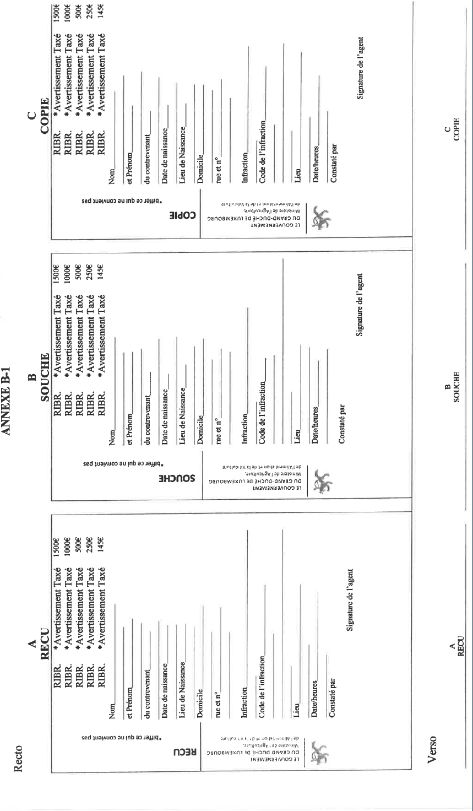
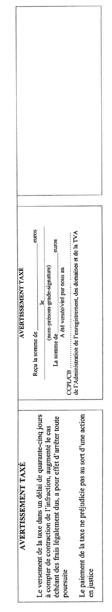
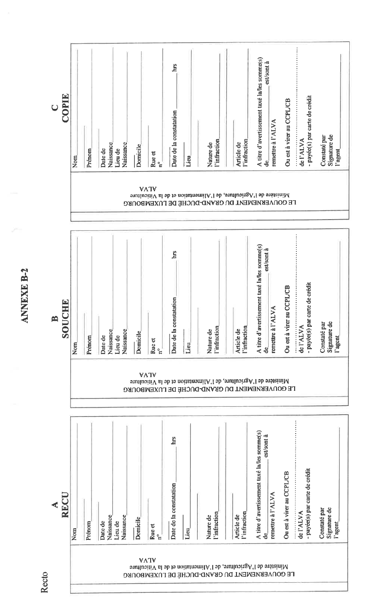
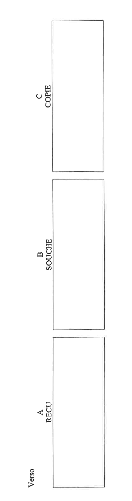

# Règlement grand-ducal du 15 juillet 2024 concernant la mise en place d’un système de surveillance et de lutte contre la rhinotrachéite infectieuse bovine.

Nous Henri, Grand-Duc de Luxembourg, Duc de Nassau,

Vu la [loi modifiée du 29 juillet 1912](https://legilux.public.lu/eli/etat/leg/loi/1912/07/29/n1/jo) concernant la police sanitaire du bétail et l’amélioration des chevaux, des bêtes à cornes et des porcs, et notamment son article 1er, alinéa 1er ;

Vu le [règlement (UE) 2016/429](https://legilux.public.lu/eli/reg_ue/2016/429/jo) du Parlement européen et du Conseil du 9 mars 2016 relatif aux maladies animales transmissibles et modifiant et abrogeant certains actes dans le domaine de la santé animale (« législation sur la santé animale »), tel que modifié ;

Vu le [règlement délégué (UE) 2020/689](https://legilux.public.lu/eli/reg_ue/2020/689/jo) de la Commission du 17 décembre 2019 complétant le [règlement (UE) 2016/429](https://legilux.public.lu/eli/reg_ue/2016/429/jo) du Parlement européen et du Conseil en ce qui concerne les règles applicables à la surveillance, aux programmes d’éradication et au statut « indemne » de certaines maladies répertoriées et émergentes, tel que modifié ;

Vu l’avis de la Chambre d’agriculture ;

Vu l’avis du Collège vétérinaire ;

Le Conseil d’État entendu ;

Sur le rapport de la Ministre de l’Agriculture, de l’Alimentation et de la Viticulture et de la Ministre de la Justice, et après délibération du Gouvernement en conseil ;

Arrêtons :

## Chapitre 1er — Dispositions générales

### Art. 1er — Définitions

Pour l’application du présent règlement, on entend par :

1° « IBR » : désignation en abrégé de la rhinotrachéite infectieuse bovine/vulvovaginite pustuleuse infectieuse ;

2° « établissement indemne d’IBR » : établissement remplissant les exigences énoncées à l’annexe IV, partie IV, chapitre 1er, du [règlement délégué (UE) 2020/689](https://legilux.public.lu/eli/reg_ue/2020/689/jo) de la Commission du 17 décembre 2019 complétant le [règlement (UE) 2016/429](https://legilux.public.lu/eli/reg_ue/2016/429/jo) du Parlement européen et du Conseil en ce qui concerne les règles applicables à la surveillance, aux programmes d’éradication et au statut « indemne » de certaines maladies répertoriées et émergentes, tel que modifié ;

3° « établissement non indemne d’IBR mais assaini » : établissement remplissant les exigences énoncées à l’annexe IV, partie IV, chapitre 1er, du [règlement délégué (UE) 2020/689](https://legilux.public.lu/eli/reg_ue/2020/689/jo) précité mais détenant des bovins vaccinés au cours des deux dernières années ;

4° « établissement non indemne d’IBR mais sous vaccination » : établissement ne remplissant pas les exigences énoncées à l’annexe IV, partie IV, chapitre 1er, du [règlement délégué (UE) 2020/689](https://legilux.public.lu/eli/reg_ue/2020/689/jo) précité et pratiquant la vaccination contre l’IBR ;

5° « réintroduction d’un bovin dans un établissement » : retour d’un bovin dans son établissement sans avoir été en contact avec des bovins d’un autre établissement ;

6° « ALVA » : Administration luxembourgeoise vétérinaire et alimentaire.

### Art. 2 — Diagnostic

(1) Le Laboratoire de médecine vétérinaire de l’ALVA est désigné comme laboratoire officiel pour l’IBR. Il coordonne les normes biologiques et les méthodes de laboratoire pour l’octroi et le maintien du statut d’IBR.

(2) Seuls les résultats des analyses effectuées par le laboratoire officiel ou validées par celui-ci sont pris en considération pour l’application des dispositions du présent règlement.

(3) Le laboratoire officiel communique tous les résultats des épreuves à l’opérateur et au vétérinaire d’exploitation.

### Art. 3 — Mesures à appliquer pour rétablir le statut indemne d’IBR

L’opérateur qui s’est vu retirer le statut d’établissement « indemne d’IBR » soumet son établissement à un des régimes de tests prévus à l’annexe IV, partie IV, chapitre 1er, section 1re, du [règlement délégué (UE) 2020/689](https://legilux.public.lu/eli/reg_ue/2020/689/jo) précité pour l’acquisition du statut indemne d’IBR. Ces tests peuvent démarrer au plus tôt trente jours après le départ du dernier cas confirmé d’IBR.

### Art. 4 — Mesures administratives

(1) Lorsqu’il est constaté qu’un opérateur ne respecte pas les dispositions du présent règlement ou du programme d’éradication de l’IBR pris en conformité du [règlement délégué (UE) 2020/689](https://legilux.public.lu/eli/reg_ue/2020/689/jo) précité, les mesures administratives suivantes peuvent être imposées par l’ALVA :

1° une limitation de mouvements des bovins du troupeau de l’établissement concerné ;

2° l’abattage des bovins chez qui la présence d’anticorps dirigés contre la glycoprotéine E du virus (BHV-1-g E) a été détectée et qui sont toujours présents dans l’établissement après la date fixée dans le programme d’éradication de l’IBR, ainsi que l’abattage des bovins d’un établissement non indemne après la date fixée dans le programme d’éradication de l’IBR.

(2) Dès qu’il a été constaté qu’il a été mis fin aux non-conformités ayant fait l’objet des limitations de mouvements prévues au paragraphe 1er, lettre a, ces dernières sont levées par l’ALVA.

### Art. 5 — Ordonnances et recours

(1) Les ordonnances de mise en conformité aux dispositions du présent règlement ou au programme d’éradication de l’IBR pris en conformité avec le [règlement délégué (UE) 2020/689](https://legilux.public.lu/eli/reg_ue/2020/689/jo) précité sont notifiées à l’opérateur concerné par l’ALVA soit par transmission électronique, soit par la remise directe de l’ordonnance à l’opérateur concerné contre signature apposée sur le double de l’ordonnance, soit par lettre recommandée avec accusé de réception. L’opérateur qui s’est vu notifier l’ordonnance par transmission électronique confirme sa réception par voie électronique moyennant une signature électronique qualifiée au sens du [règlement (UE) n° 910/2014](https://legilux.public.lu/eli/reg_ue/2014/910/jo) du Parlement européen et du Conseil du 23 juillet 2014 sur l’identification électronique et les services de confiance pour les transactions électroniques au sein du marché intérieur et abrogeant la [directive 1999/93/CE](https://legilux.public.lu/eli/dir_ue/1999/93/jo), ou d’une copie de la carte d’identité dans le délai indiqué dans l’ordonnance. L’ALVA en accuse réception par transmission électronique. L’ordonnance mentionne la nature et les motifs de la mesure ou de la dérogation, sa durée et ses modalités d’application.

(2) Les ordonnances visées au paragraphe 1er et les mesures administratives prises en vertu de l’article 4 par l’ALVA sont susceptibles d’un recours en réformation devant le tribunal administratif.

## Chapitre 2 — Sanctions pénales et avertissements taxés

### Art. 6 — Sanctions pénales

(1) Sera puni d’une amende de 49 à 2 000 euros, quiconque agit en violation de l’article 18, paragraphe 1er, lettres a) et b), point iv) du [règlement délégué (UE) 2020/689](https://legilux.public.lu/eli/reg_ue/2020/689/jo) précité.

(2) Sera puni d’une peine d’emprisonnement de huit jours à deux ans et d’une amende de 2 001 à 150 000 euros ou d’une de ces peines seulement, quiconque empêche ou entrave sciemment, de quelque manière que ce soit, les mesures administratives ordonnées par l’ALVA en vertu de l’article 4.

### Art. 7 — Avertissements taxés

En cas de contraventions punies conformément aux dispositions de l’article 6, paragraphe 1er, des avertissements taxés peuvent être décernés par les officiers de police judiciaire ou les agents de police judiciaire de la Police grand-ducale ou par les agents de l’ALVA qui ont la qualité d’officier de police judiciaire au sens de l’article 9 de la [loi modifiée du 29 juillet 1912](https://legilux.public.lu/eli/etat/leg/loi/1912/07/29/n1/jo) concernant la police sanitaire du bétail et l’amélioration des chevaux, des bêtes à cornes et des porcs. Les montants de la taxe à percevoir pour l’avertissement sont fixés respectivement à 145, 250, 500, 1 000 et 1 500 euros, selon la gravité de l’infraction. Le catalogue regroupant les contraventions suivant les différents montants de la taxe à percevoir est repris à l’annexe A.

### Art. 8 — Modalités de perception des montants des avertissements taxés

(1) Le décernement de l’avertissement taxé est subordonné à la condition que soit le contrevenant consente à verser la taxe due immédiatement et sur place entre les mains des membres de la Police grand-ducale ou des agents de l’ALVA, soit, lorsque la taxe due ne peut pas être perçue sur le lieu même de l’infraction, le contrevenant s’en acquitte dans le délai lui imparti par sommation.

La perception sur place du montant de la taxe se fait soit en espèces, soit par règlement au moyen des seules cartes de crédit et modes de paiement électronique acceptés à cet effet par les membres de la Police grand-ducale ou les agents de l’ALVA.

Le versement de la taxe dans un délai de quarante-cinq jours, à compter de la constatation de l’infraction, a pour conséquence d’arrêter toute poursuite. Lorsque la taxe a été réglée après ce délai, elle est remboursée en cas d’acquittement, et elle est imputée sur l’amende prononcée et sur les frais de justice éventuels en cas de condamnation.

(2) L’avertissement taxé est donné d’après des formules spéciales, composées, d’un reçu, d’une copie et d’une souche.

À cet effet est utilisée la formule spéciale visée à l’article 3, alinéa 1er, du [règlement grand-ducal modifié du 26 août 1993](https://legilux.public.lu/eli/etat/leg/rgd/1993/08/26/n1/jo) relatif aux avertissements taxés, aux consignations pour contrevenants non résidents ainsi qu’aux mesures d’exécution de la législation en matière de mise en fourrière des véhicules et en matière de permis à points, et figurant à l’annexe II – 1 [dudit règlement](https://legilux.public.lu/eli/etat/leg/rgd/1993/08/26/n1/jo) pour les avertissements taxés donnés par les membres de la Police grand-ducale. Les formules spéciales de l’avertissement taxé figurant à l’annexe B-1 sont utilisées pour les avertissements taxés donnés par les agents de l’ALVA. L’agent verbalisant supprime les mentions qui ne conviennent pas. Ces formules, dûment numérotées, sont reliées en carnets de quinze exemplaires.

Toutes les taxes perçues par les membres de la Police grand-ducale ou les agents de l’ALVA sont transmises sans retard à un compte bancaire déterminé de l’Administration de l’enregistrement, des domaines et de la TVA à Luxembourg. Les frais de versement, de virement ou d’encaissement éventuels sont à charge du contrevenant lorsque la taxe est réglée par versement ou virement bancaire. Ils sont à charge de l’État si le règlement se fait par carte de crédit ou au moyen d’un mode de paiement électronique.

Le reçu est remis au contrevenant, contre le paiement de la taxe due. La copie est remise au directeur général de la Police grand-ducale ou au directeur de l’ALVA. La souche reste dans le carnet de formules. Du moment que le carnet est épuisé, il est renvoyé, avec toutes les souches et les quittances de dépôt y relatives, par les membres de la Police grand-ducale au directeur général de la Police grand-ducale et par les agents de l’ALVA au directeur de l’ALVA. Si les formules n’ont pas abouti à l’établissement d’un avertissement taxé, elles doivent être renvoyées en entier et porter une mention afférente. En cas de versement ou de virement de la taxe à un compte bancaire, le titre de virement ou de versement fait fonction de souche.

(3) Lorsque le montant de l’avertissement taxé ne peut pas être perçu sur le lieu même de l’infraction, le contrevenant se voit remettre la sommation de payer la taxe dans le délai lui imparti.

À cet effet est utilisée la formule spéciale visée à l’article 2, paragraphe 2, du [règlement grand-ducal modifié du 26 août 1993](https://legilux.public.lu/eli/etat/leg/rgd/1993/08/26/n1/jo) relatif aux avertissements taxés, aux consignations pour contrevenants non résidents ainsi qu’aux mesures d’exécution de la législation en matière de mise en fourrière des véhicules et en matière de permis à points, et figurant à l’annexe II – 2 [dudit règlement](https://legilux.public.lu/eli/etat/leg/rgd/1993/08/26/n1/jo) pour les avertissements taxés donnés par les membres de la Police grand-ducale et à l’annexe B-2 pour les avertissements taxés donnés par les agents de l’ALVA. L’agent verbalisant supprime les mentions qui ne conviennent pas. Ces formules, dûment numérotées, sont reliées en carnets de quinze exemplaires.

Le contrevenant s’en acquitte dans le délai imparti au bureau de la Police grand-ducale ou de l’ALVA lui désigné par l’agent verbalisant, soit par virement de la taxe sur un des comptes bancaires spécialement ouverts à cet effet au nom de la Police grand-ducale ou de l’ALVA.

(4) Chaque unité de la Police grand-ducale ainsi que l’ALVA tiennent un registre informatique indiquant les formules mises à leur disposition, les avertissements taxés donnés et les formules annulées. Le directeur général de la Police grand-ducale et le directeur de l’ALVA établissent au début de chaque trimestre, en triple exemplaire, un bordereau récapitulatif portant sur les perceptions du trimestre précédent. Ce bordereau récapitulatif indique les noms et prénoms du contrevenant, son adresse exacte, la date et l’heure de l’infraction et la date du paiement. Un exemplaire de ce bordereau est transmis à l’Administration de l’enregistrement, des domaines et de la TVA, et un autre exemplaire sert de relevé d’information au procureur d’État.

(5) Les données à caractère personnel des personnes concernées par les avertissements taxés émis et payés conformément aux dispositions du présent article sont anonymisées dans un délai d’un an qui commence à courir à partir du jour de l’acquittement de l’avertissement taxé.

### Art. 9 — Remplacement de l’avertissement taxé par un procès-verbal ordinaire

L’avertissement taxé est remplacé par un procès-verbal ordinaire :

1° si le contrevenant n’a pas payé dans le délai de quarante-cinq jours, à compter de la constatation de l’infraction ;

2° si le contrevenant déclare ne pas vouloir ou ne pas pouvoir payer les taxes ;

3° si le contrevenant a été mineur au moment des faits.

## Chapitre 3 — Dispositions finales

### Art. 10 — Disposition abrogatoire

Le [règlement grand-ducal du 23 décembre 2016](https://legilux.public.lu/eli/etat/leg/rgd/2016/12/23/n39/jo) concernant la mise en place d’un système de surveillance et de lutte contre la rhinotrachéite infectieuse bovine est abrogé.

### Art. 11 — Formule exécutoire

Le ministre ayant l’Agriculture dans ses attributions et le ministre ayant la Justice dans ses attributions sont chargés, chacun en ce qui le concerne, de l’exécution du présent règlement qui sera publié au Journal officiel du Grand-Duché de Luxembourg.

La Ministre de l’Agriculture,  de l’Alimentation et de la Viticulture,   Martine Hansen   La Ministre de la Justice,   Elisabeth Margue

Cabasson, le 15 juillet 2024.   Henri

\**ANNEXE A**

Catalogue des avertissements taxés établis conformément à l’article 6 du présent règlement avec référence à l’article 18, paragraphe 1er, du [règlement délégué (UE) 2020/689](https://legilux.public.lu/eli/reg_ue/2020/689/jo) précité :

<table>
<tr>
<td><b>Référence aux articles</b> <b>Art. du <a href="https://legilux.public.lu/eli/reg_ue/2020/689/jo">règlement délégué (UE) 2020/689</a> précité</b></td>
<td><b>Code de l’infraction</b></td>
<td><b>Nature de l’infraction</b></td>
<td><b>Montant de la taxe en euro</b></td>
</tr>
<tr>
<td>18, (1), a), i)</td>
<td>RIBR-1</td>
<td>L’opérateur ne surveille pas ses bovins afin de détecter des signes cliniques de l’IBR</td>
<td>145 par établissement</td>
</tr>
<tr>
<td>18, (1), a), i)</td>
<td>RIBR-2</td>
<td>L’opérateur ne prend pas toutes les mesures pour éviter que le statut sanitaire de son établissement ne soit mis en danger</td>
<td>145 par établissement</td>
</tr>
<tr>
<td>18, (1), a), ii)</td>
<td>RIBR-3</td>
<td>L’opérateur met en péril le statut sanitaire de son établissement ou des autres établissements par le mouvement d’animaux ou de produits</td>
<td>145 par établissement</td>
</tr>
<tr>
<td>18, (1), a), iv)</td>
<td>RIBR-4</td>
<td>L’opérateur ne prend pas des mesures de lutte en cas de suspicion ou de confirmation de la maladie</td>
<td>250 par établissement</td>
</tr>
<tr>
<td rowspan="10">18, (1), a), v)</td>
<td>RIBR-5</td>
<td>L’opérateur ne prend pas les mesures supplémentaires jugées nécessaires par l’ALVA fixées dans le programme d’éradication de l’IBR</td>
<td>200 par établissement</td>
</tr>
<tr>
<td>RIBR-6</td>
<td>L’opérateur n’apporte pas l’aide nécessaire au vétérinaire d’exploitation pour l’exécution des prélèvements en vue de la qualification IBR des troupeaux</td>
<td>145 par établissement</td>
</tr>
<tr>
<td>RIBR-7</td>
<td>L’opérateur ne remplit pas les conditions d’introduction et de réintroduction des animaux ou de leurs produits dans les établissements définies dans le programme d’éradication de l’IBR</td>
<td>145 par animal/produit germinal</td>
</tr>
<tr>
<td>RIBR-8</td>
<td>L’opérateur ne remplit pas les conditions de mise en prairie des bovins fixées dans le programme d’éradication de l’IBR</td>
<td>145 par animal</td>
</tr>
<tr>
<td>RIBR-9</td>
<td>L’opérateur ne remplit pas les conditions particulières de participation des animaux à des rassemblements fixées dans le programme d’éradication de l’IBR</td>
<td>145 par animal</td>
</tr>
<tr>
<td>RIBR-10</td>
<td>Quiconque vaccine contre l’IBR dans les établissements indemnes d’IBR et dans les établissements non indemnes d’IBR mais assainis</td>
<td>145 par animal</td>
</tr>
<tr>
<td>RIBR-11</td>
<td>Quiconque ne vaccine pas contre l’IBR dans un établissement non indemne d’IBR mais sous vaccination et selon les modalités fixées dans le programme d’éradication de l’IBR</td>
<td>250 par animal</td>
</tr>
<tr>
<td>RIBR-12</td>
<td>Quiconque vaccine contre l’IBR sans respecter les conditions fixées dans le programme d’éradication de l’IBR</td>
<td>145 par établissement</td>
</tr>
<tr>
<td>RIBR-13</td>
<td>L’opérateur n’assiste pas le vétérinaire d’exploitation tel que défini dans le programme d’éradication de l’IBR pour la vaccination des animaux et les régimes de tests prévus à l’annexe IV, partie IV, chapitre 1er, section 1re, du <a href="https://legilux.public.lu/eli/reg_ue/2020/689/jo">règlement délégué (UE) 2020/689</a> précité</td>
<td>145 par établissement</td>
</tr>
<tr>
<td>RIBR-14</td>
<td>L’opérateur d’un établissement indemne n’a pas fait appel au vétérinaire d’exploitation dans les conditions fixées dans le programme d’éradication de l’IBR</td>
<td>145 par établissement</td>
</tr>
<tr>
<td rowspan="8"></td>
<td>RIBR-15</td>
<td>L’opérateur n’a pas isolé les bovins dans les locaux d’hébergement de l’établissement ou dans un endroit sans contact direct ou indirect avec d’autres unités épidémiologiques, en cas de suspicion, tel que défini dans le programme d’éradication de l’IBR</td>
<td>145 par établissement</td>
</tr>
<tr>
<td>RIBR-16</td>
<td>Quiconque transporte des animaux hors de l’établissement sans autorisation délivrée par l’ALVA, tel que défini dans le programme d’éradication de l’IBR</td>
<td>250 par établissement</td>
</tr>
<tr>
<td>RIBR-17</td>
<td>L’opérateur qui s’est vu retirer le statut « indemne d’IBR » ne soumet pas son établissement à un des régimes de tests prévus à l’annexe IV, partie IV, chapitre 1er, section 1re, du <a href="https://legilux.public.lu/eli/reg_ue/2020/689/jo">règlement délégué (UE) 2020/689</a> précité pour l’acquisition du statut indemne d’IBR tel que fixé dans le programme d’éradication de l’IBR</td>
<td>500 par établissement</td>
</tr>
<tr>
<td>RIBR-18</td>
<td>Les établissements non indemnes et les établissements non indemnes mais sous vaccination qui ne se soumettent pas à un bilan sérologique à la date fixée dans le programme d’éradication de l’IBR</td>
<td>500 par établissement</td>
</tr>
<tr>
<td>RIBR-19</td>
<td>Quiconque met au taureau ou insémine artificiellement des bovins d’un établissement non indemne et des bovins chez qui la présence d’anticorps dirigés contre la glycoprotéine E du virus (BHV-1-gE) a été détectée</td>
<td>250 par établissement</td>
</tr>
<tr>
<td>RIBR-20</td>
<td>Quiconque utilise à des fins de reproduction des bovins mâles d’un établissement non indemne ou les bovins mâles chez qui la présence d’anticorps dirigés contre la glycoprotéine E du virus (BHV-1-gE) a été détectée</td>
<td>250 par animal</td>
</tr>
<tr>
<td>RIBR-21</td>
<td>L’opérateur qui met en pâturage des bovins d’un établissement non indemne ou des bovins chez qui la présence d’anticorps dirigés contre la glycoprotéine E du virus (BHV-1-gE) a été détectée - pour un établissement de ≤ 500 bovins - pour un établissement de > 500 bovins</td>
<td>500 par établissement 1 000 par établissement</td>
</tr>
<tr>
<td>RIBR-22</td>
<td>L’opérateur n’élimine pas les bovins chez qui la présence d’anticorps dirigés contre la glycoprotéine E du virus (BHV-1-gE) a été détectée après la date fixée dans le programme d’éradication de l’IBR ou les bovins d’un établissement non indemne après la date fixée dans le programme d’éradication de l’IBR</td>
<td>1 500 par établissement</td>
</tr>
<tr>
<td>18, (1), b), iv)</td>
<td>RIBR-23</td>
<td>L’opérateur ne remplit pas les exigences pour l’acquisition ou le maintien d’un statut IBR dans son établissement définies à l’annexe IV, partie IV, chapitre 1, du règlement</td>
<td>500 par établissement</td>
</tr>
</table>

