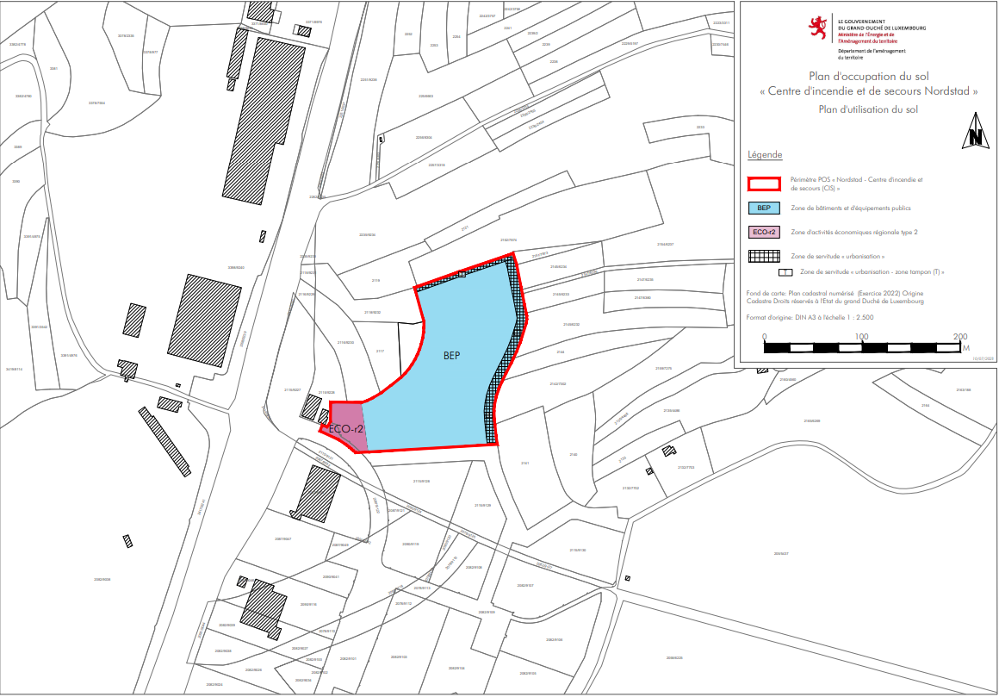
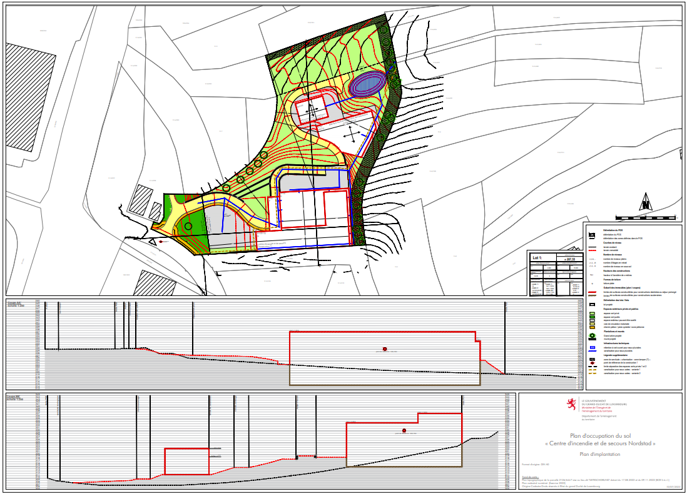

# Règlement grand-ducal du 25 octobre 2024 rendant obligatoire le plan d’occupation du sol « Centre d’incendie et de secours Nordstad ».

Nous Henri, Grand-Duc de Luxembourg, Duc de Nassau,

Vu l’article 1er, paragraphe 3, point 10°, de la [loi modifiée du 17 avril 2018](https://legilux.public.lu/eli/etat/leg/loi/2018/04/17/a271/jo) concernant l’aménagement du territoire ;

Vu les articles 2 à 7 de la [loi modifiée du 22 mai 2008](https://legilux.public.lu/eli/etat/leg/loi/2008/05/22/n2/jo) relative à l’évaluation des incidences de certains plans et programmes sur l’environnement ;

Vu l’avis de la Ministre de l’Environnement, du Climat et du Développement durable en date du 3 octobre 2022 rendu sur base de l’article 6, paragraphe 3, de la [loi précitée du 22 mai 2008](https://legilux.public.lu/eli/etat/leg/loi/2008/05/22/n2/jo) ;

Vu le rapport sur les incidences environnementales stratégique élaboré sur base de l’article 5 de la [loi précitée du 22 mai 2008](https://legilux.public.lu/eli/etat/leg/loi/2008/05/22/n2/jo) ;

Vu la décision du Gouvernement en conseil en date 8 février 2023 concernant la transmission du projet de plan d’occupation du sol « Centre d’incendie et de secours Nordstad » au collège des bourgmestre et échevins de la commune de Diekirch et au Conseil supérieur de l’aménagement du territoire ;

Vu l’avis de la Ministre de l’Environnement, du Climat et du Développement durable en date 3 juillet 2023 rendu sur base de l’article 7, paragraphe 2, de la [loi précitée du 22 mai 2008](https://legilux.public.lu/eli/etat/leg/loi/2008/05/22/n2/jo) ;

Vu la délibération de la commune de Diekirch en date du 23 mai 2023 ;

Vu les observations introduites dans le cadre de la procédure prévue à l’article 18 de la [loi précitée du 17 avril 2018](https://legilux.public.lu/eli/etat/leg/loi/2018/04/17/a271/jo) ;

Vu l’avis du Conseil supérieur de l’aménagement du territoire du 22 juin 2023 ;

Vu la délibération du Gouvernement en conseil du 21 juillet 2023 portant approbation définitive du plan d’occupation du sol « Centre d’incendie et de secours Nordstad » ;

Vu l’avis de la Chambre de commerce du 6 octobre 2023 ;

Le Conseil d’État entendu ;

Sur le rapport du Ministre du Logement et de l’Aménagement du territoire et après délibération du Gouvernement en conseil ;

Arrêtons :

## Art. 1er.

Est rendu obligatoire le plan d’occupation du sol « Centre d’incendie et de secours Nordstad ».

## Art. 2.

Les fonds couverts par le plan d’occupation du sol « Centre d’incendie et de secours Nordstad » sont définis sur les deux documents cartographiques énumérés aux points 1° et 2° qui constituent la partie graphique du plan et qui font partie intégrante du présent règlement :

1° Le « plan d’utilisation du sol » défini à l’échelle 1 : 2 500 et couvrant une partie déterminée du territoire de la Ville de Diekirch ;

2° Le « plan d’implantation » défini à l’échelle 1 : 500 et couvrant les mêmes fonds.

## Art. 3.

Aucun plan d’aménagement particulier établi conformément à l’article 25 de la [loi modifiée du 19 juillet 2004](https://legilux.public.lu/eli/etat/leg/loi/2004/07/19/n1/jo) concernant l’aménagement communal et le développement urbain n’est requis pour préciser et exécuter le présent plan d’occupation du sol.

## Art. 4.

(1) Les fonds définis à l’article 2 sont classés en tant que zone de bâtiments et d’équipements publics (BEP) et zone d’activités économiques régionale type 2 (ECO-r2).

1° La zone de bâtiments et d’équipements publics (BEP) est destinée à la construction du Centre d’incendie et de secours Nordstad y compris les constructions, aménagements et installations y relatifs, tels les terrains d’entrainement pour chiens de secours, les terrains d’entraînement avec des décombres, les terrains à parcours et les terrains d’entrainement pour feux réels.

Sont également autorisés :

a) Les emplacements de stationnement ;

b) Les équipements publics ;

c) Les infrastructures techniques ;

d) Les murs de soutènement.

2° La zone d’activités économiques régionale « Fridhaff » type 2 (ECO-r2) est gérée, au nom des communes concernées, par le Syndicat intercommunal pour la création, l’aménagement, la promotion et l’exploitation de zones d’activités économiques sur le territoire des communes de la Nordstad, en abrégé « ZANO ».

La zone d’activités économiques régionale type 2 (ECO-r2) est réservée aux activités admises dans la zone d’activités économiques à caractère régional type 1, soit les activités industrielles légères, artisanales, de commerce de gros, de transport ou de logistique, ainsi qu’aux activités de commerce de détail, limitées à une surface de vente de 2.000 mètres carrés par immeuble bâti, et aux services administratifs ou professionnels jusqu’à une surface construite brute maximale de 3.500 mètres carrés par immeuble bâti, qui de par leur envergure ou leur caractère, ne sont pas compatibles avec les zones d’habitation et les zones mixtes.

Y sont admis des établissements de restauration en relation directe avec les besoins de la zone concernée, ainsi que des prestations de service liées aux activités de la zone.

Y sont admis des logements de service à l’usage du personnel dont la présence permanente est nécessaire pour assurer la direction ou la surveillance d’une entreprise particulière. Ces logements sont à intégrer dans le corps même des constructions.

(2) Les coefficients applicables dans la zone de bâtiments et d’équipements publics (BEP) sont les suivants :

1° Le coefficient d’occupation du sol (COS) : maximum 0,40 ;

2° Le coefficient d’utilisation du sol (CUS) : maximum 0,80 ;

3° Le coefficient de scellement de sol (CSS) : maximum 0,50.

(3) Les coefficients applicables dans la zone d’activités économiques régionale « Fridhaff » type 2 (ECO-r2) sont les suivants :

1° Le coefficient d’occupation du sol (COS) : maximum 0,70 ;

2° Le coefficient d’utilisation du sol (CUS) : maximum 1,50 ;

3° Le coefficient de scellement de sol (CSS) : maximum 0,75.

## Art. 5.

(1) Le plan d’utilisation du sol définit une zone superposée intitulée « servitude d’urbanisation – zone tampon ».

Celle-ci assure l’intégration des constructions et aménagements dans le paysage et constitue un corridor écologique pour chiroptères et autres espèces animales protégées.

Un écran de verdure est à prévoir sur une largeur minimale de 10 mètres côté « Est » et de 5 mètres côté « Nord ».

Toute construction est interdite, hormis les constructions ou aménagements d’utilité publique, les infrastructures techniques liées à la gestion des eaux ainsi que les chemins dédiés à la mobilité douce.

À l’intérieur de la zone, aucun éclairage n’est permis.

(2) À l’intérieur de la zone, diverses plantations sont prévues :

1° côté « Est » :

a) des plantations d’arbres et d’arbustes adaptés aux conditions stationnelles sont à prévoir sur une surface minimale de 60 pour cent de la surface totale de la zone de servitude.

b) un arbre à haute tige d’une circonférence minimale du tronc de 0,20 à 0,25 mètre est à planter par tranche de 100 mètres carrés de la surface de la servitude.

c) les arbres à haute tige doivent avoir une hauteur minimale de 3,00 mètres.

d) les haies doivent avoir une hauteur minimale de 1,50 mètres.

e) pour toutes les plantations obligatoires suivant les dispositions aux lettres a) à d), le choix des essences est à faire parmi les suivantes :

i) plantations d’arbres à haute tige : robinier (*robinia pseudacacia*), merisier (*prunus avium*), merisier à grappes (*prunus padus*), chêne pédonculé (*quercus robur*), chêne pyramidal (*quercus robur fastigata* « Koster »), saule blanc (*salix alba*), saule marsault (*salis caprea*), charme commun (*carpinus betulus*), hêtre commun (*fagus sylvatica*), charme houblon (*ostrya carpinifolia*) , érable champêtre (*acer campestre*), alisier torminal (*sorbus terminalis*), pommier (*malus domestica*), poirier (*pyrus communis*), poirier sauvage (*pyrus pyraster*), prunier (*prunus domestica*).

ii) plantations d’arbustes : aubépine lisse (*crataegus laevigata*), aubépine monogyne (*crataegus monogyna*) églantier (*rosa canina*), prunellier (*prunus spinosa*), chèvrefeuille (*loniciera xylosteum*), sureau noir (*sambucus nigra*), troène commun (*ligustrum vulgare*), viorne obier (*viburnum opulus*), noisetier (*corylus avellana*), cornouiller mâle (*cornus mas*), rosier des champs (*rosa arvensis*), fusain (*euonymus europaeus*).

2° côté « Nord » :

a) des plantations d’arbustes adaptés aux conditions stationnelles sont à prévoir sur une surface minimale de 30 pour cent de la surface totale de la zone de servitude.

b) le choix des essences est à faire parmi les suivantes :

i) aubépine lisse (crataegus laevigata), aubépine monogyne (crataegus monogyna) églantier (rosa canina), prunellier (prunus spinosa), chèvrefeuille (loniciera xylosteum), sureau noir (sambucus nigra), troène commun (ligustrum vulgare), viorne obier (viburnum opulus), noisetier (corylus avellana), cornouiller mâle (cornus mas), rosier des champs (rosa arvensis), fusain (euonymus europaeus).

Toutes les autres mesures de plantation sont précisées au niveau du plan d’implantation.

Les plantations sont à mettre en œuvre au plus tard un an après la finalisation des travaux de construction dans la zone BEP.

Un plan vert est annexé à titre indicatif au présent règlement.

## Art. 6.

Sont définis au plan d’implantation :

1° la délimitation et la contenance des lots ;

2° le modelage du terrain ; une tolérance de 2,50 mètres par rapport au niveau du terrain remodelé défini au « plan d’implantation » est autorisée. Le modelage du terrain peut se faire sous forme de talus ou de paliers délimités par des constructions de soutènement, sous condition que les grands principes du modelage projeté sont respectés. Les talus ne peuvent accuser une pente supérieure à 35 degrés. Les talus doivent être fixés par des plantations afin d’éviter les risques d’éboulement.

3° les murs de soutènement ; les murs de soutènement qui ne sont pas représentés au plan d’implantation ne peuvent pas dépasser la hauteur de 2 mètres. Ces murs de soutènement sont à réaliser avec des pierres cyclopéennes ou des gabions. Par exception, des murs en béton sont également autorisés, à condition qu’ils soient végétalisés.

4° la limite des surfaces constructibles ;

5° les gabarits maxima des immeubles ;

6° les saillies ; exception faite des auvents, des escaliers et seuils, les saillies ne peuvent pas dépasser la surface maximale constructible ;

7° la hauteur des constructions ; pour la construction 1, le centre d’incendie et de secours, un point de référence est défini dans la partie graphique. Les hauteurs maximales admissibles sont à mesurer par rapport au point de référence. Pour les constructions 2 et 3, le bâtiment d’entraînement avec des décombres ainsi que le bâtiment modulaire d’entraînement pour feux réels, les hauteurs maximales admissibles sont à mesurer par rapport au terrain remodelé. Les éléments de desserte interne des constructions, tels que cages d’escalier ou cabanons d’ascenseur peuvent dépasser la hauteur maximale autorisée de 3,00 mètres au maximum. Les installations techniques et les capteurs solaires thermiques ou photovoltaïques peuvent dépasser la hauteur maximale autorisée de 2,50 mètres au maximum, sous respect de garder une distance minimale par rapport au plan de la façade du dernier étage de 2 mètres.

8° le nombre de niveaux hors sol et sous-sol ; un retrait minimum de 2 mètres sur les façades « Nord » et « Est » est à respecter par le dernier niveau par rapport au niveau situé directement en dessous.

9° les formes et pentes des toitures ; sont autorisées :

a) la végétalisation des toitures plates ;

b) l’installation de capteurs solaires thermiques ou photovoltaïques ;

c) les ouvertures en toiture ;

10° les surfaces extérieures pouvant être scellées ; l’aménagement de surfaces scellées étant autorisé dans l’espace vert privé, sous condition de respecter la surface maximale de scellement définie dans le tableau du degré d’utilisation du sol.

Pour les voies de circulation, une tolérance de 3,00 mètres par rapport à leur présentation sur la partie graphique du plan d’occupation du sol est autorisée.

11° les espaces verts privés :

a) l’espace vert privé 1, destiné à l’aménagement de surfaces vertes et aux plantations ; seuls sont autorisés :

i) les accès carrossables ;

ii) les chemins piétonniers ;

iii) les installations et aménagements destinés à la gestion des eaux pluviales ;

iv) les terrains à parcours ;

v) le terrain d’entrainement pour feux réels ;

vi) le terrain d’entraînement avec des décombres ;

vii) les infrastructures et équipements nécessaires à l’entrainement des pompiers.

b) l’espace vert privé 2, destiné à l’aménagement de surfaces vertes et aux plantations et au parcours d’entraînement de chiens ; seuls sont autorisés :

i) les chemins piétonniers ;

ii) les installations et aménagements destinés à la gestion des eaux pluviales ;

iii) les installations et équipements de faible envergure nécessaire à l’entraînement de chiens.

## Art. 7.

Les façades suivantes sont autorisées :

1° les façades enduites ;

2° le bardage en bois de teinte naturelle ;

3° le bardage et les panneaux de parement d’apparence mate « TRESPA » ;

4° les façades végétalisées ;

5° les façades intégrant des capteurs solaires thermiques ou photovoltaïques.

## Art. 8.

(1) À l’intérieur de la zone d’espace vert 1, et s’il est techniquement possible, les accès carrossables et les chemins piétonniers sont à réaliser avec des revêtements perméables à l’eau. Pour les surfaces extérieures consolidées avec des matériaux perméables à l’eau, la surface scellée à prendre en compte pour le calcul du scellement du sol correspond à 50 pour cent de la surface réellement consolidée.

L’éclairage doit être approprié en termes d’intensité, de structure du dispositif d’éclairage et de qualité de la lumière.

(2) À l’intérieur de la zone d’espace vert 2, aucun éclairage n’est autorisé.

## Art. 9.

Les terrains accueillant les emplacements de stationnement sont à aménager selon des critères écologiques, en réduisant le scellement du sol et en prévoyant la plantation d’arbres.

L’éclairage doit être approprié en termes d’intensité, de structure du dispositif d’éclairage et de qualité de la lumière.

## Art. 10.

Seuls les plans annexés au présent règlement et publiés au Journal officiel du Grand-Duché de Luxembourg font foi.

## Art. 11.

Le ministre ayant la Politique générale de l’aménagement du territoire dans ses attributions est chargé de l’exécution du présent règlement qui sera publié au Journal officiel du Grand-Duché de Luxembourg.

Le Ministre du Logement  et de l’Aménagement du *territoire,*   Claude Meisch

Fait le 25 octobre 2024.   Pour le Grand-Duc, Son Lieutenant-Représentant,   Guillaume,   Grand-Duc Héritier

Pour visualiser la carte en haute définition, [cliquez ici](http://data.legilux.public.lu/filestore/eli/etat/leg/rgd/2024/10/25/a468/jo/fr/pdfa/annexe/1/eli-etat-leg-rgd-2024-10-25-a468-jo-fr-pdfa-annexe-1.pdf).

Pour visualiser la carte en haute définition, [cliquez ici](http://data.legilux.public.lu/filestore/eli/etat/leg/rgd/2024/10/25/a468/jo/fr/pdfa/annexe/2/eli-etat-leg-rgd-2024-10-25-a468-jo-fr-pdfa-annexe-2.pdf).

\**Grünordnungsplan zum POS « centre d’incendie et de secours (CIS) » - Diekirch**

Einleitung

Die zu überplanende Fläche liegt nördlich der Industriezone Fridhaff und soll im Rahmen einer Gebietserweiterung für das „Corps grand-ducal d’incendie et de secours“ als Einsatzzentrum und Übungsgelände überplant werden.

Das Gelände umfasst ca. 2,2 ha und ist nach Norden geneigt. Die aktuelle Nutzung ist vorwiegend Wiesenland mit teilweiser Beweidung.

Im Süden grenzt die Fläche direkt an die öffentliche Grünfläche des bestehenden Industriegebietes an. Diese Grünfläche ist bereits mit zwei Reihen Hochstammbäumen (Esche, Ahorn, Eiche) bepflanzt.

Im Osten befindet sich eine Wiese samt einem stark geneigten Zufahrtsweg, ausgehend von dem hochterrassierten Industriegebiet bis auf diese Wiese hinab.

Nach Norden wird die Fläche zu 50% durch eine einfache Baumreihe aus Hochstammobstbäumen (Kirschen und Birnen) und Eichen mit Unterwuchs begrenzt. Die Baumreihe steht auf einem Geländeversprung (Anstieg nach Norden) von ca. 1,5m Höhe und 3m Breite. Der Rest der Nordseite (50%) ist durch eine lichte Hecke aus Gebüsch und Hochstaudenflur begrenzt.

Im Westen der Fläche grenzt ein Laubwald (Eichen, Buchen Ahorn) und ein Ruderalstreifen (mit vorwiegend Holunderaufwuchs) an.

Der aktuelle Bauplan sieht ein Gebäude mit einer Höhe von maximal 18m über dem bestehenden Geländeniveau vor, wobei im südlichen Gebäudeteil das Untergeschoss in den Hang eingeschoben werden soll, während im nördlichen Teil die Bodenplatte über dem bestehenden Gelände liegt.

Auf den Flächen nördlich des Gebäudes sollen ein Trümmerfeld, eine Brandübungsanlage, ein Hundeübungsplatz und das Regenwasserrückhaltebecken installiert werden.

Für den nördlichen Außenbereich ist eine großflächige Geländeverfüllung mit einer Schütthöhe von bis zu 6m geplant.

Einsehbarkeit

Das Gelände mit den Hochbauten ist im Wesentlichen von 2 Seiten her von öffentlichen Flächen aus einsehbar, von Westen her über die E421 (B7) auf einer Länge von ca. 160m und von Osten her vom Parkplatz des Fitness Parcours ‚Seitert‘ Diekirch aus. Von Süden wird das Gelände durch die bestehende Gebietseingrünung und durch die Gebäude der Nissan-Autohaus und der Volvo-Niederlassung abgeschirmt.

Von Norden her ist das Gelände zwar einsichtig, aber die Entfernung zwischen dem höhergelegenen Feldweg und dem geplanten Gebäude beträgt 200 bis 400m und das Gebäude ragt nicht über die bestehenden Gebäudehöhen von Nissan und Volvo hinaus. Weiter nach Norden in Richtung Kreisverkehr und zur N7 ist die Sichtbarkeit durch eine durchgängige Geländekuppe verwehrt.

Die Einsehbarkeit des Geländes von Westen her ist durch die Hochlage der B7 im Bereich der Brücke über die rue Fridhaff bedingt.

Servituden für eine Eingrünung

Um eine Gebietseingrünung erreichen zu können muss auf der Ostseite der Parzelle ein Grünstreifen mit einer Breite von mindestens 10m vorgesehen werden („servitude urbanisation zone tampon“ Est).

Im Norden genügt die Verlängerung der bestehenden Baumreihe bis an die Nordostecke der Parzelle. Es soll hier eine Eingrünung mit ca. 3m Breite vorgesehen werden, die innerhalb der „servitude urbanisation zone tampon“ Nord liegt.

Auf der Westseite dient teilweise der bestehende Wald als Sichtschutz. Zusätzlich sollen die beiden Gebäudeecken durch eine davorstehende Großbaumbepflanzung verdeckt werden. Weiterhin sollen die beiden Flächen westlich und östlich des geplanten Parkplatzes direkt mit der bestehenden öffentlichen Flächeneingrünung (vom ZANO-Fridhaff Gebiet) verbunden werden und mit Bäumen und Sträuchern angepflanzt werden.

Die detaillierte Bepflanzung der oben definierten Eingrünungsflächen wird im Pflanzplan näher definiert. Neben den Eingrünungsflächen werden einzelne Standorte für Bäume verbindlich festgelegt.

Geländemodellierung

Das Gelände weist nach Norden ein Gefälle bis zu 19% auf. Um eine bauliche und verkehrliche Erschließung zu ermöglichen, muss das Gelände terrassiert werden. Auffüllungen bis zu 6 m sind notwendig. Der Geländetiefpunkt soll in diesem Zusammenhang leicht verlegt werden, wobei die Entwässerung der angrenzenden Grundstücke gewährleistet bleibt.

Dieser Eingriff in die Landschaft soll einerseits durch den direkten Massenausgleich vor Ort und andererseits durch die Bepflanzung und Gestaltung der resultierenden Böschungen gemindert werden.

Für den Übergang zu den umliegenden Parzellen wird die maximale Hangneigung auf 35° festgelegt. Dies soll Hangrutschungen in dem aufgeschütteten Gelände entgegenwirken und gleichzeitig die Pflege dieser geneigten Flächen erleichtern.

Bei der Modellierung soll im Anschluss an das bestehende Gelände eine Schicht stückiges Material kompaktiert als Drainageschicht eingebaut werden. Der abgeschobene Mutterboden soll als Deckschicht wieder eingebaut werden.

Um das Gebäude möglichst unauffällig in das Gelände zu integrieren, soll der Baukörper so weit wie möglich in den südlichen Hang (Grünzone für das Industriegebiet „Fridhaff“) eingeschoben werden. Zusätzlich müssen die Gebäudeaußenseiten durch Geländeterrassierungen und Anböschungen mit dem bestehenden Gelände verbunden werden.

Um die verkehrliche Erschließung über die private Erschließungsstraße mit einer Gesamtneigung von maximal 8% zu erreichen muss diese Zufahrt möglichst lang und gewunden gestaltet werden um den Höhenunterschied auszugleichen. Die dabei entstehenden Straßenböschungen können als Hang (max. 35°) oder als Stützmauer, bevorzugt mit Zyklopensteinen, mit 75° Rückneigung abgefangen werden. Die Stufenhöhe bei Stützmauern soll 2m nicht überschreiten.

Alle Geländekanten sollen organisch, d.h. nicht linear und nicht auf längere Strecken (größer als 15m) mit der gleichen Hangneigung angelegt werden.

Parkplatzflächen

Die geplanten Parkplätze sollen in ökologischer Form angelegt werden, d.h. die Stellflächen müssen mit versickerungsfähigem Pflaster gestaltet werden. Die versiegelten Flächen (Einfahrten) müssen über direkt anschließende Versickerungsgräben für die Entsorgung des anfallenden Regenwassers verfügen. Die Flächen müssen eingegrünt und durchgrünt werden (Thema: Landschaftsschutz, Schattenspende, Verdunstung und Kühlung)

Bepflanzung

Die Bepflanzung soll sich der Artenauswahl vom „manuel écologique“ für die „ZANO Fridhaff“ angleichen. Einheimische und klimaangepasste bzw. klimaresistente Arten sind zu bevorzugen.

In dem nicht überplanten Bereich der Fläche (Waldstück) soll der Bestandsbewuchs weitgehend erhalten werden.

Pflanzgröße

Hochstammbäume sollen mit einer Höhe von mindestens 3,5m bis 4m / 4x verpflanzt mit Drahtballierung gepflanzt werden. Heister und Sträucher sollen eine Mindestgröße von 1,5m Kronendurchmesser und 2-3m Höhe aufweisen.

Die Auswahl an Arten ist im RGD festgelegt. Der Pflanzplan zeigt die mögliche Eingrünung der Fläche.

*[image omitted (1.2 MB) — see the official version: https://legilux.public.lu/eli/etat/leg/rgd/2024/10/25/a468/jo]*

Pour visualiser la carte en haute définition, [cliquez ici](http://data.legilux.public.lu/filestore/eli/etat/leg/rgd/2024/10/25/a468/jo/fr/pdfa/annexe/3/eli-etat-leg-rgd-2024-10-25-a468-jo-fr-pdfa-annexe-3.pdf).
