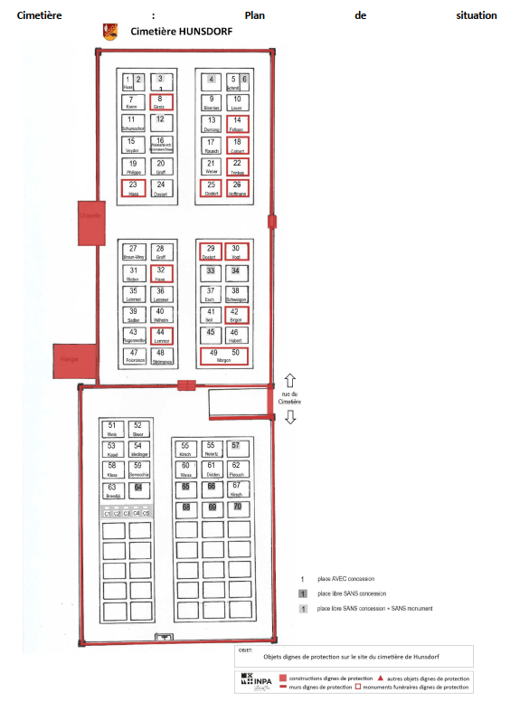
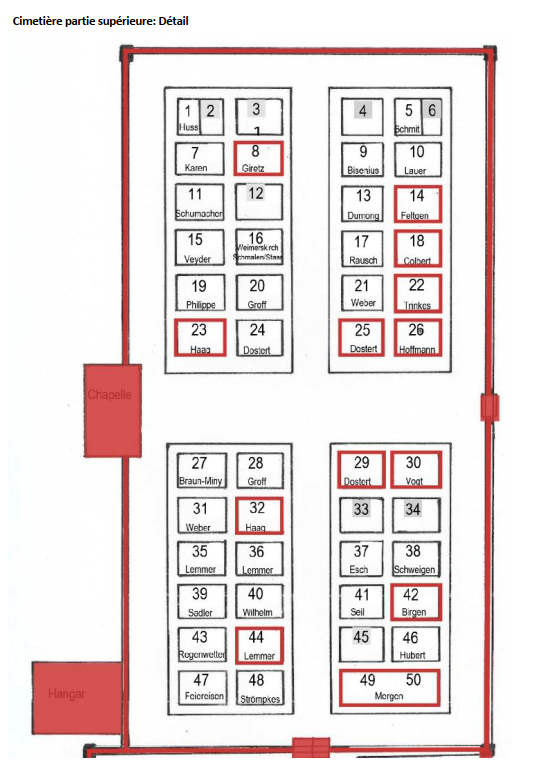
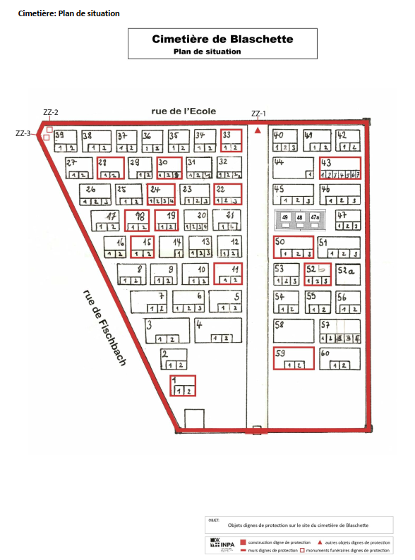
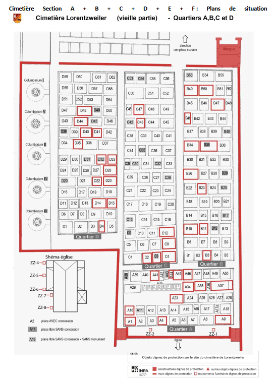
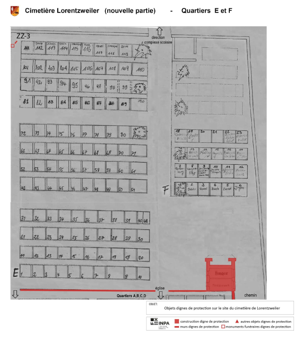
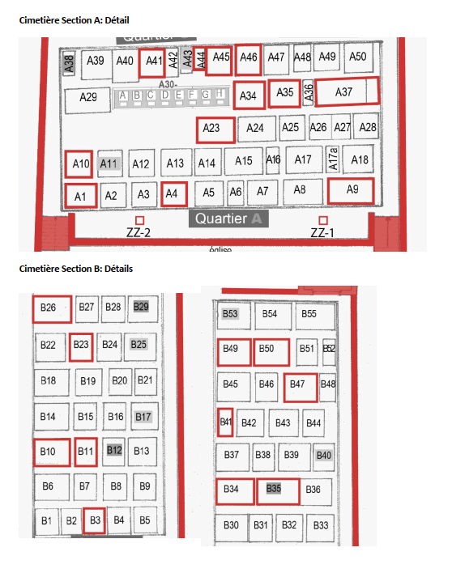
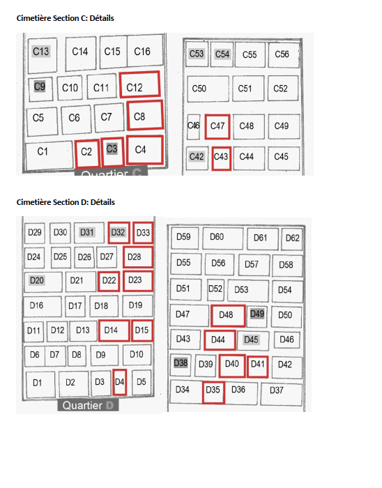
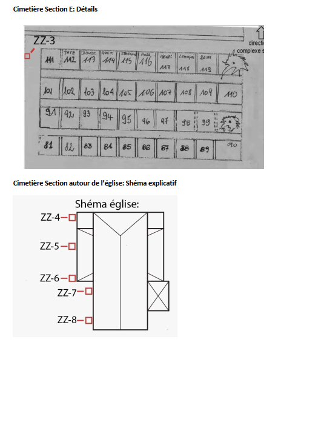

# Règlement grand-ducal du 15 janvier 2025 portant classement comme patrimoine culturel national de biens immeubles figurant à l’inventaire du patrimoine architectural de la commune de Lorentzweiler.

Nous Henri, Grand-Duc de Luxembourg, Duc de Nassau,

Vu la [loi du 25 février 2022](https://legilux.public.lu/eli/etat/leg/loi/2022/02/25/a80/jo) relative au patrimoine culturel, et notamment son article 26 ;

Vu les avis de la Commission pour le patrimoine culturel du 1er et 22 mars 2023 ;

Vu l’avis émis par le conseil communal de la commune de Lorentzweiler le 23 avril 2024 après enquête publique ;

Le Conseil d’État entendu ;

Sur le rapport du Ministre de la Culture, et après délibération du Gouvernement en conseil ;

Arrêtons :

## Art. 1er.

Sont classés patrimoine culturel national les biens immeubles se situant sur le territoire de la commune de Lorentzweiler suivants :

| **Description** | **Adresse ou lieu-dit** | **Numéro cadastre** |
|---|---|---|
| Ferme | 1, Aasselscheierhaff, ASSELSCHEUER | 764/2694, 764/2695 |
| Croix de chemin | Rue de Blaschette, sans numéro, ASSELSCHEUER | 758/2879 |
| Croix de chemin | Langenweg, sans numéro, ASSELSCHEUER | 653/2713 |
| Ferme | 18, rue de l’École, BLASCHETTE | 85/581 |
| Ferme | 23, rue de l’École, BLASCHETTE | 73/419 |
| Ensemble église et cimetière (détails sur plan annexé) | 12A, rue de Fischbach, Rue de Fischbach, sans numéro, BLASCHETTE | 30/1709 30/1710, 30/408 |
| Ferme, bildstock, stèle | Raashaff, sans numéro, BLASCHETTE | 951/2534 |
| Maison d’habitation | 26, rue de Wormeldange, BLASCHETTE | 36/478 |
| Chapelle | Rue de Wormeldange, sans numéro, BLASCHETTE | 951/2500 |
| Étable | In der Bergwies, sans numéro, BLASCHETTE | 271/415, 271/416 |
| Lavoir | In Prevent, sans numéro, BLASCHETTE | 366/0 |
| Réservoir d’eau et station de pompage | Beim Rashof, sans numéro, BLASCHETTE | 949/1614 |
| Maison d’habitation | 152, route de Luxembourg, BOFFERDANGE | 1120/1209 |
| Site mixte château de Bofferdange | 154, route de Luxembourg, BOFFERDANGE | 1171/672, 1171/2853 |
| Croix de chemin | 162, route de Luxembourg, BOFFERDANGE | 1287/1832 |
| Maison d’habitation | 193, route de Luxembourg, BOFFERDANGE | 1063/1246 |
| Ensemble église et mémoriaux | Route de Luxembourg, sans numéro, BOFFERDANGE | 1116/2759, 1116/2760 |
| Croix de chemin | 5, rue de Helmdange, HELMDANGE | 328/2243 |
| Maison d’habitation | 117, route de Luxembourg, HELMDANGE | 343/2008 |
| Maison d’habitation | 137, route de Luxembourg, HELMDANGE | 340/1733 |
| École | 142-144, route de Luxembourg, HELMDANGE | 178/2974 |
| Site mixte niche Fautelfiels | Auf Kohlent, sans numéro, HELMDANGE | 512/893 |
| Cimetière (détails sur plan annexé) | Rue du Cimetière, sans numéro HUNSDORF | 544/962 |
| Croix de chemin | Rue du Cimetière, sans numéro HUNSDORF | LUREF : 77300E 84289N |
| Maison d’habitation | 8, Am Haff, HUNSDORF | 348/1402 |
| Ancienne école | 2, rue de Prettange, HUNSDORF | 353/965 |
| Église | 40, rue de Steinsel, HUNSDORF | 360/1397, 360/1398 |
| Maison d’habitation | 55, rue de Steinsel, HUNSDORF | 365/1125 |
| Croix de chemin | Maximeinerbüsch, sans numéro, HUNSDORF | 824/800 |
| Pavillon de chasse | Maximeinerbüsch, sans numéro, HUNSDORF | 822/806 |
| Ferme | 45, rue de Gruenewald, KLINGELSCHEUER | 787/2603 |
| Croix de chemin | Am Neuenweg, sans numéro, KLINGELSCHEUER | 582/1487 |
| Maison d’habitation | 37, rue Belle-Vue, LORENTZWEILER | 637/0 |
| Monument mémorial | Place Ferdinand Dostert, sans numéro, LORENTZWEILER | 731/3227 |
| Ensemble ferme, chapelle et croix de chemin | 26, rue St. Laurent, LORENTZWEILER | 151/2924 |
| Maison d’habitation | 32, rue St. Laurent, LORENTZWEILER | 159/2162 |
| Croix de chemin | Rue St. Laurent, sans numéro, LORENTZWEILER | 147/2657 |
| Ensemble église et cimetière (détails sur plan annexé) | Rue St. Laurent, sans numéro, LORENTZWEILER | 57/3046, 57/3047, 56/1675 741/2378 |
| Maison d’habitation | 67A, route de Luxembourg, LORENTZWEILER | 730/2026 |
| Gare | 82, route de Luxembourg, LORENTZWEILER | 211/1359 |
| Maison d’habitation | 109, route de Luxembourg, LORENTZWEILER | 202/2141 |
| Chapelle | Rue des Martyrs, sans numéro, LORENTZWEILER | 735/1991 |
| Dépôt | Im Jungen Bandels, sans numéro, LORENTZWEILER | 955/1193 |

## Art. 2.

Le ministre ayant la Culture dans ses attributions est chargé de l’exécution du présent règlement qui sera publié au Journal officiel du Grand-Duché de Luxembourg.

Le Ministre de la Culture,   Eric Thill

Fait le 15 janvier 2025.   Pour le Grand-Duc,   Son Lieutenant-Représentant,   Guillaume,   Grand-Duc Héritier

Annexe

