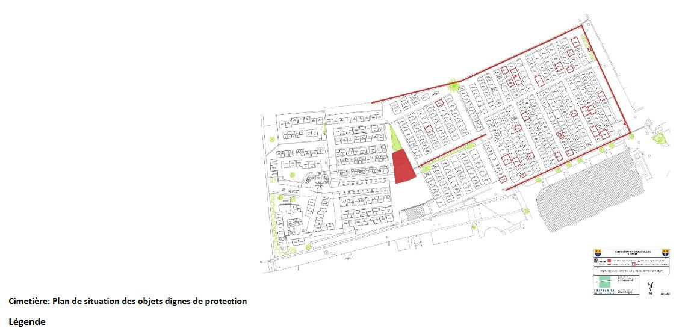
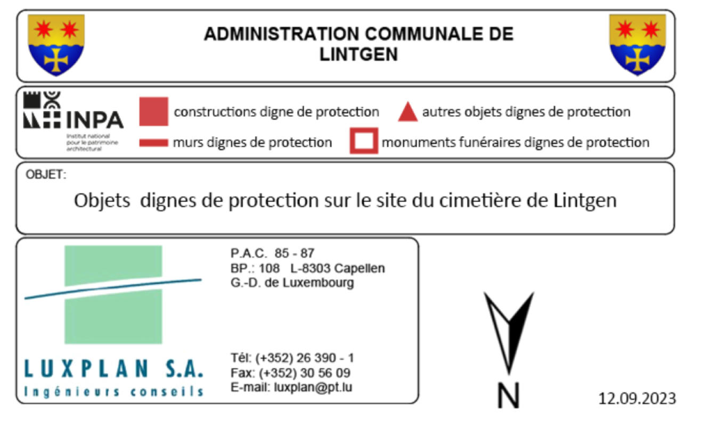
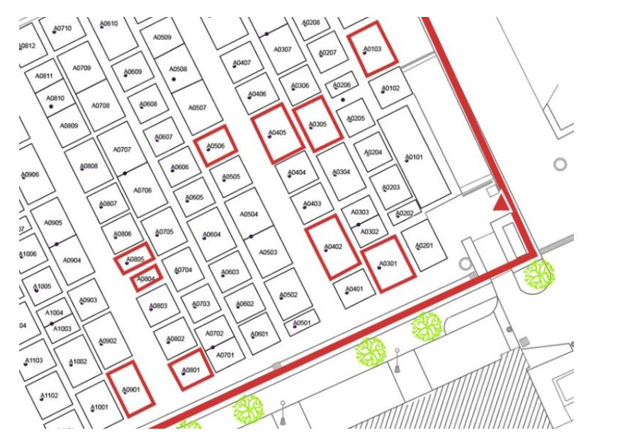
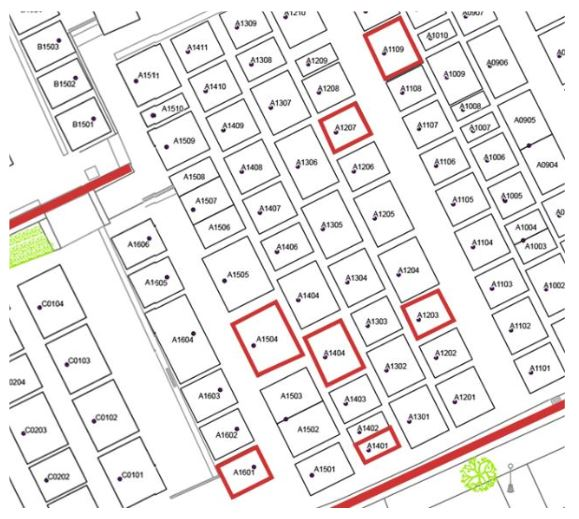

# Règlement grand-ducal du 15 janvier 2025 portant classement comme patrimoine culturel national de biens immeubles figurant à l’inventaire du patrimoine architectural de la commune de Lintgen.

Nous Henri, Grand-Duc de Luxembourg, Duc de Nassau,

Vu la [loi du 25 février 2022](https://legilux.public.lu/eli/etat/leg/loi/2022/02/25/a80/jo) relative au patrimoine culturel, et notamment son article 26 ;

Vu l’avis de la Commission pour le patrimoine culturel du 26 avril 2023 ;

Vu l’avis émis par le conseil communal de la commune de Lintgen le 24 avril 2024 après enquête publique ;

Le Conseil d’État entendu ;

Sur le rapport du Ministre de la Culture, et après délibération du Gouvernement en conseil ;

Arrêtons :

## Art. 1er.

Sont classés patrimoine culturel national les biens immeubles se situant sur le territoire de la commune de Lintgen suivants :

| **Description** | **Adresse ou lieu-dit** | **Numéro cadastral** |
|---|---|---|
| Ensemble maison jumelée avec grange | 68, route de Mersch, 70, route de Mersch, GOSSELDANGE | 607/1137 607/1685 |
| Bildstock | 86, route de Mersch, GOSSELDANGE | LUREF : 76231 E \| 87928 N Situé sur la parcelle 616/1422 |
| Ferme | 96, route de Mersch, GOSSELDANGE | 577/1891 648/2124 |
| Église | 97, route de Mersch, GOSSELDANGE | 654/2028 |
| Maison d’habitation | 113, route de Mersch, GOSSELDANGE | 640/1382 |
| Croix de chemin | Route de Mersch, sans numéro, GOSSELDANGE | LUREF : 76164 E \| 88034 N Situé sur la parcelle 648/2124 |
| Grotte | Gosseldingerbuesch, sans numéro, GOSSELDANGE | LUREF : 75838 E \| 87593 N Situé sur la parcelle 331/0 |
| Ferme | 11, rue de la Bergerie, LINTGEN | 241/0 |
| Ferme | 70, rue de la Bergerie, LINTGEN | 2156/4, 2156/5 |
| Immeuble d’habitation et de commerce avec Bildstock | 1, rue de Diekirch, Rue de Diekirch, sans numéro, LINTGEN | 50/3922, 52/3490 LUREF : 76886 E / 87371 N |
| Ferme | 14, rue de Diekirch, 14A, rue de Diekirch, LINTGEN | 1/3232 1/3231 |
| Maison d’habitation | 41+41A, rue de Diekirch, LINTGEN | 81/3909 |
| Atelier | 75, rue de Diekirch, LINTGEN | 505/4631 |
| Chapelle | Rue de Diekirch, sans numéro, LINTGEN | 76/3696 |
| Maison d’habitation | 13, rue de l’École, LINTGEN | 82/2990 |
| Maison d’habitation | 8, rue de l’Église, LINTGEN | 83/3403 |
| Maison d’habitation | 20, rue de l’Église, LINTGEN | 83/3326 |
| Maison d’habitation | 37, rue de l’Église, LINTGEN | 145/2632 |
| Ensemble église, mur, mémorial et cimetière (détails sur plan annexé) | Rue de l’Église, sans numéro, LINTGEN | 154/0, 156/606, 941/3359, 157/3713 LUREF (Croix) : 77255 E / 87468 N Mur situé en partie sur la parcelle 145/4581 et sur la voie publique |
| Maison d’habitation | 1A, route de Fischbach, LINTGEN | 76/3695 |
| Ferme | 54, route de Fischbach, LINTGEN | 142/3705 |
| Immeuble d’habitation et de commerce | 57, route de Fischbach, LINTGEN | 192/3932 |
| Maison d’habitation avec grange | 81, route de Fischbach, LINTGEN | 362/3874 |
| Bildstock | 104, route de Fischbach, LINTGEN | LUREF : 77687 E / 87372 N Situé sur la parcelle 1166/3163 |
| Croix de chemin | Route de Fischbach, sans numéro, LINTGEN | LUREF : 77965 E / 87318 N |
| Maison d’habitation | 3, rue des Jardins, LINTGEN | 126/3953 |
| Ferme | 4, rue du Moulin, LINTGEN | 338/2419 |
| Moulin et ferme | 9, rue du Moulin, LINTGEN | 339/0 |
| Comice agricole | Rue du Moulin, sans numéro, LINTGEN | 322/0 |
| Ferme | 15, Plankenhof, LINTGEN | 1881/3889 |
| Maison d’habitation avec atelier | 20, route Principale, LINTGEN | 33/4870 |
| Ensemble réservoirs d’eau | Place Roschten, sans numéro, Im Hohwald, sans numéro, LINTGEN | 394/1960 1637/1802 |
| Site mixte bunker et niche | Laschenderbüsch, sans numéro, LINTGEN | LUREF : 79369 E / 86881 N Situé sur la parcelle 1474/4371 |
| Local de rangement | Route de Hunsdorf, sans numéro, PRETTINGEN | LUREF : 76492 E / 87203 N |
| Ferme | 30, route de Hunsdorf, PRETTINGEN | 1090/1232 |
| Ferme | 14, rue de la Montagne, PRETTINGEN | 889/1528 |
| Bildstock | Rue de la Montagne, sans numéro, PRETTINGEN | 898/1654 |
| Cave | In Bingel, sans numéro, PRETTINGEN | 864/1368 |

## Art. 2.

Le ministre ayant la Culture dans ses attributions est chargé de l’exécution du présent règlement qui sera publié au Journal officiel du Grand-Duché de Luxembourg.

Le Ministre de la Culture,   Eric Thill

Fait le 15 janvier 2025.   Pour le Grand-Duc,   Son Lieutenant-Représentant,   Guillaume,   Grand-Duc Héritier

\**Cimetière Sections**

*[image omitted (2.2 MB) — see the official version: https://legilux.public.lu/eli/etat/leg/rgd/2025/01/15/a32/jo]*

\**Cimetière Section A : Détail 1**

\**Cimetière Section A : Détail 2**

\**Cimetière Section B : Détail**

*[image omitted (0.8 MB) — see the official version: https://legilux.public.lu/eli/etat/leg/rgd/2025/01/15/a32/jo]*

\**Cimetière Section C : Détail**

*[image omitted (0.7 MB) — see the official version: https://legilux.public.lu/eli/etat/leg/rgd/2025/01/15/a32/jo]*
