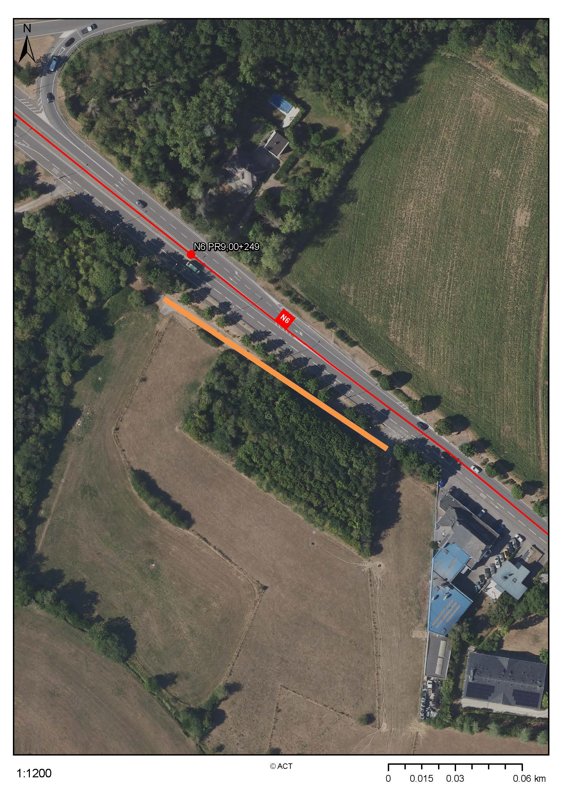

# Règlement grand-ducal du 11 février 2025 concernant l’interdiction de stationnement sur le chemin d’accès longeant la route nationale N6 entre Mamer et Capellen.

Nous Henri, Grand-Duc de Luxembourg, Duc de Nassau,

Vu la [loi modifiée du 14 février 1955](https://legilux.public.lu/eli/etat/leg/loi/1955/02/14/n3/jo) concernant la réglementation de la circulation sur toutes les voies publiques, et notamment son article 5, paragraphe 2, alinéa 1er ;

Vu l’avis de la Chambre de commerce ;

Les avis de la Chambre des métiers, de la Chambre des fonctionnaires et employés publics, de la Chambre d’agriculture et de la Chambre des salariés ayant été demandés ;

Le Conseil d’État entendu ;

Sur le rapport de la Ministre de la Mobilité et des Travaux publics, du Ministre des Affaires intérieures, et après délibération du Gouvernement en conseil ;

Arrêtons :

## Art. 1er.

Le stationnement est interdit des deux côtés sur le chemin d’accès longeant la route nationale N6 entre Mamer et Capellen entre les PR9,00+120 et PR9,00+250.

Cette disposition est indiquée par le signal C,18.

## Art. 2.

Le ministre ayant la Circulation routière dans ses attributions et le ministre ayant les Affaires intérieures dans ses attributions sont chargés, chacun en ce qui le concerne, de l’exécution du présent règlement qui sera publié au Journal officiel du Grand-Duché de Luxembourg.

La Ministre de la Mobilité  et des Travaux publics,   Yuriko Backes   Le Ministre des Affaires intérieures,   Léon Gloden

Fait le 11 février 2025.   Pour le Grand-Duc,   Son Lieutenant-Représentant,   Guillaume,   Grand-Duc Héritier

