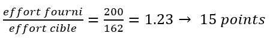

# Règlement grand-ducal du 25 février 2025 relatif à l’avancement en grades militaires des militaires de carrière et déterminant le contenu détaillé des différentes formations, les modalités de l’évaluation des qualités professionnelles et éthiques ainsi que les modalités du test sportif.

Nous Henri, Grand-Duc de Luxembourg, Duc de Nassau,

Vu la [loi du 7 août 2023](https://legilux.public.lu/eli/etat/leg/loi/2023/08/07/a502/jo) sur l’organisation de l’Armée luxembourgeoise, et notamment ses articles 24, paragraphe 4, 30 et 32 ;

Vu l’avis de la Chambre des fonctionnaires et employés publics ;

Le Conseil d’État entendu ;

Sur le rapport du Ministre de la Défense, et après délibération du Gouvernement en conseil ;

Arrêtons :

## Chapitre 1er — Contenu détaillé des formations continues

### Art. 1er.

(1) Les formations continues du sous-groupe militaire, niveau officier, sont les suivantes :

1° En fonction du choix d’arme, la formation de type commandant d’unité ou la formation spécialisée pour l’avancement au grade de capitaine est fixée comme suit :

a) La formation capitaine de l’arme Reconnaissance (Recce) porte sur les volets tactiques interarmes au niveau d’unité.

b) La formation capitaine de l’arme Logistique (Log) porte sur l’appui logistique dans les domaines de l’approvisionnement, la maintenance, le transport et les services des unités de la composante Terre. La formation se focalise sur l’appréciation des concepts et des besoins logistiques pour les opérations LAND.

c) La formation capitaine de l’arme Systèmes d’Information et de Communication (SIC) porte sur les compétences nécessaires à un officier SIC pour exercer des fonctions de commandement d’une unité spécialisée dans le domaine SIC.

d) Au vu de leur spécificité technique, des spécialisations dans les domaines suivants sont considérées comme équivalentes aux termes de l’article 28, point 1°, a) de la [loi du 7 août 2023](https://legilux.public.lu/eli/etat/leg/loi/2023/08/07/a502/jo) sur l’organisation de l’Armée luxembourgeoise : opérations en milieu terrestre autres que Reconnaissance, opérations en milieu aérien, espace, santé.

2° La formation qui vise à donner les compétences nécessaires à un officier supérieur pour exercer des fonctions de commandement et d’état-major dans un cadre national ou international pour l’avancement au grade de major est fixée comme suit :

a) Opérations : principes de planification et de conduite d’opérations militaires au niveau tactique et en relation avec une composante spécifique.

b) Management : organisation et gestion des tâches inhérentes au travail d’état-major du niveau tactique.

c) Leadership : développement de l’aptitude au commandement.

d) Sécurité et défense : analyse de la situation sécuritaire internationale au sein des coalitions multinationales (UE, OTAN, ONU) et notions de base en matière de politique de défense.

3° La formation qui vise à préparer à l’exercice de fonctions supérieures de commandement et d’état-major dans un cadre national et international et ceci avec un apport multinational et multidisciplinaire pour l’avancement au grade de lieutenant-colonel est fixée comme suit :

a) Opérations : principes de planification et de conduite d’opérations militaires interarmées au niveau opératif et dans un cadre UE, OTAN, ONU ou dans tout autre cadre (multi-)national.

b) Management : organisation et gestion des tâches inhérentes au travail d’état-major du niveau opératif.

c) Leadership : développement de l’aptitude au commandement en relation avec un emploi au niveau d’un d’état-major.

d) Sécurité et défense : compréhension et développement d’un esprit critique relatif aux problèmes complexes de sécurité internationale.

(2) Les formations du sous-groupe militaire, niveau sous-officier, sont les suivantes :

1° La formation qui vise à préparer à la fonction d’adjoint de chef de peloton pour l’avancement au grade de sergent-chef est fixée comme suit :

a) Tactique : planification et conduite de manœuvres militaires du niveau tactique peloton afin de seconder ou reprendre le commandement du chef de peloton.

b) Leadership : mise en œuvre des principes méthodologiques au niveau de l’instruction et développement de l’aptitude au commandement au niveau d’une unité de la taille d’un peloton.

c) Gestion de matériel et de personnel : analyse, expression et suivi des besoins en matériel et en personnel au niveau d’un peloton ; suivi administratif ; organisation et conduite de la maintenance et transport du matériel.

d) Relations internationales : acquisition de notions des différentes organisations internationales (UE, OTAN, ONU, etc.) et de la contribution de l’Armée luxembourgeoise à ces organisations en tant qu’État membre.

e) Au vu de leur spécificité technique, des spécialisations dans les domaines suivants sont considérées comme équivalentes aux termes de l’article 28, point 2°, a) de la [loi du 7 août 2023](https://legilux.public.lu/eli/etat/leg/loi/2023/08/07/a502/jo) sur l’organisation de l’Armée luxembourgeoise : opérations en milieu terrestre, opérations en milieu aérien, espace, SIC, santé, logistique, éducation physique et sportive.

2° La formation qui vise à préparer à exercer des fonctions au sein d’un commandement ou d’un état-major pour l’avancement au grade d’adjudant est fixée comme suit :

a) Bureautique : développement des compétences techniques en matière des outils bureautiques usuels employés au niveau d’un commandement ou d’un état-major.

b) Leadership : développement de l’aptitude au commandement en relation avec les tâches inhérentes au travail d’état-major.

c) Gestion de matériel et de personnel : développement des compétences administratives et d’organisation afin de gérer le matériel et le personnel mis à disposition au niveau d’un commandement ou d’un état-major.

d) Langue anglaise opérationnelle : développement des compétences linguistiques en langue anglaise et axées sur un vocabulaire à connotation opérationnelle.

e) Opérations : planification et gestion de l’exécution collective d’une mission ; principes du travail au sein d’un état-major (multi-)national.

3° La formation qui vise à préparer à exercer des fonctions supérieures au sein d’un commandement ou d’un état-major pour l’avancement au grade d’adjudant-major est fixée comme suit :

a) Bureautique : approfondissement des compétences techniques en matière des outils bureautiques usuels employés au niveau d’un commandement ou d’un état-major.

b) Perfectionnement en langue française ou anglaise : approfondissement des compétences linguistiques - communiquer, négocier, défendre et argumenter son opinion.

c) Leadership : développement de l’aptitude au commandement comme chef de bureau, avec un accent particulier sur la gestion d’équipe.

d) Gestion du projet de changement : acquisition des compétences pour gérer le changement au quotidien et maîtriser les mécanismes d’influence.

e) Conduite de réunion : acquisition des compétences pour organiser, animer et prendre note lors des différents types de réunions.

f) Gestion du personnel : approfondissement des compétences administratives, d’organisation, de communication et de délégation afin de gérer le personnel.

(3) Les formations du sous-groupe militaire, niveau caporal, sont les suivantes :

1° La formation qui vise à préparer à la fonction de chef d’équipe pour l’avancement au grade de caporal de 1ère classe est fixée comme suit :

a) Tactique : Planification et conduite d’une mission octroyée au niveau d’une équipe y inclus le développement des compétences nécessaires pour seconder ou reprendre le commandement du chef de section.

b) Leadership : développement de l’aptitude au commandement au niveau d’une équipe.

c) Gestion de matériel : gestion journalière du matériel au niveau de l’équipe, avec accent sur la maintenance du matériel alloué.

2° La formation qui vise à préparer à la fonction de caporal administratif ou spécialisé pour l’avancement au grade de premier caporal-chef est fixée comme suit :

a) Leadership : développement de l’aptitude au commandement comme chef de cellule, avec un accent particulier sur la gestion d’équipe.

b) Gestion de matériel ou personnel : compétences administratives et d’organisation afin de gérer le matériel ou le personnel mis à disposition au niveau d’une cellule.

c) Bureautique : développement des compétences techniques en matière des outils bureautiques usuels.

d) Compétences linguistiques : développement des compétences linguistiques au niveau administratif, notamment en langue française ou anglaise.

### Art. 2.

(1) Les formations continues du sous-groupe à attributions particulières, niveau officier, sont les suivantes :

1° La formation qui vise à donner les compétences nécessaires dans l’exercice du commandement et du management pour l’avancement au grade de capitaine est fixée comme suit :

a) Leadership : développement de l’aptitude au commandement au niveau d’une unité administrative de base.

b) Management : organisation et gestion administrative, matérielle, budgétaire et organisationnelle d’une unité administrative de base.

2° La formation qui vise à perfectionner les compétences du commandement et du management pour l’avancement au grade de lieutenant-colonel est fixée comme suit :

a) Leadership : perfectionnement de l’aptitude au commandement au niveau d’une unité administrative de base.

b) Management : perfectionnement des principes d’organisation d’une unité administrative de base et direction d’un orchestre.

(2) Les formations du sous-groupe à attributions particulières, niveau sous-officier, sont les suivantes :

1° La formation qui vise à préparer à la spécialisation à l’instrument pour l’avancement au grade d’adjudant, musicien spécialiste, est fixée comme suit :

a) Maîtrise instrumentale : amélioration de la performance musicale, spécialisation à l’instrument principal, secondaire ou autre instrument selon besoin de l’orchestre.

b) Stress management : gestion du trac sur scène, training autogène et techniques d’optimisation du potentiel diverses, y inclus techniques de relaxation mentale et physique.

2° La formation bureautique et administration qui vise à préparer à la fonction de sous-officier administratif et organisationnel de la musique militaire pour l’avancement au grade d’adjudant-major est fixée comme suit :

a) Bureautique et administration : utilisation des outils informatiques usuels ; utilisation du système informatique de gestion intégrée de l’Armée ; gestion du courrier, initiation dans le fonctionnement du secrétariat, planification des services internes, commande et gestion du matériel, communication externe ;

ou

b) Spécialisation dans un des domaines suivants : archivage, communication, sonorisation, réparation, entretien des instruments et la préparation des anches pour hautbois/basson.

## Chapitre 2 — Appréciation des qualités professionnelles et éthiques

### Art. 3.

(1) L’appréciation des qualités professionnelles se fait moyennant dix-sept compétences réparties en « compétences techniques », « compétences de comportement professionnel », ainsi que le « plan de travail individuel ».

<table>
<tr>
<td colspan="3"><b>Qualités professionnelles</b></td>
</tr>
<tr>
<td></td>
<td><b>Compétences techniques</b></td>
<td><b>Description</b></td>
</tr>
<tr>
<td>1.</td>
<td>Présentation / Tenue</td>
<td>Soin dans la présentation de soi-même, propreté et soin de la tenue.</td>
</tr>
<tr>
<td>2.</td>
<td>Souci du travail bien fait</td>
<td>Rigueur dans l’exécution des missions octroyées avec comme but d’atteindre le meilleur résultat et le plus haut niveau de performance réalisables.</td>
</tr>
<tr>
<td>3.</td>
<td>Souci du compte-rendu</td>
<td>Information de son échelon supérieur sur initiative propre, en synthétisant les éléments essentiels sans négliger le niveau de détail qui s’impose.</td>
</tr>
<tr>
<td>4.</td>
<td>Aisance d’expression orale</td>
<td>Transmission avec facilité d’une information précise par voie orale de façon claire, concise et adaptée à la personne ou au public cible ; y compris en langue étrangère, notamment en français et anglais.</td>
</tr>
<tr>
<td>5.</td>
<td>Capacité d’expression écrite</td>
<td>Rédaction de toute sorte de document écrit de façon claire, concise et adaptée à la personne ou au public cible ; y compris en langue étrangère, notamment en français.</td>
</tr>
<tr>
<td>6.</td>
<td>Capacité d’analyse</td>
<td>Capacité de séparer l’accessoire de l’essentiel et présenter les résultats de réflexion de façon claire et concise.</td>
</tr>
<tr>
<td>7.</td>
<td>Mobilisation des connaissances</td>
<td>Mise en pratique des connaissances théoriques acquises.</td>
</tr>
<tr>
<td>8.</td>
<td>Organisation du travail / Gestion du temps</td>
<td>Organisation de sa charge de travail de manière efficiente et efficace, tout en respectant le cadre horaire y attribué.</td>
</tr>
<tr>
<td>9.</td>
<td>Aptitude au commandement</td>
<td>Avoir la capacité d’exercer une autorité hiérarchique sur un groupe d’hommes et de femmes. Les éléments constitutifs de cette capacité sont des prises de décision en connaissance de cause, l’acquiescement de la responsabilité (courage) en découlant et l’exercice de la fonction de contrôle pour maximiser les chances de réalisation des objectifs fixés.</td>
</tr>
<tr>
<td></td>
<td><b>Compétences de comportement professionnel</b></td>
<td></td>
</tr>
<tr>
<td>10.</td>
<td>Disponibilité</td>
<td>Flexibilité de prioriser les besoins du service par rapport aux besoins personnels.</td>
</tr>
<tr>
<td>11.</td>
<td>Esprit de cohésion</td>
<td>Motivation intrinsèque pour la priorisation du bien commun par rapport au bien individuel ; promotion du travail d’équipe et soutien intra-corps.</td>
</tr>
<tr>
<td>12.</td>
<td>Prise d’initiative</td>
<td>Esprit d’entreprendre de façon autonome toutes les démarches jugées utiles et nécessaires pour faire avancer et/ou aboutir une tâche/mission octroyée.</td>
</tr>
<tr>
<td>13.</td>
<td>Ouverture d’esprit</td>
<td>Capacité de remise en question de ses propres considérations, désir d’élargir son horizon intellectuel et volonté d’apprendre.</td>
</tr>
<tr>
<td>14.</td>
<td>Ascendant</td>
<td>Influence positive sur autrui en faisant office d’autorité morale.</td>
</tr>
<tr>
<td>15.</td>
<td>Aisance relationnelle / Communication</td>
<td>Facilité de traiter et de communiquer avec ses supérieurs, ses inférieurs et ses paires ; utilisation efficiente et efficace des canaux de communication humaines et technologiques à sa disposition, tout en exhibant le niveau de politesse qui s’impose.</td>
</tr>
<tr>
<td>16.</td>
<td>Sens pédagogique</td>
<td>Capacité de mise en œuvre des principes de méthodologie et application de principes éducatifs.</td>
</tr>
<tr>
<td>17.</td>
<td>Maîtrise de soi</td>
<td>Faculté de ne pas se laisser emporter par ses émotions en résistant aux situations de stress, de fatigue et toute autre sorte de stimuli négatifs.</td>
</tr>
<tr>
<td></td>
<td><b>Plan de travail individuel</b></td>
<td></td>
</tr>
<tr>
<td>18.</td>
<td>Réalisation du plan de travail individuel</td>
<td>Bilan des objectifs atteints sur base de la fonction, des activités et des tâches fixées.</td>
</tr>
</table>

Pour les besoins de l’appréciation, la réalisation du plan de travail individuel est considérée comme compétence.

Nul militaire de carrière ne peut prétendre à l’avancement en grade militaire s’il est établi que le total de son niveau de performance des qualités professionnelles est inférieur à 18 points.

Il en va de même lorsque le militaire obtient pour au moins cinq compétences un niveau de performance « 0 ».

Uniquement les points repris dans l’échelle de notation du paragraphe 3 sont utilisés pour déterminer le niveau de performance.

(2) L’appréciation des qualités éthiques se fait moyennant cinq compétences de comportement éthique.

<table>
<tr>
<td colspan="3"><b>Qualités éthiques</b></td>
</tr>
<tr>
<td></td>
<td><b>Compétences de comportement éthique</b></td>
<td><b>Description</b></td>
</tr>
<tr>
<td>1.</td>
<td>Loyauté</td>
<td>Soumission volontaire aux exigences du service et dévouement envers ses collègues.</td>
</tr>
<tr>
<td>2.</td>
<td>Droiture / Fiabilité</td>
<td>Agir de manière prompte et sans faille dans l’esprit de la mission tout en respectant l’égalité et l’équité.</td>
</tr>
<tr>
<td>3.</td>
<td>Respect de la dignité d’autrui</td>
<td>Respect de l’autre en tant qu’être humain, courtoisie et politesse dans les relations interpersonnelles, que ce soit envers ses collègues, subordonnés ou supérieurs.</td>
</tr>
<tr>
<td>4.</td>
<td>Sens de la justice</td>
<td>Faire preuve d’impartialité envers ses subordonnés.</td>
</tr>
<tr>
<td>5.</td>
<td>Discipline / Rigueur formelle</td>
<td>Respect des règlementations, soumission à la discipline militaire.</td>
</tr>
</table>

Nul militaire de carrière ne peut prétendre à l’avancement en grade militaire s’il est établi que le total de ses niveaux de performance des qualités éthiques est inférieur à 5 points.

Il en va de même lorsque le militaire obtient pour au moins deux compétences un niveau de performance « 0 ».

Uniquement les points repris dans l’échelle de notation du paragraphe 3 sont utilisés pour déterminer le niveau de performance.

(3) L’échelle de notation servant à déterminer le niveau de performance est la suivante :

| **Niveau de performance** | **Point(s)** |
|---|---|
| Insuffisant | 0 |
| Passable | 1 |
| Bon | 2 |
| Très bon | 3 |
| Excellent | 4 |

(4) Le niveau de performance spécifique relatif à un type de qualités donné est déterminé en divisant le total des points alloués pour ce type de qualités par le nombre de compétences définies pour ce type de qualités.

(5) Le niveau de performance général relatif à l’ensemble des qualités professionnelles et éthiques est déterminé en divisant le total des points alloués pour les vingt-trois compétences de ces deux types de qualités définis au paragraphes 1er et 2 par vingt-trois.

(6) Si la valeur des points calculée, conformément aux paragraphes 4 et 5, correspond à un entier, le niveau de performance en découlant équivaut directement au niveau de performance spécifique, respectivement général.

Si la valeur des points calculée ne correspond pas à un entier, elle est arrondie vers le nombre entier immédiatement supérieur sous condition que la partie décimale est égale ou supérieure à 50/100. L’entier ainsi obtenu correspond au niveau de performance spécifique, respectivement général. Dans le cas contraire, l’entier, sans sa partie décimale, est pris en considération pour déterminer le niveau de performance spécifique, respectivement général.

(7) L’appréciation des différentes compétences est arrêtée par écrit, moyennant un formulaire dédié dont la forme est arrêtée par le chef d’état-major de l’Armée luxembourgeoise.

## Chapitre 3 — Évaluation de la condition physique

### Art. 4.

(1) L’épreuve d’endurance consiste en 30 minutes d’effort sur un vélo ergomètre permettant de mesurer l’effort fourni par le militaire.

L’effort cible est déterminé suivant les barèmes à l’annexe A qui tiennent compte du sexe, du poids et de l’âge du militaire.

Le coefficient obtenu par le rapport entre l’effort fourni et l’effort cible détermine la cotation suivant le barème à l’annexe A.

(2) L’épreuve de stabilité du tronc consiste à rester aussi longtemps que possible dans une position déterminée, appelée « left and right sidebridge ».

Le militaire exécute l’épreuve une fois du côté gauche et une fois du côté droit. Le résultat est obtenu par la durée moyenne des deux exécutions.

La cotation est déterminée sur base du résultat obtenu et en fonction du sexe et de l’âge du militaire, suivant les barèmes à l’annexe B.

(3) L’épreuve de force consiste à rester suspendu aussi longtemps que possible à une barre fixe, menton au-dessus de la barre et prise en supination.

La cotation est déterminée sur base de la durée obtenue et en fonction du sexe et de l’âge du militaire, suivant les barèmes à l’annexe C.

## Chapitre 4 — Dispositions finales

### Art. 5.

La référence au présent règlement se fait sous la forme suivante : « règlement grand-ducal du 25 février 2025 relatif à l’avancement en grades militaires des militaires de carrière ».

### Art. 6.

Le ministre ayant la Défense dans ses attributions est chargé de l’exécution du présent règlement qui sera publié au Journal officiel du Grand-Duché de Luxembourg.

La Ministre de la Défense,   Yuriko Backes

Fait le 25 février 2025.   Pour le Grand-Duc,   Son Lieutenant-Représentant,   Guillaume,   Grand-Duc Héritier

\**Annexe A**

| **Épreuve d’endurance** |
|---|

| Puissance (en watts) à développer (selon âge et poids) |
|---|

\**Hommes**

<table>
<tr>
<td colspan="2"><b>Âge</b></td>
<td><b>20-24</b></td>
<td><b>25-29</b></td>
<td><b>30-34</b></td>
<td><b>35-39</b></td>
<td><b>40-44</b></td>
<td><b>45-49</b></td>
<td><b>50-54</b></td>
<td><b>55-59</b></td>
<td><b>60-64</b></td>
</tr>
<tr>
<td rowspan="9"><b>Poids</b></td>
<td><b>60-65</b></td>
<td>162</td>
<td>162</td>
<td>154</td>
<td>142</td>
<td>135</td>
<td>131</td>
<td>119</td>
<td>116</td>
<td>104</td>
</tr>
<tr>
<td><b>66-69</b></td>
<td>173</td>
<td>166</td>
<td>158</td>
<td>150</td>
<td>139</td>
<td>135</td>
<td>123</td>
<td>119</td>
<td>108</td>
</tr>
<tr>
<td><b>70-73</b></td>
<td>177</td>
<td>169</td>
<td>162</td>
<td>154</td>
<td>146</td>
<td>139</td>
<td>127</td>
<td>123</td>
<td>112</td>
</tr>
<tr>
<td><b>74-77</b></td>
<td>181</td>
<td>173</td>
<td>166</td>
<td>158</td>
<td>150</td>
<td>142</td>
<td>131</td>
<td>127</td>
<td>116</td>
</tr>
<tr>
<td><b>78-81</b></td>
<td>185</td>
<td>177</td>
<td>169</td>
<td>162</td>
<td>154</td>
<td>146</td>
<td>131</td>
<td>131</td>
<td>116</td>
</tr>
<tr>
<td><b>82-85</b></td>
<td>189</td>
<td>181</td>
<td>173</td>
<td>166</td>
<td>158</td>
<td>150</td>
<td>142</td>
<td>135</td>
<td>123</td>
</tr>
<tr>
<td><b>86-89</b></td>
<td>193</td>
<td>185</td>
<td>177</td>
<td>169</td>
<td>162</td>
<td>154</td>
<td>146</td>
<td>139</td>
<td>131</td>
</tr>
<tr>
<td><b>90-93</b></td>
<td>196</td>
<td>189</td>
<td>181</td>
<td>173</td>
<td>166</td>
<td>158</td>
<td>150</td>
<td>142</td>
<td>135</td>
</tr>
<tr>
<td><b>>94</b></td>
<td>200</td>
<td>193</td>
<td>185</td>
<td>177</td>
<td>169</td>
<td>162</td>
<td>154</td>
<td>146</td>
<td>139</td>
</tr>
</table>

\**Femmes**

<table>
<tr>
<td colspan="2"><b>Âge</b></td>
<td><b>20-24</b></td>
<td><b>25-29</b></td>
<td><b>30-34</b></td>
<td><b>35-39</b></td>
<td><b>40-44</b></td>
<td><b>45-49</b></td>
<td><b>50-54</b></td>
<td><b>55-59</b></td>
<td><b>60-64</b></td>
</tr>
<tr>
<td rowspan="10"><b>Poids</b></td>
<td><b>40-45</b></td>
<td>92</td>
<td>88</td>
<td>84</td>
<td>80</td>
<td>76</td>
<td>76</td>
<td>71</td>
<td>63</td>
<td>63</td>
</tr>
<tr>
<td><b>46-49</b></td>
<td>97</td>
<td>92</td>
<td>88</td>
<td>84</td>
<td>84</td>
<td>80</td>
<td>76</td>
<td>71</td>
<td>67</td>
</tr>
<tr>
<td><b>50-53</b></td>
<td>101</td>
<td>97</td>
<td>92</td>
<td>88</td>
<td>84</td>
<td>84</td>
<td>80</td>
<td>76</td>
<td>71</td>
</tr>
<tr>
<td><b>54-57</b></td>
<td>105</td>
<td>101</td>
<td>101</td>
<td>97</td>
<td>92</td>
<td>88</td>
<td>84</td>
<td>84</td>
<td>80</td>
</tr>
<tr>
<td><b>58-61</b></td>
<td>109</td>
<td>105</td>
<td>105</td>
<td>101</td>
<td>97</td>
<td>97</td>
<td>88</td>
<td>84</td>
<td>84</td>
</tr>
<tr>
<td><b>62-65</b></td>
<td>113</td>
<td>113</td>
<td>109</td>
<td>105</td>
<td>101</td>
<td>101</td>
<td>92</td>
<td>92</td>
<td>88</td>
</tr>
<tr>
<td><b>66-69</b></td>
<td>118</td>
<td>118</td>
<td>113</td>
<td>109</td>
<td>109</td>
<td>105</td>
<td>101</td>
<td>97</td>
<td>92</td>
</tr>
<tr>
<td><b>70-73</b></td>
<td>126</td>
<td>122</td>
<td>118</td>
<td>113</td>
<td>109</td>
<td>109</td>
<td>105</td>
<td>101</td>
<td>97</td>
</tr>
<tr>
<td><b>74-77</b></td>
<td>130</td>
<td>126</td>
<td>122</td>
<td>118</td>
<td>113</td>
<td>113</td>
<td>109</td>
<td>105</td>
<td>101</td>
</tr>
<tr>
<td><b>>78</b></td>
<td>134</td>
<td>130</td>
<td>126</td>
<td>126</td>
<td>122</td>
<td>118</td>
<td>113</td>
<td>109</td>
<td>109</td>
</tr>
</table>

| Rapport entre l’effort fourni et l’effort cible |
|---|

| **Coefficient** | **Points** |
|---|---|
| 1.40 | 20 |
| 1.36 | 19 |
| 1.32 | 18 |
| 1.28 | 17 |
| 1.24 | 16 |
| 1.20 | 15 |
| 1.16 | 14 |
| 1.12 | 13 |
| 1.08 | 12 |
| 1.04 | 11 |
| 1.00 | 10 |
| 0.95 | 9 |
| 0.90 | 8 |
| 0.85 | 7 |
| 0.80 | 6 |
| 0.75 | 5 |
| 0.70 | 4 |
| 0.65 | 3 |
| 0.60 | 2 |
| 0.55 | 1 |
| 0.50 | 0 |

Exemple :

aash Un homme de 36 ans qui pèse 80 kg doit fournir un effort de 162 watts. Il fournit un effort de 200 watts.

bash Calcul du coefficient : 

\**Annexe B**

| **Épreuve **de stabilité du tronc (Left and Right Sidebridge)**** |
|---|

\**Hommes**

<table>
<tr>
<td colspan="2"><b>Âge</b></td>
<td><b>20-24</b></td>
<td><b>25-29</b></td>
<td><b>30-34</b></td>
<td><b>35-39</b></td>
<td><b>40-44</b></td>
<td><b>45-49</b></td>
<td><b>50-54</b></td>
<td><b>55-59</b></td>
<td><b>60-64</b></td>
</tr>
<tr>
<td rowspan="21"><b>Points</b></td>
<td>20</td>
<td>125</td>
<td>120</td>
<td>115</td>
<td>112</td>
<td>110</td>
<td>107</td>
<td>105</td>
<td>102</td>
<td>100</td>
</tr>
<tr>
<td>19</td>
<td>120</td>
<td>115</td>
<td>110</td>
<td>107</td>
<td>105</td>
<td>102</td>
<td>100</td>
<td>97</td>
<td>95</td>
</tr>
<tr>
<td>18</td>
<td>115</td>
<td>110</td>
<td>105</td>
<td>102</td>
<td>100</td>
<td>97</td>
<td>95</td>
<td>92</td>
<td>90</td>
</tr>
<tr>
<td>17</td>
<td>110</td>
<td>105</td>
<td>100</td>
<td>97</td>
<td>95</td>
<td>92</td>
<td>90</td>
<td>87</td>
<td>85</td>
</tr>
<tr>
<td>16</td>
<td>105</td>
<td>100</td>
<td>95</td>
<td>92</td>
<td>90</td>
<td>87</td>
<td>85</td>
<td>82</td>
<td>80</td>
</tr>
<tr>
<td>15</td>
<td>100</td>
<td>95</td>
<td>90</td>
<td>87</td>
<td>85</td>
<td>82</td>
<td>80</td>
<td>77</td>
<td>75</td>
</tr>
<tr>
<td>14</td>
<td>95</td>
<td>90</td>
<td>85</td>
<td>82</td>
<td>80</td>
<td>77</td>
<td>75</td>
<td>72</td>
<td>70</td>
</tr>
<tr>
<td>13</td>
<td>90</td>
<td>85</td>
<td>80</td>
<td>77</td>
<td>75</td>
<td>72</td>
<td>70</td>
<td>67</td>
<td>65</td>
</tr>
<tr>
<td>12</td>
<td>85</td>
<td>80</td>
<td>75</td>
<td>72</td>
<td>70</td>
<td>67</td>
<td>65</td>
<td>62</td>
<td>60</td>
</tr>
<tr>
<td>11</td>
<td>80</td>
<td>75</td>
<td>70</td>
<td>67</td>
<td>65</td>
<td>62</td>
<td>60</td>
<td>57</td>
<td>55</td>
</tr>
<tr>
<td>10</td>
<td>75</td>
<td>70</td>
<td>65</td>
<td>62</td>
<td>60</td>
<td>57</td>
<td>55</td>
<td>52</td>
<td>50</td>
</tr>
<tr>
<td>9</td>
<td>73</td>
<td>68</td>
<td>63</td>
<td>60</td>
<td>58</td>
<td>55</td>
<td>53</td>
<td>50</td>
<td>48</td>
</tr>
<tr>
<td>8</td>
<td>71</td>
<td>66</td>
<td>61</td>
<td>58</td>
<td>56</td>
<td>53</td>
<td>51</td>
<td>48</td>
<td>46</td>
</tr>
<tr>
<td>7</td>
<td>70</td>
<td>64</td>
<td>59</td>
<td>56</td>
<td>54</td>
<td>51</td>
<td>49</td>
<td>46</td>
<td>44</td>
</tr>
<tr>
<td>6</td>
<td>68</td>
<td>62</td>
<td>57</td>
<td>54</td>
<td>52</td>
<td>49</td>
<td>47</td>
<td>44</td>
<td>42</td>
</tr>
<tr>
<td>5</td>
<td>66</td>
<td>60</td>
<td>55</td>
<td>52</td>
<td>50</td>
<td>47</td>
<td>45</td>
<td>42</td>
<td>40</td>
</tr>
<tr>
<td>4</td>
<td>65</td>
<td>58</td>
<td>52</td>
<td>49</td>
<td>47</td>
<td>44</td>
<td>42</td>
<td>39</td>
<td>37</td>
</tr>
<tr>
<td>3</td>
<td>63</td>
<td>56</td>
<td>50</td>
<td>47</td>
<td>45</td>
<td>42</td>
<td>40</td>
<td>37</td>
<td>35</td>
</tr>
<tr>
<td>2</td>
<td>61</td>
<td>54</td>
<td>47</td>
<td>44</td>
<td>42</td>
<td>39</td>
<td>37</td>
<td>34</td>
<td>32</td>
</tr>
<tr>
<td>1</td>
<td>60</td>
<td>52</td>
<td>45</td>
<td>42</td>
<td>40</td>
<td>37</td>
<td>35</td>
<td>32</td>
<td>30</td>
</tr>
<tr>
<td>0</td>
<td><60</td>
<td><52</td>
<td><45</td>
<td><42</td>
<td><40</td>
<td><37</td>
<td><35</td>
<td><32</td>
<td><30</td>
</tr>
</table>

\**Femmes**

<table>
<tr>
<td colspan="2"><b>Âge</b></td>
<td><b>20-24</b></td>
<td><b>25-29</b></td>
<td><b>30-34</b></td>
<td><b>35-39</b></td>
<td><b>40-44</b></td>
<td><b>45-49</b></td>
<td><b>50-54</b></td>
<td><b>55-59</b></td>
<td><b>60-64</b></td>
</tr>
<tr>
<td rowspan="21"><b>Points</b></td>
<td>20</td>
<td>110</td>
<td>107</td>
<td>105</td>
<td>102</td>
<td>100</td>
<td>97</td>
<td>95</td>
<td>92</td>
<td>90</td>
</tr>
<tr>
<td>19</td>
<td>105</td>
<td>102</td>
<td>100</td>
<td>97</td>
<td>95</td>
<td>92</td>
<td>90</td>
<td>87</td>
<td>85</td>
</tr>
<tr>
<td>18</td>
<td>100</td>
<td>97</td>
<td>95</td>
<td>92</td>
<td>90</td>
<td>87</td>
<td>85</td>
<td>82</td>
<td>80</td>
</tr>
<tr>
<td>17</td>
<td>95</td>
<td>92</td>
<td>90</td>
<td>87</td>
<td>85</td>
<td>82</td>
<td>80</td>
<td>77</td>
<td>75</td>
</tr>
<tr>
<td>16</td>
<td>90</td>
<td>87</td>
<td>85</td>
<td>82</td>
<td>80</td>
<td>77</td>
<td>75</td>
<td>72</td>
<td>70</td>
</tr>
<tr>
<td>15</td>
<td>85</td>
<td>82</td>
<td>80</td>
<td>77</td>
<td>75</td>
<td>72</td>
<td>70</td>
<td>67</td>
<td>65</td>
</tr>
<tr>
<td>14</td>
<td>80</td>
<td>77</td>
<td>75</td>
<td>72</td>
<td>70</td>
<td>67</td>
<td>65</td>
<td>62</td>
<td>60</td>
</tr>
<tr>
<td>13</td>
<td>75</td>
<td>72</td>
<td>70</td>
<td>67</td>
<td>65</td>
<td>62</td>
<td>60</td>
<td>57</td>
<td>55</td>
</tr>
<tr>
<td>12</td>
<td>70</td>
<td>67</td>
<td>65</td>
<td>62</td>
<td>60</td>
<td>57</td>
<td>55</td>
<td>52</td>
<td>50</td>
</tr>
<tr>
<td>11</td>
<td>65</td>
<td>62</td>
<td>60</td>
<td>57</td>
<td>55</td>
<td>52</td>
<td>50</td>
<td>47</td>
<td>45</td>
</tr>
<tr>
<td>10</td>
<td>60</td>
<td>57</td>
<td>55</td>
<td>52</td>
<td>50</td>
<td>47</td>
<td>45</td>
<td>42</td>
<td>40</td>
</tr>
<tr>
<td>9</td>
<td>58</td>
<td>55</td>
<td>53</td>
<td>50</td>
<td>48</td>
<td>45</td>
<td>43</td>
<td>39</td>
<td>35</td>
</tr>
<tr>
<td>8</td>
<td>56</td>
<td>53</td>
<td>51</td>
<td>48</td>
<td>46</td>
<td>43</td>
<td>41</td>
<td>37</td>
<td>33</td>
</tr>
<tr>
<td>7</td>
<td>54</td>
<td>51</td>
<td>49</td>
<td>46</td>
<td>44</td>
<td>41</td>
<td>39</td>
<td>35</td>
<td>31</td>
</tr>
<tr>
<td>6</td>
<td>52</td>
<td>49</td>
<td>47</td>
<td>44</td>
<td>42</td>
<td>39</td>
<td>37</td>
<td>32</td>
<td>28</td>
</tr>
<tr>
<td>5</td>
<td>50</td>
<td>47</td>
<td>45</td>
<td>42</td>
<td>40</td>
<td>37</td>
<td>35</td>
<td>30</td>
<td>26</td>
</tr>
<tr>
<td>4</td>
<td>47</td>
<td>44</td>
<td>42</td>
<td>39</td>
<td>37</td>
<td>34</td>
<td>32</td>
<td>27</td>
<td>23</td>
</tr>
<tr>
<td>3</td>
<td>45</td>
<td>42</td>
<td>40</td>
<td>37</td>
<td>35</td>
<td>32</td>
<td>30</td>
<td>26</td>
<td>22</td>
</tr>
<tr>
<td>2</td>
<td>42</td>
<td>39</td>
<td>37</td>
<td>34</td>
<td>32</td>
<td>29</td>
<td>27</td>
<td>24</td>
<td>21</td>
</tr>
<tr>
<td>1</td>
<td>40</td>
<td>37</td>
<td>35</td>
<td>32</td>
<td>30</td>
<td>27</td>
<td>25</td>
<td>22</td>
<td>20</td>
</tr>
<tr>
<td>0</td>
<td><40</td>
<td><37</td>
<td><35</td>
<td><32</td>
<td><30</td>
<td><27</td>
<td><25</td>
<td><22</td>
<td><20</td>
</tr>
</table>

\**Annexe C**

| **Épreuve **de force - Suspension**** |
|---|

\**Hommes**

<table>
<tr>
<td colspan="2"><b>Âge</b></td>
<td><b>20-24</b></td>
<td><b>25-29</b></td>
<td><b>30-34</b></td>
<td><b>35-39</b></td>
<td><b>40-44</b></td>
<td><b>45-49</b></td>
<td><b>50-54</b></td>
<td><b>55-59</b></td>
<td><b>60-64</b></td>
</tr>
<tr>
<td rowspan="22"><b>Points</b></td>
<td>20</td>
<td>80</td>
<td>76</td>
<td>72</td>
<td>68</td>
<td>64</td>
<td>60</td>
<td>56</td>
<td>52</td>
<td>48</td>
</tr>
<tr>
<td>19</td>
<td>76</td>
<td>72</td>
<td>68</td>
<td>64</td>
<td>60</td>
<td>56</td>
<td>52</td>
<td>48</td>
<td>44</td>
</tr>
<tr>
<td>18</td>
<td>72</td>
<td>68</td>
<td>64</td>
<td>60</td>
<td>56</td>
<td>52</td>
<td>48</td>
<td>44</td>
<td>40</td>
</tr>
<tr>
<td>17</td>
<td>68</td>
<td>64</td>
<td>60</td>
<td>56</td>
<td>52</td>
<td>48</td>
<td>44</td>
<td>40</td>
<td>36</td>
</tr>
<tr>
<td>16</td>
<td>64</td>
<td>60</td>
<td>56</td>
<td>52</td>
<td>48</td>
<td>44</td>
<td>40</td>
<td>36</td>
<td>32</td>
</tr>
<tr>
<td>15</td>
<td>60</td>
<td>56</td>
<td>52</td>
<td>48</td>
<td>44</td>
<td>40</td>
<td>36</td>
<td>32</td>
<td>28</td>
</tr>
<tr>
<td>14</td>
<td>56</td>
<td>52</td>
<td>48</td>
<td>44</td>
<td>40</td>
<td>36</td>
<td>32</td>
<td>28</td>
<td>24</td>
</tr>
<tr>
<td>13</td>
<td>52</td>
<td>48</td>
<td>44</td>
<td>40</td>
<td>36</td>
<td>32</td>
<td>28</td>
<td>24</td>
<td>20</td>
</tr>
<tr>
<td>12</td>
<td>48</td>
<td>44</td>
<td>40</td>
<td>36</td>
<td>32</td>
<td>28</td>
<td>24</td>
<td>20</td>
<td>16</td>
</tr>
<tr>
<td>11</td>
<td>44</td>
<td>40</td>
<td>36</td>
<td>32</td>
<td>28</td>
<td>24</td>
<td>20</td>
<td>16</td>
<td>12</td>
</tr>
<tr>
<td>10</td>
<td>40</td>
<td>36</td>
<td>32</td>
<td>28</td>
<td>24</td>
<td>20</td>
<td>16</td>
<td>12</td>
<td>8</td>
</tr>
<tr>
<td>9</td>
<td>36</td>
<td>32</td>
<td>28</td>
<td>25</td>
<td>21</td>
<td>18</td>
<td>14</td>
<td>10</td>
<td>7</td>
</tr>
<tr>
<td>8</td>
<td>32</td>
<td>28</td>
<td>25</td>
<td>22</td>
<td>18</td>
<td>16</td>
<td>12</td>
<td>9</td>
<td>6</td>
</tr>
<tr>
<td>7</td>
<td>28</td>
<td>25</td>
<td>22</td>
<td>19</td>
<td>16</td>
<td>14</td>
<td>10</td>
<td>8</td>
<td>5</td>
</tr>
<tr>
<td>6</td>
<td>25</td>
<td>22</td>
<td>19</td>
<td>17</td>
<td>14</td>
<td>12</td>
<td>9</td>
<td>7</td>
<td>4</td>
</tr>
<tr>
<td>5</td>
<td>22</td>
<td>19</td>
<td>17</td>
<td>15</td>
<td>12</td>
<td>10</td>
<td>8</td>
<td>6</td>
<td>3</td>
</tr>
<tr>
<td>4</td>
<td>19</td>
<td>17</td>
<td>15</td>
<td>13</td>
<td>10</td>
<td>9</td>
<td>7</td>
<td>5</td>
<td>2</td>
</tr>
<tr>
<td>3</td>
<td>17</td>
<td>15</td>
<td>13</td>
<td>11</td>
<td>9</td>
<td>8</td>
<td>6</td>
<td>4</td>
<td>1</td>
</tr>
<tr>
<td>2</td>
<td>15</td>
<td>13</td>
<td>11</td>
<td>9</td>
<td>8</td>
<td>7</td>
<td>5</td>
<td>3</td>
<td>0</td>
</tr>
<tr>
<td>1</td>
<td>13</td>
<td>11</td>
<td>9</td>
<td>8</td>
<td>7</td>
<td>6</td>
<td>4</td>
<td>2</td>
<td>0</td>
</tr>
<tr>
<td>0</td>
<td><13</td>
<td><11</td>
<td><9</td>
<td><8</td>
<td><7</td>
<td><6</td>
<td><4</td>
<td><2</td>
<td>0</td>
</tr>
<tr>
<td colspan="8"></td>
<td>Facultatif</td>
<td>Facultatif</td>
</tr>
</table>

\**Femmes**

<table>
<tr>
<td colspan="2"><b>Âge</b></td>
<td><b>20-24</b></td>
<td><b>25-29</b></td>
<td><b>30-34</b></td>
<td><b>35-39</b></td>
<td><b>40-44</b></td>
<td><b>45-49</b></td>
<td><b>50-54</b></td>
<td><b>55-59</b></td>
<td><b>60-64</b></td>
</tr>
<tr>
<td rowspan="22"><b>Points</b></td>
<td>20</td>
<td>60</td>
<td>56</td>
<td>52</td>
<td>48</td>
<td>44</td>
<td>40</td>
<td>36</td>
<td>32</td>
<td>/</td>
</tr>
<tr>
<td>19</td>
<td>57</td>
<td>53</td>
<td>49</td>
<td>45</td>
<td>41</td>
<td>37</td>
<td>33</td>
<td>29</td>
<td>/</td>
</tr>
<tr>
<td>18</td>
<td>54</td>
<td>50</td>
<td>46</td>
<td>42</td>
<td>38</td>
<td>34</td>
<td>30</td>
<td>26</td>
<td>/</td>
</tr>
<tr>
<td>17</td>
<td>51</td>
<td>47</td>
<td>43</td>
<td>39</td>
<td>35</td>
<td>31</td>
<td>27</td>
<td>23</td>
<td>/</td>
</tr>
<tr>
<td>16</td>
<td>48</td>
<td>44</td>
<td>40</td>
<td>36</td>
<td>32</td>
<td>28</td>
<td>24</td>
<td>20</td>
<td>/</td>
</tr>
<tr>
<td>15</td>
<td>45</td>
<td>41</td>
<td>37</td>
<td>33</td>
<td>29</td>
<td>25</td>
<td>21</td>
<td>17</td>
<td>/</td>
</tr>
<tr>
<td>14</td>
<td>42</td>
<td>38</td>
<td>34</td>
<td>30</td>
<td>26</td>
<td>22</td>
<td>18</td>
<td>14</td>
<td>/</td>
</tr>
<tr>
<td>13</td>
<td>39</td>
<td>35</td>
<td>31</td>
<td>27</td>
<td>23</td>
<td>19</td>
<td>15</td>
<td>11</td>
<td>/</td>
</tr>
<tr>
<td>12</td>
<td>36</td>
<td>32</td>
<td>28</td>
<td>24</td>
<td>20</td>
<td>16</td>
<td>12</td>
<td>8</td>
<td>/</td>
</tr>
<tr>
<td>11</td>
<td>33</td>
<td>29</td>
<td>25</td>
<td>21</td>
<td>17</td>
<td>13</td>
<td>9</td>
<td>5</td>
<td>/</td>
</tr>
<tr>
<td>10</td>
<td>30</td>
<td>26</td>
<td>22</td>
<td>18</td>
<td>14</td>
<td>10</td>
<td>6</td>
<td>2</td>
<td>/</td>
</tr>
<tr>
<td>9</td>
<td>27</td>
<td>23</td>
<td>19</td>
<td>16</td>
<td>12</td>
<td>9</td>
<td>5</td>
<td>1</td>
<td>/</td>
</tr>
<tr>
<td>8</td>
<td>24</td>
<td>20</td>
<td>17</td>
<td>14</td>
<td>10</td>
<td>8</td>
<td>4</td>
<td>0</td>
<td>/</td>
</tr>
<tr>
<td>7</td>
<td>21</td>
<td>18</td>
<td>15</td>
<td>12</td>
<td>9</td>
<td>7</td>
<td>3</td>
<td>0</td>
<td>/</td>
</tr>
<tr>
<td>6</td>
<td>18</td>
<td>16</td>
<td>13</td>
<td>10</td>
<td>8</td>
<td>6</td>
<td>2</td>
<td>0</td>
<td>/</td>
</tr>
<tr>
<td>5</td>
<td>16</td>
<td>14</td>
<td>11</td>
<td>9</td>
<td>7</td>
<td>5</td>
<td>1</td>
<td>0</td>
<td>/</td>
</tr>
<tr>
<td>4</td>
<td>14</td>
<td>12</td>
<td>9</td>
<td>8</td>
<td>6</td>
<td>4</td>
<td>0</td>
<td>0</td>
<td>/</td>
</tr>
<tr>
<td>3</td>
<td>12</td>
<td>10</td>
<td>8</td>
<td>7</td>
<td>5</td>
<td>3</td>
<td>0</td>
<td>0</td>
<td>/</td>
</tr>
<tr>
<td>2</td>
<td>10</td>
<td>9</td>
<td>7</td>
<td>6</td>
<td>4</td>
<td>2</td>
<td>0</td>
<td>0</td>
<td>/</td>
</tr>
<tr>
<td>1</td>
<td>9</td>
<td>8</td>
<td>6</td>
<td>5</td>
<td>3</td>
<td>1</td>
<td>0</td>
<td>0</td>
<td>/</td>
</tr>
<tr>
<td>0</td>
<td><9</td>
<td><8</td>
<td><6</td>
<td><5</td>
<td><3</td>
<td><1</td>
<td>0</td>
<td>0</td>
<td>/</td>
</tr>
<tr>
<td colspan="8"></td>
<td>facultatif</td>
<td>dispense</td>
</tr>
</table>
