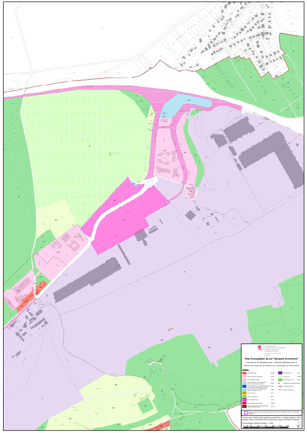
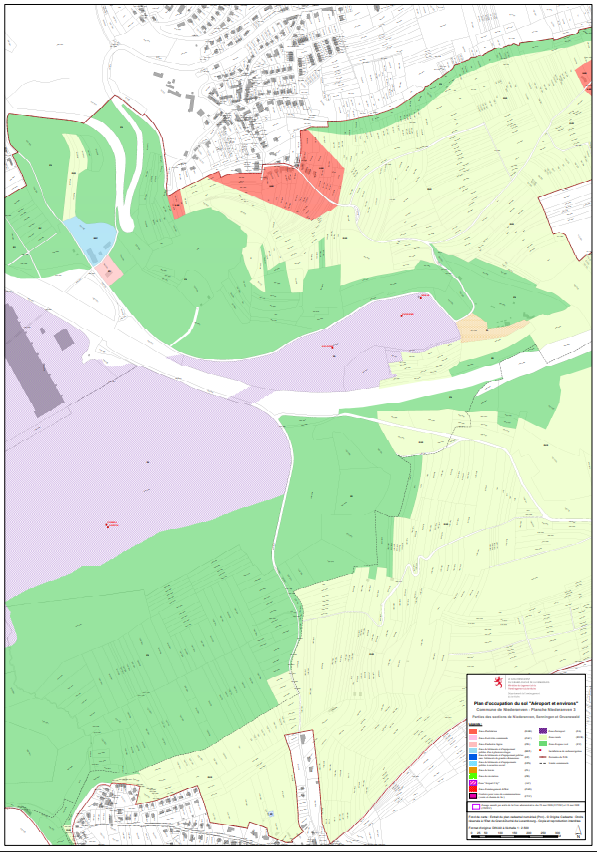
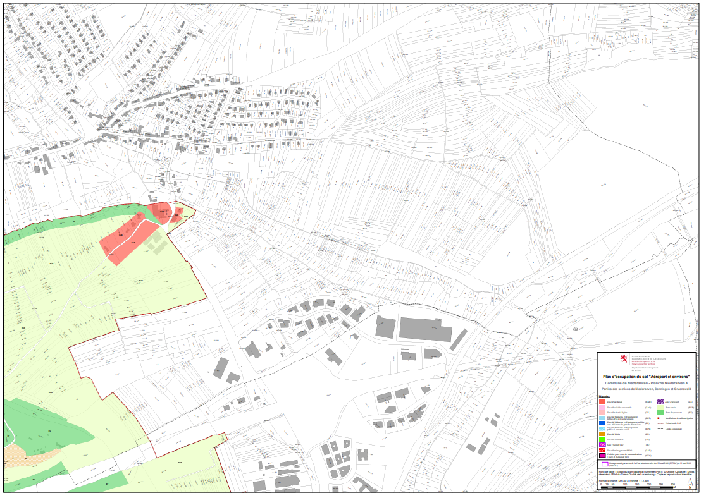
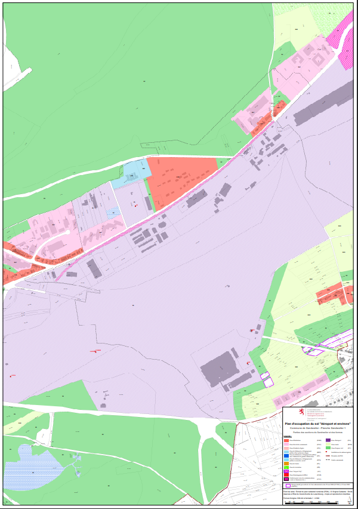
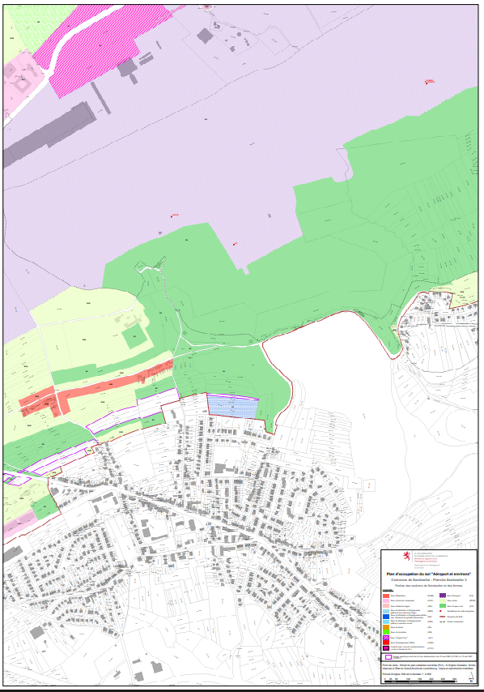
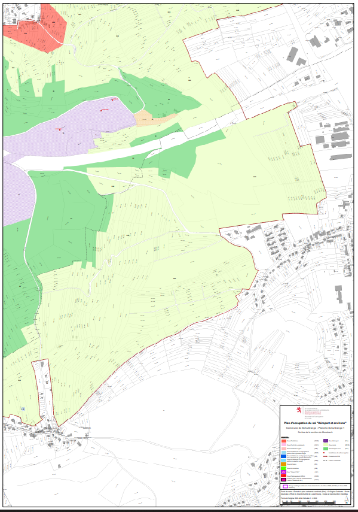

# Règlement grand-ducal du 21 mai 2025 modifiant le règlement grand-ducal modifié du 17 mai 2006 déclarant obligatoire le plan d’occupation du sol « Aéroport et environs ».

Nous Henri, Grand-Duc de Luxembourg, Duc de Nassau,

Vu l’article 33 de la [loi modifiée du 17 avril 2018](https://legilux.public.lu/eli/etat/leg/loi/2018/04/17/a271/jo) concernant l’aménagement du territoire ;

Vu l’article 2 de la [loi modifiée du 22 mai 2008](https://legilux.public.lu/eli/etat/leg/loi/2008/05/22/n2/jo) relative à l’évaluation des incidences de certains plans et programmes sur l’environnement ;

Vu l’avis du Ministre de l’Environnement, du Climat et de la Biodiversité du 9 septembre 2024 rendu sur base de l’article 2 de la [loi précitée du 22 mai 2008](https://legilux.public.lu/eli/etat/leg/loi/2008/05/22/n2/jo) ;

Vu la [décision du Gouvernement en conseil du 11 octobre 2024](https://legilux.public.lu/eli/etat/leg/pa/2024/10/11/a430/jo) concernant la transmission du projet de modification du plan d’occupation du sol « Aéroport et environs » déclaré obligatoire par le [règlement grand-ducal modifié du 17 mai 2006](https://legilux.public.lu/eli/etat/leg/rgd/2006/05/17/n1/jo) aux collèges des bourgmestre et échevins des communes de Betzdorf, de Niederanven et de Schuttrange ainsi qu’au Conseil supérieur de l’aménagement du territoire ;

Vu les extraits de délibération du conseil communal de Betzdorf du 7 février 2025, du conseil communal de Niederanven du 17 janvier 2025 et du conseil communal de Schuttrange du 29 janvier 2025 ;

Vu l’avis du Conseil supérieur de l’aménagement du territoire du 23 janvier 2025 ;

Vu le rapport du ministre ayant l’Aménagement du territoire dans ses attributions émis en vertu de l’article 18 de la [loi modifiée du 17 avril 2018](https://legilux.public.lu/eli/etat/leg/loi/2018/04/17/a271/jo) concernant l’aménagement du territoire ;

Vu la délibération du Gouvernement en conseil du 7 mars 2025 portant approbation définitive du projet de modification du plan d’occupation du sol « Aéroport et environs » déclaré obligatoire par le [règlement grand-ducal modifié du 17 mai 2006](https://legilux.public.lu/eli/etat/leg/rgd/2006/05/17/n1/jo) ;

Les avis de la Chambre de commerce, de la Chambre des salariés, de la Chambre des métiers, de la Chambre d’agriculture et de la Chambre des fonctionnaires et employés publics ayant été demandés ;

Le Conseil d’État entendu ;

Sur le rapport du Ministre du Logement et de l’Aménagement du territoire, et après délibération du Gouvernement en conseil ;

Arrêtons :

## Art. 1er.

L’article 2 du [règlement grand-ducal modifié du 17 mai 2006](https://legilux.public.lu/eli/etat/leg/rgd/2006/05/17/n1/jo) déclarant obligatoire le plan d’occupation du sol « Aéroport et environs » est remplacé comme suit :

> **Art. 2 — Champ d’application géographique**
>
> Les terrains couverts par le plan d’occupation du sol visé à l’article 1er sont définis sur un document cartographique intitulé « plan d’occupation du sol « Aéroport et environs » » couvrant une partie du territoire des communes de Hesperange, Luxembourg, Niederanven, Sandweiler et Schuttrange et constitué de 12 planches cadastrales à l’échelle 1 :2’500 libellées « planche Hesperange unique », « planche Luxembourg 1 à 3 », « planche Niederanven 1 à 4 », « planche Sandweiler 1 à 2 » et « planche Schuttrange 1 à 2 ».
>
> Ce document cartographique est complété par un plan topographique intitulé « plan d’ensemble » à l’échelle 1 :10’000, d’un plan topographique intitulé « plan de secteurs de la zone d’aéroport » à l’échelle 1 :5’000, ainsi que d’un plan intitulé « surfaces de limitation d’obstacles ».
>
> Les documents graphiques énumérés au présent article constituent la partie graphique du plan d’occupation du sol « Aéroport et environs » et font partie intégrante du présent règlement.

## Art. 2.

(1) Sont rendues obligatoires les modifications aux plans telles qu’elles résultent des plans topographiques « plan d’ensemble » et « plan de secteur de la zone d’aéroport » ainsi que des planches cadastrales « Niederanven 2 », « Niederanven 3 », « Niederanven 4 », « Schuttrange 1 », « Sandweiler 1 » et « Sandweiler 2 » qui remplacent les plans topographiques « plan d’ensemble » et « plan de secteur de la zone d’aéroport » ainsi que les planches cadastrales « Niederanven 2 », « Niederanven 3 », « Niederanven 4 », « Schuttrange 1 », « Sandweiler 1 » et « Sandweiler 2 », tels que définis à l’article 2, alinéas 1er et 2, du [règlement grand-ducal modifié du 17 mai 2006](https://legilux.public.lu/eli/etat/leg/rgd/2006/05/17/n1/jo) déclarant obligatoire le plan d’occupation du sol « Aéroport et environs ».

(2) La planche cadastrale « planche Betzdorf unique » est supprimée.

(3) L’annexe intitulée « plan d’ensemble des feuilles » du [règlement précité du 17 mai 2006](https://legilux.public.lu/eli/etat/leg/rgd/2006/05/17/n1/jo) est remplacée par l’annexe intitulée « plan d’ensemble des feuilles » du présent règlement.

## Art. 3.

Seuls les plans annexés au présent règlement et publiés au Journal officiel du Grand-Duché de Luxembourg font foi.

## Art. 4.

Le ministre ayant la Politique générale de l’aménagement du territoire dans ses attributions est chargé de l’exécution du présent règlement qui sera publié au Journal officiel du Grand-Duché de Luxembourg.

Le Ministre du Logement  et de l’Aménagement du territoire,   Claude Meisch

Fait le 21 mai 2025.   Pour le Grand-Duc,   Son Lieutenant-Représentant,   Guillaume,   Grand-Duc Héritier

Annexes

*[image omitted (1.3 MB) — see the official version: https://legilux.public.lu/eli/etat/leg/rgd/2025/05/21/a213/jo]*

*[image omitted (0.7 MB) — see the official version: https://legilux.public.lu/eli/etat/leg/rgd/2025/05/21/a213/jo]*

*[image omitted (1.2 MB) — see the official version: https://legilux.public.lu/eli/etat/leg/rgd/2025/05/21/a213/jo]*

Pour visualiser les annexes en haute résolution, [veuillez cliquer ici](http://data.legilux.public.lu/filestore/eli/etat/leg/rgd/2025/05/21/a213/jo/fr/pdfa/annexe/1/eli-etat-leg-rgd-2025-05-21-a213-jo-fr-pdfa-annexe-1.pdf).
