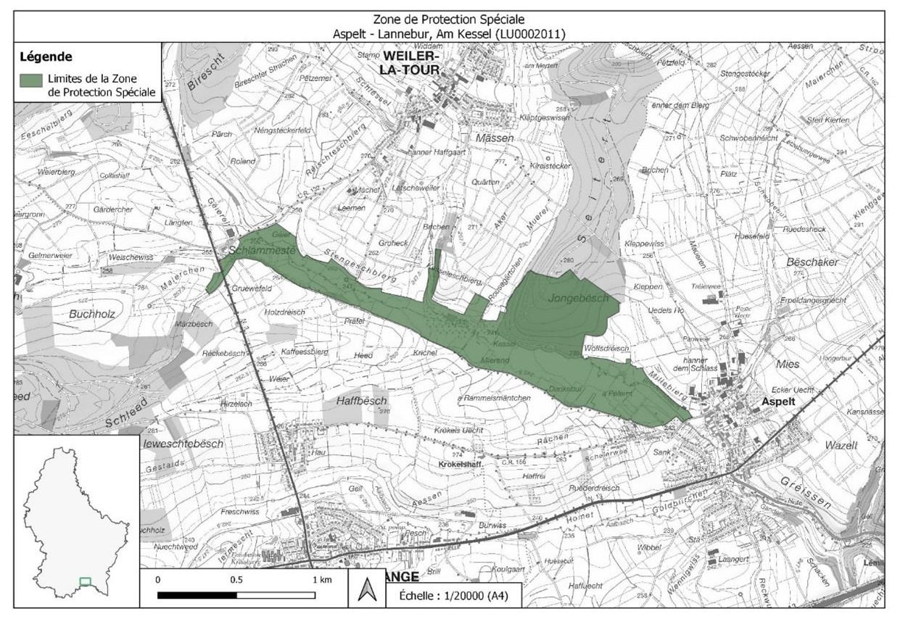

# Règlement grand-ducal du 13 juin 2025 désignant zone de protection spéciale et déclarant obligatoire la zone « Aspelt - Lannebuer, Am Kessel », et modifiant le règlement grand-ducal modifié du 30 novembre 2012 portant désignation des zones de protection spéciale.

Nous Henri, Grand-Duc de Luxembourg, Duc de Nassau,

Vu les articles 2, 4, 31 à 35 et 37 de la [loi modifiée du 18 juillet 2018](https://legilux.public.lu/eli/etat/leg/loi/2018/07/18/a771/jo) concernant la protection de la nature et des ressources naturelles ;

Vu l’avis de l’Observatoire de l’environnement naturel ;

Vu les avis de la Chambre de commerce et de la Chambre d’agriculture ;

Les avis de la Chambre des métiers, de la Chambre des salariés et de la Chambre des fonctionnaires et employés publics ayant été demandés ;

Le Conseil d’État entendu ;

Sur le rapport du Ministre de l’Environnement, du Climat et de la Biodiversité, et après délibération du Gouvernement en conseil ;

Arrêtons :

## Art. 1er.

Est désignée zone de protection spéciale et déclarée obligatoire la zone « Aspelt - Lannebuer, Am Kessel », ci-après la « zone de protection spéciale », référencée sous le code LU0002011, et faisant partie intégrante du réseau Natura 2000.

## Art. 2.

La zone de protection spéciale est désignée en vue :

1° du maintien ou, le cas échéant, du rétablissement de l’état de conservation favorable des espèces d’oiseaux mentionnées à l’article 3 ;

2° de la préservation, du maintien ou, le cas échéant, du rétablissement d’une diversité, d’une superficie et d’une qualité des habitats de ces espèces d’oiseaux ;

3° de la protection contre la pollution ou la détérioration des habitats de ces espèces d’oiseaux, ainsi que contre les perturbations touchant les oiseaux, pour autant que ces perturbations soient susceptibles d’avoir un effet significatif eu égard aux objectifs du présent article ;

4° de sa contribution à la cohérence du réseau Natura 2000 tant au niveau national qu’au sein de l’Union européenne.

## Art. 3.

Les objectifs spécifiques de conservation de la zone de protection spéciale, ainsi que les mesures de conservation spéciales à assurer afin de maintenir ou, le cas échéant, rétablir l’état de conservation favorable des espèces visées et de leurs habitats, en l’occurrence à travers les mesures de conservation visées aux articles 32 à 35 et 37 de la [loi modifiée du 18 juillet 2018](https://legilux.public.lu/eli/etat/leg/loi/2018/07/18/a771/jo) concernant la protection de la nature et des ressources naturelles, sont :

1° maintien, voire rétablissement de l’état de conservation favorable de la population de la Grue cendrée *Grus grus* :

a) maintien et amélioration de la zone en tant que lieu d’hivernage ou de halte en période de migration ;

b) maintien, amélioration, voire restauration des zones de nourrissage correspondant à une mosaïque paysagère constituée d’herbages, zones et friches humides ;

c) préservation de la quiétude autour des dortoirs en halte de migration et en hivernage ;

2° rétablissement de l’état de conservation favorable de la population de l’Oie des moissons *Anser fabalis* :

a) maintien et amélioration de la zone en tant que lieu d’hivernage ;

b) maintien, amélioration, voire restauration des zones de nourrissage correspondant à une mosaïque paysagère constituée d’herbages et labours, et présentant des zones humides et eaux stagnantes ;

c) préservation de la quiétude autour des dortoirs en halte de migration et en hivernage ;

3° maintien, voire rétablissement de l’état de conservation favorable des populations de la Grande Aigrette *Casmerodius albus* (syn. : *Egretta alba*) et de la Cigogne blanche *Ciconia ciconia* :

a) maintien et amélioration des zones d’hivernage ou de halte en période de migration ;

b) maintien, amélioration, voire restauration des zones de nourrissage correspondant aux herbages, zones et friches humides ;

4° rétablissement de l’état de conservation favorable de la population de la Bergeronnette printanière *Motacilla flava*, et des populations d’autres oiseaux prairiaux :

a) maintien et amélioration d’une mosaïque paysagère de pâturages, de friches humides et de prairies humides à fauchage tardif, voire très tardif ;

b) aménagement de bandes refuges dans les herbages, à fauchage très tardif ou pluriannuel ;

5° rétablissement de l’état de conservation favorable de la population du Vanneau huppé *Vanellus vanellus* :

a) restauration des zones de nidification et des zones de nourrissage correspondant aux herbages et zones humides ;

b) maintien et amélioration des zones de nourrissage en période de migration correspondant aux herbages humides ;

6° restauration de la population du Râle des genêts *Crex crex* :

a) restauration des zones de nidification, notamment des prairies humides à fauchage très tardif et des friches humides ;

b) préservation de la quiétude en période de reproduction ;

7° rétablissement de l’état de conservation favorable des populations de la Bécassine des marais *Gallinago gallinago*, de la Bécassine sourde *Lymnocryptes minimus*, du Combattant varié *Philomachus pugnax*, du Chevalier sylvain *Tringa glareola* ou du Chevalier gambette *Tringa totanus*, ainsi que des populations d’autres oiseaux des vasières et autres zones humides :

aone maintien, amélioration, voire restauration des zones de nourrissage en période de migration ou d’hivernation, notamment des marais, vasières, prairies marécageuses, cariçaies, friches humides et d’autres dépressions humides dans les herbages et zones inondables de la plaine alluviale ;

8° maintien, voire rétablissement de l’état de conservation favorable de la population de la Cigogne noire *Ciconia nigra* :

a) maintien et restauration des zones de nourrissage correspondant aux cours d’eau, fonds de vallées et autres habitats humides ;

b) maintien et amélioration de la qualité de l’eau, de la structure des cours d’eau et des fonds de vallée ;

c) préservation de la quiétude en période de reproduction dans les alentours des zones de nourrissage ;

9° rétablissement de l’état de conservation favorable des populations de la Rousserolle effarvatte *Acrocephalus scirpaceus* et du Gorge-bleue à miroir *Luscinia svecica*, ainsi que des populations d’autres oiseaux des roselières, des mégaphorbiaies et autres zones humides :

aone maintien, amélioration, voire restauration des habitats de nidification respectivement des aires de repos en halte de migration, notamment des roselières et mégaphorbiaies ;

10° maintien, voire rétablissement de l’état de conservation favorable de la population du Râle d’eau *Rallus aquaticus* :

aone maintien, amélioration, voire restauration des habitats de nidification, notamment des roselières, mégaphorbiaies, friches humides et ripisylves lumineuses ;

11° maintien, voire rétablissement de l’état de conservation favorable de la population de la Sarcelle d’hiver *Anas crecca*, ainsi que des populations d’autres oiseaux des plans et cours d’eau :

aone maintien, amélioration, voire restauration des zones de nourrissage en période de migration ou d’hivernation, notamment des plans et cours d’eau ;

12° rétablissement de l’état de conservation favorable de la population de l’Alouette des champs *Alauda arvensis* et des populations d’autres oiseaux des paysages agraires :

aone maintien et amélioration des zones de nidification, notamment une mosaïque paysagère d’herbages maigres ;

13° rétablissement de l’état de conservation favorable de la population de la Pie-grièche écorcheur *Lanius collurio*, ainsi que des populations d’autres oiseaux des structures paysagères et des herbages :

aone maintien et restauration des zones de nidification et de chasse correspondant aux structures paysagères telles que murgiers, bandes enherbées, friches, buissons, broussailles, haies, arbres solitaires, groupes et rangées d’arbres dans les pâturages maigres ;

14° rétablissement de l’état de conservation favorable de la population du Busard des roseaux *Circus aeruginosus* :

a) maintien et amélioration des zones de halte en période de migration ;

b) maintien, amélioration, voire restauration des zones de chasse correspondant aux herbages, zones et friches humides ;

15° maintien, voire rétablissement de l’état de conservation favorable des populations du Milan royal *Milvus milvus* et du Milan noir *Milvus migrans* :

a) maintien et amélioration des zones de chasse correspondant à une mosaïque paysagère riche en prairies à fauchage échelonné et pâturages entrelacés de bandes enherbées, zones humides et jachères ;

b) maintien et amélioration des zones de nidification correspondant à des lisières de forêts feuillues, des rangées d’arbres et des arbres solitaires ;

c) préservation des arbres porteurs d’aire de rapace ;

d) préservation de la quiétude en période de reproduction dans les alentours directs des zones de nidification ;

16° rétablissement de l’état de conservation favorable de la population de la Tourterelle des bois *Streptopelia turtur* :

a) préservation et restauration des lisières structurées, des bosquets et des paysages semi-ouverts, notamment des milieux humides, ainsi que des futaies lumineuses et ripisylves ;

b) restructuration horizontale et verticale des lisières et des futaies ;

c) préservation et restauration des plaines alluviales avec des strates herbacées, buissonnantes et boisées diversement structurées ;

d) aménagement de bandes herbacées ou de bandes refuges dans les herbages à fauchage très tardif ou pluriannuel ;

17° maintien, voire rétablissement de l’état de conservation favorable des populations de pics, notamment du Pic noir *Dryocopus martius*, ainsi que des populations d’autres oiseaux cavernicoles :

a) maintien et aménagement de boisements diversement structurés ;

b) préservation et restauration des boisements avec des strates herbacées, buissonnantes et boisées diversement structurées ;

c) maintien et préservation d’arbres à loge de pic, d’arbres à forte dimension, d’arbres biotopes et d’arbres morts en futaies feuillues, lisières et ripisylves ;

d) aménagement d’îlots de vieillissement ;

18° rétablissement du bon état écologique des eaux :

a) amélioration de la qualité de l’eau, de la structure des cours d’eau et des fonds de vallée ;

b) restauration de la plaine alluviale et de son hydromorphologie ;

c) aménagement de bandes de protection herbagères le long des cours d’eau et autour des sources ;

19° maintien, voire rétablissement de l’état de conservation favorable, préservation, restauration et extension surfacique des plans d’eau et dépressions humides ; aménagement de bandes de protection herbagères autour des plans d’eau et dépressions humides ;

20° maintien, voire rétablissement de l’état de conservation favorable, préservation, restauration et extension surfacique des friches humides et des mégaphorbiaies ; fauchage très tardif et pluriannuel ;

21° maintien, voire rétablissement de l’état de conservation favorable, préservation, restauration et extension surfacique des roselières ; conservation et aménagement de vieux peuplements de roselières avec pieds dans l’eau ;

22° maintien, voire rétablissement de l’état de conservation favorable, préservation, restauration et extension surfacique des prairies humides et des prairies maigres, y favoriser le fauchage tardif, voire très tardif et préserver des zones refuges fauchées pluriannuellement ;

23° promotion des programmes d’extensification en agriculture, notamment extensification des prairies et des pâturages ; préservation et extension surfacique des prairies permanentes, sans retournement, ni sursemis ; maintien et restauration d’une bande refuge le long des cours d’eau et des chemins agricoles, ainsi qu’entre les parcelles ; renonciation à l’emploi de fertilisants, rodenticides et insecticides ;

24° maintien, voire rétablissement de l’état de conservation favorable et préservation des structures paysagères, tels que bandes herbacées et bandes refuges, buissons, broussailles, arbres solitaires, ainsi que groupes et rangées d’arbres ; élaboration d’un plan de gestion et d’entretien pluriannuel des structures paysagères ;

25° maintien, voire rétablissement de l’état de conservation favorable, préservation et restauration des différents types de futaies, y préserver des arbres à forte dimension, des arbres biotopes, des arbres morts et des classes d’âge avancées, ainsi que des lisières structurées ; aménagement d’îlots de vieillissement ;

26° maintien et amélioration des zones de nidification, ainsi que des aires de repos en période de migration et d’hivernation, notamment d’une mosaïque paysagère richement structurée ;

27° préservation de la quiétude des zones sensibles en période de nidification, de migration et d’hivernage par la gestion des flux de visiteurs.

## Art. 4.

Les mesures de conservation spéciales de la zone de protection spéciale sont déclinées en objectifs opérationnels et précisées dans un plan de gestion approprié.

## Art. 5.

La délimitation de la zone de protection spéciale est indiquée sur le plan figurant en annexe. La zone de protection spéciale couvre une superficie totale de 103,88 hectares.

## Art. 6.

Le [règlement grand-ducal modifié du 30 novembre 2012](https://legilux.public.lu/eli/etat/leg/rgd/2012/11/30/n10/jo) portant désignation des zones de protection spéciale est modifié comme suit :

1° À l’article 4, le point (11) est supprimé.

2° À l’annexe 1, la ligne portant le numéro 11, faisant référence à la zone de protection spéciale LU0002011, est supprimée.

3° À l’annexe 2, les références à la zone de protection spéciale LU0002011 sont supprimées.

4° À l’annexe 3, le plan portant le titre « Zone de Protection Spéciale – « Aspelt – Lannebuer, Am Kessel » (LU0002011) » et les découpages y relatifs sont supprimés.

## Art. 7.

La référence au présent règlement se fait sous la forme suivante : « Règlement grand-ducal du 13 juin 2025 désignant zone de protection spéciale la zone « Aspelt - Lannebuer, Am Kessel ».

## Art. 8.

Le ministre ayant l’Environnement dans ses attributions est chargé de l’exécution du présent règlement qui sera publié au Journal officiel du Grand-Duché de Luxembourg.

Le Ministre de l’Environnement,  du Climat et de la Biodiversité,   Serge Wilmes

Fait le 13 juin 2025.   Pour le Grand-Duc,   Son Lieutenant-Représentant,   Guillaume,   Grand-Duc Héritier

ANNEXE

Pour visualiser l’annexe en haute résolution, [veuillez cliquer ici](http://data.legilux.public.lu/filestore/eli/etat/leg/rgd/2025/06/13/a241/jo/fr/pdfa/annexe/1/eli-etat-leg-rgd-2025-06-13-a241-jo-fr-pdfa-annexe-1.pdf).
