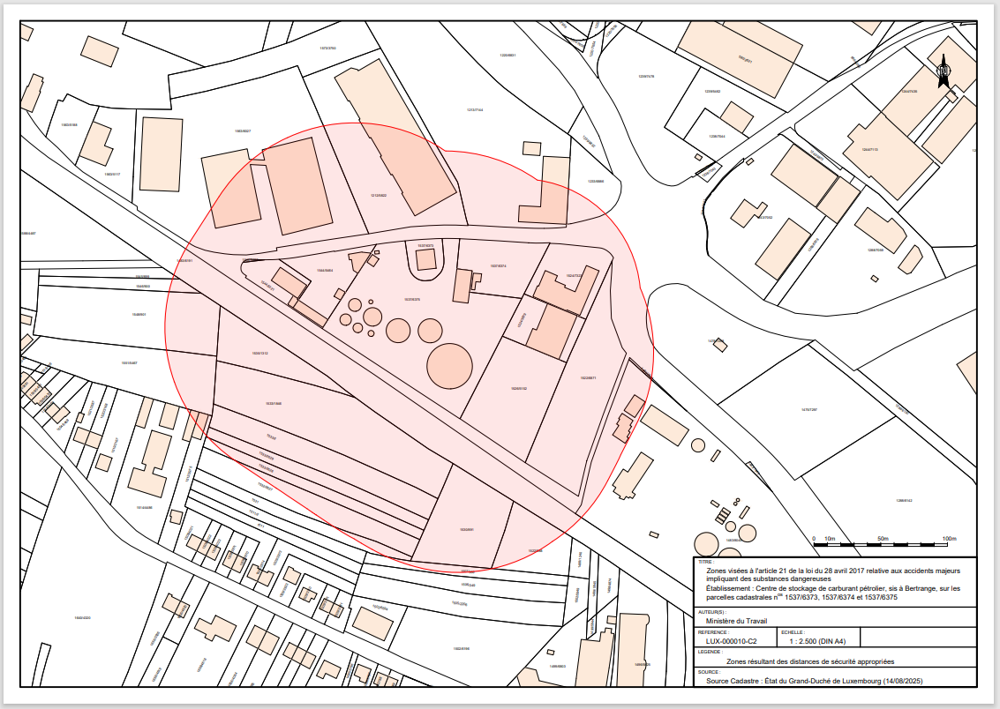

# Règlement grand-ducal du 30 octobre 2025 délimitant les zones relatives à la maîtrise de l’urbanisation pour l’établissement d’un centre de stockage de carburant pétrolier, sis à Bertrange, sur les parcelles cadastrales nos 1537/6373, 1537/6374 et 1537/6375.

Nous Guillaume, Grand-Duc de Luxembourg, Duc de Nassau,

Vu la [loi du 28 avril 2017](https://legilux.public.lu/eli/etat/leg/loi/2017/04/28/a459/jo) relative aux accidents majeurs impliquant des substances dangereuses, et notamment son article 21 ;

Vu l’avis de la Chambre de commerce ;

Les avis de la Chambre des métiers, de la Chambre des salariés, de la Chambre des fonctionnaires et employés publics et de la Chambre d’agriculture ayant été demandés ;

Le Conseil d’État entendu ;

Sur le rapport du Ministre du Travail et du Ministre de l’Environnement, du Climat et de la Biodiversité, et après délibération du Gouvernement en conseil ;

Arrêtons :

## Art. 1er — Objet

Le présent règlement délimite les zones résultant des distances de sécurité appropriées induites par l’établissement du centre de stockage de carburant pétrolier, sis à Bertrange, sur les parcelles cadastrales nos 1537/6373, 1537/6374 et 1537/6375, telles que prévues à l’article 21 de la [loi du 28 avril 2017](https://legilux.public.lu/eli/etat/leg/loi/2017/04/28/a459/jo) relative aux accidents majeurs impliquant des substances dangereuses.

## Art. 2 — Délimitations des zones

(1) Les délimitations des zones résultant des distances de sécurité appropriées induites par l’établissement visé à l’article 1er sont représentées sur le plan repris sous l’annexe I.

(2) L’axe de la ligne de la représentation graphique des zones sur le plan repris sous l’annexe I vaut délimitation exacte.

Toutes les surfaces, situées à l’intérieur de ces zones, sont concernées par les servitudes visées à l’article 21 de la [loi du 28 avril 2017](https://legilux.public.lu/eli/etat/leg/loi/2017/04/28/a459/jo) relative aux accidents majeurs impliquant des substances dangereuses.

(3) Les délimitations des zones résultant des distances de sécurité appropriées visées au paragraphe 1er sont transmises, sur demande, au format vectoriel numérique par l’Inspection du travail et des mines.

En cas de discordance entre les délimitations des zones au format vectoriel numérique et celles représentées sur le plan repris sous l’annexe I, ces dernières font foi.

## Art. 3 — Formule exécutoire

Le ministre ayant le Travail dans ses attributions et le ministre ayant l’Environnement dans ses attributions sont chargés, chacun en ce qui le concerne, de l’exécution du présent règlement qui sera publié au Journal officiel du Grand-Duché de Luxembourg.

Le Ministre du Travail,   Georges Mischo   Le Ministre de l’Environnement,  du Climat et de la Biodiversité,   Serge Wilmes

Fait le 30 octobre 2025.   Guillaume

ANNEXE I

Pour visualiser la carte en haute résolution, [veuillez cliquer ici](http://data.legilux.public.lu/filestore/eli/etat/leg/rgd/2025/10/30/a467/jo/fr/pdfa/annexe/1/eli-etat-leg-rgd-2025-10-30-a467-jo-fr-pdfa-annexe-1.pdf).
