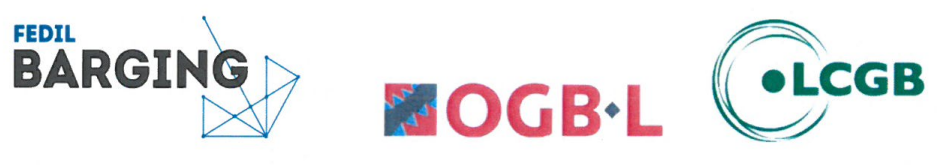

# Règlement grand-ducal du 8 janvier 2026 portant déclaration d’obligation générale de l’Avenant à l’Accord interprofessionnel du 22 mars 2017 relatif à l’aménagement du temps de travail dans le secteur de la navigation intérieure, signé le 2 octobre 2025.

Nous Guillaume, Grand-Duc de Luxembourg, Duc de Nassau,

Vu l’article L. 165-1 du [Code du travail](https://legilux.public.lu/eli/etat/leg/code/travail) ;

Vu la demande de déclaration d’obligation générale du 2 octobre 2025 de l’Avenant à l’Accord interprofessionnel du 22 mars 2017 relatif à l’aménagement du temps de travail dans le secteur de la navigation intérieure, signé le 2 octobre 2025 ;

Sur proposition unanime des deux groupes d’assesseurs de la commission paritaire de l’Office national de conciliation ;

Vu les avis de la Chambre des salariés et de la Chambre de commerce ;

Les avis de la Chambre des métiers, de la Chambre des fonctionnaires et employés publics et de la Chambre d’agriculture ayant été demandés ;

Le Conseil d’État entendu ;

Sur le rapport du Ministre du Travail, et après délibération du Gouvernement en conseil ;

Arrêtons :

## Art. 1er.

L’Avenant à l’Accord interprofessionnel du 22 mars 2017 relatif à l’aménagement du temps de travail dans le secteur de la navigation intérieure, signé le 2 octobre 2025, entre FEDIL Barging, d’une part, et la Confédération syndicale indépendante du Luxembourg, Onofhängege Gewerkschaftsbond Lëtzebuerg (OGBL) et la Confédération luxembourgeoise des syndicats chrétiens, Lëtzebuerger Chrëschtleche Gewerkschaftsbond (LCGB), d’autre part, est déclaré d’obligation générale pour tout le secteur.

## Art. 2.

Le ministre ayant le Travail dans ses attributions est chargé de l’exécution du présent règlement qui sera publié au Journal officiel du Grand-Duché de Luxembourg.

Le Ministre du Travail,   Marc Spautz

Fait le 8 janvier 2026.   Guillaume

\**Avenant à l’accord interprofessionnel du 22 mars 2017 relatif à l’aménagement du temps de travail dans le secteur de la navigation intérieure conclu entre FEDIL BARGING, d’une part et les syndicats OGB-L et LCGB, d’autre part.**

Les partenaires sociaux conviennent de modifier la clause 8 de l’accord interprofessionnel du 22 mars 2017 relatif à l’aménagement du temps de travail dans le secteur de la navigation intérieure qui prend dorénavant la teneur suivante :

> \*« Pour des raisons inhérentes à la sécurité et à la santé, tout travailleur visé à la clause 1 bénéficie, dans le cas où la durée de travail journalière est supérieure à six heures, d’un ou de plusieurs temps de pause.*
>
> \*Les modalités pratiques de ces temps de pause peuvent être fixées par le conducteur de bateau ou, le cas échéant, par une convention collective conclue dans l’entreprise. »*

Les partenaires sociaux ont également convenu que la déclaration d’obligation générale du présent avenant sera demandée par les parties signataires.

Signé en 4 exemplaires à Luxembourg, le 2 octobre 2025

| Wim Macleanen Président FEDIL Barging | Chris Ifkovitz Vice-Président FEDIL Barging |
|---|---|
| Sveinn Graas Secrétaire central OGBL | Céline Conter Secrétaire syndicale LCGB |
