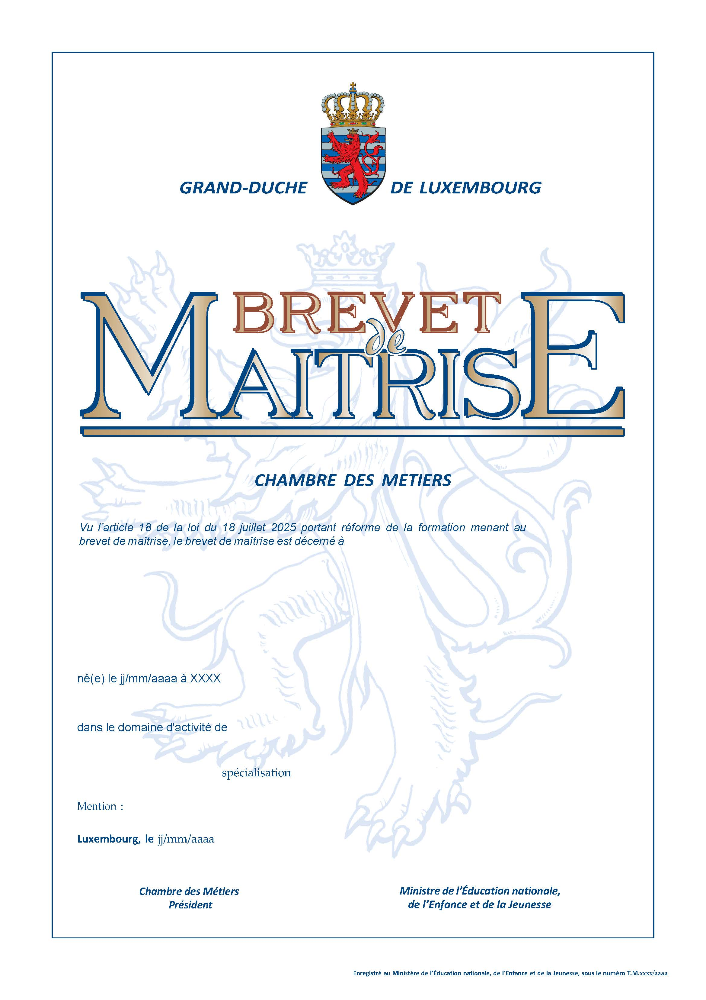

# Règlement grand-ducal du 5 février 2026 fixant les modalités d’organisation des cours et des examens de la formation menant au brevet de maîtrise ainsi que les droits d’inscription et le modèle du brevet de maîtrise.

Nous Guillaume, Grand-Duc de Luxembourg, Duc de Nassau,

Vu la [loi du 18 juillet 2025](https://legilux.public.lu/eli/etat/leg/loi/2025/07/18/a338/jo) portant réforme de la formation menant au brevet de maîtrise, et notamment ses articles 6, 7, 8, 13 et 14 ;

Vu les avis de la Chambre des métiers, de la Chambre des salariés et de la Chambre de commerce ;

Les avis de la Chambre d’agriculture et de la Chambre des fonctionnaires et employés publics ayant été demandés ;

Le Conseil d’État entendu ;

Sur le rapport du Ministre de l’Éducation nationale, de l’Enfance et de la Jeunesse, et après délibération du Gouvernement en conseil ;

Arrêtons :

## Art. 1er.

Le candidat s’inscrit aux cours du brevet de maîtrise entre le 1er juin et le 15 août auprès de la Chambre des métiers.

## Art. 2.

Le droit d’inscription aux cours est fixé à 600 euros par session de cours. Il est à verser à la Chambre des métiers.

## Art. 3.

Le modèle de la demande de dispense d’un ou de plusieurs modules est arrêté à l’annexe I.

## Art. 4.

Pour chaque session, le candidat s’inscrit à un ou plusieurs modules d’examens auprès de la Chambre des métiers. Pour la première session, l’inscription se fait entre le 1er décembre et le 31 janvier. Pour la seconde session, l’inscription se fait entre le 15 juin et le 15 août.

En fonction du domaine d’activité, la première session des examens du brevet de maîtrise a lieu durant la période qui s’étend du 1er mars au 31 juillet.

La seconde session des examens du brevet de maîtrise s’étend du 1er septembre au 31 décembre.

La première et la seconde session portent sur les modules « gestion d’entreprise et pédagogie appliquée » pour tous les domaines d’apprentissage ainsi que sur les modules du domaine d’apprentissage « technologie et pratique professionnelle ».

Le projet professionnel est examiné entre le 1er mars et le 31 décembre.

## Art. 5.

Le droit d’inscription aux examens est fixé à 300 euros par session d’examen. Il est à verser à la Chambre des métiers.

## Art. 6.

Le plan d’organisation, reprenant les dates et horaires des examens théoriques par session, est publié par la Chambre des métiers au plus tard un mois avant chaque session d’examen.

## Art. 7.

Durant les examens, la présence d’au moins deux membres ou experts de la commission d’examen est obligatoire.

## Art. 8.

En cas de constatation de fraude ou de tentative de fraude du candidat, par un membre de la commission d’examen au cours d’une session d’examen, l’épreuve est considérée comme nulle et le module en question est comptabilisé comme échec. Le candidat concerné est exclu d’office des examens du module en question de la session en cours par le directeur à la formation professionnelle.

## Art. 9.

Lors de la consultation par le candidat des documents et pièces d’examen et de leur barème d’évaluation, le commissaire et un ou plusieurs membres de la commission d’examen sont présents.

## Art. 10.

Le modèle du brevet de maîtrise est arrêté à l’annexe II.

## Art. 11.

Le [règlement grand-ducal modifié du 1er juillet 1997](https://legilux.public.lu/eli/etat/leg/rgd/1997/07/01/n2/jo) fixant le programme et les modalités d’organisation des cours et des examens menant au brevet de maîtrise dans le secteur de l’artisanat est abrogé.

## Art. 12.

Le candidat inscrit dans des cours ou examens relatifs à un métier donné au moment de l’entrée en vigueur du présent règlement peut bénéficier, pendant les deux années suivant cette date, des dispositions relatives à l’organisation des cours et examens telles qu’elles résultent du [règlement grand-ducal modifié du 1erjuillet 1997](https://legilux.public.lu/eli/etat/leg/rgd/1997/07/01/n2/jo) fixant le programme et les modalités d’organisation des cours et des examens menant au brevet de maîtrise dans le secteur de l’artisanat, si celles-ci sont plus favorables.

## Art. 13.

Le présent règlement produit ses effets à partir de l’année d’études 2025/2026 du brevet de maîtrise.

## Art. 14.

Le ministre ayant la Formation professionnelle dans ses attributions est chargé de l’exécution du présent règlement qui sera publié au Journal officiel du Grand-Duché de Luxembourg.

Le Ministre de l’Éducation nationale,  de l’Enfance et de la Jeunesse,   Claude Meisch

Fait le 5 février 2026.   Guillaume

\**Annexe I**

\**DEMANDE DE DISPENSE**

\**DANS LE CADRE DU BREVET DE MAÎTRISE**

\**à remettre à :**

Ministère de l’Éducation nationale, de l’Enfance et de la Jeunesse

Service de la formation professionnelle

29, rue Aldringen

L-2926 Luxembourg

Le/La candidat(e) qui souhaite obtenir une ou plusieurs dispenses d’un ou de plusieurs modules est invité(e) à compléter le présent formulaire. Aucun autre formulaire ou demande ne sera pris en considération. Toute demande de dispense doit être introduite entre le 1er janvier et le 15 août de l’année visée.

Données du/de la candidat(e)

| Nom et prénom : |  |  |  |
|---|---|---|---|
| Date de naissance : |  | Lieu de naissance : |  |
| N°, rue : |  |  |  |
| CP et Lieu : |  |  |  |
| N° de téléphone : |  |  |  |
| Email : |  |  |  |

\**Demande de dispense**

Par la présente, et dans le cadre du Brevet de Maîtrise du métier/domaine d’activité _____________________________________ , je demande une dispense pour le ou les modules de : _____________________________________ ; ____________________________________ ; _____________________________________ ; ______________________________________ .

\**Éléments de justification de la demande**

Le présent formulaire de demande de dispense doit s’accompagner :

aash d’une copie d’une qualification supérieure au niveau trois du cadre luxembourgeois de qualification ou, le cas échéant d’une équivalence d’un diplôme reconnu par le ministre ayant l’Éducation nationale dans ses attributions ;

bash du programme détaillé de la formation ayant mené au diplôme ;

cash d’un relevé des notes ;

dash d’une lettre de motivation ;

eash d’un curriculum vitae.

\**Diplômes**

Veuillez indiquer les diplômes obtenus en rapport avec la demande de dispense aux cours préparatoires et examens. Seuls les candidats titulaires d’un diplôme **supérieur** au niveau 3 du cadre luxembourgeois des qualifications sont éligibles pour entrer une demande de dispense.

| **Intitulé** **du diplôme** | **Nom de l’organisme/ établissement** **de formation** | **Date d’obtention** |
|---|---|---|
|  |  |  |
|  |  |  |
|  |  |  |

\**Attention :** Les diplômes étrangers doivent être soumis à une reconnaissance d’équivalence délivrée par le Ministère de l’Éducation nationale de l’Enfance et de la Jeunesse luxembourgeois :

[https://guichet.public.lu/fr/citoyens/famille-education/enseignement-secondaire/jeune-recemment-arrive-pays/reconnaissance-etudes/reconnaissance-equivalence-diplome.html](https://guichet.public.lu/fr/citoyens/famille-education/enseignement-secondaire/jeune-recemment-arrive-pays/reconnaissance-etudes/reconnaissance-equivalence-diplome.html)

| Lieu et date |  | Signature |
|---|---|---|

\**Tout dossier incomplet ne sera pas pris en considération.**

En soumettant votre signature sur la présente demande de dispense, vous déclarez avoir lu et accepté l’information concernant la protection des données ci-dessous.

\**Information quant au traitement des données à caractère personnel**

Afin de pouvoir traiter votre demande de dispense, des données à caractère personnel sont collectées. Conformément au [règlement (UE) 2016/679](https://legilux.public.lu/eli/reg_ue/2016/679/jo) du Parlement européen et du Conseil du 27 avril 2016 relatif à la protection des personnes physiques à l’égard du traitement des données à caractère personnel et à la libre circulation de ces données, et abrogeant la [directive 95/46/CE](https://legilux.public.lu/eli/dir_ue/1995/46/jo) ([règlement général sur la protection des données](https://legilux.public.lu/eli/reg_ue/2016/679/jo)), veuillez trouver ci-dessous des explications y relatives :

aot **Responsable du traitement :**

Le Ministère de l’Éducation nationale, de l’Enfance et de la Jeunesse,

Service de la formation professionnelle

29, rue Aldringen

L-1118 Luxembourg

bot **Base(s) juridique(s) :**

Les données à caractère personnel sont traitées par le Service de la formation professionnelle dans le cadre de sa mission d’intérêt public, conformément aux dispositions de la [loi du 18 juillet 2025](https://legilux.public.lu/eli/etat/leg/loi/2025/07/18/a338/jo) portant réforme de la formation menant au brevet de maîtrise.

cot **Finalité(s) :**

Le Service de la formation professionnelle collecte et traite les catégories de données à caractère personnel **listées ci-dessus**, dans le cadre de la gestion des demandes de dispense.

En outre, les données sont susceptibles d’être traitées à des fins archivistiques dans l’intérêt public, conformément aux dispositions de la [loi modifiée du 17 août 2018](https://legilux.public.lu/eli/etat/leg/loi/2018/08/17/a706/jo) relative à l’archivage, et à des fins de recherche scientifique ou historique ou à des fins statistiques, conformément aux dispositions de la [loi du 1er août 2018](https://legilux.public.lu/eli/etat/leg/loi/2018/08/01/a686/jo) portant organisation de la Commission nationale pour la protection des données et du régime général sur la protection des données.

dot **Destinataire(s) :**

aash Service de la formation professionnelle (SFP).

eot **Durée de conservation :**

fot Ces données sont conservées pour une durée strictement nécessaire de dix ans à compter de la clôture du dossier (en cas de recours juridictionnel, ce délai commence à courir à compter de la décision statuant à titre définitif sur le recours).

got Cette durée de conservation correspond à la durée d’utilité administrative « DUA » des dossiers telle qu’elle a été déterminée par le Service de la formation professionnelle, conformément à la [loi modifiée du 17 août 2018](https://legilux.public.lu/eli/etat/leg/loi/2018/08/17/a706/jo) relative à l’archivage.

hot **Délégué à la protection des données :**

Ministère de l’Éducation nationale, de l’Enfance et de la Jeunesse,

Délégué à la protection des données

33, rives de Clausen

L-2165 Luxembourg

dpo@men.lu

iot **Vos droits :**

Conformément à et dans les limites de la législation applicable en matière de protection des données à caractère personnel, vous disposez des droits suivants concernant vos données personnelles :

aot Droit d’information et droit d’accès : vous pouvez obtenir la confirmation que vos données sont traitées et accéder à ces données.

bot Droit de rectification : vous pouvez demander la correction de données inexactes ou incomplètes.

cot Droit à la limitation du traitement : vous pouvez demander la limitation du traitement de vos données, sous certaines conditions.

dot Droit d’opposition : vous pouvez vous opposer au traitement de vos données pour des raisons tenant à votre situation particulière, sous certaines conditions.

Pour des questions relatives au traitement de vos données ou en vue de faire valoir l’exercice de vos droits, vous pouvez contacter le responsable du traitement ou son délégué à la protection des données.

Si vous estimez, que le traitement de vos données tel qu’effectué par le Service de la formation professionnelle constitue une violation du [règlement général sur la protection des données](https://legilux.public.lu/eli/reg_ue/2016/679/jo), vous pouvez adresser une réclamation à la Commission nationale pour la protection des données, ayant son siège à 15, boulevard du Jazz, L-4370 Belvaux ([www.cnpd.lu](https://cnpd.public.lu/fr.html)).

Annexe II

Modèle du brevet de maîtrise

