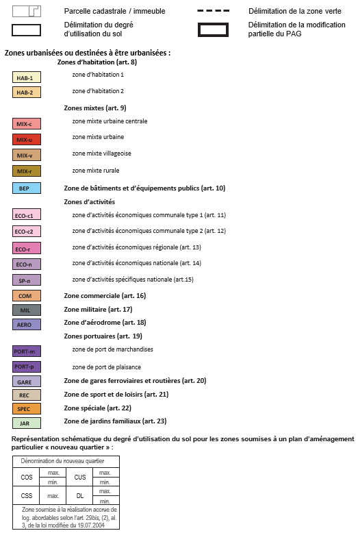
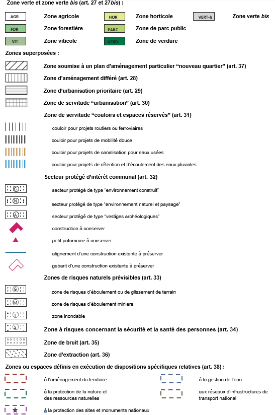

# Règlement grand-ducal du 2 mars 2026 portant modification du règlement grand-ducal modifié du 8 mars 2017 concernant le contenu du plan d’aménagement général d’une commune.

Nous Guillaume, Grand-Duc de Luxembourg, Duc de Nassau,

Vu la [loi modifiée du 19 juillet 2004](https://legilux.public.lu/eli/etat/leg/loi/2004/07/19/n1/jo) concernant l’aménagement communal et le développement urbain, et notamment son article 9 ;

Vu l’avis de la Chambre de commerce ;

Vu l’avis de la Chambre des métiers ;

Vu l’avis du Syndicat des villes et communes luxembourgeoises ;

Les avis de la Chambre d’agriculture, de la Chambre des fonctionnaires et employés publics et de la Chambre des salariés ayant été demandés ;

Le Conseil d’État entendu ;

Sur le rapport du Ministre des Affaires intérieures, et après délibération du Gouvernement en conseil ;

Arrêtons :

## Art. 1er.

L’article 11 du [règlement grand-ducal modifié du 8 mars 2017](https://legilux.public.lu/eli/etat/leg/rgd/2017/03/08/a321/jo) concernant le contenu du plan d’aménagement général d’une commune est remplacé comme suit :

> **« Art. 11 — Zones d’activités économiques communales [ECO-c]**
>
> (1) Les zones d’activités économiques communales sont réservées aux activités industrielles légères, artisanales, de fabrication, de production, d’assemblage, de transformation, de préparation, de conditionnement ou de réparation de produits, de commerce de gros, de transport ou de logistique ou encore d’hébergement ou d’incubateur d’entreprises. Y sont également admis les installations d’énergie renouvelable.
>
> Des activités de vente de détail et de prestation de services peuvent être autorisées, si elles sont liées et exercées à titre accessoire et complémentaire à une activité définie à l’alinéa 1er.
>
> Des activités de prestation de services non liées à l’exercice d’une activité définie à l’alinéa 1er peuvent être autorisées :
>
> 1° pour un immeuble bâti dans lequel est exercé une activité définie à l’alinéa 1er, si la surface mise à disposition pour tout type d’activités de prestation de services confondus ne dépasse pas la moitié de la surface construite bâtie par immeuble bâti ou ;
>
> 2° si elles servent majoritairement les besoins de la zone ou le développement des activités définies à l’alinéa 1er et sans qu’elles ne dépassent 3.500 m2 de surface construite brute par immeuble bâti.
>
> (2) Si les caractéristiques ou les particularités de la zone le permettent, peuvent être autorisées, outre les activités prévues au paragraphe 1er, des activités :
>
> 1° industrielles de production, d’assemblage ou de transformation ;
>
> 2° de vente de détail de produits de consommation non liées à l’exercice d’une activité définie au paragraphe 1er, alinéa 1er, limitées à 2.000 m2 de surface construite brute par immeuble bâti, ou encore de produits énergétiques s’ils servent majoritairement les besoins de la zone ou le développement des activités définies au paragraphe 1er, alinéa 1er, ou au paragraphe 2, point 1°, limitées à 500 m2 de surface construite brute par immeuble bâti.
>
> (3) Des activités de restauration peuvent être autorisées, si elles servent majoritairement les besoins de la zone.
>
> (4) Des logements de service ne pouvant dépasser une surface habitable de 130 m2 peuvent être autorisés, s’ils sont strictement réservés en tant qu’habitation principale et permanente à l’usage du personnel salarié d’une entreprise dont la présence permanente est nécessaire pour assurer la surveillance de celle-ci. Ces logements sont à intégrer dans le corps même des constructions.
>
> (5) Pour tout plan d’aménagement particulier « nouveau quartier », l’ensemble des activités visées au paragraphe 1er, alinéa 3, point 2°, ne peut pas dépasser 20 pour cent de la surface construite brute totale de la zone, et l’ensemble des activités prévues au paragraphe 2, point 2°, ne peut pas dépasser 10 pour cent de la surface construite brute totale de la zone.
>
> La commune peut déroger au principe respectivement des 20 pour cent et des 10 pour cent si les caractéristiques ou les particularités du site le permettent.
>
> (6) Les activités visées au paragraphe 1er, alinéas 2 et 3, et aux paragraphes 3 et 4 ne peuvent dépasser la moitié de la surface construite brute de la zone. ».

## Art. 2.

L’article 12 du [même règlement](https://legilux.public.lu/eli/etat/leg/rgd/2017/03/08/a321/jo) est abrogé.

## Art. 3.

L’article 13 du [même règlement](https://legilux.public.lu/eli/etat/leg/rgd/2017/03/08/a321/jo) est remplacé comme suit :

> **« Art. 13 — Zones d’activités économiques régionales [ECO-r]**
>
> (1) Les zones d’activités économiques régionales sont gérées, au nom des communes concernées, par des syndicats intercommunaux.
>
> (2) Les zones d’activités économiques régionales sont principalement réservées aux activités :
>
> 1° industrielles et industrielles légères, artisanales, de fabrication, de production, d’assemblage, de transformation, de préparation, de conditionnement ou de réparation de produits ;
>
> 2° de commerce de gros, de transport ou de logistique ;
>
> 3° de recherche-développement-innovation au sens de l’article 1er, point 28 de la [loi modifiée du 17 mai 2017](https://legilux.public.lu/eli/etat/leg/loi/2017/05/17/a544/jo) relative à la promotion de la recherche, du développement et de l’innovation ;
>
> 4° d’hébergement ou d’incubateur d’entreprises si elles répondent à des objectifs régionaux ou nationaux de développement sectoriel ou à des besoins spécifiques d’importance régionale ou nationale.
>
> Y sont également admis les installations d’énergie renouvelable.
>
> Des activités de vente de détail et de prestation de services peuvent être autorisées, si elles sont liées et exercées à titre accessoire et complémentaire à une activité définie à l’alinéa 1er.
>
> Des activités de prestation de services non liées à l’exercice d’une activité définie à l’alinéa 1er peuvent être autorisées :
>
> 1° pour un immeuble bâti dans lequel est exercé une activité définie à l’alinéa 1er, si la surface mise à disposition pour tout type d’activités de prestation des services confondus ne dépasse pas la moitié de la surface construite bâtie par immeuble bâti ou ;
>
> 2° si elles servent majoritairement les besoins de la zone ou le développement des activités définies à l’alinéa 1er et sans qu’elles ne dépassent 3.500 m2 de surface construite brute par immeuble bâti.
>
> (3) Si les caractéristiques ou les particularités de la zone le permettent, peuvent être autorisées des activités de vente de détail de produits de consommation non liées à l’exercice d’une activité définie au paragraphe 2, alinéa 1er, limitées à 2.000 m2 de surface construite brute par immeuble bâti, ou encore de produits énergétiques s’ils servent majoritairement les besoins de la zone ou le développement des activités définies au paragraphe 2, limitées à 500 m2 de surface construite brute par immeuble bâti.
>
> (4) Des activités de restauration peuvent être autorisées, si elles servent majoritairement les besoins de la zone.
>
> (5) Des logements de service ne pouvant dépasser une surface habitable de 130 m2 peuvent être autorisés, s’ils sont strictement réservés en tant qu’habitation principale et permanente à l’usage du personnel salarié d’une entreprise dont la présence permanente est nécessaire pour assurer la surveillance de celle-ci. Ces logements sont à intégrer dans le corps même des constructions.
>
> Si les caractéristiques ou les particularités de la zone le permettent, des logements collectifs, strictement réservés à l’usage permanent du personnel salarié d’entreprises exerçant une activité définie au paragraphe 2, alinéa 1er, peuvent être autorisés, s’ils sont localisés à un endroit dans la zone qui soit compatible avec l’habitat. L’ensemble des logements collectifs ne peut pas dépasser 5 pour cent de la surface construite brute totale de la zone concernée. La commune peut déroger au principe des 5 pour cent si les besoins de la zone le requièrent.
>
> (6) Pour tout plan d’aménagement particulier « nouveau quartier », l’ensemble des activités visées au paragraphe 2, alinéa 4, point 2°, ne peut pas dépasser 20 pour cent de la surface construite brute totale de la zone concernée, et l’ensemble des activités prévues au paragraphe 3 ne peut pas dépasser 10 pour cent de la surface construite brute totale de la zone.
>
> La commune peut déroger au principe respectivement des 20 pour cent et des 10 pour cent si les caractéristiques ou les particularités du site le permettent. ».

## Art. 4.

L’article 14 du [même règlement](https://legilux.public.lu/eli/etat/leg/rgd/2017/03/08/a321/jo) est remplacé comme suit :

> **« Art. 14 — Zones d’activités économiques nationales [ECO-n]**
>
> (1) Les zones d’activités économiques nationales sont principalement réservées aux activités :
>
> 1° industrielles de fabrication, de production, d’assemblage, de transformation, de préparation ou de conditionnement de produits, ainsi que de prestation de services ayant une influence motrice sur le développement économique national ;
>
> 2° de recherche-développement-innovation au sens de l’article 1er, point 28 de la [loi modifiée du 17 mai 2017](https://legilux.public.lu/eli/etat/leg/loi/2017/05/17/a544/jo) relative à la promotion de la recherche, du développement et de l’innovation ;
>
> 3° d’hébergement ou d’incubateur d’entreprises si elles répondent à des objectifs nationaux de développement sectoriel ou à des besoins spécifiques d’importance nationale.
>
> Y sont également admis les installations d’énergie renouvelable.
>
> (2) Des activités de restauration et de prestation de services peuvent être autorisées, si elles servent majoritairement les besoins de la zone ou le développement des activités définies au paragraphe 1er.
>
> (3) Des logements de service ne pouvant dépasser une surface habitable de 130 m2 peuvent être autorisés, s’ils sont strictement réservés en tant qu’habitation principale et permanente à l’usage du personnel salarié d’une entreprise dont la présence permanente est nécessaire pour assurer la surveillance de celle-ci. Ces logements sont à intégrer dans le corps même des constructions.
>
> Si les caractéristiques ou les particularités de la zone le permettent, des logements collectifs, strictement réservés à l’usage permanent du personnel salarié d’entreprises exerçant une activité définie au paragraphe 1er peuvent être autorisés, s’ils sont localisés à un endroit dans la zone qui soit compatible avec l’habitat. L’ensemble des logements collectifs ne peut pas dépasser 5 pour cent de la surface construite brute totale de la zone concernée. La commune peut déroger au principe des 5 pour cent si les besoins de la zone le requièrent. ».

## Art. 5.

L’article 15 du [même règlement](https://legilux.public.lu/eli/etat/leg/rgd/2017/03/08/a321/jo) est remplacé comme suit :

> **« Art. 15 — Zones d’activités spécifiques nationales [SP-n]**
>
> (1) Les zones d’activités spécifiques nationales sont principalement réservées aux activités :
>
> 1° répondant à des objectifs nationaux de développement sectoriel ou à des fonctions ou besoins spécifiques d’importance nationale ;
>
> 2° de recherche-développement-innovation au sens de l’article 1er, point 28 de la [loi modifiée du 17 mai 2017](https://legilux.public.lu/eli/etat/leg/loi/2017/05/17/a544/jo) relative à la promotion de la recherche, du développement et de l’innovation ;
>
> 3° d’hébergement ou d’incubateur d’entreprises si elles répondent à l’un des objectifs fixés au point 1°.
>
> Y sont également admis les installations d’énergie renouvelable.
>
> (2) Des activités de restauration et de prestation de services peuvent être autorisées, si elles servent majoritairement les besoins de la zone ou le développement des activités définies au paragraphe 1er.
>
> (3) Des logements de service ne pouvant dépasser une surface habitable de 130 m2 peuvent être autorisés, s’ils sont strictement réservés en tant qu’habitation principale et permanente à l’usage du personnel salarié d’une entreprise dont la présence permanente est nécessaire pour assurer la surveillance de celle-ci. Ces logements sont à intégrer dans le corps même des constructions.
>
> Si les caractéristiques ou les particularités de la zone le permettent, des logements collectifs, strictement réservés à l’usage permanent du personnel salarié d’entreprises exerçant une activité définie au paragraphe 1er peuvent être autorisés, s’ils sont localisés à un endroit dans la zone qui soit compatible avec l’habitat. L’ensemble des logements collectifs ne peut pas dépasser 5 pour cent de la surface construite brute totale de la zone concernée. La commune peut déroger au principe des 5 pour cent si les besoins de la zone le requièrent. ».

## Art. 6.

Après l’article 23 du [même règlement](https://legilux.public.lu/eli/etat/leg/rgd/2017/03/08/a321/jo), sous le chapitre 2*,* section 1re, il est inséré un article 23*bis* nouveau libellé comme suit :

> **« Art. 23*bis* — Zones de parc urbain [ZPU]**
>
> La zone de parc urbain est destinée aux espaces verts aménagés à des fins publiques comme espace de détente, de repos, de jeux et de loisirs.
>
> Y sont également admis des restaurants et des débits de boissons, des activités de commerce en lien direct avec les objectifs de l’alinéa 1er, des activités jardinières, des équipements de service public ainsi que des aménagements d’utilité publique. ».

## Art. 7.

À l’article 25 du [même règlement](https://legilux.public.lu/eli/etat/leg/rgd/2017/03/08/a321/jo), il est ajouté un alinéa 2 nouveau libellé comme suit :

> « Le nombre d’emplacements de stationnement minimal pour les logements abordables ne peut pas dépasser un emplacement par unité de logement. ».

## Art. 8.

À l’article 39 du [même règlement](https://legilux.public.lu/eli/etat/leg/rgd/2017/03/08/a321/jo), il est ajouté un paragraphe *3* nouveau qui prend la teneur suivante :

> « (3) Les dispositions du présent règlement dans sa teneur avant l’entrée en vigueur du règlement grand-ducal du 2 mars 2026 portant modification du [règlement grand-ducal modifié du 8 mars 2017](https://legilux.public.lu/eli/etat/leg/rgd/2017/03/08/a321/jo) concernant le contenu du plan d’aménagement général d’une commune, continuent à s’appliquer aux plans d’aménagement général dont la procédure d’adoption est entamée, en vertu de l’article 10 de la [loi modifiée du 19 juillet 2004](https://legilux.public.lu/eli/etat/leg/loi/2004/07/19/n1/jo) concernant l’aménagement communal et le développement urbain. ».

## Art. 9.

Les annexes I et II du [même règlement](https://legilux.public.lu/eli/etat/leg/rgd/2017/03/08/a321/jo) sont remplacées par les annexes A et B.

## Art. 10.

Le ministre ayant l’Aménagement communal et le développement urbain dans ses attributions est chargé de l’exécution du présent règlement qui sera publié au Journal officiel du Grand-Duché de Luxembourg.

Le Ministre des Affaires intérieures,   Léon Gloden

Fait le 2 mars 2026.   Guillaume

\**Annexes**

\**Annexe A**

> \**« Annexe I : Légende-type du plan d’aménagement général**
>
> 
>
> 
>
> ».

\**Annexe B**

> \**« Annexe II : Terminologie du degré d’utilisation du sol**
>
> A. Activités
>
> On entend par :
>
> 1° « activités artisanales » toutes activités de création de produits exercées par des artisans, soit entièrement à la main, soit à l’aide d’outils à main ou même de moyens mécaniques, pourvu que la contribution manuelle directe de l’artisan demeure la composante déterminante du produit fini ;
>
> 2° « activités d’assemblage » toutes activités de mise en ensemble et réunion de toutes matières premières ou pièces détachées ;
>
> 3° « activités de commerce de gros » toutes activités de stockage et de vente de produits dans l’état où ils sont achetés, ou après transformation, à une clientèle professionnelle ;
>
> 4° « activités de conditionnement » toutes activités d’enveloppement de produits pour en assurer la protection, la conservation et en favorisant la vente ;
>
> 5° « activités de fabrication » toutes activités recourant à des processus d’utilisation de machines et du travail manuel pour confectionner des produits ;
>
> 6° « activités de logistique » toutes activités de gestion et optimisation de flux de marchandises depuis le fournisseur jusqu’au client final ;
>
> 7° « activités de préparation » toutes activités sur des produits en vue de leur utilisation dans un processus de finissage de production ;
>
> 8° « activités de prestation de services » toutes activités à but de lucre par lesquelles le prestataire fournit à ses clients un savoir-faire technique, manuel, intellectuel ou d’assistance ;
>
> 9° « activités de production » toutes les activités utilisant des matières premières pour les transformer en produits finis ;
>
> 10° « activités de transformation » toutes activités de changement d’un produit d’une forme en une autre ;
>
> 11° « activités de transport » toutes activités de déplacement de marchandises ou collectif de personnes ;
>
> 12° « activités de réparation » toutes activités de remise en état de fonctionnement de marchandises ou de produits défectueux ;
>
> 13° « activités de vente de détail » la vente de produits dans l’état où ils sont achetés, ou après transformation, à une clientèle de particuliers ;
>
> 14° « activités industrielles »toutes les activités de production standardisées ou automatisées de produits pour l’exercice desquelles la connaissance du processus de production du produit est secondaire, il est suffisant de maîtriser tout ou partie du fonctionnement technique d’une ou de plusieurs composantes de la réalisation technique du produit final de la chaîne de production ;
>
> 15° « activités industrielles légères » toutes les manufactures qui produisent des biens à usage privé et de consommation et ne nécessitant pas une utilisation élevée de capital ou de ressources naturelles et qui de par leur taille et leurs conditions d’exploitation ne constituent pas de gêne ou de sacrifice excessif ou intolérable pour le voisinage du point de vue de la sécurité, de la salubrité et de l’hygiène.
>
> B. Coefficient d’utilisation du sol [CUS]
>
> On entend par coefficient d’utilisation du sol le rapport entre la somme des surfaces construites brutes de tous les niveaux et la surface totale du terrain à bâtir brut, pour autant que la hauteur d’étage moyenne ne dépasse pas 5 mètres.
>
> Pour tous les niveaux dont la hauteur moyenne d’étage est comprise entre 5 mètres et 10 mètres, la surface construite brute est multipliée par 2. Pour tous les niveaux dont la hauteur d’étage moyenne dépasse 10 mètres, la surface construite brute est multipliée par 3.
>
> C. Coefficient d’occupation du sol [COS]
>
> On entend par coefficient d’occupation du sol le rapport entre la surface d’emprise au sol de la ou des constructions (au niveau du terrain naturel) et la surface du terrain à bâtir net.
>
> D. Coefficient de scellement du sol [CSS]
>
> On entend par coefficient de scellement du sol le rapport entre la surface de sol scellée et la surface du terrain à bâtir net.
>
> E. Densité de logement [DL]
>
> On entend par densité de logement le rapport entre le nombre d’unités de logement et le terrain à bâtir brut exprimé en hectares.
>
> Les logements intégrés, au sens de l’annexe II du [règlement grand-ducal du 8 mars 2017](https://legilux.public.lu/eli/etat/leg/rgd/2017/03/08/a323/jo) concernant le contenu du plan d’aménagement particulier « quartier existant » et du plan d’aménagement particulier « nouveau quartier » portant exécution du plan d’aménagement général d’une commune, ne sont pas pris en compte.
>
> F. Entreprise
>
> On entend par entreprise, en vertu du [Code de commerce](https://legilux.public.lu/eli/etat/leg/code/commerce) et de la [loi modifiée du 2 septembre 2011](https://legilux.public.lu/eli/etat/leg/loi/2011/09/02/n1/jo) réglementant l’accès aux professions d’artisan, de commerçant, d’industriel ainsi qu’à certaines professions libérales, tout commerçant, toute personne physique, ainsi que les sociétés commerciales dotées de la personnalité juridique, les groupements (européens) d’intérêt économique et les sociétés en commandite spéciales.
>
> G. Hébergement d’entreprises
>
> On entend par hébergement d’entreprises toutes activités de construction ou de mise à disposition par une entreprise, l’État ou un syndicat de communes, d’un immeuble sous forme d’espaces de travail communs ou individualisés et adaptés sur mesure.
>
> H. Incubateur d’entreprises
>
> On entend par incubateur d’entreprises toutes activités de construction ou de mise à disposition à durée déterminée par une entreprise, l’État ou un syndicat de communes d’un immeuble pour soutenir et accompagner la création et le développement d’entreprises.
>
> I. Produit
>
> On entend par produit au sens des dispositions relatives aux zones d’activités économiques tous objets mobiliers résultant d’un processus de fabrication ou de production industriel ou artisanal, susceptible d’être acheté ou vendu, en gros ou en détail.
>
> J. Terrain à bâtir brut
>
> On entend par terrain à bâtir brut tous les fonds situés en zone urbanisée ou destinée à être urbanisée, non encore ou partiellement viabilisés.
>
> K. Terrain à bâtir net
>
> On entend par terrain à bâtir net tous les fonds situés en zone urbanisée ou destinée à être urbanisée déduction faite de toutes les surfaces privées et publiques nécessaires à sa viabilisation.
>
> L. Surface construite brute
>
> Sans préjudice des dispositions de la lettre B, on entend par surface construite brute la surface hors œuvre obtenue d’un bâtiment et des dépendances en additionnant la surface de tous les niveaux. Seules les surfaces non aménageables en sous-sol ou partiellement en sous-sol et sous combles ne sont pas prises en compte.
>
> Les surfaces non closes, notamment les loggias, les balcons et les car-ports, ne sont pas prises en compte pour le calcul de la surface construite brute.
>
> Les surfaces construites brutes attribuées aux différentes affectations d’un immeuble, telles que commerces, bureaux, logements et logements abordables, sont déterminées en additionnant pour chaque affectation précitée l’ensemble des surfaces construites brutes correspondantes, y compris les murs qui englobent les surfaces attribuées à l’affectation respective.
>
> Sans préjudice de ce qui précède, les surfaces occupées par des murs ou parties de murs, qui servent de séparation entre des surfaces connaissant des affectations distinctes, sont attribuées à part égale aux affectations concernées.
>
> Les parties d’utilité commune, dont notamment les espaces de circulation, sont comptabilisées au prorata des surfaces construites brutes attribuées aux diverses affectations.
>
> M. Surface non aménageable
>
> Pour établir si une surface est non aménageable, il convient d’appliquer les critères suivants :
>
> 1° hauteur des locaux :
>
> Les surfaces, dont la hauteur sous plafond est inférieure à 1,80 mètre, sont considérées comme surfaces non aménageables.
>
> 2° affectation des locaux :
>
> Les locaux techniques qui sont exclusivement affectés au fonctionnement technique de l’immeuble sont à considérer comme surfaces non aménageables.
>
> Sont également à considérer comme surfaces non aménageables, les espaces de circulation, dont les garages, les cages d’escalier et les cages d’ascenseur, les dépôts ainsi que les caves individuelles des constructions collectives ne comportant pas d’ouverture sur l’extérieur.
>
> Par contre, est considéré comme aménageable tout local où peut s’exercer une activité quelconque, telle que les buanderies, ateliers, vestiaires, cantines, réserves commerciales, restaurants, salles de réunion, salles de cinéma et salles d’ordinateurs.
>
> 3° solidité et géométrie des locaux :
>
> Sont à considérer comme non aménageables les locaux dont les planchers ne peuvent supporter des charges supérieures à 1,5 kN/m2 ou en raison de l’encombrement de la charpente ou d’autres installations.
>
> Ces critères ne sont pas cumulatifs.
>
> N. Surface hors œuvre
>
> Est à considérer comme surface hors œuvre, la surface de plancher mesurée au nu extérieur des murs de pourtour, l’isolation thermique et le parachèvement compris. Sont à exclure du calcul les constructions ne formant pas de plancher, dont les pylônes, canalisations, ouvrages de stockage tels que les citernes et les silos ainsi que les auvents. Sont également à exclure, les modénatures tels que les acrotères, bandeaux, corniches ou marquises ainsi que les rampes et les escaliers extérieurs.
>
> En cas d’assainissement énergétique, la couche isolante supplémentaire de même que le nouveau parachè­vement extérieur ne seront pas pris en compte.
>
> O. Surface d’emprise au sol
>
> On entend par surface d’emprise au sol la surface hors œuvre mesurée sur le plan du ou des parties de niveaux en contact direct avec le terrain naturel.
>
> Ne sont pas pris en compte pour le calcul de la surface d’emprise au sol les aménagements extérieurs en dur, notamment les rampes de garage, les chemins d’accès, les surfaces non closes au rez-de-chaussée, les terrasses non couvertes, les surfaces non closes aux étages, tels que les loggias, les balcons, les perrons et les seuils.
>
> P. Surface scellée
>
> Est considérée comme surface scellée toute surface dont l’aménagement ne permet pas l’infiltration des eaux pluviales ainsi que toute surface surplombée par une construction.
>
> Concernant les surfaces scellées par des constructions souterraines et couvertes de terre végétale, la surface de sol scellée à prendre en compte est réduite par tranche de 15 pour cent pour 15 cm d’épaisseur de couverture de terre végétale, jusqu’à concurrence de 75 pour cent.
>
> Concernant les toitures végétales, la surface scellée à prendre en compte est réduite de 50 pour cent.
>
> Q. Surface de vente
>
> Il s’agit de la surface de vente au sens de la [loi modifiée du 2 septembre 2011](https://legilux.public.lu/eli/etat/leg/loi/2011/09/02/n1/jo) réglementant l’accès aux professions d’artisan, de commerçant, d’industriel ainsi qu’à certaines professions libérales. ».
