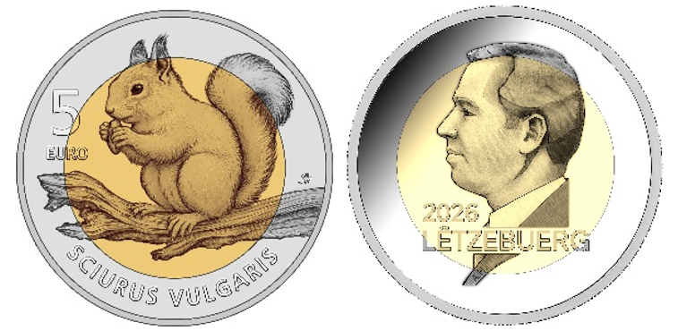

# Règlement grand-ducal du 3 mars 2026 concernant l’émission d’une pièce de collection dédiée à l’écureuil.

Nous Guillaume, Grand-Duc de Luxembourg, Duc de Nassau,

Vu l’article 45, paragraphe 3, de la [Constitution](https://legilux.public.lu/eli/etat/leg/constitution/1868/10/17/n1/consolide/20230701) ;

Vu le [règlement (UE) n° 651/2012](https://legilux.public.lu/eli/reg_ue/2012/651/jo) du Parlement européen et du Conseil du 4 juillet 2012 concernant l’émission de pièces en euros, et notamment son article 5 ;

Le Conseil d’État entendu ;

Sur le rapport du Ministre des Finances, et après délibération du Gouvernement en conseil ;

Arrêtons :

## Art. 1er.

Il sera émis au nom et pour compte du Trésor une pièce de collection en argent et en or nordique, telle qu’illustrée à l’annexe.

## Art. 2.

Cette pièce présente les caractéristiques suivantes :

1° le centre de la pièce est en or nordique de couleur jaune, entouré d’un anneau en argent ;

2° l’avers de la pièce représente en son centre un écureuil posé sur la branche d’un arbre. La partie inférieure de l’anneau reprend l’inscription « SCIURUS VULGARIS ». La partie supérieure gauche de la pièce porte la mention de la valeur faciale « 5 EURO » ;

3° le revers de la pièce porte Notre portrait, l’indication « LËTZEBUERG » et le millésime « 2026 » ;

4° elle est frappée en qualité « proof » et a la tranche lisse. Elle a un diamètre de 34 millimètres et son poids total de 14,93 grammes comprend 9 grammes d’argent au titre de 0,925 et 5,93 grammes d’or nordique.

## Art. 3.

Cette pièce a cours légal à partir du 1er mai 2026 pour sa valeur faciale de 5 euros.

## Art. 4.

Le ministre ayant les Finances dans ses attributions est chargé de l’exécution du présent règlement qui sera publié au Journal officiel du Grand-Duché de Luxembourg.

Le Ministre des Finances,   Gilles Roth

Fait le 3 mars 2026.   Guillaume

\**Annexe**

