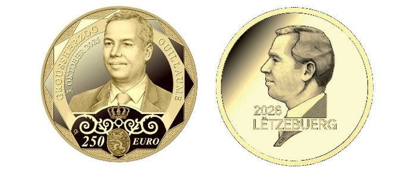
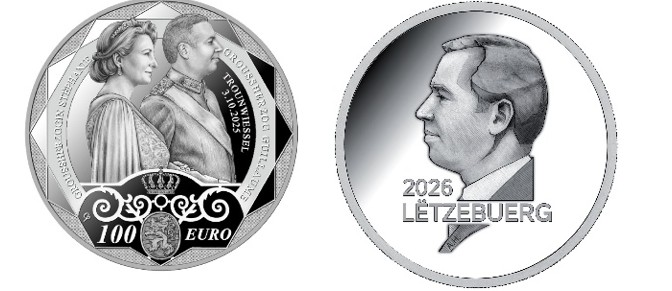
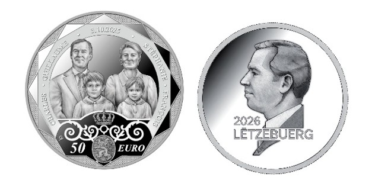
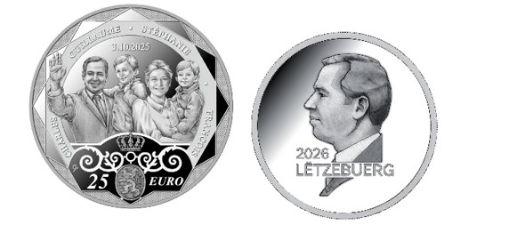

# Règlement grand-ducal du 27 avril 2026 concernant l’émission de quatre pièces de collection dédiées à l’accession au trône du Grand-Duc Guillaume.

Nous Guillaume, Grand-Duc de Luxembourg, Duc de Nassau,

Vu l’article 45, paragraphe 3, de la [Constitution](https://legilux.public.lu/eli/etat/leg/constitution/1868/10/17/n1/consolide/20230701) ;

Vu le [règlement (UE) n° 651/2012](https://legilux.public.lu/eli/reg_ue/2012/651/jo) du Parlement européen et du Conseil du 4 juillet 2012 concernant l’émission de pièces en euros, et notamment son article 5 ;

Le Conseil d’État entendu ;

Sur le rapport du Ministre des Finances, et après délibération du Gouvernement en conseil ;

Arrêtons :

## Art. 1er.

Il sera émis au nom et pour compte du Trésor quatre pièces de collection frappées en quatre métaux précieux différents, telles qu’illustrées à l’annexe.

## Art. 2.

La pièce frappée en or présente les caractéristiques suivantes :

1° l’avers de la pièce représente en son centre l’effigie du Grand-Duc de profil à gauche et entourée partiellement d’un cercle présentant à gauche l’inscription « GROUSSHERZOG » et à droite l’inscription « GUILLAUME ». La ligne extérieure de ce cercle est dessinée sous forme dodécagonale débouchant vers l’extérieur en douze triangles symbolisant un cadran horaire. La partie inférieure reprend une partie de l’ornement du balcon du Palais grand-ducal superposé par une couronne et présentant en bas un écusson avec le lion luxembourgeois. La valeur faciale « 250 » « EURO » est mentionnée de part et d’autre de cet écusson. La date de l’accession au trône « 3. OKTOBER 2025 » est inscrite sous forme semi-circulaire à gauche de l’effigie ;

2° le revers de la pièce porte Notre portrait, l’indication « LËTZEBUERG » et le millésime « 2026 » ;

3° elle est frappée en qualité « proof » et a la tranche lisse. Elle a un diamètre de 37 millimètres et son poids total est de 31,10 grammes d’or au titre de 0,999.

## Art. 3.

La pièce frappée en platine présente les caractéristiques suivantes :

1° l’avers de la pièce représente en son centre les effigies du couple grand-ducal de profil à droite et entourées partiellement d’un cercle présentant à gauche l’inscription « GROUSSHERZOGIN STÉPHANIE » et à droite l’inscription « GROUSSHERZOG GUILLAUME ». La ligne extérieure de ce cercle est dessinée sous forme dodécagonale débouchant vers l’extérieur en douze triangles symbolisant un cadran horaire. La partie inférieure reprend une partie de l’ornement du balcon du Palais grand-ducal superposé par une couronne et présentant en bas un écusson avec le lion luxembourgeois. La valeur faciale « 100 » « EURO » est mentionnée de part et d’autre de cet écusson. Le thème de la pièce « TROUNWIESSEL » et la date « 3.10.2025 » sont inscrits sous forme semi-circulaire à droite ;

2° le revers de la pièce porte Notre portrait, l’indication « LËTZEBUERG » et le millésime « 2026 » ;

3° elle est frappée en qualité « proof » et a la tranche lisse. Elle a un diamètre de 37 millimètres et son poids total est de 31,10 grammes de platine au titre de 0,999.

## Art. 4.

La pièce frappée en palladium présente les caractéristiques suivantes :

1° l’avers de la pièce représente en son centre les effigies de la famille grand-ducale. Le Prince Charles se trouve devant le Grand-Duc, tandis que le Prince François est représenté devant la Grande-Duchesse. Leurs Altesses Royales sont entourées partiellement d’un cercle présentant en bas à gauche l’inscription « CHARLES », en haut à gauche l’inscription « GUILLAUME » suivie de l’indication de la date « 3.10.2025 », puis en haut à droite l’inscription « STÉPHANIE » et en bas à droite l’inscription « FRANÇOIS ». La ligne extérieure de ce cercle est dessinée sous forme dodécagonale débouchant vers l’extérieur en douze triangles symbolisant un cadran horaire. La partie inférieure reprend une partie de l’ornement du balcon du Palais grand-ducal superposé par une couronne et présentant en bas un écusson avec le lion luxembourgeois. La valeur faciale « 50 » « EURO » est mentionnée de part et d’autre de cet écusson ;

2° le revers de la pièce porte Notre portrait, l’indication « LËTZEBUERG » et le millésime « 2026 » ;

3° elle est frappée en qualité « proof » et a la tranche lisse. Elle a un diamètre de 37 millimètres et son poids total est de 31,10 grammes de palladium au titre de 0,999.

## Art. 5.

La pièce frappée en argent présente les caractéristiques suivantes :

1° l’avers de la pièce représente en son centre la famille grand-ducale. Le Prince Charles est porté sur les bras du Grand-Duc tandis que le Prince François est sur les bras de la Grande-Duchesse. Leurs Altesses Royales sont entourées partiellement d’un cercle présentant en bas à gauche l’inscription « CHARLES », en haut à gauche l’inscription « GUILLAUME » suivie de l’inscription en haut à droite « STÉPHANIE » et en bas à droite l’inscription « FRANÇOIS ». La ligne extérieure de ce cercle est dessinée sous forme dodécagonale débouchant vers l’extérieur en douze triangles symbolisant un cadran horaire. La partie inférieure reprend une partie de l’ornement du balcon du Palais grand-ducal superposé par une couronne et présentant en bas un écusson avec le lion luxembourgeois. La valeur faciale « 25 » « EURO » est mentionnée de part et d’autre de cet écusson. La date de l’accession au trône « 3.10.2025 » est inscrite au-dessus des effigies ;

2° le revers de la pièce porte Notre portrait, l’indication « LËTZEBUERG » et le millésime « 2026 » ;

3° elle est frappée en qualité « proof » et a la tranche lisse. Elle a un diamètre de 34 millimètres et son poids total est de 31,10 grammes d’argent au titre de 0,999.

## Art. 6.

(1) La pièce frappée en or a cours légal à partir du 1er juin 2026 pour sa valeur faciale de 250 euros.

(2) La pièce frappée en platine a cours légal à partir du 1er juin 2026 pour sa valeur faciale de 100 euros.

(3) La pièce frappée en palladium a cours légal à partir du 1er juin 2026 pour sa valeur faciale de 50 euros.

(4) La pièce frappée en argent a cours légal à partir du 1er juin 2026 pour sa valeur faciale de 25 euros.

## Art. 7.

Le ministre ayant les Finances dans ses attributions est chargé de l’exécution du présent règlement qui sera publié au Journal officiel du Grand-Duché de Luxembourg.

Le Ministre des Finances,   Gilles Roth

Fait le 27 avril 2026.   Guillaume

\**Annexe**

Illustration de la pièce frappée en or :

Illustration de la pièce frappée en platine :

Illustration de la pièce frappée en palladium :

Illustration de la pièce frappée en argent :

