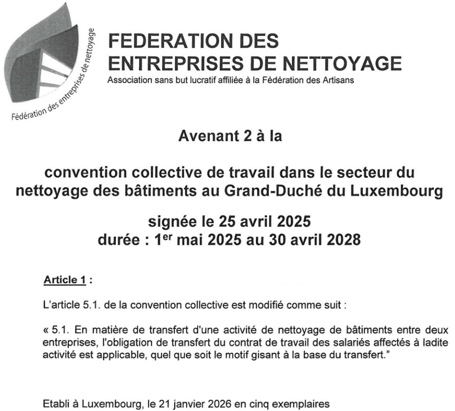
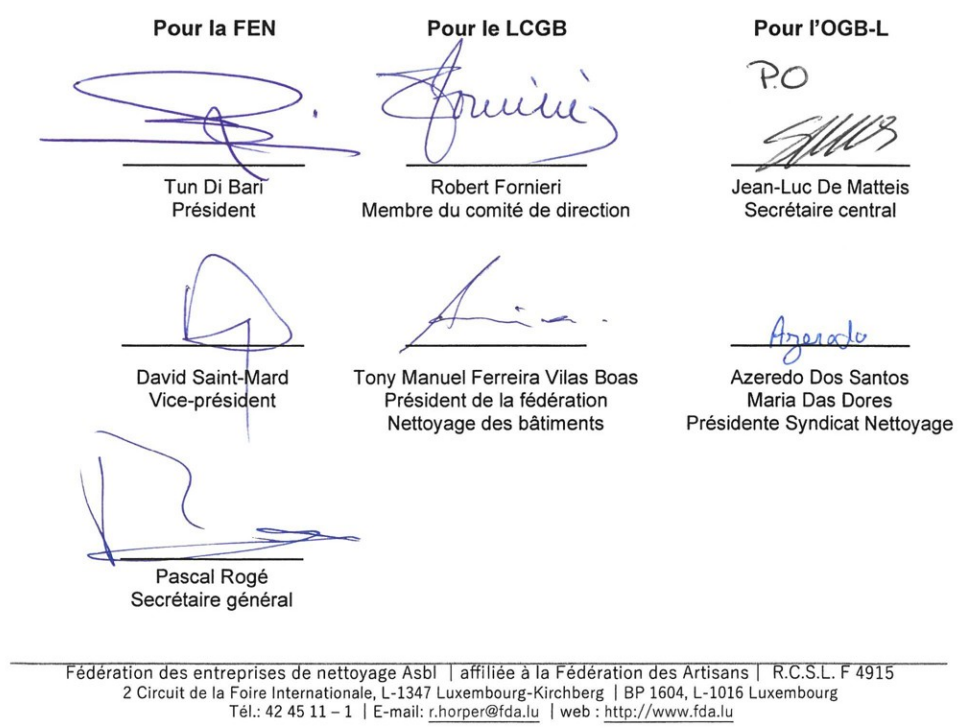

# Règlement grand-ducal du 11 mai 2026 portant déclaration d’obligation générale de l’Avenant 2 à la Convention collective de travail dans le secteur du nettoyage des bâtiments 2025-2028, signé le 21 janvier 2026.

Nous Guillaume, Grand-Duc de Luxembourg, Duc de Nassau,

Vu l’article L. 164-8 du [Code du travail](https://legilux.public.lu/eli/etat/leg/code/travail) ;

Vu la demande de déclaration d’obligation générale du 13 février 2026 de l’Avenant 2 à la Convention collective de travail dans le secteur du nettoyage des bâtiments 2025-2028, signé le 21 janvier 2026 ;

Sur proposition conjointe des deux groupes d’assesseurs de la commission paritaire de l’Office national de conciliation ;

Vu les avis de la Chambre de commerce et de la Chambre des salariés ;

Les avis de la Chambre des métiers, de la Chambre des fonctionnaires et employés publics et de la Chambre d’agriculture ayant été demandés ;

Le Conseil d’État entendu ;

Sur le rapport du Ministre du Travail, et après délibération du Gouvernement en conseil ;

Arrêtons :

## Art. 1er.

L’Avenant 2 à la Convention collective de travail dans le secteur du nettoyage des bâtiments 2025-2028, signé le 21 janvier 2026, entre la Fédération des entreprises de nettoyage a.s.b.l., d’une part, et la Confédération syndicale indépendante du Luxembourg, Onofhängege Gewerkschaftsbond Lëtzebuerg (OGBL) et la Confédération luxembourgeoise des syndicats chrétiens, Lëtzebuerger Chrëschtleche Gewerkschaftsbond (LCGB), d’autre part, annexé au présent règlement, est déclaré d’obligation générale pour tout le secteur.

## Art. 2.

Le ministre ayant le Travail dans ses attributions est chargé de l’exécution du présent règlement qui sera publié au Journal officiel du Grand-Duché de Luxembourg.

Le Ministre du Travail,   Marc Spautz

Fait le 11 mai 2026.   Guillaume

